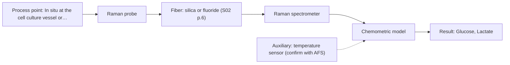
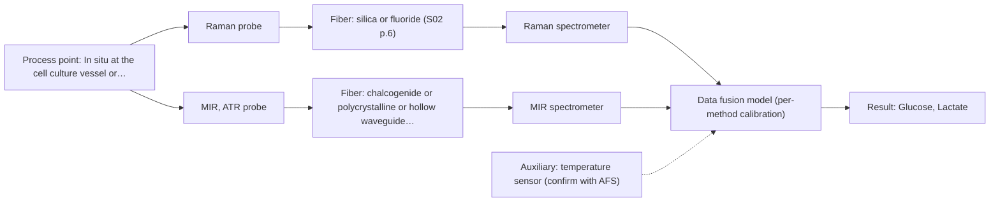

# First technical assessment: Glucose and lactate trends in an aqueous bioprocess

**Customer enquiry**

> We run a cell culture process in an aqueous medium. Glucose and lactate are measured from samples, and the delay makes it difficult to see changes promptly. We are exploring an in situ spectroscopy pilot that can be checked against those existing laboratory measurements. The medium and cell population change during the run; we have not yet selected a probe or a calibration strategy.

## Brief answer

Test Raman first as a single in situ method for glucose and lactate in the aqueous cell culture, with your existing laboratory assays as the reference. MIR ATR is a reasonable single-method comparison. NIR transmission/transflection is conditional on a clear, low-optical-density medium. Before committing, we need the concentration ranges, required accuracy and response time, optical density/turbidity, and any fluorescence background; these decide whether a single method is enough or a combined Raman+MIR option is worth testing.

## Proposal

- **Best current option:** O2 (recommended): R1 Raman probe
- **Basis:** supplied AFS sources
- **What would change it:** Answers on glucose/lactate ranges, required accuracy and response time, optical density/turbidity, fluorescence background, and reference-method quality. If the medium stays clear and low-OD, NIR transmission/transflection could become the simple option; if one method cannot meet the targets, the extended Raman+MIR ATR option becomes worth testing.
- **Next step:** Run a single-method feasibility trial on representative cell culture samples, starting with Raman and the existing laboratory glucose/lactate reference, and measure optical density/turbidity and cell density to decide the NIR geometry.

**Decision status:** Provisional feasibility assessment. A single-method shortlist can be justified from the supplied sources, but the customer's concentration ranges, required accuracy, optical regime and fluorescence background are still unknown.

## Parameters

| ID | Parameter | Kind | Need | Measured by | Why | Sources |
|---|---|---|---|---|---|---|
| P1 | Glucose | quantitative | required | Spectroscopy: Raman | Primary target analyte; the pilot must track it against the existing laboratory measurements. | [1: S01 p.16] |
| P2 | Lactate | quantitative | required | Spectroscopy: Raman | Primary target analyte; the pilot must track it against the existing laboratory measurements. | [2: S01 p.16] |
| P3 | Cell density / viability | quantitative | optional | Reference lab method: cell count and viability (offline) | The cell population changes during the run and affects scattering and the sample matrix, so it should be available to interpret spectra and build a representative calibration. | [3: S01 p.16] [4: REF §5] |
| P4 | Optical density / turbidity | quantitative | required | Reference lab method: optical density or turbidity measurement | Decides whether NIR transmission/transflection is feasible or whether a scattering/ATR geometry is needed; it also indicates how the optical regime changes during the run. | [5: S01 p.18] |
| P5 | Temperature | quantitative | optional | Auxiliary sensor: temperature sensor (engineering judgement: confirm availability with AFS) | Temperature should be available because it affects the process and can shift spectral baselines; it is useful for calibration and for comparing in situ spectra with laboratory reference measurements. | *(no verified source: engineering judgement)* |

## Solution options

| ID | Tier | Methods | Cost class, S01 Table 1 (p.6) | Ease of use | Maintenance | Performance fit | Sources |
|---|---|---|---|---|---|---|---|
| O1 | Simple | R2 MIR, ATR probe | high (row 2) | Contact probe; no pathlength adjustment. | ATR crystal cleaning and fouling checks. | High molecular selectivity; water and contact are the main limits. | [6: S01 p.9] |
| O2 | Recommended | R1 Raman probe | high (row 12) | Fiber probe; laser safety and fluorescence background to manage. | Probe cleaning; laser and filter checks. | Best fit for aqueous glucose/lactate; requires matrix-specific calibration. | [7: S01 p.16] |
| O3 | Extended (multi-method) | R1 Raman probe; R2 MIR, ATR probe | high (rows 2, 12) | More complex: two instruments and aligned sampling. | Two calibrations and two sets of diagnostics. | Only worth it if single methods cannot meet targets. | [8: S01 p.8] [9: S01 p.8] [10: S01 p.8] [11: REF §5] |

*Cost class is the relative rating in S01 Table 1 (p.6) for the in-line method+technique rows named (the highest one for a multi-method option); it is not a price.*

- **O1 cost drivers:** MIR spectrometer, mid-IR fiber probe, ATR crystal, cleaning and calibration effort.
- **O2 cost drivers:** Raman spectrometer, laser, Raman fiber probe, chemometric model development.
- **O3 cost drivers:** Two spectrometers, combined or aligned probes, data fusion, synchronisation, and dual calibration.
- **O3 combining methods:** Fusion level: start with one model per method, then fuse joined spectra or variables with block scaling, or combine per-method scores; variables from different methods are not equivalent and methods with more variables can dominate. Same spot: use a combined MIR-ATR/Raman probe or aligned same-area sampling. Synchronisation: align acquisition rates to a common time step and account for dead time. Per-method calibration: each method needs its own calibration and diagnostics. Must beat the best single method: validate on independent runs and show the fused model is better than the best single method.

## Setup sketch

*Recommended option O2; drawn by code from the option, a schematic, not a configuration.*

*Extended (multi-method) option O3; drawn by code from the option, a schematic, not a configuration.*

## Premise check

- **Not covered:** The existing laboratory measurements are suitable as a reference for checking the in situ spectroscopy pilot. The supplied material says a feasibility plan needs independent reference measurements, but it gives no criteria for judging the customer's existing laboratory method. [12: REF §3]
- **Supported:** The delay of the current sample measurements is a problem that in situ spectroscopy can address promptly. The sources state that fiber probes can be integrated into reactors and production lines and can give results in near real time. [13: S01 p.2]
- **Not covered:** The changing medium and cell population can be accommodated by the pilot. No supplied source says a single calibration can accommodate a changing medium and cell population. The sources warn that calibrations are matrix-specific, so this must be tested with representative samples. [14: REF §5]

## Requirements

**Stated by the customer**

**Key unknowns**

- Target concentration ranges for glucose and lactate.
- Required accuracy, precision, and response time or update interval.
- Optical density/turbidity of the medium and cell suspension over the run.
- Medium composition changes and cell density/viability profile.
- Existing laboratory reference method, sampling frequency, and uncertainty.
- Fluorescence background from the medium and cells, and whether any fluorescent indicator is present.

## Clarification questions (most decision-relevant first)

Q1. What are the expected glucose and lactate concentration ranges, and what accuracy, precision and response time are required? *Why it matters:* These numbers decide whether a single method is sufficient and set the go/no-go basis. *(affects: method, technique, calibration, status)*
Q2. What is the optical density or turbidity of the medium and cell suspension over the run, and does it remain clear or become highly scattering? *Why it matters:* This decides whether NIR transmission/transflection is feasible or whether a scattering geometry or MIR ATR is needed. *(affects: method, technique, installation)*
Q3. Which laboratory method is used for the glucose and lactate reference, and what are its sampling frequency and uncertainty? *Why it matters:* The existing reference must be suitable for validating the in situ pilot. *(affects: status, calibration)*
Q4. Are there fluorescent species or a fluorescent indicator in the medium or cells? *Why it matters:* Fluorescence can interfere with Raman and is needed to judge whether fluorescence spectroscopy is relevant. *(affects: method, technique)*
Q5. What are the installation conditions: temperature, cleaning/sterilisation, probe contact with cells, and distance from the spectrometer? *Why it matters:* These determine the probe and fiber choices and whether contact techniques such as ATR are acceptable. *(affects: installation, technique)*

## Recommendation

- **R1 · Primary candidate: Raman probe.** Raman is the single method to test first for glucose and lactate in an aqueous cell culture: it is well suited to water and has literature precedent for direct detection of glucose and lactate in bioprocess monitoring. *Conditions:* Use a Raman fiber probe and state the laser excitation wavelength separately from the Raman shift. Check the real medium and cells for fluorescence background. Confirm any result against the existing laboratory reference. [15: S01 p.16] [16: S01 p.16] [17: S01 p.11]
- **R2 · Comparison candidate: MIR, ATR probe.** MIR ATR is a reasonable single-method comparison because it is highly informative and ATR gives a thin measurement layer for aqueous liquids. It provides vibrational information complementary to Raman. *Conditions:* Requires tight contact with the ATR crystal and is suited to liquid or soft solid samples. Check fouling and water absorption. The usable MIR range depends on the fiber, crystal and spectrometer selected. [18: S01 p.9] [19: S01 p.5] [20: S01 p.11]
- **R3 · Conditional candidate: NIR, transmission/transflection probe.** NIR is worth testing only if the aqueous medium and cell suspension remain transparent or semi-transparent enough for transmission/transflection. NIR can track glucose in the millimolar range, but transmission fails when the sample becomes too thick, opaque or scattering. *Conditions:* Decide from measured optical density/turbidity over the run. If the medium becomes turbid or highly scattering, test NIR diffuse reflection or rely on the single-method Raman/MIR comparison instead. The usable NIR range depends on instrument, fiber and probe. [21: S01 p.16] [22: S01 p.18] [23: S01 p.18]

## Measurement concept

- **Probe and geometry:** Start with a single-method fiber probe: Raman first; MIR ATR as a contact comparison; NIR transmission/transflection only if the medium stays clear. A combined MIR-ATR/Raman probe is a later option if single methods are insufficient.
- **Location:** In situ at the cell culture vessel or process line, with the spectrometer remotely connected by fiber.
- **Fiber link:** The fiber family must match the method range. Silica fibers are used for Raman and NIR; MIR needs chalcogenide or polycrystalline infrared fibers. Exact link length is not stated in the sources and must be confirmed. [24: S01 p.5] [25: S02 p.6] [26: S02 p.6]

## Spectral range

- **Raman:** Raman is reported as Raman shift in cm-1, with the laser excitation wavelength stated separately. The exact excitation wavelength for this cell culture must be chosen and tested. [27: S01 p.11]
- **MIR:** Nominal MIR range is 4000-400 cm-1 (2.5-25 μm). The usable range depends on the fiber, ATR crystal and spectrometer actually selected. [28: S01 p.9] [29: REF §5]
- **NIR:** Nominal NIR range is 780-2500 nm. The usable range depends on the instrument, fiber and probe actually selected. [30: S01 p.10] [31: REF §5]

## Risks and uncertainty

- Raman signal may be swamped by fluorescence from the medium or cells; this must be checked on real samples. *(rules: R-RAM-1)* [32: S01 p.11]
- Calibration may not hold as the medium and cell population change; matrix-specific calibration and validation on held-out runs are required. *(rules: R-CAL-1)* [33: REF §5]
- The conditional NIR transmission/transflection option may fail if the medium becomes turbid or highly scattering. *(rules: R-GEO-2, R-GEO-3)* [34: S01 p.18]
- MIR ATR may suffer fouling or contact issues, and water absorbs strongly in the infrared; the ATR crystal must maintain tight contact and be cleaned. *(rules: R-MIR-2, R-MIR-3, R-GEN-3)* [35: S04 p.4] [36: S01 p.5]

## First feasibility experiment

1. **Collect representative cell culture samples across the expected glucose/lactate ranges, cell densities and medium states, and measure each with the existing laboratory glucose/lactate reference.** Establish a representative reference set across the expected chemical and physical variation. [37: REF §3]
2. **Run single-method in situ trials first, starting with Raman. Compare Raman and MIR ATR, and test NIR transmission/transflection only if the medium is clear, against the reference on the same samples or process states.** Test single methods before any combination. [38: REF §5]
3. **Build per-method chemometric models for glucose and lactate and validate them on held-out runs or batches, not on the calibration samples.** Check that the calibration transfers to new process runs. [39: REF §5]
4. **Only if no single method meets the customer's criteria, test the combined Raman + MIR ATR option with aligned same-spot sampling and synchronised data.** Keep the combination as a later hypothesis after the single-method tests. [40: REF §5]
5. **Go/no-go: use the customer's numerical limits for accuracy, precision, response time and robustness. Stop if a single method meets them; otherwise decide on the combination or further method work.** Make the decision basis explicit and customer-owned. [41: REF §3]

**Reference measurements:** Use the existing laboratory glucose and lactate measurements as the independent reference, but first confirm their method, sampling frequency and uncertainty.

**Decision basis:** Customer-defined numerical criteria for accuracy, precision, response time and robustness.

## Assumptions

- The existing laboratory glucose and lactate measurements are accurate enough to serve as the reference; this must be confirmed.
- The cell culture medium and cell population can be represented in a calibration set; this must be tested.
- The process allows an in situ fiber probe installation with acceptable cleaning and sterility; this must be confirmed.

## Not covered by the supplied sources

- The supplied material does not cover this customer's specific cell culture medium, cell type, glucose/lactate concentration ranges, required accuracy or response time, installation/sterilisation constraints, or regulatory validation requirements.

## Further notes

- **Chemometrics:** Calibration is matrix-specific: build per-method models for glucose and lactate against the existing laboratory reference, and validate on held-out runs or batches. The changing medium and cell population must be represented in the calibration set; fluorescence background and scattering should be checked before modelling.
- **Real-time tracking:** In situ fiber probes can provide near-real-time results, which addresses the sampling delay. The actual update interval depends on spectral acquisition and chemometric computation and is not specified by the sources.
- **Future direction:** If the single-method pilot works, a customized multi-spectral fiber system or compact sensor could be considered later for the specific cell culture application.

## Evidence (verified quotes)

1. ✓ **S01 p.16** (application precedent): "Raman spectroscopy can be used in the same reactor to provide a "molecular fingerprint" for direct detection of specific metabolites like glucose, acetate, or lactate."
2. ✓ **S01 p.16** (application precedent): "Raman spectroscopy can be used in the same reactor to provide a "molecular fingerprint" for direct detection of specific metabolites like glucose, acetate, or lactate."
3. ✓ **S01 p.16** (general): "cell suspension turbidity correlates well with cell density."
4. ✓ **REF §5** (general): "optical density is not a viable cell count."
5. ✓ **S01 p.18** (general): "it fails when the milk becomes too "thick" or fat-rich, as the light cannot penetrate the sample."
6. ✓ **S01 p.9** (general): "Vibrational spectroscopy in the mid-IR range (4000-400 cm-1) is one of the most informative methods of chemical analysis."
7. ✓ **S01 p.16** (general): "Raman is particularly well-suited for aqueous environments, as it exhibits low absorbance for water molecules compared to infrared methods."
8. ✓ **S01 p.8** (general): "It is crucial that the spectral information obtained by different methods-Mid-IR, NIR, Raman, and fluorescence spectra-is collected from the same small, even pinpoint, area of the sample."
9. ✓ **S01 p.8** (general): "data synchronization can be challenging, as the acquisition rates of different spectra can vary greatly-from milliseconds to minutes"
10. ✓ **S01 p.8** (general): "Variables obtained from different spectral methods are not equivalent."
11. ✓ **REF §5** (general): "compare with the best single method."
12. ✓ **REF §3** (general): "Representative samples or process states, independent reference measurements, what is compared, and the basis for the go / no-go decision."
13. ✓ **S01 p.2** (general): "enabling on-site online analysis and obtaining results in near real time."
14. ✓ **REF §5** (general): "calibration specific to the matrix."
15. ✓ **S01 p.16** (general): "Raman is particularly well-suited for aqueous environments, as it exhibits low absorbance for water molecules compared to infrared methods."
16. ✓ **S01 p.16** (application precedent): "Raman spectroscopy can be used in the same reactor to provide a "molecular fingerprint" for direct detection of specific metabolites like glucose, acetate, or lactate."
17. ✓ **S01 p.11** (general): "The Raman shift is used as the horizontal (spectral) axis in Raman spectroscopy"
18. ✓ **S01 p.9** (general): "Vibrational spectroscopy in the mid-IR range (4000-400 cm-1) is one of the most informative methods of chemical analysis."
19. ✓ **S01 p.5** (general): "strong absorption in the mid-IR region limits the corresponding spectral method to the analysis of very thin samples (usually less than 50 μm), but it opens up the possibility of using attenuated total reflectance (ATR)"
20. ✓ **S01 p.11** (general): "This property makes mid-IR and Raman spectra complementary, that is, they complement each other."
21. ✓ **S01 p.16** (application precedent): "NIR spectroscopy is effective for tracking major components like glucose or glycerol in the millimolar range but may lack the sensitivity to detect trace compounds below 0.1 percent."
22. ✓ **S01 p.18** (general): "Transmission is the preferred method for transparent or semi-transparent liquids, such as skim milk, whey, or permeate."
23. ✓ **S01 p.18** (general): "it fails when the milk becomes too "thick" or fat-rich, as the light cannot penetrate the sample."
24. ✓ **S01 p.5** (general): "making it ideal for online applications, including remote measurements via fiber optic probes."
25. ✓ **S02 p.6** (general): "1100 nm Chalcogenide As-S IR Fibers 6500 nm"
26. ✓ **S02 p.6** (general): "3000 nm Polycrystalline Infrared Fibers 17 μm"
27. ✓ **S01 p.11** (general): "The Raman shift is used as the horizontal (spectral) axis in Raman spectroscopy"
28. ✓ **S01 p.9** (general): "Vibrational spectroscopy in the mid-IR range (4000-400 cm-1) is one of the most informative methods of chemical analysis."
29. ✓ **REF §5** (general): "It is not a product specification: actual spectral coverage, fiber length, component ratings, detection limits and accuracy depend on the configuration and the sample."
30. ✓ **S01 p.10** (general): "NIR spectra (780-2500 nm) contain predominantly overtones and component bands of fundamental vibrations"
31. ✓ **REF §5** (general): "It is not a product specification: actual spectral coverage, fiber length, component ratings, detection limits and accuracy depend on the configuration and the sample."
32. ✓ **S01 p.11** (general): "superposition of luminescence (fluorescence), which has a significantly higher intensity."
33. ✓ **REF §5** (general): "calibration specific to the matrix."
34. ✓ **S01 p.18** (general): "it fails when the milk becomes too "thick" or fat-rich, as the light cannot penetrate the sample."
35. ✓ **S04 p.4** (general): "suitability of analyzed samples for ATR measurements, which is true for liquid or soft solid samples and their components, allowing a tight contact with the probe head."
36. ✓ **S01 p.5** (general): "strong absorption in the mid-IR region limits the corresponding spectral method to the analysis of very thin samples (usually less than 50 μm), but it opens up the possibility of using attenuated total reflectance (ATR)"
37. ✓ **REF §3** (general): "Representative samples or process states, independent reference measurements, what is compared, and the basis for the go / no-go decision."
38. ✓ **REF §5** (general): "compare with the best single method."
39. ✓ **REF §5** (general): "calibration specific to the matrix."
40. ✓ **REF §5** (general): "compare with the best single method."
41. ✓ **REF §3** (general): "Representative samples or process states, independent reference measurements, what is compared, and the basis for the go / no-go decision."

## Verification

- Citations verified: 41 of 41 (exact or whitespace/hyphen-tolerant match on the cited page, scope checked).
- Hard check failures before deterministic corrections: 0; still open: 0; soft warnings: 0; repair rounds: 0.

*Run D04-20261017T121204Z · models deepseek/deepseek-v4.1-flash · cost $0.0176*
