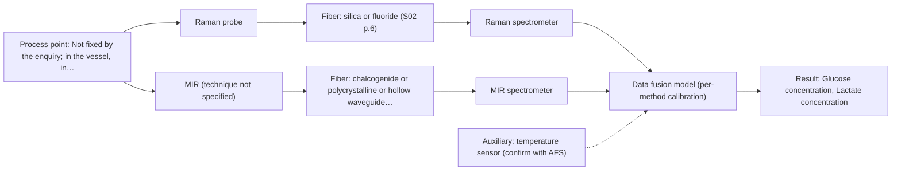

# First technical assessment: Glucose and lactate trends in an aqueous bioprocess

## Answer

**Customer request (our summary):** A cell culture process in aqueous medium wants to move glucose and lactate measurement from delayed sample-based laboratory analysis towards an in situ spectroscopy pilot, with the existing laboratory measurements used as the comparison. The medium and cell population change during the run, and no probe or calibration strategy has been chosen.

### Brief answer

Test Raman first as a single in-situ method: it suits an aqueous medium and is reported to give a molecular fingerprint for glucose and lactate. A mid-IR ATR probe is the natural single-method comparison. Still open: the concentration range and required accuracy, the medium's optical behaviour, the probe location, and what counts as agreement with the laboratory values. A combined Raman + ATR model is a later hypothesis only.

### Proposal

- **Best current option:** O2 (recommended)
- **Basis:** supplied AFS sources
- **What would change it:** Answers on the glucose and lactate range, the required accuracy and the medium's optical density could change the choice: a strongly scattering, high-cell-density medium would favour MIR-ATR or the combined option, while a clear, low-scattering medium would bring NIR transmission or reflection back into the shortlist. A strong fluorescence background on real samples would move the choice away from Raman.
- **Next step:** Run the first feasibility experiment on representative process samples and compare the in-situ predictions with the existing laboratory glucose and lactate values.

**Secondary evidence (external, not AFS material):** G1: E03 ¶12; G2: E01 ¶33, E01 ¶82; G3: no usable external source found; G4: E05 ¶1. See Expert detail.

**Decision status:** Provisional feasibility assessment

### Solution options

| ID | Tier | Methods | Confidence | Cost class, S01 Table 1 (p.6) | Ease of use | Maintenance | Performance fit | Sources |
|---|---|---|---|---|---|---|---|---|
| O1 | Simple | M2 MIR, ATR probe | High | high cost (row 2) | single contact probe, familiar ATR handling | crystal cleaning and fouling checks | well-defined mid-IR bands for both targets | [1: S01 p.10] [2: S01 p.9] [3: S01 p.5] |
| O2 | Recommended | M1 Raman probe | High | high cost (row 12) | one probe on a silica fiber link | laser and probe optics checks | aqueous-friendly, fingerprints glucose and lactate | [4: S01 p.16] [5: S01 p.16] |
| O3 | Extended (multi-method) | M3 Raman probe + MIR (combination) | Medium: multi-method, fusion benefit not yet shown | high cost (rows 2, 12) | two instruments, synchronised acquisition needed | two calibrations and two diagnostics | complementary bands; only if single methods fall short | [6: S01 p.7] [7: S01 p.11] [8: S01 p.8] [9: S01 p.8] [10: S02 p.16] |

*Confidence rates the basis of the advice (how much is known and cited), not a predicted accuracy or probability of success. It starts at High, or at Medium when a key question on the method or the option is open, and drops one level per weakness listed (floor Low).*

*Cost class is the relative rating in S01 Table 1 (p.6) for the in-line method+technique rows named (the highest one for a multi-method option); it is not a price.*

### Setup sketch

*Recommended option O2; drawn by code from the option, a schematic, not a configuration.*

## Expert detail

**Customer enquiry**

> We run a cell culture process in an aqueous medium. Glucose and lactate are measured from samples, and the delay makes it difficult to see changes promptly. We are exploring an in situ spectroscopy pilot that can be checked against those existing laboratory measurements. The medium and cell population change during the run; we have not yet selected a probe or a calibration strategy.

**Decision status:** Provisional feasibility assessment. The sources support a single-method shortlist for an aqueous glucose and lactate measurement, but the concentration range, required performance, optical regime and installation point are not yet known, so the choice between Raman and MIR-ATR stays provisional. The premise that a pilot is workable rests on published precedents, and the supplied material does not say what agreement with the laboratory values would establish.

### Parameters

| ID | Parameter | Kind | Need | Measured by | Why | Sources |
|---|---|---|---|---|---|---|
| P1 | Glucose concentration | quantitative | required | Spectroscopy: Raman | It is one of the two target analytes and the quantity the pilot must track promptly. | [5: S01 p.16] |
| P2 | Lactate concentration | quantitative | required | Spectroscopy: Raman | It is the second target analyte and is currently obtained with a delay from samples. | [5: S01 p.16] |
| P3 | Viable cell density | quantitative | required | Reference lab method: viable cell count by the existing laboratory method | The cell population changes during the run and is the main scattering matrix variation the calibration must remain valid across. | [11: S01 p.7] |
| P4 | Temperature at the measurement point | quantitative | optional | Auxiliary sensor: temperature sensor (engineering judgement: confirm availability with AFS) | It is needed to interpret the spectra and to keep the calibration valid over the run, and it should already be available from the reactor's process control. | *(no verified source: engineering judgement)* |

### Solution option details

- **O1 cost drivers:** one ATR probe and one mid-IR spectrometer; MIR fiber run length unresolved
- **O2 cost drivers:** one Raman probe, laser and spectrometer; reference laboratory comparison
- **O3 cost drivers:** two spectrometers, combined probe, synchronisation and fused-model work
- **O3 combining methods:** Start with one model per method as the baseline, then fuse the synchronised Raman and mid-IR blocks, scaled so that neither method dominates the joined model. The two probes must look at the same measurement point, and the two data streams must be normalised to a common time step before fusion, with each method keeping its own calibration and diagnostics. Keep the fused model only if it beats the best single method on held-out runs or batches.

*Extended (multi-method) option O3; drawn by code from the option, a schematic, not a configuration.*

### Premise check

- **Precedent only:** An in situ spectroscopy pilot is a workable route for prompt glucose and lactate monitoring in this process. The sources report fiber-probe monitoring in bioreactors as literature examples, including Raman for metabolites in the same reactor, which is a reason to test the method here but not proof for this process. [5: S01 p.16] [4: S01 p.16]
- **Supported:** The sampling delay is the limitation that an in situ measurement would remove. In-process measurement without sampling is described as removing delays and the risk of sample contamination. [12: S01 p.3]
- **Not covered:** Agreement with the existing laboratory measurements would establish the in situ pilot as fit for the purpose. No supplied source states what agreement with laboratory values would establish, or which tolerance would count as a match. *(no verified source: engineering judgement)*

### Requirements

**Stated by the customer**

- "We run a cell culture process"
- "in an aqueous medium"
- "Glucose and lactate are measured from samples"
- "the delay makes it difficult to see changes promptly"
- "We are exploring an in situ spectroscopy pilot"
- "can be checked against those existing laboratory measurements"
- "The medium and cell population change during the run"
- "we have not yet selected a probe or a calibration strategy"

**Key unknowns**

- Glucose and lactate concentration ranges to be covered
- Required accuracy, precision and response time of the in situ measurement
- Optical behaviour of the medium at process conditions (turbidity, cell scattering, bubbles, foaming)
- Installation point, distance between probe and spectrometer, and cleaning or sterilisation requirements
- The reference laboratory method and the tolerance that counts as agreement
- Fluorescence background of the medium under the intended Raman excitation

### Clarification questions (most decision-relevant first)

### Recommendation

- **M1 · Primary candidate: Raman probe.** Raman is reported as well suited to aqueous media and, in a reactor, as giving a molecular fingerprint for glucose and lactate, which are the two stated targets. It is the single method to test first, with the existing laboratory values as the reference. *Conditions:* Applies if the fluorescence background of real process samples stays manageable and the probe can reach the liquid at the chosen point. [4: S01 p.16] [5: S01 p.16]
- **M2 · Comparison candidate: MIR, ATR probe.** Mid-IR is described as highly informative with well-defined bands, and an ATR probe gives the very thin sample layer that strong mid-IR water absorption requires. It is a defensible alternative single method to compare against Raman. *Conditions:* Applies where the probe keeps tight contact with the liquid and crystal fouling can be managed. [2: S01 p.9] [3: S01 p.5]
- **M3 · Conditional candidate: Raman probe + MIR (combination).** Mid-IR and Raman spectra are complementary, and a combined ATR plus Raman fiber probe has been shown, so a fused model is a plausible later hypothesis. It is only worth the second instrument if it beats the best single method on held-out runs. *Conditions:* Only if neither single method covers both analytes across the changing medium and cell population. [6: S01 p.7] [7: S01 p.11] [10: S02 p.16] Later hypothesis, after single-method tests.

### Measurement concept

- **Probe and geometry:** Raman fiber probe for the primary test; mid-IR ATR probe as the single-method comparison; a combined ATR plus Raman probe only in the later fused option.
- **Location:** Not fixed by the enquiry; in the vessel, in a bypass or recirculation loop, or at-line.
- **Fiber link:** Not fixed by the enquiry; long-run figures are stated only for low-OH silica cables, so a mid-IR link length is an open question. [13: S02 p.7]

### Spectral range

- **Raman:** Raman shift on the horizontal axis in cm-1, with the laser excitation wavelength stated separately; one example in the sources uses 785 nm excitation. [14: S01 p.11] [15: S01 p.15]
- **MIR:** Mid-IR nominal range 4000-400 cm-1 (2.5-25 um), reached with an ATR fiber probe. [2: S01 p.9]
- **Raman:** The nominal method range is not the range of a specific instrument, fiber or probe; the usable coverage depends on the configuration actually selected. [16: REF §5]
- **MIR:** The nominal method range is not the range of a specific instrument, fiber or probe; the usable coverage depends on the configuration actually selected. [16: REF §5]

### Risks and uncertainty

- A fluorescence background from the medium or the cells can swamp the weak Raman signal on real process samples, which would weaken the primary recommendation. *(rules: R-RAM-1)* [17: S01 p.11]
- The medium and cell population change during the run, and a calibration is specific to the matrix, so a model built on one process phase may not hold across the run. *(rules: R-CAL-1)* [18: REF §5]
- No source states an achievable link length for a mid-IR probe, and the ATR crystal samples only a few micrometres of a fouling-prone liquid, so the MIR-ATR comparison carries installation and contact risk. *(rules: R-FIB-2, R-MIR-3)* [19: S02 p.10] [20: S01 p.13]
- The reference laboratory method and the tolerance that counts as agreement are not defined, so the pilot has no agreed go/no-go threshold yet. *(no verified source: engineering judgement)*

### First feasibility experiment

1. **Build a sample set that spans the expected variation: early, mid and late process phases, low and high cell density, and the widest glucose and lactate range the run reaches, using real process samples.** Cover the chemical and physical variation the model must survive. [21: REF §3]
2. **Measure each sample with the single Raman method first, and separately with the single MIR-ATR method, at the intended probe geometry and measurement point.** Single methods first; the combination is only tested afterwards. *(no verified source: engineering judgement)*
3. **Take independent reference values for glucose, lactate, cell density and temperature with the existing laboratory methods, on the same samples.** Provide the independent reference the pilot is checked against. *(no verified source: engineering judgement)*
4. **Build one calibration per method and validate it on held-out runs or batches, not on random splits of the same run.** Test whether the model holds on new material. [22: S03 p.13]
5. **Go/no-go: compare the in-situ predictions with the reference values against the customer's own accuracy, precision and response-time criteria; test the combined Raman + MIR-ATR model only if neither single method meets them.** Decide on the customer's criteria, not on a figure invented here. [23: REF §3]

**Reference measurements:** Existing laboratory glucose and lactate values on the same samples, plus cell density and temperature.

**Decision basis:** Customer-defined accuracy, precision and response-time criteria on held-out runs.

### Assumptions

- The medium is a liquid that can contact a probe or flow past it.
- The existing laboratory glucose and lactate values are usable as an independent reference.
- No probe, fiber family or calibration strategy has been fixed yet.

### Not covered by the supplied sources

- The supplied material gives no achievable accuracy, detection limit or response time for glucose or lactate measured in-line in cell-culture medium; those figures would have to come from the pilot itself.
- No demonstrated in-line glucose or lactate result for a cell-culture process is supplied; the bioprocess section is a map of literature-reported accessible variables.

### Secondary evidence (external, not AFS material)

*Found by a literature search for gaps the supplied AFS sources leave open. Not AFS material and not proof for this case; every quote below was verified verbatim against the fetched text.*

**G1 · auxiliary sensor:** In-line measurement of Temperature at the measurement point with temperature sensor

- **E03 ¶12** The source notes that temperature sensitivity of OH bands is a severe drawback for measuring aqueous solution in NIR and MIR, making tempered sample holders necessary. *How it applies:* For an in-line aqueous cell-culture measurement, this could inform the need to control or monitor temperature at the measurement point to reduce spectral variability. *Limits and transfer risks:* The quote concerns NIR and MIR, not Raman, and comes from a review rather than a cell-culture study; it does not specify a temperature sensor or setpoint.
  > "Additionally, the temperature sensitivity of the OH bands is a severe drawback for measuring aqueous solution in NIR and MIR, which makes tempered sample holders necessary [29]."
  > A critical review of recent trends, and a future perspective of optical spectroscopy as PAT in biopharmaceutical downstream processing. (2020) · Analytical and bioanalytical chemistry · doi:10.1007/s00216-020-02407-z · https://europepmc.org/article/PMC/PMC7072065 · retrieved 2026-10-17, full text, licence: cc by, via curated library

**G2 · multi-method:** Combining several spectroscopy methods (data fusion) (Start with one model per method as the baseline, then fuse the synchronised Raman and mid-IR blocks, scaled so that neither method dominates the joined model. The two probes must look at the same measurement point, and the two data streams must be normalised to a common time step before fusion, with each method keeping its own calibration and diagnostics. Keep the fused model only if it beats the best single method on held-out runs or batches.)

- **E01 ¶33** The source describes high-level data fusion as working at the decision level, where supervised models are first fitted to each data matrix. *How it applies:* This supports the proposed baseline of one model per method before fusing the Raman and mid-IR blocks. *Limits and transfer risks:* The source is a general PAT data-fusion review and does not address cell-culture medium, Raman/mid-IR synchronisation, or scaling. *(supports O3)*
  > "The high-level data fusion (HLDF) (also called "decision-level" fusion) works on a decision level. This means that the first step is to fit some supervised models to each data matrix."
  > Challenges and Opportunities of Implementing Data Fusion in Process Analytical Technology-A Review. (2022) · Molecules (Basel, Switzerland) · doi:10.3390/molecules27154846 · https://europepmc.org/article/PMC/PMC9369811 · retrieved 2026-10-17, full text, licence: cc by, via curated library
- **E01 ¶82** The source states that before fusing data from multiple sources, it is essential to evaluate the contribution of each dataset and its complementarity. *How it applies:* This supports checking whether the fused model adds value over the best single method and whether the methods are complementary rather than redundant. *Limits and transfer risks:* The source is a general review and does not provide cell-culture-specific validation or fusion performance. *(supports O3)*
  > "Before fusing data from multiple sources, it is essential to evaluate the contribution of each dataset to the model and its complementarity."
  > Challenges and Opportunities of Implementing Data Fusion in Process Analytical Technology-A Review. (2022) · Molecules (Basel, Switzerland) · doi:10.3390/molecules27154846 · https://europepmc.org/article/PMC/PMC9369811 · retrieved 2026-10-17, full text, licence: cc by, via curated library

**G3 · not in the supplied sources:** The supplied material gives no achievable accuracy, detection limit or response time for glucose or lactate measured in-line in cell-culture medium; those figures would have to come from the pilot itself.

- No usable external source found.

**G4 · not in the supplied sources:** No demonstrated in-line glucose or lactate result for a cell-culture process is supplied; the bioprocess section is a map of literature-reported accessible variables.

- **E05 ¶1** The source reports high prediction accuracy for glucose, lactate, and viable cell density in a Raman cell-culture monitoring context. *How it applies:* This suggests that in-line Raman monitoring of glucose and lactate has been demonstrated in cell-culture processes, so the pilot could test a similar approach. *Limits and transfer risks:* The source is an abstract only, uses commercial CHO processes, and does not provide full method details or transferability to the user's cell line and medium. *(supports O2)*
  > "The model achieved high prediction accuracy for glucose, lactate, and viable cell density, with R 2 values exceeding 0.94 and low prediction errors observed on the independent test set."
  > Machine Learning-Enhanced Generic Raman Model for Commercial-Scale Cell Culture Process Monitoring. (2026) · Biotechnology journal · doi:10.1002/biot.70309 · https://europepmc.org/article/MED/42764603 · retrieved 2026-10-17, abstract only, licence: unknown, via europepmc

### Evidence (verified quotes)

1. ✓ **S01 p.10** (general): "ATR fiber probes (Fig.1) enable the analysis of liquids and solid elastic samples"
2. ✓ **S01 p.9** (general): "Vibrational spectroscopy in the mid-IR range (4000-400 cm-1) is one of the most informative methods of chemical analysis."
3. ✓ **S01 p.5** (general): "strong absorption in the mid-IR region limits the corresponding spectral method to the analysis of very thin samples (usually less than 50 μm), but it opens up the possibility of using attenuated total reflectance (ATR)"
4. ✓ **S01 p.16** (general): "Raman is particularly well-suited for aqueous environments, as it exhibits low absorbance for water molecules compared to infrared methods."
5. ✓ **S01 p.16** (application precedent): "for direct detection of specific metabolites like glucose, acetate, or lactate."
6. ✓ (precedent only) **S01 p.7** (method gain): "The analysis of such systems may require a combination of two or even more spectral methods."
7. ✓ **S01 p.11** (general): "This property makes mid-IR and Raman spectra complementary, that is, they complement each other."
8. ✓ **S01 p.8** (general): "It is crucial that the spectral information obtained by different methods-Mid-IR, NIR, Raman, and fluorescence spectra-is collected from the same small, even pinpoint, area of the sample."
9. ✓ **S01 p.8** (general): "Ultimately, the measurement data must be normalized to a common time step."
10. ✓ **S02 p.16** (application precedent): "Combi probe with 2 IR-fibers coupled to FTIR-spectrometer and 2 Silica fibers coupled to Fluo or Raman spectrometers to work with 680nm & 785nm laser excitation"
11. ✓ **S01 p.7** (general): "Morphological factors, such as sample inhomogeneity (e.g., biological tissue) or process turbulence, must also be considered when selecting a measurement technique."
12. ✓ **S01 p.3** (general): "It allows for in-process analysis, i.e., directly in the process flow or reactor without sampling, eliminating delays and the risk of sample contamination."
13. ✓ **S02 p.7** (general): "Robust 100-300m cables made with Silica fibers of low OH-content (<0.1ppm OH) enable remote industrial process-control"
14. ✓ **S01 p.11** (general): "The Raman shift is used as the horizontal (spectral) axis in Raman spectroscopy"
15. ✓ **S01 p.15** (application precedent): "Raman spectrometer and Raman fiber probe for contact measurements with 785 nm excitation wavelength"
16. ✓ **REF §5** (general): "It is not a product specification: actual spectral coverage, fiber length, component ratings, detection limits and accuracy depend on the configuration and the sample."
17. ✓ **S01 p.11** (general): "superposition of luminescence (fluorescence), which has a significantly higher intensity."
18. ✓ **REF §5** (general): "physical variation; calibration specific to the matrix."
19. ✓ **S02 p.10** (general): "1.25 Meter Silver Halide - straight run"
20. ✓ **S01 p.13** (general): "typically at a depth of few microns"
21. ✓ **REF §3** (general): "Representative samples or process states, independent reference measurements, what is compared, and the basis for the go / no-go decision."
22. ✓ **S03 p.13** (general): "Repeated measurements in the same sample position produced similar spectra or sensor data; therefore, these should always be simultaneously excluded for every CV iteration."
23. ✓ **REF §3** (general): "the basis for the go / no-go decision."

### Verification

- Citations verified: 32 of 32 (exact or whitespace/hyphen-tolerant match on the cited page, scope checked).
- Hard check failures before deterministic corrections: 0; still open: 0; soft warnings: 4; repair rounds: 1.
- Removed 1 intake item(s) not quoted verbatim from the enquiry:
  - intake.sample.fluorophore: slot value without a verbatim enquiry quote; reset to unknown
- External evidence (live): 4 quote(s) verified verbatim (exact or whitespace/hyphen-tolerant, at most 400 characters and 2 sentences, against the cited paragraph); 1 item(s) dropped.
- External search: 4 query(ies), 35 hit(s), 5 source(s) (3 from the curated library).
- External step: 2 model call(s), 66.5 s extra (cost in the run JSON).
  - ⚠ dropped G3 E05 ¶1: figure not in its own quote: 1500

*Run D04-20261017T222314Z · models deepseek/deepseek-v4.1-flash*
