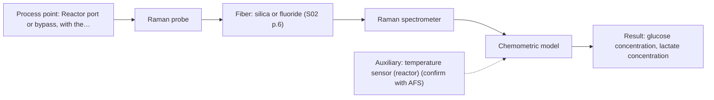
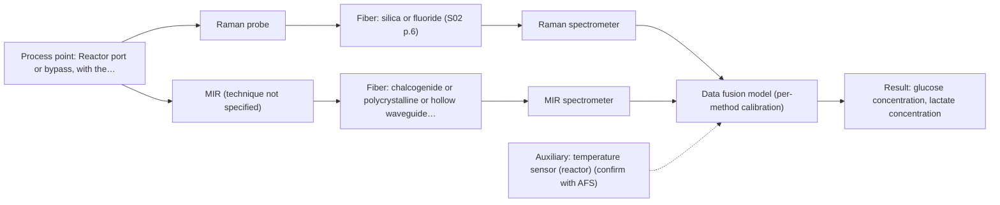

# First technical assessment: Glucose and lactate trends in an aqueous bioprocess

# Answer

**Customer request:** Customer runs a cell culture process in aqueous medium, currently measures glucose and lactate from samples, and is exploring an in situ spectroscopy pilot to be checked against existing laboratory measurements; medium and cell population change during the run, and no probe or calibration strategy has been selected.

## Brief answer

Test one single method first: a Raman fiber probe, because Raman suits aqueous media and has been used to detect glucose and lactate directly; a mid-IR ATR probe is the alternative to compare. Both should be checked against your existing laboratory glucose and lactate results on samples taken across the run. Your required ranges and accuracy, the medium's turbidity, and the reference method's timing are still open.

## Proposal

- **Best current option:** O2 (recommended): M1 Raman probe
- **Basis:** supplied AFS sources
- **What would change it:** A strong fluorescence background, a strongly turbid or opaque medium, or a required accuracy that one method cannot reach would move the choice towards the mid-IR ATR alternative or the combined option.
- **Next step:** Measure representative samples from across the run with a Raman probe and with a mid-IR ATR probe, compare both against your existing laboratory glucose and lactate results, and then decide on the hardware.

**Decision status:** Provisional feasibility assessment. A method shortlist can be justified: both Raman and mid-IR ATR are compatible with an in-line liquid measurement, and Raman has a published bioprocess precedent for glucose and lactate in an aqueous medium. Which one fits this process, and whether a combined measurement is needed, depends on the customer's accuracy target, the medium's optical density and the fluorescence background.

## Solution options

| ID | Tier | Methods | Confidence | Cost class, S01 Table 1 (p.6) | Ease of use | Maintenance | Performance fit | Sources |
|---|---|---|---|---|---|---|---|---|
| O1 | Simple | M2 MIR, ATR probe | High | high (row 2) | Contact ATR probe and one instrument; no laser or fluorescence handling. | Crystal cleaning, contact and fouling checks, periodic recalibration. | Sharp mid-IR bands give selectivity for both analytes in a liquid. | *(no verified source: engineering judgement)* |
| O2 | Recommended | M1 Raman probe | High | high (row 12) | One probe and one laser; silica fiber link to the instrument. | Probe window cleaning; laser and fluorescence background checks. | Aqueous medium suits Raman; precedent for glucose and lactate detection. | *(no verified source: engineering judgement)* |
| O3 | Extended (multi-method) | M3 Raman probe + MIR (combination) | Medium: multi-method, fusion benefit not yet shown | high (row 12); not rated in S01 Table 1: MIR (technique not specified) | Two instruments and two probes, with synchronisation between the data streams. | Two calibrations and diagnostics; one drifting block breaks the fused model. | Complementary mid-IR and Raman information may improve accuracy if one method falls short. | [1: S01 p.11] |

*Confidence rates the basis of the advice (how much is known and cited), not a predicted accuracy or probability of success. It starts at High and drops one level per weakness listed.*

*Cost class is the relative rating in S01 Table 1 (p.6) for the in-line method+technique rows named (the highest one for a multi-method option); it is not a price.*

## Setup sketch

*Recommended option O2; drawn by code from the option, a schematic, not a configuration.*

*Extended (multi-method) option O3; drawn by code from the option, a schematic, not a configuration.*

## Key questions

1. What concentration ranges do you need for glucose and lactate, and what accuracy and response time would make the pilot a success?
2. How optically dense or turbid does the medium become during a run, and how much does it change?
3. Which laboratory method gives your current glucose and lactate values, and how long after sampling are the results available?

# Expert detail

**Customer enquiry**

> We run a cell culture process in an aqueous medium. Glucose and lactate are measured from samples, and the delay makes it difficult to see changes promptly. We are exploring an in situ spectroscopy pilot that can be checked against those existing laboratory measurements. The medium and cell population change during the run; we have not yet selected a probe or a calibration strategy.

## Parameters

| ID | Parameter | Kind | Need | Measured by | Why | Sources |
|---|---|---|---|---|---|---|
| P1 | glucose concentration | quantitative | required | Spectroscopy: Raman | It is one of the two stated targets and the quantity the current off-line sampling reports. | [2: S01 p.16] |
| P2 | lactate concentration | quantitative | required | Spectroscopy: Raman | It is the second stated target and the second quantity the current off-line sampling reports. | [3: S01 p.16] |
| P3 | temperature | quantitative | optional | Auxiliary sensor: temperature sensor (reactor) (engineering judgement: confirm availability with AFS) | It should already be available from the reactor control system and is a useful covariate for the calibration. | *(no verified source: engineering judgement)* |
| P4 | viable cell density | quantitative | optional | Reference lab method: off-line viable cell count (e.g. automated cell counter) | The cell population changes during the run, so it helps to explain spectral variation and calibration drift. | *(no verified source: engineering judgement)* |

## Solution option details

- **O1 cost drivers:** Mid-IR spectrometer, ATR probe, infrared fibers and per-analyte calibration effort.
- **O2 cost drivers:** Raman spectrometer, laser, probe and chemometric calibration effort.
- **O3 cost drivers:** Two spectrometers, two probes, synchronisation and data-fusion modelling.
- **O3 combining methods:** Fusion level: one calibration per method first, then a joint model on block-scaled concatenated spectra. Both probes must look at the same small sample volume, and the two data streams must be normalised to a common time step. Each method keeps its own calibration and diagnostics; the fused model must beat the best single method on held-out runs, otherwise the extra instrument is dropped.

## Premise check

- **Precedent only:** In-line fiber-optic spectroscopy can measure glucose and lactate in an aqueous cell-culture medium. A published bioprocess example uses Raman in a reactor for direct detection of metabolites including glucose and lactate, and states Raman suits aqueous media; this is a reason to test, not proof for this process. [4: S01 p.16] [5: S01 p.16]
- **Not covered:** The existing laboratory glucose and lactate measurements are a suitable check for the in situ pilot. No supplied source addresses using an existing off-line assay as the reference for an in-line measurement; the sources only state that a feasibility plan needs independent reference measurements, and the timing between sampling and the in-line reading must be settled with the customer. *(no verified source: engineering judgement)*
- **Supported:** Moving the measurement in situ will remove the delay in seeing changes. The source states that in-process analysis is performed directly in the process flow or reactor without sampling, eliminating delays. [6: S01 p.3]

## Requirements

**Stated by the customer**

**Key unknowns**

- Concentration ranges, required accuracy and required response time for glucose and lactate.
- Optical density and homogeneity of the medium during the run (does it become turbid or opaque?).
- Whether the medium or the cells show a strong fluorescence background.
- Which laboratory method produces the current glucose and lactate values, its accuracy and its sampling delay.
- Probe installation point, distance to the spectrometer, and cleaning, sterilisation, temperature and pressure conditions.
- Whether cell density must be tracked as well as the two analytes.

## Clarification questions (most decision-relevant first)

Q1. What concentration ranges do you need for glucose and lactate, and what accuracy and response time would make the pilot a success? *Why it matters:* These targets set the go/no-go basis and decide whether one method can cover both analytes or a combination is needed. *(affects: method, technique, status)*
Q2. How optically dense or turbid does the medium become during a run, and how much does it change? *Why it matters:* Optical density decides whether transmission, diffuse reflection or an ATR contact geometry is usable in this process. *(affects: technique, installation)*
Q3. Which laboratory method gives your current glucose and lactate values, and how long after sampling are the results available? *Why it matters:* That method is the independent reference for the pilot and must be time-aligned with the in-line readings on a changing culture. *(affects: method, status)*
Q4. Where can a probe be installed (reactor port or bypass), and how far is that point from the spectrometer? *Why it matters:* The fiber family and the usable link length depend on this, especially for a mid-infrared link. *(affects: installation, technique)*
Q5. Does the medium or the cell suspension fluoresce noticeably, or has a fluorescence background been seen before? *Why it matters:* Strong fluorescence can swamp the weak Raman signal and would shift the choice towards mid-IR ATR or a combined measurement. *(affects: method)*
Q6. What cleaning, sterilisation, temperature and pressure conditions must the probe survive? *Why it matters:* These conditions set the probe materials and the installation concept. *(affects: installation)*

## Recommendation

- **M1 · Primary candidate: Raman probe.** Raman suits an aqueous medium because water absorbs little, and it has been used in a reactor for direct detection of glucose, acetate and lactate. It is the single method that covers both stated targets. *Conditions:* Applies if the medium's fluorescence background does not swamp the Raman signal, which must be checked on real samples. [7: S01 p.16] [8: S01 p.16]
- **M2 · Comparison candidate: MIR, ATR probe.** Mid-IR band spectra are well defined and give high selectivity, and ATR fiber probes are used for in-line liquid and biotechnological streams. It is the alternative single method to compare against Raman for the same two analytes. *Conditions:* Applies if the medium makes tight contact with the ATR crystal and the crystal stays free of deposits. [9: S01 p.9] [10: S01 p.10]
- **M3 · Conditional candidate: Raman probe.** Mid-IR and Raman spectra are complementary, so measuring both could add information for the two analytes. Any gain is a hypothesis and is only worth testing if the single-method tests fall short. *Conditions:* Applies only if neither single method reaches the required accuracy for both analytes. [11: S01 p.11] [12: S01 p.15] Later hypothesis, after single-method tests: combine with MIR.

## Measurement concept

- **Probe and geometry:** In-situ fiber probe in contact with the liquid: Raman probe as the first single method, an ATR contact probe as the mid-IR alternative; transmission geometries are not assumed because the optical density of the medium is unknown.
- **Location:** Reactor port or bypass, with the spectrometer away from the process point; exact point and distance to be confirmed (Q4).
- **Fiber link:** The fiber family follows the method: silica for Raman, and a mid-IR fiber (chalcogenide or polycrystalline) for ATR; the achievable mid-IR link length is not stated in the supplied material and must be confirmed with AFS. [13: S01 p.15]

## Spectral range

- **Raman:** Raman shift in cm-1, with the laser excitation wavelength stated separately; the usable shift range depends on the laser, fiber and probe selected. [14: S01 p.11]
- **MIR:** Nominal mid-IR range 4000-400 cm-1; the usable range depends on the instrument, fiber and ATR crystal actually selected. [15: S01 p.9] [16: REF §5]

## Risks and uncertainty

- The medium or the cells may fluoresce strongly enough to swamp the weak Raman signal, so Raman alone could fail on this matrix. *(rules: R-RAM-1)* [17: S01 p.11] [18: S01 p.11]
- Because the medium and the cell population change during the run, the calibration is matrix-specific and may not hold across the whole run without re-validation. *(rules: R-CAL-1)* [19: REF §5]
- The usable spectral range, fiber link and probe depend on the instrument and probe actually chosen, none of which is fixed yet. *(rules: R-GEN-1)* [20: REF §5]
- For the mid-IR ATR alternative, only a thin surface layer of the sample is seen, so deposits or poor contact on the crystal can bias the result. *(rules: R-MIR-3)* [21: S01 p.13]

## First feasibility experiment

1. **Collect representative samples or process states across the run: early, mid and late culture, low and high cell density, and the expected low and high glucose and lactate levels.** Span the chemical and physical variation the model must cover. [22: REF §3]
2. **Measure each sample with the single Raman probe under the intended in-situ conditions (temperature, contact), then repeat with the mid-IR ATR probe; note the medium's turbidity at each point.** Compare the two single methods on the same material before any combination. *(no verified source: engineering judgement)*
3. **Run your existing laboratory glucose and lactate assay on the same samples as the independent reference, time-aligned with the spectral measurements, and record cell density and temperature.** Provide the independent reference values and the context variables for the models. *(no verified source: engineering judgement)*
4. **Build one calibration model per analyte and per method on part of the runs and validate on held-out runs or batches, keeping repeated measurements from the same run together in each split.** Test whether the model generalises to new runs, not only to new points of the same run. [23: S03 p.13]
5. **Go/no-go: compare the validated prediction error for glucose and lactate against the accuracy and response time you require (Q1); only if both single methods fall short, test a combined Raman plus mid-IR measurement against the best single method.** Decide whether one method is enough before adding a second instrument. *(no verified source: engineering judgement)*

**Reference measurements:** The existing laboratory glucose and lactate method, run on the same samples and time-aligned with the in-line readings; cell density and temperature as context variables.

**Decision basis:** Numerical accuracy and response-time criteria to be supplied by the customer (Q1); a single method is preferred unless both fall short.

## Assumptions

- The process liquid can be brought into contact with a probe (reactor port or bypass) without changing the process.
- The existing off-line glucose and lactate assay can be run on samples taken at the same times as the spectral measurements.
- The medium is not so opaque that no in-line optical geometry works.

## Not covered by the supplied sources

- No supplied source states achievable accuracy or detection limits for in-line glucose or lactate measurement in cell-culture medium.
- No supplied source states an achievable fiber-link length for a mid-infrared ATR probe installation.
- No supplied source covers validation of an in-line measurement against an existing off-line assay for a cell-culture process.

## Further notes

- **Chemometrics:** Glucose and lactate need matrix-specific calibration models built on reference data that span the run; validate on held-out runs, not only on held-out samples of the same run.
- **Real-time tracking:** The pilot should acquire spectra continuously and timestamp them, so each in-line reading can be matched to the off-line reference sample taken at that moment.
- **Future direction:** If one method proves sufficient, a later step could be a compact application-specific sensor or a single combined probe for both methods.

## Evidence (verified quotes)

1. ✓ **S01 p.11** (general): "This property makes mid-IR and Raman spectra complementary, that is, they complement each other."
2. ✓ **S01 p.16** (application precedent): "Raman spectroscopy can be used in the same reactor to provide a "molecular fingerprint" for direct detection of specific metabolites like glucose, acetate, or lactate."
3. ✓ **S01 p.16** (application precedent): "Raman spectroscopy can be used in the same reactor to provide a "molecular fingerprint" for direct detection of specific metabolites like glucose, acetate, or lactate."
4. ✓ **S01 p.16** (application precedent): "Raman spectroscopy can be used in the same reactor to provide a "molecular fingerprint" for direct detection of specific metabolites like glucose, acetate, or lactate."
5. ✓ **S01 p.16** (general): "Raman is particularly well-suited for aqueous environments, as it exhibits low absorbance for water molecules compared to infrared methods."
6. ✓ **S01 p.3** (general): "It allows for in-process analysis, i.e., directly in the process flow or reactor without sampling, eliminating delays and the risk of sample contamination."
7. ✓ **S01 p.16** (general): "Raman is particularly well-suited for aqueous environments, as it exhibits low absorbance for water molecules compared to infrared methods."
8. ✓ **S01 p.16** (application precedent): "Raman spectroscopy can be used in the same reactor to provide a "molecular fingerprint" for direct detection of specific metabolites like glucose, acetate, or lactate."
9. ✓ **S01 p.9** (general): "Vibrational spectroscopy in the mid-IR range (4000-400 cm-1) is one of the most informative methods of chemical analysis."
10. ✓ **S01 p.10** (general): "Probe-based analysis is gaining widespread use in online analysis, such as in-line, in-process (chemical, biotechnological, natural) environments"
11. ✓ **S01 p.11** (general): "This property makes mid-IR and Raman spectra complementary, that is, they complement each other."
12. ✓ (precedent only) **S01 p.15** (method gain): "By combining Raman and NIR, these models can predict API potency or coating thickness with higher accuracy and robustness than single-method models."
13. ✓ **S01 p.15** (general): "located safely away from the vibration and dust of the manufacturing floor."
14. ✓ **S01 p.11** (general): "The Raman shift is used as the horizontal (spectral) axis in Raman spectroscopy"
15. ✓ **S01 p.9** (general): "Vibrational spectroscopy in the mid-IR range (4000-400 cm-1) is one of the most informative methods of chemical analysis."
16. ✓ **REF §5** (general): "actual spectral coverage, fiber length, component ratings, detection limits and accuracy depend on the configuration and the sample."
17. ✓ **S01 p.11** (general): "signals, which are several orders of magnitude weaker than IR absorption peaks"
18. ✓ **S01 p.11** (general): "superposition of luminescence (fluorescence), which has a significantly higher intensity."
19. ✓ **REF §5** (general): "calibration specific to the matrix."
20. ✓ **REF §5** (general): "actual spectral coverage, fiber length, component ratings, detection limits and accuracy depend on the configuration and the sample."
21. ✓ **S01 p.13** (general): "typically at a depth of few microns"
22. ✓ **REF §3** (general): "Representative samples or process states, independent reference measurements, what is compared, and the basis for the go / no-go decision."
23. ✓ **S03 p.13** (general): "Repeated measurements in the same sample position produced similar spectra or sensor data; therefore, these should always be simultaneously excluded for every CV iteration."

## Verification

- Citations verified: 23 of 23 (exact or whitespace/hyphen-tolerant match on the cited page, scope checked).
- Hard check failures before deterministic corrections: 0; still open: 0; soft warnings: 1; repair rounds: 0.

*Run D04-20261017T134114Z · models deepseek/deepseek-v4.1-flash*
