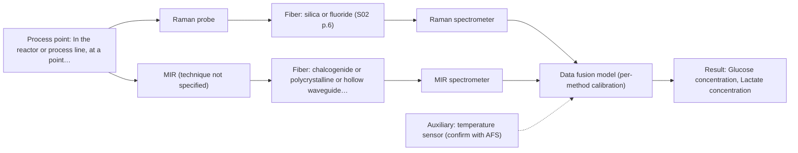

# First technical assessment: Glucose and lactate trends in an aqueous bioprocess

## Answer

**Customer request (our summary):** Customer runs a cell culture process in aqueous medium, currently measuring glucose and lactate from samples with delay, and is exploring an in situ spectroscopy pilot to be checked against existing laboratory measurements. Medium and cell population change during the run; probe and calibration strategy not yet selected.

### Brief answer

Test Raman spectroscopy first: it tolerates water and is the method named for glucose and lactate in a reactor, with MIR-ATR as the main comparison. A combined MIR-ATR plus Raman probe is a later hypothesis only if one method falls short. Still open are the medium's turbidity and fluorescence, the glucose and lactate ranges and required accuracy, and the reference method's comparability.

### Proposal

- **Best current option:** O2 (recommended)
- **Basis:** supplied AFS sources
- **What would change it:** If the medium proves strongly fluorescent, or the glucose and lactate ranges fall below what Raman can resolve, the MIR-ATR option (O1) becomes the better single method. If neither single method meets the accuracy target, the combined option (O3) is the next test.
- **Next step:** Run the feasibility experiment with Raman first, using the existing laboratory glucose and lactate values as independent references and the customer's accuracy and response-time figures as the go/no-go basis.

**Secondary evidence (external, not AFS material):** G1: E03 ¶12, E02 ¶19; G2: E01 ¶82, E04 ¶1; G3: no usable external source found; G4: no usable external source found. See Expert detail.

**Decision status:** Provisional feasibility assessment

### Solution options

| ID | Tier | Methods | Confidence | Cost class, S01 Table 1 (p.6) | Ease of use | Maintenance | Performance fit | Sources |
|---|---|---|---|---|---|---|---|---|
| O1 | Simple | M2 MIR, ATR probe | Medium: open question: Q1 (starts at Medium) | high cost (row 2) | single contact probe, no laser | ATR crystal cleaning, fouling checks | well-defined bands, water handled by ATR | [1: S01 p.10] [2: S01 p.9] [3: S01 p.5] |
| O2 | Recommended | M1 Raman probe | Medium: open question: Q1 (starts at Medium) | high cost (row 12) | fiber probe, laser safety to manage | probe cleaning, fluorescence background check | water-tolerant, direct glucose and lactate | [4: S01 p.16] [5: S01 p.16] |
| O3 | Extended (multi-method) | M3 Raman probe + MIR (combination) | Low: open question: Q1 (starts at Medium); multi-method, fusion benefit not yet shown | high cost (rows 2, 12) | two instruments, combined probe needed | two calibrations, two sets of diagnostics | adds complementary bands if one method falls short | [6: S01 p.8] [7: S01 p.8] [8: S01 p.8] [9: S01 p.9] [10: S01 p.11] [11: S01 p.7] |

*Confidence rates the basis of the advice (how much is known and cited), not a predicted accuracy or probability of success. It starts at High, or at Medium when a key question on the method or the option is open, and drops one level per weakness listed (floor Low).*

*Cost class is the relative rating in S01 Table 1 (p.6) for the in-line method+technique rows named (the highest one for a multi-method option); it is not a price.*

### Setup sketch

*Recommended option O2; drawn by code from the option, a schematic, not a configuration.*

### Key questions

1. What are the expected glucose and lactate concentration ranges, and what accuracy and response time are required?
2. What is the medium's turbidity or optical density, and how much does it change during the run?
3. Which laboratory method is used for glucose and lactate, at what sampling frequency and with what uncertainty?

## Expert detail

**Customer enquiry**

> We run a cell culture process in an aqueous medium. Glucose and lactate are measured from samples, and the delay makes it difficult to see changes promptly. We are exploring an in situ spectroscopy pilot that can be checked against those existing laboratory measurements. The medium and cell population change during the run; we have not yet selected a probe or a calibration strategy.

**Decision status:** Provisional feasibility assessment. A single-method shortlist can be justified from the sources, so this is a provisional assessment rather than insufficient information. It rests on the assumptions that the medium suits Raman or ATR measurement and that the existing laboratory values can serve as independent references.

### Parameters

| ID | Parameter | Kind | Need | Measured by | Why | Sources |
|---|---|---|---|---|---|---|
| P1 | Glucose concentration | quantitative | required | Spectroscopy: Raman | It is one of the two target analytes the customer wants to follow in situ. | [5: S01 p.16] |
| P2 | Lactate concentration | quantitative | required | Spectroscopy: Raman | It is the second target analyte and is currently only available with the sampling delay. | [5: S01 p.16] |
| P3 | Temperature | quantitative | optional | Auxiliary sensor: temperature sensor (engineering judgement: confirm availability with AFS) | It is normally logged by the process and should be available; it shifts spectral baselines and is needed to compare runs. | *(no verified source: engineering judgement)* |
| P4 | Viable cell density | quantitative | optional | Not measurable in-line by spectroscopy; alternative: offline viable cell count | The cell population changes during the run and affects scattering, so it helps to interpret and validate the spectra. | [12: S01 p.16] [13: REF §5] |

### Solution option details

- **O1 cost drivers:** MIR spectrometer, ATR probe, mid-IR fibers, calibration
- **O2 cost drivers:** Raman spectrometer, laser, fiber probe, chemometric calibration
- **O3 cost drivers:** two spectrometers, combined probe, data fusion, extra maintenance
- **O3 combining methods:** A combined MIR-ATR and Raman probe would measure the same small spot, so both methods see the same material; two separate probes used alternately cannot guarantee this. The two data streams must be brought to a common time step and autoscaled before fusion, and each method keeps its own calibration and diagnostics. This option is worth pursuing only if the fused model beats the best single method on independent runs.

*Extended (multi-method) option O3; drawn by code from the option, a schematic, not a configuration.*

### Premise check

- **Supported:** The in situ spectroscopy pilot can be checked against the existing laboratory measurements. A feasibility plan is expected to use independent reference measurements as the basis for the go/no-go decision; the customer's laboratory glucose and lactate values can fill that role if they are independent and comparable. [14: REF §3]
- **Precedent only:** In situ optical spectroscopy can measure glucose and lactate in this aqueous cell culture medium. A published reactor example uses Raman for glucose and lactate, which is a reason to test the method here, not proof that it works for this medium or process. [5: S01 p.16]

### Requirements

**Stated by the customer**

- Targets: glucose and lactate, currently measured from samples with a delay.
- Goal: an in situ spectroscopy pilot that removes the delay and can be checked against the existing laboratory measurements.
- Sample: aqueous cell culture medium; medium and cell population change during the run.
- Not yet decided: probe and calibration strategy.

**Key unknowns**

- Glucose and lactate concentration ranges, required accuracy and required response time.
- Medium turbidity / optical density and how much it varies during the run.
- Whether the medium or its components fluoresce under visible/NIR excitation.
- The existing reference method: its principle, sampling frequency and uncertainty.
- Installation point, temperature, pressure and cleaning / sterilisation requirements.
- Choice of probe and calibration strategy.

### Clarification questions (most decision-relevant first)

Q1. What are the expected glucose and lactate concentration ranges, and what accuracy and response time are required? *Why it matters:* These numbers decide which method can reach the target and define the go/no-go criteria for the pilot. *(affects: method)*
Q2. What is the medium's turbidity or optical density, and how much does it change during the run? *Why it matters:* It decides whether a transmission geometry is viable or whether an ATR or reflection geometry is needed. *(affects: technique)*
Q3. Which laboratory method is used for glucose and lactate, at what sampling frequency and with what uncertainty? *Why it matters:* It determines whether those values can act as independent references for validating the in-line result. *(affects: status)*
Q4. Does the medium or its components fluoresce under visible or near-infrared excitation? *Why it matters:* A strong fluorescence background can swamp the Raman signal and would move the choice towards MIR. *(affects: method)*
Q5. What are the installation conditions: measurement point, temperature, pressure, and cleaning or sterilisation requirements? *Why it matters:* They set the probe materials, the interface and the fiber link, none of which can be fixed yet. *(affects: installation)*

### Recommendation

- **M1 · Primary candidate: Raman probe.** Raman tolerates water and is the method named for direct detection of glucose and lactate in a reactor, so it is the single method to test first. A fiber probe allows the in situ measurement the customer is exploring. [4: S01 p.16] [5: S01 p.16]
- **M2 · Comparison candidate: MIR, ATR probe.** MIR gives strong, well-defined absorption bands and ATR handles an aqueous sample in a very thin layer, so it is a strong second single method to compare against Raman. In-line ATR probes are established for liquid process streams. [2: S01 p.9] [3: S01 p.5] [1: S01 p.10]
- **M3 · Conditional candidate: Raman probe + MIR (combination).** Mid-IR and Raman spectra are complementary, so fusing them could add information if either single method falls short in the changing medium. Any gain from combining is a hypothesis, tested only after the single-method runs. *Conditions:* Applies only if the single-method tests do not meet the customer's accuracy or robustness targets. [10: S01 p.11] [11: S01 p.7] Later hypothesis, after single-method tests.

### Measurement concept

- **Probe and geometry:** Single-method first: a Raman fiber probe for in situ measurement, with a MIR ATR probe as the comparison. The ATR probe requires tight contact with the liquid; the Raman probe can look into the medium through a window or immersion optic. A combined MIR-ATR plus Raman probe is a later option.
- **Location:** In the reactor or process line, at a point that is representative of the bulk and accessible for cleaning.
- **Fiber link:** Silica fibers are the normal route for the visible/NIR region used by Raman; the mid-IR needs chalcogenide or polycrystalline fibers. No achievable mid-IR link length is stated in the sources, so the length remains an open question. [15: S02 p.6] [16: S02 p.6]

### Spectral range

- **Raman:** Report Raman as a shift in cm-1 and state the laser excitation wavelength separately; the excitation wavelength is not yet fixed. [17: S01 p.11]
- **MIR:** The nominal MIR range is 4000-400 cm-1 (2.5-25 µm); the usable range depends on the crystal, fiber and probe actually selected. [2: S01 p.9] [18: REF §5]

### Risks and uncertainty

- Fluorescence or luminescence from the medium or cells could swamp the weak Raman signal and degrade the calibration. *(rules: R-RAM-1)* [19: S01 p.11]
- ATR senses only a surface layer a few micrometres deep, so cell or protein deposits on the crystal could bias the MIR result. *(rules: R-MIR-3)* [20: S01 p.13]
- The changing medium and cell population alter the matrix, so a calibration built on one process state may not transfer to another. *(rules: R-CAL-1)* [21: REF §5]
- The medium's turbidity and optical density are unknown; if they are high, transmission geometries fail and scattering may bias quantitation. *(rules: R-GEO-2, R-GEN-5)* [22: S01 p.7]

### First feasibility experiment

1. **Collect representative samples and process states covering the expected variation of the medium and cell population** Sample coverage [14: REF §3]
2. **Measure each sample with Raman as the single first method, using one probe and one fixed geometry** Single-method measurement *(no verified source: engineering judgement)*
3. **Record paired independent reference values for glucose and lactate with the existing laboratory method** Independent reference [23: REF §3]
4. **Build chemometric calibration models on part of the runs and validate them on held-out runs or batches** Calibration and validation [24: S01 p.12]
5. **Compare the prediction error and response time against the customer's numerical targets and decide go or no-go** Go / no-go decision [25: REF §3]

**Reference measurements:** Existing laboratory glucose and lactate values on paired samples, taken as close in time as possible to the spectral measurement.

**Decision basis:** The prediction error for glucose and lactate, and the response time, compared against the numerical targets supplied by the customer (Q1).

### Assumptions

- The medium is a liquid that can contact an ATR crystal or a Raman probe without unacceptable fouling.
- The existing laboratory method gives glucose and lactate values that are comparable with an in-line measurement.
- The medium is not so strongly fluorescent that the Raman signal is lost (to be checked).

### Not covered by the supplied sources

- No supplied source gives detection limits or accuracy figures for glucose or lactate in cell culture medium.
- No supplied source covers cleaning, fouling or sterilisation requirements for a cell-culture process probe.
- No supplied source states an achievable mid-IR fiber link length for a process installation.

### Further notes

- **Chemometrics:** Glucose and lactate give broad or overlapping bands, so the in-line result depends on a chemometric calibration built and validated against reference data from the existing laboratory method. The calibration is specific to the matrix and should be re-checked as the medium and cell population change.
- **Real-time tracking:** In-line measurement removes the sampling delay and can give results in near real time; this requires high-speed spectral acquisition. The customer's prompt-change requirement (Q1) should be stated as a numerical response time.
- **Future direction:** Once the informative spectral regions are known, the analysis could be reduced to a compact optical multisensor for lower-cost in-line control; the sources describe this as a later development step.

### Secondary evidence (external, not AFS material)

*Found by a literature search for gaps the supplied AFS sources leave open. Not AFS material and not proof for this case; every quote below was verified verbatim against the fetched text.*

**G1 · auxiliary sensor:** In-line measurement of Temperature with temperature sensor

- **E03 ¶12** The review states that temperature sensitivity of OH bands is a severe drawback for measuring aqueous solutions in NIR and MIR, making tempered sample holders necessary. *How it applies:* For an aqueous cell-culture medium, this suggests that temperature control or measurement may be needed to reduce spectral variation; consider testing temperature stability and whether an in-line temperature sensor is required. *Limits and transfer risks:* The quote concerns NIR and MIR aqueous measurements and tempered sample holders, not an in-line temperature sensor in cell culture; transfer to Raman or a pilot probe is uncertain.
  > "Additionally, the temperature sensitivity of the OH bands is a severe drawback for measuring aqueous solution in NIR and MIR, which makes tempered sample holders necessary [29]."
  > A critical review of recent trends, and a future perspective of optical spectroscopy as PAT in biopharmaceutical downstream processing. (2020) · Analytical and bioanalytical chemistry · doi:10.1007/s00216-020-02407-z · https://europepmc.org/article/PMC/PMC7072065 · retrieved 2026-10-17, full text, licence: cc by, via curated library
- **E02 ¶19** In a reactive extraction study, temperature was varied along with concentrations and ionic strength to obtain a robust model. *How it applies:* This could support including temperature as a calibration variable and using an in-line temperature sensor to record it during runs. *Limits and transfer risks:* The study is on lithium recycling liquid-liquid extraction, not cell culture medium, and the quote does not identify the spectroscopic method or probe.
  > "The concentrations of nitric acid and hydrochloric acid as well as the ionic strength and temperature were varied to obtain a robust model."
  > Process Analytical Technology-Integrated FT-IR and Raman Spectroscopies for Efficient Reactive Liquid-Liquid Extraction Processing in Lithium Recycling. (2025) · ACS omega · doi:10.1021/acsomega.5c05705 · https://europepmc.org/article/PMC/PMC12573149 · retrieved 2026-10-17, full text, licence: cc by, via curated library

**G2 · multi-method:** Combining several spectroscopy methods (data fusion) (A combined MIR-ATR and Raman probe would measure the same small spot, so both methods see the same material; two separate probes used alternately cannot guarantee this. The two data streams must be brought to a common time step and autoscaled before fusion, and each method keeps its own calibration and diagnostics. This option is worth pursuing only if the fused model beats the best single method on independent runs.)

- **E01 ¶82** Before fusing data from multiple sources, the review says it is essential to evaluate each dataset's contribution and complementarity. *How it applies:* For a combined MIR-ATR and Raman option, this suggests testing whether each method adds complementary information before building a fused model. *Limits and transfer risks:* This is a general PAT review, not a cell-culture study; complementarity must be demonstrated on the actual medium and process. *(supports O3)*
  > "Before fusing data from multiple sources, it is essential to evaluate the contribution of each dataset to the model and its complementarity."
  > Challenges and Opportunities of Implementing Data Fusion in Process Analytical Technology-A Review. (2022) · Molecules (Basel, Switzerland) · doi:10.3390/molecules27154846 · https://europepmc.org/article/PMC/PMC9369811 · retrieved 2026-10-17, full text, licence: cc by, via curated library
- **E04 ¶1** A tomato maturity study reports that a multimodal fusion model combining imaging, spectroscopy and haptic sensing surpassed single-modal methods. *How it applies:* This supports the idea of comparing a fused model against the best single method, as the gap notes, but only as a reason to test in the cell-culture context. *Limits and transfer risks:* The source is abstract-only and concerns tomato maturity, not glucose or lactate in cell culture; it uses different modalities and deep-learning classification rather than quantitative calibration. *(supports O3)*
  > "This neural network model achieves 99.4% accuracy in tomato maturity classification, surpassing single-modal methods (color imaging: 94.2%; spectroscopy: 87.8%; haptics: 87.2%)."
  > Development of Multimodal Fusion Technology for Tomato Maturity Assessment (2024) · Sensors · doi:10.3390/s24082467 · https://doi.org/10.3390/s24082467 · retrieved 2026-10-17, abstract only, licence: cc-by, via openalex

**G3 · not in the supplied sources:** No supplied source gives detection limits or accuracy figures for glucose or lactate in cell culture medium.

- No usable external source found.

**G4 · not in the supplied sources:** No supplied source covers cleaning, fouling or sterilisation requirements for a cell-culture process probe.

- No usable external source found.

### Evidence (verified quotes)

1. ✓ **S01 p.10** (general): "Probe-based analysis is gaining widespread use in online analysis, such as in-line, in-process (chemical, biotechnological, natural) environments"
2. ✓ **S01 p.9** (general): "Vibrational spectroscopy in the mid-IR range (4000-400 cm-1) is one of the most informative methods of chemical analysis."
3. ✓ **S01 p.5** (general): "strong absorption in the mid-IR region limits the corresponding spectral method to the analysis of very thin samples (usually less than 50 μm), but it opens up the possibility of using attenuated total reflectance (ATR)"
4. ✓ **S01 p.16** (general): "Raman is particularly well-suited for aqueous environments, as it exhibits low absorbance for water molecules compared to infrared methods."
5. ✓ **S01 p.16** (application precedent): "Raman spectroscopy can be used in the same reactor to provide a "molecular fingerprint" for direct detection of specific metabolites like glucose, acetate, or lactate."
6. ✓ (precedent only) **S01 p.8** (method gain): "It is crucial that the spectral information obtained by different methods-Mid-IR, NIR, Raman, and fluorescence spectra-is collected from the same small, even pinpoint, area of the sample."
7. ✓ (precedent only) **S01 p.8** (method gain): "Ultimately, the measurement data must be normalized to a common time step."
8. ✓ (precedent only) **S01 p.8** (method gain): "If the variables have different units of measurement, the data should be normalized in some way, for example, using an autoscaling algorithm."
9. ✓ (precedent only) **S01 p.9** (method gain): "One of the challenges of multispectral analysis is the need to simultaneously connect at least two independently operating measuring instruments."
10. ✓ **S01 p.11** (general): "This property makes mid-IR and Raman spectra complementary, that is, they complement each other."
11. ✓ (precedent only) **S01 p.7** (method gain): "The analysis of such systems may require a combination of two or even more spectral methods."
12. ✓ **S01 p.16** (general): "cell suspension turbidity correlates well with cell density."
13. ✓ **REF §5** (general): "optical density is not a viable cell count."
14. ✓ **REF §3** (general): "Representative samples or process states, independent reference measurements, what is compared, and the basis for the go / no-go decision."
15. ✓ **S02 p.6** (general): "350 nm Standard VIS-NIR Silica Fibers Al/Cu-coated VIS-NIR Silica Fibers 2400 nm"
16. ✓ **S02 p.6** (general): "1100 nm Chalcogenide As-S IR Fibers 6500 nm"
17. ✓ **S01 p.11** (general): "The Raman shift is used as the horizontal (spectral) axis in Raman spectroscopy"
18. ✓ **REF §5** (general): "actual spectral coverage, fiber length, component ratings, detection limits and accuracy depend on the configuration and the sample."
19. ✓ **S01 p.11** (general): "superposition of luminescence (fluorescence), which has a significantly higher intensity."
20. ✓ **S01 p.13** (general): "typically at a depth of few microns"
21. ✓ **REF §5** (general): "calibration specific to the matrix."
22. ✓ **S01 p.7** (general): "Morphological factors, such as sample inhomogeneity (e.g., biological tissue) or process turbulence, must also be considered when selecting a measurement technique."
23. ✓ **REF §3** (general): "independent reference measurements"
24. ✓ **S01 p.12** (general): "Raman spectra (as well as IR absorption spectra) can be used to construct chemometric models-calibration or classification ones."
25. ✓ **REF §3** (general): "the basis for the go / no-go decision."

### Verification

- Citations verified: 33 of 33 (exact or whitespace/hyphen-tolerant match on the cited page, scope checked).
- Hard check failures before deterministic corrections: 0; still open: 0; soft warnings: 6; repair rounds: 1.
- Corrected deterministically after verification (1):
  - ⚠ recommendations[2].combined_with: combined_with normalised to ['MIR'] (duplicates and the entry's own method removed)
- External evidence (live): 4 quote(s) verified verbatim (exact or whitespace/hyphen-tolerant, at most 400 characters and 2 sentences, against the cited paragraph); 0 item(s) dropped.
- External search: 6 query(ies), 44 hit(s), 5 source(s) (3 from the curated library).
- External step: 2 model call(s), 48.0 s extra (cost in the run JSON).

*Run D04-20261017T194912Z · models deepseek/deepseek-v4.1-flash*
