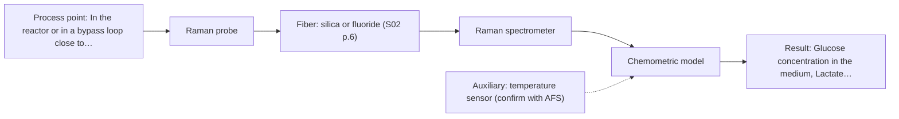

# First technical assessment: Glucose and lactate trends in an aqueous bioprocess

## Answer

**Customer request (our summary):** Customer runs an aqueous cell culture process, currently measures glucose and lactate from samples, and is exploring an in situ spectroscopy pilot to reduce delay, to be checked against existing laboratory measurements.

### Brief answer

Test Raman first (M1) as the single in-line method: it suits aqueous media and there is a bioprocess precedent for glucose and lactate. Test MIR ATR (M2) alongside it as the strongest alternative, and keep NIR transmission (M3) as an option only if the medium stays optically clear. What is still open: the concentration ranges, the required accuracy, the reference assay's uncertainty and how the medium changes during a run.

### Proposal

- **Best current option:** O2 (recommended)
- **Basis:** supplied AFS sources
- **What would change it:** A strong fluorescence background or insufficient sensitivity for the stated ranges would move MIR ATR (M2) to the front, and a medium that stays optically clear would make NIR transmission (M3) a serious candidate. An unusable reference assay would change the whole comparison.
- **Next step:** Agree the target ranges, the required accuracy and the reference assay's uncertainty, then run the feasibility plan on samples from several runs with Raman first and MIR ATR alongside.

**Decision status:** Provisional feasibility assessment

### Solution options

| ID | Tier | Methods | Confidence | Cost class, S01 Table 1 (p.6) | Ease of use | Maintenance | Performance fit | Sources |
|---|---|---|---|---|---|---|---|---|
| O1 | Simple | M2 MIR, ATR probe | Low: open question: Q1 (starts at Medium); precedent only; uncited auxiliary sensor | high cost (row 2) | contact probe, no laser, simple optics | crystal cleaning, fouling and drift checks | well-defined MIR bands for both analytes | [1: S04 p.4] [2: S01 p.13] |
| O2 | Recommended | M1 Raman probe | Low: open question: Q1 (starts at Medium); uncited auxiliary sensor | high cost (row 12) | fiber probe, laser safety, background check | laser and probe checks, recalibration | aqueous-friendly, precedent for glucose and lactate | [3: S01 p.16] [4: S01 p.16] |

*Confidence rates the basis of the advice (how much is known and cited), not a predicted accuracy or probability of success. It starts at High, or at Medium when a key question on the method or the option is open, and drops one level per weakness listed (floor Low).*

*Cost class is the relative rating in S01 Table 1 (p.6) for the in-line method+technique rows named (the highest one for a multi-method option); it is not a price.*

### Setup sketch

*Recommended option O2; drawn by code from the option, a schematic, not a configuration.*

### Key questions

1. What are the expected glucose and lactate concentration ranges, and what accuracy, precision and response time must the in-line result meet?
2. How optically dense is the medium across a run - how clear or turbid does it become?
3. How do the medium and the cell population change during a run - which feeds are added, when, and how much does the matrix vary between runs?

## Expert detail

**Customer enquiry**

> We run a cell culture process in an aqueous medium. Glucose and lactate are measured from samples, and the delay makes it difficult to see changes promptly. We are exploring an in situ spectroscopy pilot that can be checked against those existing laboratory measurements. The medium and cell population change during the run; we have not yet selected a probe or a calibration strategy.

**Decision status:** Provisional feasibility assessment. Both Raman and MIR ATR suit an aqueous liquid held in contact with a probe, and a bioprocess source describes Raman detecting glucose and lactate directly in a reactor, so a shortlist is justified. The choice between them, and whether NIR transmission is usable at all, depends on the target ranges and the medium's optical density, which are not yet known.

### Parameters

| ID | Parameter | Kind | Need | Measured by | Why | Sources |
|---|---|---|---|---|---|---|
| P1 | Glucose concentration in the medium | quantitative | required | Spectroscopy: Raman | Glucose is a stated target and must be tracked in-line to remove the sampling delay. | [4: S01 p.16] |
| P2 | Lactate concentration in the medium | quantitative | required | Spectroscopy: Raman | Lactate is the second stated target and is measured today only from samples. | [4: S01 p.16] |
| P3 | Medium temperature at the measurement point | quantitative | required | Auxiliary sensor: temperature sensor (engineering judgement: confirm availability with AFS) | Spectral baselines and any calibration shift with temperature, so it must be logged with each spectrum. | *(no verified source: engineering judgement)* |
| P4 | Cell density (biomass) | quantitative | required | Reference lab method: existing laboratory cell count | The cell population changes during the run and scatters light, so it has to be recorded to separate its effect from glucose and lactate. | *(no verified source: engineering judgement)* |

### Solution option details

- **O1 cost drivers:** FTIR spectrometer, ATR probe and crystal, calibration and reference assays
- **O2 cost drivers:** Raman spectrometer and laser, fiber probe, calibration and reference assays

### Premise check

- **Supported:** An in situ fiber-probe pilot can be checked against the existing laboratory glucose and lactate measurements. A feasibility plan is expected to include independent reference measurements, which the existing laboratory assay provides. [5: REF §3]
- **Supported:** In situ spectroscopy can report changes without the sampling delay. In-process analysis without sampling is described as removing the delay, which is the problem the customer states. [6: S01 p.3]
- **Not covered:** One calibration can be expected to hold across a run while the medium and the cell population change. No supplied source addresses cell culture medium or the stability of a calibration across a changing medium and cell population; this is an assumption the trial has to test, not a supported expectation. *(no verified source: engineering judgement)*

### Requirements

**Stated by the customer**

- "cell culture process"
- "aqueous medium"
- "Glucose and lactate are measured from samples"
- "the delay makes it difficult to see changes promptly"
- "in situ spectroscopy pilot"
- "checked against those existing laboratory measurements"
- "The medium and cell population change during the run"
- "we have not yet selected a probe or a calibration strategy"
- "Glucose"
- "lactate"

**Key unknowns**

- Expected glucose and lactate concentration ranges, and the accuracy, precision and response time the in-line result must meet.
- Optical density (turbidity) of the medium across a run.
- How the medium and the cell population change during a run (feed additions, matrix variability between runs).
- Temperature, flow and cleaning or sterilisation conditions at the measurement point, and whether a probe can contact the liquid there.
- Uncertainty and sampling delay of the existing laboratory glucose and lactate assay.
- Whether the medium or the cells produce a strong fluorescence background that would affect Raman.

### Clarification questions (most decision-relevant first)

Q1. What are the expected glucose and lactate concentration ranges, and what accuracy, precision and response time must the in-line result meet? *Why it matters:* These decide whether one method's sensitivity is sufficient and set the go/no-go numbers for the trial. *(affects: method)*
Q2. How optically dense is the medium across a run - how clear or turbid does it become? *Why it matters:* It decides whether NIR transmission (M3) can be used at all, or whether a surface technique is required. *(affects: M3)*
Q3. How do the medium and the cell population change during a run - which feeds are added, when, and how much does the matrix vary between runs? *Why it matters:* The scope of the calibration and how often it must be updated depend on this variability. *(affects: technique)*
Q4. What are the temperature, flow and cleaning or sterilisation conditions at the intended measurement point, and can a probe contact the liquid there? *Why it matters:* ATR needs tight contact with the sample, and the installation must survive the process conditions. *(affects: installation)*
Q5. Can the existing laboratory glucose and lactate measurements be made on the same samples, with what sampling delay and what uncertainty? *Why it matters:* The pilot is checked against them, so their uncertainty limits what the comparison can show. *(affects: status)*

### Recommendation

- **M1 · Primary candidate: Raman probe.** Raman tolerates water, and a bioprocess source describes it providing a molecular fingerprint for glucose and lactate directly in a reactor, so one method can cover both stated targets. It is listed first because no second instrument is then needed. *Conditions:* Applies if the medium's fluorescence background does not swamp the Raman bands, which the trial must check. [4: S01 p.16] [3: S01 p.16]
- **M2 · Comparison candidate: MIR, ATR probe.** MIR ATR works with liquids held in tight contact with the crystal and gives well-defined absorption bands, so it is the strongest alternative single method for the same two analytes. Its sampling depth is only a few micrometres, a different volume from Raman's, which matters for a cell-containing medium. *Conditions:* Applies if the probe can make tight contact with the medium and crystal fouling can be managed. [1: S04 p.4] [2: S01 p.13]
- **M3 · Conditional candidate: NIR, transmission/transflection probe.** NIR transmission is the preferred geometry for transparent or semi-transparent liquids and NIR is described as effective for glucose in the millimolar range, so it is worth testing if the medium stays clear. It stays conditional because the medium's optical density is unknown and transmission loses signal in turbid samples. *Conditions:* Applies only if the medium stays transparent to semi-transparent (low optical density) through the run. [7: S01 p.18] [8: S01 p.16]

### Measurement concept

- **Probe and geometry:** A fiber probe dipping into the reactor or a flow cell on the recirculation line: Raman probe as the first candidate, MIR ATR probe as the alternative, NIR transmission or transflection only if the medium stays optically clear.
- **Location:** In the reactor or in a bypass loop close to the sampling point of the existing laboratory assay, so that spectra and reference samples can be paired in time.
- **Fiber link:** Not fixed here: the usable spectral range and the achievable link length depend on the fiber and probe actually selected, so these remain open points for AFS. [9: REF §5]

### Spectral range

- **Raman:** Report the Raman shift in cm-1 and state the laser excitation wavelength separately; the excitation wavelength is not yet chosen. [10: S01 p.11]
- **MIR:** Nominal MIR range 4000-400 cm-1; the usable range depends on the crystal, fiber and spectrometer chosen. [11: S01 p.9]
- **NIR:** Nominal NIR range 780-2500 nm; the usable range depends on the instrument, fiber and probe actually selected. [12: S01 p.10]

### Risks and uncertainty

- Raman signals are weak and can be swamped by fluorescence from the medium or the cells, so the trial must show the glucose and lactate bands remain visible. *(rules: R-RAM-1)* [13: S01 p.11] [14: S01 p.11]
- A calibration is specific to the matrix, and this medium and cell population change during the run, so a model built on one part of a run may not transfer. *(rules: R-CAL-1)* [15: REF §5]
- MIR ATR sees only a few micrometres at the crystal surface, so a cell layer or deposit can make the spectrum unrepresentative of the bulk medium. *(rules: R-MIR-3)* [2: S01 p.13]
- The reference laboratory assay's uncertainty and sampling delay are unknown, so it may not resolve the small changes the pilot is meant to track. *(rules: R-EVI-2)* [16: REF §3]

### First feasibility experiment

1. **Collect representative samples across the expected variation: several runs, points from inoculation to harvest, different feed states and cell densities, and spiked glucose and lactate levels spanning the expected range.** Cover the chemical and physical variation the model must survive. [5: REF §3]
2. **Measure every sample with the single methods in order - Raman first (M1), then MIR ATR (M2) - with the intended probe geometry and at process temperature.** Single methods first; no combination until one method has been tested on its own. *(no verified source: engineering judgement)*
3. **Have the existing laboratory glucose and lactate assay run on the same samples, blinded, with the sampling time recorded, so the reference is independent of the spectra.** Independent reference values for the comparison. *(no verified source: engineering judgement)*
4. **Build one calibration per method and validate it on held-out runs (leave-one-run-out), not on random samples from the same run; only if a single method falls short, test a fused Raman + MIR ATR model and keep it only if it beats the best single method.** Honest validation and a controlled test of any combination. [17: REF §5]
5. **Fix the go/no-go numbers before the trial: the accuracy and response time the customer needs for glucose and lactate, measured against the reference assay.** The numerical criteria must come from the customer, not from the trial itself. [18: REF §3]

**Reference measurements:** The customer's existing laboratory glucose and lactate assay, run on the same samples and at recorded times, is the independent reference; its uncertainty has to be stated before the go/no-go numbers can be set.

**Decision basis:** Go if the in-line result meets the customer's stated accuracy and response time for both analytes on held-out runs; no-go, or re-scope to another method, if it does not.

### Assumptions

- The medium can be brought into contact with a probe, or into a flow cell, at the intended measurement point.
- The existing laboratory assay can be run on the same samples within a known delay.
- Glucose and lactate concentrations lie in a range that at least one of the shortlisted methods can follow; the range is not yet stated.

### Not covered by the supplied sources

- No supplied source covers glucose or lactate measurement in mammalian cell culture medium, or a validated calibration for it.
- No supplied source states achievable link lengths, accuracy or detection limits for a Raman or MIR probe in this application; these remain open points for AFS.

### Further notes

- **Chemometrics:** Both shortlisted methods need a chemometric calibration with reference values from the existing assay, and the model is specific to the medium; validation on whole held-out runs is the honest test of whether one model can span a changing medium and cell population. Raman is not the only option here: the same trial design would also produce a MIR ATR model for comparison.
- **Real-time tracking:** In-line fiber probes are described as enabling on-site online analysis with results in near real time, which is the delay the customer wants to remove.
- **Future direction:** If a stable model is found, the analysis could later be reduced to a compact optical multisensor system for the few wavelengths that carry the information, after in-depth laboratory studies of the object.

### Evidence (verified quotes)

1. ✓ **S04 p.4** (general): "suitability of analyzed samples for ATR measurements, which is true for liquid or soft solid samples and their components, allowing a tight contact with the probe head."
2. ✓ **S01 p.13** (general): "typically at a depth of few microns"
3. ✓ **S01 p.16** (general): "Raman is particularly well-suited for aqueous environments, as it exhibits low absorbance for water molecules compared to infrared methods."
4. ✓ **S01 p.16** (application precedent): "While UV/Vis tracks growth, Raman spectroscopy can be used in the same reactor to provide a "molecular fingerprint" for direct detection of specific metabolites like glucose, acetate, or lactate."
5. ✓ **REF §3** (general): "Representative samples or process states, independent reference measurements, what is compared, and the basis for the go / no-go decision."
6. ✓ **S01 p.3** (general): "It allows for in-process analysis, i.e., directly in the process flow or reactor without sampling, eliminating delays and the risk of sample contamination."
7. ✓ **S01 p.18** (general): "Transmission is the preferred method for transparent or semi-transparent liquids, such as skim milk, whey, or permeate."
8. ✓ **S01 p.16** (general): "NIR spectroscopy is effective for tracking major components like glucose or glycerol in the millimolar range but may lack the sensitivity to detect trace compounds below 0.1 percent."
9. ✓ **REF §5** (general): "It is not a product specification: actual spectral coverage, fiber length, component ratings, detection limits and accuracy depend on the configuration and the sample."
10. ✓ **S01 p.11** (general): "The Raman shift is used as the horizontal (spectral) axis in Raman spectroscopy"
11. ✓ **S01 p.9** (general): "Vibrational spectroscopy in the mid-IR range (4000-400 cm-1) is one of the most informative methods of chemical analysis."
12. ✓ **S01 p.10** (general): "NIR spectra (780-2500 nm) contain predominantly overtones and component bands of fundamental vibrations"
13. ✓ **S01 p.11** (general): "measuring Raman spectra is hampered by the low intensity of Raman signals"
14. ✓ **S01 p.11** (general): "superposition of luminescence (fluorescence), which has a significantly higher intensity."
15. ✓ **REF §5** (general): "calibration specific to the matrix"
16. ✓ **REF §3** (general): "a published application is a reason to test a method, not proof that it will work for a new customer."
17. ✓ (precedent only) **REF §5** (method gain): "compare with the best single method."
18. ✓ **REF §3** (general): "the basis for the go / no-go decision"

### Verification

- Citations verified: 25 of 25 (exact or whitespace/hyphen-tolerant match on the cited page, scope checked).
- Hard check failures before deterministic corrections: 0; still open: 0; soft warnings: 2; repair rounds: 0.

*Run D04-20261017T165249Z · models deepseek/deepseek-v4.1-flash*
