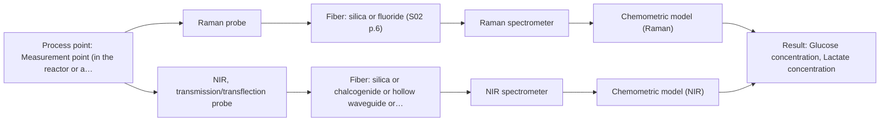
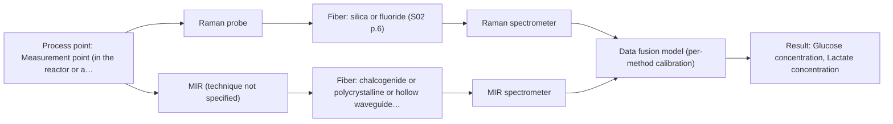

# First technical assessment: Glucose and lactate trends in an aqueous bioprocess

## Answer

**Customer request (our summary):** Cell culture process in aqueous medium; glucose and lactate currently measured from samples with a delay; customer is exploring an in situ spectroscopy pilot to be checked against the existing laboratory measurements; medium and cell population change during the run; no probe or calibration strategy selected yet.

### Brief answer

Test Raman in-line first: it suits an aqueous medium and has been reported for glucose and lactate. Run it side by side with NIR transmission on representative samples across the run, so the medium's optical state can be checked. Still open: the target ranges, required accuracy and response time, the reference method's uncertainty, and whether the medium becomes too turbid for transmission.

### Proposal

- **Best current option:** O2 (recommended)
- **Basis:** supplied AFS sources
- **What would change it:** If the medium is confirmed optically clear and stable, the single-method NIR option could be enough and the second instrument would not be needed; if neither single method reaches the required accuracy or detection limit at the worst process state, the fused Raman plus MIR-ATR option becomes the candidate. A reference method whose own uncertainty is larger than the required difference would change the whole plan, because the comparison could not confirm anything.
- **Next step:** Answer the deciding questions - target ranges and required accuracy and response time, the reference method's uncertainty and delay, and the medium's optical state and how it changes during the run - so the single-method trial can be specified.

**Secondary evidence (external, not AFS material):** G1: E02 ¶82, E02 ¶36; G2: no usable external source found; G3: E03 ¶27, E01 ¶12; G4: no usable external source found. See Expert detail.

**Decision status:** Provisional feasibility assessment

### Solution options

| ID | Tier | Methods | Confidence | Cost class, S01 Table 1 (p.6) | Ease of use | Maintenance | Performance fit | Sources |
|---|---|---|---|---|---|---|---|---|
| O1 | Simple | M1 Raman probe | Medium: open question: Q1 (starts at Medium) | high cost (row 12) | one probe, one spectrometer, one model | probe cleaning, periodic model re-check | one method for both aqueous analytes | [1: S01 p.16] [2: S01 p.16] |
| O2 | Recommended | M1 Raman probe; M2 NIR, transmission/transflection probe | Low: open question: Q1 (starts at Medium); sample clarity unknown | high cost (rows 7, 12) | two instruments to run and align | two calibrations and two instrument checks | compares the two most likely methods directly | [3: S01 p.16] [4: S01 p.3] [1: S01 p.16] [2: S01 p.16] [5: S01 p.18] [6: S01 p.18] |
| O3 | Extended (multi-method) | M1 Raman probe; M3 Raman probe + MIR (combination) | Low: open question: Q1 (starts at Medium); multi-method, fusion benefit not yet shown | at least high cost (row 12); MIR row not identified | combined probe, two instruments, fused model | per-block calibration, combined probe care | adds MIR bands if one method falls short | [7: S01 p.8] [8: S01 p.8] [9: S01 p.8] [10: S01 p.9] [1: S01 p.16] [2: S01 p.16] [11: S01 p.11] [12: S01 p.7] |

*Confidence rates the basis of the advice (how much is known and cited), not a predicted accuracy or probability of success. It starts at High, or at Medium when a key question on the method or the option is open, and drops one level per weakness listed (floor Low).*

*Cost class is the relative rating in S01 Table 1 (p.6) for the in-line method+technique rows named (the highest one for a multi-method option); it is not a price.*

### Setup sketch

*Recommended option O2; drawn by code from the option, a schematic, not a configuration.*

### Key questions

1. What are the target concentration ranges for glucose and lactate, and what accuracy, detection limit and response time must the in-line result meet?
2. How clear, turbid or scattering is the medium at the intended measurement point, and how does it change with cell density during the run?
3. Where should the measurement sit - inside the bioreactor or in a sidestream - and what are the temperature, pressure, sterilisation and cleaning conditions at that point?

## Expert detail

**Customer enquiry**

> We run a cell culture process in an aqueous medium. Glucose and lactate are measured from samples, and the delay makes it difficult to see changes promptly. We are exploring an in situ spectroscopy pilot that can be checked against those existing laboratory measurements. The medium and cell population change during the run; we have not yet selected a probe or a calibration strategy.

**Decision status:** Provisional feasibility assessment. A shortlist of methods worth testing can be justified from the supplied sources, and no central premise of the enquiry is contradicted. It remains provisional because the target ranges, the required accuracy and response time, the reference method's uncertainty and the medium's optical state are not yet known, so the choice of method and geometry rests on stated assumptions.

### Parameters

| ID | Parameter | Kind | Need | Measured by | Why | Sources |
|---|---|---|---|---|---|---|
| P1 | Glucose concentration | quantitative | required | Spectroscopy: Raman | It is one of the two analytes the customer measures from samples and wants to follow in line. | [2: S01 p.16] |
| P2 | Lactate concentration | quantitative | required | Spectroscopy: Raman | It is the second analyte the customer measures from samples and wants to follow in line. | [2: S01 p.16] |
| P3 | Cell density or biomass | quantitative | optional | Reference lab method: cell count and viability (existing laboratory method) | The cell population changes during the run and its scattering is part of the physical variation the calibration has to cover; it should be available from existing process data. | [13: REF §5] |

### Solution option details

- **O1 cost drivers:** one spectrometer, one fiber probe, calibration effort
- **O2 cost drivers:** two spectrometers, two probes, reference measurements
- **O3 cost drivers:** two instruments, combined probe, fusion modelling
- **O3 combining methods:** The two methods have to sample the same small area and the data have to be brought to a common time step before any joint model; a combined probe head is designed to place both measuring interfaces at one point. Each block keeps its own calibration and diagnostics, and the fused model has to be validated on independent runs and beat the best single method, otherwise the second instrument is not justified.

*Extended (multi-method) option O3; drawn by code from the option, a schematic, not a configuration.*

### Premise check

- **Not covered:** The existing laboratory sample measurements are a suitable reference against which the in situ spectroscopy pilot can be checked. No supplied page addresses whether an existing at-line laboratory measurement can serve as the reference for a feasibility comparison, or what its own uncertainty and delay are. *(no verified source: engineering judgement)*
- **Precedent only:** In situ spectroscopy can give a response time adequate for this process. The sources report Raman in a reactor for metabolites including glucose and lactate, and describe fiber probes giving results in near real time; both are reasons to test, not proof for this process. [2: S01 p.16] [14: S01 p.2]
- **Not covered:** An in situ pilot can proceed before target feasibility, probe choice and calibration strategy are settled. No supplied page states when an in situ pilot may start relative to target feasibility, probe choice and calibration strategy. *(no verified source: engineering judgement)*

### Requirements

**Stated by the customer**

- "We run a cell culture process"
- "an aqueous medium"
- "Glucose and lactate are measured from samples"
- "the delay makes it difficult to see changes promptly"
- "We are exploring an in situ spectroscopy pilot"
- "checked against those existing laboratory measurements"
- "The medium and cell population change during the run"
- "we have not yet selected a probe or a calibration strategy"

**Key unknowns**

- Target concentration ranges for glucose and lactate, and the required accuracy, detection limit and response time.
- Reference method: analyzer type, sampling frequency, and its own uncertainty and delay.
- Optical state of the medium at the measurement point and how it changes with cell density during the run.
- Measurement location (in the reactor or a sidestream), distance to the instrument, and temperature, pressure, sterilisation and cleaning conditions.
- Number of runs and independent reference samples available for calibration and validation.
- Composition changes of the medium during the run (feeds, dissolved gas, pH) and whether they confound the models.

### Clarification questions (most decision-relevant first)

Q1. What are the target concentration ranges for glucose and lactate, and what accuracy, detection limit and response time must the in-line result meet? *Why it matters:* These numbers are the go/no-go basis and decide whether one method can cover both analytes. *(affects: method)*
Q2. How clear, turbid or scattering is the medium at the intended measurement point, and how does it change with cell density during the run? *Why it matters:* The optical state decides whether transmission or transflection stays measurable and which probe geometry is realistic. *(affects: technique)*
Q3. Where should the measurement sit - inside the bioreactor or in a sidestream - and what are the temperature, pressure, sterilisation and cleaning conditions at that point? *Why it matters:* Location and conditions determine the probe, the fiber link, the interface material and the fouling regime. *(affects: installation)*
Q4. Which analyzer and sampling frequency does the existing laboratory method use, and what are its own uncertainty and delay? *Why it matters:* The comparison can be no better than the reference, so its uncertainty sets the smallest difference the pilot can confirm. *(affects: status)*
Q5. How many pilot runs and independent reference samples will be available for calibration and for validation on held-out runs? *Why it matters:* The number of independent runs decides whether a calibration can be validated and whether testing a combined method is worth the extra effort. *(affects: M1, M3)*

### Recommendation

- **M1 · Primary candidate: Raman probe.** Raman suits an aqueous medium and has been reported for direct detection of metabolites such as glucose and lactate in a reactor. That report is a published example, so it is a reason to test the method here, not proof for this process. [1: S01 p.16] [2: S01 p.16]
- **M2 · Conditional candidate: NIR, transmission/transflection probe.** NIR is reported as effective for major components such as glucose in the millimolar range, and transmission is described as the preferred geometry for transparent or semi-transparent liquids. It applies only while the medium passes enough light at the chosen pathlength. *Conditions:* Applies if the medium is transparent to semi-transparent at a controlled pathlength and does not become too turbid or too thick during the run. [3: S01 p.16] [5: S01 p.18] [6: S01 p.18]
- **M3 · Conditional candidate: Raman probe + MIR (combination).** Mid-IR and Raman spectra are described as complementary, and complex multicomponent samples may need two or more spectral methods; any gain from combining them is a hypothesis to test. This entry applies only if the single-method tests do not cover both analytes. *Conditions:* Applies only if the single-method tests (M1 and M2) do not reach the customer's stated targets for glucose and lactate. [11: S01 p.11] [12: S01 p.7] Later hypothesis, after single-method tests.
- **M4 · Not recommended: fluorescence probe.** Fluorescence measures only species that fluoresce, and most chemicals do not; no fluorescent species or indicator for glucose or lactate was named in the enquiry. It is therefore not a route to the two stated analytes. [15: S01 p.5] [16: S04 p.4]

### Measurement concept

- **Probe and geometry:** No probe and no geometry are selected yet. The candidates follow the methods: a Raman probe for contact measurement in the reactor or a sidestream; NIR transmission or transflection through a defined pathlength; MIR-ATR with the crystal in contact with the medium.
- **Location:** Measurement point (in the reactor or a sidestream) and distance to the instrument are open; they decide the probe, the fiber link and the fouling regime.
- **Fiber link:** No fiber family is proposed in the enquiry, and no source states an achievable link length for a MIR probe, so the link has to be settled with the configuration. [17: S01 p.10] [18: S01 p.18]

### Spectral range

- **Raman:** Raman shift, expressed in cm-1; the laser excitation wavelength is a separate quantity and is not fixed by the enquiry. [19: S01 p.11] [20: S01 p.11]
- **NIR:** 780-2500 nm nominal; the usable range depends on the instrument, fiber and probe actually selected. [21: S01 p.10] [22: REF §5]
- **MIR:** 4000-400 cm-1 nominal; used only in the combined option, and the usable range depends on the fiber and crystal selected. [23: S01 p.9]

### Risks and uncertainty

- The optical state of the medium is unknown; if it becomes too turbid or too thick, transmission and transflection lose the signal and the geometry has to change. *(rules: R-GEO-2, R-GEN-4)* [6: S01 p.18]
- The Raman signal is weak and can be swamped by fluorescence from the medium or the cells, which has to be checked on real samples before a probe and excitation are chosen. *(rules: R-RAM-1)* [24: S01 p.11] [25: S01 p.11]
- The medium and cell population change during the run, so a calibration built on one process state may not hold and has to be re-validated on the changed matrix. *(rules: R-CAL-1, R-GEN-5)* [26: REF §5] [27: S01 p.7]
- NIR may lack the sensitivity for low-concentration components, and the required detection limit has not been stated, so the method could miss the target even if the geometry fits. *(rules: R-NIR-4)* [28: S01 p.16]

### First feasibility experiment

1. **Collect representative samples or process states across the expected chemical and physical variation: early-run and late-run medium, feed additions, low to high cell density, and more than one batch.** Cover the variation the model has to survive. [29: REF §3]
2. **Measure every sample with Raman first and, in parallel, with NIR transmission or transflection at a defined pathlength; record the glucose and lactate values from the existing laboratory method together with its delay and uncertainty.** Single methods first, each against an independent reference. [18: S01 p.18]
3. **Build one calibration model per method on a calibration subset and validate it on held-out runs or batches, not on repeated measurements from the same run.** Show that the model transfers to runs it has not seen. [30: S03 p.14]
4. **Test the alternative geometry on the process states where the first choice fails, for example a turbid, high-cell-density state, and keep the geometry that stays measurable.** Decide the technique from measured behaviour, not assumption. *(no verified source: engineering judgement)*
5. **Only if the best single method misses the customer's criteria, test the Raman plus MIR-ATR combination: both signals from the same spot, brought to a common time step, each block with its own calibration, and keep it only if it beats the best single method on held-out runs.** Test the fusion hypothesis last and against the single-method baseline. [7: S01 p.8] [8: S01 p.8]

**Reference measurements:** The existing laboratory glucose and lactate measurements are the intended reference; their analyzer, sampling frequency, uncertainty and delay still have to be stated (Q4), because the comparison can be no better than the reference.

**Decision basis:** Go if one method reaches the customer's stated accuracy, detection limit and response time on held-out runs at the worst optical state of the medium; no-go if none does, or if the reference method cannot resolve the required difference. The numerical criteria must come from the customer (Q1) and have not been stated.

### Assumptions

- The medium is a liquid at the measurement point and remains pumpable or stirrable there.
- The existing laboratory glucose and lactate values are traceable enough to serve as reference values; this is not confirmed by any source.
- Glucose and lactate are present at concentrations in the range the methods are reported for; no ranges were given.
- The cell population is present in the same medium that is measured, so its scattering affects the spectrum.

### Not covered by the supplied sources

- Whether the customer's existing laboratory glucose and lactate measurements are a suitable reference for a feasibility comparison, and what their uncertainty and delay are: no supplied page addresses reference-method suitability.
- An in situ fiber-probe installation for a cell culture bioreactor (probe type, sterilisation, cleaning): the sources describe in-line fiber probes generally, but no cell culture installation.
- Achievable response time, accuracy and detection limit for glucose and lactate in this medium: no supplied page states figures for these analytes.

### Further notes

- **Chemometrics:** Calibration models are specific to the matrix and the process state, so a model built on one phase of the run has to be re-validated, and usually extended, as the medium and cell population change. Both NIR and Raman models are built from reference values, so the quality of the existing laboratory values limits what the model can show.
- **Real-time tracking:** The stated problem is the sampling delay: fiber probes integrated into reactors and lines give on-site online analysis with results in near real time, and online measurement requires high-speed acquisition. Whether the chosen method and probe reach the response time the process needs is still open and is one of the deciding questions.
- **Future direction:** Once the informative spectral regions and the best method are known from the trial, the analysis could be narrowed to a compact analyzer with a few selected wavelengths, which the sources describe as the route away from several benchtop spectrometers.

### Secondary evidence (external, not AFS material)

*Found by a literature search for gaps the supplied AFS sources leave open. Not AFS material and not proof for this case; every quote below was verified verbatim against the fetched text.*

**G1 · multi-method:** Combining several spectroscopy methods (data fusion) (The two methods have to sample the same small area and the data have to be brought to a common time step before any joint model; a combined probe head is designed to place both measuring interfaces at one point. Each block keeps its own calibration and diagnostics, and the fused model has to be validated on independent runs and beat the best single method, otherwise the second instrument is not justified.)

- **E02 ¶82** Before fusing data from multiple sources, the contribution of each dataset and its complementarity should be evaluated. *How it applies:* This supports testing whether a second Raman block adds complementary information and whether the fused model beats the best single method before justifying the extended option. *Limits and transfer risks:* The source is a general PAT data-fusion review; it does not cover cell culture medium, same-area probe alignment, or common time-step requirements. *(supports O3)*
  > "Before fusing data from multiple sources, it is essential to evaluate the contribution of each dataset to the model and its complementarity."
  > Challenges and Opportunities of Implementing Data Fusion in Process Analytical Technology-A Review. (2022) · Molecules (Basel, Switzerland) · doi:10.3390/molecules27154846 · https://europepmc.org/article/PMC/PMC9369811 · retrieved 2026-10-17, full text, licence: cc by, via curated library
- **E02 ¶36** Instrument complementarity alone was not sufficient to improve prediction of several CQAs in a Raman and FT-IR food study. *How it applies:* This cautions that adding a second measurement channel may not improve the fused model; independent-run validation against the best single method is needed. *Limits and transfer risks:* The cited study is food analytical and uses Raman and FT-IR, not two Raman probes in cell culture; transfer to this medium and probe arrangement is uncertain. *(supports O3)*
  > "In some situations, instrument complementarity (not data complementarity) was not sufficient to improve the performance of predictive several CQAs, as shown by a Raman and FT-IR data based food analytical study [73]."
  > Challenges and Opportunities of Implementing Data Fusion in Process Analytical Technology-A Review. (2022) · Molecules (Basel, Switzerland) · doi:10.3390/molecules27154846 · https://europepmc.org/article/PMC/PMC9369811 · retrieved 2026-10-17, full text, licence: cc by, via curated library

**G2 · not in the supplied sources:** Whether the customer's existing laboratory glucose and lactate measurements are a suitable reference for a feasibility comparison, and what their uncertainty and delay are: no supplied page addresses reference-method suitability.

- No usable external source found.

**G3 · not in the supplied sources:** An in situ fiber-probe installation for a cell culture bioreactor (probe type, sterilisation, cleaning): the sources describe in-line fiber probes generally, but no cell culture installation.

- **E03 ¶27** Contamination of the probe window by a binder during the process can make accurate measurement impossible. *How it applies:* This highlights cleaning and fouling as risks to check when installing an in situ probe in a cell culture bioreactor. *Limits and transfer risks:* The source concerns pharmaceutical unit operations with binder addition, not cell culture medium or sterilisation; the fouling mechanism may differ.
  > "However, an accurate measurement may not be possible because of contamination of the probe window due to the addition of a binder during the process, which is a disadvantage."
  > Process Analytical Technology Tools for Monitoring Pharmaceutical Unit Operations: A Control Strategy for Continuous Process Verification. (2021) · Pharmaceutics · doi:10.3390/pharmaceutics13060919 · https://europepmc.org/article/PMC/PMC8234957 · retrieved 2026-10-17, full text, licence: cc by, via curated library
- **E01 ¶12** Temperature sensitivity of OH bands is a severe drawback for measuring aqueous solution in NIR and MIR, making tempered sample holders necessary. *How it applies:* This suggests temperature control may need attention for an in situ NIR/MIR installation in aqueous cell culture medium. *Limits and transfer risks:* The source is a review and refers to tempered sample holders, not in situ fiber probes or cell culture bioreactors; transfer to a sterilised probe installation is uncertain. *(supports O2)*
  > "Additionally, the temperature sensitivity of the OH bands is a severe drawback for measuring aqueous solution in NIR and MIR, which makes tempered sample holders necessary [29]."
  > A critical review of recent trends, and a future perspective of optical spectroscopy as PAT in biopharmaceutical downstream processing. (2020) · Analytical and bioanalytical chemistry · doi:10.1007/s00216-020-02407-z · https://europepmc.org/article/PMC/PMC7072065 · retrieved 2026-10-17, full text, licence: cc by, via curated library

**G4 · not in the supplied sources:** Achievable response time, accuracy and detection limit for glucose and lactate in this medium: no supplied page states figures for these analytes.

- No usable external source found.

### Evidence (verified quotes)

1. ✓ **S01 p.16** (general): "Raman is particularly well-suited for aqueous environments, as it exhibits low absorbance for water molecules compared to infrared methods."
2. ✓ **S01 p.16** (application precedent): "Raman spectroscopy can be used in the same reactor to provide a "molecular fingerprint" for direct detection of specific metabolites like glucose, acetate, or lactate."
3. ✓ **S01 p.16** (general): "NIR spectroscopy is effective for tracking major components like glucose or glycerol in the millimolar range but may lack the sensitivity to detect trace compounds below 0.1 percent."
4. ✓ **S01 p.3** (general): "samples of incompletely known composition, in order to select the most suitable method or combination of methods."
5. ✓ **S01 p.18** (general): "Transmission is the preferred method for transparent or semi-transparent liquids, such as skim milk, whey, or permeate."
6. ✓ **S01 p.18** (general): "it fails when the milk becomes too "thick" or fat-rich, as the light cannot penetrate the sample."
7. ✓ **S01 p.8** (general): "It is crucial that the spectral information obtained by different methods-Mid-IR, NIR, Raman, and fluorescence spectra-is collected from the same small, even pinpoint, area of the sample."
8. ✓ **S01 p.8** (general): "Ultimately, the measurement data must be normalized to a common time step."
9. ✓ **S01 p.8** (general): "If the variables have different units of measurement, the data should be normalized in some way, for example, using an autoscaling algorithm."
10. ✓ **S01 p.9** (general): "One of the challenges of multispectral analysis is the need to simultaneously connect at least two independently operating measuring instruments."
11. ✓ **S01 p.11** (general): "This property makes mid-IR and Raman spectra complementary, that is, they complement each other."
12. ✓ (precedent only) **S01 p.7** (method gain): "The analysis of such systems may require a combination of two or even more spectral methods."
13. ✓ **REF §5** (general): "optical density is not a viable cell count."
14. ✓ **S01 p.2** (general): "Fiber optic probes and cells are being integrated into reactors and production lines of ongoing technological processes, enabling on-site online analysis and obtaining results in near real time."
15. ✓ **S01 p.5** (general): "However, most chemicals do not exhibit this property."
16. ✓ **S04 p.4** (general): "it is limited to the samples containing at least one fluorescent component"
17. ✓ **S01 p.10** (general): "ATR fiber probes (Fig.1) enable the analysis of liquids and solid elastic samples"
18. ✓ **S01 p.18** (general): "the precise control of the optical pathlength (usually 1 - 10 mm); if the pathlength is too wide, the signal is lost to absorption; if too narrow, the sample represents a negligible volume."
19. ✓ **S01 p.11** (general): "The Raman shift is used as the horizontal (spectral) axis in Raman spectroscopy"
20. ✓ **S01 p.11** (general): "The difference between the observed frequencies and the laser frequency is called the Raman shift, expressed in units of frequency-wavenumbers (cm-1)."
21. ✓ **S01 p.10** (general): "NIR spectra (780-2500 nm) contain predominantly overtones and component bands of fundamental vibrations"
22. ✓ **REF §5** (general): "It is not a product specification: actual spectral coverage, fiber length, component ratings, detection limits and accuracy depend on the configuration and the sample."
23. ✓ **S01 p.9** (general): "Vibrational spectroscopy in the mid-IR range (4000-400 cm-1) is one of the most informative methods of chemical analysis."
24. ✓ **S01 p.11** (general): "signals, which are several orders of magnitude weaker than IR absorption peaks"
25. ✓ **S01 p.11** (general): "superposition of luminescence (fluorescence), which has a significantly higher intensity."
26. ✓ **REF §5** (general): "physical variation; calibration specific to the matrix."
27. ✓ **S01 p.7** (general): "Morphological factors, such as sample inhomogeneity (e.g., biological tissue) or process turbulence, must also be considered when selecting a measurement technique."
28. ✓ **S01 p.16** (general): "may lack the sensitivity to detect trace compounds below 0.1 percent."
29. ✓ **REF §3** (general): "Representative samples or process states, independent reference measurements, what is compared, and the basis for the go / no-go decision."
30. ✓ **S03 p.14** (general): "A thorough validation, including full, segmented and random-subset CVs, as well as randomization tests, are recommended in any cases for which important conclusions depend on calibration or discrimination models built on limited experimental material."

### Verification

- Citations verified: 39 of 39 (exact or whitespace/hyphen-tolerant match on the cited page, scope checked).
- Hard check failures before deterministic corrections: 0; still open: 0; soft warnings: 2; repair rounds: 1.
- External evidence (live): 4 quote(s) verified verbatim (exact or whitespace/hyphen-tolerant, at most 400 characters and 2 sentences, against the cited paragraph); 0 item(s) dropped.
- External search: 6 query(ies), 45 hit(s), 5 source(s) (3 from the curated library).
- External step: 2 model call(s), 73.7 s extra (cost in the run JSON).

*Run D04-20261018T003738Z · models deepseek/deepseek-v4.1-flash*
