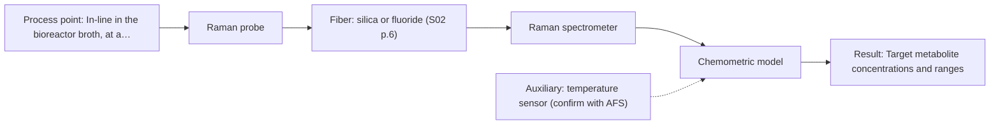
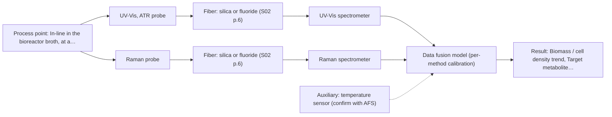

# First technical assessment: Biomass related monitoring during yeast fermentation

## Answer

**Customer request (our summary):** The customer wants an optical measurement setup for yeast fermentation to track biomass and metabolic signals despite increasing optical density.

### Brief answer

Test first a Raman probe to resolve specific metabolites in the aqueous broth, alongside a UV-Vis ATR probe for the biomass growth trend as optical density rises. Single-method trials will establish whether Raman alone or UV-Vis alone suffices before testing a combined setup. Key open points are the defined metabolic targets, bioreactor installation constraints, and your numerical go/no-go criteria.

### Proposal

- **Best current option:** O2 (recommended)
- **Basis:** supplied AFS sources
- **What would change it:** If the metabolic target turns out to be a fluorescent species or trace compound, fluorescence (M4) or NIR (M3) would replace Raman; if only the biomass growth trend is needed, the simple option O1 is sufficient, while combining both methods in O3 requires demonstrating that the fused model beats the best single method.
- **Next step:** Define the target metabolites and go/no-go criteria with the customer, then perform single-method laboratory trials on representative broth samples with independent reference measurements.

**Secondary evidence (external, not AFS material):** G1: no usable external source found; G2: no usable external source found; G3: no usable external source found; G4: no usable external source found. See Expert detail.

**Decision status:** Provisional feasibility assessment

### Solution options

| ID | Tier | Methods | Confidence | Cost class, S01 Table 1 (p.6) | Ease of use | Maintenance | Performance fit | Sources |
|---|---|---|---|---|---|---|---|---|
| O1 | Simple | M1 UV-Vis, ATR probe | High | average cost (row 14) | Simple single-probe turbidity trend | Low; one probe and window cleaning | Tracks growth trend at lowest effort | [1: S01 p.16] [2: S01 p.16] |
| O2 | Recommended | M2 Raman probe | Medium: open question: Q1 (starts at Medium) | high cost (row 12) | Single immersion probe for metabolites | Moderate; laser alignment and probe cleaning | Specific molecular fingerprint in aqueous broth | [3: S01 p.16] [4: S01 p.16] |
| O3 | Extended (multi-method) | M1 UV-Vis, ATR probe; M2 Raman probe; M5 Raman probe + UV-Vis (combination) | Low: open question: Q1 (starts at Medium); multi-method, fusion benefit not yet shown | high cost (rows 12, 14) | Two probes, moderate integration effort | Two calibrations and two probe windows | Covers growth and metabolites despite turbidity | [5: S01 p.8] [6: S01 p.8] [1: S01 p.16] [2: S01 p.16] [4: S01 p.16] [3: S01 p.16] [7: S01 p.7] |

*Confidence rates the basis of the advice (how much is known and cited), not a predicted accuracy or probability of success. It starts at High, or at Medium when a key question on the method or the option is open, and drops one level per weakness listed (floor Low).*

*Cost class is the relative rating in S01 Table 1 (p.6) for the in-line method+technique rows named (the highest one for a multi-method option); it is not a price.*

### Setup sketch

*Recommended option O2; drawn by code from the option, a schematic, not a configuration.*

### Key questions

1. Which metabolites should the 'metabolic signal' track (e.g. glucose, acetate, lactate, ethanol), and over what concentration ranges?
2. Is the metabolic change expected to involve fluorescent species such as NADH, tryptophan or riboflavin, and can an off-line fluorescence scan of the broth be run?
3. Where should the probe(s) sit (reactor port, recirculation loop), and what sterilisation, cleaning and material constraints apply?

## Expert detail

**Customer enquiry**

> We would like an optical measurement during yeast fermentation to help us follow growth and notice changes earlier. Our team has mentioned both a biomass signal and a metabolic signal, but these have not been defined as separate targets. The broth becomes more optically dense as the run develops. We need help turning this request into an initial feasibility study with useful reference measurements.

**Decision status:** Provisional feasibility assessment. The biomass target can be addressed with a turbidity-based UV-Vis signal and the metabolic target with Raman on published bioprocess precedent, but the metabolic signal is still undefined, so the shortlist rests on stated assumptions and deciding questions.

### Parameters

| ID | Parameter | Kind | Need | Measured by | Why | Sources |
|---|---|---|---|---|---|---|
| P1 | Biomass / cell density trend | quantitative | required | Spectroscopy: UV-Vis | It is the stated growth-following target and defines what the biomass signal must track. | [8: S01 p.16] |
| P2 | Identity of target metabolites | qualitative | required | Reference lab method: off-line HPLC or enzymatic assay of broth samples | The metabolic technique cannot be chosen until the 'metabolic signal' is defined as named species. | *(no verified source: engineering judgement)* |
| P3 | Target metabolite concentrations and ranges | quantitative | required | Spectroscopy: Raman | Concentration ranges decide sensitivity needs and whether NIR, Raman or fluorescence fits. | [4: S01 p.16] |
| P4 | Presence of relevant fluorescent species | qualitative | required | Reference lab method: off-line fluorescence scan of broth samples | Fluorescence is only usable if a defined fluorophore or indicator is present in the broth. | [9: S01 p.5] |
| P5 | Process temperature | quantitative | optional | Auxiliary sensor: temperature sensor (engineering judgement: confirm availability with AFS) | It should be available because temperature affects spectral and fluorescence response and should be recorded alongside spectra. | *(no verified source: engineering judgement)* |

### Solution option details

- **O1 cost drivers:** One UV-Vis ATR probe, spectrometer, basic turbidity calibration against off-line cell density
- **O2 cost drivers:** Raman spectrometer, laser source, immersion probe, multivariate calibration
- **O3 cost drivers:** Raman spectrometer and probe plus UV-Vis ATR channel, synchronisation software, two chemometric calibrations and reference assays
- **O3 combining methods:** Low-level fusion: Raman and UV-Vis ATR probes placed at the same sampling point, with data synchronised to a common time step since acquisition rates differ. Each method keeps its own calibration against its own reference assays, with block scaling so neither dominates the fused model. The fused model must beat the best single method on held-out runs, otherwise the extra instrument is dropped.

*Extended (multi-method) option O3; drawn by code from the option, a schematic, not a configuration.*

### Premise check

- **Not covered:** A biomass signal and a metabolic signal can be measured as undefined targets, without naming the species or indicators involved. The supplied sources always tie a method to named analytes or fluorophores (e.g. glucose, acetate, lactate; NADH, tryptophan, riboflavin); no source describes measuring an undefined 'metabolic signal'. The targets must be defined before technique selection is final. *(no verified source: engineering judgement)*
- **Supported:** An initial feasibility study with reference measurements is the right first step for this request. The AFS pathway explicitly starts with multi-method lab trials on the customer process before any in-line configuration is chosen. [10: S02 p.20]

### Requirements

**Stated by the customer**

- Follow yeast growth via a biomass signal.
- Notice metabolic changes earlier via a metabolic signal.
- Cope with broth optical density that increases during the run.
- Receive an initial feasibility study design with useful reference measurements.

**Key unknowns**

- Which metabolites define the 'metabolic signal' and at what concentration ranges
- Whether the broth contains relevant intrinsic fluorophores (e.g. NADH, tryptophan, riboflavin)
- Installation point, probe interface and sterilisation requirements in the bioreactor
- Required measurement frequency and response time
- Customer-defined accuracy criteria for the go/no-go decision
- Process temperature range

### Clarification questions (most decision-relevant first)

Q1. Which metabolites should the 'metabolic signal' track (e.g. glucose, acetate, lactate, ethanol), and over what concentration ranges? *Why it matters:* The metabolite identity and concentration range decide whether Raman, NIR or fluorescence is the right technique. *(affects: M2, M3, M4)*
Q2. Is the metabolic change expected to involve fluorescent species such as NADH, tryptophan or riboflavin, and can an off-line fluorescence scan of the broth be run? *Why it matters:* Fluorescence only works if a defined fluorescent species or indicator is present, so this decides whether M4 stays on the list. *(affects: M4)*
Q3. Where should the probe(s) sit (reactor port, recirculation loop), and what sterilisation, cleaning and material constraints apply? *Why it matters:* Installation constraints determine probe type, fouling risk and whether two methods can sample the same spot. *(affects: installation)*
Q4. How quickly must changes be detected, and at what measurement frequency? *Why it matters:* Response time and acquisition rate constrain the technique and any multi-method synchronisation. *(affects: technique)*
Q5. What numerical accuracy or detection criteria would you accept for a go/no-go on each target? *Why it matters:* The feasibility go/no-go basis must come from your criteria, not from assumptions. *(affects: status)*

### Recommendation

- **M1 · Primary candidate: UV-Vis, ATR probe.** Cell suspension turbidity correlates well with cell density, so UV-Vis gives a low-cost real-time biomass trend, and the ATR probe's very short path keeps working as the broth becomes optically dense. [1: S01 p.16] [2: S01 p.16]
- **M2 · Comparison candidate: Raman probe.** Raman provides a molecular fingerprint for direct detection of specific metabolites in the same reactor and tolerates water better than infrared methods. [4: S01 p.16] [3: S01 p.16]
- **M3 · Conditional candidate: NIR, diffuse reflection probe.** NIR can track major components such as glucose or glycerol in the millimolar range via diffuse reflection, which suits scattering broths. *Conditions:* Apply only if the defined metabolic targets are major components; NIR may lack sensitivity for trace compounds below 0.1 percent. [11: S01 p.16]
- **M4 · Conditional candidate: fluorescence probe.** Fluorescence offers high-sensitivity detection of cofactors and amino acids such as NADH, tryptophan and riboflavin, which can serve as an early metabolic-state indicator. *Conditions:* Apply only if a defined fluorescent species relevant to the metabolic target is present in the broth; most chemicals do not fluoresce. [12: S01 p.16] [9: S01 p.5]
- **M5 · Comparison candidate: Raman probe + UV-Vis (combination).** Combining Raman (metabolites) with UV-Vis ATR (biomass) is a hypothesis for covering both targets in one setup, to be tested only after the single-method trials and only if it beats the best single method. *Conditions:* Test as a later hypothesis after M1 and M2 single-method results, with aligned sampling location and timing. [7: S01 p.7] [5: S01 p.8]
- **M6 · Not recommended: UV-Vis, transmission/transflection probe.** A transmission setup might seem the obvious biomass route, but it saturates once the broth becomes optically dense because light cannot penetrate the bulk. [13: S01 p.16]

### Measurement concept

- **Probe and geometry:** Immersion UV-Vis ATR probe for the biomass/turbidity trend, and a Raman immersion probe for the metabolic fingerprint; both placed at the same sampling point or as close as the reactor ports allow.
- **Location:** In-line in the bioreactor broth, at a position representative of the bulk (avoiding dead zones), to be fixed with the customer.
- **Fiber link:** Silica fibers for UV-Vis and Raman; the usable spectral range depends on the instrument, fiber and probe actually selected, which is not yet defined. [14: S01 p.16] [15: S01 p.15]

### Spectral range

- **UV-Vis:** Nominal UV-Vis range depends on the target and setup; the UV region of high sensitivity is 190-360 nm, but the usable range depends on the selected instrument, fiber and probe. [16: S01 p.5]
- **Raman:** Raman is reported as Raman shift in cm-1 with the laser excitation wavelength stated separately; the excitation wavelength for this application is not yet selected. [17: S01 p.11]

### Risks and uncertainty

- The undefined 'metabolic signal' may turn out to be a trace or non-Raman-active species, invalidating M2 as the primary metabolic technique. *(rules: R-NIR-4)* *(no verified source: engineering judgement)*
- Probe windows (ATR crystal, Raman optics) may foul in the fermenter, degrading the signal over long runs. *(rules: R-MIR-3)* *(no verified source: engineering judgement)*
- Fluorescence background from broth components can swamp the weak Raman signal and must be checked on real samples. *(rules: R-RAM-1)* [18: S01 p.11]
- Calibrations are specific to the broth matrix and may need rebuilding if the medium or process changes. *(rules: R-CAL-1)* *(no verified source: engineering judgement)*

### First feasibility experiment

1. **Define the two targets with the customer: the biomass measure (e.g. cell density) and the named metabolites with concentration ranges, plus the go/no-go criteria.** Turn the high-level request into defined, measurable targets. *(no verified source: engineering judgement)*
2. **Collect representative broth samples across the expected variation: early-run low optical density through late-run high optical density, across different batches and process states.** Cover the chemical and physical variation the in-line method must handle. *(no verified source: engineering judgement)*
3. **Run independent reference measurements on each sample: off-line cell density / cell dry weight for biomass, and HPLC or enzymatic assays for the named metabolites, plus an off-line fluorescence scan of the broth.** Provide the reference data the spectral models must be calibrated and validated against. *(no verified source: engineering judgement)*
4. **Test single methods first in the laboratory on the same samples: UV-Vis ATR for the biomass trend and Raman for the metabolites; include NIR diffuse reflection and a fluorescence scan as conditional checks.** Establish what each method alone can deliver before any combination is considered. [10: S02 p.20]
5. **Build and validate per-method chemometric models on held-out runs or batches, and only then test the Raman + UV-Vis combination against the best single method, using the customer's numerical criteria as the go/no-go basis.** Verify that each method, and any fusion, meets the agreed performance before an in-line configuration is proposed. [19: S01 p.10]

**Reference measurements:** Off-line cell density / cell dry weight, HPLC or enzymatic metabolite assays, and an off-line fluorescence scan of the broth.

**Decision basis:** Customer-defined numerical accuracy criteria per target, assessed on held-out runs or batches; no criteria are stated in the enquiry, so these must be agreed (Q5).

### Assumptions

- The broth is aqueous and the process runs at conditions compatible with immersion fiber probes.
- The 'biomass signal' means a cell-density-related optical trend, not a cell count.
- The metabolic target will be definable as one or more named metabolites or fluorophores.

### Not covered by the supplied sources

- Which specific metabolites matter in this customer's yeast fermentation and their concentration ranges.
- Whether this specific broth contains fluorophores relevant to the metabolic target.

### Further notes

- **Chemometrics:** Both the biomass trend and the metabolite models will need chemometric calibration (e.g. PLS regression) against the off-line reference measurements, validated on held-out runs or batches; NIR and Raman calibrations are specific to the broth matrix and must be re-validated if the medium changes.
- **Real-time tracking:** The goal is continuous in-line tracking across the run; if two methods are combined, acquisition rates differ and the data must be normalised to a common time step, so the required detection response time (Q4) should be fixed early.
- **Future direction:** Once the targets are defined and validated, a compact customized spectral fiber sensor for the specific control task could be developed as a later step.

### Secondary evidence (external, not AFS material)

*Found by a literature search for gaps the supplied AFS sources leave open. Not AFS material and not proof for this case; every quote below was verified verbatim against the fetched text.*

**G1 · auxiliary sensor:** In-line measurement of Process temperature with temperature sensor

- No usable external source found.

**G2 · multi-method:** Combining several spectroscopy methods (data fusion) (Low-level fusion: Raman and UV-Vis ATR probes placed at the same sampling point, with data synchronised to a common time step since acquisition rates differ. Each method keeps its own calibration against its own reference assays, with block scaling so neither dominates the fused model. The fused model must beat the best single method on held-out runs, otherwise the extra instrument is dropped.)

- No usable external source found.

**G3 · not in the supplied sources:** Which specific metabolites matter in this customer's yeast fermentation and their concentration ranges.

- No usable external source found.

**G4 · not in the supplied sources:** Whether this specific broth contains fluorophores relevant to the metabolic target.

- No usable external source found.

### Evidence (verified quotes)

1. ✓ **S01 p.16** (general): "UV/Vis spectroscopy can be deployed as a low-cost, robust tool for real-time biomass monitoring, as cell suspension turbidity correlates well with cell density."
2. ✓ **S01 p.16** (general): "extremely short path length that enables the measurement of "black" or highly scattering fluids without dilution."
3. ✓ **S01 p.16** (general): "Raman is particularly well-suited for aqueous environments, as it exhibits low absorbance for water molecules compared to infrared methods."
4. ✓ **S01 p.16** (application precedent): "Raman spectroscopy can be used in the same reactor to provide a "molecular fingerprint" for direct detection of specific metabolites like glucose, acetate, or lactate."
5. ✓ **S01 p.8** (general): "the data from each method must be obtained simultaneously."
6. ✓ **S01 p.8** (general): "If the variables have different units of measurement, the data should be normalized in some way, for example, using an autoscaling algorithm."
7. ✓ (precedent only) **S01 p.7** (method gain): "The analysis of such systems may require a combination of two or even more spectral methods."
8. ✓ **S01 p.16** (general): "cell suspension turbidity correlates well with cell density."
9. ✓ **S01 p.5** (general): "However, most chemicals do not exhibit this property."
10. ✓ **S02 p.20** (general): "1. Multi-Method Lab Trials AFS tests your process using all key fiber optic spectroscopy methods."
11. ✓ **S01 p.16** (general): "NIR spectroscopy is effective for tracking major components like glucose or glycerol in the millimolar range but may lack the sensitivity to detect trace compounds below 0.1 percent."
12. ✓ **S01 p.16** (general): "Fluorescence spectroscopy can be used for high-sensitivity detection (down to the nM-μM range) of critical cofactors and amino acids like NADH, tryptophan, and riboflavin."
13. ✓ **S01 p.16** (general): "transmission setup becomes saturated because the light cannot penetrate the bulk of the sample."
14. ✓ **S01 p.16** (general): "a UV-ATR (Attenuated Total Reflection) probe is used."
15. ✓ **S01 p.15** (general): "The use of fiber optics is critical here, as it allows the sensitive spectrometers to be located safely away from the vibration and dust of the manufacturing floor."
16. ✓ **S01 p.5** (general): "It has very high sensitivity, especially in the UV region (190-360 nm)"
17. ✓ **S01 p.11** (general): "The Raman shift is used as the horizontal (spectral) axis in Raman spectroscopy"
18. ✓ **S01 p.11** (general): "superposition of luminescence (fluorescence), which has a significantly higher intensity."
19. ✓ **S01 p.10** (general): "The broad absorption bands observed in this region overlap, suggesting the use of chemometrics for quantitative and qualitative analysis of spectral data."

### Verification

- Citations verified: 25 of 25 (exact or whitespace/hyphen-tolerant match on the cited page, scope checked).
- Hard check failures before deterministic corrections: 0; still open: 0; soft warnings: 4; repair rounds: 1.
- External evidence (live): 0 quote(s) verified verbatim (exact or whitespace/hyphen-tolerant, at most 400 characters and 2 sentences, against the cited paragraph); 0 item(s) dropped.
- External search: 4 query(ies), 35 hit(s), 5 source(s) (3 from the curated library).
- External step: 2 model call(s), 5.4 s extra (cost in the run JSON).

*Run D05-20261018T094733Z-ef92 · models google/gemini-3.5-flash-lite, google/gemini-3.8-flash, z-ai/glm-5.3-flash*
