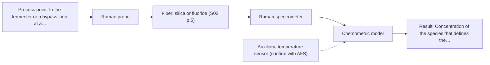
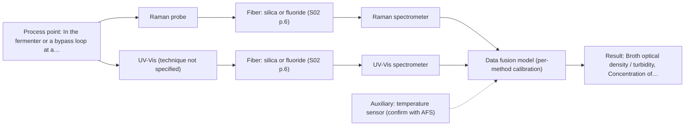

# First technical assessment: Biomass related monitoring during yeast fermentation

## Answer

**Customer request (our summary):** Customer wants an optical measurement during yeast fermentation to follow growth and detect changes earlier, mentioning a biomass signal and a metabolic signal that are not yet defined as separate targets; they ask for help shaping an initial feasibility study with useful reference measurements.

### Brief answer

Test the single methods first on representative broth: Raman for the metabolic signal and UV-Vis for the growth signal, each against an independent reference. Raman suits the aqueous broth; UV-Vis turbidity tracks cell density but is not a cell count. Which species the metabolic signal is, and whether the broth stays optically thin enough for transmission, are still open and decide the method. A combined Raman and UV-Vis option is a later hypothesis to test.

### Proposal

- **Best current option:** O2 (recommended)
- **Basis:** engineering judgement
- **What would change it:** If the metabolic signal turns out to be a fluorescent species, fluorescence would join the shortlist; if the broth stays optically thin enough, UV-Vis transmission could replace the ATR geometry and become the simplest first test.
- **Next step:** Agree the reference methods and the go/no-go numbers with the customer, then run the single-method tests on representative broth samples.

**Decision status:** Provisional feasibility assessment

### Solution options

| ID | Tier | Methods | Confidence | Cost class, S01 Table 1 (p.6) | Ease of use | Maintenance | Performance fit | Sources |
|---|---|---|---|---|---|---|---|---|
| O1 | Simple | M2 UV-Vis, ATR probe | Low: open question: Q1, Q2 (starts at Medium); uncited auxiliary sensor | average cost (row 14) | simple, robust turbidity measurement | probe cleaning and reference sampling | answers the growth question with least effort | [1: S01 p.16] [2: S01 p.16] |
| O2 | Recommended | M1 Raman probe | Low: open question: Q1 (starts at Medium); uncited auxiliary sensor | high cost (row 12) | moderate, needs spectral calibration | probe cleaning and calibration checks | targets the metabolic signal in water | [3: S01 p.16] [4: S01 p.16] [5: S01 p.12] |
| O3 | Extended (multi-method) | M3 Raman probe + UV-Vis (combination) | Low: open question: Q1 (starts at Medium); uncited auxiliary sensor; multi-method, fusion benefit not yet shown | high cost (rows 12, 14) | two instruments to run together | per-instrument calibration and cleaning | covers biomass and metabolic targets together | [6: S01 p.16] [7: S01 p.8] [8: S01 p.9] [9: S01 p.7] [10: S01 p.8] |

*Confidence rates the basis of the advice (how much is known and cited), not a predicted accuracy or probability of success. It starts at High, or at Medium when a key question on the method or the option is open, and drops one level per weakness listed (floor Low).*

*Cost class is the relative rating in S01 Table 1 (p.6) for the in-line method+technique rows named (the highest one for a multi-method option); it is not a price.*

### Setup sketch

*Recommended option O2; drawn by code from the option, a schematic, not a configuration.*

### Key questions

1. Which species or variable is the "metabolic signal", and does it fluoresce (for example an intrinsic cofactor such as NADH)?
2. What is the broth's optical density over the run, and does it stay within a controlled transmission pathlength or become too dense?
3. Which reference method should the optical measurement be compared with, and what accuracy, detection limit and response time must it meet against the current method?

## Expert detail

**Customer enquiry**

> We would like an optical measurement during yeast fermentation to help us follow growth and notice changes earlier. Our team has mentioned both a biomass signal and a metabolic signal, but these have not been defined as separate targets. The broth becomes more optically dense as the run develops. We need help turning this request into an initial feasibility study with useful reference measurements.

**Decision status:** Provisional feasibility assessment. The known facts support a shortlist but not a final method choice: both targets are undefined and the broth's optical regime is unknown. A conditional shortlist with explicit assumptions is the honest position.

### Parameters

| ID | Parameter | Kind | Need | Measured by | Why | Sources |
|---|---|---|---|---|---|---|
| P1 | Broth optical density / turbidity | quantitative | required | Spectroscopy: UV-Vis | It is the physical signal that tracks growth and it sets whether a transmission or ATR geometry is usable. | [11: S01 p.16] [12: REF §5] |
| P2 | Biomass / cell density | quantitative | required | Reference lab method: the customer's reference cell-count or dry-weight method (to be named) | It is the independent reference against which the optical biomass proxy is calibrated and validated. | [13: REF §3] |
| P3 | Concentration of the species that defines the metabolic signal | quantitative | required | Spectroscopy: Raman | It is the second stated target, the change the customer wants to detect earlier; the species itself still has to be named. | [3: S01 p.16] |
| P4 | Temperature | quantitative | required | Auxiliary sensor: temperature sensor (engineering judgement: confirm availability with AFS) | It affects both the fermentation rate and the stability of the optical measurement. | *(no verified source: engineering judgement)* |

### Solution option details

- **O1 cost drivers:** one UV-Vis spectrometer and ATR probe, reference cell counts
- **O2 cost drivers:** Raman spectrometer, laser and probe, reference metabolite assays
- **O3 cost drivers:** two spectrometers and probes, synchronisation and data fusion
- **O3 combining methods:** Start from one model per method, UV-Vis for biomass and Raman for metabolites, then fuse the two spectral blocks at the low level with autoscaling so neither method dominates. Both probes must look at the same broth point and the two data streams must be normalised to a common time step before fusion. The fused model must beat the best single method on held-out runs, or the second instrument is not worth keeping.

*Extended (multi-method) option O3; drawn by code from the option, a schematic, not a configuration.*

### Premise check

- **Precedent only:** An optical measurement will let them follow yeast growth in-line. The sources report that UV/Vis turbidity tracks cell density in bioprocessing, which is a reason to test the method here, not proof for this broth. [1: S01 p.16]
- **Precedent only:** A metabolic signal exists as a usable signal, even though it is not defined as a target. The sources show Raman fingerprinting of specific metabolites and fluorescence detection of cofactors in bioprocessing; the species still has to be named. [3: S01 p.16] [14: S01 p.16]
- **Supported:** The request can be turned into an initial feasibility study with useful reference measurements before the facts are known. The guidance sets out exactly this plan shape: representative samples or process states, independent reference measurements and a go/no-go basis. [13: REF §3]

### Requirements

**Stated by the customer**

- Optical measurement during yeast fermentation
- Follow growth (biomass signal)
- Notice changes earlier (metabolic signal)
- Broth becomes more optically dense as the run develops
- Help shaping an initial feasibility study with useful reference measurements

**Key unknowns**

- Which quantity defines the biomass target and what range is required
- Which species or variable defines the metabolic signal, and whether it fluoresces
- The broth's absolute optical density over the run and its scattering versus absorption character
- The reference method and the required accuracy, detection limit and response time
- Installation point, probe interface, optical path length, and CIP/SIP and fouling constraints
- Organism and strain, fermenter scale, temperature and run duration

### Clarification questions (most decision-relevant first)

Q1. Which species or variable is the "metabolic signal", and does it fluoresce (for example an intrinsic cofactor such as NADH)? *Why it matters:* It decides whether Raman or fluorescence is the right method for the metabolic target. *(affects: method, M1)*
Q2. What is the broth's optical density over the run, and does it stay within a controlled transmission pathlength or become too dense? *Why it matters:* It decides whether a UV-Vis transmission or ATR geometry is used, and whether transmission stays valid late in the run. *(affects: technique, M2)*
Q3. Which reference method should the optical measurement be compared with, and what accuracy, detection limit and response time must it meet against the current method? *Why it matters:* Without these numbers the go/no-go basis cannot be set. *(affects: status)*
Q4. Where will the probe be installed, what interface and path length are available, and what cleaning, sterilisation (CIP/SIP) and fouling constraints apply? *Why it matters:* It decides the probe geometry and whether the installation is feasible. *(affects: installation)*
Q5. What organism and strain, fermenter scale, temperature and run duration are involved? *Why it matters:* It sets the range of variation the models must cover and the reference sampling plan. *(affects: installation)*

### Recommendation

- **M1 · Primary candidate: Raman probe.** Raman gives a molecular fingerprint for specific metabolites in the same reactor and is well suited to aqueous media, so it is the single method most likely to show the metabolic changes the customer wants to see earlier. Its spectra also support calibration or classification models. *Conditions:* Test on representative broth and check that the broth's fluorescence background does not swamp the Raman bands. [3: S01 p.16] [4: S01 p.16] [5: S01 p.12]
- **M2 · Comparison candidate: UV-Vis, ATR probe.** UV/Vis turbidity is a low-cost, robust proxy for cell density, and a UV-ATR probe's very short path measures highly scattering, high-optical-density broth without dilution. It is the simplest route to the growth signal. [1: S01 p.16] [2: S01 p.16]
- **M3 · Comparison candidate: Raman probe + UV-Vis (combination).** The sources describe UV/Vis tracking growth while Raman fingerprints metabolites in the same reactor, so together they may cover both stated targets. Any gain is a hypothesis to test against the best single method. *Conditions:* Only after the single-method tests, and only with both probes looking at the same broth point and their data synchronised. [6: S01 p.16] [9: S01 p.7] [10: S01 p.8] Later hypothesis, after single-method tests.
- **M4 · Not recommended: NIR, transmission/transflection probe.** NIR is the most common in-line method, so a reader would expect it, but for a broth that becomes more optically dense the transmission signal is expected to lose light. The diffuse-reflection variant, not transmission, would be the one to consider. [15: S01 p.10] [16: S01 p.18]

### Measurement concept

- **Probe and geometry:** In-line fiber probes in contact with the broth: a Raman probe and, for the comparison, a UV-Vis ATR probe with a very short path. If the broth proves optically thin enough, a UV-Vis transmission or transflection probe with a controlled pathlength is the alternative to test.
- **Location:** In the fermenter or a bypass loop at a well-mixed point, at the same sampling spot when methods are combined.
- **Fiber link:** Fiber links let the spectrometers sit away from the vessel; the usable length for any mid-IR link is not stated in the sources and must be confirmed for the selected configuration. [17: S01 p.15]

### Spectral range

- **Raman:** Reported as Raman shift in cm-1, with the laser excitation wavelength stated separately for the selected configuration. [18: S01 p.11]
- **UV-Vis:** Depends on the target and setup; the nominal method range is not the range of the instrument, fiber and probe actually selected. [19: REF §3]

### Risks and uncertainty

- The metabolic target is not yet defined, so the chosen method may not see the species that matters and fluorescence or another method could be needed. *(no verified source: engineering judgement)*
- The broth's rising optical density and scattering may weaken the Raman signal and push the UV-Vis measurement out of the transmission regime, so the geometry may need to change during the run. *(rules: R-GEN-5)* [20: S01 p.7]
- Fluorescence from the broth can swamp the weak Raman bands, so a real-sample check is needed before committing. *(rules: R-RAM-1)* [21: S01 p.11]
- The reference method and the required accuracy, detection limit and response time are unspecified, so no go/no-go threshold can yet be set. *(no verified source: engineering judgement)*

### First feasibility experiment

1. **Collect representative broth samples or process states across the run, spanning the early, mid and late optical-density range and the expected metabolite variation.** Cover the chemical and physical variation the models must handle. [13: REF §3]
2. **Measure each sample with the single methods first - Raman and UV-Vis - at the same points, and record the independent reference values (cell count or dry weight; metabolite assay).** Compare each single method against an independent reference before any combination. [22: S01 p.3]
3. **Build and cross-validate one calibration or classification model per method against the reference values.** Establish the single-method baseline. [5: S01 p.12]
4. **Only after the single-method results, fuse the Raman and UV-Vis blocks and test whether the combined model beats the best single method on held-out runs or batches.** Test the combination hypothesis against the best single method. [23: REF §5] [24: S01 p.8]
5. **Set the go/no-go criteria - accuracy, detection limit and response time against the customer's current method - before starting, using values the customer provides.** Give the trial a defined decision basis. [13: REF §3]

**Reference measurements:** Independent reference values for biomass (for example a cell count or dry-weight method, to be named) and for the metabolite species (a laboratory assay, to be named) are needed; the sources do not name reference methods for yeast fermentation.

**Decision basis:** Go/no-go numbers must come from the customer; the plan only defines how the comparison is made.

### Assumptions

- The fermentation broth is liquid and can be contacted by an in-line fiber probe.
- The biomass target can be proxied in-line by broth turbidity, with an independent reference for validation.
- The metabolic target is a chemical species detectable by Raman or, if fluorescent, by fluorescence.
- The customer can supply representative samples and reference measurements.

### Not covered by the supplied sources

- No supplied source gives an in-line yeast-fermentation example, or accuracy, detection-limit or response-time figures for biomass or metabolites in broth.
- No supplied source names a reference method for yeast biomass or metabolites.

### Further notes

- **Chemometrics:** Both targets need calibration or classification models built on reference data, and NIR and Raman calibrations are specific to the sample matrix, so the models must be re-validated if the broth composition changes.
- **Real-time tracking:** Fiber probes give near-real-time in-line results without sampling; if both methods run together, their data must be aligned to a common time step before fusion.
- **Future direction:** Once the key wavelengths for a single fixed target are known, a compact spectral fiber or LED sensor could replace full spectrometers for routine control.

### Evidence (verified quotes)

1. ✓ **S01 p.16** (application precedent): "UV/Vis spectroscopy can be deployed as a low-cost, robust tool for real-time biomass monitoring, as cell suspension turbidity correlates well with cell density."
2. ✓ **S01 p.16** (general): "extremely short path length that enables the measurement of "black" or highly scattering fluids without dilution."
3. ✓ **S01 p.16** (application precedent): "Raman spectroscopy can be used in the same reactor to provide a "molecular fingerprint" for direct detection of specific metabolites like glucose, acetate, or lactate."
4. ✓ **S01 p.16** (general): "Raman is particularly well-suited for aqueous environments, as it exhibits low absorbance for water molecules compared to infrared methods."
5. ✓ **S01 p.12** (general): "Therefore, Raman spectra (as well as IR absorption spectra) can be used to construct chemometric models-calibration or classification ones."
6. ✓ (precedent only) **S01 p.16** (method gain): "While UV/Vis tracks growth, Raman spectroscopy can be used in the same reactor to provide a "molecular fingerprint" for direct detection of specific metabolites like glucose, acetate, or lactate."
7. ✓ **S01 p.8** (general): "Ultimately, the measurement data must be normalized to a common time step."
8. ✓ **S01 p.9** (general): "Furthermore, methods containing a larger number of variables have a greater impact on the model."
9. ✓ (precedent only) **S01 p.7** (method gain): "The analysis of such systems may require a combination of two or even more spectral methods."
10. ✓ **S01 p.8** (general): "It is crucial that the spectral information obtained by different methods-Mid-IR, NIR, Raman, and fluorescence spectra-is collected from the same small, even pinpoint, area of the sample."
11. ✓ **S01 p.16** (general): "cell suspension turbidity correlates well with cell density."
12. ✓ **REF §5** (general): "optical density is not a viable cell count."
13. ✓ **REF §3** (general): "Representative samples or process states, independent reference measurements, what is compared, and the basis for the go / no-go decision."
14. ✓ **S01 p.16** (application precedent): "critical cofactors and amino acids like NADH, tryptophan, and riboflavin."
15. ✓ **S01 p.10** (general): "Near-IR vibrational spectroscopy (NIR) is the most common online analysis method performed using fiber optic probes."
16. ✓ **S01 p.18** (general): "it fails when the milk becomes too "thick" or fat-rich, as the light cannot penetrate the sample."
17. ✓ **S01 p.15** (general): "located safely away from the vibration and dust of the manufacturing floor."
18. ✓ **S01 p.11** (general): "The Raman shift is used as the horizontal (spectral) axis in Raman spectroscopy"
19. ✓ **REF §3** (general): "A nominal method range is not the range of a specific instrument, fiber or probe."
20. ✓ **S01 p.7** (general): "Morphological factors, such as sample inhomogeneity (e.g., biological tissue) or process turbulence, must also be considered when selecting a measurement technique."
21. ✓ **S01 p.11** (general): "superposition of luminescence (fluorescence), which has a significantly higher intensity."
22. ✓ **S01 p.3** (general): "analyzing natural and industrial samples of incompletely known composition, in order to select the most suitable method or combination of methods."
23. ✓ **REF §5** (general): "compare with the best single method."
24. ✓ **S01 p.8** (general): "If the variables have different units of measurement, the data should be normalized in some way, for example, using an autoscaling algorithm."

### Verification

- Citations verified: 32 of 32 (exact or whitespace/hyphen-tolerant match on the cited page, scope checked).
- Hard check failures before deterministic corrections: 0; still open: 0; soft warnings: 5; repair rounds: 1.
- Removed 1 intake item(s) not quoted verbatim from the enquiry:
  - intake.sample.fluorophore: slot value without a verbatim enquiry quote; reset to unknown

*Run D05-20261017T165834Z · models deepseek/deepseek-v4.1-flash*
