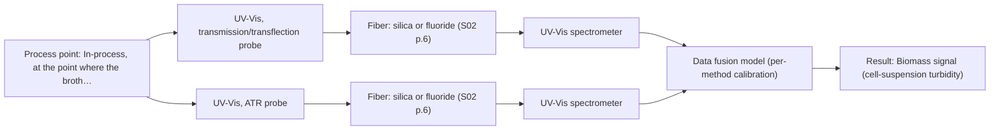
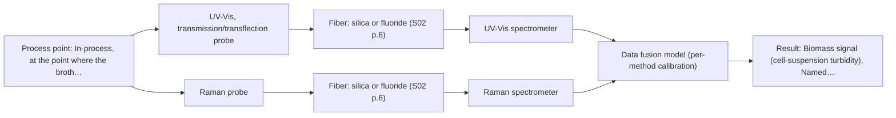

# First technical assessment: Biomass related monitoring during yeast fermentation

## Answer

**Customer request (our summary):** Самая распространенная ошибка — это наиболее часто встречающаяся ошибка в не_производстве.

### Brief answer

Start with UV/Vis transmission or transflection on the broth to follow the turbidity growth trend, and add Raman as the comparison method for the metabolite signal once the compound is named; a UV-ATR probe is the fallback if the broth becomes too dense for transmission. Reference cell count or dry weight, and a reference assay for the named metabolite, are needed to calibrate either signal. The broth's optical-density range and the metabolite identity are still open.

### Proposal

- **Best current option:** O2 (recommended): M1 UV-Vis, transmission/transflection probe; M3 UV-Vis, ATR probe
- **Basis:** supplied AFS sources
- **What would change it:** If the broth turns out to be optically dilute and stable, the single transmission/transflection option is enough; if the named metabolite turns out to be a fluorescent species such as NADH, tryptophan or riboflavin, a fluorescence-based combination becomes the hypothesis to test.
- **Next step:** Start a multi-method laboratory trial on representative broth samples with independent reference analyses, and use its results to fix the method, geometry and calibration.

**Decision status:** Provisional feasibility assessment. A conditional shortlist can be justified from the sources: UV/Vis turbidity for the growth trend, Raman for a named metabolite, and a UV-ATR geometry if the broth saturates a transmission path. The broth's optical-density range and the identity of the metabolic target are still unknown, so no configuration can be fixed yet.

### Solution options

| ID | Tier | Methods | Confidence | Cost class, S01 Table 1 (p.6) | Ease of use | Maintenance | Performance fit | Sources |
|---|---|---|---|---|---|---|---|---|
| O1 | Simple | M1 UV-Vis, transmission/transflection probe | Medium: physical state unknown, sample clarity unknown | low cost (row 16) | Simplest setup: one probe, one spectrometer, one calibration. | Probe cleaning and reference-standard checks between runs. | Least effort that still follows the growth trend the enquiry asks about. | [1: S01 p.16] [2: S01 p.16] [3: S01 p.16] |
| O2 | Recommended | M1 UV-Vis, transmission/transflection probe; M3 UV-Vis, ATR probe | Medium: physical state unknown, sample clarity unknown | average cost (rows 14, 16) | Two probes on one spectrometer; switch geometry as the broth densifies. | Two probe heads to clean; ATR crystal surface care. | Covers the growth trend across the run, including the denser phase. | [4: S01 p.16] [5: S01 p.16] [6: S01 p.16] [7: S01 p.16] [8: S01 p.16] [9: S01 p.16] |
| O3 | Extended (multi-method) | M1 UV-Vis, transmission/transflection probe; M2 Raman probe | Low: physical state unknown, sample clarity unknown; multi-method, fusion benefit not yet shown | high cost (rows 12, 16) | Two instruments and probes; alignment and synchronisation work needed. | Two calibrations and diagnostic routines; Raman laser and filter care. | Only option covering both the growth and the metabolic target. | [10: S01 p.16] [11: S01 p.8] [12: S01 p.8] [13: S01 p.7] [14: S01 p.16] [15: S01 p.16] [16: S01 p.16] [17: S01 p.16] [18: S01 p.11] |

*Confidence rates the basis of the advice (how much is known and cited), not a predicted accuracy or probability of success. It starts at High and drops one level per weakness listed.*

*Cost class is the relative rating in S01 Table 1 (p.6) for the in-line method+technique rows named (the highest one for a multi-method option); it is not a price.*

### Setup sketch

*Recommended option O2; drawn by code from the option, a schematic, not a configuration.*

*Extended (multi-method) option O3; drawn by code from the option, a schematic, not a configuration.*

### Key questions

1. What is the broth's optical density (or light transmission) at the measurement point, and how does it change over the run?
2. Which metabolite or chemical change should the 'metabolic signal' represent, and over what concentration range?
3. What do you measure for growth today, how often, and what change must the new measurement detect earlier?

## Expert detail

**Customer enquiry**

> We would like an optical measurement during yeast fermentation to help us follow growth and notice changes earlier. Our team has mentioned both a biomass signal and a metabolic signal, but these have not been defined as separate targets. The broth becomes more optically dense as the run develops. We need help turning this request into an initial feasibility study with useful reference measurements.

### Parameters

| ID | Parameter | Kind | Need | Measured by | Why | Sources |
|---|---|---|---|---|---|---|
| P1 | Biomass signal (cell-suspension turbidity) | quantitative | required | Spectroscopy: UV-Vis | It is the growth signal the enquiry wants to follow, and in a bioprocess turbidity correlates with cell density. | [19: S01 p.16] |
| P2 | Reference biomass (cell count or dry cell weight) | quantitative | required | Reference lab method: cell count (counting chamber or plate count) or dry cell weight | Turbidity is a proxy; an independent count or dry weight is needed to calibrate it, since optical density is not a viable cell count. | [20: REF §5] |
| P3 | Named metabolite concentration (for example glucose, acetate or lactate) | quantitative | required | Spectroscopy: Raman | The 'metabolic signal' the team mentioned must be named before a method or calibration can be chosen, and Raman is cited for these metabolites in aqueous bioprocess media. | [21: S01 p.16] |
| P4 | Reference concentration of the named metabolite | quantitative | required | Reference lab method: validated laboratory assay (for example HPLC or an enzymatic test) | An independent assay is needed to build and check the Raman calibration on the real broth, because the calibration is specific to the matrix. | [22: REF §5] |
| P5 | Broth optical density / light transmission at the probe path | quantitative | required | Reference lab method: laboratory optical density (absorbance) measurement on withdrawn samples | It decides whether a transmission/transflection geometry gives a usable signal or whether the ATR geometry is required. | [23: S01 p.16] |

### Solution option details

- **O1 cost drivers:** One spectrometer, one fiber probe, method and calibration work.
- **O2 cost drivers:** One spectrometer but two probes and two geometries to calibrate.
- **O3 cost drivers:** Second spectrometer and probe, synchronisation, and fusion modelling effort.
- **O3 combining methods:** Fusion level: start with one model per method (UV/Vis turbidity, Raman metabolite) and then join the two blocks with block scaling, because variables from different methods are not equivalent; the probes must look at the same small area of the broth. Acquisition rates differ, so the data must be aligned to a common time step, and each method keeps its own calibration and diagnostics. The combined model is only kept if it beats the better of the two single-method models on independent batches.

### Premise check

- **Precedent only:** One in-line optical measurement can follow both growth (biomass) and metabolic change in the same yeast fermentation. A published example, not proof for this process; it is a reason to test a combination later, after the single methods. [24: S01 p.7]
- **Precedent only:** The rising optical density of the broth is a usable biomass signal for following growth. The source states a correlation with cell density, not an absolute cell count, so an independent reference (count or dry weight) is needed before the signal can be read as biomass. [25: S01 p.16]
- **Not covered:** In-line optical monitoring will notice fermentation changes earlier than the customer's current measurements. No supplied source compares in-line optical monitoring with an existing method for how early a change is detected; the customer must define 'earlier' and the comparison. *(no verified source: engineering judgement)*

### Requirements

**Stated by the customer**

**Key unknowns**

- The broth's optical density or transmission range over the run, which decides between transmission/transflection and ATR geometries (Q1).
- Which metabolite or chemical change the 'metabolic signal' should represent, and over what concentration range (Q2).
- What growth is measured with today and how often, so that 'earlier' can be defined (Q3).
- Whether the broth contains fluorescent species and how strong the fluorescence background is (Q4).
- The probe installation point and process conditions such as temperature, pressure and cleaning (Q5).
- Whether both signals must come from one instrument or may come from separate instruments.

### Clarification questions (most decision-relevant first)

Q1. What is the broth's optical density (or light transmission) at the measurement point, and how does it change over the run? *Why it matters:* It decides whether a transmission/transflection geometry (M1) gives a usable signal or whether the UV-ATR geometry (M3) is required. *(affects: method, technique, installation)*
Q2. Which metabolite or chemical change should the 'metabolic signal' represent, and over what concentration range? *Why it matters:* Raman and fluorescence respond only to suitable species, and the calibration is specific to the matrix. *(affects: method, technique)*
Q3. What do you measure for growth today, how often, and what change must the new measurement detect earlier? *Why it matters:* This fixes the reference measurements the feasibility study must match and the go/no-go criteria. *(affects: status, method)*
Q4. Is the broth fluorescent, or does it contain fluorescent species such as NADH, tryptophan or riboflavin? *Why it matters:* It decides whether a fluorescence-based option is worth testing and how far fluorescence background will limit Raman. *(affects: method, technique)*
Q5. Where on the reactor or line can a probe be installed (port, bypass or flow cell), and what are the process temperature, pressure and cleaning conditions? *Why it matters:* It fixes the probe geometry and the fiber link, which are configuration-dependent. *(affects: installation)*

### Recommendation

- **M1 · Primary candidate: UV-Vis, transmission/transflection probe.** Cell-suspension turbidity correlates with cell density, and UV/Vis is described as a low-cost, robust tool for real-time biomass monitoring; transmission or transflection is the geometry for transparent to semi-transparent liquids. It is the single method that most directly addresses the growth trend the enquiry asks about. *Conditions:* Applies while the broth transmits enough light for a usable signal; if it saturates as the optical density rises, the UV-ATR geometry (M3) is the next test. [26: S01 p.16] [27: S01 p.16]
- **M2 · Comparison candidate: Raman probe.** Raman is well suited to aqueous media and gives a molecular fingerprint for specific metabolites such as glucose, acetate or lactate, which a turbidity signal cannot report. It is the natural second single method to test against M1 for the metabolic part of the enquiry. *Conditions:* Applies if the metabolite of interest is Raman-active and the broth's fluorescence background does not swamp the weak Raman signal. [28: S01 p.16] [29: S01 p.16] [30: S01 p.11]
- **M3 · Conditional candidate: UV-Vis, ATR probe.** Where the medium becomes opaque or highly concentrated, a standard transmission signal saturates because light cannot penetrate the bulk, and a UV-ATR probe with its very short path is the stated alternative. It is therefore only relevant if the broth turns out to be dense enough to saturate M1. *Conditions:* Applies only if the broth's optical density at the chosen pathlength saturates the transmission/transflection signal (Q1). [31: S01 p.16] [32: S01 p.16] [33: S01 p.16]
- **M4 · Not recommended: MIR, ATR probe.** MIR absorption is strong, so the method needs very thin samples, and in an aqueous broth infrared methods suffer from water absorption; an ATR probe also samples only a surface layer, so it would not represent the bulk cell-density trend. It stays a possible later option for specific dissolved components, not the first test here. *Conditions:* Only revisit if a named, water-tolerant component cannot be reached with NIR, Raman or fluorescence. [34: S01 p.5] [35: S01 p.16]

### Measurement concept

- **Probe and geometry:** Fiber-probe measurement directly in the broth or in a bypass/flow cell: UV/Vis transmission or transflection for the dilute phase, UV-ATR if the broth saturates that path, and a Raman probe as the comparison method.
- **Location:** In-process, at the point where the broth passes the probe; the same sampling point for any combination.
- **Fiber link:** Depends on the method and the selected probe; no link length is stated in the sources, so this remains an open configuration question (Q5). [36: S01 p.10]

### Spectral range

- **UV-Vis:** UV-Vis sensitivity is stated especially in the UV region 190-360 nm; the usable range depends on the instrument, fiber and probe actually selected. [37: S01 p.5] [38: REF §5]
- **Raman:** Reported as Raman shift (cm-1); the laser excitation wavelength is stated separately (one source describes a Raman probe with 785 nm excitation). [39: S01 p.11] [40: S01 p.15]

### Risks and uncertainty

- If the broth becomes dense enough to saturate a transmission path, the UV/Vis growth signal from M1 may be unusable and the UV-ATR geometry (M3) becomes the measurement to test. *(rules: R-GEO-7)* [41: S01 p.16]
- The 'biomass signal' is a turbidity correlation with cell density rather than a cell count, so it may not match the biomass measure the team actually wants without an independent reference. *(rules: R-UV-2)* [42: REF §5]
- The Raman signal is weak and can be swamped by fluorescence from the broth, so the metabolite fingerprint may not be recoverable without checking the background on real samples. *(rules: R-RAM-1)* [43: S01 p.11]
- In a turbid, inhomogeneous broth the two probes of a combined option may sample different volumes, which would weaken the fusion and must be checked before relying on it. *(rules: R-CMB-2)* [44: S01 p.8]

### First feasibility experiment

1. **Collect representative broth samples or process states across the run (early, mid, late) from at least two independent batches, covering the optical-density range the process shows.** Covers the expected chemical and physical variation. [45: REF §3]
2. **Measure the samples with each single method first at the same sampling point: UV/Vis transmission/transflection (M1), UV-ATR where the broth is dense (M3), Raman (M2); test any combination only afterwards.** Single methods first; a combination is a later hypothesis. *(no verified source: engineering judgement)*
3. **Run independent reference measurements on the same samples: cell count or dry cell weight for the growth signal, and a validated laboratory assay for the named metabolite.** Independent reference data for both targets. [46: REF §5]
4. **Build a calibration per method on part of the batches and validate it on held-out batches; only then test the combined model against the best single method.** Validation on held-out runs or batches; a fusion must beat the best single method. [47: REF §5]
5. **The customer sets the numerical go/no-go criteria (for example the acceptable error or the smallest useful change in the growth and metabolite signals); any method or combination that does not reach them is dropped.** Go/no-go basis with customer-defined numbers. *(no verified source: engineering judgement)*

**Reference measurements:** Cell count or dry cell weight for the growth signal, and a validated assay for the named metabolite (P2, P4).

**Decision basis:** Customer-defined numerical criteria for the smallest useful change and acceptable error (Q3).

### Assumptions

- The measurement point can accept a fiber probe or a bypass/flow cell.
- The broth is a liquid suspension whose optical density rises over the run.
- The 'metabolic signal' refers to one or a few dissolved components that can be named.
- The fermentation runs under controlled temperature.

### Not covered by the supplied sources

- No supplied source gives detection limits, accuracy or response times for these measurements in a yeast broth; those figures must come from the trial.
- No supplied source shows that in-line optical monitoring detects fermentation changes earlier than the customer's current measurements.

### Further notes

- **Chemometrics:** Both signals need calibration models built on reference data; for a combined option, start with one model per method and join the blocks with block scaling, since variables from different methods are not equivalent and normalisation such as autoscaling may be needed.
- **Real-time tracking:** The measurement is in-line and continuous during a run, so acquisition must keep up with the process, and the two methods' different rates must be aligned to a common time step.
- **Future direction:** A later extension worth considering is the published yeast-fermentation combination of NIR with fluorescence, which reported biomass and intra- and extracellular metabolite information.

### Evidence (verified quotes)

1. ✓ **S01 p.16** (general): "UV/Vis spectroscopy can be deployed as a low-cost, robust tool for real-time biomass monitoring"
2. ✓ **S01 p.16** (general): "cell suspension turbidity correlates well with cell density"
3. ✓ **S01 p.16** (general): "For highly transparent liquids with low optical density, UV-Transmission or Transflection probes are ideal"
4. ✓ **S01 p.16** (general): "Equipping a facility with both probe types significantly increases laboratory flexibility"
5. ✓ **S01 p.16** (general): "For highly transparent liquids with low optical density, UV-Transmission or Transflection probes are ideal"
6. ✓ **S01 p.16** (general): "cell suspension turbidity correlates well with cell density"
7. ✓ **S01 p.16** (general): "the signal in a standard transmission setup becomes saturated because the light cannot penetrate the bulk of the sample"
8. ✓ **S01 p.16** (general): "In these high-OD scenarios, a UV-ATR (Attenuated Total Reflection) probe is used."
9. ✓ **S01 p.16** (general): "extremely short path length that enables the measurement of "black" or highly scattering fluids without dilution"
10. ✓ (precedent only) **S01 p.16** (method gain): "While UV/Vis tracks growth, Raman spectroscopy can be used in the same reactor"
11. ✓ (precedent only) **S01 p.8** (method gain): "Variables obtained from different spectral methods are not equivalent."
12. ✓ (precedent only) **S01 p.8** (method gain): "Ultimately, the measurement data must be normalized to a common time step."
13. ✓ **S01 p.7** (application precedent): "The combination of NIR spectroscopy with fluorescence spectroscopy demonstrated the possibility of more accurately determining the biomass content during yeast fermentation, as well as distinguishing between their intra- and extracellular metabolites."
14. ✓ **S01 p.16** (general): "cell suspension turbidity correlates well with cell density"
15. ✓ **S01 p.16** (general): "For highly transparent liquids with low optical density, UV-Transmission or Transflection probes are ideal"
16. ✓ **S01 p.16** (general): "Raman spectroscopy can be used in the same reactor to provide a "molecular fingerprint" for direct detection of specific metabolites like glucose, acetate, or lactate"
17. ✓ **S01 p.16** (general): "Raman is particularly well-suited for aqueous environments, as it exhibits low absorbance for water molecules compared to infrared methods."
18. ✓ **S01 p.11** (general): "superposition of luminescence (fluorescence), which has a significantly higher intensity"
19. ✓ **S01 p.16** (general): "cell suspension turbidity correlates well with cell density"
20. ✓ **REF §5** (general): "optical density is not a viable cell count."
21. ✓ **S01 p.16** (general): "Raman spectroscopy can be used in the same reactor to provide a "molecular fingerprint" for direct detection of specific metabolites like glucose, acetate, or lactate"
22. ✓ **REF §5** (general): "calibration specific to the matrix."
23. ✓ **S01 p.16** (general): "In these high-OD scenarios, a UV-ATR (Attenuated Total Reflection) probe is used."
24. ✓ **S01 p.7** (application precedent): "The combination of NIR spectroscopy with fluorescence spectroscopy demonstrated the possibility of more accurately determining the biomass content during yeast fermentation, as well as distinguishing between their intra- and extracellular metabolites."
25. ✓ **S01 p.16** (general): "cell suspension turbidity correlates well with cell density"
26. ✓ **S01 p.16** (general): "cell suspension turbidity correlates well with cell density"
27. ✓ **S01 p.16** (general): "For highly transparent liquids with low optical density, UV-Transmission or Transflection probes are ideal"
28. ✓ **S01 p.16** (general): "Raman spectroscopy can be used in the same reactor to provide a "molecular fingerprint" for direct detection of specific metabolites like glucose, acetate, or lactate"
29. ✓ **S01 p.16** (general): "Raman is particularly well-suited for aqueous environments, as it exhibits low absorbance for water molecules compared to infrared methods."
30. ✓ **S01 p.11** (general): "superposition of luminescence (fluorescence), which has a significantly higher intensity"
31. ✓ **S01 p.16** (general): "the signal in a standard transmission setup becomes saturated because the light cannot penetrate the bulk of the sample"
32. ✓ **S01 p.16** (general): "In these high-OD scenarios, a UV-ATR (Attenuated Total Reflection) probe is used."
33. ✓ **S01 p.16** (general): "extremely short path length that enables the measurement of "black" or highly scattering fluids without dilution"
34. ✓ **S01 p.5** (general): "strong absorption in the mid-IR region limits the corresponding spectral method to the analysis of very thin samples (usually less than 50 μm)"
35. ✓ **S01 p.16** (general): "Raman is particularly well-suited for aqueous environments, as it exhibits low absorbance for water molecules compared to infrared methods."
36. ✓ **S01 p.10** (general): "Probe-based analysis is gaining widespread use in online analysis, such as in-line, in-process (chemical, biotechnological, natural) environments"
37. ✓ **S01 p.5** (general): "It has very high sensitivity, especially in the UV region (190-360 nm)"
38. ✓ **REF §5** (general): "It is not a product specification: actual spectral coverage, fiber length, component ratings, detection limits and accuracy depend on the configuration and the sample."
39. ✓ **S01 p.11** (general): "The Raman shift is used as the horizontal (spectral) axis in Raman spectroscopy"
40. ✓ **S01 p.15** (general): "Raman spectrometer and Raman fiber probe for contact measurements with 785 nm excitation wavelength"
41. ✓ **S01 p.16** (general): "the signal in a standard transmission setup becomes saturated because the light cannot penetrate the bulk of the sample"
42. ✓ **REF §5** (general): "optical density is not a viable cell count."
43. ✓ **S01 p.11** (general): "superposition of luminescence (fluorescence), which has a significantly higher intensity"
44. ✓ **S01 p.8** (general): "It is crucial that the spectral information obtained by different methods-Mid-IR, NIR, Raman, and fluorescence spectra-is collected from the same small, even pinpoint, area of the sample. This is difficult to achieve by using two probes alternately for measurements."
45. ✓ **REF §3** (general): "Representative samples or process states, independent reference measurements, what is compared, and the basis for the go / no-go decision."
46. ✓ **REF §5** (general): "optical density is not a viable cell count."
47. ✓ (precedent only) **REF §5** (method gain): "compare with the best single method."

### Verification

- Citations verified: 36 of 36 (exact or whitespace/hyphen-tolerant match on the cited page, scope checked).
- Hard check failures before deterministic corrections: 0; still open: 0; soft warnings: 8; repair rounds: 1.
- Removed 3 intake item(s) not quoted verbatim from the enquiry:
  - intake.facts_stated[0]: enquiry_quote not found verbatim in the enquiry
  - intake.targets[0]: enquiry_quote not found verbatim in the enquiry
  - intake.sample.fluorophore: slot value without a verbatim enquiry quote; reset to unknown

*Run D05-20261017T145153Z · models deepseek/deepseek-v4.1-flash*
