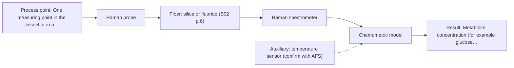
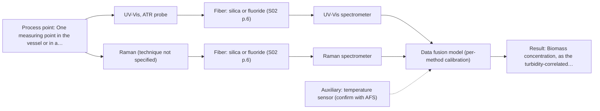

# First technical assessment: Biomass related monitoring during yeast fermentation

## Answer

**Customer request (our summary):** Customer requests an in-line optical measurement during yeast fermentation to follow growth and detect changes earlier. Biomass and metabolic signals are mentioned but not defined as separate targets. The broth becomes more optically dense over the run. They seek an initial feasibility study with reference measurements.

### Brief answer

Test the single methods first: UV-Vis ATR for the growth trend and Raman for the metabolic signal. Raman is the stronger single-method fit for noticing changes earlier; the UV-Vis + Raman combination is a later hypothesis, only if one method cannot cover both targets. The targets, the broth's optical density range and the reference methods are still open.

### Proposal

- **Best current option:** O2 (recommended)
- **Basis:** supplied AFS sources
- **What would change it:** Defined targets and ranges, or a broth that turns out to be strongly fluorescent or too opaque for the chosen geometry, would move the choice between O1, O2 and O3. The reference methods and the go/no-go numbers the customer can provide would change it as well.
- **Next step:** Agree the reference methods and the go/no-go numbers, then measure broth samples across the run with UV-Vis ATR and Raman before any fused model is built.

**Secondary evidence (external, not AFS material):** G1: no usable external source found; G2: E02 ¶31, E02 ¶82; G3: no usable external source found. See Expert detail.

**Decision status:** Provisional feasibility assessment

### Solution options

| ID | Tier | Methods | Confidence | Cost class, S01 Table 1 (p.6) | Ease of use | Maintenance | Performance fit | Sources |
|---|---|---|---|---|---|---|---|---|
| O1 | Simple | M1 UV-Vis, ATR probe | Medium: open question: Q1 (starts at Medium) | average cost (row 14) | one probe, robust signal | ATR tip cleaning, periodic checks | answers the growth question at low effort | [1: S01 p.16] [2: S01 p.16] |
| O2 | Recommended | M2 Raman probe | Medium: open question: Q1 (starts at Medium) | high cost (row 12) | standard probe, sensitive to background | laser and probe checks, recalibration | molecular specificity for metabolites in aqueous broth | [3: S01 p.16] [4: S01 p.16] |
| O3 | Extended (multi-method) | M3 UV-Vis, ATR probe + Raman (combination) | Low: open question: Q1 (starts at Medium); multi-method, fusion benefit not yet shown | high cost (rows 12, 14) | two instruments, more setup work | two calibrations, two instrument checks | covers growth and metabolite targets together | [5: S01 p.8] [6: S01 p.9] [7: S01 p.9] [8: S01 p.7] [9: S01 p.8] |

*Confidence rates the basis of the advice (how much is known and cited), not a predicted accuracy or probability of success. It starts at High, or at Medium when a key question on the method or the option is open, and drops one level per weakness listed (floor Low).*

*Cost class is the relative rating in S01 Table 1 (p.6) for the in-line method+technique rows named (the highest one for a multi-method option); it is not a price.*

### Setup sketch

*Recommended option O2; drawn by code from the option, a schematic, not a configuration.*

### Key questions

1. Which quantity should represent the biomass signal (for example cell density or dry cell weight) and which species the metabolic signal (for example glucose, ethanol, acetate or glycerol), and over what concentration ranges?
2. How optically dense does the broth become over the run, and does it stay flowable and pumpable?
3. Where can a probe be installed (vessel port, bypass loop or flow cell) and what are the temperature, pressure, cleaning and sterilisation conditions there?

## Expert detail

**Customer enquiry**

> We would like an optical measurement during yeast fermentation to help us follow growth and notice changes earlier. Our team has mentioned both a biomass signal and a metabolic signal, but these have not been defined as separate targets. The broth becomes more optically dense as the run develops. We need help turning this request into an initial feasibility study with useful reference measurements.

**Decision status:** Provisional feasibility assessment. A shortlist of methods can be justified from the supplied sources, but the two targets are undefined and the broth's optical regime is unknown, so the shortlist and the option tiers rest on stated assumptions. The shortlist is conditional on the answers to the questions below.

### Parameters

| ID | Parameter | Kind | Need | Measured by | Why | Sources |
|---|---|---|---|---|---|---|
| P1 | Biomass concentration, as the turbidity-correlated signal | quantitative | required | Spectroscopy: UV-Vis | It is the stated growth target, and the UV-Vis signal is a turbidity proxy that correlates with cell density rather than a direct cell count. | [10: S01 p.16] |
| P2 | Metabolite concentration (for example glucose, ethanol, acetate or glycerol) | quantitative | required | Spectroscopy: Raman | It is the stated metabolic signal and the basis for noticing changes earlier. | [11: S01 p.16] |
| P3 | Independent reference values for biomass and metabolites | quantitative | required | Reference lab method: dry cell weight or cell counts; HPLC, GC or enzymatic assay for the metabolite(s) | The in-line signals are proxies, so calibration and the go/no-go decision need an independent laboratory value. | *(no verified source: engineering judgement)* |
| P4 | Broth temperature at the measuring point | quantitative | optional | Auxiliary sensor: temperature sensor (engineering judgement: confirm availability with AFS) | It should be available because temperature varies over a fermentation run and affects the spectra, so it should be logged with each measurement. | *(no verified source: engineering judgement)* |

### Solution option details

- **O1 cost drivers:** one UV-Vis spectrometer, ATR probe and fiber link
- **O2 cost drivers:** Raman spectrometer, laser and fiber probe
- **O3 cost drivers:** two spectrometers, combined probe, data fusion effort
- **O3 combining methods:** Fusion level: low-level fusion of the UV-Vis and Raman blocks, normalised so that neither block dominates the model, with one calibration kept per method. Both probes must look at the same small broth volume at the same time, and the two data streams must be brought to a common time step. The fused model must beat the best single method on held-out runs, otherwise the second instrument is dropped.

*Extended (multi-method) option O3; drawn by code from the option, a schematic, not a configuration.*

### Premise check

- **Precedent only:** An optical measurement can help follow yeast fermentation growth and notice changes earlier. The source shows fiber-probe optical methods used for bioprocess growth and metabolite tracking, which is a reason to test, not proof for this broth. [1: S01 p.16]
- **Precedent only:** Both a biomass signal and a metabolic signal are relevant and can be distinguished as separate targets. The source pairs a growth-tracking method with a metabolite-fingerprint method in the same reactor, which supports treating them as two targets but does not define them for this customer. [3: S01 p.16]
- **Supported:** An in-line optical measurement can still be taken from the broth as it becomes more optically dense. Supported for a short-path ATR geometry; it does not hold for a transmission geometry through a thick, opaque medium. [2: S01 p.16]

### Requirements

**Stated by the customer**

- In-line optical measurement during yeast fermentation (customer fact).
- Follow growth and notice changes earlier (customer fact).
- A biomass signal and a metabolic signal are mentioned but not defined as separate targets (customer fact).
- The broth becomes more optically dense as the run develops (customer fact).
- An initial feasibility study with useful reference measurements is wanted (customer request).

**Key unknowns**

- Target species and concentration ranges for the biomass signal and for the metabolic signal.
- How optically dense the broth becomes over the run, and whether it stays flowable and pumpable.
- Whether the broth contains fluorescent species, bubbles, particulates or antifoam.
- Which independent reference methods are available, and the required accuracy, detection limit and response time.
- Probe installation point and the temperature, pressure, cleaning and sterilisation conditions there.
- Fermentation stage, batch duration and the time resolution needed to 'notice changes earlier'.

### Clarification questions (most decision-relevant first)

Q1. Which quantity should represent the biomass signal (for example cell density or dry cell weight) and which species the metabolic signal (for example glucose, ethanol, acetate or glycerol), and over what concentration ranges? *Why it matters:* This decides which method and which calibration target the feasibility study has to cover. *(affects: method)*
Q2. How optically dense does the broth become over the run, and does it stay flowable and pumpable? *Why it matters:* It decides between ATR, transmission and reflection geometries, and whether a short ATR path is needed. *(affects: technique)*
Q3. Where can a probe be installed (vessel port, bypass loop or flow cell) and what are the temperature, pressure, cleaning and sterilisation conditions there? *Why it matters:* It decides the probe type, its materials and the fiber routing to the spectrometer. *(affects: installation)*
Q4. Which reference measurements can run alongside the trial (for example dry cell weight or cell counts, HPLC, GC or enzymatic assays), and what accuracy, detection limit and time resolution would count as success? *Why it matters:* Without an independent reference and agreed numbers there is no basis for calibration or for a go/no-go decision. *(affects: status)*
Q5. Does the broth contain fluorescent species, bubbles, particulates or antifoam that could disturb a Raman measurement? *Why it matters:* A strong fluorescence background or heavy scattering would make the Raman route unworkable as proposed. *(affects: M2)*

### Recommendation

- **M1 · Primary candidate: UV-Vis, ATR probe.** A UV-Vis ATR probe gives a real-time, low-cost signal that tracks growth, and the short ATR path lets it work as the broth becomes more optically dense. It is the lowest-risk single method to test first. *Conditions:* The broth must make tight contact with the ATR crystal and must not leave deposits on it. [1: S01 p.16] [2: S01 p.16]
- **M2 · Comparison candidate: Raman probe.** Raman gives a molecular fingerprint that can be calibrated for specific metabolites, and water interferes less than in infrared methods. It is the single method that adds the metabolic information UV-Vis cannot give. *Conditions:* The broth must be checked on real samples for fluorescence background and particulates before a calibration is attempted. [3: S01 p.16] [4: S01 p.16]
- **M3 · Conditional candidate: UV-Vis, ATR probe + Raman (combination).** If the single-method tests leave one of the two targets uncovered, the UV-Vis and Raman blocks can be fused. Any gain from the combination is a hypothesis to test against the best single method. *Conditions:* Applies only if neither single method covers both targets and both probes can look at the same small broth volume. [8: S01 p.7] [9: S01 p.8] Later hypothesis, after single-method tests.
- **M4 · Not recommended: NIR, transmission/transflection probe.** NIR transmission is the method a reader would expect first, but the customer states the broth becomes more optically dense, and transmission loses the signal when the medium is too thick or opaque. A fit for this broth is not confirmed. *Conditions:* Only worth revisiting if the broth stays transparent and a controlled pathlength can be maintained. [12: S01 p.18]

### Measurement concept

- **Probe and geometry:** In-line fiber probe in the broth: ATR probe tip in contact with the liquid for the UV-Vis route, and a Raman fiber probe in contact with the liquid for the metabolite route; the spectrometers stay remote from the vessel and are linked by fibers.
- **Location:** One measuring point in the vessel or in a bypass loop, chosen so that both probes, if combined, look at the same small broth volume.
- **Fiber link:** Fiber family and achievable link length depend on the method and probe selected; no length is stated in the sources for this case and must be confirmed for the chosen configuration. [13: S01 p.15]

### Spectral range

- **UV-Vis:** UV-Vis covers the ultraviolet and visible range; the source quotes high sensitivity especially in the UV region (190-360 nm). The usable range depends on the instrument, fiber and probe actually selected. [14: S01 p.5]
- **Raman:** Raman is reported as a Raman shift in cm-1, with the laser excitation wavelength stated separately. The usable shift range depends on the laser, spectrometer and probe selected. [15: S01 p.11]

### Risks and uncertainty

- The two targets are undefined, so the choice between UV-Vis ATR and Raman may change once the species and their concentration ranges are named. *(rules: R-UV-2, R-RAM-1)* *(no verified source: engineering judgement)*
- If the broth becomes too optically dense for the geometry chosen, or deposits build up on the crystal, the ATR signal can degrade over a run. *(rules: R-MIR-3, R-GEN-5)* *(no verified source: engineering judgement)*
- Fluorescence background or strong scattering from the broth can swamp the weak Raman signal, so excitation wavelength and probe must be checked on real samples. *(rules: R-RAM-1)* [16: S01 p.11]
- The calibration is specific to the broth matrix, so a change of medium, feed or strain can invalidate it, and no in-line performance figure for this broth appears in the supplied pages. *(rules: R-CAL-1)* [17: REF §5]

### First feasibility experiment

1. **Collect representative broth samples or process states across at least three independent runs (early, mid and late fermentation), spanning the expected optical-density range and any medium or feed changes.** Cover the chemical and physical variation the model must later survive. [18: REF §3]
2. **Measure each sample with the single methods first - UV-Vis ATR, then Raman - at the same temperature and probe position, recording raw spectra together with the sample's reference value.** Establish each single method before any combination is tested. *(no verified source: engineering judgement)*
3. **Have the customer's laboratory provide independent reference values: dry cell weight or cell counts for biomass, and HPLC, GC or enzymatic assays for the metabolite(s).** An independent reference is what makes a calibration and a go/no-go decision possible. *(no verified source: engineering judgement)*
4. **Build one calibration model per method and compare them on held-out runs or batches; only then build the fused UV-Vis + Raman model and check whether it beats the best single method.** A combination is only justified if it adds performance over the best single method. [19: REF §5]
5. **Set the go/no-go criteria as numbers supplied by the customer (allowed prediction error, detection limit, time resolution) before the trial starts.** The trial needs a decision rule agreed in advance, not one chosen after the results. *(no verified source: engineering judgement)*

**Reference measurements:** Independent laboratory values for biomass (dry cell weight or cell counts) and for the named metabolite(s), measured on the same samples that are measured optically.

**Decision basis:** Numerical criteria from the customer: allowed prediction error on the biomass signal and on the metabolic signal, detection limit, and time resolution.

### Assumptions

- The fermentation broth is an aqueous liquid that can make contact with a probe tip.
- The broth remains flowable and can be sampled or bypassed during the run.
- The customer's laboratory can supply independent reference values for both targets.
- The two mentioned signals are process quantities that can be calibrated against those references.

### Further notes

- **Chemometrics:** Both targets need a calibration or classification model built against the independent reference values, and the models are specific to the broth matrix, so they must be re-validated on held-out runs and after any medium, feed or strain change.
- **Real-time tracking:** The purpose is in-line, continuous tracking of the growth and metabolite trends over a run, so acquisition rate and the time step needed to notice a change should be agreed before the trial.
- **Future direction:** If a fluorescent species is later confirmed in the broth, the published NIR with fluorescence combination for yeast fermentation described on S01 p.7 is a further option worth testing as a later extension.

### Secondary evidence (external, not AFS material)

*Found by a literature search for gaps the supplied AFS sources leave open. Not AFS material and not proof for this case; every quote below was verified verbatim against the fetched text.*

**G1 · auxiliary sensor:** In-line measurement of Broth temperature at the measuring point with temperature sensor

- No usable external source found.

**G2 · multi-method:** Combining several spectroscopy methods (data fusion) (Fusion level: low-level fusion of the UV-Vis and Raman blocks, normalised so that neither block dominates the model, with one calibration kept per method. Both probes must look at the same small broth volume at the same time, and the two data streams must be brought to a common time step. The fused model must beat the best single method on held-out runs, otherwise the second instrument is dropped.)

- **E02 ¶31** Low-level data fusion is described as the simplest way to combine inputs by rearranging variables from different sources into one new data matrix. *How it applies:* This supports testing a low-level fusion of UV-Vis and Raman blocks for O3, with the two blocks concatenated and normalised so neither dominates; the fused model should still be compared against the best single method on held-out runs. *Limits and transfer risks:* The source is a general review, not a fermentation study, and it does not address same-volume sampling, common time steps, or probe alignment. *(supports O3)*
  > "Low-level data fusion (LLDF) is considered the simplest method to achieve a combination of inputs. In this case, the data is rearranged into a new data matrix, where the variables coming from different sources are placed one after the other."
  > Challenges and Opportunities of Implementing Data Fusion in Process Analytical Technology-A Review. (2022) · Molecules (Basel, Switzerland) · doi:10.3390/molecules27154846 · https://europepmc.org/article/PMC/PMC9369811 · retrieved 2026-10-17, full text, licence: cc by, via curated library
- **E02 ¶82** Before fusing data from multiple sources, the source says it is essential to evaluate each dataset's contribution and complementarity. *How it applies:* This supports the O3 go/no-go check: assess whether the Raman block adds complementary information to UV-Vis before keeping the second instrument, and drop it if the fused model does not beat the best single method on held-out runs. *Limits and transfer risks:* The source is a review and does not specify UV-Vis/Raman, fermentation broth, or a low-level fusion workflow. *(supports O3)*
  > "Before fusing data from multiple sources, it is essential to evaluate the contribution of each dataset to the model and its complementarity."
  > Challenges and Opportunities of Implementing Data Fusion in Process Analytical Technology-A Review. (2022) · Molecules (Basel, Switzerland) · doi:10.3390/molecules27154846 · https://europepmc.org/article/PMC/PMC9369811 · retrieved 2026-10-17, full text, licence: cc by, via curated library

**G3 · parameter without a source:** Measuring Independent reference values for biomass and metabolites: The in-line signals are proxies, so calibration and the go/no-go decision need an independent laboratory value.

- No usable external source found.

### Evidence (verified quotes)

1. ✓ **S01 p.16** (general): "UV/Vis spectroscopy can be deployed as a low-cost, robust tool for real-time biomass monitoring, as cell suspension turbidity correlates well with cell density."
2. ✓ **S01 p.16** (general): "extremely short path length that enables the measurement of "black" or highly scattering fluids without dilution."
3. ✓ **S01 p.16** (general): "While UV/Vis tracks growth, Raman spectroscopy can be used in the same reactor to provide a "molecular fingerprint" for direct detection of specific metabolites like glucose, acetate, or lactate."
4. ✓ **S01 p.16** (general): "Raman is particularly well-suited for aqueous environments, as it exhibits low absorbance for water molecules compared to infrared methods."
5. ✓ **S01 p.8** (general): "Ultimately, the measurement data must be normalized to a common time step."
6. ✓ **S01 p.9** (general): "Furthermore, methods containing a larger number of variables have a greater impact on the model."
7. ✓ **S01 p.9** (general): "One of the challenges of multispectral analysis is the need to simultaneously connect at least two independently operating measuring instruments."
8. ✓ (precedent only) **S01 p.7** (method gain): "The analysis of such systems may require a combination of two or even more spectral methods."
9. ✓ **S01 p.8** (general): "It is crucial that the spectral information obtained by different methods-Mid-IR, NIR, Raman, and fluorescence spectra-is collected from the same small, even pinpoint, area of the sample."
10. ✓ **S01 p.16** (general): "cell suspension turbidity correlates well with cell density."
11. ✓ **S01 p.16** (general): "for direct detection of specific metabolites like glucose, acetate, or lactate."
12. ✓ **S01 p.18** (general): "it fails when the milk becomes too "thick" or fat-rich, as the light cannot penetrate the sample."
13. ✓ **S01 p.15** (general): "located safely away from the vibration and dust of the manufacturing floor."
14. ✓ **S01 p.5** (general): "It has very high sensitivity, especially in the UV region (190-360 nm)"
15. ✓ **S01 p.11** (general): "The Raman shift is used as the horizontal (spectral) axis in Raman spectroscopy"
16. ✓ **S01 p.11** (general): "superposition of luminescence (fluorescence), which has a significantly higher intensity."
17. ✓ **REF §5** (general): "physical variation; calibration specific to the matrix."
18. ✓ **REF §3** (general): "Representative samples or process states, independent reference measurements, what is compared, and the basis for the go / no-go decision."
19. ✓ **REF §5** (general): "compare with the best single method."

### Verification

- Citations verified: 25 of 25 (exact or whitespace/hyphen-tolerant match on the cited page, scope checked).
- Hard check failures before deterministic corrections: 0; still open: 0; soft warnings: 1; repair rounds: 1.
- Corrected deterministically after verification (1):
  - ⚠ recommendations[2].combined_with: combined_with normalised to ['Raman'] (duplicates and the entry's own method removed)
- External evidence (live): 2 quote(s) verified verbatim (exact or whitespace/hyphen-tolerant, at most 400 characters and 2 sentences, against the cited paragraph); 0 item(s) dropped.
- External search: 5 query(ies), 40 hit(s), 5 source(s) (3 from the curated library).
- External step: 2 model call(s), 85.5 s extra (cost in the run JSON).

*Run D05-20261017T223122Z · models deepseek/deepseek-v4.1-flash*
