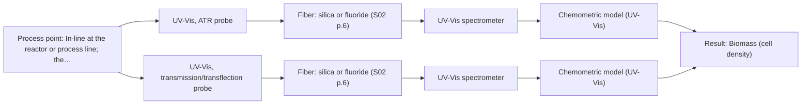
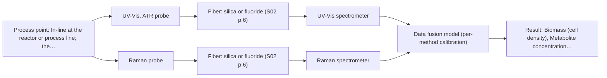

# First technical assessment: Biomass related monitoring during yeast fermentation

## Answer

**Customer request (our summary):** Customer wants an optical measurement during yeast fermentation to follow growth and notice changes earlier, with undefined biomass and metabolic signals, and an initial feasibility study with reference measurements.

### Brief answer

Test a single UV-Vis measurement first: turbidity tracks cell density and gives a low-cost growth signal, with ATR for the denser broth and transmission for the dilute start. If the metabolic signal is defined, test Raman afterwards as a combination with UV-Vis. The optical-density range, the metabolite and the reference method still need to be defined.

### Proposal

- **Best current option:** O2 (recommended)
- **Basis:** supplied AFS sources
- **What would change it:** Defining the metabolic target, or finding that the broth's optical density leaves a usable transmission path, could move the choice to a single UV-Vis technique or to the UV-Vis plus Raman option. A confirmed fluorophore could open a fluorescence route.
- **Next step:** Confirm the targets and the broth's optical-density range, then run the single-method UV-Vis trial with independent reference measurements.

**Secondary evidence (external, not AFS material):** G1: no usable external source found; G2: E01 ¶31, E04 ¶1; G3: no usable external source found; G4: no usable external source found. See Expert detail.

**Decision status:** Provisional feasibility assessment

### Solution options

| ID | Tier | Methods | Confidence | Cost class, S01 Table 1 (p.6) | Ease of use | Maintenance | Performance fit | Sources |
|---|---|---|---|---|---|---|---|---|
| O1 | Simple | M1 UV-Vis, ATR probe | Medium: open question: Q1 (starts at Medium) | average cost (row 14) | single probe, simple in-line fit | routine crystal cleaning and inspection | least effort that still follows growth | [1: S01 p.16] [2: S01 p.16] |
| O2 | Recommended | M1 UV-Vis, ATR probe; M2 UV-Vis, transmission/transflection probe | Low: open question: Q1 (starts at Medium); sample clarity unknown | average cost (rows 14, 16) | two probes, one spectrometer, more setup | two probe surfaces to clean | covers the broth's changing optical density | [1: S01 p.16] [2: S01 p.16] [3: S01 p.18] [4: S01 p.16] [5: S01 p.16] |
| O3 | Extended (multi-method) | M1 UV-Vis, ATR probe; M3 Raman probe + UV-Vis (combination) | Low: open question: Q1 (starts at Medium); multi-method, fusion benefit not yet shown | high cost (rows 12, 14) | two instruments, more alignment and upkeep | per-instrument calibration and probe checks | adds the metabolic signal UV-Vis cannot see | [1: S01 p.16] [2: S01 p.16] [6: S01 p.16] [7: S01 p.16] [8: S01 p.7] [9: S01 p.8] [10: S01 p.8] |

*Confidence rates the basis of the advice (how much is known and cited), not a predicted accuracy or probability of success. It starts at High, or at Medium when a key question on the method or the option is open, and drops one level per weakness listed (floor Low).*

*Cost class is the relative rating in S01 Table 1 (p.6) for the in-line method+technique rows named (the highest one for a multi-method option); it is not a price.*

### Setup sketch

*Recommended option O2; drawn by code from the option, a schematic, not a configuration.*

### Key questions

1. Which signals must be reported separately: is growth/biomass the primary target, and which metabolite(s) define the metabolic signal?
2. What is the broth's optical density at the start and at the end of the run?
3. Which reference method will you use (for example cell dry weight, viable count or a chromatographic assay), and what accuracy, detection limit and response time define go/no-go?

## Expert detail

**Customer enquiry**

> We would like an optical measurement during yeast fermentation to help us follow growth and notice changes earlier. Our team has mentioned both a biomass signal and a metabolic signal, but these have not been defined as separate targets. The broth becomes more optically dense as the run develops. We need help turning this request into an initial feasibility study with useful reference measurements.

**Decision status:** Provisional feasibility assessment. A source-supported route to a real-time biomass signal exists, so a conditional shortlist can be justified. The metabolic signal, the broth's optical-density range and the reference targets are still undefined, so the method choice is provisional.

### Parameters

| ID | Parameter | Kind | Need | Measured by | Why | Sources |
|---|---|---|---|---|---|---|
| P1 | Biomass (cell density) | quantitative | required | Spectroscopy: UV-Vis | It is the stated main purpose (follow growth) and turbidity tracks cell density as a real-time proxy. | [1: S01 p.16] |
| P2 | Metabolite concentration (species to be defined, for example glucose, acetate or lactate) | quantitative | required | Spectroscopy: Raman | It is the stated metabolic signal; the species must be defined before it can be calibrated. | [6: S01 p.16] |
| P3 | Cell dry weight or viable cell count | quantitative | required | Reference lab method: gravimetric cell dry weight or viable plate count | An independent reference is needed to check the optical biomass signal. | [11: REF §3] |
| P4 | Temperature | quantitative | optional | Auxiliary sensor: temperature sensor (engineering judgement: confirm availability with AFS) | It should be available in a fermenter and is needed to interpret growth and spectral baselines. | *(no verified source: engineering judgement)* |

### Solution option details

- **O1 cost drivers:** one UV-Vis probe and spectrometer, plus reference lab work
- **O2 cost drivers:** two UV-Vis probe types, calibration, reference lab work
- **O3 cost drivers:** UV-Vis and Raman instruments, synchronisation and fusion effort
- **O3 combining methods:** Start with one model per method (UV-Vis and Raman) as the baseline, then fuse at a low level by joining the spectra with block scaling so neither method dominates. The probes must look at the same small volume and the data must be aligned to a common time step. Each instrument keeps its own calibration, and the fused model must beat the best single method on held-out runs before the extra instrument is kept.

*Extended (multi-method) option O3; drawn by code from the option, a schematic, not a configuration.*

### Premise check

- **Precedent only:** An optical measurement during yeast fermentation will help follow growth and notice changes earlier. A bioprocess example links turbidity to cell density, which is a reason to test this broth, not proof for it. [1: S01 p.16]
- **Precedent only:** A biomass signal and a metabolic signal are relevant targets for this measurement. A yeast-fermentation example and a bioprocess example show both signal types being followed, but neither is proof for this customer's broth. [12: S01 p.7] [6: S01 p.16]
- **Precedent only:** The broth becoming more optically dense as the run develops is useful for following the process. Turbidity is a recognised biomass proxy, but optical density is not itself a cell count, so it is a reason to test with independent references. [13: S01 p.16] [14: REF §5]

### Requirements

**Stated by the customer**

- Optical measurement during yeast fermentation.
- Follow growth and notice changes earlier.
- Biomass signal and metabolic signal mentioned but not defined as separate targets.
- Broth becomes more optically dense as the run develops.
- An initial feasibility study with useful reference measurements.

**Key unknowns**

- Which metabolite(s) define the metabolic signal and whether the two signals must be reported separately.
- The broth's optical density at the start and end of the run.
- Whether the broth contains fluorescent species such as NADH, tryptophan or riboflavin.
- Matrix composition and how it changes during the run.
- The reference method and the target accuracy, detection limit and response time that define go/no-go.
- Probe installation point, distance from the spectrometer, and the cleaning and fouling regime.

### Clarification questions (most decision-relevant first)

Q1. Which signals must be reported separately: is growth/biomass the primary target, and which metabolite(s) define the metabolic signal? *Why it matters:* It decides whether one method is enough or whether a second method such as Raman is needed. *(affects: method)*
Q2. What is the broth's optical density at the start and at the end of the run? *Why it matters:* It decides between a transmission/transflection probe and a UV-ATR probe, whose usable regimes differ. *(affects: technique)*
Q3. Which reference method will you use (for example cell dry weight, viable count or a chromatographic assay), and what accuracy, detection limit and response time define go/no-go? *Why it matters:* The go/no-go criteria must come from the customer, not from the sources. *(affects: status)*
Q4. Are any fluorescent species (for example NADH, tryptophan or riboflavin) expected in the broth? *Why it matters:* Fluorescence could add a sensitive metabolic signal, but only if a fluorophore is present. *(affects: method)*
Q5. Where will the probe be installed, at what distance from the spectrometer, and what cleaning or fouling regime is possible? *Why it matters:* It affects the probe and fiber choice and the risk of biomass fouling the measurement surface. *(affects: installation)*

### Recommendation

- **M1 · Primary candidate: UV-Vis, ATR probe.** UV/Vis turbidity tracks cell density and gives a low-cost real-time biomass signal for the stated growth target. Its very short ATR path suits the broth as it becomes more optically dense. [1: S01 p.16] [2: S01 p.16]
- **M2 · Conditional candidate: UV-Vis, transmission/transflection probe.** Transmission or transflection is the preferred geometry for transparent or semi-transparent liquids and samples a longer, more representative path. It applies only while the broth is still dilute enough for light to pass through. *Conditions:* Applies only if the broth's optical density stays within a usable transmission path. [3: S01 p.18] [4: S01 p.16] [5: S01 p.16]
- **M3 · Conditional candidate: Raman probe + UV-Vis (combination).** Raman gives a molecular fingerprint of specific metabolites and tolerates water, so it can add the metabolic signal that UV/Vis does not see. The gain from combining it with the UV-Vis biomass signal is a hypothesis to test, not a settled benefit. *Conditions:* Applies only after the single-method UV-Vis tests, and only if the metabolic signal is defined as a target. [6: S01 p.16] [7: S01 p.16] [8: S01 p.7] [9: S01 p.8] [10: S01 p.8] Later hypothesis, after single-method tests.

### Measurement concept

- **Probe and geometry:** A fiber-optic UV-Vis probe in contact with the broth (ATR tip), with a transmission or transflection probe as the alternative geometry if the dilute phase needs a longer path.
- **Location:** In-line at the reactor or process line; the exact installation point and distance from the spectrometer are open (Q5).
- **Fiber link:** Silica fiber is the family for UV-Vis and Raman; any achievable link length depends on the configuration actually selected and is not stated in the sources. [15: S01 p.5]

### Spectral range

- **UV-Vis:** The usable range depends on the instrument, fiber and probe actually selected; no specific range for this broth is stated in the sources. [16: REF §5]
- **Raman:** The Raman shift in cm-1 is stated separately from the laser excitation wavelength; both depend on the configuration chosen. [17: S01 p.11]

### Risks and uncertainty

- If the broth spans from clear to very dense, no single UV-Vis technique may cover the whole run, because a transmission signal saturates as the medium becomes more opaque. *(rules: R-GEO-2, R-GEO-7)* [18: S01 p.16]
- Raman signals are weak and can be swamped by fluorescence from the broth, so the background must be checked on real samples. *(rules: R-RAM-1)* [19: S01 p.11]
- The calibration is matrix-specific, so a change of medium or process conditions may invalidate it. *(rules: R-CAL-1)* [20: REF §5]
- Biomass can foul the ATR crystal or probe window and bias a surface measurement. *(rules: R-MIR-3)* [21: REF §5]

### First feasibility experiment

1. **Collect representative broth samples or process states across the run, from the dilute start to the dense end, and across at least two batches or media, to cover the expected chemical and physical variation.** Representativeness [11: REF §3]
2. **Acquire the single-method UV-Vis spectra first, at the intended installation point, with the ATR probe and, if the dilute phase needs it, a transmission or transflection probe.** Single methods first *(no verified source: engineering judgement)*
3. **Measure independent references on the same samples: cell dry weight or viable count for biomass, and the laboratory method for the chosen metabolite(s).** Independent reference measurements *(no verified source: engineering judgement)*
4. **Only after the single-method tests, add the Raman measurement and, if pursued, the combined UV-Vis and Raman acquisition at the same point and the same time step.** Combination after singles [9: S01 p.8] [10: S01 p.8]
5. **Validate the models on held-out runs or batches, and set the go/no-go criteria from the customer's target accuracy and response time.** Held-out validation and go/no-go *(no verified source: engineering judgement)*

**Reference measurements:** Independent references chosen by the customer (for example cell dry weight, viable count, or a chromatographic assay) on the same samples and runs.

**Decision basis:** A go/no-go decision based on numerical criteria supplied by the customer; no accuracy or response-time figures are given in the sources.

### Assumptions

- The broth is a liquid that can be brought into contact with a probe, as implied by the enquiry.
- The run can be sampled at several points for independent reference measurements.
- The broth's optical density changes over the run but its actual range is not yet known.

### Not covered by the supplied sources

- No supplied source gives reference methods, accuracy, detection limits or response times for yeast-fermentation biomass or metabolite measurement.
- No supplied source states an achievable fiber or cable length for this specific installation.

### Further notes

- **Chemometrics:** Extracting quantitative information from these spectra requires chemometric calibration or classification models. Each model is specific to the sample matrix, so it must be validated on independent runs and re-checked when the broth or medium changes.
- **Real-time tracking:** Fiber probes can be placed at the reactor for on-site online analysis with results in near real time, and real-time decisions need fast spectral acquisition.
- **Future direction:** If a fluorescent species is confirmed, the yeast-fermentation NIR plus fluorescence pairing reported in the literature could be a later extension; a compact LED-based sensor could follow once a model is established.

### Secondary evidence (external, not AFS material)

*Found by a literature search for gaps the supplied AFS sources leave open. Not AFS material and not proof for this case; every quote below was verified verbatim against the fetched text.*

**G1 · auxiliary sensor:** In-line measurement of Temperature with temperature sensor

- No usable external source found.

**G2 · multi-method:** Combining several spectroscopy methods (data fusion) (Start with one model per method (UV-Vis and Raman) as the baseline, then fuse at a low level by joining the spectra with block scaling so neither method dominates. The probes must look at the same small volume and the data must be aligned to a common time step. Each instrument keeps its own calibration, and the fused model must beat the best single method on held-out runs before the extra instrument is kept.)

- **E01 ¶31** Low-level data fusion is described as the simplest way to combine inputs, by rearranging variables from different sources into one new data matrix. *How it applies:* This supports the proposed baseline of joining UV-Vis and Raman spectra at a low level, but the fused model still needs to be tested against the best single method on held-out runs. *Limits and transfer risks:* This is a general review statement, not a yeast-fermentation study, and it does not address block scaling, time alignment, or probe volume matching. *(supports O3)*
  > "Low-level data fusion (LLDF) is considered the simplest method to achieve a combination of inputs. In this case, the data is rearranged into a new data matrix, where the variables coming from different sources are placed one after the other."
  > Challenges and Opportunities of Implementing Data Fusion in Process Analytical Technology-A Review. (2022) · Molecules (Basel, Switzerland) · doi:10.3390/molecules27154846 · https://europepmc.org/article/PMC/PMC9369811 · retrieved 2026-10-17, full text, licence: cc by, via curated library
- **E04 ¶1** In an in-line monoclonal antibody study, UV alone gave the most precise prediction and the tested data fusion techniques did not improve accuracy over the UV-based PLS model; PLS fusion seemed meritless when combining a very accurate sensor with a less accurate signal. *How it applies:* This is a caution for adding Raman to UV-Vis: the fused model should be required to beat the best single method on held-out runs before the extra instrument is kept. *Limits and transfer risks:* The source is an abstract only, concerns Protein A load phase for monoclonal antibodies, and uses different analytes, matrix, and process conditions than yeast fermentation. *(supports O3)*
  > "The different data fusion techniques did not improve the prediction accuracy above the prediction accuracy of the UV-based PLS model. Data fusion by PLS models seems meritless when combining a very accurate sensor with a less accurate signal."
  > Comparison of UV- and Raman-based monitoring of the Protein A load phase and evaluation of data fusion by PLS models and CNNs (2021) · Biotechnology and Bioengineering · doi:10.1002/bit.27894 · https://doi.org/10.1002/bit.27894 · retrieved 2026-10-17, abstract only, licence: cc-by-nc, via openalex

**G3 · not in the supplied sources:** No supplied source gives reference methods, accuracy, detection limits or response times for yeast-fermentation biomass or metabolite measurement.

- No usable external source found.

**G4 · not in the supplied sources:** No supplied source states an achievable fiber or cable length for this specific installation.

- No usable external source found.

### Evidence (verified quotes)

1. ✓ **S01 p.16** (application precedent): "UV/Vis spectroscopy can be deployed as a low-cost, robust tool for real-time biomass monitoring, as cell suspension turbidity correlates well with cell density."
2. ✓ **S01 p.16** (general): "In these high-OD scenarios, a UV-ATR (Attenuated Total Reflection) probe is used."
3. ✓ **S01 p.18** (general): "Transmission is the preferred method for transparent or semi-transparent liquids, such as skim milk, whey, or permeate."
4. ✓ **S01 p.16** (general): "For highly transparent liquids with low optical density, UV-Transmission or Transflection probes are ideal"
5. ✓ **S01 p.16** (general): "Equipping a facility with both probe types significantly increases laboratory flexibility"
6. ✓ **S01 p.16** (application precedent): "for direct detection of specific metabolites like glucose, acetate, or lactate."
7. ✓ **S01 p.16** (general): "Raman is particularly well-suited for aqueous environments, as it exhibits low absorbance for water molecules compared to infrared methods."
8. ✓ (precedent only) **S01 p.7** (method gain): "The analysis of such systems may require a combination of two or even more spectral methods."
9. ✓ **S01 p.8** (general): "collected from the same small, even pinpoint, area of the sample."
10. ✓ **S01 p.8** (general): "the data from each method must be obtained simultaneously."
11. ✓ **REF §3** (general): "Representative samples or process states, independent reference measurements, what is compared, and the basis for the go / no-go decision."
12. ✓ **S01 p.7** (application precedent): "the combination of NIR spectroscopy with fluorescence spectroscopy demonstrated the possibility of more accurately determining the biomass content during yeast fermentation"
13. ✓ **S01 p.16** (general): "cell suspension turbidity correlates well with cell density."
14. ✓ **REF §5** (general): "optical density is not a viable cell count."
15. ✓ **S01 p.5** (general): "Immersible fiber optic probes operating in various spectral regions from UV to mid-IR are increasingly being used for measuring liquid and soft or powdered solid samples."
16. ✓ **REF §5** (general): "actual spectral coverage, fiber length, component ratings, detection limits and accuracy depend on the configuration and the sample."
17. ✓ **S01 p.11** (general): "The Raman shift is used as the horizontal (spectral) axis in Raman spectroscopy"
18. ✓ **S01 p.16** (general): "transmission setup becomes saturated because the light cannot penetrate the bulk of the sample."
19. ✓ **S01 p.11** (general): "superposition of luminescence (fluorescence), which has a significantly higher intensity."
20. ✓ **REF §5** (general): "calibration specific to the matrix."
21. ✓ **REF §5** (general): "Usable range limited by fiber and crystal; contact, fouling, compatibility."

### Verification

- Citations verified: 28 of 28 (exact or whitespace/hyphen-tolerant match on the cited page, scope checked).
- Hard check failures before deterministic corrections: 0; still open: 0; soft warnings: 1; repair rounds: 0.
- External evidence (live): 2 quote(s) verified verbatim (exact or whitespace/hyphen-tolerant, at most 400 characters and 2 sentences, against the cited paragraph); 0 item(s) dropped.
- External search: 5 query(ies), 40 hit(s), 5 source(s) (3 from the curated library).
- External step: 2 model call(s), 60.5 s extra (cost in the run JSON).

*Run D05-20261017T195716Z · models deepseek/deepseek-v4.1-flash*
