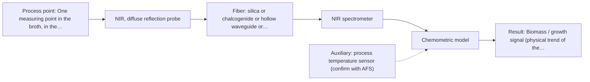
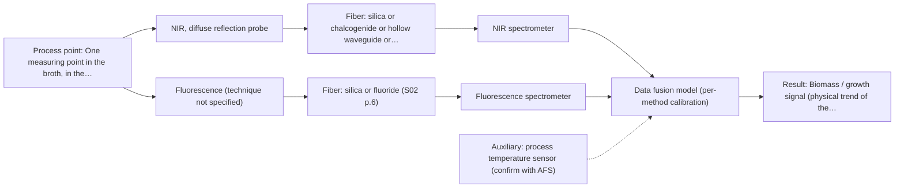

# First technical assessment: Biomass related monitoring during yeast fermentation

# Answer

**Customer request:** Optical measurement during yeast fermentation to follow growth and notice changes earlier, with undefined biomass and metabolic signals.

## Brief answer

Start with NIR diffuse reflection as a single method: the broth is turbid and gets denser, the regime where reflection rather than transmission is used, and NIR also sees major components. A UV-Vis transmission measurement is the simple comparison for the growth signal. What stays open is the metabolic target itself: until its species and concentration range are defined, and reference analyses agreed, fluorescence or Raman cannot be chosen.

## Proposal

- **Best current option:** O2 (recommended): M1 NIR, diffuse reflection probe
- **Basis:** supplied AFS sources
- **What would change it:** If the metabolic target turns out to be a trace species that does not fluoresce, or if the optical-density range rules out reflection, the shortlist and the geometry would have to be revisited.
- **Next step:** Run the feasibility experiment on representative broth samples, single methods first, with independent reference analyses and the customer's accuracy and response-time criteria.

**Decision status:** Provisional feasibility assessment. The turbid aqueous broth and the two named target families justify a conditional shortlist, so this assessment is provisional. The targets themselves are not yet defined, and no supplied source shows performance for this broth.

## Solution options

| ID | Tier | Methods | Confidence | Cost class, S01 Table 1 (p.6) | Ease of use | Maintenance | Performance fit | Sources |
|---|---|---|---|---|---|---|---|---|
| O1 | Simple | M2 UV-Vis, transmission/transflection probe | High | low (row 16) | Single transmission probe, standard optics, little training needed. | Periodic window cleaning and baseline checks. | Answers the growth question with the least hardware, but saturates as the broth thickens. | *(no verified source: engineering judgement)* |
| O2 | Recommended | M1 NIR, diffuse reflection probe | High | average (row 8) | One reflection probe; building the chemometric model needs skilled work. | Probe cleaning plus recalibration when the medium changes. | Tolerates turbidity and covers growth and major components in one method. | *(no verified source: engineering judgement)* |
| O3 | Extended (multi-method) | M3 NIR, diffuse reflection probe + Fluorescence (combination) | Low: fluorescent target unknown; multi-method, fusion benefit not yet shown | average (row 8); not rated in S01 Table 1: Fluorescence (technique not specified) | Two instruments and two data streams to align and keep running. | Two calibrations and two sets of probe diagnostics. | Adds a sensitive metabolic channel where NIR alone is too coarse. | [1: S01 p.8] [2: S01 p.8] |

*Confidence rates the basis of the advice (how much is known and cited), not a predicted accuracy or probability of success. It starts at High and drops one level per weakness listed.*

*Cost class is the relative rating in S01 Table 1 (p.6) for the in-line method+technique rows named (the highest one for a multi-method option); it is not a price.*

## Setup sketch

*Recommended option O2; drawn by code from the option, a schematic, not a configuration.*

*Extended (multi-method) option O3; drawn by code from the option, a schematic, not a configuration.*

## Key questions

1. Which metabolic species should the measurement follow, and over what concentration range?
2. Does the broth contain a fluorescent species (for example NADH, tryptophan or riboflavin), or could a justified fluorescent indicator be added?
3. What is the optical density from start to end of the run, and does the broth stay in the scattering regime?

# Expert detail

**Customer enquiry**

> We would like an optical measurement during yeast fermentation to help us follow growth and notice changes earlier. Our team has mentioned both a biomass signal and a metabolic signal, but these have not been defined as separate targets. The broth becomes more optically dense as the run develops. We need help turning this request into an initial feasibility study with useful reference measurements.

## Parameters

| ID | Parameter | Kind | Need | Measured by | Why | Sources |
|---|---|---|---|---|---|---|
| P1 | Biomass / growth signal (physical trend of the broth) | quantitative | required | Spectroscopy: NIR | Following growth is the first stated target, and in a turbid broth the growth trend appears as a change in the scattering and absorption signal. | *(no verified source: engineering judgement)* |
| P2 | Major soluble components (for example carbon source such as glucose or glycerol) | quantitative | required | Spectroscopy: NIR | This is the metabolic side of the request at the level NIR can reach. | [3: S01 p.16] |
| P3 | Fluorescent cofactor or metabolite signal (for example NADH, tryptophan, riboflavin) | quantitative | optional | Spectroscopy: Fluorescence | It should be available if the broth fluoresces, because it adds the sensitive trace-level metabolic channel. | [4: S01 p.16] |
| P4 | Optical density / turbidity | quantitative | required | Spectroscopy: UV-Vis | It is the state the customer says changes during the run, and it decides which measurement geometry stays usable. | *(no verified source: engineering judgement)* |
| P5 | Offline reference values (dry cell weight, metabolite concentration) | quantitative | required | Reference lab method: dry cell weight; laboratory metabolite assay (for example HPLC) | Independent reference values are needed to build and validate the calibration models. | [5: REF §3] |
| P6 | Temperature | quantitative | optional | Auxiliary sensor: process temperature sensor (engineering judgement: confirm availability with AFS) | Fermentation temperature drives growth and shifts the spectra, so it should be available to interpret the trends. | *(no verified source: engineering judgement)* |

## Solution option details

- **O1 cost drivers:** One spectrometer, one transmission probe, simple data handling.
- **O2 cost drivers:** NIR spectrometer, reflection probe, calibration samples and model work.
- **O3 cost drivers:** Second spectrometer, combined probe, synchronisation and fusion work.
- **O3 combining methods:** Both channels must look at the same small area of the broth, so either one combined probe head or two probes at one measuring point are needed. The two data streams must be aligned to a common time step, and each method keeps its own calibration and diagnostics. The fused model must be validated on independent batches and must beat the best single method, otherwise the second channel is dropped.

## Premise check

- **Precedent only:** An optical measurement during yeast fermentation will help follow growth and notice changes earlier. A published yeast-fermentation study shows a spectral combination improving biomass estimation and separating metabolites; that is a reason to test the approach, not proof for this broth. [6: S01 p.7]
- **Precedent only:** Biomass and metabolic signals can be used as separate targets. Sources treat a physical process trend and chemical structures as distinct things to monitor in bioprocessing, but nothing here defines the two signals for this broth. [7: S01 p.16]
- **Supported:** The broth becoming more optically dense is a useful indicator for the process. The source states that turbidity correlates with cell density, so the optical-density trend is usable as a growth indicator; it is not a cell count. [8: S01 p.16]

## Requirements

**Stated by the customer**

**Key unknowns**

- Identity and concentration range of the metabolic target
- Whether the broth contains a fluorescent species
- Optical-density range across the run (which geometry stays usable)
- Reference method and reference sampling frequency
- Required accuracy and response time (go/no-go criteria)
- Probe installation point, distance from the spectrometer and cleaning regime

## Clarification questions (most decision-relevant first)

Q1. Which metabolic species should the measurement follow, and over what concentration range? *Why it matters:* It decides whether NIR, fluorescence or Raman can see the target at all. *(affects: method, technique)*
Q2. Does the broth contain a fluorescent species (for example NADH, tryptophan or riboflavin), or could a justified fluorescent indicator be added? *Why it matters:* Fluorescence only works with a fluorescing species, so this decides whether the two-channel option is usable. *(affects: technique)*
Q3. What is the optical density from start to end of the run, and does the broth stay in the scattering regime? *Why it matters:* It decides between transmission and reflection geometry and where each one stops working. *(affects: technique, installation)*
Q4. What accuracy and response time must the measurement reach for you to accept it? *Why it matters:* These numbers become the go/no-go criteria for the feasibility test. *(affects: status)*
Q5. Where can a probe be installed, at what distance from the spectrometer, and how will it be cleaned? *Why it matters:* It fixes the probe and fiber type, and deposits on the measuring window can change the signal. *(affects: installation)*

## Recommendation

- **M1 · Primary candidate: NIR, diffuse reflection probe.** The broth is turbid and becomes denser, the regime where reflection rather than transmission is used. NIR also tracks major components such as glucose or glycerol in the millimolar range, so one method covers both the growth trend and the larger chemical changes. *Conditions:* Applies if the broth stays in the scattering regime through the run and a calibration can be built from reference samples. [9: S01 p.17] [10: S01 p.18] [11: S01 p.16]
- **M2 · Comparison candidate: UV-Vis, transmission/transflection probe.** UV/Vis transmission is a robust route to a real-time growth signal, because turbidity correlates with cell density. It is usable only while the broth is still transparent enough; as the broth thickens the transmission signal saturates. *Conditions:* Applies mainly to the early, lower-optical-density part of the run. [12: S01 p.16] [13: S01 p.16]
- **M3 · Conditional candidate: NIR, diffuse reflection probe.** In yeast fermentation the published combination of NIR with fluorescence gave a better biomass estimate and separated intra- from extracellular metabolites, so the second channel is worth testing. Fluorescence reaches trace cofactors that NIR misses, but only where a fluorescent species is present. *Conditions:* Applies only after the single-method tests, and only if a fluorescent species (for example NADH, tryptophan or riboflavin) is present. [14: S01 p.7] [15: S01 p.7] [16: S01 p.16] Later hypothesis, after single-method tests: combine with Fluorescence.

## Measurement concept

- **Probe and geometry:** NIR reflection probe flush-mounted in the reactor or a flow cell, in contact with the broth; transmission/transflection as the comparison geometry while the broth is still clear.
- **Location:** One measuring point in the broth, in the reactor or in a recirculation loop; two methods would have to share that point.
- **Fiber link:** Fiber family and link length depend on the method and installation; no length can be stated from the supplied sources for a MIR link, and the NIR/UV-Vis link is an open question for AFS. *(no verified source: engineering judgement)*

## Spectral range

- **NIR:** Nominal method range 780-2500 nm; the usable range depends on the instrument, fiber and probe actually selected. [17: S01 p.10] [18: REF §5]
- **UV-Vis:** Nominal UV part of the range 190-360 nm; the visible part is not given as a number in the supplied sources, and the usable range depends on the instrument, fiber and probe actually selected. [19: S01 p.5] [20: REF §5]

## Risks and uncertainty

- The biomass and metabolic targets are still undefined, so a method could be chosen for the wrong species or concentration range. *(no verified source: engineering judgement)*
- NIR may lack the sensitivity for trace metabolites, so earlier changes could be missed. *(rules: R-NIR-4)* *(no verified source: engineering judgement)*
- While the broth is still clear early in the run, reflection may be less representative of the bulk than later. *(rules: R-GEO-4)* [21: S01 p.18]
- If no fluorescent species is present, the second channel of the two-channel option cannot be used. *(rules: R-FLU-1)* [22: S04 p.4]
- NIR and UV-Vis calibrations are specific to the matrix, so a change of medium, strain or feed requires re-validation on the new material. *(rules: R-CAL-1)* [23: REF §5]

## First feasibility experiment

1. **Collect representative broth samples across the run (early, mid, late) and from at least three independent batches, covering the expected optical-density range.** Representative samples and process states are the base of the comparison. [24: REF §3]
2. **Measure every sample with the single methods first (NIR diffuse reflection and UV-Vis transmission), on the same samples, without combining methods.** Single methods first; a combination is a later hypothesis. *(no verified source: engineering judgement)*
3. **Obtain independent reference values for each sample: dry cell weight or cell count, and the metabolite concentration by a laboratory assay.** Reference values are needed to build and check the models. *(no verified source: engineering judgement)*
4. **Build one chemometric model per method and validate it on held-out batches, not on further samples from the same run.** Held-out batches show whether the model transfers. *(no verified source: engineering judgement)*
5. **Only if no single method separates the process states, test the NIR plus fluorescence combination at the same measuring point and compare it with the best single method; the accuracy and response-time criteria come from the customer.** A combination must beat the best single method or be dropped. *(no verified source: engineering judgement)*

**Reference measurements:** Dry cell weight or cell count, and metabolite concentration by a laboratory assay, on the same samples used for the spectra.

**Decision basis:** The customer's own accuracy and response-time numbers; if no single method reaches them, the combination is tested against the best single method.

## Assumptions

- The broth stays a pumpable liquid and can be brought into contact with a probe.
- A chemometric calibration can be built from the available reference samples.
- The process can provide reference samples at a usable frequency.

## Not covered by the supplied sources

- Accuracy, detection limits and response times for in-line monitoring of this broth.
- An achievable fiber link length for a probe in this installation.

## Further notes

- **Chemometrics:** NIR and UV-Vis bands overlap, so quantitative use needs a chemometric calibration built on reference samples and validated on held-out batches; the model is specific to the broth and must be re-validated when the medium or strain changes.
- **Real-time tracking:** The measurement is in-line and continuous, and the broth changes during the run, so the model has to cover the whole range; if two methods are used, their data must be synchronised to a common time step.
- **Future direction:** Once the informative spectral regions are known, a compact LED-based sensor or a Raman channel could be considered as a later step.

## Evidence (verified quotes)

1. ✓ **S01 p.8** (general): "It is crucial that the spectral information obtained by different methods-Mid-IR, NIR, Raman, and fluorescence spectra-is collected from the same small, even pinpoint, area of the sample."
2. ✓ **S01 p.8** (general): "Ultimately, the measurement data must be normalized to a common time step."
3. ✓ (precedent only) **S01 p.16** (performance figure): "NIR spectroscopy is effective for tracking major components like glucose or glycerol in the millimolar range but may lack the sensitivity to detect trace compounds below 0.1 percent."
4. ✓ (precedent only) **S01 p.16** (performance figure): "To fill this gap, Fluorescence spectroscopy can be used for high-sensitivity detection (down to the nM-μM range) of critical cofactors and amino acids like NADH, tryptophan, and riboflavin."
5. ✓ **REF §3** (general): "Representative samples or process states, independent reference measurements, what is compared, and the basis for the go / no-go decision."
6. ✓ **S01 p.7** (application precedent): "The combination of NIR spectroscopy with fluorescence spectroscopy demonstrated the possibility of more accurately determining the biomass content during yeast fermentation, as well as distinguishing between their intra- and extracellular metabolites."
7. ✓ **S01 p.16** (general): "a primary advantage of having multiple techniques is the ability to monitor both complex chemical structures and overall physical process trends simultaneously"
8. ✓ **S01 p.16** (general): "cell suspension turbidity correlates well with cell density"
9. ✓ **S01 p.17** (application precedent): "NIR Reflection is primarily used for opaque or highly concentrated dairy products, such as yogurt, butter, or whole milk concentrates."
10. ✓ **S01 p.18** (general): "reflection can work well in highly scattering environments but can be less representative for clear liquids."
11. ✓ (precedent only) **S01 p.16** (performance figure): "NIR spectroscopy is effective for tracking major components like glucose or glycerol in the millimolar range but may lack the sensitivity to detect trace compounds below 0.1 percent."
12. ✓ **S01 p.16** (application precedent): "UV/Vis spectroscopy can be deployed as a low-cost, robust tool for real-time biomass monitoring, as cell suspension turbidity correlates well with cell density."
13. ✓ **S01 p.16** (general): "the signal in a standard transmission setup becomes saturated because the light cannot penetrate the bulk of the sample."
14. ✓ **S01 p.7** (application precedent): "The combination of NIR spectroscopy with fluorescence spectroscopy demonstrated the possibility of more accurately determining the biomass content during yeast fermentation, as well as distinguishing between their intra- and extracellular metabolites."
15. ✓ (precedent only) **S01 p.7** (method gain): "The analysis of such systems may require a combination of two or even more spectral methods."
16. ✓ (precedent only) **S01 p.16** (performance figure): "To fill this gap, Fluorescence spectroscopy can be used for high-sensitivity detection (down to the nM-μM range) of critical cofactors and amino acids like NADH, tryptophan, and riboflavin."
17. ✓ **S01 p.10** (general): "NIR spectra (780-2500 nm) contain predominantly overtones and component bands of fundamental vibrations"
18. ✓ **REF §5** (general): "It is not a product specification: actual spectral coverage, fiber length, component ratings, detection limits and accuracy depend on the configuration and the sample."
19. ✓ **S01 p.5** (general): "It has very high sensitivity, especially in the UV region (190-360 nm), but requires the use of special light sources and fiber optic probes."
20. ✓ **REF §5** (general): "It is not a product specification: actual spectral coverage, fiber length, component ratings, detection limits and accuracy depend on the configuration and the sample."
21. ✓ **S01 p.18** (general): "reflection can work well in highly scattering environments but can be less representative for clear liquids."
22. ✓ **S04 p.4** (general): "it is limited to the samples containing at least one fluorescent component"
23. ✓ **REF §5** (general): "physical variation; calibration specific to the matrix."
24. ✓ **REF §3** (general): "Representative samples or process states, independent reference measurements, what is compared, and the basis for the go / no-go decision."

## Verification

- Citations verified: 24 of 24 (exact or whitespace/hyphen-tolerant match on the cited page, scope checked).
- Hard check failures before deterministic corrections: 0; still open: 0; soft warnings: 5; repair rounds: 1.

*Run D05-20261017T134559Z · models deepseek/deepseek-v4.1-flash*
