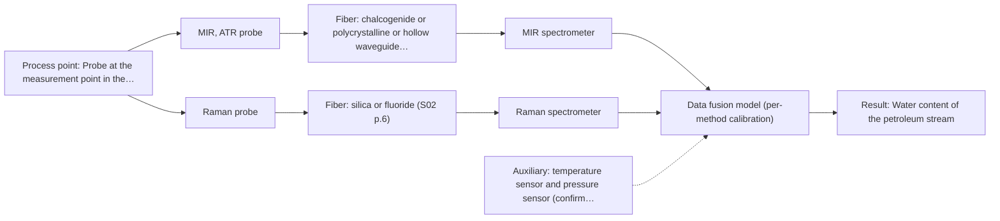

# First technical assessment: Water content in a petroleum stream

# Answer

**Customer request:** We handle a petroleum stream and currently send samples to a laboratory for water determination. We want to investigate a fiber based measurement closer to the process so that changes can be noticed sooner. The analyzer would be outside the process area. Before selecting equipment, we need to know what to clarify and what a first comparison experiment should establish.

## Brief answer

Start with a mid-IR ATR fibre measurement, tested in-line against your current laboratory water determination across the full water range; it is the only technique in the supplied material with a shown water-in-petroleum application. What is still open: the required range and accuracy, whether the water is dissolved or dispersed, the installation distance and conditions, and how the probe will be kept clean.

## Proposal

- **Best current option:** O2 (recommended): M1 MIR, ATR probe; M2 Raman probe
- **Basis:** supplied AFS sources
- **What would change it:** If the agreed water range and accuracy are already met by MIR ATR alone in the trial, O1 is enough and the Raman comparison can be dropped; if the stream proves optically clear with a controllable pathlength, the NIR transmission route (M3) moves onto the shortlist.
- **Next step:** Answer Q1-Q3, then run the MIR ATR comparison against the current laboratory method on split samples across the water range.

**Decision status:** Provisional feasibility assessment. A shortlist can be justified: mid-IR ATR is the technique the supplied material actually shows for water content in petroleum, and the customer is asking for a comparison experiment, not a commitment. The required water range, the physical state of the water and the installation distance are still unknown, so the assessment stays provisional.

## Solution options

| ID | Tier | Methods | Confidence | Cost class, S01 Table 1 (p.6) | Ease of use | Maintenance | Performance fit | Sources |
|---|---|---|---|---|---|---|---|---|
| O1 | Simple | M1 MIR, ATR probe | Medium: uncited auxiliary sensor and a required parameter is not measurable in-line | high (row 2) | One probe and one spectrometer; simple contact interface. | Clean the ATR crystal; watch for deposits and poor contact. | Direct water-in-petroleum ATR lead; least effort that answers the main question. | [1: REF §5] |
| O2 | Recommended | M1 MIR, ATR probe; M2 Raman probe | Low: uncited auxiliary sensor and a required parameter is not measurable in-line; multi-method, fusion benefit not yet shown | high (rows 2, 12) | Two probes and two spectrometers; more set-up and alignment. | Two probe interfaces; Raman laser and fluorescence background checks. | Compares ATR surface and Raman bulk sampling before any hardware commitment. | [2: S01 p.11] |

*Confidence rates the basis of the advice (how much is known and cited), not a predicted accuracy or probability of success. It starts at High and drops one level per weakness listed.*

*Cost class is the relative rating in S01 Table 1 (p.6) for the in-line method+technique rows named (the highest one for a multi-method option); it is not a price.*

## Setup sketch

*Recommended option O2; drawn by code from the option, a schematic, not a configuration.*

## Key questions

1. What water range must be covered, with what accuracy or detection limit, and how quickly must a change be visible?
2. Is the water in the stream dissolved, emulsified or free, and is the stream single-phase at the measurement point?
3. What is the distance from the measurement point to the intended analyzer location, and what are the temperature, pressure and area classification there?

# Expert detail

**Customer enquiry**

> We handle a petroleum stream and currently send samples to a laboratory for water determination. We want to investigate a fiber based measurement closer to the process so that changes can be noticed sooner. The analyzer would be outside the process area. Before selecting equipment, we need to know what to clarify and what a first comparison experiment should establish.

## Parameters

| ID | Parameter | Kind | Need | Measured by | Why | Sources |
|---|---|---|---|---|---|---|
| P1 | Water content of the petroleum stream | quantitative | required | Spectroscopy: MIR | It is the target of the measurement, and the in-line result has to track the water concentration the laboratory reports. | [3: S02 p.13] |
| P2 | Temperature and pressure at the measurement point | quantitative | required | Auxiliary sensor: temperature sensor and pressure sensor (engineering judgement: confirm availability with AFS) | Temperature and pressure shift infrared bands and decide how much water stays dissolved, so they have to be recorded with each spectrum for the calibration to hold. | *(no verified source: engineering judgement)* |
| P3 | Water state: dissolved, emulsified or free | qualitative | required | Not measurable in-line by spectroscopy; alternative: laboratory determination of total and free water on the same samples | ATR looks only a few micrometres into the contacting phase, so whether the water is dissolved or dispersed decides how representative the probe reading is of total water. | [4: S01 p.13] |
| P4 | Hydrocarbon matrix, additives and contaminants | qualitative | optional | Reference lab method: current laboratory characterisation of the stream | A calibration is specific to the matrix, so knowing when the stream composition changes tells us when the model has to be re-validated. | [5: REF §5] |

## Solution option details

- **O1 cost drivers:** One mid-IR spectrometer, one ATR fibre probe, installation and calibration work.
- **O2 cost drivers:** Two spectrometers, two probes, longer trial and chemometric effort.

## Premise check

- **Supported:** A fibre based measurement closer to the process will let changes be noticed sooner. In-line analysis measures directly in the process flow without sampling, which removes the sampling and transport delay; how fast a change is actually visible still depends on the spectrometer and averaging chosen, which are not fixed yet. [6: S01 p.3]
- **Supported:** The analyzer can be outside the process area while still measuring the process. Fibre probes allow measurement at a distance from the spectrometer, so the principle holds; however, no supplied source states an achievable length for a mid-IR link, so the actual distance has to be confirmed with AFS. [7: S01 p.10]
- **Precedent only:** A fibre based measurement can determine water in a petroleum stream. A water-content-in-petroleum ATR application with example spectra is shown, which is a reason to test the method on this stream, not proof that it will meet the customer's range and accuracy. [8: S02 p.13]

## Requirements

**Stated by the customer**

**Key unknowns**

- Required water range, accuracy or detection limit, and the response time the in-line result must meet.
- Whether the water is dissolved, emulsified or free, and whether the stream is single-phase at the measurement point.
- Optical behaviour of the stream (clear, turbid, dark) and its hydrocarbon, additive and contaminant composition.
- Temperature, pressure and area classification at the measurement point, and the distance to the analyzer location.
- The laboratory water determination method used today and its repeatability.
- Achievable mid-IR fibre length between probe and analyzer, and how the probe would be kept clean.

## Clarification questions (most decision-relevant first)

Q1. What water range must be covered, with what accuracy or detection limit, and how quickly must a change be visible? *Why it matters:* These numbers are the go/no-go basis and decide whether a single method is enough. *(affects: method, technique, status)*
Q2. Is the water in the stream dissolved, emulsified or free, and is the stream single-phase at the measurement point? *Why it matters:* A surface method such as ATR sees only the contacting layer, so the answer decides how representative the reading is. *(affects: method, technique)*
Q3. What is the distance from the measurement point to the intended analyzer location, and what are the temperature, pressure and area classification there? *Why it matters:* No source states an achievable mid-IR fibre length, so the remote-analyzer idea has to be checked against the installation. *(affects: installation, technique)*
Q4. Which laboratory method is used today for the water determination, and what is its repeatability? *Why it matters:* It is the independent reference the in-line result will be compared against. *(affects: status)*
Q5. How clear or turbid is the stream, and which hydrocarbons, additives and contaminants does it contain? *Why it matters:* This decides whether a NIR transmission geometry is worth testing and how matrix-specific the calibration has to be. *(affects: method, technique)*
Q6. How would the probe be kept clean in service, and how would fouling be noticed? *Why it matters:* ATR needs tight contact, and deposits on the crystal change the reading. *(affects: installation)*

## Recommendation

- **M1 · Primary candidate: MIR, ATR probe.** MIR ATR is the technique the supplied material shows for water content in petroleum, and ATR gives a defined short path in a medium that absorbs water strongly. It is the single method to test first against the current laboratory determination. [9: S02 p.13] [10: REF §5] [11: S01 p.5]
- **M2 · Comparison candidate: Raman probe.** Raman tolerates water well and probes a different sample volume than the ATR surface layer, so it is worth running on the same samples as a second single method. Its weak signal can be swamped by hydrocarbon fluorescence, which has to be checked on the real stream. *Conditions:* Applies if MIR ATR alone does not meet the agreed water range, or if the water turns out to be dispersed rather than dissolved. [12: S01 p.16] [13: S01 p.11]
- **M3 · Conditional candidate: NIR, transmission/transflection probe.** NIR is the most common in-line fibre method and carries the water overtone bands, but transmission needs a clear, semi-transparent liquid and a controlled pathlength. It becomes worth testing only if the stream turns out optically clear. *Conditions:* Applies only if the stream is optically clear and a defined pathlength can be installed at the measurement point. [14: S01 p.10] [15: S01 p.18]

## Measurement concept

- **Probe and geometry:** Mid-IR ATR fibre probe in contact with the liquid stream (crystal face in the flowing medium); Raman fibre probe as the single-method comparison; NIR transmission or transflection only if the stream is clear.
- **Location:** Probe at the measurement point in the stream; spectrometer outside the process area, linked by fibre.
- **Fiber link:** Fibre family and link length depend on the method chosen and must be confirmed with AFS; no source states an achievable mid-IR link length. [16: S01 p.10] [17: S02 p.7]

## Spectral range

- **MIR:** Nominal mid-IR range 4000-400 cm-1; the usable range depends on the instrument, fibre and probe actually selected. [18: S01 p.9]
- **Raman:** Raman is reported as a Raman shift in cm-1, with the laser excitation wavelength stated separately; the excitation wavelength for this stream is not yet fixed. [19: S01 p.11]
- **NIR:** Nominal NIR range 780-2500 nm; the usable range depends on the instrument, fibre and probe actually selected. [20: S01 p.10]

## Risks and uncertainty

- If the water is present as free or emulsified droplets rather than dissolved, an ATR probe reading only the contacting few micrometres may not track total water in the stream. *(rules: R-MIR-3)* [21: S01 p.13]
- No supplied source states an achievable length for a mid-IR fibre link, so the distance between the probe and an analyzer outside the process area cannot be assumed; the long 100-300 m figure is stated only for low-OH silica cables. *(rules: R-FIB-1, R-FIB-2)* [22: S02 p.7]
- The required water range and accuracy are unknown; if they lie below what MIR ATR can resolve in this matrix, the method choice changes. *(no verified source: engineering judgement)*
- A fouled or poorly contacted ATR crystal, and temperature or pressure changes at the probe, can move the reading independently of the water content. *(rules: R-MIR-2, R-MIR-3)* [23: REF §5]

## First feasibility experiment

1. **Agree the go/no-go numbers with the customer before any measurement: the water range, the required accuracy or detection limit, and the response time the in-line result must meet.** Sets the acceptance criteria the trial has to meet before any measurement is taken. [24: REF §3]
2. **Collect representative samples and process states across the expected water range, feeds and operating conditions, splitting each sample so one part goes to the laboratory.** Covers the expected chemical and physical variation, with a portion kept back for the independent reference. *(no verified source: engineering judgement)*
3. **Measure every sample with the MIR ATR probe in the intended geometry and location, with repeat measurements on at least two separate runs or days.** Tests the single method first, in the geometry that would actually be installed. *(no verified source: engineering judgement)*
4. **Have the split samples analysed by the current laboratory water determination method, without knowledge of the spectral results.** Provides the independent reference values for calibration and validation. *(no verified source: engineering judgement)*
5. **Fit the water calibration on part of the runs and validate it on held-out runs or batches; if it does not meet the agreed numbers, repeat the measurement and calibration work with the Raman comparison on the same samples.** Shows whether the method meets the agreed numbers on data it was not built on. *(no verified source: engineering judgement)*

**Reference measurements:** The current laboratory water determination on split samples, used blind as the independent reference.

**Decision basis:** Go/no-go numbers supplied by the customer before the trial; MIR ATR must meet them on held-out runs and batches.

## Assumptions

- The stream is a liquid at the measurement point and can make tight contact with an ATR crystal.
- The analyzer can be placed far enough away that only the fibre link, not the spectrometer, sits in the process environment.

## Not covered by the supplied sources

- No supplied source states an achievable fibre length for a mid-IR link, so the distance between a probe in the process and an analyzer outside the process area cannot be quoted from this material.
- The sources show example water-in-petroleum ATR spectra but give no accuracy or detection limit for that application.
- Hazardous-area classification and process-safety requirements for the installation are not covered.

## Further notes

- **Chemometrics:** The water result will come from a chemometric calibration built on the laboratory reference data; it is specific to the stream matrix, so plan to re-validate it when the feed or composition changes.
- **Real-time tracking:** Moving the measurement to the process removes sampling and transport delay, which is the point of in-line analysis; the achievable time resolution depends on the spectrometer, probe and averaging chosen, none of which is fixed yet.

## Evidence (verified quotes)

1. ✓ **REF §5** (general): "Liquids, pastes and soft solids in contact with the ATR crystal."
2. ✓ **S01 p.11** (general): "This property makes mid-IR and Raman spectra complementary, that is, they complement each other."
3. ✓ **S02 p.13** (application precedent): "Application: measurement of water content in petroleum ATR-Probes with ATR-tips from ZrO2 (& Diamond, etc.) sealed in PEEK-shaft and protected by PEEK-tubing can be used in microwave furnaces"
4. ✓ **S01 p.13** (general): "typically at a depth of few microns"
5. ✓ **REF §5** (general): "physical variation; calibration specific to the matrix."
6. ✓ **S01 p.3** (general): "It allows for in-process analysis, i.e., directly in the process flow or reactor without sampling, eliminating delays and the risk of sample contamination."
7. ✓ **S01 p.10** (general): "These immersion probes operate on the ATR principle but allow analysis at a significant distance from the spectrometer, without the need for sampling."
8. ✓ **S02 p.13** (application precedent): "Application: measurement of water content in petroleum ATR-Probes with ATR-tips from ZrO2 (& Diamond, etc.) sealed in PEEK-shaft and protected by PEEK-tubing can be used in microwave furnaces"
9. ✓ **S02 p.13** (application precedent): "Application: measurement of water content in petroleum ATR-Probes with ATR-tips from ZrO2 (& Diamond, etc.) sealed in PEEK-shaft and protected by PEEK-tubing can be used in microwave furnaces"
10. ✓ **REF §5** (general): "Leads: water in petroleum, API in polymer extrusion."
11. ✓ **S01 p.5** (general): "strong absorption in the mid-IR region limits the corresponding spectral method to the analysis of very thin samples (usually less than 50 μm), but it opens up the possibility of using attenuated total reflectance (ATR)"
12. ✓ **S01 p.16** (general): "Raman is particularly well-suited for aqueous environments, as it exhibits low absorbance for water molecules compared to infrared methods."
13. ✓ **S01 p.11** (general): "the superposition of luminescence (fluorescence), which has a significantly higher intensity."
14. ✓ **S01 p.10** (general): "Near-IR vibrational spectroscopy (NIR) is the most common online analysis method performed using fiber optic probes."
15. ✓ **S01 p.18** (general): "Transmission is the preferred method for transparent or semi-transparent liquids, such as skim milk, whey, or permeate."
16. ✓ **S01 p.10** (general): "ATR fiber probes (Fig.1) enable the analysis of liquids and solid elastic samples"
17. ✓ **S02 p.7** (general): "Robust 100-300m cables made with Silica fibers of low OH-content (<0.1ppm OH) enable remote industrial process-control"
18. ✓ **S01 p.9** (general): "Vibrational spectroscopy in the mid-IR range (4000-400 cm-1) is one of the most informative methods of chemical analysis."
19. ✓ **S01 p.11** (general): "The Raman shift is used as the horizontal (spectral) axis in Raman spectroscopy"
20. ✓ **S01 p.10** (general): "NIR spectra (780-2500 nm) contain predominantly overtones and component bands of fundamental vibrations"
21. ✓ **S01 p.13** (general): "typically at a depth of few microns"
22. ✓ **S02 p.7** (general): "Robust 100-300m cables made with Silica fibers of low OH-content (<0.1ppm OH) enable remote industrial process-control"
23. ✓ **REF §5** (general): "Usable range limited by fiber and crystal; contact, fouling, compatibility."
24. ✓ **REF §3** (general): "Representative samples or process states, independent reference measurements, what is compared, and the basis for the go / no-go decision."

## Verification

- Citations verified: 24 of 24 (exact or whitespace/hyphen-tolerant match on the cited page, scope checked).
- Hard check failures before deterministic corrections: 0; still open: 0; soft warnings: 0; repair rounds: 1.

*Run D06-20261017T135435Z · models deepseek/deepseek-v4.1-flash*
