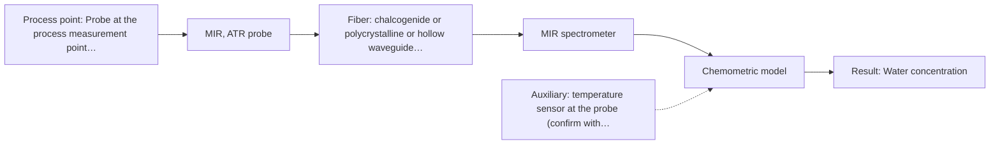

# First technical assessment: Water content in a petroleum stream

**Customer enquiry**

> We handle a petroleum stream and currently send samples to a laboratory for water determination. We want to investigate a fiber based measurement closer to the process so that changes can be noticed sooner. The analyzer would be outside the process area. Before selecting equipment, we need to know what to clarify and what a first comparison experiment should establish.

## Brief answer

Start with a single-method MIR ATR fiber-probe trial, because a source shows water content in petroleum measured by ATR. Compare it against your laboratory water reference on representative samples across the expected water range and process conditions. Still open: the stream's physical state and clarity, required detection limit, process temperature and pressure, and the achievable MIR fiber length for an analyzer outside the process area.

## Proposal

- **Best current option:** O2 (recommended): R1 MIR, ATR probe
- **Basis:** supplied AFS sources
- **What would change it:** If the stream is not suitable for ATR (e.g., gas, multiphase, or very high opacity), or if the required MIR fiber link length cannot be achieved, the choice would change toward NIR transmission/transflection or diffuse reflection. If the required water detection limit is below what MIR ATR can reach, a different method or combination would be needed. If the stream is transparent and low-scattering, NIR transmission may become the primary comparison.
- **Next step:** Clarify the physical state, water range and required accuracy, and process conditions; then run a feasibility trial comparing MIR ATR against the laboratory reference on representative samples, as in the feasibility plan.

**Decision status:** Provisional feasibility assessment. A shortlist can be justified from the sources: MIR ATR has a direct application precedent for water in petroleum, and NIR techniques are plausible comparisons. The known facts are not enough to select a final configuration.

## Parameters

| ID | Parameter | Kind | Need | Measured by | Why | Sources |
|---|---|---|---|---|---|---|
| P1 | Water concentration | quantitative | required | Spectroscopy: MIR | Target analyte; needed to set the calibration and the required detection limit. | [1: S02 p.13] |
| P2 | Sample temperature | quantitative | required | Auxiliary sensor: temperature sensor at the probe (engineering judgement: confirm availability with AFS) | Water absorption bands and ATR spectra vary with temperature; needed for calibration stability and comparison with the laboratory reference. | *(no verified source: engineering judgement)* |

## Solution options

| ID | Tier | Methods | Cost class, S01 Table 1 (p.6) | Ease of use | Maintenance | Performance fit | Sources |
|---|---|---|---|---|---|---|---|
| O1 | Simple | R1 MIR, ATR probe | high (row 2) | laboratory trial, manual sampling | ATR crystal cleaning between samples | answers whether MIR ATR can see water in this stream | *(no verified source: engineering judgement)* |
| O2 | Recommended | R1 MIR, ATR probe | high (row 2) | in-line, analyzer remote from process | periodic ATR cleaning and calibration checks | best fit for water in petroleum with remote analyzer | *(no verified source: engineering judgement)* |

*Cost class is the relative rating in S01 Table 1 (p.6) for the in-line method+technique rows named (the highest one for a multi-method option); it is not a price.*

- **O1 cost drivers:** ATR fiber probe, FTIR spectrometer, laboratory time, reference analyses
- **O2 cost drivers:** process-rated ATR probe, MIR fiber link, FTIR spectrometer, installation, calibration

## Setup sketch

*Recommended option O2; drawn by code from the option, a schematic, not a configuration.*

## Premise check

- **Supported:** A fiber-based measurement closer to the process will make changes noticeable sooner. The source says fiber probes enable on-site online analysis with near real-time results. [2: S01 p.2]
- **Supported:** The analyzer can be outside the process area while still measuring the process stream. The source states that ATR fiber probes allow analysis at a significant distance from the spectrometer. [3: S01 p.10]
- **Supported:** A first comparison experiment can establish what is needed before selecting equipment. The source supports testing methods on incompletely known samples to select the most suitable method or combination. [4: S01 p.3]

## Requirements

**Stated by the customer**

- The customer handles a petroleum stream.
- The customer currently sends samples to a laboratory for water determination.
- The customer wants to investigate a fiber-based measurement closer to the process so that changes can be noticed sooner.
- The analyzer would be outside the process area.
- Before selecting equipment, the customer needs to know what to clarify and what a first comparison experiment should establish.

**Key unknowns**

- Water concentration range and required detection limit, accuracy, and response time.
- Physical state and optical clarity of the stream at the measurement point (single-phase liquid, emulsion, multiphase, gas; transparent, turbid, opaque).
- Process temperature and pressure at the measurement point.
- Distance from analyzer to process connection and the achievable MIR fiber length for a remote analyzer.
- Current laboratory water determination reference method and its uncertainty.
- Process area classification and probe/fiber material compatibility.

## Clarification questions (most decision-relevant first)

Q1. What is the physical state and optical clarity of the petroleum stream at the intended measurement point (single-phase liquid, emulsion, multiphase, gas; transparent, turbid, or opaque)? *Why it matters:* This decides whether ATR contact is suitable and whether NIR transmission, transflection, or diffuse reflection is possible. *(affects: method, technique, installation, status)*
Q2. What water concentration range must be covered, and what detection limit, accuracy, and response time are required? *Why it matters:* These targets set whether MIR ATR is sufficient or whether another method or combination is needed. *(affects: method, technique, status)*
Q3. What are the process temperature and pressure at the measurement point, and what is the distance from the analyzer to the process connection? *Why it matters:* These determine probe and fiber compatibility and whether a remote MIR link is feasible. *(affects: technique, installation, status)*
Q4. What is the current laboratory water determination reference method, and what is its uncertainty? *Why it matters:* The reference method and its uncertainty are needed to validate any fiber-based measurement. *(affects: method, status)*
Q5. Are there process area classification or material compatibility constraints for the probe, fiber, and analyzer installation? *Why it matters:* These can rule out certain probe materials, fiber types, or installation locations. *(affects: technique, installation, status)*

## Recommendation

- **R1 · Primary candidate: MIR, ATR probe.** Direct application precedent for water content in petroleum; MIR ATR suits liquids and soft solids and can be used with a fiber probe at a distance from the spectrometer. The deciding question is whether the stream is in a state that allows tight ATR contact. *Conditions:* Applies if the stream is a liquid, paste, or soft solid that can make tight contact with the ATR crystal. [5: S02 p.13] [6: S01 p.10]
- **R2 · Comparison candidate: NIR, diffuse reflection probe.** NIR is the most common online method with fiber optic probes and can use long silica cables for a remote analyzer; however water bands are weaker and overlap hydrocarbons, so it is a comparison to test against MIR ATR. *Conditions:* Applies if the stream is opaque, highly scattering, or otherwise unsuitable for transmission. [7: S01 p.10] [8: S02 p.7]
- **R3 · Conditional candidate: NIR, transmission/transflection probe.** Applies only if the stream is transparent or semi-transparent; transmission is preferred for clear liquids but fails if the stream is too opaque or fat-rich. Pathlength must be controlled. *Conditions:* Applies if the stream is transparent or semi-transparent and the optical pathlength can be controlled. [9: S01 p.18] [10: S01 p.18]

## Measurement concept

- **Probe and geometry:** Start with a MIR ATR fiber probe for tight-contact measurement of the petroleum stream. If the stream is transparent or semi-transparent, compare with a NIR transmission or transflection probe. If it is opaque or highly scattering, compare with a NIR diffuse reflection probe.
- **Location:** Probe at the process measurement point; analyzer outside the process area connected by fiber.
- **Fiber link:** For MIR, the fiber must transmit the MIR range (chalcogenide, polycrystalline, or hollow waveguide). The achievable MIR link length is an open question. For NIR, silica fibers can support remote analyzer placement, but the exact length and configuration depend on the installation. [11: S01 p.5] [12: S02 p.7]

## Spectral range

- **MIR:** Nominal MIR range 4000-400 cm-1. The usable range depends on the instrument, fiber, and ATR probe actually selected. [13: S01 p.9] [14: REF §3]
- **NIR:** Nominal NIR range 780-2500 nm. The usable range depends on the instrument, fiber, and probe actually selected. [15: S01 p.10] [16: REF §5]

## Risks and uncertainty

- The stream may not be suitable for ATR contact (for example, gas, multiphase, or very high opacity), which would invalidate the primary method. *(rules: R-MIR-2)* [17: S04 p.4]
- The required water detection limit or accuracy may be below what MIR ATR can reach for this matrix. *(rules: R-CAL-1)* *(no verified source: engineering judgement)*
- The achievable MIR fiber length for an analyzer outside the process area is not stated in the supplied sources and may limit installation. *(rules: R-FIB-2)* [18: S02 p.9] [19: S02 p.10]
- ATR samples only a thin surface layer; deposits, fouling, or water droplet heterogeneity can make the measurement unrepresentative. *(rules: R-MIR-3, R-GEN-5)* [20: S01 p.13] [21: S01 p.7]

## First feasibility experiment

1. **Collect representative petroleum samples across the expected water range and the expected process conditions** Representative sampling [22: REF §3]
2. **Measure every sample with a MIR ATR fiber probe, first as a single method, at the process-relevant temperature** Single-method MIR ATR measurement *(no verified source: engineering judgement)*
3. **Analyse the same samples with the current laboratory water determination method as an independent reference** Independent reference analysis *(no verified source: engineering judgement)*
4. **Build the water calibration and validate it on held-out runs or batches, not on the calibration samples** Calibration and held-out validation *(no verified source: engineering judgement)*
5. **Test a comparison method, and only afterwards a combination, if the single MIR ATR result does not meet the customer criteria** Comparison method and combination only if needed [23: REF §5]

**Reference measurements:** The current laboratory water determination method on the same samples, with its uncertainty recorded.

**Decision basis:** Customer-defined numerical criteria for water accuracy, detection limit, and response time; also whether the probe remains clean and representative over the trial.

## Assumptions

- The petroleum stream is a liquid or soft solid at the measurement point and can make tight contact with an ATR crystal.
- The water concentration range is within the working range of the selected MIR ATR probe and spectrometer.
- The analyzer can be placed outside the process area and connected by a fiber link of achievable length.
- The current laboratory water determination method is suitable as an independent reference.

## Not covered by the supplied sources

- The supplied sources do not give a water detection limit or accuracy for in-line petroleum measurement.
- The supplied sources do not state a maximum MIR fiber length for an analyzer outside the process area.
- The supplied sources do not cover process pressure/temperature ratings or hazardous-area certification for this petroleum stream.

## Further notes

- **Chemometrics:** A calibration model will be needed for water concentration from MIR ATR spectra; it must be built and validated on the customer's petroleum matrix, with independent reference values.
- **Real-time tracking:** MIR ATR fiber probe can be used for in-line monitoring; data can be acquired continuously, but the actual time resolution depends on the spectrometer and averaging.
- **Future direction:** If single-method tests show insufficient sensitivity or interference, a later hypothesis is to combine MIR ATR with NIR, but only after the single-method tests and with validation against the best single method.

## Evidence (verified quotes)

1. ✓ **S02 p.13** (application precedent): "Application: measurement of water content in petroleum"
2. ✓ **S01 p.2** (general): "enabling on-site online analysis and obtaining results in near real time."
3. ✓ **S01 p.10** (general): "These immersion probes operate on the ATR principle but allow analysis at a significant distance from the spectrometer, without the need for sampling."
4. ✓ **S01 p.3** (general): "in order to select the most suitable method or combination of methods."
5. ✓ **S02 p.13** (application precedent): "Application: measurement of water content in petroleum"
6. ✓ **S01 p.10** (general): "These immersion probes operate on the ATR principle but allow analysis at a significant distance from the spectrometer, without the need for sampling."
7. ✓ **S01 p.10** (general): "Near-IR vibrational spectroscopy (NIR) is the most common online analysis method performed using fiber optic probes."
8. ✓ **S02 p.7** (performance figure): "Robust 100-300m cables made with Silica fibers of low OH-content (<0.1ppm OH) enable remote industrial process-control"
9. ✓ **S01 p.18** (general): "Transmission is the preferred method for transparent or semi-transparent liquids, such as skim milk, whey, or permeate."
10. ✓ **S01 p.18** (general): "it fails when the milk becomes too "thick" or fat-rich, as the light cannot penetrate the sample."
11. ✓ **S01 p.5** (general): "strong absorption in the mid-IR region limits the corresponding spectral method to the analysis of very thin samples (usually less than 50 μm), but it opens up the possibility of using attenuated total reflectance (ATR)"
12. ✓ **S02 p.7** (performance figure): "Robust 100-300m cables made with Silica fibers of low OH-content (<0.1ppm OH) enable remote industrial process-control"
13. ✓ **S01 p.9** (general): "Vibrational spectroscopy in the mid-IR range (4000-400 cm-1) is one of the most informative methods of chemical analysis."
14. ✓ **REF §3** (general): "A nominal method range is not the range of a specific instrument, fiber or probe."
15. ✓ **S01 p.10** (general): "NIR spectra (780-2500 nm) contain predominantly overtones and component bands of fundamental vibrations"
16. ✓ **REF §5** (general): "It is not a product specification: actual spectral coverage, fiber length, component ratings, detection limits and accuracy depend on the configuration and the sample."
17. ✓ **S04 p.4** (general): "suitability of analyzed samples for ATR measurements, which is true for liquid or soft solid samples and their components, allowing a tight contact with the probe head."
18. ✓ (precedent only) **S02 p.9** (performance figure): "HWG-750-2m PIR 600/700 -2m"
19. ✓ (precedent only) **S02 p.10** (performance figure): "1 Meter PolyMicro hollow fiber 1mm ID"
20. ✓ **S01 p.13** (general): "typically at a depth of few microns"
21. ✓ **S01 p.7** (general): "Morphological factors, such as sample inhomogeneity (e.g., biological tissue) or process turbulence, must also be considered when selecting a measurement technique."
22. ✓ **REF §3** (general): "Representative samples or process states, independent reference measurements, what is compared, and the basis for the go / no-go decision."
23. ✓ **REF §5** (general): "compare with the best single method."

## Verification

- Citations verified: 23 of 23 (exact or whitespace/hyphen-tolerant match on the cited page, scope checked).
- Hard check failures before deterministic corrections: 0; still open: 0; soft warnings: 2; repair rounds: 1.

*Run D06-20261017T123519Z · models deepseek/deepseek-v4.1-flash · cost $0.0175*
