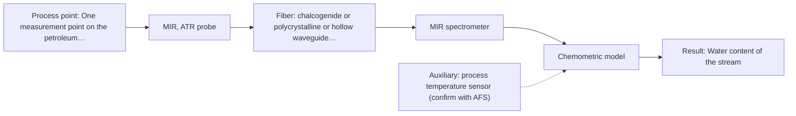

# First technical assessment: Water content in a petroleum stream

## Answer

**Customer request (our summary):** Customer currently sends petroleum stream samples to a laboratory for water determination and wants to investigate a fiber based measurement closer to the process, with the analyzer outside the process area, to notice changes sooner. They ask what to clarify and what a first comparison experiment should establish before selecting equipment.

### Brief answer

Test mid-infrared ATR first, with a fibre probe, because water has strong mid-IR bands and a laboratory example shows water content in petroleum measured with ATR probes. Test NIR transmission on the same samples as the comparison, since silica fibres allow the analyzer to sit far from the process. What stays open is the water range, the stream's optical state and the distance to the analyzer.

### Proposal

- **Best current option:** O2 (recommended): M1 MIR, ATR probe
- **Basis:** supplied AFS sources
- **What would change it:** If the stream proves opaque or strongly scattering, or the water range lies below NIR overtone sensitivity, the comparison narrows towards the mid-IR route; if the distance to the analyzer is long, the missing mid-IR link-length figure could favour the silica-fibre NIR route. If no single method meets the stated accuracy, a combined mid-IR and NIR test would be the next hypothesis.
- **Next step:** Answer the questions about water range, stream state and distance, then run the five-step comparison on representative samples against the existing laboratory water determination.

**Decision status:** Provisional feasibility assessment. The target (water) and the intended placement (analyzer outside the process area) are clear, but the water range, the stream's optical state and the distance to the analyzer are not, so no configuration can be fixed yet. A shortlist is still justified: mid-IR ATR first, with NIR transmission as the comparison, both tested on representative samples against the laboratory method.

### Solution options

| ID | Tier | Methods | Confidence | Cost class, S01 Table 1 (p.6) | Ease of use | Maintenance | Performance fit | Sources |
|---|---|---|---|---|---|---|---|---|
| O1 | Simple | M2 NIR, transmission/transflection probe | Low: physical state unknown, sample clarity unknown, open question: Q1, Q2, Q3; uncited auxiliary sensor | average cost (row 7) | Standard silica fibres and glass optics, familiar to plant staff. | Window or flow-cell cleaning; periodic re-check of the model. | Least effort and the longest stated remote link, but weaker water bands. | [1: S01 p.10] [2: S01 p.10] [3: S02 p.7] [4: S01 p.18] |
| O2 | Recommended | M1 MIR, ATR probe | Low: physical state unknown, sample clarity unknown, open question: Q1, Q2, Q3; uncited auxiliary sensor | high cost (row 2) | One contact probe and one spectrometer, direct water band. | ATR crystal and probe-tip cleaning; watch contact and fouling. | Most selective for water, with a petroleum ATR example behind it. | [5: S02 p.13] [6: S01 p.9] [7: S01 p.10] |

*Confidence rates the basis of the advice (how much is known and cited), not a predicted accuracy or probability of success. It starts at High and drops one level per weakness listed.*

*Cost class is the relative rating in S01 Table 1 (p.6) for the in-line method+technique rows named (the highest one for a multi-method option); it is not a price.*

### Setup sketch

*Recommended option O2; drawn by code from the option, a schematic, not a configuration.*

### Key questions

1. What water concentration range must be covered, and what accuracy or smallest change must be detected, compared with what your laboratory method reports today?
2. At the proposed measurement point, is the stream a clear liquid, a turbid or emulsified liquid, or does it contain free water droplets, gas or solids?
3. What is the distance between the proposed measurement point and the place where the analyzer would stand, and what response time is required?

## Expert detail

**Customer enquiry**

> We handle a petroleum stream and currently send samples to a laboratory for water determination. We want to investigate a fiber based measurement closer to the process so that changes can be noticed sooner. The analyzer would be outside the process area. Before selecting equipment, we need to know what to clarify and what a first comparison experiment should establish.

### Parameters

| ID | Parameter | Kind | Need | Measured by | Why | Sources |
|---|---|---|---|---|---|---|
| P1 | Water content of the stream | quantitative | required | Spectroscopy: MIR | It is the target the customer needs to follow closer to the process. | [8: S02 p.13] |
| P2 | Sample temperature at the measurement point | quantitative | optional | Auxiliary sensor: process temperature sensor (engineering judgement: confirm availability with AFS) | It should already be available from the process and is needed to interpret the spectra and to check probe and crystal compatibility. | *(no verified source: engineering judgement)* |

### Solution option details

- **O1 cost drivers:** NIR spectrometer, fibre probe and flow cell, reference analyses, model building.
- **O2 cost drivers:** MIR spectrometer, CIR or PIR fibre probe, ATR crystal, calibration samples.

### Premise check

- **Supported:** Moving the measurement closer to the process will let changes be noticed sooner than sending samples to a laboratory. In-process fibre measurement is described as removing the sampling delay. [9: S01 p.3]
- **Supported:** The analyzer can stand outside the process area while the measurement is made in the process. ATR fibre probes are stated to allow analysis at a distance from the spectrometer, but no distance figure is given anywhere in the supplied material. [10: S01 p.10]
- **Supported:** A fibre-optic measurement close to the process is the right thing to investigate for this problem. Fibre probes are described as being integrated into production lines for on-site online analysis; this supports the approach, not a specific method. [11: S01 p.2]

### Requirements

**Stated by the customer**

**Key unknowns**

- Water concentration range of the stream and the accuracy the laboratory method delivers today.
- Matrix composition and interferences in the petroleum stream.
- Physical state and optical behaviour of the stream at the proposed measurement point.
- Process temperature and pressure at that point.
- Distance between the process point and the analyzer, and the required response time.
- Cleaning and fouling requirements at the probe.

### Clarification questions (most decision-relevant first)

Q1. What water concentration range must be covered, and what accuracy or smallest change must be detected, compared with what your laboratory method reports today? *Why it matters:* The required water level and resolution decide whether a mid-IR method or a less sensitive NIR method can carry the measurement. *(affects: M1, M2, O1, O2)*
Q2. At the proposed measurement point, is the stream a clear liquid, a turbid or emulsified liquid, or does it contain free water droplets, gas or solids? *Why it matters:* The optical state decides the measurement geometry: transmission needs a transparent sample, while ATR or reflection suits opaque, scattering or strongly absorbing streams. *(affects: M1, M2, O1, O2)*
Q3. What is the distance between the proposed measurement point and the place where the analyzer would stand, and what response time is required? *Why it matters:* The link length and speed decide which fibre family is feasible, and no achievable mid-IR link length is stated in the supplied material. *(affects: M1, M2, O2)*
Q4. What are the process temperature and pressure at that point, and what cleaning or fouling regime is realistic there? *Why it matters:* Temperature and pressure limit the probe, crystal and seal materials, and deposits on a contact probe change the reading. *(affects: M1, M2, O2)*
Q5. Which laboratory method and sampling procedure do you use today for water, and can split samples be made available for the comparison? *Why it matters:* The comparison needs independent reference water values measured on the same samples. *(affects: M1, M2)*

### Recommendation

- **M1 · Primary candidate: MIR, ATR probe.** Water has strong, well-defined mid-IR absorption, and ATR needs only a thin layer in tight contact, which suits a liquid stream. A supplied page shows laboratory ATR spectra of water content in petroleum, so this is the first single method worth testing. *Conditions:* Applies if the stream at the measurement point is a liquid or paste that can wet the ATR crystal; a dry, gassy or heavily fouling point would have to be re-checked. [12: S02 p.13] [13: S01 p.9] [14: S01 p.10]
- **M2 · Comparison candidate: NIR, transmission/transflection probe.** NIR is the most common online method with fibre probes, and low-OH silica cables are stated for long remote runs, which fits an analyzer placed away from the process. Its water bands are overtones and need a chemometric calibration, so it is worth testing against M1 rather than assuming it is equivalent. *Conditions:* Applies if the stream is transparent or semi-transparent at a controlled pathlength; if it is opaque or strongly scattering, a diffuse-reflection geometry would have to be tested instead. [15: S01 p.10] [16: S01 p.10] [17: S02 p.7] [18: S01 p.18]

### Measurement concept

- **Probe and geometry:** Contact ATR probe head for the mid-IR route; a transmission or transflection probe with a defined path for the NIR route. Analyzer and spectrometers sit away from the process point, connected by fibre cables.
- **Location:** One measurement point on the petroleum stream, with the probe in contact with the flowing medium and the analyzer outside the process area.
- **Fiber link:** Silica fibres are the stated option for a long remote link (NIR); the achievable length of a mid-IR link is not stated in the supplied material and must be clarified. [19: S01 p.10] [20: S02 p.7]

### Spectral range

- **MIR:** Nominal mid-IR range 4000-400 cm-1. The usable range of the actual probe, crystal and fibre is narrower and depends on the configuration selected. [21: S01 p.9] [22: REF §5]
- **NIR:** Nominal NIR range 780-2500 nm. The usable range of the actual instrument, fibre and probe is narrower and depends on the configuration selected. [23: S01 p.10] [24: REF §5]

### Risks and uncertainty

- If the water level is below what NIR overtones can see, the NIR comparison will fail for sensitivity reasons rather than for chemistry. *(rules: R-NIR-4)* [25: S01 p.16]
- No supplied source states an achievable fibre length for a mid-IR link, so the requirement that the analyzer sits outside the process area may not be met with the mid-IR route. *(rules: R-FIB-2)* *(no verified source: engineering judgement)*
- ATR samples only a surface layer a few micrometres deep, so a water phase that does not touch the crystal, or deposits on it, could bias the reading. *(rules: R-MIR-3)* [26: S01 p.13]
- Calibrations are specific to the sample matrix, so a change of feed, grade or additive would require the models to be re-checked on the new material. *(rules: R-CAL-1)* [27: REF §5]

### First feasibility experiment

1. **Collect representative samples or process states across the expected variation (water level, feed or grade, temperature) and record the process conditions at the sampling point.** Representative coverage is the basis of the whole comparison. [28: REF §3]
2. **Measure every sample with mid-IR ATR first, as the single method, keeping the probe in tight contact and recording the sample temperature.** Test the primary single method before any combination. [29: S02 p.13]
3. **Measure the same samples with NIR transmission or transflection at a fixed optical pathlength and the same temperature.** Give the two candidate methods the same samples so they can be compared fairly. [30: S01 p.18]
4. **Split each sample and determine water independently by the customer's laboratory method; build one calibration per method and check it on held-out runs or batches.** Independent reference values and held-out validation guard against overfitting. [31: S03 p.14]
5. **Decide go / no-go on the customer's own numerical criteria, fixed before the trial: agreement with the reference and the smallest water change that must be detected.** The acceptance numbers must come from the customer, not from the sources. *(no verified source: engineering judgement)*

**Reference measurements:** Water determination by the customer's own laboratory method on split samples.

**Decision basis:** Customer-defined agreement with the reference and customer-defined smallest detectable change.

### Assumptions

- The petroleum stream is a liquid or paste that can make tight contact with an ATR crystal at the proposed point.
- The stream at the measurement point is assumed to be optically measurable (not a dry gas); if it turns out opaque, strongly scattering or carrying free water droplets, the geometry (transmission versus ATR versus reflection) has to be re-decided.
- The water level lies within the range the customer's laboratory method already reports.
- The analyzer can be linked to the probe point by fibre; the achievable length is still open.

### Not covered by the supplied sources

- No supplied source states an achievable fibre-cable length for a mid-IR link between the process point and an analyzer placed outside the process area; long-cable figures are given only for low-OH silica fibres.

### Further notes

- **Chemometrics:** Both routes need a calibration model specific to the stream matrix, built on reference water values and checked on held-out samples or batches; the NIR route relies on chemometrics in particular because its bands overlap.
- **Real-time tracking:** In-line fibre probes give results in near real time instead of by laboratory sampling, which is the change the customer is looking for.
- **Future direction:** If one water channel proves sufficient, a reduced spectral sensor built for that single task could be considered later instead of a full spectrometer.

### Evidence (verified quotes)

1. ✓ **S01 p.10** (general): "Near-IR vibrational spectroscopy (NIR) is the most common online analysis method performed using fiber optic probes."
2. ✓ **S01 p.10** (general): "NIR spectra (780-2500 nm) contain predominantly overtones and component bands of fundamental vibrations"
3. ✓ **S02 p.7** (general): "Robust 100-300m cables made with Silica fibers of low OH-content (<0.1ppm OH) enable remote industrial process-control"
4. ✓ **S01 p.18** (general): "Transmission is the preferred method for transparent or semi-transparent liquids, such as skim milk, whey, or permeate."
5. ✓ **S02 p.13** (application precedent): "Application: measurement of water content in petroleum"
6. ✓ **S01 p.9** (general): "Vibrational spectroscopy in the mid-IR range (4000-400 cm-1) is one of the most informative methods of chemical analysis."
7. ✓ **S01 p.10** (general): "ATR fiber probes (Fig.1) enable the analysis of liquids and solid elastic samples"
8. ✓ **S02 p.13** (application precedent): "Application: measurement of water content in petroleum"
9. ✓ **S01 p.3** (general): "It allows for in-process analysis, i.e., directly in the process flow or reactor without sampling, eliminating delays and the risk of sample contamination."
10. ✓ **S01 p.10** (general): "These immersion probes operate on the ATR principle but allow analysis at a significant distance from the spectrometer, without the need for sampling."
11. ✓ **S01 p.2** (general): "Fiber optic probes and cells are being integrated into reactors and production lines of ongoing technological processes, enabling on-site online analysis and obtaining results in near real time."
12. ✓ **S02 p.13** (application precedent): "Application: measurement of water content in petroleum"
13. ✓ **S01 p.9** (general): "Vibrational spectroscopy in the mid-IR range (4000-400 cm-1) is one of the most informative methods of chemical analysis."
14. ✓ **S01 p.10** (general): "ATR fiber probes (Fig.1) enable the analysis of liquids and solid elastic samples"
15. ✓ **S01 p.10** (general): "Near-IR vibrational spectroscopy (NIR) is the most common online analysis method performed using fiber optic probes."
16. ✓ **S01 p.10** (general): "NIR spectra (780-2500 nm) contain predominantly overtones and component bands of fundamental vibrations"
17. ✓ **S02 p.7** (general): "Robust 100-300m cables made with Silica fibers of low OH-content (<0.1ppm OH) enable remote industrial process-control"
18. ✓ **S01 p.18** (general): "Transmission is the preferred method for transparent or semi-transparent liquids, such as skim milk, whey, or permeate."
19. ✓ **S01 p.10** (general): "These immersion probes operate on the ATR principle but allow analysis at a significant distance from the spectrometer, without the need for sampling."
20. ✓ **S02 p.7** (general): "Robust 100-300m cables made with Silica fibers of low OH-content (<0.1ppm OH) enable remote industrial process-control"
21. ✓ **S01 p.9** (general): "Vibrational spectroscopy in the mid-IR range (4000-400 cm-1) is one of the most informative methods of chemical analysis."
22. ✓ **REF §5** (general): "It is not a product specification: actual spectral coverage, fiber length, component ratings, detection limits and accuracy depend on the configuration and the sample."
23. ✓ **S01 p.10** (general): "NIR spectra (780-2500 nm) contain predominantly overtones and component bands of fundamental vibrations"
24. ✓ **REF §5** (general): "It is not a product specification: actual spectral coverage, fiber length, component ratings, detection limits and accuracy depend on the configuration and the sample."
25. ✓ **S01 p.16** (general): "may lack the sensitivity to detect trace compounds below 0.1 percent."
26. ✓ **S01 p.13** (general): "typically at a depth of few microns"
27. ✓ **REF §5** (general): "physical variation; calibration specific to the matrix."
28. ✓ **REF §3** (general): "Representative samples or process states, independent reference measurements, what is compared, and the basis for the go / no-go decision."
29. ✓ **S02 p.13** (application precedent): "Application: measurement of water content in petroleum"
30. ✓ **S01 p.18** (general): "the precise control of the optical pathlength (usually 1 - 10 mm)"
31. ✓ **S03 p.14** (general): "A thorough validation, including full, segmented and random-subset CVs, as well as randomization tests, are recommended in any cases for which important conclusions depend on calibration or discrimination models built on limited experimental material."

### Verification

- Citations verified: 24 of 24 (exact or whitespace/hyphen-tolerant match on the cited page, scope checked).
- Hard check failures before deterministic corrections: 0; still open: 0; soft warnings: 0; repair rounds: 1.

*Run D06-20261017T150155Z · models deepseek/deepseek-v4.1-flash*
