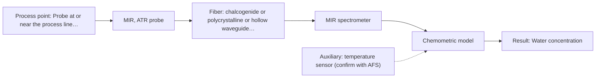
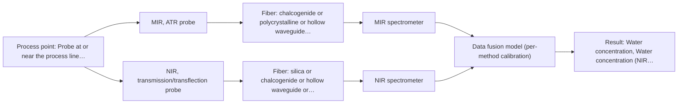

# First technical assessment: Water content in a petroleum stream

## Answer

**Customer request (our summary):** The customer wants to investigate a fiber-based measurement for water determination in a petroleum stream with the analyzer located outside the process area.

### Brief answer

Test mid-IR ATR first: it gives selective water bands and laboratory spectra of water in petroleum are shown in the supplied material. Compare it with NIR transmission, which suits long fiber runs to an analyzer outside the process area. Open points: the water concentration range and required precision, the analyzer-to-process distance (mid-IR fiber length is undocumented), stream opacity and temperature, and the reference lab method. A first lab comparison on representative samples with independent water references should establish which method meets your targets.

### Proposal

- **Best current option:** O2 (recommended)
- **Basis:** supplied AFS sources
- **What would change it:** If the analyzer-to-process distance exceeds what a mid-IR fiber link can achieve, or the stream proves too opaque for the ATR contact geometry, the NIR transmission option (O1) becomes the primary candidate. If neither single method meets the required precision, the combined option (O3) is tested.
- **Next step:** Run a multi-method laboratory trial on representative petroleum samples with water as the reference target, comparing MIR-ATR and NIR transmission before selecting equipment.

**Secondary evidence (external, not AFS material):** G1: no usable external source found; G2: E05 ¶15, E01 ¶31; G3: no usable external source found; G4: no usable external source found. See Expert detail.

**Decision status:** Provisional feasibility assessment

### Solution options

| ID | Tier | Methods | Confidence | Cost class, S01 Table 1 (p.6) | Ease of use | Maintenance | Performance fit | Sources |
|---|---|---|---|---|---|---|---|---|
| O1 | Simple | M2 NIR, transmission/transflection probe | Low: open question: Q1, Q2, Q3 (starts at Medium); sample clarity unknown | average cost (row 7) | Standard silica fibers and probes, straightforward installation | Low; no crystal contact to foul | Fits the remote analyzer location via long silica cables | [1: S01 p.5] [2: S02 p.7] [3: S01 p.10] |
| O2 | Recommended | M1 MIR, ATR probe | Medium: open question: Q1, Q2 (starts at Medium) | high cost (row 2) | Immersion ATR probe, direct in-line insertion | Crystal cleaning and fouling checks needed | Selective, well-defined water bands with petroleum precedent | [4: S02 p.13] [5: S01 p.9] [6: S01 p.10] |
| O3 | Extended (multi-method) | M3 MIR, ATR probe + NIR (combination) | Low: open question: Q1 (starts at Medium); sample clarity unknown; multi-method, fusion benefit not yet shown | high cost (rows 2, 7) | Two instruments and probes to operate and align | Each block needs its own calibration and diagnostics | Covers cases where one method misses part of the range | [7: S01 p.8] [8: S01 p.7] [9: S01 p.8] |

*Confidence rates the basis of the advice (how much is known and cited), not a predicted accuracy or probability of success. It starts at High, or at Medium when a key question on the method or the option is open, and drops one level per weakness listed (floor Low).*

*Cost class is the relative rating in S01 Table 1 (p.6) for the in-line method+technique rows named (the highest one for a multi-method option); it is not a price.*

### Setup sketch

*Recommended option O2; drawn by code from the option, a schematic, not a configuration.*

### Key questions

1. What water concentration range must be measured, and what detection limit and precision are required?
2. What is the distance between the process tapping point and the planned analyzer location?
3. What are the process temperature and pressure, and how opaque or turbid is the stream?

## Expert detail

**Customer enquiry**

> We handle a petroleum stream and currently send samples to a laboratory for water determination. We want to investigate a fiber based measurement closer to the process so that changes can be noticed sooner. The analyzer would be outside the process area. Before selecting equipment, we need to know what to clarify and what a first comparison experiment should establish.

**Decision status:** Provisional feasibility assessment. A shortlist can be justified from the sources, but the water concentration range, the required precision and the analyzer-to-process distance are open and could change the choice.

### Parameters

| ID | Parameter | Kind | Need | Measured by | Why | Sources |
|---|---|---|---|---|---|---|
| P1 | Water concentration | quantitative | required | Spectroscopy: MIR | It is the target variable and defines the calibration range and detection-limit requirement. | [4: S02 p.13] |
| P2 | Water concentration (NIR cross-check) | quantitative | required | Spectroscopy: NIR | Needed to compare the NIR option against the same reference targets in the feasibility test. | *(no verified source: engineering judgement)* |
| P3 | Reference water value | quantitative | required | Reference lab method: laboratory water determination (e.g. Karl Fischer, to be confirmed per Q5) | Independent laboratory values are needed to build and validate any calibration model. | *(no verified source: engineering judgement)* |
| P4 | Process temperature | quantitative | optional | Auxiliary sensor: temperature sensor (engineering judgement: confirm availability with AFS) | Temperature shifts spectral bands and water solubility, so it should be available to correct or interpret the spectra. | *(no verified source: engineering judgement)* |
| P5 | Stream matrix / opacity class | qualitative | required | Reference lab method: stream characterisation / visual-turbidity assessment | It decides whether NIR transmission can penetrate the sample and whether the calibration must cover several matrix states. | [10: S01 p.18] |

### Solution option details

- **O1 cost drivers:** NIR spectrometer, transmission probe, fiber cable, calibration samples and chemometric model
- **O2 cost drivers:** FTIR spectrometer, ATR fiber probe with CIR/PIR fibers, link length engineering, calibration samples
- **O3 cost drivers:** Two spectrometers, combined or paired probes, synchronisation software, fused-model development
- **O3 combining methods:** Low-level fusion: one calibration model per method first, then joined spectra with block scaling. Probes must sample the same spot and data must be normalised to a common time step. The fused model must beat the best single method on held-out batches, otherwise the extra instrument is dropped.

*Extended (multi-method) option O3; drawn by code from the option, a schematic, not a configuration.*

### Premise check

- **Precedent only:** A fiber-based in-line measurement of water in petroleum is feasible. Laboratory ATR spectra of water content in petroleum are shown in the supplied material; this is a reason to test, not proof for this customer's stream. [4: S02 p.13]
- **Precedent only:** An analyzer located outside the process area can be connected by fiber over the needed distance. Long remote links are documented only for silica (NIR-range) fibers; no source states an achievable length for a mid-IR fiber link, so the distance requirement must be checked. [2: S02 p.7]

### Requirements

**Stated by the customer**

- "We handle a petroleum stream"
- "currently send samples to a laboratory for water determination"
- "The analyzer would be outside the process area."

**Key unknowns**

- Water concentration range and required detection limit / precision
- Required response time (batch lab replacement vs continuous tracking)
- Distance from the process tapping point to the analyzer location
- Process temperature and pressure, and stream opacity/turbidity
- Reference laboratory method used for water today

### Clarification questions (most decision-relevant first)

Q1. What water concentration range must be measured, and what detection limit and precision are required? *Why it matters:* It decides whether NIR sensitivity suffices or the stronger, more selective mid-IR water bands are needed. *(affects: method, technique, status)*
Q2. What is the distance between the process tapping point and the planned analyzer location? *Why it matters:* Long remote links are documented for silica fibers (NIR) but not for mid-IR fibers, so distance can decide the method. *(affects: installation, M1, M2)*
Q3. What are the process temperature and pressure, and how opaque or turbid is the stream? *Why it matters:* Opacity decides whether NIR transmission can penetrate the sample, and temperature/pressure determine the probe design. *(affects: technique, installation, M2)*
Q4. Where can a probe be inserted, and is fouling or wax deposition on surfaces expected? *Why it matters:* ATR probes sample only a thin surface layer, so deposits would bias the water reading. *(affects: installation, M1)*
Q5. Which laboratory method is used today for the water determination? *Why it matters:* The independent reference method defines the calibration targets and the go/no-go criteria of the feasibility test. *(affects: status)*

### Recommendation

- **M1 · Primary candidate: MIR, ATR probe.** Mid-IR gives well-defined, selective absorption bands, and laboratory ATR spectra of water content in petroleum are shown in the supplied material. ATR fiber probes enable in-line analysis of liquids without sampling. [5: S01 p.9] [4: S02 p.13] [6: S01 p.10]
- **M2 · Comparison candidate: NIR, transmission/transflection probe.** NIR suits remote fiber-probe measurement and standard silica fibers support long cables, matching the analyzer outside the process area. Water absorbs in the NIR, but broad overlapping bands require a chemometric calibration on this matrix. *Conditions:* The stream must be transmissive at the chosen pathlength; if it is too opaque or fat-rich, transmission fails. [1: S01 p.5] [2: S02 p.7] [3: S01 p.10]
- **M3 · Conditional candidate: MIR, ATR probe + NIR (combination).** If neither single method meets the target alone, combining mid-IR ATR with NIR is a later hypothesis: the methods give complementary information and combined probes exist. Any fusion gain must be validated against the best single method. *Conditions:* Only if the single-method tests (M1, M2) do not meet the required precision or range. [8: S01 p.7] [9: S01 p.8]
- **M4 · Not recommended: fluorescence probe.** Water is not a fluorescent species and no fluorescent indicator has been identified for this stream, so fluorescence cannot directly determine water here. [11: S01 p.5]

### Measurement concept

- **Probe and geometry:** Immersion ATR fiber probe in the petroleum stream (primary); transmission/transflection probe with controlled pathlength as the NIR comparison.
- **Location:** Probe at or near the process line; spectrometer in the analyzer room outside the process area, connected by fiber.
- **Fiber link:** NIR: silica fibers enable remote industrial process control. MIR: CIR/PIR fibers required, but no source states an achievable link length, so the distance must be confirmed with AFS. [12: S02 p.6]

### Spectral range

- **MIR:** Nominal mid-IR range 4000-400 cm-1; the usable range depends on the instrument, fiber and probe actually selected. [5: S01 p.9]
- **NIR:** Nominal NIR range 780-2500 nm; the usable range depends on the instrument, fiber and probe actually selected. [13: S01 p.10]

### Risks and uncertainty

- No source states an achievable length for a mid-IR fiber link, so the analyzer-outside-the-area requirement may not be met with MIR-ATR. *(rules: R-FIB-2)* [14: S02 p.10]
- ATR probes sample only a surface layer a few micrometres deep, so fouling or a non-representative surface would bias the water result. *(rules: R-MIR-3)* [15: S01 p.13]
- If the stream is too opaque or fat-rich, NIR transmission loses the signal and the comparison option fails. *(rules: R-GEO-2)* [10: S01 p.18]
- Any NIR or Raman calibration is specific to this petroleum matrix and must be rebuilt if the stream composition changes significantly. *(rules: R-CAL-1)* [16: REF §5]

### First feasibility experiment

1. **Collect representative petroleum samples spanning the expected water range and matrix variation (e.g. different grades, temperatures).** Cover the chemical and physical variation the in-line method must handle. *(no verified source: engineering judgement)*
2. **Measure each sample with the laboratory reference method for water (per Q5) as the independent ground truth.** Provide calibration and validation targets. *(no verified source: engineering judgement)*
3. **Test the single methods first: MIR-ATR probe and NIR transmission/transflection probe on the same samples, comparing predicted vs reference water content.** Identify the best single method before any combination. *(no verified source: engineering judgement)*
4. **Only if a single method falls short, test the MIR+NIR combination on the same samples with synchronised data.** Check whether fusion beats the best single method. *(no verified source: engineering judgement)*
5. **Validate on held-out samples or a later independent batch, with go/no-go criteria (accuracy and detection limit) defined by the customer from Q1.** Confirm the method meets the stated requirement before any in-line installation. *(no verified source: engineering judgement)*

**Reference measurements:** Laboratory water determination on every sample (method per Q5).

**Decision basis:** Go/no-go on customer-defined accuracy and detection limit for water, validated on held-out samples.

### Assumptions

- The stream is a liquid petroleum product at conditions that allow probe insertion.
- The laboratory method currently used can serve as the independent reference.

### Not covered by the supplied sources

- Achievable fiber link length for a mid-IR (CIR/PIR) connection between process and analyzer room.
- Hazardous-area (ATEX/explosion-proof) requirements for probes and electronics in a petroleum process area.

### Further notes

- **Chemometrics:** Both candidate methods need a calibration model against the laboratory water reference; validate with held-out samples or batches and re-validate after any matrix change.
- **Real-time tracking:** The stated aim of noticing changes sooner implies continuous or frequent in-line tracking; the required response time (Q1) determines the acquisition rate needed.
- **Future direction:** Once the method is proven, a compact LED- or filter-based sensor at the measuring point is a possible later simplification, as described for other applications in the sources.

### Secondary evidence (external, not AFS material)

*Found by a literature search for gaps the supplied AFS sources leave open. Not AFS material and not proof for this case; every quote below was verified verbatim against the fetched text.*

**G1 · auxiliary sensor:** In-line measurement of Process temperature with temperature sensor

- No usable external source found.

**G2 · multi-method:** Combining several spectroscopy methods (data fusion) (Low-level fusion: one calibration model per method first, then joined spectra with block scaling. Probes must sample the same spot and data must be normalised to a common time step. The fused model must beat the best single method on held-out batches, otherwise the extra instrument is dropped.)

- **E05 ¶15** Data-level fusion involves the direct concatenation of multimodal data at the input layer, but raw data can contain redundant or noisy signals that degrade recognition accuracy if not removed. *How it applies:* When testing low-level fusion of multiple spectroscopic methods, evaluate whether raw spectral concatenation introduces noise or improves the water determination model compared to single-method approaches. *Limits and transfer risks:* This finding comes from food matrix research and may not transfer directly to petroleum streams or specific analyzer configurations without empirical testing. *(supports O3)*
  > "Data-level fusion is defined as the integration of raw or minimally processed data from multiple modalities at the input layer to construct a unified input representation. In the context of multimodal data fusion, this approach typically involves the direct concatenation of multimodal data, followed by the application of intelligent learning algorithms for downstream computational tasks."
  > Food Intelligent Quality and Safety Analysis: From Data-Driven to Data-Mechanism Hybrid-Driven Paradigm. (2026) · Foods (Basel, Switzerland) · doi:10.3390/foods15173155 · https://europepmc.org/article/PMC/PMC13565232 · retrieved 2026-10-18, full text, licence: cc by, via europepmc
- **E01 ¶31** Low-level data fusion rearranges data into a new matrix where variables from different sources are placed one after the other. *How it applies:* Use this structural approach when combining spectral blocks from different methods for the multi-method water determination setup. *Limits and transfer risks:* This is a general data arrangement concept whose success depends heavily on proper synchronization and scaling of the specific sensors used in a petroleum environment. *(supports O3)*
  > "Low-level data fusion (LLDF) is considered the simplest method to achieve a combination of inputs. In this case, the data is rearranged into a new data matrix, where the variables coming from different sources are placed one after the other."
  > Challenges and Opportunities of Implementing Data Fusion in Process Analytical Technology-A Review. (2022) · Molecules (Basel, Switzerland) · doi:10.3390/molecules27154846 · https://europepmc.org/article/PMC/PMC9369811 · retrieved 2026-10-17, full text, licence: cc by, via curated library

**G3 · not in the supplied sources:** Achievable fiber link length for a mid-IR (CIR/PIR) connection between process and analyzer room.

- No usable external source found.

**G4 · not in the supplied sources:** Hazardous-area (ATEX/explosion-proof) requirements for probes and electronics in a petroleum process area.

- No usable external source found.

### Evidence (verified quotes)

1. ✓ **S01 p.5** (general): "making it ideal for online applications, including remote measurements via fiber optic probes."
2. ✓ **S02 p.7** (performance figure): "Robust 100-300m cables made with Silica fibers of low OH-content (<0.1ppm OH) enable remote industrial process-control"
3. ✓ **S01 p.10** (general): "The broad absorption bands observed in this region overlap, suggesting the use of chemometrics for quantitative and qualitative analysis of spectral data."
4. ✓ **S02 p.13** (application precedent): "Application: measurement of water content in petroleum"
5. ✓ **S01 p.9** (general): "Vibrational spectroscopy in the mid-IR range (4000-400 cm-1) is one of the most informative methods of chemical analysis."
6. ✓ **S01 p.10** (general): "ATR fiber probes (Fig.1) enable the analysis of liquids and solid elastic samples"
7. ✓ **S01 p.8** (general): "Ultimately, the measurement data must be normalized to a common time step."
8. ✓ (precedent only) **S01 p.7** (method gain): "The analysis of such systems may require a combination of two or even more spectral methods."
9. ✓ **S01 p.8** (general): "collected from the same small, even pinpoint, area of the sample."
10. ✓ **S01 p.18** (general): "it fails when the milk becomes too "thick" or fat-rich, as the light cannot penetrate the sample."
11. ✓ **S01 p.5** (general): "However, most chemicals do not exhibit this property."
12. ✓ **S02 p.6** (general): "3000 nm Polycrystalline Infrared Fibers 17 μm"
13. ✓ **S01 p.10** (general): "NIR spectra (780-2500 nm) contain predominantly overtones and component bands of fundamental vibrations"
14. ✓ **S02 p.10** (general): "1.25 Meter Silver Halide - straight run"
15. ✓ **S01 p.13** (general): "typically at a depth of few microns"
16. ✓ **REF §5** (general): "Weak signal, fluorescence background; calibration specific to the matrix."

### Verification

- Citations verified: 22 of 22 (exact or whitespace/hyphen-tolerant match on the cited page, scope checked).
- Hard check failures before deterministic corrections: 0; still open: 0; soft warnings: 3; repair rounds: 1.
- External evidence (live): 2 quote(s) verified verbatim (exact or whitespace/hyphen-tolerant, at most 400 characters and 2 sentences, against the cited paragraph); 0 item(s) dropped.
- External search: 3 query(ies), 30 hit(s), 5 source(s) (3 from the curated library).
- External step: 2 model call(s), 7.5 s extra (cost in the run JSON).

*Run D06-20261018T094733Z-3a31 · models google/gemini-3.5-flash-lite, google/gemini-3.8-flash, z-ai/glm-5.3-flash*
