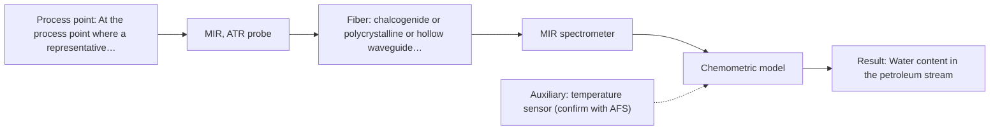
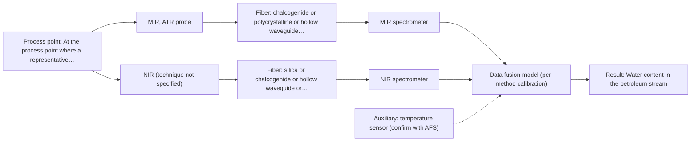

# First technical assessment: Water content in a petroleum stream

## Answer

**Customer request (our summary):** Customer wants to investigate a fiber based measurement closer to the process for water determination in a petroleum stream, with the analyzer outside the process area. They ask what to clarify and what a first comparison experiment should establish before selecting equipment.

### Brief answer

Test mid-IR ATR first: it has a published precedent for water content in petroleum and suits a liquid in contact with the probe. Add NIR as a comparison, because silica fibers can carry it to an analyzer outside the process area. Still open are the water range and required detection limit, the stream's optical character and composition, and the distance to the analyzer.

### Proposal

- **Best current option:** O2 (recommended)
- **Basis:** supplied AFS sources
- **What would change it:** A clear stream with a long distance to the analyzer, or a required water range that NIR can reach, would move the first test to the NIR option (O1). If neither single method meets the targets, the combined option (O3) becomes the next test.
- **Next step:** Run the first comparison experiment on representative stream samples, measuring MIR-ATR (M1) and NIR (M2) against the customer's laboratory water determination.

**Secondary evidence (external, not AFS material):** G1: E02 ¶12; G2: E03 ¶33, E04 ¶20; G3: no usable external source found; G4: no usable external source found. See Expert detail.

**Decision status:** Provisional feasibility assessment

### Solution options

| ID | Tier | Methods | Confidence | Cost class, S01 Table 1 (p.6) | Ease of use | Maintenance | Performance fit | Sources |
|---|---|---|---|---|---|---|---|---|
| O1 | Simple | M2 NIR, transmission/transflection probe | Low: open question: Q1 (starts at Medium); physical state unknown, sample clarity unknown; uncited auxiliary sensor | average cost (row 7) | one spectrometer, ordinary fiber optics | probe cleaning, periodic model revalidation | lowest effort, long fiber link possible | [1: S01 p.5] [2: S01 p.10] [3: S02 p.7] [4: S01 p.18] [5: S01 p.16] |
| O2 | Recommended | M1 MIR, ATR probe | Low: open question: Q1 (starts at Medium); physical state unknown, sample clarity unknown; uncited auxiliary sensor and a parameter is not measurable in-line | high cost (row 2) | one probe, direct contact measurement | crystal cleaning, calibration updates | strong water bands, petroleum precedent | [6: S01 p.5] [7: S02 p.13] [8: S01 p.9] [9: S01 p.5] [10: S01 p.10] |
| O3 | Extended (multi-method) | M3 MIR, ATR probe + NIR (combination) | Low: open question: Q1 (starts at Medium); physical state unknown, sample clarity unknown; uncited auxiliary sensor and a parameter is not measurable in-line; multi-method, fusion benefit not yet shown | high cost (rows 2, 7) | two instruments, one combined probe | two calibrations, two instrument checks | adds depth information if one method falls short | [11: S01 p.8] [12: S01 p.8] [13: S01 p.8] [14: S01 p.9] [15: S01 p.9] [16: S01 p.7] [17: S01 p.8] [18: REF §5] |

*Confidence rates the basis of the advice (how much is known and cited), not a predicted accuracy or probability of success. It starts at High, or at Medium when a key question on the method or the option is open, and drops one level per weakness listed (floor Low).*

*Cost class is the relative rating in S01 Table 1 (p.6) for the in-line method+technique rows named (the highest one for a multi-method option); it is not a price.*

### Setup sketch

*Recommended option O2; drawn by code from the option, a schematic, not a configuration.*

### Key questions

1. What is the water concentration range, and what detection limit, accuracy and response time must the in-line measurement reach?
2. What is the physical state and optical character of the stream (single-phase or with free water, clear, turbid or opaque) and its composition or grade?
3. How far is the process point from the intended analyzer location, and what are the process temperature, pressure and area classification?

## Expert detail

**Customer enquiry**

> We handle a petroleum stream and currently send samples to a laboratory for water determination. We want to investigate a fiber based measurement closer to the process so that changes can be noticed sooner. The analyzer would be outside the process area. Before selecting equipment, we need to know what to clarify and what a first comparison experiment should establish.

**Decision status:** Provisional feasibility assessment. The stream's physical state, water range and required performance are unknown, so no final configuration can be justified. A shortlist (mid-IR ATR first, NIR as a comparison) is defensible with the assumptions stated, and the first comparison experiment is defined.

### Parameters

| ID | Parameter | Kind | Need | Measured by | Why | Sources |
|---|---|---|---|---|---|---|
| P1 | Water content in the petroleum stream | quantitative | required | Spectroscopy: MIR | It is the analyte the customer wants to follow in-line instead of by laboratory sampling. | [7: S02 p.13] |
| P2 | Stream temperature | quantitative | required | Auxiliary sensor: temperature sensor (engineering judgement: confirm availability with AFS) | Temperature changes how much water stays dissolved or emulsified in the hydrocarbon and sets the temperature limits for probe and fiber. | *(no verified source: engineering judgement)* |
| P3 | Water phase state (dissolved, emulsified or free water) | qualitative | required | Not measurable in-line by spectroscopy; alternative: laboratory analysis of grab samples using the customer's existing water determination | The comparison with the laboratory value and the choice of sampling point only make sense if the water fractions present are known. | *(no verified source: engineering judgement)* |
| P4 | Stream matrix and product grade | qualitative | optional | Reference lab method: customer's laboratory analysis of the stream | Calibrations are specific to the matrix, so the range of grades handled sets how many calibrations are needed; this should already be available from the customer's process records. | [19: REF §5] |

### Solution option details

- **O1 cost drivers:** one NIR spectrometer, fiber link, pathlength cell
- **O2 cost drivers:** mid-IR spectrometer, ATR probe, mid-IR fiber
- **O3 cost drivers:** two spectrometers, combined probe, fusion software
- **O3 combining methods:** Fusion level: build one model per method first, then join the two blocks with block scaling, because variables from different methods are not equivalent and a block with more variables otherwise dominates the model. Both probes must look at the same small area of the stream and the data must be aligned to a common time step, which is difficult in a flowing stream, and each instrument needs its own calibration and diagnostics. The combined model must beat the best single method on held-out runs; otherwise the extra instrument is dropped.

*Extended (multi-method) option O3; drawn by code from the option, a schematic, not a configuration.*

### Premise check

- **Supported:** A fiber based measurement closer to the process is the right way to make changes noticed sooner. The sources state that in-process analysis without sampling removes the delay that laboratory sampling causes, which is exactly the effect the customer wants. [20: S01 p.3]
- **Supported:** An analyzer outside the process area can perform the fiber based measurement. Mid-IR ATR fiber probes are described as allowing analysis at a significant distance from the spectrometer, but no source states an achievable distance, so the actual link length stays an open question for the customer's layout. [21: S01 p.10]

### Requirements

**Stated by the customer**

- Water determination in a petroleum stream, in-line rather than by sending samples to a laboratory.
- Changes should be noticed sooner than with the current laboratory determination.
- The analyzer would sit outside the process area.

**Key unknowns**

- Water concentration range and the required detection limit, accuracy and response time.
- Stream physical state and optical character (single-phase, clear, turbid or opaque, free water, particulates) and composition or grade.
- Distance from the process point to the analyzer, plus process temperature, pressure and area classification.
- Reference laboratory method, its uncertainty and the sampling procedure.
- Acceptance criteria for the first comparison (bias, limits of agreement, response time).
- Cleaning and fouling behaviour of the probe in this stream.

### Clarification questions (most decision-relevant first)

Q1. What is the water concentration range, and what detection limit, accuracy and response time must the in-line measurement reach? *Why it matters:* This decides whether NIR alone can meet the target or whether MIR-ATR, and possibly a combined option, is needed. *(affects: method, M2)*
Q2. What is the physical state and optical character of the stream (single-phase or with free water, clear, turbid or opaque) and its composition or grade? *Why it matters:* This decides the measurement technique (ATR contact, transmission or diffuse reflection) and how many matrix-specific calibrations are needed. *(affects: technique)*
Q3. How far is the process point from the intended analyzer location, and what are the process temperature, pressure and area classification? *Why it matters:* This decides the fiber type and length and whether the analyzer can really sit outside the process area. *(affects: installation)*
Q4. Which laboratory method is used for water determination, with what uncertainty and sampling procedure? *Why it matters:* It defines the independent reference for the comparison experiment and the agreement that is achievable. *(affects: status)*
Q5. What numerical result counts as success for the first experiment (bias, limits of agreement, response time)? *Why it matters:* The go/no-go decision needs criteria that come from the customer, not from the sources. *(affects: status)*

### Recommendation

- **M1 · Primary candidate: MIR, ATR probe.** Mid-IR ATR has a published precedent for measuring water content in petroleum with ZrO2 ATR tips, and water absorbs strongly in the mid-IR so ATR's very thin sampling layer suits it. ATR fiber probes are made for liquids and solid elastic samples and allow the spectrometer to sit away from the sampling point. *Conditions:* Applies if the stream is a liquid or paste that wets the ATR crystal and if the crystal material is compatible with the stream. [7: S02 p.13] [8: S01 p.9] [9: S01 p.5] [10: S01 p.10]
- **M2 · Comparison candidate: NIR, transmission/transflection probe.** NIR is the most common online fiber-probe method and silica fibers carry it over long cables, which fits an analyzer outside the process area. Its bands are broad and overlapping so a chemometric calibration is needed, and it may lack sensitivity for trace water. *Conditions:* Only for a clear or semi-transparent single-phase stream; if the stream is opaque or strongly scattering, a diffuse-reflection NIR variant would have to be tested instead. [2: S01 p.10] [3: S02 p.7] [4: S01 p.18] [5: S01 p.16]
- **M3 · Conditional candidate: MIR, ATR probe + NIR (combination).** A combined MIR-ATR + NIR measurement is a later hypothesis: the two methods can deliver information from different depths, and combining methods is reported to help on complex samples. Any gain is a hypothesis and must be shown against the best single method. *Conditions:* Test only if neither single method reaches the customer's water specification. [16: S01 p.7] [17: S01 p.8] [18: REF §5] Later hypothesis, after single-method tests.

### Measurement concept

- **Probe and geometry:** Mid-IR ATR fiber probe in contact with the stream (first choice); NIR transmission/transflection probe with a controlled pathlength as the comparison; a combined MIR-ATR + NIR probe only as a later hypothesis.
- **Location:** At the process point where a representative, homogeneous stream can wet the probe; the spectrometers sit outside the process area.
- **Fiber link:** NIR can use silica fibers, for which long cables are stated; for mid-IR the fiber family must be selected from chalcogenide or polycrystalline fibers, and the achievable length is an open question. [22: S01 p.18]

### Spectral range

- **MIR:** Nominal mid-IR range 4000-400 cm-1 (2.5-25 µm); the usable range depends on the instrument, fiber and ATR crystal actually selected. [8: S01 p.9]
- **NIR:** Nominal NIR range 780-2500 nm; the usable range depends on the instrument, fiber and probe actually selected. [23: S01 p.10]

### Risks and uncertainty

- The stream may be opaque or strongly scattering, in which case NIR transmission (O1) cannot work and the technique changes. *(rules: R-GEO-2)* [24: S01 p.18]
- The required detection limit may be below what NIR can reach for trace water, so MIR-ATR would have to carry the measurement. *(rules: R-NIR-4)* [5: S01 p.16]
- The distance to the analyzer is unknown, and the sources state long cable lengths only for silica fibers, not for mid-IR fibers, so the remote layout for a mid-IR probe must be confirmed. *(rules: R-FIB-2)* [3: S02 p.7]
- Wax, asphaltenes or free water may foul the ATR crystal and change the signal; the cleaning interval is unknown. *(rules: R-MIR-3)* [25: REF §5]

### First feasibility experiment

1. **Collect representative samples or process states: cover the expected product grades, the water range from dry to the highest expected water content, and normal and upset conditions; take the grab samples at the exact point where the probe will sit.** Cover the variation the method must handle before any instrument is chosen. [26: REF §3]
2. **Measure each sample with the single candidate methods first - MIR-ATR (M1) and NIR (M2) - under the intended conditions, with repeats at the same spot.** Gives each single method a fair test before any combination is considered. *(no verified source: engineering judgement)*
3. **Determine water in split samples by the customer's laboratory method, and record its own uncertainty and the sampling delay.** Provides the independent reference the comparison is judged against. *(no verified source: engineering judgement)*
4. **Build a per-method calibration and compare each method with the reference: correlation, bias and limits of agreement across the range, plus response time.** Shows whether one method alone can meet the target and where it fails. *(no verified source: engineering judgement)*
5. **Validate on held-out runs or batches and apply the go/no-go numbers the customer sets (detection limit, accuracy, response time); only if neither single method meets them, test the synchronised, same-spot MIR-ATR + NIR combination (M3) against the best single method.** Separates a real gain from an apparent one and keeps the extra instrument out unless it earns its place. [18: REF §5]

**Reference measurements:** The customer's existing laboratory water determination, applied to split samples from the same points and times as the fiber measurements.

**Decision basis:** The customer's own numerical criteria for detection limit, accuracy and response time; until those are given, no go/no-go can be set.

### Assumptions

- The stream is a single-phase or pumpable liquid that can be brought into contact with a probe at the intended point.
- The customer's laboratory water determination is fit to serve as the independent reference for the comparison.
- The analyzer can be placed at a distance from the process that the selected fiber family can bridge.

### Not covered by the supplied sources

- No supplied source states an achievable fiber link length for a mid-IR probe or for a petroleum process installation.
- No supplied source gives water detection limits or accuracy figures for a petroleum stream.
- No supplied source covers hazardous-area classification or analyzer certification for a unit placed outside the process area.

### Further notes

- **Chemometrics:** Water in a hydrocarbon matrix gives broad, overlapping NIR bands and needs a calibration model built on the customer's own samples; the model is matrix-specific, so it must be revalidated when the grade changes.
- **Real-time tracking:** Both candidate methods can run in-line through fiber probes, which is what allows changes to be seen sooner than by laboratory sampling.
- **Future direction:** Once the water channel is fixed, a compact LED or spectral-sensor version of the measurement could be considered for a dedicated installation.

### Secondary evidence (external, not AFS material)

*Found by a literature search for gaps the supplied AFS sources leave open. Not AFS material and not proof for this case; every quote below was verified verbatim against the fetched text.*

**G1 · auxiliary sensor:** In-line measurement of Stream temperature with temperature sensor

- **E02 ¶12** The source states that temperature sensitivity of OH bands is a severe drawback for measuring aqueous solution in NIR and MIR, making tempered sample holders necessary. *How it applies:* For water determination in a petroleum stream, this suggests temperature should be measured or controlled and its effect on the spectrum tested before selecting MIR ATR equipment. *Limits and transfer risks:* The statement concerns aqueous solutions in NIR and MIR, not a petroleum stream, and refers to tempered sample holders rather than an in-line temperature sensor. *(supports O2)*
  > "Additionally, the temperature sensitivity of the OH bands is a severe drawback for measuring aqueous solution in NIR and MIR, which makes tempered sample holders necessary [29]."
  > A critical review of recent trends, and a future perspective of optical spectroscopy as PAT in biopharmaceutical downstream processing. (2020) · Analytical and bioanalytical chemistry · doi:10.1007/s00216-020-02407-z · https://europepmc.org/article/PMC/PMC7072065 · retrieved 2026-10-17, full text, licence: cc by, via curated library

**G2 · multi-method:** Combining several spectroscopy methods (data fusion) (Fusion level: build one model per method first, then join the two blocks with block scaling, because variables from different methods are not equivalent and a block with more variables otherwise dominates the model. Both probes must look at the same small area of the stream and the data must be aligned to a common time step, which is difficult in a flowing stream, and each instrument needs its own calibration and diagnostics. The combined model must beat the best single method on held-out runs; otherwise the extra instrument is dropped.)

- **E03 ¶33** The source describes high-level data fusion as working at the decision level, where the first step is to fit supervised models to each data matrix. *How it applies:* For combining MIR ATR with another spectroscopy method, this supports building a separate model per method before fusion and then testing whether the combined decision improves on the best single method. *Limits and transfer risks:* This is a review statement about data fusion in PAT, not a petroleum water measurement, and it does not address probe alignment, common time steps, or block scaling. *(supports O3)*
  > "The high-level data fusion (HLDF) (also called "decision-level" fusion) works on a decision level. This means that the first step is to fit some supervised models to each data matrix."
  > Challenges and Opportunities of Implementing Data Fusion in Process Analytical Technology-A Review. (2022) · Molecules (Basel, Switzerland) · doi:10.3390/molecules27154846 · https://europepmc.org/article/PMC/PMC9369811 · retrieved 2026-10-17, full text, licence: cc by, via curated library
- **E04 ¶20** The source reports a low-level data fusion method that merged F- and R-block by concatenating them along the spectral dimension after separate block autoscaling. *How it applies:* If low-level fusion is considered for MIR ATR plus another method, this suggests testing separate block scaling before concatenation to reduce a block dominating the combined model. *Limits and transfer risks:* The example is offline hyperspectral imaging of dyed textiles, not a flowing petroleum stream, and it does not cover probe co-location, time alignment, or per-instrument diagnostics. *(supports O3)*
  > "As the final step, a low-level data fusion method was chosen to merge F- and R-block by concatenating them along the spectral dimension after separate block autoscaling."
  > Multimodal HSI Combined with Multiblock Data Fusion: A New Tool for the Study of Time-Dependent Alteration Processes in Dyed Textiles. (2024) · Analytical chemistry · doi:10.1021/acs.analchem.4c04236 · https://europepmc.org/article/PMC/PMC11657530 · retrieved 2026-10-17, full text, licence: cc by, via europepmc

**G3 · not in the supplied sources:** No supplied source states an achievable fiber link length for a mid-IR probe or for a petroleum process installation.

- No usable external source found.

**G4 · not in the supplied sources:** No supplied source gives water detection limits or accuracy figures for a petroleum stream.

- No usable external source found.

### Evidence (verified quotes)

1. ✓ **S01 p.5** (general): "NIR spectroscopy, with its relatively large penetration depth (up to several millimetres) even into dense solid samples due to low absorption and strong scattering, allows the use of ordinary glass for optics"
2. ✓ **S01 p.10** (general): "Near-IR vibrational spectroscopy (NIR) is the most common online analysis method performed using fiber optic probes."
3. ✓ **S02 p.7** (general): "Robust 100-300m cables made with Silica fibers of low OH-content (<0.1ppm OH) enable remote industrial process-control"
4. ✓ **S01 p.18** (general): "Transmission is the preferred method for transparent or semi-transparent liquids, such as skim milk, whey, or permeate."
5. ✓ **S01 p.16** (general): "may lack the sensitivity to detect trace compounds below 0.1 percent."
6. ✓ **S01 p.5** (general): "Mid-IR band spectra contain well-defined peaks (absorption bands), while NIR, UV, and fluorescence spectra contain broad, highly overlapping signals"
7. ✓ **S02 p.13** (application precedent): "measurement of water content in petroleum ATR-Probes with ATR-tips from ZrO2"
8. ✓ **S01 p.9** (general): "Vibrational spectroscopy in the mid-IR range (4000-400 cm-1) is one of the most informative methods of chemical analysis."
9. ✓ **S01 p.5** (general): "strong absorption in the mid-IR region limits the corresponding spectral method to the analysis of very thin samples (usually less than 50 μm), but it opens up the possibility of using attenuated total reflectance (ATR)"
10. ✓ **S01 p.10** (general): "ATR fiber probes (Fig.1) enable the analysis of liquids and solid elastic samples"
11. ✓ **S01 p.8** (general): "It is crucial that the spectral information obtained by different methods-Mid-IR, NIR, Raman, and fluorescence spectra-is collected from the same small, even pinpoint, area of the sample."
12. ✓ **S01 p.8** (general): "two or more probes, belonging to different methods, can be used for measurements, but the data from each method must be obtained simultaneously."
13. ✓ **S01 p.8** (general): "Ultimately, the measurement data must be normalized to a common time step."
14. ✓ **S01 p.9** (general): "Furthermore, methods containing a larger number of variables have a greater impact on the model."
15. ✓ **S01 p.9** (general): "One of the challenges of multispectral analysis is the need to simultaneously connect at least two independently operating measuring instruments."
16. ✓ **S01 p.7** (application precedent): "The combination of NIR and IR spectroscopy showed benefits in determining tumor boundaries in medical diagnostics."
17. ✓ **S01 p.8** (general): "Information can also be obtained from various depths, as in the analysis of biological tissue samples using Mid-IR and NIR spectroscopy with fiber-optic probes."
18. ✓ **REF §5** (general): "compare with the best single method."
19. ✓ **REF §5** (general): "calibration specific to the matrix."
20. ✓ **S01 p.3** (general): "It allows for in-process analysis, i.e., directly in the process flow or reactor without sampling, eliminating delays and the risk of sample contamination."
21. ✓ **S01 p.10** (general): "These immersion probes operate on the ATR principle but allow analysis at a significant distance from the spectrometer, without the need for sampling."
22. ✓ **S01 p.18** (general): "the precise control of the optical pathlength (usually 1 - 10 mm); if the pathlength is too wide, the signal is lost to absorption; if too narrow, the sample represents a negligible volume."
23. ✓ **S01 p.10** (general): "NIR spectra (780-2500 nm) contain predominantly overtones and component bands of fundamental vibrations"
24. ✓ **S01 p.18** (general): "reflection can work well in highly scattering environments but can be less representative for clear liquids."
25. ✓ **REF §5** (general): "Usable range limited by fiber and crystal; contact, fouling, compatibility."
26. ✓ **REF §3** (general): "Representative samples or process states, independent reference measurements, what is compared, and the basis for the go / no-go decision."

### Verification

- Citations verified: 31 of 31 (exact or whitespace/hyphen-tolerant match on the cited page, scope checked).
- Hard check failures before deterministic corrections: 0; still open: 0; soft warnings: 1; repair rounds: 1.
- External evidence (live): 3 quote(s) verified verbatim (exact or whitespace/hyphen-tolerant, at most 400 characters and 2 sentences, against the cited paragraph); 0 item(s) dropped.
- External search: 6 query(ies), 45 hit(s), 5 source(s) (3 from the curated library).
- External step: 2 model call(s), 65.1 s extra (cost in the run JSON).

*Run D06-20261017T223236Z · models deepseek/deepseek-v4.1-flash*
