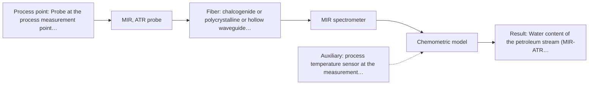

# First technical assessment: Water content in a petroleum stream

## Answer

**Customer request (our summary):** Customer wants to investigate a fiber-based measurement closer to a petroleum process for water determination, with the analyzer outside the process area, before selecting equipment. They ask what to clarify and what a first comparison experiment should establish.

### Brief answer

Test MIR-ATR first: the supplied material shows a laboratory ATR application for water content in petroleum. Measure NIR on the same samples as the comparison, using a reflection probe unless the stream proves to be a clear liquid. Both should be compared with your existing laboratory water determination on representative samples. Still open: the water range and required detection limit, the stream's physical state at the probe, and the distance from the process point to the analyzer.

### Proposal

- **Best current option:** O2 (recommended)
- **Basis:** supplied AFS sources
- **What would change it:** A required detection limit or a stream state that MIR-ATR cannot cover, or a distance from the process point to the analyzer that a Mid-IR fiber link cannot span, would move the choice to the NIR option or to a combined measurement.
- **Next step:** Run the comparison experiment on representative samples: MIR-ATR first, NIR on the same samples, both against the existing laboratory water determination, with the go/no-go limits supplied by the customer.

**Decision status:** Provisional feasibility assessment

### Solution options

| ID | Tier | Methods | Confidence | Cost class, S01 Table 1 (p.6) | Ease of use | Maintenance | Performance fit | Sources |
|---|---|---|---|---|---|---|---|---|
| O1 | Simple | M2 NIR, diffuse reflection probe | Low: open question: Q1, Q2 (starts at Medium); physical state unknown, sample clarity unknown; uncited auxiliary sensor | average cost (row 8) | Silica fibers and standard optics, no crystal | Window cleaning; no ATR crystal to replace | Least effort; water overtones; low-level risk | [1: S01 p.10] [2: S01 p.16] [3: S01 p.10] [4: S01 p.10] [5: S01 p.6] [6: S02 p.7] |
| O2 | Recommended | M1 MIR, ATR probe | Low: open question: Q1, Q2, Q3 (starts at Medium); physical state unknown, sample clarity unknown; uncited auxiliary sensor | high cost (row 2) | ATR probe needs firm, clean contact | Crystal cleaning and fouling checks | Petroleum water precedent; high MIR sensitivity | [7: S02 p.13] [8: S01 p.10] [9: S01 p.9] [10: S04 p.4] |

*Confidence rates the basis of the advice (how much is known and cited), not a predicted accuracy or probability of success. It starts at High, or at Medium when a key question on the method or the option is open, and drops one level per weakness listed (floor Low).*

*Cost class is the relative rating in S01 Table 1 (p.6) for the in-line method+technique rows named (the highest one for a multi-method option); it is not a price.*

### Setup sketch

*Recommended option O2; drawn by code from the option, a schematic, not a configuration.*

### Key questions

1. What water concentration range must be covered, and what detection limit, accuracy and response time are required?
2. What is the physical state and optical behaviour of the stream at the intended measurement point (clear liquid, dark or opaque, emulsion with free water, or gas)?
3. How far is the intended analyzer location from the process measurement point?

## Expert detail

**Customer enquiry**

> We handle a petroleum stream and currently send samples to a laboratory for water determination. We want to investigate a fiber based measurement closer to the process so that changes can be noticed sooner. The analyzer would be outside the process area. Before selecting equipment, we need to know what to clarify and what a first comparison experiment should establish.

**Decision status:** Provisional feasibility assessment. A shortlist can be justified: the supplied material shows an ATR laboratory application for water content in petroleum, and NIR is a documented in-line fiber method. The water range, the stream state at the probe and the achievable distance to a remote analyzer are still unknown, so the choice stays provisional.

### Parameters

| ID | Parameter | Kind | Need | Measured by | Why | Sources |
|---|---|---|---|---|---|---|
| P1 | Water content of the petroleum stream (MIR-ATR channel) | quantitative | required | Spectroscopy: MIR | This is the target quantity the MIR-ATR route would report, and the supplied material shows ATR probes used for water content in petroleum. | [7: S02 p.13] |
| P2 | Water content of the petroleum stream (NIR channel) | quantitative | required | Spectroscopy: NIR | The comparison needs the same target measured by NIR on identical samples so both routes can be judged against the reference values. | [3: S01 p.10] |
| P3 | Temperature at the measurement point | quantitative | required | Auxiliary sensor: process temperature sensor at the measurement point (engineering judgement: confirm availability with AFS) | Needed to choose the probe and fiber for the process point and to judge whether temperature shifts the water signal and the calibration. | *(no verified source: engineering judgement)* |
| P4 | Water content by the existing laboratory determination | quantitative | required | Reference lab method: the customer's current laboratory water determination (method to be confirmed) | Independent reference values are needed to calibrate and to compare both optical routes against today's laboratory result. | [11: REF §3] |

### Solution option details

- **O1 cost drivers:** NIR analyzer, reflection probe, silica fiber run, calibration effort
- **O2 cost drivers:** FTIR spectrometer, Mid-IR fiber ATR probe, crystal wear, calibration

### Premise check

- **Precedent only:** A fiber-based optical measurement can determine water in a petroleum stream. The supplied material shows a laboratory ATR example for water content in petroleum; that is a reason to test the method, not proof for this process. [7: S02 p.13]
- **Supported:** A fiber-based measurement closer to the process will let changes be noticed sooner. In-process measurement without sampling removes the delay and the contamination risk of sample transport to a laboratory. [12: S01 p.3]
- **Supported:** The analyzer can be located outside the process area while still measuring the process stream. Fiber probes are described as allowing measurement at a distance from the spectrometer, and long silica cable runs are documented; the achievable length for a Mid-IR probe is not stated, so the planned distance must be confirmed. [8: S01 p.10] [6: S02 p.7]

### Requirements

**Stated by the customer**

- Water determination in a petroleum stream, currently done by sending samples to a laboratory.
- Measurement closer to the process so changes are noticed sooner.
- Analyzer located outside the process area.
- No method, fiber type or equipment proposed by the customer; the request is for what to clarify and what a first comparison experiment should establish.

**Key unknowns**

- Water concentration range in the stream and the required detection limit, accuracy and response time.
- Physical state and optical behaviour of the stream at the measurement point (clear liquid, dark or opaque, emulsion with free water, or gas).
- Distance from the process measurement point to the intended analyzer location.
- Process temperature and pressure at the measurement point.
- Existing laboratory water determination method and the sampling procedure used today.
- Whether the water to be measured is dissolved in the oil or present as free or emulsified droplets.

### Clarification questions (most decision-relevant first)

Q1. What water concentration range must be covered, and what detection limit, accuracy and response time are required? *Why it matters:* These numbers decide whether one method is enough and whether NIR can reach the low end of the range. *(affects: method, M2)*
Q2. What is the physical state and optical behaviour of the stream at the intended measurement point (clear liquid, dark or opaque, emulsion with free water, or gas)? *Why it matters:* It decides the measurement technique: ATR contact, transmission or transflection, or diffuse reflection. *(affects: technique, M1, M2)*
Q3. How far is the intended analyzer location from the process measurement point? *Why it matters:* Fiber type and achievable link length differ by method, and no achievable Mid-IR link length is stated in the supplied material. *(affects: installation, M1)*
Q4. What are the temperature and pressure at the measurement point, and what cleaning or maintenance access is available there? *Why it matters:* They set the probe and fiber choice and the practical maintenance interval for the interface. *(affects: installation)*
Q5. Which laboratory method and sampling procedure is used today for the water determination, and what uncertainty does it have? *Why it matters:* It is the independent reference for the comparison and sets the smallest difference the experiment can resolve. *(affects: status)*

### Recommendation

- **M1 · Primary candidate: MIR, ATR probe.** MIR-ATR is the one route the supplied material shows on this analyte: ATR probes are presented for the measurement of water content in petroleum. MIR is highly informative and sensitive for molecular bands, and ATR suits liquids and soft solids brought into tight contact with the crystal. *Conditions:* Applies if the stream at the measurement point is a liquid or soft solid that can contact the ATR crystal; a dry gas or a heavily fouling stream would not fit this route. [7: S02 p.13] [9: S01 p.9] [10: S04 p.4]
- **M2 · Comparison candidate: NIR, diffuse reflection probe.** NIR carries the -OH overtone and combination bands of water and is described as the most common in-line method using fiber probes, so it is the natural second candidate to measure on the same samples. Documented silica cable runs of 100-300 m also fit an analyzer placed away from the process point. *Conditions:* Applies where the stream at the probe is opaque or strongly scattering; if the stream proves to be a clear, low-scattering liquid, a transmission or transflection geometry would be the alternative to test. [3: S01 p.10] [4: S01 p.10] [5: S01 p.6] [6: S02 p.7]

### Measurement concept

- **Probe and geometry:** MIR-ATR immersion probe for the primary test (contact with the stream), NIR diffuse reflection probe with silica fibers as the comparison; the exact probe head, crystal material and geometry depend on the answers to Q2 and Q3.
- **Location:** Probe at the process measurement point, spectrometer remote, outside the process area.
- **Fiber link:** Fiber family follows the method: Mid-IR needs chalcogenide or polycrystalline fibers, NIR uses silica; no achievable Mid-IR link length is stated in the supplied material. [9: S01 p.9]

### Spectral range

- **MIR:** Nominal method range 4000-400 cm-1; the usable range depends on the fiber, crystal and spectrometer actually selected, and is not fixed by this assessment. [9: S01 p.9]
- **NIR:** Nominal method range 780-2500 nm; the usable range depends on the fiber, probe and spectrometer actually selected. [3: S01 p.10]

### Risks and uncertainty

- The ATR measurement looks only at a surface layer a few micrometres deep, so an inhomogeneous stream carrying free water droplets may not be represented by the crystal contact. *(rules: R-MIR-3, R-GEN-5)* [13: S01 p.13]
- No achievable fiber-optic link length for a Mid-IR ATR probe is stated in the supplied material, so the planned distance from the process point to the analyzer may not be feasible with MIR. *(rules: R-FIB-2)* *(no verified source: engineering judgement)*
- The required water detection limit is unknown, and the sources note that NIR may lack sensitivity for trace compounds, so the NIR comparison may not reach a low limit. *(rules: R-NIR-4)* [2: S01 p.16]
- The petroleum ATR example in the supplied material is a laboratory measurement, which is a reason to test the method, not proof that it works in-line on this stream. *(rules: R-EVI-1, R-EVI-2)* [14: REF §3]

### First feasibility experiment

1. **Representative samples across the expected variation (water range, stream states such as clear, emulsified or free water, and process temperatures).** Cover the chemical and physical variation the measurement must survive. [11: REF §3]
2. **Split each sample and have it analysed by the existing laboratory water determination, blinded and in replicate.** Independent reference values for calibration and comparison. *(no verified source: engineering judgement)*
3. **Single methods first: measure all samples with MIR-ATR (M1), then with NIR (M2) in the geometry that fits the stream state, with repeats for repeatability.** Establish which single method can see the water change. *(no verified source: engineering judgement)*
4. **Build one calibration per method against the reference values and validate on held-out samples or runs; compare prediction error, detection limit and repeatability against the customer's criteria.** Decide on measured performance, not on expectation. [15: REF §5]
5. **Go/no-go: the numerical criteria (detection limit, accuracy, repeatability, response time) must come from the customer; if neither single method reaches them, test a combined MIR and NIR measurement at the same spot as a later hypothesis.** A defined decision basis instead of an open trial. *(no verified source: engineering judgement)*

**Reference measurements:** The existing laboratory water determination on split samples, blinded and in replicate; its method and uncertainty are still to be confirmed (Q5).

**Decision basis:** Customer-supplied numerical criteria for detection limit, accuracy, repeatability and response time; the comparison is method result against reference value on the same samples.

### Assumptions

- The stream at the measurement point is a liquid or a pumpable soft material that a probe can contact.
- The analyzer location is reachable with one fiber run from a single measurement point.
- The existing laboratory determination can serve as the reference method for the comparison.

### Not covered by the supplied sources

- No achievable fiber-optic link length for a Mid-IR ATR probe to a remote analyzer is stated in the supplied material.
- No accuracy, detection limit or response time figures for water measurement in a petroleum stream are given.
- No probe or fiber temperature and pressure ratings for a process installation are given.

### Further notes

- **Chemometrics:** Both routes need a chemometric calibration built on the reference values from the existing laboratory determination. NIR bands overlap and require multivariate treatment; any model is specific to the stream matrix and must be re-validated after a change of stream or composition. Validate on held-out samples or runs, not on the calibration set alone.
- **Real-time tracking:** The aim is continuous in-line tracking of water so changes appear sooner than with laboratory sampling. The sources describe fiber probes integrated into production lines for on-site online analysis in near real time and in-process measurement without sampling delay, so the concept fits the described use; the measurement interval, the common time step and the cleaning cycle still have to be defined with the process data.
- **Future direction:** If neither single method reaches the required water performance, a later step is a combined MIR-ATR and NIR measurement at the same spot with data fusion. That would need the same measurement spot for both probes, synchronised data on a common time step, a separate calibration and maintenance per method, and evidence that the fused result beats the best single method.

### Evidence (verified quotes)

1. ✓ **S01 p.10** (general): "more affordable high-speed analyzers based on diode arrays (DADs)"
2. ✓ (precedent only) **S01 p.16** (performance figure): "may lack the sensitivity to detect trace compounds below 0.1 percent."
3. ✓ **S01 p.10** (general): "NIR spectra (780-2500 nm) contain predominantly overtones and component bands of fundamental vibrations of molecules and atomic groups, such as -OH, -NH2=NH, -CH3, =CH2, ≥CH, etc., found in many organic and inorganic compounds."
4. ✓ **S01 p.10** (general): "Near-IR vibrational spectroscopy (NIR) is the most common online analysis method performed using fiber optic probes."
5. ✓ **S01 p.6** (general): "Diffuse reflection-probe diffuse reflection Scattering media, powder 0.5-1 mm"
6. ✓ **S02 p.7** (performance figure): "Robust 100-300m cables made with Silica fibers of low OH-content (<0.1ppm OH) enable remote industrial process-control"
7. ✓ **S02 p.13** (application precedent): "Application: measurement of water content in petroleum"
8. ✓ **S01 p.10** (general): "These immersion probes operate on the ATR principle but allow analysis at a significant distance from the spectrometer, without the need for sampling."
9. ✓ **S01 p.9** (general): "Vibrational spectroscopy in the mid-IR range (4000-400 cm-1) is one of the most informative methods of chemical analysis."
10. ✓ **S04 p.4** (general): "suitability of analyzed samples for ATR measurements, which is true for liquid or soft solid samples and their components, allowing a tight contact with the probe head."
11. ✓ **REF §3** (general): "Representative samples or process states, independent reference measurements, what is compared, and the basis for the go / no-go decision."
12. ✓ **S01 p.3** (general): "It allows for in-process analysis, i.e., directly in the process flow or reactor without sampling, eliminating delays and the risk of sample contamination."
13. ✓ **S01 p.13** (general): "typically at a depth of few microns"
14. ✓ **REF §3** (general): "a published application is a reason to test a method, not proof that it will work for a new customer."
15. ✓ **REF §5** (general): "calibration specific to the matrix."

### Verification

- Citations verified: 26 of 26 (exact or whitespace/hyphen-tolerant match on the cited page, scope checked).
- Hard check failures before deterministic corrections: 0; still open: 0; soft warnings: 3; repair rounds: 0.

*Run D06-20261017T170654Z · models deepseek/deepseek-v4.1-flash*
