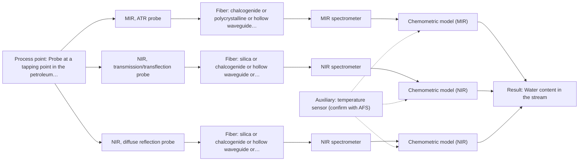

# First technical assessment: Water content in a petroleum stream

## Answer

**Customer request (our summary):** Customer handles a petroleum stream and currently uses laboratory water determination. They want to investigate a fiber based measurement closer to the process so changes can be noticed sooner. The analyzer would be outside the process area. They need to know what to clarify and what a first comparison experiment should establish before selecting equipment.

### Brief answer

Test mid-infrared ATR spectroscopy first: a supplied example measures water content in petroleum with ATR probes. In the same laboratory trial, compare it with a near-infrared geometry chosen by the stream's optical behaviour, using your current laboratory water determination as the reference. What is still open: the water range and accuracy you need, whether the stream is clear or turbid, and whether a fiber link to a remote analyzer is long enough for mid-infrared.

### Proposal

- **Best current option:** O2 (recommended)
- **Basis:** supplied AFS sources
- **What would change it:** If the stream turns out clear and the analyzer must sit far from the process, NIR transmission would move to the front. If the needed mid-IR fiber link cannot be provided, the mid-IR ATR option would drop out of the shortlist.
- **Next step:** Run the comparison experiment on representative samples against the current laboratory water determination, with the go/no-go criteria agreed before the trial.

**Secondary evidence (external, not AFS material):** G1: E03 ¶12; G2: no usable external source found; G3: no usable external source found; G4: E02 ¶4. See Expert detail.

**Decision status:** Provisional feasibility assessment

### Solution options

| ID | Tier | Methods | Confidence | Cost class, S01 Table 1 (p.6) | Ease of use | Maintenance | Performance fit | Sources |
|---|---|---|---|---|---|---|---|---|
| O1 | Simple | M1 MIR, ATR probe | Low: open question: Q1, Q3 (starts at Medium); physical state unknown, sample clarity unknown; uncited auxiliary sensor | high cost (row 2) | One method, one probe type | Crystal cleaning and probe checks | Matches the petroleum-water precedent directly | [1: S02 p.13] [2: S01 p.9] [3: REF §5] |
| O2 | Recommended | M1 MIR, ATR probe; M2 NIR, transmission/transflection probe; M3 NIR, diffuse reflection probe | Low: open question: Q1, Q3 (starts at Medium); physical state unknown, sample clarity unknown; uncited auxiliary sensor | high cost (rows 2, 7, 8) | Two method setups in one trial | Two instruments and probe types | Selects the method on your own samples | [1: S02 p.13] [2: S01 p.9] [3: REF §5] [4: S01 p.10] [5: S02 p.7] [6: S01 p.18] [7: S01 p.17] |

*Confidence rates the basis of the advice (how much is known and cited), not a predicted accuracy or probability of success. It starts at High, or at Medium when a key question on the method or the option is open, and drops one level per weakness listed (floor Low).*

*Cost class is the relative rating in S01 Table 1 (p.6) for the in-line method+technique rows named (the highest one for a multi-method option); it is not a price.*

### Setup sketch

*Recommended option O2; drawn by code from the option, a schematic, not a configuration.*

### Key questions

1. What water concentration range do you expect, what accuracy and detection limit do you need, and how quickly must a change be seen?
2. Is the stream a clear liquid, or is it turbid, opaque or carrying free water droplets or solids?
3. What distance is there from the process tapping point to the planned analyzer location, and how would the fiber be routed?

## Expert detail

**Customer enquiry**

> We handle a petroleum stream and currently send samples to a laboratory for water determination. We want to investigate a fiber based measurement closer to the process so that changes can be noticed sooner. The analyzer would be outside the process area. Before selecting equipment, we need to know what to clarify and what a first comparison experiment should establish.

**Decision status:** Provisional feasibility assessment. A method shortlist can be justified: the sources show water content in petroleum measured with mid-IR ATR probes, and NIR is the most common online fiber-probe method. The stream's optical behaviour, the water range and the achievable fiber link are not known, so the shortlist and the geometry remain assumptions.

### Parameters

| ID | Parameter | Kind | Need | Measured by | Why | Sources |
|---|---|---|---|---|---|---|
| P1 | Water content in the stream | quantitative | required | Spectroscopy: MIR | The enquiry asks for water determination, so a quantitative water value is the parameter the measurement must deliver. | [1: S02 p.13] |
| P2 | Stream temperature at the measurement point | quantitative | required | Auxiliary sensor: temperature sensor (engineering judgement: confirm availability with AFS) | Temperature shifts the water absorption band and sets the probe, crystal and fiber material choice for the installation. | *(no verified source: engineering judgement)* |
| P3 | Stream optical behaviour (clear or turbid; free water or solids) | qualitative | required | Reference lab method: laboratory turbidity / optical-density assessment of a sample | It decides whether the measurement geometry is transmission, diffuse reflection or ATR contact. | *(no verified source: engineering judgement)* |

### Solution option details

- **O1 cost drivers:** One spectrometer, mid-IR fiber, ATR probe, one-method laboratory trial
- **O2 cost drivers:** Two method setups, laboratory work, reference analyses, fiber-link test

### Premise check

- **Supported:** A fiber based measurement closer to the process will allow changes to be noticed sooner. The sources state that fiber probes integrated into process lines allow on-site online analysis with results in near real time, which is the mechanism the customer describes. [8: S01 p.2]
- **Supported:** The analyzer can be outside the process area while still measuring the process. Fiber probes are stated to allow measurement at a significant distance from the spectrometer. No source states an achievable link length for mid-infrared, so the distance must still be confirmed. [9: S01 p.10] [5: S02 p.7]
- **Precedent only:** A fiber-optic method is suitable for water determination in this petroleum stream. A supplied application example shows water content measured in petroleum with mid-IR ATR probes. That is a reason to test the method on this stream, not proof that it will work here. [1: S02 p.13]

### Requirements

**Stated by the customer**

- "We handle a petroleum stream"
- "currently send samples to a laboratory for water determination"
- "fiber based measurement closer to the process so that changes can be noticed sooner"
- "The analyzer would be outside the process area."
- "Before selecting equipment, we need to know what to clarify and what a first comparison experiment should establish."
- "water determination"

**Key unknowns**

- Expected water concentration range, required accuracy and detection limit
- Physical state and optical behaviour of the stream (clear or turbid, free water droplets, solids)
- Distance from the process tapping point to the planned analyzer location, and fiber routing
- Stream temperature and pressure at the measurement point
- Fouling and cleaning requirements at the measurement point
- Reference laboratory water method and its repeatability

### Clarification questions (most decision-relevant first)

Q1. What water concentration range do you expect, what accuracy and detection limit do you need, and how quickly must a change be seen? *Why it matters:* These values set the target the measurement must meet and become the go/no-go criteria for the first experiment. *(affects: method)*
Q2. Is the stream a clear liquid, or is it turbid, opaque or carrying free water droplets or solids? *Why it matters:* This decides whether transmission, diffuse reflection or ATR contact is the feasible measurement geometry. *(affects: technique)*
Q3. What distance is there from the process tapping point to the planned analyzer location, and how would the fiber be routed? *Why it matters:* Long cables are stated in the sources only for low-OH silica fibers, so the distance can rule a method in or out. *(affects: method, installation)*
Q4. What are the stream temperature and pressure at the measurement point? *Why it matters:* They set the probe, crystal and fiber materials and the way the probe is mounted. *(affects: installation)*
Q5. Which laboratory method is used for water determination today, and how repeatable is it? *Why it matters:* The comparison experiment is judged against this reference, so its uncertainty limits the agreement that can be shown. *(affects: method)*

### Recommendation

- **M1 · Primary candidate: MIR, ATR probe.** A supplied example measures water content in petroleum with ATR probes, and strong mid-IR water absorption keeps the ATR path very short. Nominal mid-IR range is 4000-400 cm-1; the usable range depends on the instrument, fiber and probe chosen. *Conditions:* Applies if the stream is a liquid or soft solid that can wet the ATR crystal and if a mid-IR fiber link of the needed length to the remote analyzer can be provided. [1: S02 p.13] [2: S01 p.9] [3: REF §5]
- **M2 · Comparison candidate: NIR, transmission/transflection probe.** NIR is the most common online method with fiber probes and silica fibers are stated to allow long cable runs, which fits an analyzer placed outside the process area. The usable range depends on the instrument, fiber and probe chosen. *Conditions:* Applies if the stream is a clear or semi-transparent liquid that allows a defined transmission pathlength. [4: S01 p.10] [5: S02 p.7] [6: S01 p.18]
- **M3 · Conditional candidate: NIR, diffuse reflection probe.** NIR reflection is used for opaque or highly concentrated products, so it is the fallback geometry if the stream is turbid or carries free water; it uses the same nominal NIR range as M2. *Conditions:* Applies only if the stream turns out opaque or strongly scattering, for example with free water droplets or solids. [7: S01 p.17]
- **M4 · Not recommended: fluorescence probe.** Fluorescence needs a species or indicator that emits light, and none is identified for water in a petroleum stream. It is also not a direct measurement of water. [10: S01 p.5] [11: REF §5]

### Measurement concept

- **Probe and geometry:** Two geometries to test on the customer's own samples: an ATR contact probe for the mid-IR option, and a NIR probe in either transmission/transflection or diffuse reflection, chosen by the stream's optical behaviour.
- **Location:** Probe at a tapping point in the petroleum stream; spectrometers located away from the process area, coupled by fiber.
- **Fiber link:** One fiber per method. Silica fibers are stated for long runs; no source states an achievable length for a mid-infrared link, so that remains open. [12: S01 p.8]

### Spectral range

- **MIR:** Nominal mid-IR range 4000-400 cm-1 (2.5-25 um). The usable range depends on the instrument, fiber and probe actually selected. [2: S01 p.9]
- **NIR:** Nominal NIR range 780-2500 nm. The usable range depends on the instrument, fiber and probe actually selected. [13: S01 p.10]

### Risks and uncertainty

- No supplied source states an achievable fiber link length for mid-infrared, so placing the analyzer outside the process area may not be possible for the mid-IR option; long cables are stated only for low-OH silica fibers. *(rules: R-FIB-2)* [5: S02 p.7]
- The stream's optical behaviour and the expected water range are unknown, so the technique choice and the achievable detection limit are assumptions rather than established facts. *(rules: R-GEN-1, R-PRO-2)* [14: REF §3]
- The petroleum-water example in the sources is a laboratory application and is not proof that the method will work on this stream or in this installation. *(rules: R-EVI-2)* [15: REF §3]
- A film of water, wax or solids on the ATR crystal, and stream inhomogeneity, can change the spectrum without a real change in water content. *(rules: R-MIR-3, R-GEN-5)* [16: REF §5]

### First feasibility experiment

1. **Collect representative samples across the expected range of water content and of physical state (temperature, clear or turbid, free water or solids), recording the stream conditions for each sample.** Cover the real variation before any model is built. [17: REF §3]
2. **Measure every sample with the mid-IR ATR probe and with the NIR geometry that matches its optical behaviour, and have the same samples measured by the current laboratory water determination as the independent reference.** Compare each method against the same reference on the same material. [18: REF §3]
3. **Build one calibration per method and compare the two single-method models on held-out runs or batches; a calibration is specific to the sample matrix and must be re-validated when the matrix changes.** Decide whether one method already meets the target, on data not used for the model. [19: S03 p.14] [20: REF §5]
4. **Repeat the better-performing method through the actual fiber route and length to the planned analyzer location, and check signal quality and stability over a run.** Test the fiber link and the remote analyzer position, not only the probe. *(no verified source: engineering judgement)*
5. **Judge go/no-go against numerical criteria agreed with the customer before the trial: agreement with the reference method, detection limit, time to result and signal stability.** Fix the decision basis in advance so the trial outcome is unambiguous. [21: REF §3]

**Reference measurements:** The current laboratory water determination, run on the same samples, is the independent reference; its repeatability must be known before the comparison.

**Decision basis:** Agreed numerical criteria from the customer: required accuracy against the reference, detection limit, time to result and signal stability. No figures are stated in the sources.

### Assumptions

- The stream can be tapped at a point where a probe can be mounted and cleaned.
- The petroleum stream is a liquid or soft solid at the measurement point, so that an ATR crystal can make contact.
- A laboratory water determination exists today and can serve as the reference method.
- The analyzer position outside the process area is close enough for the fiber family of the selected method; this is unverified.

### Not covered by the supplied sources

- The achievable length of a mid-infrared fiber link between the process and a remote analyzer is not stated in the supplied material.
- Accuracy, detection limit and response time for water determination in a petroleum stream are not stated in the supplied material.

### Further notes

- **Chemometrics:** Both mid-IR and NIR water determination work through a calibration model rather than a single peak; NIR bands overlap and need chemometrics, and a calibration is specific to the sample matrix, so it must be re-validated when the stream or its composition changes.
- **Real-time tracking:** The point of moving closer to the process is that fiber probes give results in near real time instead of a laboratory turnaround. The achievable time resolution depends on the method, probe and spectrometer actually chosen and is not stated in the sources.

### Secondary evidence (external, not AFS material)

*Found by a literature search for gaps the supplied AFS sources leave open. Not AFS material and not proof for this case; every quote below was verified verbatim against the fetched text.*

**G1 · auxiliary sensor:** In-line measurement of Stream temperature at the measurement point with temperature sensor

- **E03 ¶12** The source states that OH bands in NIR and MIR are strongly temperature sensitive, so aqueous solutions require tempered sample holders. *How it applies:* For water determination in a petroleum stream, this suggests temperature at the measurement point may affect the water-related signal and should be measured or controlled in the comparison experiment. *Limits and transfer risks:* The statement concerns aqueous solutions in NIR/MIR and a tempered sample holder, not an in-line temperature sensor in petroleum; transfer to a remote fiber setup is not shown. *(supports O2)*
  > "Additionally, the temperature sensitivity of the OH bands is a severe drawback for measuring aqueous solution in NIR and MIR, which makes tempered sample holders necessary [29]."
  > A critical review of recent trends, and a future perspective of optical spectroscopy as PAT in biopharmaceutical downstream processing. (2020) · Analytical and bioanalytical chemistry · doi:10.1007/s00216-020-02407-z · https://europepmc.org/article/PMC/PMC7072065 · retrieved 2026-10-17, full text, licence: cc by, via curated library

**G2 · not in the supplied sources:** The achievable length of a mid-infrared fiber link between the process and a remote analyzer is not stated in the supplied material.

- No usable external source found.

**G3 · not in the supplied sources:** Accuracy, detection limit and response time for water determination in a petroleum stream are not stated in the supplied material.

- No usable external source found.

**G4 · parameter without a source:** Measuring Stream optical behaviour (clear or turbid; free water or solids): It decides whether the measurement geometry is transmission, diffuse reflection or ATR contact.

- **E02 ¶4** The source reports that ATR probes can be used for in-line measurements in demanding environments and in reaction mixtures containing highly oxidative or corrosive substances. *How it applies:* If the petroleum stream is turbid or contains free water or solids, this supports testing ATR contact geometry as one candidate and checking whether the stream is compatible with the probe. *Limits and transfer risks:* The examples are chlorosilanes and strong acids/bases, not petroleum streams; the result is from a reaction-monitoring context and does not establish performance for water in petroleum. *(supports O2)*
  > "Attenuated total reflection probes (ATR) allow in-line measurements even in demanding measurement environments and reaction mixtures with highly oxidative and corrosive substances, such as chlorosilanes or strong acids and bases."
  > A Process Analytical Concept for In-Line FTIR Monitoring of Polysiloxane Formation. (2020) · Polymers · doi:10.3390/polym12112473 · https://europepmc.org/article/PMC/PMC7693933 · retrieved 2026-10-17, full text, licence: cc by, via curated library

### Evidence (verified quotes)

1. ✓ **S02 p.13** (application precedent): "Application: measurement of water content in petroleum"
2. ✓ **S01 p.9** (general): "Vibrational spectroscopy in the mid-IR range (4000-400 cm-1) is one of the most informative methods of chemical analysis."
3. ✓ **REF §5** (general): "It is not a product specification: actual spectral coverage, fiber length, component ratings, detection limits and accuracy depend on the configuration and the sample."
4. ✓ **S01 p.10** (general): "Near-IR vibrational spectroscopy (NIR) is the most common online analysis method performed using fiber optic probes."
5. ✓ **S02 p.7** (general): "Robust 100-300m cables made with Silica fibers of low OH-content (<0.1ppm OH) enable remote industrial process-control"
6. ✓ **S01 p.18** (general): "Transmission is the preferred method for transparent or semi-transparent liquids, such as skim milk, whey, or permeate."
7. ✓ **S01 p.17** (application precedent): "NIR Reflection is primarily used for opaque or highly concentrated dairy products, such as yogurt, butter, or whole milk concentrates."
8. ✓ **S01 p.2** (general): "enabling on-site online analysis and obtaining results in near real time."
9. ✓ **S01 p.10** (general): "These immersion probes operate on the ATR principle but allow analysis at a significant distance from the spectrometer, without the need for sampling."
10. ✓ **S01 p.5** (general): "However, most chemicals do not exhibit this property."
11. ✓ **REF §5** (general): "Only a defined fluorescent species or a justified indicator."
12. ✓ **S01 p.8** (general): "The use of a combined probe facilitates measurements and allows for the analysis of a smaller sample volume."
13. ✓ **S01 p.10** (general): "NIR spectra (780-2500 nm) contain predominantly overtones and component bands of fundamental vibrations"
14. ✓ **REF §3** (general): "If the known facts cannot justify a method choice, say so, ask the questions that would decide it and propose the next step."
15. ✓ **REF §3** (general): "a published application is a reason to test a method, not proof that it will work for a new customer."
16. ✓ **REF §5** (general): "Usable range limited by fiber and crystal; contact, fouling, compatibility."
17. ✓ **REF §3** (general): "Representative samples or process states"
18. ✓ **REF §3** (general): "independent reference measurements"
19. ✓ **S03 p.14** (general): "A thorough validation, including full, segmented and random-subset CVs, as well as randomization tests, are recommended in any cases for which important conclusions depend on calibration or discrimination models built on limited experimental material."
20. ✓ **REF §5** (general): "calibration specific to the matrix"
21. ✓ **REF §3** (general): "the basis for the go / no-go decision"

### Verification

- Citations verified: 26 of 26 (exact or whitespace/hyphen-tolerant match on the cited page, scope checked).
- Hard check failures before deterministic corrections: 0; still open: 0; soft warnings: 0; repair rounds: 1.
- External evidence (live): 2 quote(s) verified verbatim (exact or whitespace/hyphen-tolerant, at most 400 characters and 2 sentences, against the cited paragraph); 0 item(s) dropped.
- External search: 6 query(ies), 45 hit(s), 5 source(s) (3 from the curated library).
- External step: 2 model call(s), 38.6 s extra (cost in the run JSON).

*Run D06-20261017T201312Z · models deepseek/deepseek-v4.1-flash*
