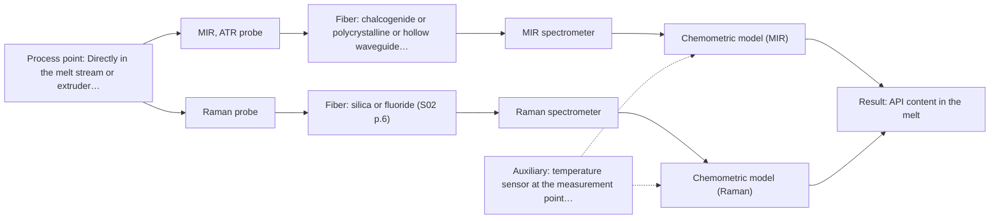
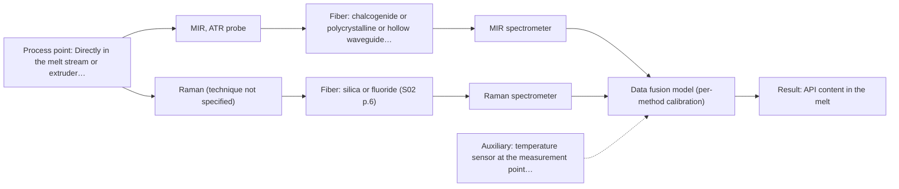

# First technical assessment: API concentration during hot polymer extrusion

## Answer

**Customer request (our summary):** Customer is developing a hot polymer extrusion process incorporating an active pharmaceutical ingredient and wants to investigate optical measurement for detecting composition changes in the melt. They have offline assays, but the process interface is hot and may be exposed to material build up. They need an initial comparison plan and questions before choosing a probe.

### Brief answer

Start with a laboratory comparison of MIR-ATR and Raman on representative melt samples, using the offline assays as reference; MIR-ATR has a published precedent for API in hot polymer extrusion, and Raman adds complementary information. What is still open: the melt's optical behaviour, the API and its concentration range, and the temperature and build-up conditions at the interface. Those answers decide the probe geometry and whether the interface is viable.

### Proposal

- **Best current option:** O2 (recommended)
- **Basis:** supplied AFS sources
- **What would change it:** Answers on the melt's optical regime, the API and its concentration range, and the interface temperature and cleaning conditions could move the choice to MIR-ATR alone (O1) or rule out a contact probe altogether. If the first trials show one method clearly tracking composition, the comparison option collapses to that single method and the combined option becomes unnecessary.
- **Next step:** Run the MIR-ATR and Raman laboratory comparison on representative melt samples with the offline assays as reference, and answer the deciding questions Q1 to Q3.

**Secondary evidence (external, not AFS material):** G1: E01 ¶12; G2: E02 ¶36, E04 ¶1; G3: no usable external source found; G4: no usable external source found. See Expert detail.

**Decision status:** Provisional feasibility assessment

### Solution options

| ID | Tier | Methods | Confidence | Cost class, S01 Table 1 (p.6) | Ease of use | Maintenance | Performance fit | Sources |
|---|---|---|---|---|---|---|---|---|
| O1 | Simple | M1 MIR, ATR probe | Low: open question: Q1 (starts at Medium); uncited auxiliary sensor and a parameter is not measurable in-line | high cost (row 2) | one contact probe, one spectrometer | clean ATR crystal, periodic recalibration | MIR bands separate API from polymer | [1: S02 p.14] [2: S04 p.4] [3: S01 p.5] [4: S01 p.13] |
| O2 | Recommended | M1 MIR, ATR probe; M2 Raman probe | Low: open question: Q1 (starts at Medium); uncited auxiliary sensor and a parameter is not measurable in-line | high cost (rows 2, 12) | two instruments, same sample points | two calibrations, two probe interfaces cleaned | side-by-side trial picks the working method | [1: S02 p.14] [2: S04 p.4] [3: S01 p.5] [4: S01 p.13] [5: S01 p.11] [6: S01 p.11] |
| O3 | Extended (multi-method) | M3 MIR, ATR probe + Raman (combination) | Low: open question: Q1 (starts at Medium); uncited auxiliary sensor and a parameter is not measurable in-line; multi-method, fusion benefit not yet shown | high cost (rows 2, 12) | one combined probe, two spectrometers | per-block calibration and drift checks | adds Raman detail where MIR is not enough | [7: S01 p.7] [8: S02 p.16] [9: S01 p.8] [10: S01 p.8] |

*Confidence rates the basis of the advice (how much is known and cited), not a predicted accuracy or probability of success. It starts at High, or at Medium when a key question on the method or the option is open, and drops one level per weakness listed (floor Low).*

*Cost class is the relative rating in S01 Table 1 (p.6) for the in-line method+technique rows named (the highest one for a multi-method option); it is not a price.*

### Setup sketch

*Recommended option O2; drawn by code from the option, a schematic, not a configuration.*

### Key questions

1. Which active pharmaceutical ingredient is it, and over what concentration range in the melt must a composition change be detected?
2. Is the melt optically clear, turbid or opaque at process temperature?
3. What are the temperature and pressure at the intended measurement point, and how far is it from where a spectrometer can stand?

## Expert detail

**Customer enquiry**

> We are developing a hot polymer extrusion process that incorporates an active pharmaceutical ingredient. We want to investigate whether an optical measurement can detect composition changes while the melt is being processed. We have offline assays, but the process interface is hot and may be exposed to material build up. We need an initial comparison plan and the questions required before choosing a probe.

**Decision status:** Provisional feasibility assessment. MIR-ATR, Raman and UV-Vis ATR are not excluded by the sources, and MIR-ATR has a published precedent in hot polymer extrusion with an API, so a shortlist is justified. The melt's optical behaviour, the API identity and concentration range, and the interface temperature and build-up conditions are still unknown, so the choice remains provisional.

### Parameters

| ID | Parameter | Kind | Need | Measured by | Why | Sources |
|---|---|---|---|---|---|---|
| P1 | API content in the melt | quantitative | required | Spectroscopy: MIR | The stated target is to detect composition changes of the active ingredient in the melt. | [1: S02 p.14] |
| P2 | Polymer matrix and excipient composition | qualitative | required | Reference lab method: customer's offline assay (composition reference) | Calibrations are specific to the matrix, so the matrix must be known and either held constant or varied deliberately in the trial. | [11: REF §5] |
| P3 | Melt temperature at the measurement point | quantitative | required | Auxiliary sensor: temperature sensor at the measurement point (engineering judgement: confirm availability with AFS) | The interface is stated to be hot; temperature affects the spectra and the probe selection, and no source gives limits for this case. | *(no verified source: engineering judgement)* |
| P4 | Optical regime of the melt (clear, turbid or opaque) | qualitative | required | Not measurable in-line by spectroscopy; alternative: offline transmission or scattering test on melt samples at process temperature | It decides between contact ATR, transmission/transflection and diffuse reflection geometries. | *(no verified source: engineering judgement)* |

### Solution option details

- **O1 cost drivers:** one spectrometer, ATR probe, fiber link, calibration runs
- **O2 cost drivers:** two spectrometers and probes, larger sample set, two calibrations
- **O3 cost drivers:** two spectrometers, combined probe, synchronisation and fusion effort
- **O3 combining methods:** MIR-ATR and Raman spectra are taken from one combined probe head at the same small melt volume, then normalised to a common time step and block-scaled before joining, because variables from different methods are not equivalent. Each block keeps its own calibration and diagnostics. The fused model must beat the better single method on held-out runs or batches, otherwise the extra instrument is dropped.

*Extended (multi-method) option O3; drawn by code from the option, a schematic, not a configuration.*

### Premise check

- **Precedent only:** An optical measurement can detect composition changes in the melt while it is being processed. A process example shows NIR-reflex and MIR-ATR spectroscopy used to control polymer extrusion in-line, and API spectra in hot polymer obtained with an ATR probe; this is a reason to test the methods here, not proof for this melt. [12: S02 p.14] [1: S02 p.14]
- **Not covered:** A fiber probe can be mounted directly at the hot, build-up-prone extrusion interface and keep measuring. No supplied source states probe or fiber temperature ratings, cleaning intervals or anti-fouling measures for a hot polymer melt, so this stays an open installation question. *(no verified source: engineering judgement)*

### Requirements

**Stated by the customer**

- "hot polymer extrusion process that incorporates an active pharmaceutical ingredient"
- "detect composition changes while the melt is being processed"
- "We have offline assays"
- "the process interface is hot and may be exposed to material build up"
- "We need an initial comparison plan and the questions required before choosing a probe."
- "detect composition changes"
- "incorporates an active pharmaceutical ingredient"

**Key unknowns**

- API identity and the concentration range over which a change must be detected
- Optical behaviour of the melt at process temperature (clear, turbid, opaque)
- Interface temperature and pressure, and the distance from the measurement point to the spectrometer
- Cleaning interval and access at the measurement point
- What the offline assays measure and their uncertainty
- Whether the API or the polymer matrix fluoresces

### Clarification questions (most decision-relevant first)

Q1. Which active pharmaceutical ingredient is it, and over what concentration range in the melt must a composition change be detected? *Why it matters:* It decides whether a vibrational method can see the ingredient at all and sets the target for the trial. *(affects: method)*
Q2. Is the melt optically clear, turbid or opaque at process temperature? *Why it matters:* It decides between contact ATR, transmission/transflection and diffuse reflection geometries. *(affects: technique)*
Q3. What are the temperature and pressure at the intended measurement point, and how far is it from where a spectrometer can stand? *Why it matters:* Hot-interface materials, the fiber family and the fiber path determine what can be installed there. *(affects: installation)*
Q4. How often does the line need cleaning, and can the measurement point be reached for cleaning or probe removal? *Why it matters:* Build-up on the probe interface may set the maintenance interval and rule out a flush contact geometry. *(affects: installation)*
Q5. What exactly do the offline assays measure, with what uncertainty, and can a sample be taken at the measurement point? *Why it matters:* The reference values and their quality decide whether a calibration can be built and validated. *(affects: status)*

### Recommendation

- **M1 · Primary candidate: MIR, ATR probe.** MIR-ATR is the single method to test first: it suits liquids and soft solids held in tight contact with the crystal, it gives well-defined absorption bands, and there is a published example of API spectra in hot polymer obtained with an ATR probe coupled to an FTIR spectrometer. That example is a reason to test the method on this melt, not proof that it will work here. *Conditions:* Applies only if the melt makes tight contact with the ATR crystal, the few-micrometre sampling depth is representative of the melt, and the probe materials tolerate the process temperature, which is not stated in the sources. [1: S02 p.14] [2: S04 p.4] [3: S01 p.5] [4: S01 p.13]
- **M2 · Comparison candidate: Raman probe.** Raman is the comparison method to run beside MIR-ATR: mid-IR and Raman spectra are complementary, so together they carry more structural information than either alone, and the same contact point can serve both. The published complementarity is a hypothesis for this polymer melt, and the weak Raman signal can be swamped by fluorescence. *Conditions:* Applies if the melt does not fluoresce strongly enough to hide the Raman bands; the fluorescence background must be checked on real melt samples. [5: S01 p.11] [6: S01 p.11]
- **M3 · Conditional candidate: MIR, ATR probe + Raman (combination).** If neither single method tracks the composition change well enough, combining MIR-ATR and Raman is the next hypothesis: a combined ATR/Raman probe head exists, and combining methods is suggested for samples where one method is insufficient. Any gain from the combination must be shown against the best single method. *Conditions:* Only after the single-method trials, and only if a combined probe can look at the same small melt volume with synchronised acquisition. [7: S01 p.7] [8: S02 p.16] [9: S01 p.8] [10: S01 p.8] Later hypothesis, after single-method tests.

### Measurement concept

- **Probe and geometry:** Contact ATR probe (mid-IR) at the melt, optionally with a Raman probe at the same point; a combined ATR/Raman probe head only in the later, combined option.
- **Location:** Directly in the melt stream or extruder port, subject to the answers on temperature, access and cleaning.
- **Fiber link:** Mid-IR needs chalcogenide (CIR) or polycrystalline (PIR) fibers, or a hollow waveguide; the achievable link length is not stated in the sources and must be confirmed. [13: S01 p.10]

### Spectral range

- **MIR:** Nominal mid-IR range 4000-400 cm-1 (2.5-25 um); the usable range depends on the instrument, fiber and probe actually selected. [14: S01 p.9] [15: REF §5]
- **Raman:** Raman is reported as a Raman shift in cm-1 with the laser excitation wavelength stated separately; no excitation wavelength has been fixed for this case yet. [16: S01 p.11]

### Risks and uncertainty

- The melt may be too absorbing or too scattering for the chosen geometry, so no usable spectrum is obtained; its optical regime is unknown. *(rules: R-GEN-3, R-GEO-2)* [17: S01 p.18]
- Build-up on the ATR crystal or probe window may degrade the signal and force a cleaning interval that no source states. *(rules: R-MIR-3)* *(no verified source: engineering judgement)*
- The interface temperature and the probe/fiber temperature limits are unknown, and mid-IR needs chalcogenide or PIR fibers whose achievable link length is not stated in the sources. *(rules: R-FIB-1, R-FIB-2)* [18: S02 p.6]
- The API may sit below the method's sensitivity or have no distinct spectral signature in the usable range, and calibrations are specific to the matrix. *(rules: R-CAL-1)* [11: REF §5]

### First feasibility experiment

1. **Collect representative melt samples across the expected chemical and physical variation, each with an independent reference value from the offline assay.** Representative samples across the expected chemical and physical variation, each with an independent reference value. [19: REF §3]
2. **Record MIR-ATR spectra of each sample in contact with the crystal at process temperature, and Raman spectra at the same sample points, noting any fluorescence background in the Raman data.** Record MIR-ATR spectra of each sample in contact with the crystal at process temperature, and Raman spectra at the same sample points, noting any fluorescence background in the Raman data. [1: S02 p.14]
3. **Build one calibration per method against the offline assay values and validate on held-out runs or batches, not on the runs used for calibration.** Build one calibration per method against the offline assay values and validate on held-out runs or batches, not on the runs used for calibration. [20: REF §5]
4. **Compare the two single methods first; only if neither meets the agreed criteria, test a fused MIR+Raman model (one model per block, block-scaled joined variables, aligned to a common time step) against the better single method.** Compare the two single methods first; only if neither meets the agreed criteria, test a fused MIR+Raman model against the better single method. [21: S01 p.8] [22: REF §5]
5. **Set the go/no-go thresholds from the customer's own numerical criteria (required composition resolution, repeatability, response time) on the held-out runs; these numbers must come from the customer and are not in the sources.** Go/no-go against the customer's own numerical criteria on the held-out runs; these numbers must come from the customer and are not in the sources. *(no verified source: engineering judgement)*

**Reference measurements:** The customer's offline assays, applied to the same samples and runs, are the independent reference; their uncertainty and sampling point must be defined (Q5).

**Decision basis:** Go/no-go on the customer's numerical criteria; single methods are judged first, and a combination is only kept if it beats the best single method on held-out runs.

### Assumptions

- The melt can be sampled for laboratory trials at the same composition states as the process.
- The offline assay can serve as reference for the same material that is measured optically.
- A probe can be brought into contact with the melt at the intended point.

### Not covered by the supplied sources

- Probe and fiber temperature ratings for a hot polymer melt interface.
- Cleaning or anti-fouling measures for a build-up-prone measurement point.
- Achievable fiber link length for a mid-IR (CIR or PIR) installation.

### Further notes

- **Chemometrics:** Quantitative use of MIR-ATR or Raman needs a chemometric calibration against the offline assay, built on representative melt samples and validated on held-out runs or batches. If a combined measurement is tried, the fused model must be shown to beat the best single method.
- **Real-time tracking:** The enquiry is about in-line detection during processing, so spectra must be acquired fast enough to follow composition changes; if two methods run together, their data must be aligned to a common time step before any fused output.
- **Future direction:** If one method tracks the composition change, a reduced-channel or sensor-style unit for routine process control is a possible later extension.

### Secondary evidence (external, not AFS material)

*Found by a literature search for gaps the supplied AFS sources leave open. Not AFS material and not proof for this case; every quote below was verified verbatim against the fetched text.*

**G1 · auxiliary sensor:** In-line measurement of Melt temperature at the measurement point with temperature sensor at the measurement point

- **E01 ¶12** The source states that temperature sensitivity of OH bands is a severe drawback for measuring aqueous solution in NIR and MIR, making tempered sample holders necessary. *How it applies:* This could inform the assessment by highlighting that temperature at the measurement point may need to be controlled or monitored when using MIR or NIR, and that temperature variation should be tested for its effect on spectra. *Limits and transfer risks:* The statement concerns aqueous solutions and NIR/MIR, not a hot polymer melt, and it does not describe an in-line temperature sensor or probe/fiber temperature rating. *(supports O2)*
  > "Additionally, the temperature sensitivity of the OH bands is a severe drawback for measuring aqueous solution in NIR and MIR, which makes tempered sample holders necessary [29]."
  > A critical review of recent trends, and a future perspective of optical spectroscopy as PAT in biopharmaceutical downstream processing. (2020) · Analytical and bioanalytical chemistry · doi:10.1007/s00216-020-02407-z · https://europepmc.org/article/PMC/PMC7072065 · retrieved 2026-10-17, full text, licence: cc by, via curated library

**G2 · multi-method:** Combining several spectroscopy methods (data fusion) (MIR-ATR and Raman spectra are taken from one combined probe head at the same small melt volume, then normalised to a common time step and block-scaled before joining, because variables from different methods are not equivalent. Each block keeps its own calibration and diagnostics. The fused model must beat the better single method on held-out runs or batches, otherwise the extra instrument is dropped.)

- **E02 ¶36** The source warns that in some situations instrument complementarity, rather than data complementarity, was not sufficient to improve the performance of several predictive CQAs, citing a Raman and FT-IR food analytical study. *How it applies:* This supports testing whether a fused MIR-ATR and Raman model actually beats the better single method on held-out runs or batches before keeping the extra instrument. *Limits and transfer risks:* The cited case is a food analytical study using Raman and FT-IR, not MIR-ATR and Raman from one combined probe head in a hot polymer melt, so the outcome may not transfer. *(supports O3)*
  > "In some situations, instrument complementarity (not data complementarity) was not sufficient to improve the performance of predictive several CQAs, as shown by a Raman and FT-IR data based food analytical study [73]."
  > Challenges and Opportunities of Implementing Data Fusion in Process Analytical Technology-A Review. (2022) · Molecules (Basel, Switzerland) · doi:10.3390/molecules27154846 · https://europepmc.org/article/PMC/PMC9369811 · retrieved 2026-10-17, full text, licence: cc by, via curated library
- **E04 ¶1** In one study, a signal-to-noise weighted NIR-MIR-Raman model showed the best performance compared with both combined and individual models, with a root mean square error of cross-validation of 0.75 Pa s and an RPD of 10.62. *How it applies:* This could inform a comparison plan by suggesting that signal-to-noise weighting of blocks be tested and that the fused model be compared against the better single method. *Limits and transfer risks:* The study concerns micellar liquids and viscosity prediction, is available only as an abstract, and does not use the same combined probe head or hot polymer melt matrix. *(supports O3)*
  > "The signal-to-noise weighted NIR-MIR-Raman model showed the best performance compared with both combined and individual models with a root mean square error of cross-validation of 0.75 Pa s and an RPD of 10.62."
  > Comparison of Individual and Integrated Inline Raman, Near-Infrared, and Mid-Infrared Spectroscopic Models to Predict the Viscosity of Micellar Liquids (2020) · Applied Spectroscopy · doi:10.1177/0003702820924043 · https://doi.org/10.1177/0003702820924043 · retrieved 2026-10-17, abstract only, licence: cc-by, via openalex

**G3 · not in the supplied sources:** Probe and fiber temperature ratings for a hot polymer melt interface.

- No usable external source found.

**G4 · not in the supplied sources:** Cleaning or anti-fouling measures for a build-up-prone measurement point.

- No usable external source found.

### Evidence (verified quotes)

1. ✓ **S02 p.14** (application precedent): "Spectra of API in hot polymer obtained with Diamond cone ATR probe coupled to iC10 FTIR (MTAC)"
2. ✓ **S04 p.4** (general): "suitability of analyzed samples for ATR measurements, which is true for liquid or soft solid samples and their components, allowing a tight contact with the probe head."
3. ✓ **S01 p.5** (general): "Mid-IR band spectra contain well-defined peaks (absorption bands), while NIR, UV, and fluorescence spectra contain broad, highly overlapping signals"
4. ✓ **S01 p.13** (general): "typically at a depth of few microns"
5. ✓ **S01 p.11** (general): "This property makes mid-IR and Raman spectra complementary, that is, they complement each other."
6. ✓ **S01 p.11** (general): "superposition of luminescence (fluorescence), which has a significantly higher intensity."
7. ✓ (precedent only) **S01 p.7** (method gain): "The analysis of such systems may require a combination of two or even more spectral methods."
8. ✓ **S02 p.16** (general): "Combi probe with 2 IR-fibers coupled to FTIR-spectrometer and 2 Silica fibers coupled to Fluo or Raman spectrometers to work with 680nm & 785nm laser excitation"
9. ✓ **S01 p.8** (general): "It is crucial that the spectral information obtained by different methods-Mid-IR, NIR, Raman, and fluorescence spectra-is collected from the same small, even pinpoint, area of the sample."
10. ✓ **S01 p.8** (general): "two or more probes, belonging to different methods, can be used for measurements, but the data from each method must be obtained simultaneously."
11. ✓ **REF §5** (general): "calibration specific to the matrix."
12. ✓ **S02 p.14** (application precedent): "NIR-Reflex & MIR-ATR-spectroscopy to control polymer extrusion in-line"
13. ✓ **S01 p.10** (general): "ATR fiber probes (Fig.1) enable the analysis of liquids and solid elastic samples"
14. ✓ **S01 p.9** (general): "Vibrational spectroscopy in the mid-IR range (4000-400 cm-1) is one of the most informative methods of chemical analysis."
15. ✓ **REF §5** (general): "It is not a product specification: actual spectral coverage, fiber length, component ratings, detection limits and accuracy depend on the configuration and the sample."
16. ✓ **S01 p.11** (general): "The Raman shift is used as the horizontal (spectral) axis in Raman spectroscopy"
17. ✓ **S01 p.18** (general): "it fails when the milk becomes too "thick" or fat-rich, as the light cannot penetrate the sample."
18. ✓ **S02 p.6** (general): "350 nm Standard VIS-NIR Silica Fibers Al/Cu-coated VIS-NIR Silica Fibers 2400 nm"
19. ✓ **REF §3** (general): "Representative samples or process states, independent reference measurements, what is compared, and the basis for the go / no-go decision."
20. ✓ **REF §5** (general): "compare with the best single method."
21. ✓ **S01 p.8** (general): "Variables obtained from different spectral methods are not equivalent."
22. ✓ (precedent only) **REF §5** (method gain): "Sampling location and timing must be aligned; a gain is a hypothesis to test."

### Verification

- Citations verified: 26 of 26 (exact or whitespace/hyphen-tolerant match on the cited page, scope checked).
- Hard check failures before deterministic corrections: 0; still open: 0; soft warnings: 2; repair rounds: 1.
- External evidence (live): 3 quote(s) verified verbatim (exact or whitespace/hyphen-tolerant, at most 400 characters and 2 sentences, against the cited paragraph); 0 item(s) dropped.
- External search: 6 query(ies), 45 hit(s), 5 source(s) (3 from the curated library).
- External step: 2 model call(s), 65.5 s extra (cost in the run JSON).

*Run D07-20261017T202123Z · models deepseek/deepseek-v4.1-flash*
