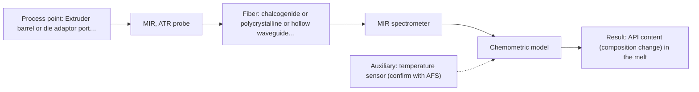
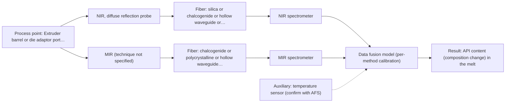

# First technical assessment: API concentration during hot polymer extrusion

## Answer

**Customer request (our summary):** Customer is developing a hot polymer extrusion process incorporating an active pharmaceutical ingredient and wants to investigate whether an optical measurement can detect composition changes in the melt. They have offline assays, but the process interface is hot and may be exposed to material build up. They request an initial comparison plan and the questions required before choosing a probe.

### Brief answer

Test mid-infrared ATR on the melt first, with Raman as the single-method comparison; a published process example uses MIR-ATR and NIR reflection to control polymer extrusion in-line. Still open: the target species and its concentration range, the accuracy and response time that would count as success, the melt temperature and pressure at the port, and how build-up will be handled. Those answers decide the final probe.

### Proposal

- **Best current option:** O2 (recommended)
- **Basis:** supplied AFS sources
- **What would change it:** If the melt cannot make tight contact with an ATR crystal, or if the API has no distinct mid-IR band, the choice moves to the Raman comparison (M2) or to NIR reflection (M3). An accuracy or response-time target that no single method reaches would push toward the combined option (O3).
- **Next step:** Answer the clarification questions, especially the target species and the interface conditions, then run the single-method MIR ATR and Raman trials on representative melt samples against the offline assay.

**Decision status:** Provisional feasibility assessment

### Solution options

| ID | Tier | Methods | Confidence | Cost class, S01 Table 1 (p.6) | Ease of use | Maintenance | Performance fit | Sources |
|---|---|---|---|---|---|---|---|---|
| O1 | Simple | M2 Raman probe | Low: open question: Q1 (starts at Medium); uncited auxiliary sensor | high cost (row 12) | one probe, one spectrometer | probe window cleaning only | single instrument, first melt spectra | [1: S01 p.11] [2: S01 p.11] [3: S01 p.11] |
| O2 | Recommended | M1 MIR, ATR probe | Low: open question: Q1 (starts at Medium); uncited auxiliary sensor | high cost (row 2) | probe mounted in extruder port | ATR crystal cleaning, build-up watch | well-defined bands, extrusion precedent | [4: S02 p.14] [5: S02 p.14] [6: S01 p.9] [7: S04 p.4] |
| O3 | Extended (multi-method) | M3 NIR, diffuse reflection probe + MIR (combination) | Low: open question: Q1 (starts at Medium); sample clarity unknown; uncited auxiliary sensor; multi-method, fusion benefit not yet shown | high cost (rows 2, 8) | two instruments, one measurement port | two calibrations, two probe interfaces | fusion only if single methods fall short | [8: S01 p.8] [4: S02 p.14] [9: S01 p.18] |

*Confidence rates the basis of the advice (how much is known and cited), not a predicted accuracy or probability of success. It starts at High, or at Medium when a key question on the method or the option is open, and drops one level per weakness listed (floor Low).*

*Cost class is the relative rating in S01 Table 1 (p.6) for the in-line method+technique rows named (the highest one for a multi-method option); it is not a price.*

### Setup sketch

*Recommended option O2; drawn by code from the option, a schematic, not a configuration.*

### Key questions

1. Which species defines the composition change, over what concentration range, and what accuracy and response time would count as success?
2. What are the melt temperature and pressure at the intended measurement port, and how far is that port from where a spectrometer could stand?
3. How quickly does build-up form, how is the port cleaned, and can an ATR crystal or a flush-mounted window be removed for cleaning?

## Expert detail

**Customer enquiry**

> We are developing a hot polymer extrusion process that incorporates an active pharmaceutical ingredient. We want to investigate whether an optical measurement can detect composition changes while the melt is being processed. We have offline assays, but the process interface is hot and may be exposed to material build up. We need an initial comparison plan and the questions required before choosing a probe.

**Decision status:** Provisional feasibility assessment. A method shortlist can be justified: the sources contain a process example in which MIR-ATR (with NIR reflection) is used to control polymer extrusion in-line, with API spectra recorded in hot polymer, and the melt is a liquid that can be brought into contact with an ATR crystal. The target species, the accuracy target and the port conditions are still unknown, so the final probe choice is not yet justified.

### Parameters

| ID | Parameter | Kind | Need | Measured by | Why | Sources |
|---|---|---|---|---|---|---|
| P1 | API content (composition change) in the melt | quantitative | required | Spectroscopy: MIR | The enquiry asks whether composition changes can be detected in the melt, so the API content is the variable the measurement has to track. | [5: S02 p.14] [6: S01 p.9] |
| P2 | Melt temperature at the probe interface | quantitative | required | Auxiliary sensor: temperature sensor (engineering judgement: confirm availability with AFS) | The interface is stated to be hot, so the melt temperature at the probe defines the measurement conditions and the range over which a calibration would have to hold. | *(no verified source: engineering judgement)* |
| P3 | Base polymer matrix and grade | qualitative | required | Reference lab method: the customer's existing offline assay (method not stated in the enquiry) | A calibration is specific to the matrix, so the polymer system has to be defined before melt spectra can be interpreted. | [10: REF §5] |

### Solution option details

- **O1 cost drivers:** one spectrometer, one fiber probe, calibration effort
- **O2 cost drivers:** mid-IR fiber probe, ATR crystal, FTIR, chemometrics
- **O3 cost drivers:** two spectrometers, combined probe, data fusion effort
- **O3 combining methods:** Start from one calibration model per method (MIR ATR and NIR reflection) and only then fuse, using joined autoscaled variables or per-method scores, because variables from different methods are not equivalent. Both probes must look at the same small area of the melt and the two acquisition rates must be brought to a common time step. The fused model must beat the best single method on independent runs, and each block needs its own calibration and diagnostics; otherwise the second instrument is dropped.

*Extended (multi-method) option O3; drawn by code from the option, a schematic, not a configuration.*

### Premise check

- **Precedent only:** An optical, in-line measurement can be applied to a hot polymer melt extrusion process. A published process example shows MIR-ATR and NIR reflection spectroscopy controlling polymer extrusion in-line, with API spectra recorded in hot polymer through a diamond ATR probe. A published example is a reason to test, not proof for this process. [4: S02 p.14] [5: S02 p.14]
- **Not covered:** A fiber probe can be fitted to this hot extruder port and tolerate the material build-up. The sources describe fiber probes used in-line and in-situ, including ATR probes in process environments, but give no temperature, pressure or fouling rating for an extruder port, so this has to be established with AFS. *(no verified source: engineering judgement)*

### Requirements

**Stated by the customer**

- "hot polymer extrusion process that incorporates an active pharmaceutical ingredient"
- "detect composition changes while the melt is being processed"
- "We have offline assays"
- "the process interface is hot"
- "may be exposed to material build up"
- "We need an initial comparison plan and the questions required before choosing a probe"
- "detect composition changes"

**Key unknowns**

- Target species and the concentration range that defines a composition change.
- Required accuracy and response time (the go/no-go criteria).
- Melt temperature and pressure at the intended probe port.
- Base polymer matrix and whether the melt is clear or highly scattering/filled.
- Build-up rate, cleaning interval and probe removal access.
- Which offline assay is the reference and how precisely it quantifies the API.

### Clarification questions (most decision-relevant first)

Q1. Which species defines the composition change, over what concentration range, and what accuracy and response time would count as success? *Why it matters:* These values are the go/no-go criteria and decide whether one method can cover the target or a combination is needed. *(affects: method, status)*
Q2. What are the melt temperature and pressure at the intended measurement port, and how far is that port from where a spectrometer could stand? *Why it matters:* Temperature, pressure and the distance to the spectrometer decide which probe and which fiber family can be used. *(affects: installation)*
Q3. How quickly does build-up form, how is the port cleaned, and can an ATR crystal or a flush-mounted window be removed for cleaning? *Why it matters:* Build-up can drift the signal and mimic a composition change, and it decides between contact ATR and a reflection window. *(affects: installation, technique)*
Q4. What is the base polymer, and is the melt clear or highly scattering and filled? *Why it matters:* The matrix sets the calibration and decides whether a transmission, reflection or ATR geometry fits. *(affects: method)*
Q5. Which offline assay will serve as the reference, and does the API show a distinct mid-IR or Raman band, or fluoresce? *Why it matters:* The reference defines the comparison, and the API's spectral activity decides whether MIR ATR or Raman is the better first test. *(affects: status, M1, M2)*

### Recommendation

- **M1 · Primary candidate: MIR, ATR probe.** Mid-IR is one of the most informative chemical methods and its bands are well defined, while a melt can be brought into tight contact with an ATR crystal. A published process example uses MIR-ATR, together with NIR reflection, to control polymer extrusion in-line and records API spectra in hot polymer with a diamond ATR probe. *Conditions:* Applies if the melt makes tight contact with the ATR crystal and the target species has a distinguishable mid-IR band in the usable range. [4: S02 p.14] [5: S02 p.14] [6: S01 p.9] [7: S04 p.4]
- **M2 · Comparison candidate: Raman probe.** Raman records the same fundamental vibrational frequencies as mid-IR but with different intensities, so the two methods complement each other. Its signal is weak and can be swamped by fluorescence, which has to be checked on the real melt. *Conditions:* Applies if the melt gives a measurable Raman signal without a dominant fluorescence or thermal background. [1: S01 p.11] [2: S01 p.11] [3: S01 p.11]
- **M3 · Conditional candidate: NIR, diffuse reflection probe + MIR (combination).** NIR reflection appears in the same in-line polymer extrusion example, and reflection can work well in highly scattering environments. Whether this melt scatters enough for a reflection geometry is not known, so this entry stays conditional. *Conditions:* Applies only if the melt is highly scattering or opaque and a flush-mounted reflection window can be fitted at the extruder. [4: S02 p.14] [9: S01 p.18] Later hypothesis, after single-method tests.
- **M4 · Not recommended: fluorescence probe.** No fluorescent species or indicator has been identified, and most chemicals do not fluoresce; fluorescence is highly sensitive but low in selectivity and is not a direct measurement of every analyte. *Conditions:* Would be reconsidered only if the API or a deliberately added indicator is shown to fluoresce. [11: S01 p.5] [12: REF §5]

### Measurement concept

- **Probe and geometry:** Single-method trials first: a mid-IR ATR probe (immersion/contact, crystal head in the melt) as the primary test, and a Raman probe on the same melt samples as the comparison; a flush-mounted NIR reflection window only if the melt proves highly scattering. Link length and port geometry are open (Q2).
- **Location:** Extruder barrel or die adaptor port, downstream of the melting zone, where the melt is fully homogenised.
- **Fiber link:** Fiber family follows the method: mid-IR needs chalcogenide or polycrystalline infrared fibers or hollow waveguides, while Raman uses silica fibers. No achievable mid-IR link length is stated in the sources (see not_in_sources). [13: S02 p.6]

### Spectral range

- **MIR:** Nominal mid-IR range 4000-400 cm-1 (2.5-25 um); the usable range depends on the instrument, the fiber and the ATR crystal actually selected, and the ATR layer sampled is only a few micrometres deep. [6: S01 p.9] [14: S01 p.13]
- **Raman:** Raman is reported on a Raman shift axis in cm-1; the laser excitation wavelength is stated separately and is not fixed by the source for this case. The usable range depends on the excitation wavelength, the probe and the spectrometer chosen. [15: S01 p.11]
- **NIR:** Nominal NIR range 780-2500 nm; the usable range depends on the instrument, the fiber and the probe actually selected. [16: S01 p.10]

### Risks and uncertainty

- The target species may have no distinguishable mid-IR band, in which case M1 would not see the composition change. *(no verified source: engineering judgement)*
- Build-up on the ATR crystal or the window can drift the spectrum and be mistaken for a composition change. *(rules: R-MIR-3)* [17: REF §5]
- No source states an achievable fiber length for a mid-IR link, so the distance from the extruder to the spectrometer is an open feasibility point for M1. *(rules: R-FIB-2)* [18: S02 p.9]
- The offline assay may not represent the melt at the probe point (different thermal history), which would weaken the reference comparison. *(no verified source: engineering judgement)*

### First feasibility experiment

1. **Collect representative melt samples or process states across the expected composition and temperature range, each with the offline assay value recorded as the independent reference.** Representative samples and an independent reference are the basis of the comparison. [19: REF §3]
2. **Measure the single methods first on those samples, MIR ATR (M1) and Raman (M2), under the same temperature states, and keep spectra and reference values paired.** Single methods first; the comparison shows which one sees the composition change. *(no verified source: engineering judgement)*
3. **Repeat measurements at one position and at several positions to check repeatability and to see how build-up changes the signal over a run.** Separates real composition change from drift caused by the interface. *(no verified source: engineering judgement)*
4. **Only if neither single method meets the customer's criteria, measure the combined MIR ATR and NIR reflection set-up at the same point, with synchronised acquisition and one calibration per method.** A combination is a later hypothesis to test against the best single method. [20: S01 p.8] [21: S01 p.8]
5. **Validate on held-out runs or batches and set the go/no-go against the customer's numerical criteria, which are not yet stated.** Validation on independent runs, with criteria from the customer. *(no verified source: engineering judgement)*

**Reference measurements:** The customer's existing offline assay, on the same material and at the same composition states; the assay method still has to be named (Q5).

**Decision basis:** Go/no-go on the customer's own accuracy and response-time targets (Q1); not yet stated.

### Assumptions

- The melt is a liquid or soft solid that can be brought into tight contact with a probe head at the extruder.
- The composition change is expressed as a concentration of the API (or of one named component) that the offline assay quantifies.

### Not covered by the supplied sources

- No source states an achievable fiber length for a mid-IR (CIR/PIR) link; the mid-IR fiber and hollow-waveguide examples given are laboratory-length samples, not process link lengths.
- No source gives probe temperature, pressure or fouling ratings for an extruder port.
- No source gives accuracy, detection limit or response time for API content in a polymer melt.

### Further notes

- **Chemometrics:** Mid-IR and NIR bands are broad and overlapping, and Raman calibration is equally matrix-specific, so each method needs its own calibration or classification model built on reference data from the customer's offline assays. A model built on one polymer grade or composition window is not transferable to another without re-validation.
- **Real-time tracking:** Fiber probes allow measurement directly in the process without sampling, which is what makes a continuous or time-resolved comparison on the running extruder possible; the achievable time resolution depends on the spectrometer and the acquisition settings chosen, and is not fixed by the sources.
- **Future direction:** If the lab trials show a usable signal, a later step could be a customized multispectral system, or a compact spectral sensor aimed at the one composition variable that matters for this process.

### Evidence (verified quotes)

1. ✓ **S01 p.11** (general): "This property makes mid-IR and Raman spectra complementary, that is, they complement each other."
2. ✓ **S01 p.11** (general): "which are several orders of magnitude weaker than IR absorption peaks"
3. ✓ **S01 p.11** (general): "superposition of luminescence (fluorescence), which has a significantly higher intensity."
4. ✓ **S02 p.14** (application precedent): "NIR-Reflex & MIR-ATR-spectroscopy to control polymer extrusion in-line"
5. ✓ **S02 p.14** (application precedent): "Spectra of API in hot polymer obtained with Diamond cone ATR probe coupled to iC10 FTIR (MTAC)"
6. ✓ **S01 p.9** (general): "Vibrational spectroscopy in the mid-IR range (4000-400 cm-1) is one of the most informative methods of chemical analysis."
7. ✓ **S04 p.4** (general): "suitability of analyzed samples for ATR measurements, which is true for liquid or soft solid samples and their components, allowing a tight contact with the probe head."
8. ✓ **S01 p.8** (general): "It is crucial that the spectral information obtained by different methods-Mid-IR, NIR, Raman, and fluorescence spectra-is collected from the same small, even pinpoint, area of the sample."
9. ✓ **S01 p.18** (general): "reflection can work well in highly scattering environments but can be less representative for clear liquids."
10. ✓ **REF §5** (general): "physical variation; calibration specific to the matrix."
11. ✓ **S01 p.5** (general): "However, most chemicals do not exhibit this property."
12. ✓ **REF §5** (general): "High sensitivity, low selectivity; not a direct measurement of every analyte."
13. ✓ **S02 p.6** (general): "1100 nm Chalcogenide As-S IR Fibers 6500 nm"
14. ✓ **S01 p.13** (general): "typically at a depth of few microns"
15. ✓ **S01 p.11** (general): "The Raman shift is used as the horizontal (spectral) axis in Raman spectroscopy"
16. ✓ **S01 p.10** (general): "NIR spectra (780-2500 nm) contain predominantly overtones and component bands of fundamental vibrations"
17. ✓ **REF §5** (general): "Usable range limited by fiber and crystal; contact, fouling, compatibility."
18. ✓ **S02 p.9** (general): "HWG-750-2m PIR 600/700 -2m"
19. ✓ **REF §3** (general): "Representative samples or process states, independent reference measurements, what is compared, and the basis for the go / no-go decision."
20. ✓ **S01 p.8** (general): "the data from each method must be obtained simultaneously."
21. ✓ **S01 p.8** (general): "the measurement data must be normalized to a common time step."

### Verification

- Citations verified: 29 of 29 (exact or whitespace/hyphen-tolerant match on the cited page, scope checked).
- Hard check failures before deterministic corrections: 0; still open: 0; soft warnings: 1; repair rounds: 1.
- Corrected deterministically after verification (1):
  - ⚠ recommendations[2].combined_with: combined_with normalised to ['MIR'] (duplicates and the entry's own method removed)

*Run D07-20261017T171452Z · models deepseek/deepseek-v4.1-flash*
