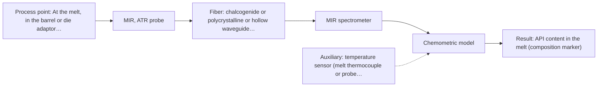
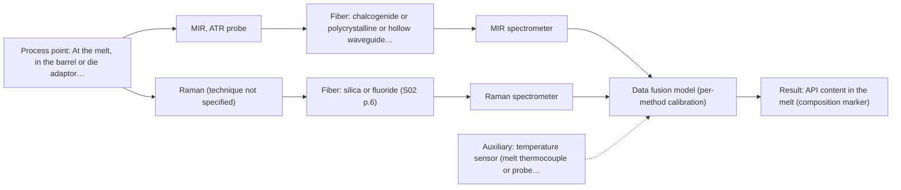

# First technical assessment: API concentration during hot polymer extrusion

## Answer

**Customer request (our summary):** Customer is developing a hot polymer extrusion process containing an active pharmaceutical ingredient and wants to investigate whether an optical measurement can detect composition changes in the melt. They have offline assays, note the process interface is hot and may suffer material build up, and request an initial comparison plan plus questions before choosing a probe.

### Brief answer

Start with laboratory trials on representative melt samples, testing mid-infrared ATR first, then NIR reflection, and later a combined MIR-ATR plus Raman probe. MIR-ATR is the single method to test first. Still open: the API and its concentration range, whether the melt is clear or scattering, the melt temperature at the probe, and how build-up will be handled.

### Proposal

- **Best current option:** O2 (recommended)
- **Basis:** supplied AFS sources
- **What would change it:** If the melt turns out clear and low-viscosity, or if the API sits at trace level with no distinct MIR band, NIR transmission or another method would move ahead of MIR-ATR. If the single-method tests cannot separate composition changes, the combined MIR-ATR plus Raman option becomes the next test.
- **Next step:** Run the laboratory comparison on representative melt samples, starting with MIR-ATR and using the existing offline assays as reference values.

**Secondary evidence (external, not AFS material):** G1: no usable external source found; G2: E02 ¶33, E02 ¶36; G3: no usable external source found; G4: E04 ¶690. See Expert detail.

**Decision status:** Provisional feasibility assessment

### Solution options

| ID | Tier | Methods | Confidence | Cost class, S01 Table 1 (p.6) | Ease of use | Maintenance | Performance fit | Sources |
|---|---|---|---|---|---|---|---|---|
| O1 | Simple | M2 NIR, diffuse reflection probe | Low: open question: Q1 (starts at Medium); sample clarity unknown; uncited auxiliary sensor and a parameter is not measurable in-line | average cost (row 8) | Robust fiber probe, no crystal contact | Window cleaning, scatter checks, recalibration | Lowest effort; fits if the melt is scattering | [1: S01 p.10] [2: S01 p.18] [3: S02 p.14] [4: S01 p.16] |
| O2 | Recommended | M1 MIR, ATR probe | Low: open question: Q1 (starts at Medium); uncited auxiliary sensor and a parameter is not measurable in-line | high cost (row 2) | Standard contact ATR probe in the line | Crystal cleaning and fouling checks | Sharp MIR bands; precedent for API in hot polymer | [5: S02 p.14] [6: S01 p.9] [7: REF §5] [8: S01 p.10] [9: REF §3] |
| O3 | Extended (multi-method) | M1 MIR, ATR probe; M3 MIR, ATR probe + Raman (combination) | Low: open question: Q1 (starts at Medium); uncited auxiliary sensor and a parameter is not measurable in-line; multi-method, fusion benefit not yet shown | at least high cost (row 2); Raman row not identified | Two instruments and time alignment overhead | Two calibrations, crystal and Raman probe care | Adds Raman information when MIR alone is not enough | [10: S01 p.7] [11: S02 p.16] [12: S01 p.8] [13: S01 p.9] [5: S02 p.14] [6: S01 p.9] [8: S01 p.10] [9: REF §3] |

*Confidence rates the basis of the advice (how much is known and cited), not a predicted accuracy or probability of success. It starts at High, or at Medium when a key question on the method or the option is open, and drops one level per weakness listed (floor Low).*

*Cost class is the relative rating in S01 Table 1 (p.6) for the in-line method+technique rows named (the highest one for a multi-method option); it is not a price.*

### Setup sketch

*Recommended option O2; drawn by code from the option, a schematic, not a configuration.*

### Key questions

1. Which substance is the active pharmaceutical ingredient (or which composition marker should be followed), and over what concentration range does it vary in the melt?
2. Is the melt optically clear or semi-transparent, or is it opaque and strongly scattering (for example filled, pigmented or highly viscous)?
3. What are the melt temperature and pressure at the measurement point, and how far is the spectrometer from that point?

## Expert detail

**Customer enquiry**

> We are developing a hot polymer extrusion process that incorporates an active pharmaceutical ingredient. We want to investigate whether an optical measurement can detect composition changes while the melt is being processed. We have offline assays, but the process interface is hot and may be exposed to material build up. We need an initial comparison plan and the questions required before choosing a probe.

**Decision status:** Provisional feasibility assessment. A method shortlist can be justified: MIR-ATR suits liquids and soft solids and is shown for API in hot polymer extrusion, while Raman is complementary to MIR and passes the method fit check. The choice still rests on unverified assumptions about the API, the melt's optical regime and how the hot, build-up-prone interface will be handled.

### Parameters

| ID | Parameter | Kind | Need | Measured by | Why | Sources |
|---|---|---|---|---|---|---|
| P1 | API content in the melt (composition marker) | quantitative | required | Spectroscopy: MIR | This is the composition change the customer wants to follow while the melt is being processed. | [5: S02 p.14] |
| P2 | Melt temperature at the measurement point | quantitative | required | Auxiliary sensor: temperature sensor (melt thermocouple or probe sensor) (engineering judgement: confirm availability with AFS) | The interface is hot and temperature shifts band positions and baseline, so spectra must be interpreted at a known temperature and the probe rated for it. | *(no verified source: engineering judgement)* |
| P3 | Base polymer, filler and additive composition of the matrix | qualitative | required | Not measurable in-line by spectroscopy; alternative: Formulation records and offline matrix analysis | It shows whether the API bands are free of overlap and which spectral range and method can carry the measurement. | *(no verified source: engineering judgement)* |

### Solution option details

- **O1 cost drivers:** one NIR spectrometer, reflection probe, fiber link, calibration effort
- **O2 cost drivers:** one MIR spectrometer, ATR probe, mid-IR fiber, calibration effort
- **O3 cost drivers:** two spectrometers, combined ATR/Raman probe, synchronisation and fusion software
- **O3 combining methods:** Fusion level: one model per method first, then joined or block-scaled variables, compared against the best single method. Both methods must look at the same melt volume at a common time step, ideally with a combined ATR plus Raman probe head, and each block keeps its own calibration and diagnostics. The fused model must beat the best single-method model on held-out runs, otherwise the second instrument is dropped.

*Extended (multi-method) option O3; drawn by code from the option, a schematic, not a configuration.*

### Premise check

- **Precedent only:** The plan can rest on an optical measurement detecting composition changes in the melt while it is being processed. The sources show API spectra in hot polymer with a diamond cone ATR probe coupled to an FTIR spectrometer, and NIR-Reflex plus MIR-ATR used to control polymer extrusion in-line. That is a reason to test the methods here, not proof that they will work for this process. [5: S02 p.14] [3: S02 p.14]
- **Not covered:** The hot interface and possible material build-up are manageable for an in-line optical probe. No supplied source gives probe, crystal or fiber temperature ratings, or cleaning and anti-fouling practice for a hot polymer melt. Contact, fouling and compatibility are named only as general limitations of the ATR route. [14: REF §5]

### Requirements

**Stated by the customer**

- "hot polymer extrusion process"
- "active pharmaceutical ingredient"
- "detect composition changes while the melt is being processed"
- "We have offline assays"
- "the process interface is hot"
- "may be exposed to material build up"

**Key unknowns**

- API identity, marker band and expected concentration range in the melt
- Optical regime of the melt: clear, strongly scattering or opaque (filled or pigmented)
- Melt temperature and pressure at the intended measurement point, and any probe temperature limit
- Type and rate of material build-up and how the probe or window is cleaned
- Required accuracy, repeatability and response time, and the go/no-go criteria
- Distance from the spectrometer to the measurement point

### Clarification questions (most decision-relevant first)

Q1. Which substance is the active pharmaceutical ingredient (or which composition marker should be followed), and over what concentration range does it vary in the melt? *Why it matters:* It decides whether a distinct mid-IR or Raman band exists and whether the level is above the method's practical sensitivity. *(affects: method)*
Q2. Is the melt optically clear or semi-transparent, or is it opaque and strongly scattering (for example filled, pigmented or highly viscous)? *Why it matters:* It decides the geometry: transmission or transflection needs a defined path through a clear liquid, while scattering melts need diffuse reflection or a contact ATR probe. *(affects: technique)*
Q3. What are the melt temperature and pressure at the measurement point, and how far is the spectrometer from that point? *Why it matters:* It sets the probe, crystal and fiber choice and whether a remote fiber link is even possible; no source states a temperature rating or a mid-IR link length. *(affects: installation)*
Q4. How much material build-up is expected at the probe, and how is the line cleaned or the probe removed and re-conditioned? *Why it matters:* A contact ATR crystal sees only a thin surface layer, so deposits can drift the signal and change the maintenance interval. *(affects: installation)*
Q5. What do the offline assays measure, and with what uncertainty and turnaround time are they reported? *Why it matters:* Reference values of known quality are needed to judge the comparison and to set the go/no-go basis. *(affects: status)*

### Recommendation

- **M1 · Primary candidate: MIR, ATR probe.** MIR gives sharp fingerprint bands and is highly informative, and MIR-ATR is shown for API in hot polymer with a diamond cone ATR probe coupled to an FTIR spectrometer. It is the single method to test first. *Conditions:* Applies if the melt can make tight contact with an ATR crystal and the crystal can be kept clean enough between measurements; probe temperature limits are not stated in the sources. [5: S02 p.14] [6: S01 p.9] [8: S01 p.10] [9: REF §3]
- **M2 · Conditional candidate: NIR, diffuse reflection probe.** NIR is the most common in-line fiber-probe method and appears beside MIR-ATR in the polymer-extrusion example. Its bands are broad and overlapping, and it may miss trace levels, so it is a cheaper comparison rather than the first choice. *Conditions:* Applies only if the melt is opaque or strongly scattering rather than a clear liquid, which question Q2 must settle. [1: S01 p.10] [3: S02 p.14] [2: S01 p.18] [4: S01 p.16]
- **M3 · Conditional candidate: MIR, ATR probe + Raman (combination).** MIR and Raman are separate vibrational methods, and combining two or more spectral methods may be needed for complex samples; a combined ATR plus Raman fiber probe has been demonstrated. Any gain from fusing them is a hypothesis to test against the best single method, after the single-method tests. *Conditions:* Only if the MIR-ATR model alone cannot separate the composition changes, and only with a probe head that looks at the same melt volume with both methods. [10: S01 p.7] [11: S02 p.16] Later hypothesis, after single-method tests.

### Measurement concept

- **Probe and geometry:** Contact ATR probe (crystal tip) for the mid-IR route, flush-mounted in the extruder barrel or die adaptor; diffuse-reflection probe as the NIR alternative if the melt is scattering. A combined ATR plus Raman probe head only for the extended option, so that both methods see the same small volume.
- **Location:** At the melt, in the barrel or die adaptor; spectrometers remote from the hot, vibrating line.
- **Fiber link:** Fiber family follows the method: silica fibers for NIR and for the Raman/fluorescence side, mid-IR fibers (chalcogenide or polycrystalline) for the MIR route. Achievable mid-IR link length is not stated in the sources and must be confirmed. [8: S01 p.10] [15: S01 p.15]

### Spectral range

- **MIR:** Nominal MIR range 4000-400 cm-1 (about 2.5-25 µm). [6: S01 p.9]
- **NIR:** Nominal NIR range 780-2500 nm. [16: S01 p.10]
- **Raman:** Raman is reported as a Raman shift in cm-1; the laser excitation wavelength is stated separately (a 785 nm excitation is used in the pharma example). [17: S01 p.11] [18: S01 p.15]
- **MIR:** The usable range depends on the instrument, fiber and probe actually selected; the nominal method range is not the range of a specific configuration. [19: REF §3]

### Risks and uncertainty

- Build-up of polymer or API on the ATR crystal or window can drift the signal and look like a composition change; contact, fouling and compatibility are named limits of the ATR route. *(rules: R-MIR-3)* [14: REF §5]
- The melt temperature may exceed what the probe, crystal or fiber can tolerate; no supplied source states a temperature rating, so this must come from the supplier and the process data. *(no verified source: engineering judgement)*
- If the API is present only at low level or its bands overlap the polymer bands, neither MIR-ATR alone nor NIR reflection may separate composition changes. *(rules: R-CAL-1, R-NIR-4)* [4: S01 p.16]
- In the combined MIR plus Raman option, fluorescence from the polymer or the API can swamp the weak Raman signal, and the two methods sample different depths in a heterogeneous melt. *(rules: R-RAM-1, R-CMB-2)* [20: S01 p.11] [21: S01 p.8]

### First feasibility experiment

1. **Collect representative melt samples or process states across the expected composition range, temperature and any filler or pigment variation, taken at the intended measurement point.** Representative samples or process states. [22: S01 p.3]
2. **Measure every sample with each candidate method in the same order (MIR-ATR first, then NIR diffuse reflection), keeping the probe at the same location and at process temperature, and store the raw spectra.** Compare methods under comparable conditions. *(no verified source: engineering judgement)*
3. **Have the existing offline assays run on the same samples and runs, to give independent reference values for the API content.** Independent reference measurements. *(no verified source: engineering judgement)*
4. **Build one calibration or classification model per method and validate it on held-out runs or batches, never on repeated scans of the same sample or position.** Validation on held-out runs or batches. [23: S03 p.13]
5. **Set the go/no-go with the customer's own numbers for accuracy, repeatability and response time; if a combined MIR plus Raman model does not beat the best single-method model on held-out runs, drop the second method.** A go/no-go basis whose numerical criteria come from the customer. [24: REF §3]

**Reference measurements:** The existing offline assays, run on the same samples and runs, are the independent reference for the API content. Their uncertainty and turnaround time are unknown and are asked in Q5.

**Decision basis:** Numbers for accuracy, repeatability and response time come from the customer; the fused model must beat the best single method on held-out runs, otherwise the second method is dropped.

### Assumptions

- The melt is pumpable through the measurement zone and can make contact with an ATR crystal or a reflection window.
- The API is the composition marker of interest and is present over a range the customer can state.
- The offline assays can be run on the same samples that are measured optically.

### Not covered by the supplied sources

- No supplied source states probe, crystal or fiber temperature ratings, so a maximum melt temperature for the probe cannot be given.
- No supplied source describes cleaning or anti-fouling measures for a hot polymer melt interface.
- No supplied source gives accuracy or detection limits for an API in a polymer melt.
- No supplied source states an achievable mid-IR fiber link length.

### Further notes

- **Chemometrics:** Both NIR and MIR spectra of this matrix need a calibration model for the API content. Reference values should be split by run or batch, not by repeated scans of one sample, and a matrix change means re-validating the model.
- **Real-time tracking:** The goal is continuous in-line tracking of composition during extrusion. If a second method is added later, the two data streams must be aligned to a common time step before any joint model is built.
- **Future direction:** If one method works on representative samples, a compact sensor built around the few wavelengths that carry the information could be a later step, following the supplier's staged path from laboratory trials to a customized sensor.

### Secondary evidence (external, not AFS material)

*Found by a literature search for gaps the supplied AFS sources leave open. Not AFS material and not proof for this case; every quote below was verified verbatim against the fetched text.*

**G1 · auxiliary sensor:** In-line measurement of Melt temperature at the measurement point with temperature sensor (melt thermocouple or probe sensor)

- No usable external source found.

**G2 · multi-method:** Combining several spectroscopy methods (data fusion) (Fusion level: one model per method first, then joined or block-scaled variables, compared against the best single method. Both methods must look at the same melt volume at a common time step, ideally with a combined ATR plus Raman probe head, and each block keeps its own calibration and diagnostics. The fused model must beat the best single-method model on held-out runs, otherwise the second instrument is dropped.)

- **E02 ¶33** High-level data fusion first fits supervised models to each data matrix. *How it applies:* This supports starting with one model per method before any joined or block-scaled variables, as the gap proposes. *Limits and transfer risks:* The review is general and not specific to hot polymer melt, API, ATR or Raman, so the sequence may need local validation. *(supports O3)*
  > "The high-level data fusion (HLDF) (also called "decision-level" fusion) works on a decision level. This means that the first step is to fit some supervised models to each data matrix."
  > Challenges and Opportunities of Implementing Data Fusion in Process Analytical Technology-A Review. (2022) · Molecules (Basel, Switzerland) · doi:10.3390/molecules27154846 · https://europepmc.org/article/PMC/PMC9369811 · retrieved 2026-10-17, full text, licence: cc by, via curated library
- **E02 ¶36** Instrument complementarity alone was not sufficient to improve prediction of several CQAs in a Raman and FT-IR food study. *How it applies:* This cautions that a fused ATR plus Raman model must be compared against the best single method on held-out runs, and dropped if it does not improve. *Limits and transfer risks:* The cited study is food analytical, not a hot polymer/API melt, and uses Raman and FT-IR rather than necessarily the same probe configuration. *(supports O3)*
  > "In some situations, instrument complementarity (not data complementarity) was not sufficient to improve the performance of predictive several CQAs, as shown by a Raman and FT-IR data based food analytical study [73]."
  > Challenges and Opportunities of Implementing Data Fusion in Process Analytical Technology-A Review. (2022) · Molecules (Basel, Switzerland) · doi:10.3390/molecules27154846 · https://europepmc.org/article/PMC/PMC9369811 · retrieved 2026-10-17, full text, licence: cc by, via curated library

**G3 · not in the supplied sources:** No supplied source states probe, crystal or fiber temperature ratings, so a maximum melt temperature for the probe cannot be given.

- No usable external source found.

**G4 · not in the supplied sources:** No supplied source describes cleaning or anti-fouling measures for a hot polymer melt interface.

- **E04 ¶690** Epoxy resins adhered firmly to a zinc-selenide ATR crystal, and removing them damaged the fragile crystal even with great care. *How it applies:* This suggests testing how the hot polymer/API melt interacts with the ATR crystal and whether cleaning or anti-fouling can remove build-up without damaging the crystal. *Limits and transfer risks:* The work used epoxy resins on ZnSe in a laboratory ATR study, not a hot polymer melt with API, so adhesion and damage may differ.
  > "The first of these inaccuracies arose from the fact that most of the ATR work was carried out using epoxy resins on a zinc-selenide crystal. These resins firmly adhere to their substrate, and thus, even exercising the greatest of care, when removed, damage was sustained to the rather fragile crystal."
  > Infrared and Raman studies of thin polymer films (1994) · Durham e-Theses (Durham University) · http://etheses.dur.ac.uk/5142/1/5142_2595.PDF · retrieved 2026-10-17, full text, licence: unknown, via openalex

### Evidence (verified quotes)

1. ✓ **S01 p.10** (general): "Near-IR vibrational spectroscopy (NIR) is the most common online analysis method performed using fiber optic probes."
2. ✓ **S01 p.18** (general): "reflection can work well in highly scattering environments but can be less representative for clear liquids."
3. ✓ **S02 p.14** (application precedent): "NIR-Reflex & MIR-ATR-spectroscopy to control polymer extrusion in-line"
4. ✓ (precedent only) **S01 p.16** (performance figure): "may lack the sensitivity to detect trace compounds below 0.1 percent."
5. ✓ **S02 p.14** (application precedent): "Spectra of API in hot polymer obtained with Diamond cone ATR probe coupled to iC10 FTIR (MTAC)"
6. ✓ **S01 p.9** (general): "Vibrational spectroscopy in the mid-IR range (4000-400 cm-1) is one of the most informative methods of chemical analysis."
7. ✓ **REF §5** (general): "Liquids, pastes and soft solids in contact with the ATR crystal."
8. ✓ **S01 p.10** (general): "ATR fiber probes (Fig.1) enable the analysis of liquids and solid elastic samples"
9. ✓ **REF §3** (general): "a published application is a reason to test a method, not proof that it will work for a new customer."
10. ✓ (precedent only) **S01 p.7** (method gain): "The analysis of such systems may require a combination of two or even more spectral methods."
11. ✓ **S02 p.16** (application precedent): "Combi probe with 2 IR-fibers coupled to FTIR-spectrometer and 2 Silica fibers coupled to Fluo or Raman spectrometers"
12. ✓ **S01 p.8** (general): "Ultimately, the measurement data must be normalized to a common time step."
13. ✓ **S01 p.9** (general): "One of the challenges of multispectral analysis is the need to simultaneously connect at least two independently operating measuring instruments."
14. ✓ **REF §5** (general): "Usable range limited by fiber and crystal; contact, fouling, compatibility."
15. ✓ **S01 p.15** (general): "located safely away from the vibration and dust of the manufacturing floor."
16. ✓ **S01 p.10** (general): "NIR spectra (780-2500 nm) contain predominantly overtones and component bands of fundamental vibrations"
17. ✓ **S01 p.11** (general): "The Raman shift is used as the horizontal (spectral) axis in Raman spectroscopy"
18. ✓ **S01 p.15** (general): "Raman spectrometer and Raman fiber probe for contact measurements with 785 nm excitation wavelength"
19. ✓ **REF §3** (general): "A nominal method range is not the range of a specific instrument, fiber or probe."
20. ✓ **S01 p.11** (general): "superposition of luminescence (fluorescence), which has a significantly higher intensity."
21. ✓ **S01 p.8** (general): "It is crucial that the spectral information obtained by different methods-Mid-IR, NIR, Raman, and fluorescence spectra-is collected from the same small, even pinpoint, area of the sample."
22. ✓ **S01 p.3** (general): "samples of incompletely known composition, in order to select the most suitable method or combination of methods."
23. ✓ **S03 p.13** (general): "Repeated measurements in the same sample position produced similar spectra or sensor data; therefore, these should always be simultaneously excluded for every CV iteration."
24. ✓ **REF §3** (general): "Representative samples or process states, independent reference measurements, what is compared, and the basis for the go / no-go decision."

### Verification

- Citations verified: 37 of 37 (exact or whitespace/hyphen-tolerant match on the cited page, scope checked).
- Hard check failures before deterministic corrections: 0; still open: 0; soft warnings: 5; repair rounds: 1.
- External evidence (live): 3 quote(s) verified verbatim (exact or whitespace/hyphen-tolerant, at most 400 characters and 2 sentences, against the cited paragraph); 0 item(s) dropped.
- External search: 6 query(ies), 45 hit(s), 5 source(s) (3 from the curated library).
- External step: 2 model call(s), 45.6 s extra (cost in the run JSON).

*Run D07-20261017T225757Z · models deepseek/deepseek-v4.1-flash*
