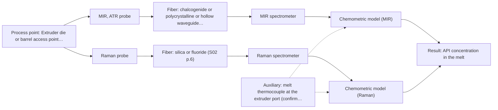
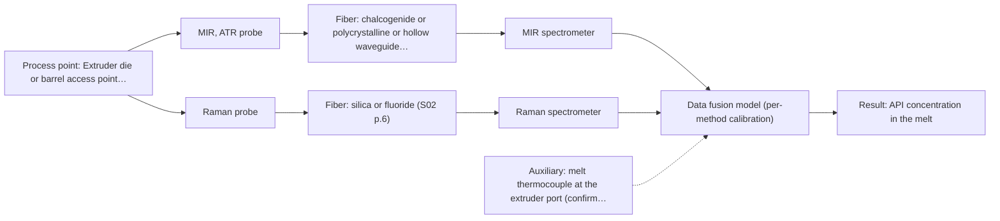

# First technical assessment: API concentration during hot polymer extrusion

## Answer

**Customer request (our summary):** The customer wants to investigate whether optical measurement can monitor composition changes in a hot polymer melt extrusion process containing an active pharmaceutical ingredient, and requests an initial comparison plan.

### Brief answer

Test MIR-ATR first: it is the method with a direct in-line polymer extrusion precedent, with Raman as the comparison method on the same melt samples. NIR reflection is conditional on the melt being opaque; NIR transmission and fluorescence are not recommended for now. Open points: polymer/API identity and concentration range, melt temperature and pressure, melt opacity, required response time, and probe access and fouling behaviour at the hot interface.

### Proposal

- **Best current option:** O2 (recommended)
- **Basis:** supplied AFS sources
- **What would change it:** If the melt temperature exceeds the probe and fiber limits, or the melt is transparent with strong NIR API bands, the balance shifts toward NIR reflection or a window-based Raman setup. If a single method already meets the customer's error criteria, the fused option is unnecessary.
- **Next step:** Run the multi-method lab trial on representative melt samples with MIR-ATR and Raman probes against the offline assay, after confirming melt temperature and access geometry.

**Secondary evidence (external, not AFS material):** G1: no usable external source found; G2: no usable external source found; G3: no usable external source found; G4: no usable external source found. See Expert detail.

**Decision status:** Provisional feasibility assessment

### Solution options

| ID | Tier | Methods | Confidence | Cost class, S01 Table 1 (p.6) | Ease of use | Maintenance | Performance fit | Sources |
|---|---|---|---|---|---|---|---|---|
| O1 | Simple | M1 MIR, ATR probe | Low: open question: Q1 (starts at Medium); uncited auxiliary sensor | high cost (row 2) | Single probe, straightforward lab trial | Crystal cleaning; fouling watch needed | Direct precedent for polymer extrusion control | [1: S02 p.14] [2: S01 p.10] [3: S01 p.5] |
| O2 | Recommended | M1 MIR, ATR probe; M2 Raman probe | Low: open question: Q1 (starts at Medium); uncited auxiliary sensor and a parameter is not measurable in-line | high cost (rows 2, 12) | Two probes, moderate trial effort | Two instruments, separate calibrations | Covers complementary API bands and window-based access | [1: S02 p.14] [2: S01 p.10] [3: S01 p.5] [4: S01 p.16] [5: S01 p.11] |
| O3 | Extended (multi-method) | M4 MIR, ATR probe + Raman (combination) | Low: open question: Q1 (starts at Medium); uncited auxiliary sensor and a parameter is not measurable in-line; multi-method, fusion benefit not yet shown | high cost (rows 2, 12) | Most complex; combined or paired probes | Two calibrations; fused model breaks if any block drifts | Only if fusion beats the best single method | [6: S01 p.8] [7: S01 p.8] [8: S01 p.11] [9: S01 p.7] |

*Confidence rates the basis of the advice (how much is known and cited), not a predicted accuracy or probability of success. It starts at High, or at Medium when a key question on the method or the option is open, and drops one level per weakness listed (floor Low).*

*Cost class is the relative rating in S01 Table 1 (p.6) for the in-line method+technique rows named (the highest one for a multi-method option); it is not a price.*

### Setup sketch

*Recommended option O2; drawn by code from the option, a schematic, not a configuration.*

### Key questions

1. Which polymer and which API are used, and over what concentration range must composition changes be detected?
2. What is the melt temperature and pressure at the proposed measurement point?
3. Is the melt optically transparent or opaque/scattering at process conditions?

## Expert detail

**Customer enquiry**

> We are developing a hot polymer extrusion process that incorporates an active pharmaceutical ingredient. We want to investigate whether an optical measurement can detect composition changes while the melt is being processed. We have offline assays, but the process interface is hot and may be exposed to material build up. We need an initial comparison plan and the questions required before choosing a probe.

**Decision status:** Provisional feasibility assessment. A shortlist of methods worth testing can be justified from the supplied material, but the polymer/API identity, melt temperature and melt opacity are unknown, so the choice stays provisional and conditional on the lab trial.

### Parameters

| ID | Parameter | Kind | Need | Measured by | Why | Sources |
|---|---|---|---|---|---|---|
| P1 | API concentration in the melt | quantitative | required | Spectroscopy: MIR | It is the target variable that the optical in-line method must detect during extrusion. | *(no verified source: engineering judgement)* |
| P2 | Polymer and API chemical identity | qualitative | required | Reference lab method: customer formulation specification | It determines active vibrational bands and whether matrix fluorescence will interfere. | *(no verified source: engineering judgement)* |
| P3 | Melt temperature at the measurement point | quantitative | required | Auxiliary sensor: melt thermocouple at the extruder port (engineering judgement: confirm availability with AFS) | It decides whether the probe, crystal and fiber can survive in-line service. | *(no verified source: engineering judgement)* |
| P4 | Melt optical regime (transparent vs opaque/scattering) | qualitative | required | Not measurable in-line by spectroscopy; alternative: offline laboratory optical characterisation of the melt | It decides between transmission, reflection and ATR interface geometries. | *(no verified source: engineering judgement)* |

### Solution option details

- **O1 cost drivers:** One MIR-ATR probe, FTIR spectrometer, lab trial time, reference assays
- **O2 cost drivers:** MIR-ATR and Raman probes, two spectrometers, extended lab trial, reference assays
- **O3 cost drivers:** Two spectrometers and probes, synchronisation software, fusion model development, validation runs
- **O3 combining methods:** Low-level fusion: MIR-ATR and Raman spectra of the same melt spot merged into one augmented matrix for a PLS model. Both probes must sample the same small area and the data must be normalised to a common time step. The fused model must beat the best single method on held-out runs, otherwise the extra instrument is dropped.

*Extended (multi-method) option O3; drawn by code from the option, a schematic, not a configuration.*

### Premise check

- **Precedent only:** In-line optical monitoring of an API in hot polymer extrusion is a realistic goal. A supplied process example shows NIR reflection and MIR-ATR spectroscopy used to control polymer extrusion in-line; this is a reason to test, not proof for this customer's process. [1: S02 p.14]
- **Not covered:** An ATR probe can be operated at the customer's hot-melt interface temperature. The sources show ATR probes used in hot environments (e.g. sealed in PEEK and used in microwave furnaces) but state no temperature rating; the actual melt temperature must be checked with AFS. [10: S02 p.13]
- **Not covered:** Material build-up at the probe will not prevent a useful measurement. No supplied source addresses fouling or build-up on in-line probes in polymer melts; ATR samples only a surface layer a few microns deep, so deposits on the crystal are a real risk to manage. [11: S01 p.13]

### Requirements

**Stated by the customer**

- Detect composition changes of an API in a hot polymer melt during extrusion.
- In-line or at-line measurement during processing; offline assays exist as reference.
- Probe must cope with a hot interface and possible material build-up.
- An initial comparison plan and the questions needed before choosing a probe.

**Key unknowns**

- Polymer and API identity, and the API concentration range of interest
- Melt temperature and pressure at the intended measurement point
- Optical regime of the melt (transparent vs opaque/scattering)
- Required measurement frequency and response time
- Available access point geometry (flange, sapphire window, bypass) and acceptable probe contact

### Clarification questions (most decision-relevant first)

Q1. Which polymer and which API are used, and over what concentration range must composition changes be detected? *Why it matters:* The spectral bands, detection limit and calibration strategy all depend on the chemistry and the target range. *(affects: method, technique)*
Q2. What is the melt temperature and pressure at the proposed measurement point? *Why it matters:* It decides whether an ATR or Raman probe can survive there and which fiber and window materials are eligible. *(affects: installation)*
Q3. Is the melt optically transparent or opaque/scattering at process conditions? *Why it matters:* Transmission-style geometries fail in opaque melts, while reflection or ATR geometries need them; this decides the technique. *(affects: technique, M3)*
Q4. How fast must composition changes be detected (response time and measurement frequency)? *Why it matters:* Acquisition speed differs strongly between FTIR-based MIR, diode-array NIR and Raman, and shapes the instrument choice. *(affects: method)*
Q5. What access is possible on the extruder (die, barrel port, bypass loop) and is probe contact with the melt acceptable? *Why it matters:* ATR needs tight contact with the melt, while Raman can work through a window, so the access point constrains the technique. *(affects: installation, M1)*

### Recommendation

- **M1 · Primary candidate: MIR, ATR probe.** MIR-ATR fiber probes are shown in a supplied process example controlling polymer extrusion in-line, and ATR suits liquids and soft solids in tight contact. MIR spectra have well-defined bands, giving good selectivity for an API in a polymer matrix. *Conditions:* The melt temperature must be within the probe and fiber limits, and build-up on the crystal must be managed. [1: S02 p.14] [2: S01 p.10] [3: S01 p.5]
- **M2 · Comparison candidate: Raman probe.** Raman probes are listed for liquids and solids and Raman tolerates water and can probe through a window, making it a strong second candidate to compare against MIR-ATR on the same melt. Its weak signal and possible fluorescence background must be checked on real samples. [4: S01 p.16] [5: S01 p.11]
- **M3 · Conditional candidate: NIR, diffuse reflection probe.** NIR diffuse reflection suits opaque or highly concentrated streams and NIR penetrates millimetres, but its fit depends on the melt's optical regime, which is unknown. It becomes relevant only if the melt proves opaque and the API bands in NIR are strong enough. *Conditions:* Applies if the melt is opaque or highly scattering and the trial shows sufficient API contrast in the NIR bands. [12: S01 p.17] [13: S01 p.5]
- **M4 · Comparison candidate: MIR, ATR probe + Raman (combination).** If neither single method separates the API signal from the polymer matrix well enough, a combined MIR-ATR and Raman measurement is the next hypothesis; mid-IR and Raman spectra are complementary. The gain must be proven against the best single method. *Conditions:* Only after the single-method tests M1 and M2, and only if a fused model beats both. [8: S01 p.11] [9: S01 p.7]
- **M5 · Not recommended: NIR, transmission/transflection probe.** Transmission fails when the sample is too thick or opaque because light cannot penetrate it, which is the likely regime of a hot polymer melt. It would only apply to a transparent, thin melt section, which the customer has not described. [14: S01 p.18]
- **M6 · Not recommended: fluorescence probe.** Fluorescence only measures species that fluoresce, and most chemicals do not; no fluorescent species or indicator has been identified in this polymer/API system. It could only re-enter as an indicator if a suitable fluorophore is identified. [15: S01 p.5]

### Measurement concept

- **Probe and geometry:** Immersion ATR fiber probe (diamond or zirconium dioxide tip) in tight contact with the melt at a die or barrel port; Raman probe as a comparison, optionally through a window; NIR reflection probe only if the melt is opaque.
- **Location:** Extruder die or barrel access point downstream of the melting/mixing zone, close to where composition is representative.
- **Fiber link:** MIR-ATR requires CIR or PIR fibers because silica fibers do not cover the mid-IR range; Raman and NIR use silica fibers. Achievable MIR link length is an open question; long cables are only documented for silica. [16: S02 p.6] [17: S02 p.7]

### Spectral range

- **MIR:** Nominal mid-IR range is 4000-400 cm-1; the usable range depends on the instrument, fiber and probe actually selected. [18: S01 p.9]
- **Raman:** Raman shift in cm-1 with the laser excitation wavelength (e.g. 785 nm in the pharma example) stated separately; exact coverage depends on the spectrometer and probe. [19: S01 p.15]

### Risks and uncertainty

- Material build-up on the ATR crystal would bias or block the signal, since ATR samples only a surface layer a few microns deep. *(rules: R-MIR-3)* [11: S01 p.13]
- No supplied source states a temperature rating for MIR fibers, ATR probes or their seals, so the hot-melt compatibility is unverified. *(rules: R-FIB-2)* [20: S02 p.9]
- Raman signal may be swamped by fluorescence from the polymer or additives, which must be checked on real melt samples. *(rules: R-RAM-1)* [21: S01 p.11]
- Any calibration is specific to the polymer/API matrix and must be re-validated whenever the formulation changes. *(rules: R-CAL-1)* [22: REF §5]

### First feasibility experiment

1. **Collect representative melt samples across the expected API concentration range and polymer batch variation, at process temperature where possible.** Cover the chemical and physical variation the in-line method must handle. *(no verified source: engineering judgement)*
2. **Measure each sample with MIR-ATR and Raman fiber probes in the laboratory, and with an NIR reflection probe if the melt is opaque.** Compare the candidate single methods on identical material before any in-line installation. *(no verified source: engineering judgement)*
3. **Analyse all samples with the existing offline assay as the independent reference for API concentration.** Provide the ground truth for calibration and validation. *(no verified source: engineering judgement)*
4. **Build a first chemometric calibration per method and validate it on held-out samples or a separate extrusion run.** Quantify each method's prediction error on material it was not fitted to. *(no verified source: engineering judgement)*
5. **Define go/no-go with the customer: a maximum acceptable prediction error and detection threshold for composition changes, plus a fouling/temperature check of the probe at the real interface.** Give an objective basis for choosing the probe and deciding whether a fused MIR+Raman option is worth testing. *(no verified source: engineering judgement)*

**Reference measurements:** Offline assays supplied by the customer (API concentration per sample).

**Decision basis:** Customer-defined maximum prediction error for API concentration and minimum detectable composition change, validated on held-out runs.

### Assumptions

- The melt behaves as a liquid or soft solid at the measurement point, so ATR contact is physically possible.
- The offline assay measures the same API concentration the in-line method should track.
- A die or barrel port can be fitted with a probe or window without changing the process critically.

### Not covered by the supplied sources

- Temperature and pressure ratings of ATR and Raman probes for hot-melt extrusion service
- Achievable MIR fiber link length for an in-line extruder installation
- Fouling behaviour or cleaning strategy for probes in polymer melts

### Further notes

- **Chemometrics:** Each method needs its own calibration against the offline assay first; a fused MIR+Raman model is only built afterwards and must be validated on held-out extrusion runs, with block scaling so one spectral block does not dominate.
- **Real-time tracking:** The goal is in-line tracking of composition changes during extrusion; acquisition rate must match the residence-time scale of the process, which is why the required response time (Q4) matters before instrument selection.
- **Future direction:** If the trial succeeds, a customised spectral fiber sensor or multisensor system focused on the chosen wavelengths could be developed for permanent in-line process control.

### Secondary evidence (external, not AFS material)

*Found by a literature search for gaps the supplied AFS sources leave open. Not AFS material and not proof for this case; every quote below was verified verbatim against the fetched text.*

**G1 · auxiliary sensor:** In-line measurement of Melt temperature at the measurement point with melt thermocouple at the extruder port

- No usable external source found.

**G2 · multi-method:** Combining several spectroscopy methods (data fusion) (Low-level fusion: MIR-ATR and Raman spectra of the same melt spot merged into one augmented matrix for a PLS model. Both probes must sample the same small area and the data must be normalised to a common time step. The fused model must beat the best single method on held-out runs, otherwise the extra instrument is dropped.)

- No usable external source found.

**G3 · not in the supplied sources:** Temperature and pressure ratings of ATR and Raman probes for hot-melt extrusion service

- No usable external source found.

**G4 · not in the supplied sources:** Achievable MIR fiber link length for an in-line extruder installation

- No usable external source found.

### Evidence (verified quotes)

1. ✓ **S02 p.14** (application precedent): "NIR-Reflex & MIR-ATR-spectroscopy to control polymer extrusion in-line"
2. ✓ **S01 p.10** (general): "ATR fiber probes (Fig.1) enable the analysis of liquids and solid elastic samples"
3. ✓ **S01 p.5** (general): "Mid-IR band spectra contain well-defined peaks (absorption bands)"
4. ✓ **S01 p.16** (general): "Raman is particularly well-suited for aqueous environments, as it exhibits low absorbance for water molecules compared to infrared methods."
5. ✓ **S01 p.11** (general): "superposition of luminescence (fluorescence), which has a significantly higher intensity."
6. ✓ **S01 p.8** (general): "collected from the same small, even pinpoint, area of the sample."
7. ✓ **S01 p.8** (general): "Ultimately, the measurement data must be normalized to a common time step."
8. ✓ **S01 p.11** (general): "This property makes mid-IR and Raman spectra complementary, that is, they complement each other."
9. ✓ (precedent only) **S01 p.7** (method gain): "The analysis of such systems may require a combination of two or even more spectral methods."
10. ✓ **S02 p.13** (application precedent): "ATR-Probes with ATR-tips from ZrO2 (& Diamond, etc.) sealed in PEEK-shaft and protected by PEEK-tubing can be used in microwave furnaces"
11. ✓ **S01 p.13** (general): "typically at a depth of few microns"
12. ✓ **S01 p.17** (general): "NIR Reflection is primarily used for opaque or highly concentrated dairy products, such as yogurt, butter, or whole milk concentrates."
13. ✓ **S01 p.5** (general): "NIR spectroscopy, with its relatively large penetration depth (up to several millimetres) even into dense solid samples due to low absorption and strong scattering, allows the use of ordinary glass for optics"
14. ✓ **S01 p.18** (general): "it fails when the milk becomes too "thick" or fat-rich, as the light cannot penetrate the sample."
15. ✓ **S01 p.5** (general): "However, most chemicals do not exhibit this property."
16. ✓ **S02 p.6** (general): "1100 nm Chalcogenide As-S IR Fibers 6500 nm"
17. ✓ **S02 p.7** (general): "Robust 100-300m cables made with Silica fibers of low OH-content (<0.1ppm OH) enable remote industrial process-control"
18. ✓ **S01 p.9** (general): "Vibrational spectroscopy in the mid-IR range (4000-400 cm-1) is one of the most informative methods of chemical analysis."
19. ✓ **S01 p.15** (general): "Raman spectrometer and Raman fiber probe for contact measurements with 785 nm excitation wavelength"
20. ✓ **S02 p.9** (general): "HWG-750-2m PIR 600/700 -2m"
21. ✓ **S01 p.11** (general): "signals, which are several orders of magnitude weaker than IR absorption peaks"
22. ✓ **REF §5** (general): "Weak signal, fluorescence background; calibration specific to the matrix."

### Verification

- Citations verified: 25 of 25 (exact or whitespace/hyphen-tolerant match on the cited page, scope checked).
- Hard check failures before deterministic corrections: 0; still open: 0; soft warnings: 3; repair rounds: 1.
- External evidence (live): 0 quote(s) verified verbatim (exact or whitespace/hyphen-tolerant, at most 400 characters and 2 sentences, against the cited paragraph); 1 item(s) dropped.
- External search: 4 query(ies), 35 hit(s), 5 source(s) (3 from the curated library).
- External step: 2 model call(s), 9.1 s extra (cost in the run JSON).
  - ⚠ dropped G2 E05 ¶5: quote not verified (not_found)

*Run D07-20261018T094733Z-8dbe · models google/gemini-3.5-flash-lite, google/gemini-3.8-flash, z-ai/glm-5.3-flash*
