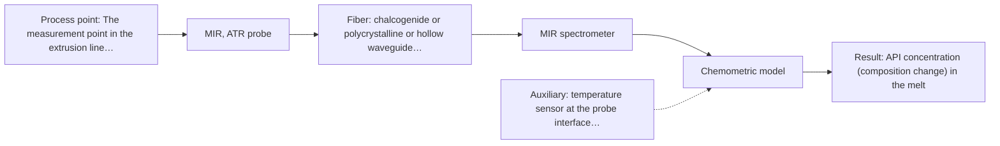
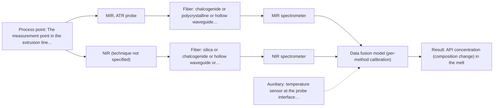

# First technical assessment: API concentration during hot polymer extrusion

## Answer

**Customer request (our summary):** Customer is developing a hot polymer extrusion process incorporating an active pharmaceutical ingredient and wants to investigate whether an optical measurement can detect composition changes while the melt is being processed. They have offline assays, but the process interface is hot and may be exposed to material build up. They request an initial comparison plan and the questions required before choosing a probe.

### Brief answer

Test mid-infrared ATR first on your hot melt: a comparable in-line polymer-extrusion case with an API is shown in our material. Compare it with NIR reflection on the same samples, and treat a combined MIR-ATR plus NIR measurement as a later hypothesis only. Before choosing a probe we need your target accuracy and response time, the melt's optical appearance and homogeneity, the real interface temperature and build-up behaviour, and details of your offline assays.

### Proposal

- **Best current option:** O2 (recommended): M1 MIR, ATR probe
- **Basis:** supplied AFS sources
- **What would change it:** If the melt proves optically clear and homogeneous, or if build-up makes a contact crystal unworkable, the first choice shifts towards a non-contact NIR reflection or transmission probe. A required detection limit that neither NIR nor MIR-ATR can reach would move the plan to the combined option.
- **Next step:** Answer the clarification questions above, then run the MIR-ATR trial on representative melt samples with the offline assay as reference.

**Decision status:** Provisional feasibility assessment. A method shortlist can be justified: MIR-ATR is the single method to test first, with NIR reflection as a conditional second candidate and a MIR-ATR plus NIR combination as a later hypothesis. The deciding facts (required accuracy and response time, the melt's optical regime, the real interface temperature and the build-up behaviour) are still open, so this is a provisional shortlist, not a probe selection.

### Solution options

| ID | Tier | Methods | Confidence | Cost class, S01 Table 1 (p.6) | Ease of use | Maintenance | Performance fit | Sources |
|---|---|---|---|---|---|---|---|---|
| O1 | Simple | M2 NIR, diffuse reflection probe | Low: sample clarity unknown; uncited auxiliary sensor | average cost (row 8) | Silica fibers, standard optics, familiar in-line setup | Reference checks and probe cleaning if build-up appears | Least effort to see whether any optical signal tracks composition | [1: S01 p.10] [2: S01 p.17] [3: S01 p.5] [4: S01 p.10] |
| O2 | Recommended | M1 MIR, ATR probe | Medium: uncited auxiliary sensor and a parameter is not measurable in-line | high cost (row 2) | Contact ATR probe on a defined port at the barrel | Crystal cleaning and reference checks; fouling-sensitive | Closest fit: shown API-in-polymer extrusion application and sharp bands | [5: S02 p.14] [6: S02 p.14] [7: S01 p.9] [8: S01 p.5] |
| O3 | Extended (multi-method) | M3 MIR, ATR probe + NIR (combination) | Low: sample clarity unknown; precedent only; uncited auxiliary sensor and a parameter is not measurable in-line; multi-method, fusion benefit not yet shown | high cost (row 2); not rated in S01 Table 1: NIR (technique not specified) | Two spectrometers and two probes, aligned at one port | Separate calibration and diagnostics for each instrument | Most information, but it must beat the best single method to be kept | [9: S01 p.8] [10: S01 p.8] [11: REF §5] [12: S01 p.7] |

*Confidence rates the basis of the advice (how much is known and cited), not a predicted accuracy or probability of success. It starts at High and drops one level per weakness listed.*

*Cost class is the relative rating in S01 Table 1 (p.6) for the in-line method+technique rows named (the highest one for a multi-method option); it is not a price.*

### Setup sketch

*Recommended option O2; drawn by code from the option, a schematic, not a configuration.*

*Extended (multi-method) option O3; drawn by code from the option, a schematic, not a configuration.*

### Key questions

1. Which composition changes must be detected, over what range, and with what required accuracy, detection limit and response time?
2. Where in the line would the measurement sit (barrel, die, melt pipe), and what are the actual melt temperature, pressure and available space at that point?
3. What is the melt's optical behaviour at the measurement point - clear, turbid or opaque - and is it homogeneous there?

## Expert detail

**Customer enquiry**

> We are developing a hot polymer extrusion process that incorporates an active pharmaceutical ingredient. We want to investigate whether an optical measurement can detect composition changes while the melt is being processed. We have offline assays, but the process interface is hot and may be exposed to material build up. We need an initial comparison plan and the questions required before choosing a probe.

### Parameters

| ID | Parameter | Kind | Need | Measured by | Why | Sources |
|---|---|---|---|---|---|---|
| P1 | API concentration (composition change) in the melt | quantitative | required | Spectroscopy: MIR | This is the target variable whose change in the melt must be detected. | [13: S02 p.14] |
| P2 | Melt temperature at the measurement point | quantitative | required | Auxiliary sensor: temperature sensor at the probe interface (engineering judgement: confirm availability with AFS) | The interface is hot, and temperature affects the melt state, the contact at the probe and the spectral response. | *(no verified source: engineering judgement)* |
| P3 | Base polymer and additive composition (matrix) | qualitative | required | Reference lab method: customer formulation records and existing offline assay | The matrix and additives set the spectral interferences and the range over which a calibration stays valid. | *(no verified source: engineering judgement)* |
| P4 | Build-up (fouling) at the probe interface | qualitative | required | Not measurable in-line by spectroscopy; alternative: scheduled inspection and cleaning log, plus a reference spectrum on a clean probe | Build-up on the crystal or window can change the signal and drives the cleaning interval and data validity. | [14: REF §5] |

### Solution option details

- **O1 cost drivers:** One NIR spectrometer, one reflection probe, calibration samples
- **O2 cost drivers:** One MIR spectrometer, ATR probe and MIR fiber link, calibration samples
- **O3 cost drivers:** Two spectrometers, two probes, synchronisation and fusion effort
- **O3 combining methods:** Fusion level: start with one calibration model per method as the baseline, then fuse the two spectral blocks after scaling, because variables from different methods are not equivalent. Both probes must look at the same small area of the melt, and the two data streams must be normalised to a common time step. Each instrument keeps its own calibration and diagnostics, and the fused model must beat the best single method on independent runs, otherwise the second instrument is dropped.

### Premise check

- **Precedent only:** An in-line fiber-probe optical measurement can detect composition changes in a hot polymer melt that contains an active pharmaceutical ingredient. A shown in-line application reports API spectra in hot polymer obtained with an ATR probe coupled to an FTIR spectrometer, and NIR reflection together with MIR-ATR was used to control polymer extrusion in-line; this is a reason to test the approach, not proof that it works for this process. [15: S02 p.14] [16: S02 p.14]
- **Not covered:** The existing offline assays can serve as the independent reference for the in-line comparison. No supplied source describes the customer's offline assays or their comparability with an in-line measurement, so this has to be confirmed by the customer. *(no verified source: engineering judgement)*

### Requirements

**Stated by the customer**

**Key unknowns**

- Required accuracy, detection limit and response time for the composition change.
- Optical regime of the melt (clear, turbid or opaque) and its homogeneity at the measurement point.
- Actual melt temperature and pressure and the available installation point and space.
- Base polymer, API and additives: spectral interferences and the range any calibration must cover.
- Build-up rate and material at the interface, and the cleaning method used there.
- Details of the offline assays: method, sampling point, uncertainty and time lag.

### Clarification questions (most decision-relevant first)

Q1. Which composition changes must be detected, over what range, and with what required accuracy, detection limit and response time? *Why it matters:* These values are the go/no-go criteria and decide whether NIR or MIR-ATR can meet the target. *(affects: method, technique)*
Q2. Where in the line would the measurement sit (barrel, die, melt pipe), and what are the actual melt temperature, pressure and available space at that point? *Why it matters:* They decide whether a contact ATR probe or a remote reflection probe is possible, and which fiber and window can be used. *(affects: technique, installation)*
Q3. What is the melt's optical behaviour at the measurement point - clear, turbid or opaque - and is it homogeneous there? *Why it matters:* It decides between NIR transmission or transflection, NIR reflection and MIR-ATR. *(affects: method, technique)*
Q4. What are the base polymer, the API and any additives, and how much build-up forms on hot surfaces and how is the interface cleaned? *Why it matters:* This sets the spectral interferences, the fouling risk and the cleaning compatibility of the probe. *(affects: technique, installation)*
Q5. What exactly are the offline assays - method, sampling point, uncertainty and time lag between sampling and result? *Why it matters:* They are the independent reference against which any in-line signal is compared and calibrated. *(affects: status, method)*

### Recommendation

- **M1 · Primary candidate: MIR, ATR probe.** MIR-ATR is the candidate with a directly comparable shown application: API spectra in hot polymer were obtained with an ATR probe coupled to an FTIR spectrometer, and NIR reflection together with MIR-ATR was used to control polymer extrusion in-line. MIR gives well-defined absorption bands, and ATR avoids the path-length problem that a thick, hot melt would create in transmission. *Conditions:* Applies if the melt makes tight contact with the ATR crystal and the interface temperature and cleaning regime suit the probe. [17: S02 p.14] [18: S02 p.14] [19: S01 p.9] [20: S01 p.5]
- **M2 · Conditional candidate: NIR, diffuse reflection probe.** NIR reflection is the most common in-line fiber-probe method and is used for opaque or highly concentrated products, and the same extrusion example shows an NIR reflection probe on the barrel. It is conditional because the melt's optical regime is not yet known and NIR bands overlap, so a matrix-specific calibration is required. *Conditions:* Applies if the melt is opaque or strongly scattering at the probe and the measured surface represents the bulk. [21: S01 p.10] [22: S01 p.17] [23: S01 p.5] [24: S01 p.10]
- **M3 · Comparison candidate: MIR, ATR probe.** Combining MIR-ATR with NIR reflection is a hypothesis that the two data blocks together describe the melt better than either alone, and the supplied extrusion example shows both techniques on the same process. Any gain must be shown against the best single method before a second instrument is kept. *Conditions:* Test only after both single-method trials, and only if the two probes can look at the same small area of the melt with synchronised acquisition. [25: S01 p.8] [26: S01 p.8] [27: REF §5] [28: S01 p.7] Later hypothesis, after single-method tests: combine with NIR.
- **M4 · Not recommended: fluorescence probe.** No fluorescent species or indicator has been identified in the polymer melt, and most chemicals do not fluoresce, so fluorescence would not measure the composition change directly. *Conditions:* Reconsider only if the API or an additive is shown to fluoresce under process conditions. [29: S01 p.5]

### Measurement concept

- **Probe and geometry:** Contact ATR probe at a barrel or die port for the first test, with an NIR reflection probe as the non-contact alternative; a combined ATR plus reflection probe only as a later step. Probe choice, window material and fiber link are fixed after Q2 to Q4.
- **Location:** The measurement point in the extrusion line is not yet stated by the customer; it must be a point where the melt composition is representative.
- **Fiber link:** The link length and fiber family depend on the method and on the chosen port; no source states an achievable mid-infrared link length. [30: S01 p.10] [31: S02 p.7]

### Spectral range

- **MIR:** Nominal method range 4000-400 cm-1; the usable range depends on the instrument, fiber, crystal and probe actually selected. [32: S01 p.9] [33: REF §5]
- **NIR:** Nominal method range 780-2500 nm; the usable range depends on the instrument, fiber and probe actually selected. [34: S01 p.10]

### Risks and uncertainty

- Build-up on the ATR crystal or probe window can drift the baseline and reduce signal, so the chosen interface may need frequent cleaning or a different window design. *(rules: R-MIR-3)* [35: REF §5]
- The real melt temperature and pressure at the intended port are unknown; if they exceed what the selected fiber and probe tolerate, the interface must change. *(no verified source: engineering judgement)*
- The offline assays may not be comparable to the in-line measurement point (different sampling, time lag, heterogeneity), which would weaken the calibration and the comparison. *(rules: R-CAL-1)* *(no verified source: engineering judgement)*
- The API's spectral contribution may be masked by the polymer matrix or by additives, or the required detection limit may be below what NIR or MIR-ATR can reach. *(rules: R-NIR-4)* [36: S01 p.16]

### First feasibility experiment

1. **Collect representative melt samples or process states that span the expected API range and the expected physical variation (polymer grade, temperature), and record the offline assay value for each as the independent reference.** Representative samples and an independent reference [37: REF §3]
2. **Measure these samples with the single method first, MIR-ATR at process temperature, and build a calibration against the offline assay.** Single method first: MIR-ATR [38: S02 p.14]
3. **Repeat with NIR reflection on the same samples and, where possible, the same spot, and compare its ability to track the composition change with MIR-ATR.** Second single method for comparison *(no verified source: engineering judgement)*
4. **Only after both single-method trials, test the combined MIR-ATR plus NIR measurement at the same spot with synchronised data, and compare the fused model against the better single method.** Combination as a later hypothesis [39: REF §5]
5. **Validate the chosen model on held-out runs or batches not used for calibration, and decide go/no-go against the customer's required accuracy, detection limit and response time.** Independent validation and go/no-go basis *(no verified source: engineering judgement)*

**Reference measurements:** The customer's existing offline assay, with a defined sampling point and uncertainty.

**Decision basis:** The numerical accuracy, detection limit and response time must come from the customer (Q1).

### Assumptions

- The melt reaches the probe interface and can be presented to it without changing the process.
- The offline assay values are traceable to the same material that passes the measurement point.
- Probe and fiber materials can be selected for the real interface temperature once Q2 is answered.

### Not covered by the supplied sources

- The temperature rating of any probe, fiber or window at a hot extrusion interface is not stated in the supplied material.
- No source states an achievable link length for a mid-infrared fiber; the mid-infrared fiber and waveguide examples given are short laboratory lengths.
- No source covers probe compatibility with a specific polymer or API under process conditions.

### Further notes

- **Chemometrics:** Any NIR or MIR calibration is specific to the matrix: build it on representative melt samples with the offline assay as reference, and re-validate it after a change of polymer grade, additive or API level.
- **Real-time tracking:** Both candidates can be run continuously in-line; the comparison should record time-resolved data so that real composition changes and drift caused by build-up can be separated.
- **Future direction:** Once the informative spectral regions are identified, a compact LED-based fiber sensor could later replace the full spectrometer for routine control.

### Evidence (verified quotes)

1. ✓ **S01 p.10** (general): "Near-IR vibrational spectroscopy (NIR) is the most common online analysis method performed using fiber optic probes."
2. ✓ **S01 p.17** (general): "NIR Reflection is primarily used for opaque or highly concentrated dairy products, such as yogurt, butter, or whole milk concentrates."
3. ✓ **S01 p.5** (general): "making it ideal for online applications, including remote measurements via fiber optic probes."
4. ✓ **S01 p.10** (general): "The broad absorption bands observed in this region overlap, suggesting the use of chemometrics for quantitative and qualitative analysis of spectral data."
5. ✓ **S02 p.14** (application precedent): "Spectra of API in hot polymer obtained with Diamond cone ATR probe coupled to iC10 FTIR (MTAC)"
6. ✓ **S02 p.14** (application precedent): "NIR-Reflex & MIR-ATR-spectroscopy to control polymer extrusion in-line"
7. ✓ **S01 p.9** (general): "Vibrational spectroscopy in the mid-IR range (4000-400 cm-1) is one of the most informative methods of chemical analysis."
8. ✓ **S01 p.5** (general): "strong absorption in the mid-IR region limits the corresponding spectral method to the analysis of very thin samples (usually less than 50 μm), but it opens up the possibility of using attenuated total reflectance (ATR)"
9. ✓ (precedent only) **S01 p.8** (method gain): "It is crucial that the spectral information obtained by different methods-Mid-IR, NIR, Raman, and fluorescence spectra-is collected from the same small, even pinpoint, area of the sample."
10. ✓ (precedent only) **S01 p.8** (method gain): "the data from each method must be obtained simultaneously."
11. ✓ (precedent only) **REF §5** (method gain): "Sampling location and timing must be aligned; a gain is a hypothesis to test."
12. ✓ (precedent only) **S01 p.7** (method gain): "The analysis of such systems may require a combination of two or even more spectral methods."
13. ✓ **S02 p.14** (application precedent): "Spectra of API in hot polymer obtained with Diamond cone ATR probe coupled to iC10 FTIR (MTAC)"
14. ✓ **REF §5** (general): "Usable range limited by fiber and crystal; contact, fouling, compatibility."
15. ✓ **S02 p.14** (application precedent): "Spectra of API in hot polymer obtained with Diamond cone ATR probe coupled to iC10 FTIR (MTAC)"
16. ✓ **S02 p.14** (application precedent): "NIR-Reflex & MIR-ATR-spectroscopy to control polymer extrusion in-line"
17. ✓ **S02 p.14** (application precedent): "Spectra of API in hot polymer obtained with Diamond cone ATR probe coupled to iC10 FTIR (MTAC)"
18. ✓ **S02 p.14** (application precedent): "NIR-Reflex & MIR-ATR-spectroscopy to control polymer extrusion in-line"
19. ✓ **S01 p.9** (general): "Vibrational spectroscopy in the mid-IR range (4000-400 cm-1) is one of the most informative methods of chemical analysis."
20. ✓ **S01 p.5** (general): "strong absorption in the mid-IR region limits the corresponding spectral method to the analysis of very thin samples (usually less than 50 μm), but it opens up the possibility of using attenuated total reflectance (ATR)"
21. ✓ **S01 p.10** (general): "Near-IR vibrational spectroscopy (NIR) is the most common online analysis method performed using fiber optic probes."
22. ✓ **S01 p.17** (general): "NIR Reflection is primarily used for opaque or highly concentrated dairy products, such as yogurt, butter, or whole milk concentrates."
23. ✓ **S01 p.5** (general): "making it ideal for online applications, including remote measurements via fiber optic probes."
24. ✓ **S01 p.10** (general): "The broad absorption bands observed in this region overlap, suggesting the use of chemometrics for quantitative and qualitative analysis of spectral data."
25. ✓ (precedent only) **S01 p.8** (method gain): "It is crucial that the spectral information obtained by different methods-Mid-IR, NIR, Raman, and fluorescence spectra-is collected from the same small, even pinpoint, area of the sample."
26. ✓ (precedent only) **S01 p.8** (method gain): "the data from each method must be obtained simultaneously."
27. ✓ (precedent only) **REF §5** (method gain): "Sampling location and timing must be aligned; a gain is a hypothesis to test."
28. ✓ (precedent only) **S01 p.7** (method gain): "The analysis of such systems may require a combination of two or even more spectral methods."
29. ✓ **S01 p.5** (general): "However, most chemicals do not exhibit this property."
30. ✓ **S01 p.10** (general): "These immersion probes operate on the ATR principle but allow analysis at a significant distance from the spectrometer, without the need for sampling."
31. ✓ **S02 p.7** (general): "Robust 100-300m cables made with Silica fibers of low OH-content (<0.1ppm OH) enable remote industrial process-control"
32. ✓ **S01 p.9** (general): "Vibrational spectroscopy in the mid-IR range (4000-400 cm-1) is one of the most informative methods of chemical analysis."
33. ✓ **REF §5** (general): "It is not a product specification: actual spectral coverage, fiber length, component ratings, detection limits and accuracy depend on the configuration and the sample."
34. ✓ **S01 p.10** (general): "NIR spectra (780-2500 nm) contain predominantly overtones and component bands of fundamental vibrations"
35. ✓ **REF §5** (general): "Usable range limited by fiber and crystal; contact, fouling, compatibility."
36. ✓ **S01 p.16** (general): "may lack the sensitivity to detect trace compounds below 0.1 percent."
37. ✓ **REF §3** (general): "Representative samples or process states, independent reference measurements, what is compared, and the basis for the go / no-go decision."
38. ✓ **S02 p.14** (application precedent): "Spectra of API in hot polymer obtained with Diamond cone ATR probe coupled to iC10 FTIR (MTAC)"
39. ✓ (precedent only) **REF §5** (method gain): "Sampling location and timing must be aligned; a gain is a hypothesis to test."

### Verification

- Citations verified: 27 of 27 (exact or whitespace/hyphen-tolerant match on the cited page, scope checked).
- Hard check failures before deterministic corrections: 0; still open: 0; soft warnings: 5; repair rounds: 1.
- Corrected deterministically after verification (1):
  - ⚠ recommendations[2].combined_with: combined_with normalised to ['NIR'] (duplicates and the entry's own method removed)

*Run D07-20261017T153849Z · models deepseek/deepseek-v4.1-flash*
