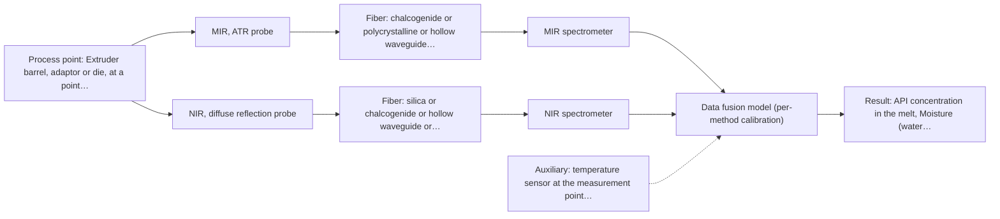
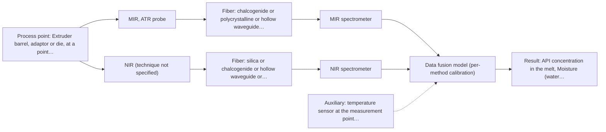

# First technical assessment: API concentration during hot polymer extrusion

# Answer

**Customer request:** Customer is developing a hot polymer extrusion process incorporating an active pharmaceutical ingredient and wants to investigate whether an optical measurement can detect composition changes while the melt is being processed. They have offline assays, but the process interface is hot and may be exposed to material build up. They need an initial comparison plan and the questions required before choosing a probe.

## Brief answer

Start with an at-line comparison of MIR-ATR against NIR reflection on representative melt samples, using your offline assays as the reference. MIR-ATR has the closest precedent for in-line polymer extrusion with an API; NIR reflection is worth comparing if the melt scatters. What remains open is the melt temperature and optical behaviour, the size of the composition change, and how build-up will be managed at the interface.

## Proposal

- **Best current option:** O2 (recommended): M1 MIR, ATR probe; M2 NIR, diffuse reflection probe
- **Basis:** supplied AFS sources
- **What would change it:** If the melt turns out clear and non-scattering, transmission or transflection becomes the better comparison than diffuse reflection; if MIR-ATR alone shows the composition change clearly, the single-method option O1 is enough and the second instrument is not justified.
- **Next step:** Run the first at-line comparison of MIR-ATR against NIR reflection on representative melt samples, with the customer's offline assay as the independent reference.

**Decision status:** Provisional feasibility assessment. A shortlist (MIR-ATR first, NIR reflection as the comparison) can be justified from a published in-line polymer-extrusion precedent, but the melt temperature, the optical regime of the melt and the required detection limit are still unknown, so the plan stays conditional.

## Solution options

| ID | Tier | Methods | Confidence | Cost class, S01 Table 1 (p.6) | Ease of use | Maintenance | Performance fit | Sources |
|---|---|---|---|---|---|---|---|---|
| O1 | Simple | M1 MIR, ATR probe | Medium: uncited auxiliary sensor | high (row 2) | One contact probe and one spectrometer; simplest interface to install. | ATR crystal must be cleaned whenever melt build-up forms. | Tests first whether the API band is visible in the melt. | *(no verified source: engineering judgement)* |
| O2 | Recommended | M1 MIR, ATR probe; M2 NIR, diffuse reflection probe | Low: sample clarity unknown; uncited auxiliary sensor; multi-method, fusion benefit not yet shown | high (rows 2, 8) | Two probes and instruments, but each method measured separately. | Two probe interfaces to keep clean, aligned and calibrated. | Gives the side-by-side method comparison the enquiry asks for. | *(no verified source: engineering judgement)* |
| O3 | Extended (multi-method) | M3 MIR, ATR probe + NIR (combination) | Low: sample clarity unknown; uncited auxiliary sensor; multi-method, fusion benefit not yet shown | high (row 2); not rated in S01 Table 1: NIR (technique not specified) | Needs synchronised acquisition and fused chemometric modelling. | Two instruments, each calibrated and diagnosed on its own. | Only justified if no single method reaches the required sensitivity. | *(no verified source: engineering judgement)* |

*Confidence rates the basis of the advice (how much is known and cited), not a predicted accuracy or probability of success. It starts at High and drops one level per weakness listed.*

*Cost class is the relative rating in S01 Table 1 (p.6) for the in-line method+technique rows named (the highest one for a multi-method option); it is not a price.*

## Setup sketch

*Recommended option O2; drawn by code from the option, a schematic, not a configuration.*

*Extended (multi-method) option O3; drawn by code from the option, a schematic, not a configuration.*

## Key questions

1. What is the active ingredient, over what concentration range must it be measured, and how large a composition change must be detected?
2. Is the hot melt clear, turbid, opaque or strongly scattering, and does the formulation fluoresce?
3. What are the melt temperature and pressure, and where on the extruder (barrel, adaptor or die) could a probe be mounted?

# Expert detail

**Customer enquiry**

> We are developing a hot polymer extrusion process that incorporates an active pharmaceutical ingredient. We want to investigate whether an optical measurement can detect composition changes while the melt is being processed. We have offline assays, but the process interface is hot and may be exposed to material build up. We need an initial comparison plan and the questions required before choosing a probe.

## Parameters

| ID | Parameter | Kind | Need | Measured by | Why | Sources |
|---|---|---|---|---|---|---|
| P1 | API concentration in the melt | quantitative | required | Spectroscopy: MIR | It is the composition change the customer wants to follow in-line, and it is the value the calibration is built against. | [1: S02 p.14] |
| P2 | Melt temperature | quantitative | required | Auxiliary sensor: temperature sensor at the measurement point (engineering judgement: confirm availability with AFS) | The process runs hot, and temperature shifts band positions and baselines and constrains which probe materials can be used, so it must be logged with every spectrum. | *(no verified source: engineering judgement)* |
| P3 | Moisture (water content) in the melt | quantitative | optional | Spectroscopy: MIR | Residual moisture absorbs strongly in the infrared and can look like a composition change, so it should be available from the customer's assays and recorded alongside the spectra. | [2: S02 p.13] |
| P4 | Polymer matrix (carrier) composition and grade | qualitative | required | Reference lab method: offline assay for polymer matrix composition (customer's lab) | The calibration is specific to the matrix, so the polymer grade and any formulation change must be known and recorded with each calibration set. | [3: REF §5] |

## Solution option details

- **O1 cost drivers:** One spectrometer, one ATR probe and its hot-interface fitting.
- **O2 cost drivers:** Two spectrometers, two process probes and longer laboratory time.
- **O3 cost drivers:** Two instruments plus synchronisation and data-fusion modelling effort.
- **O3 combining methods:** Low-level fusion of the MIR and NIR spectra into one matrix, with block scaling so that neither method dominates the model. Both probes must look at the same melt volume and the data must be normalised to a common time step. Each block keeps its own calibration and diagnostics, and the fused model must beat the best single method on held-out runs or the second instrument is dropped.

## Premise check

- **Precedent only:** An optical measurement can detect composition changes while the melt is being processed. A similar published case followed API in hot polymer with MIR-ATR and NIR reflection during in-line extrusion control. That is a reason to test this melt, not proof that it will work for this formulation. [4: S02 p.14]
- **Not covered:** The existing offline assays are suitable as the independent reference for the comparison. No supplied source addresses the fitness of the customer's assays. Their sampling, uncertainty and traceability must be checked, because the calibration and the go/no-go decision rest on them. *(no verified source: engineering judgement)*

## Requirements

**Stated by the customer**

**Key unknowns**

- Melt temperature and pressure range, and where on the extruder a probe could be mounted.
- Optical regime of the melt (clear, turbid, opaque, strongly scattering) and whether the formulation fluoresces.
- Identity of the active ingredient, its concentration range, and the size of the composition change to be detected.
- Required accuracy, detection limit, response time and measurement frequency.
- Build-up rate on the process interface and how the line is cleaned.
- Polymer matrix or grade and whether the offline assays are precise enough to calibrate against.

## Clarification questions (most decision-relevant first)

Q1. What is the active ingredient, over what concentration range must it be measured, and how large a composition change must be detected? *Why it matters:* It decides whether the NIR overtones or the MIR fundamental bands give enough contrast, and it sets the detection limit for the go/no-go test. *(affects: method, targets)*
Q2. Is the hot melt clear, turbid, opaque or strongly scattering, and does the formulation fluoresce? *Why it matters:* It decides the measurement geometry - ATR contact, diffuse reflection or transmission - and whether fluorescence will interfere with the signal. *(affects: technique, status)*
Q3. What are the melt temperature and pressure, and where on the extruder (barrel, adaptor or die) could a probe be mounted? *Why it matters:* It decides the probe, crystal and sealing materials, the measurement location, and whether a process interface can survive there. *(affects: installation)*
Q4. How quickly does material build up on surfaces in this process, and how is the line cleaned between runs? *Why it matters:* It decides whether a contact ATR surface is practical and how often it would have to be cleaned or replaced. *(affects: installation, maintenance)*
Q5. What accuracy, detection limit, response time and measurement frequency do you need, and how are the offline assays performed and with what uncertainty? *Why it matters:* It sets the numerical go/no-go criteria and the quality of the reference data the calibration will be built on. *(affects: status, go_no_go)*

## Recommendation

- **M1 · Primary candidate: MIR, ATR probe.** Mid-IR gives well-defined absorption bands with high selectivity, and ATR fibre probes work on liquids and soft solids in contact with the crystal, which is how a melt would be measured. A published case followed API in hot polymer with a diamond ATR probe during in-line extrusion control, so this is the first method worth testing. *Conditions:* Applies if the hot melt wets the crystal and keeps tight contact at process temperature, and if the probe and crystal materials tolerate the melt. [5: S02 p.14] [6: S02 p.14] [7: S01 p.9] [8: S01 p.5] [9: S04 p.4]
- **M2 · Comparison candidate: NIR, diffuse reflection probe.** NIR reflection is the most common in-line fibre-probe method and penetrates further into the sample than ATR, so it is less tied to the immediate surface; the same published extrusion case ran NIR reflection beside MIR-ATR. Its broad, overlapping bands need a chemometric calibration that is specific to the polymer and API matrix. *Conditions:* Applies if the melt gives a usable diffuse-reflection signal rather than behaving as a clear transparent liquid, and if the expected composition change is large enough to appear in the NIR overtones. [10: S01 p.10] [11: S01 p.5] [12: S02 p.14] [13: S01 p.10]
- **M3 · Comparison candidate: MIR, ATR probe.** Mid-IR and NIR carry different parts of the information and the published extrusion case used both, but combining them is a later hypothesis, not a first step. Any fused model must be shown to beat the best single method on held-out runs before a second instrument is kept. *Conditions:* Applies only after the single-method tests, and only if no single method reaches the required sensitivity for the composition change. [14: S01 p.7] [15: S01 p.8] [16: S01 p.8] [17: S01 p.9] [18: REF §5] Later hypothesis, after single-method tests: combine with NIR.
- **M4 · Not recommended: NIR, transmission/transflection probe.** Transmission needs the light to pass through the melt, and it fails once the sample is too thick or opaque, which cannot be excluded here. With the optical regime of the melt still unknown, this geometry cannot be justified as a starting point. [19: S01 p.18]

## Measurement concept

- **Probe and geometry:** Contact ATR probe first (crystal in the melt stream); diffuse-reflection NIR probe as the comparison. Both mounted at the same process position so the two data sets refer to the same melt.
- **Location:** Extruder barrel, adaptor or die, at a point where the melt is homogeneous and the probe can be inserted and cleaned.
- **Fiber link:** Not stated here: the usable link length depends on the method, the fibre family and the probe actually selected and is an open question for AFS. *(no verified source: engineering judgement)*

## Spectral range

- **MIR:** Nominal mid-IR range 4000-400 cm-1 (2.5-25 um); the usable range depends on the fibre, crystal and instrument actually selected. [20: S01 p.9]
- **NIR:** Nominal NIR range 780-2500 nm; the usable range depends on the fibre, probe and instrument actually selected. [21: S01 p.10] [22: REF §5]

## Risks and uncertainty

- Build-up on the ATR crystal would corrupt the signal, because ATR only samples the first few micrometres at the probe surface. *(rules: R-MIR-3)* [23: S01 p.13]
- A hot, viscous melt may not wet the crystal reliably or may move against it, so the ATR measurement could be unstable or unrepresentative. *(rules: R-MIR-2)* *(no verified source: engineering judgement)*
- The composition change may be smaller than NIR can resolve, and any model is specific to the polymer/API matrix and must be re-validated when the formulation changes. *(rules: R-NIR-4, R-CAL-1)* *(no verified source: engineering judgement)*
- The melt's unknown optical regime (clear, strongly scattering or fluorescent) could make the chosen geometry unusable. *(rules: R-GEO-6, R-RAM-1)* *(no verified source: engineering judgement)*

## First feasibility experiment

1. **Collect representative melt samples across the expected API concentration range and the expected melt-temperature and moisture variation, taken at the intended measurement point, and record the process state for each sample.** Cover the chemical and physical variation the model must handle. [24: REF §3]
2. **Measure every sample with MIR-ATR alone first, using the probe geometry and temperature intended for the line, with repeated measurements at the same spot to check repeatability.** Test the single method before any combination. *(no verified source: engineering judgement)*
3. **Have the customer's offline assay measure the same samples for API content (and moisture) as the independent reference, keeping run and batch identity for every sample.** Provide the independent reference values the calibration is built on. *(no verified source: engineering judgement)*
4. **Build one calibration per method and validate it on held-out runs or batches, split by run or batch and never by spectrum.** Give honest error figures instead of an optimistic fit. *(no verified source: engineering judgement)*
5. **Only if no single method reaches the target, test the combined MIR-ATR plus NIR model on synchronised samples and compare it with the best single method; the accuracy and detection-limit numbers for the go/no-go decision come from the customer.** Decide whether the second instrument earns its place. [25: REF §5]

**Reference measurements:** The customer's offline assay for API content and moisture, applied to the same samples and recorded with run/batch identity.

**Decision basis:** Customer-defined numerical criteria: required accuracy and detection limit for the API composition change; if they are not met by the best single method, the combined model is compared against it.

## Assumptions

- The melt can be brought into contact with, or made optically accessible to, a probe at a defined point of the extruder.
- The customer's offline assay is precise enough to act as the calibration reference; this is unverified (premise PC2).
- The composition change of interest is large enough to be seen spectroscopically; the required size is not yet known (Q1).

## Not covered by the supplied sources

- No supplied source states a temperature or material rating for a probe used at a hot polymer-melt interface.
- No supplied source describes how build-up on an in-line probe is detected or removed in a polymer process.

## Further notes

- **Chemometrics:** Both candidate methods need a chemometric calibration: NIR bands overlap and the calibration is specific to the polymer/API matrix (P4), so build it on the offline-assay reference (P1, P3) and validate on held-out runs or batches. A classification model would only be appropriate if the target is a pass/fail composition state rather than a concentration.
- **Real-time tracking:** In-line, continuous tracking of the melt is the customer's goal; the published extrusion case ran MIR-ATR and NIR reflection in-line on hot polymer, and both techniques can sample the same process point continuously. Whether the required response time can be met is still open (Q5).
- **Future direction:** If a single method proves sufficient, a compact spectral fibre sensor optimised for the few informative wavelengths could later replace the full spectrometer for routine control; this is an engineering judgement, not something the supplied pages state for this process.

## Evidence (verified quotes)

1. ✓ **S02 p.14** (application precedent): "Spectra of API in hot polymer obtained with Diamond cone ATR probe coupled to iC10 FTIR (MTAC)"
2. ✓ **S02 p.13** (application precedent): "Application: measurement of water content in petroleum"
3. ✓ **REF §5** (general): "physical variation; calibration specific to the matrix."
4. ✓ **S02 p.14** (application precedent): "NIR-Reflex & MIR-ATR-spectroscopy to control polymer extrusion in-line"
5. ✓ **S02 p.14** (application precedent): "NIR-Reflex & MIR-ATR-spectroscopy to control polymer extrusion in-line"
6. ✓ **S02 p.14** (application precedent): "Spectra of API in hot polymer obtained with Diamond cone ATR probe coupled to iC10 FTIR (MTAC)"
7. ✓ **S01 p.9** (general): "Vibrational spectroscopy in the mid-IR range (4000-400 cm-1) is one of the most informative methods of chemical analysis."
8. ✓ **S01 p.5** (general): "Mid-IR band spectra contain well-defined peaks (absorption bands)"
9. ✓ **S04 p.4** (general): "suitability of analyzed samples for ATR measurements, which is true for liquid or soft solid samples and their components, allowing a tight contact with the probe head."
10. ✓ **S01 p.10** (general): "Near-IR vibrational spectroscopy (NIR) is the most common online analysis method performed using fiber optic probes."
11. ✓ **S01 p.5** (general): "NIR spectroscopy, with its relatively large penetration depth (up to several millimetres) even into dense solid samples due to low absorption and strong scattering, allows the use of ordinary glass for optics"
12. ✓ **S02 p.14** (application precedent): "NIR-Reflex & MIR-ATR-spectroscopy to control polymer extrusion in-line"
13. ✓ **S01 p.10** (general): "The broad absorption bands observed in this region overlap, suggesting the use of chemometrics for quantitative and qualitative analysis of spectral data."
14. ✓ (precedent only) **S01 p.7** (method gain): "The analysis of such systems may require a combination of two or even more spectral methods."
15. ✓ (precedent only) **S01 p.8** (method gain): "It is crucial that the spectral information obtained by different methods-Mid-IR, NIR, Raman, and fluorescence spectra-is collected from the same small, even pinpoint, area of the sample."
16. ✓ (precedent only) **S01 p.8** (method gain): "two or more probes, belonging to different methods, can be used for measurements, but the data from each method must be obtained simultaneously."
17. ✓ **S01 p.9** (general): "One of the challenges of multispectral analysis is the need to simultaneously connect at least two independently operating measuring instruments."
18. ✓ (precedent only) **REF §5** (method gain): "compare with the best single method."
19. ✓ **S01 p.18** (general): "it fails when the milk becomes too "thick" or fat-rich, as the light cannot penetrate the sample."
20. ✓ **S01 p.9** (general): "Vibrational spectroscopy in the mid-IR range (4000-400 cm-1) is one of the most informative methods of chemical analysis."
21. ✓ **S01 p.10** (general): "NIR spectra (780-2500 nm) contain predominantly overtones and component bands of fundamental vibrations"
22. ✓ **REF §5** (general): "It is not a product specification: actual spectral coverage, fiber length, component ratings, detection limits and accuracy depend on the configuration and the sample."
23. ✓ **S01 p.13** (general): "typically at a depth of few microns"
24. ✓ **REF §3** (general): "Representative samples or process states, independent reference measurements, what is compared, and the basis for the go / no-go decision."
25. ✓ (precedent only) **REF §5** (method gain): "compare with the best single method."

## Verification

- Citations verified: 25 of 25 (exact or whitespace/hyphen-tolerant match on the cited page, scope checked).
- Hard check failures before deterministic corrections: 0; still open: 0; soft warnings: 6; repair rounds: 0.
- Corrected deterministically after verification (1):
  - ⚠ recommendations[2].combined_with: combined_with normalised to ['NIR'] (duplicates and the entry's own method removed)

*Run D07-20261017T140307Z · models deepseek/deepseek-v4.1-flash*
