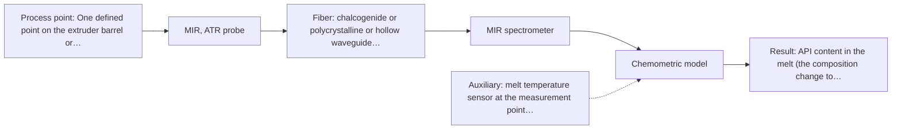
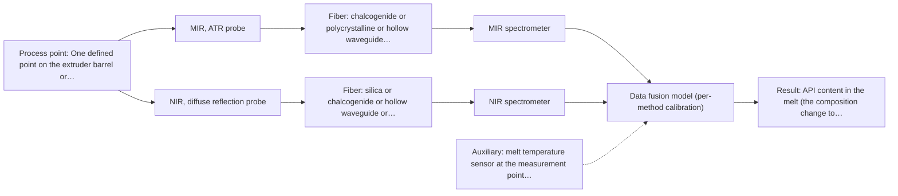

# First technical assessment: API concentration during hot polymer extrusion

**Customer enquiry**

> We are developing a hot polymer extrusion process that incorporates an active pharmaceutical ingredient. We want to investigate whether an optical measurement can detect composition changes while the melt is being processed. We have offline assays, but the process interface is hot and may be exposed to material build up. We need an initial comparison plan and the questions required before choosing a probe.

## Brief answer

Test mid-infrared ATR first: the supplied material shows API spectra in hot polymer and in-line NIR/MIR-ATR control of polymer extrusion, so MIR-ATR is the most direct single method, with NIR reflection as the lower-effort comparison if the melt is scattering. Before a probe is chosen we need the required accuracy and detection limit, the melt's optical state, the interface temperature and the cleaning regime. This is a provisional plan, not a validated configuration.

## Proposal

- **Best current option:** O2 (recommended): R1 MIR, ATR probe
- **Basis:** supplied AFS sources
- **What would change it:** If the melt at the intended port is clear and low-scattering, the geometry changes and O1 would be reconsidered with a transmission or transflection probe. If the API has no usable MIR band at the required level, or if build-up cannot be managed within the cleaning interval, the choice moves to NIR reflection or to the combined option O3. The answers to Q1 to Q5 (required accuracy and detection limit, melt optical state and polymer, interface temperature and cleaning regime, fluorescence, reference quality) decide this.
- **Next step:** Run a multi-method laboratory trial on representative melt samples at process temperature: MIR-ATR and NIR reflection first, with the existing offline assay as the independent reference, against go/no-go numbers agreed with the customer beforehand.

**Decision status:** Provisional feasibility assessment. A shortlist of single methods can be justified from the supplied material (MIR-ATR has a direct published precedent for API in hot polymer and for in-line polymer extrusion control), but the melt's optical state, the required detection limit and the interface conditions are not known, so this is a provisional plan, not a configuration.

## Parameters

| ID | Parameter | Kind | Need | Measured by | Why | Sources |
|---|---|---|---|---|---|---|
| P1 | API content in the melt (the composition change to be detected) | quantitative | required | Spectroscopy: MIR | This is the target quantity; the comparison trial has to show whether an optical measurement can follow it in the melt. | [1: S02 p.14] |
| P2 | Melt temperature at the measurement point | quantitative | required | Auxiliary sensor: melt temperature sensor at the measurement point (for example the extruder's own melt-temperature channel or a thermocouple at the port) (engineering judgement: confirm availability with AFS) | The interface is hot; temperature affects the spectrum and the baseline, and it decides which probe can be used and how the measurement is normalised. | *(no verified source: engineering judgement)* |
| P3 | Optical state of the melt at the measurement point (clear/translucent versus opaque and scattering) | qualitative | required | Reference lab method: offline optical measurement (transmission and reflectance) on representative melt samples | It decides the geometry: transmission or transflection is preferred for clear liquids, reflection for scattering or opaque ones. The geometry then decides the probe and the fiber. | [2: S01 p.18] [3: S01 p.17] |
| P4 | Build-up / fouling state of the probe interface | qualitative | required | Not measurable in-line by spectroscopy; alternative: inspection at cleaning, plus a blank or reference measurement repeated during a run to watch for drift | A film on the interface changes what the probe sees and can imitate a composition change; it also sets the cleaning interval and whether an ATR crystal can be kept in contact with the melt. | [4: REF §5] |
| P5 | Base polymer and additive package | qualitative | optional | Reference lab method: customer formulation records and the supplier specification of the polymer grade | Should be available from the customer's own formulation records. The polymer and additive bands form the spectral background against which the API band has to be separated, so this decides the usable window. | *(no verified source: engineering judgement)* |

## Solution options

| ID | Tier | Methods | Cost class, S01 Table 1 (p.6) | Ease of use | Maintenance | Performance fit | Sources |
|---|---|---|---|---|---|---|---|
| O1 | Simple | R2 NIR, diffuse reflection probe | average (row 8) | one NIR instrument and one reflection probe; no crystal to keep in contact | cleaning the measurement window against build-up | least effort that can still answer the question, but only if the melt scatters and the API has a usable NIR band | [5: S01 p.10] |
| O2 | Recommended | R1 MIR, ATR probe | high (row 2) | one instrument and one probe, contact measurement at the barrel; needs a port and a cleaning arrangement | ATR crystal cleaning; build-up is the main service item | best fit for the stated target: well-defined MIR bands and a direct precedent for API spectra in hot polymer and for in-line polymer extrusion control | [6: S02 p.14] [7: S01 p.5] |
| O3 | Extended (multi-method) | R1 MIR, ATR probe; R2 NIR, diffuse reflection probe; R3 MIR, ATR probe + NIR (combination) | high (rows 2, 8) | two instruments, and either two probes looking at one point or one combined probe | two calibrations and two sets of instrument diagnostics to keep current | only if one method cannot cover the targets; the fused model must beat the best single method to be worth the extra instrument | [8: S01 p.8] [9: S01 p.8] [10: S01 p.8] [11: S01 p.8] [12: S01 p.9] [13: S01 p.9] |

*Cost class is the relative rating in S01 Table 1 (p.6) for the in-line method+technique rows named (the highest one for a multi-method option); it is not a price.*

- **O1 cost drivers:** one NIR spectrometer, one reflection probe and port, reference samples, and a chemometric calibration
- **O2 cost drivers:** FTIR spectrometer, ATR probe with a diamond or ZrO2 crystal, MIR fiber link, engineering of a port for a hot interface, and cleaning provisions
- **O3 cost drivers:** two spectrometers, two probes or one combined probe, synchronisation and data-fusion software, dual calibration and dual maintenance
- **O3 combining methods:** Fusion level: start from one model per method as the baseline, then low-level fusion of the concatenated spectra with block scaling so that neither method dominates. Same sampling spot: both measurements must look at the same material at the same barrel position, or a combined probe must be used; ATR sees a shallow layer while NIR reflection sees a larger, deeper volume. Synchronisation: the data from both methods must be taken simultaneously and normalised to a common time step before fusion. Per-method calibration: each instrument needs its own calibration and its own diagnostics; a fused model breaks if either block drifts or a probe is changed. Must beat the best single method: validate on held-out runs or batches and drop the extra instrument if the fused model is not better.

## Setup sketch

*Recommended option O2; drawn by code from the option, a schematic, not a configuration.*

*Extended (multi-method) option O3; drawn by code from the option, a schematic, not a configuration.*

## Premise check

- **Supported:** The existing offline assays can serve as the comparison reference for an in-line optical measurement. A feasibility plan is expected to include independent reference measurements; the offline assays are the natural candidate. Their precision and the sampling point must still be matched to the in-line measurement. [14: REF §3]
- **Supported:** Material build-up at the hot process interface is a relevant constraint for probe selection. The supplied guidance lists contact, fouling and compatibility as limitations for MIR-ATR; a fouling layer is also exactly what an ATR measurement would sample. [15: REF §5]
- **Supported:** An initial comparison plan and pre-probe questions are enough to proceed toward choosing a probe. The published pathway starts with multi-method trials on the process and only then selects the solution. That makes a comparison trial the right next step; it is a reason to test, not proof of any configuration. [16: S02 p.20] [17: S01 p.3]

## Requirements

**Stated by the customer**

- hot polymer extrusion process containing an active pharmaceutical ingredient
- detect composition changes while the melt is being processed
- offline assays are available as reference
- the process interface is hot and may be exposed to material build-up
- customer asks for an initial comparison plan and the questions to answer before choosing a probe

**Key unknowns**

- Identity and concentration range of the API, and exactly which composition change must be detected.
- Required accuracy, detection limit and response time (these become the go/no-go numbers).
- Optical state of the melt at the intended measurement point (clear or strongly scattering) and the base polymer and additive package.
- Melt temperature and pressure at the interface, distance from the measurement point to the spectrometer, and the cleaning / build-up regime.
- Whether the API, or a suitable indicator, fluoresces or absorbs in the UV-Vis.
- What the existing offline assays measure, with what precision, and on what material they are run.

## Clarification questions (most decision-relevant first)

Q1. Which composition change must be detected, over what API concentration range, and with what required accuracy, detection limit and response time? *Why it matters:* These numbers are the go/no-go basis and decide whether a single method is enough; without them no method can be called fit for the task. *(affects: method, technique, status)*
Q2. What is the base polymer and additive package, and at the intended measurement point is the melt clear/translucent or opaque and strongly scattering? Is there already a port or window in the extruder? *Why it matters:* The optical state decides the geometry (transmission or transflection for clear liquids, reflection for scattering ones) and therefore the probe and fiber. *(affects: technique, installation)*
Q3. What are the melt temperature and pressure at the interface, the distance to the spectrometer, and how often is the interface cleaned or expected to foul? *Why it matters:* Hot-interface compatibility and cleaning decide whether an ATR crystal can be used and whether a remote fiber link is needed. *(affects: installation, status)*
Q4. Does the API, or a deliberately added indicator, fluoresce or absorb in the UV-Vis? *Why it matters:* Fluorescence and UV-Vis only apply to species that fluoresce or absorb; otherwise those methods drop out of the comparison. *(affects: method)*
Q5. What exactly do the offline assays measure, with what precision, and on what material are they run? *Why it matters:* They are the independent reference against which any in-line result is judged, so their uncertainty sets the smallest change that can be confirmed. *(affects: status)*

## Recommendation

- **R1 · Primary candidate: MIR, ATR probe.** MIR gives well-defined absorption bands and is one of the most informative methods for chemical analysis, and ATR is the contact route for a liquid or soft material. The supplied material shows spectra of an API in hot polymer recorded with an ATR probe, and NIR plus MIR-ATR used together to control polymer extrusion in-line. This is a precedent that justifies testing MIR-ATR first; it is not proof that it works on this melt. *Conditions:* Requires the melt to make tight contact with the ATR head at the chosen port, and a cleaning arrangement for build-up. [18: S02 p.14] [19: S02 p.14] [20: S01 p.9] [21: S04 p.4]
- **R2 · Conditional candidate: NIR, diffuse reflection probe.** NIR is the most common in-line method performed with fiber probes, silica fibers carry NIR over cable runs stated as 100-300 m, and reflection geometry is used for opaque or highly concentrated products. Its bands are broad and overlap, so a chemometric calibration is required, and it may lack sensitivity for low-level changes. *Conditions:* Applies only if the melt at the measurement point is opaque or strongly scattering and an optical access point is available. If the melt turns out to be clear and low-scattering, a transmission or transflection geometry would be considered instead. [22: S01 p.10] [23: S02 p.7] [24: S01 p.17] [25: S01 p.10]
- **R3 · Comparison candidate: MIR, ATR probe.** The same source shows NIR reflection and MIR-ATR used together to control polymer extrusion in-line, and combining methods is reported to help for complex samples. A gain from fusing the two is a hypothesis: it must be tested against the best single method on held-out runs, with both measurements looking at the same material at the same time. *Conditions:* Only as a later step, after the single-method trials, and only if one method alone does not meet the targets. [26: S02 p.14] [27: S01 p.7] [28: REF §5] [29: REF §5] Later hypothesis, after single-method tests: combine with NIR.

## Measurement concept

- **Probe and geometry:** MIR: ATR probe in contact with the melt at the extruder, connected by MIR fibers to an FTIR spectrometer away from the machine. NIR alternative: a reflection probe flush-mounted into the barrel or a port, connected by silica fibers.
- **Location:** One defined point on the extruder barrel or die, chosen so that the material passing it represents the composition being controlled.
- **Fiber link:** NIR can use silica fibers, for which long cable runs are stated; for MIR the sources show chalcogenide and polycrystalline fibers, and the MIR fiber and waveguide examples shown are laboratory-scale lengths. An achievable MIR link length for a plant installation is an open question for AFS and must not be assumed. [30: S02 p.6] [31: S02 p.9]

## Spectral range

- **MIR:** Nominal MIR range 4000-400 cm-1. The usable range depends on the fiber and the ATR crystal actually selected. [32: S01 p.9] [33: REF §5]
- **NIR:** Nominal NIR range 780-2500 nm. The usable range depends on the instrument, fiber and probe actually selected. [34: S01 p.10] [35: REF §3]

## Risks and uncertainty

- Build-up at the interface. A film of material on the interface changes what the probe sees and can look like a composition change. An ATR measurement samples only a very shallow surface layer, so a degraded surface film can dominate the spectrum. *(rules: R-MIR-3)* [36: REF §5] [37: S01 p.13]
- The optical state of the melt is unknown. If it is clear and low-scattering, reflection is less representative; if it is thick or opaque, a transmission geometry loses the signal. This measurement has not been made and decides the geometry. *(rules: R-GEO-2, R-GEO-4)* [38: S01 p.18]
- Hardware for a hot interface. No supplied source gives an achievable MIR fiber length or a probe temperature rating for an extruder port; the MIR fiber and waveguide examples shown are laboratory lengths, and MIR needs chalcogenide or polycrystalline fibers because silica fibers do not carry it. *(rules: R-FIB-1, R-FIB-2)* [39: S02 p.9] [40: S02 p.6]
- Calibration and sensitivity. NIR and MIR calibrations are specific to the material; a change of API grade, polymer or additive package requires re-validation on the new material, and NIR may not see small changes. *(rules: R-CAL-1, R-NIR-4)* [41: REF §5] [42: S01 p.16]

## First feasibility experiment

1. **Fix the sample set and the process states to be compared with the customer: at least three API levels spanning the expected range, plus the extremes of the process window (temperature, throughput). Collect representative melt material, or measure directly at the extruder.** Fix the sample set and the states to be compared with the customer: at least three API levels spanning the expected range, plus the extremes of the process window (temperature, throughput). Collect representative melt material, or measure directly at the extruder. [43: REF §3]
2. **Measure with single methods first, on the same material and at process temperature: MIR-ATR, then NIR reflection. Record the raw spectra, the probe contact state and the cleaning state at each measurement.** Measure with single methods first, on the same material and at process temperature: MIR-ATR, then NIR reflection. Record the raw spectra, the probe contact state and the cleaning state at each measurement. [44: S02 p.20]
3. **Measure the independent reference for every sample with the customer's existing offline assay, on the same material and as close in time to the optical measurement as possible.** Measure the independent reference for every sample with the customer's existing offline assay, on the same material and as close in time to the optical measurement as possible. *(no verified source: engineering judgement)*
4. **Compare: build one calibration or classification model per method and check whether each single method detects the required composition change. Only then test whether the combined NIR + MIR-ATR model beats the best single method on held-out runs or batches.** Compare: build one calibration or classification model per method and check whether each single method detects the required composition change. Only then test whether the combined NIR + MIR-ATR model beats the best single method on held-out runs or batches. [45: REF §5]
5. **Take the go / no-go decision on held-out runs or batches, using the numerical criteria the customer sets (required accuracy, detection limit, response time). Include a build-up check: repeat a reference or blank measurement across a run and confirm the signal does not drift within the cleaning interval.** Go / no-go from held-out runs or batches, using the numerical criteria the customer sets (required accuracy, detection limit, response time). Include a build-up check: repeat a reference or blank measurement across a run and confirm the signal does not drift within the cleaning interval. *(no verified source: engineering judgement)*

**Reference measurements:** The customer's existing offline assays, run on the same material.

**Decision basis:** Numerical go/no-go criteria are set by the customer (required accuracy, detection limit, response time); the decision is taken on held-out runs or batches, not on the calibration set.

## Assumptions

- The melt can be brought into controlled contact with, or optical view of, a probe at one defined point on the extruder.
- The customer's offline assays are precise enough to serve as the independent reference for the smallest change that matters.
- A measurement port can be engineered and cleaned within the customer's existing maintenance practice.
- The API survives extrusion at the process temperature long enough for the reference and the optical measurement to see the same material.

## Not covered by the supplied sources

- An achievable MIR fiber link length for a plant installation: the supplied pages show MIR fiber and waveguide examples at laboratory lengths only, and no MIR link length is stated.
- Probe temperature ratings or materials suitable for a hot extruder interface: not covered by the supplied pages.
- An expected detection limit or accuracy for a specific API in a polymer melt: not covered; the figures needed must come from the customer's targets and from the trial.
- A specific probe or component recommendation for this extruder: not covered.

## Further notes

- **Chemometrics:** Both routes need a calibration or classification model built on reference values from the offline assays. NIR bands overlap, which makes chemometrics necessary, and NIR and MIR calibrations are specific to the material: an API grade, polymer or additive change requires re-validation on the new material. Build the model on the trial data and validate it on held-out runs or batches.
- **Real-time tracking:** The enquiry is about detection while the melt is processed. Fiber probes allow measurement at the process without sampling, and NIR diode-array instruments record all wavelengths at once, which suits fast processes. The measurement point and the time step still have to be fixed with the customer.
- **Future direction:** If the trial identifies a few informative wavelengths, a compact optical multisensor system or a small spectral fiber sensor could be a later, lower-cost route for this process point.

## Evidence (verified quotes)

1. ✓ **S02 p.14** (application precedent): "Spectra of API in hot polymer obtained with Diamond cone ATR probe coupled to iC10 FTIR (MTAC)"
2. ✓ **S01 p.18** (general): "Transmission is the preferred method for transparent or semi-transparent liquids, such as skim milk, whey, or permeate."
3. ✓ **S01 p.17** (application precedent): "NIR Reflection is primarily used for opaque or highly concentrated dairy products, such as yogurt, butter, or whole milk concentrates."
4. ✓ **REF §5** (general): "Usable range limited by fiber and crystal; contact, fouling, compatibility."
5. ✓ **S01 p.10** (general): "Near-IR vibrational spectroscopy (NIR) is the most common online analysis method performed using fiber optic probes."
6. ✓ **S02 p.14** (application precedent): "NIR-Reflex & MIR-ATR-spectroscopy to control polymer extrusion in-line"
7. ✓ **S01 p.5** (general): "Mid-IR band spectra contain well-defined peaks (absorption bands)"
8. ✓ (precedent only) **S01 p.8** (method gain): "collected from the same small, even pinpoint, area of the sample."
9. ✓ (precedent only) **S01 p.8** (method gain): "the data from each method must be obtained simultaneously."
10. ✓ (precedent only) **S01 p.8** (method gain): "Ultimately, the measurement data must be normalized to a common time step."
11. ✓ (precedent only) **S01 p.8** (method gain): "If the variables have different units of measurement, the data should be normalized in some way, for example, using an autoscaling algorithm."
12. ✓ (precedent only) **S01 p.9** (method gain): "Furthermore, methods containing a larger number of variables have a greater impact on the model."
13. ✓ (precedent only) **S01 p.9** (method gain): "One of the challenges of multispectral analysis is the need to simultaneously connect at least two independently operating measuring instruments."
14. ✓ **REF §3** (general): "Representative samples or process states, independent reference measurements, what is compared, and the basis for the go / no-go decision."
15. ✓ **REF §5** (general): "Usable range limited by fiber and crystal; contact, fouling, compatibility."
16. ✓ **S02 p.20** (general): "1. Multi-Method Lab Trials AFS tests your process using all key fiber optic spectroscopy methods."
17. ✓ **S01 p.3** (general): "samples of incompletely known composition, in order to select the most suitable method or combination of methods."
18. ✓ **S02 p.14** (application precedent): "Spectra of API in hot polymer obtained with Diamond cone ATR probe coupled to iC10 FTIR (MTAC)"
19. ✓ **S02 p.14** (application precedent): "NIR-Reflex & MIR-ATR-spectroscopy to control polymer extrusion in-line"
20. ✓ **S01 p.9** (general): "Vibrational spectroscopy in the mid-IR range (4000-400 cm-1) is one of the most informative methods of chemical analysis."
21. ✓ **S04 p.4** (general): "suitability of analyzed samples for ATR measurements, which is true for liquid or soft solid samples and their components, allowing a tight contact with the probe head."
22. ✓ **S01 p.10** (general): "Near-IR vibrational spectroscopy (NIR) is the most common online analysis method performed using fiber optic probes."
23. ✓ **S02 p.7** (performance figure): "Robust 100-300m cables made with Silica fibers of low OH-content (<0.1ppm OH) enable remote industrial process-control"
24. ✓ **S01 p.17** (application precedent): "NIR Reflection is primarily used for opaque or highly concentrated dairy products, such as yogurt, butter, or whole milk concentrates."
25. ✓ **S01 p.10** (general): "The broad absorption bands observed in this region overlap, suggesting the use of chemometrics for quantitative and qualitative analysis of spectral data."
26. ✓ **S02 p.14** (application precedent): "NIR-Reflex & MIR-ATR-spectroscopy to control polymer extrusion in-line"
27. ✓ (precedent only) **S01 p.7** (method gain): "The analysis of such systems may require a combination of two or even more spectral methods."
28. ✓ (precedent only) **REF §5** (method gain): "compare with the best single method."
29. ✓ (precedent only) **REF §5** (method gain): "Sampling location and timing must be aligned; a gain is a hypothesis to test."
30. ✓ **S02 p.6** (general): "350 nm Standard VIS-NIR Silica Fibers Al/Cu-coated VIS-NIR Silica Fibers 2400 nm"
31. ✓ (precedent only) **S02 p.9** (performance figure): "HWG-750-2m PIR 600/700 -2m"
32. ✓ **S01 p.9** (general): "Vibrational spectroscopy in the mid-IR range (4000-400 cm-1) is one of the most informative methods of chemical analysis."
33. ✓ **REF §5** (general): "It is not a product specification: actual spectral coverage, fiber length, component ratings, detection limits and accuracy depend on the configuration and the sample."
34. ✓ **S01 p.10** (general): "NIR spectra (780-2500 nm) contain predominantly overtones and component bands of fundamental vibrations"
35. ✓ **REF §3** (general): "A nominal method range is not the range of a specific instrument, fiber or probe."
36. ✓ **REF §5** (general): "Usable range limited by fiber and crystal; contact, fouling, compatibility."
37. ✓ **S01 p.13** (general): "typically at a depth of few microns"
38. ✓ **S01 p.18** (general): "reflection can work well in highly scattering environments but can be less representative for clear liquids."
39. ✓ (precedent only) **S02 p.9** (performance figure): "HWG-750-2m PIR 600/700 -2m"
40. ✓ **S02 p.6** (general): "350 nm Standard VIS-NIR Silica Fibers Al/Cu-coated VIS-NIR Silica Fibers 2400 nm"
41. ✓ **REF §5** (general): "physical variation; calibration specific to the matrix."
42. ✓ (precedent only) **S01 p.16** (performance figure): "may lack the sensitivity to detect trace compounds below 0.1 percent."
43. ✓ **REF §3** (general): "Representative samples or process states, independent reference measurements, what is compared, and the basis for the go / no-go decision."
44. ✓ **S02 p.20** (general): "1. Multi-Method Lab Trials AFS tests your process using all key fiber optic spectroscopy methods."
45. ✓ (precedent only) **REF §5** (method gain): "compare with the best single method."

## Verification

- Citations verified: 45 of 45 (exact or whitespace/hyphen-tolerant match on the cited page, scope checked).
- Hard check failures before deterministic corrections: 0; still open: 0; soft warnings: 14; repair rounds: 1.

*Run D07-20261017T124043Z · models deepseek/deepseek-v4.1-flash · cost $0.0217*
