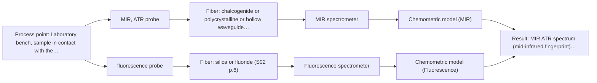
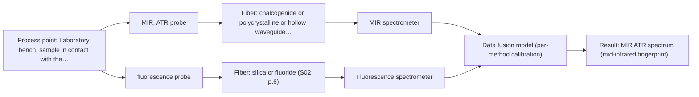

# First technical assessment: Local measurements of heterogeneous model tissues

## Answer

**Customer request (our summary):** Customer is evaluating a spectral measurement interface for a laboratory classification study using model biological tissues (chicken muscle, fat, liver). They want to compare MIR ATR and fluorescence information, noting heterogeneity and possible sequential sampling mismatch. They request a first comparison experiment and a clear statement of what its results would demonstrate.

### Brief answer

Test MIR ATR and fluorescence side by side on the same marked spots of chicken muscle, fat and liver, with one classification model per method and independent tissue-type references. Published work on these same tissues suggests neither method alone separated all three classes, so treat a fused result as a hypothesis. Whether the samples fluoresce usefully, and how many batches you can supply, still decide the design.

### Proposal

- **Best current option:** O2 (recommended)
- **Basis:** supplied AFS sources
- **What would change it:** If MIR ATR alone separates the classes, O1 is enough; if the group needs both signals from the same spot on every measurement, or already holds a combined probe, O3 becomes the better fit.
- **Next step:** Prepare representative chicken samples with independent tissue-type references and run the side-by-side MIR ATR and fluorescence comparison, with the go/no-go criterion fixed before the measurements.

**Decision status:** Provisional feasibility assessment

### Solution options

| ID | Tier | Methods | Confidence | Cost class, S01 Table 1 (p.6) | Ease of use | Maintenance | Performance fit | Sources |
|---|---|---|---|---|---|---|---|---|
| O1 | Simple | M1 MIR, ATR probe | Medium: open question: Q1 (starts at Medium) | high cost (row 2) | One probe, simple contact measurement | ATR crystal cleaning between samples | Least effort; shows what MIR alone separates | [1: S04 p.4] [2: S01 p.9] [3: S01 p.5] [4: S04 p.3] |
| O2 | Recommended | M1 MIR, ATR probe; M2 fluorescence probe | Low: open question: Q1, Q2 (starts at Medium); fit for soft solid to be tested, sample clarity unknown, fluorescent target unknown | high cost (rows 2, 19) | Two probes aligned on a marking grid | Two probes; ATR crystal cleaning | Compares both methods on marked spots, least hardware | [5: S04 p.2] [6: S04 p.2] [2: S01 p.9] [3: S01 p.5] [1: S04 p.4] [4: S04 p.3] [7: S04 p.3] [8: S04 p.4] [9: S01 p.5] |
| O3 | Extended (multi-method) | M1 MIR, ATR probe; M2 fluorescence probe; M3 MIR, ATR probe + Fluorescence (combination) | Low: open question: Q1, Q2, Q3 (starts at Medium); fit for soft solid to be tested, sample clarity unknown, fluorescent target unknown; multi-method, fusion benefit not yet shown | high cost (rows 2, 19) | One combined probe, simultaneous acquisition | Two instruments, each with own calibration | Same-spot data, suited to heterogeneous tissue | [10: S01 p.8] [11: S01 p.8] [12: S01 p.8] [13: S01 p.9] [14: S04 p.1] [2: S01 p.9] [3: S01 p.5] [1: S04 p.4] [4: S04 p.3] [7: S04 p.3] [8: S04 p.4] [9: S01 p.5] [15: S04 p.4] [16: S04 p.4] [17: S01 p.7] |

*Confidence rates the basis of the advice (how much is known and cited), not a predicted accuracy or probability of success. It starts at High, or at Medium when a key question on the method or the option is open, and drops one level per weakness listed (floor Low).*

*Cost class is the relative rating in S01 Table 1 (p.6) for the in-line method+technique rows named (the highest one for a multi-method option); it is not a price.*

### Setup sketch

*Recommended option O2; drawn by code from the option, a schematic, not a configuration.*

### Key questions

1. Which classes must the classification separate (tissue type only, or a further state), and which independent reference defines each label?
2. Do these samples show a usable autofluorescence signal, and has the emitting species been identified?
3. Is a single combined ATR plus fluorescence probe available, or would two separate probes be used?

## Expert detail

**Customer enquiry**

> Our research group is evaluating a spectral measurement interface using model biological tissues such as chicken muscle, fat and liver. We want to compare MIR ATR and fluorescence information, because the material is heterogeneous and sequential measurements may not sample the same location. This is a laboratory classification study. We need a first comparison experiment and a clear statement of what its results would demonstrate.

**Decision status:** Provisional feasibility assessment. A shortlist can be justified from the supplied screening and from the closest published laboratory study on the same model tissues, but the class definition, the fluorescent component and the sample set are still open. The assessment therefore stays provisional and conditional on the questions below.

### Parameters

| ID | Parameter | Kind | Need | Measured by | Why | Sources |
|---|---|---|---|---|---|---|
| P1 | tissue class label (muscle, fat, liver) | qualitative | required | Reference lab method: independent tissue-type reference (to be defined by the group) | A classification study needs a ground-truth label for every measured spot. | [18: REF §3] |
| P2 | MIR ATR spectrum (mid-infrared fingerprint) | qualitative | required | Spectroscopy: MIR | It carries the lipid and protein band information used to separate the tissue types. | [4: S04 p.3] |
| P3 | fluorescence emission spectrum | qualitative | required | Spectroscopy: Fluorescence | It is the second, independent signal that the comparison is built on. | [7: S04 p.3] |
| P4 | sample temperature | quantitative | optional | Auxiliary sensor: temperature sensor (engineering judgement: confirm availability with AFS) | It should be available because it affects spectral reproducibility and tissue condition, but no source states a required value for this case. | *(no verified source: engineering judgement)* |

### Solution option details

- **O1 cost drivers:** One spectrometer, one ATR probe, sample handling and reference work
- **O2 cost drivers:** Two spectrometers, two probes, marking grid, longer measurement time
- **O3 cost drivers:** Combined multispectral probe, two spectrometers, fusion and validation effort
- **O3 combining methods:** Both techniques sit in one probe head and share a common ATR crystal as measurement interface, so the signals come from the same small area; the two spectrometers acquire at different rates, so the data are logged on a common time step. Build one model per method first, then fuse the joined spectra with block scaling, keeping a separate calibration and diagnostics for each instrument. The fused model must separate the tissue classes better than the best single method on held-out samples, otherwise the second channel is dropped.

*Extended (multi-method) option O3; drawn by code from the option, a schematic, not a configuration.*

### Premise check

- **Precedent only:** Chicken muscle, fat and liver are suitable model biological tissues for evaluating spectroscopic methods. A published laboratory study used exactly these tissue types as a model system; that is a reason to test, not proof for this group's samples. [19: S04 p.3]
- **Precedent only:** MIR ATR and fluorescence information can be meaningfully compared on the same samples. A combined ATR mid-infrared and fluorescence probe has been built and used on liquid and solid samples, including chicken tissue; this shows the comparison is technically possible, not that it will separate this group's classes. [14: S04 p.1]
- **Supported:** Heterogeneity and sequential sampling mismatch are the key measurement problems. The sources state both that alternating measurements cannot guarantee coincident spots and that collecting all methods from the same small area is difficult with two probes used alternately. [6: S04 p.2] [20: S01 p.8]

### Requirements

**Stated by the customer**

- "Our research group is evaluating a spectral measurement interface"
- "using model biological tissues such as chicken muscle, fat and liver"
- "We want to compare MIR ATR and fluorescence information"
- "because the material is heterogeneous and sequential measurements may not sample the same location"
- "This is a laboratory classification study."
- "We need a first comparison experiment and a clear statement of what its results would demonstrate."
- "MIR ATR and fluorescence information"

**Key unknowns**

- Which classes the classification must separate, and which independent reference defines them
- Whether these samples contain a fluorescent component at usable intensity (species and level unknown)
- Whether a combined probe interface is available, or two separate probes would be used
- Number of animals, tissue batches and replicate spots available for a defensible validation
- MIR ATR configuration (crystal material, usable spectral range, resolution) and fluorescence excitation/emission settings
- What numerical result the group would accept as a meaningful comparison (go/no-go basis)

### Clarification questions (most decision-relevant first)

Q1. Which classes must the classification separate (tissue type only, or a further state), and which independent reference defines each label? *Why it matters:* The class definition and the reference method set the sample set, the labelling and what the comparison can demonstrate. *(affects: method)*
Q2. Do these samples show a usable autofluorescence signal, and has the emitting species been identified? *Why it matters:* Fluorescence only reports species that fluoresce, so the fluorescence arm may be applicable to some tissues and not others. *(affects: technique, M2)*
Q3. Is a single combined ATR plus fluorescence probe available, or would two separate probes be used? *Why it matters:* This decides whether both signals can be taken from the same spot, which is the stated measurement problem. *(affects: installation, M3)*
Q4. What MIR ATR crystal and usable spectral range, which fluorescence excitation wavelength, and what fiber link length are intended? *Why it matters:* The usable range and the fiber link depend on the components actually selected, not on the nominal method range. *(affects: technique, installation)*
Q5. What numerical outcome would count as a meaningful comparison for the group (the go/no-go basis)? *Why it matters:* A pre-stated criterion decides whether the extra method or the fusion effort is justified. *(affects: status)*

### Recommendation

- **M1 · Primary candidate: MIR, ATR probe.** MIR ATR is the candidate that passed the method and technique screening for soft solids and gives a well-defined, information-rich fingerprint; ATR needs only tight contact between the sample and the crystal. *Conditions:* Samples must make tight contact with the ATR crystal, and the usable range depends on the crystal and fiber actually chosen. [2: S01 p.9] [3: S01 p.5] [1: S04 p.4] [4: S04 p.3]
- **M2 · Comparison candidate: fluorescence probe.** Fluorescence is the second method the group wants to compare and adds a different, highly sensitive signal; in the closest published example a porphyrin band near 613 nm distinguished liver from the other tissue types. *Conditions:* Applicable only if these samples contain a fluorescent component at usable intensity, which is not yet known for this sample set. [7: S04 p.3] [8: S04 p.4] [9: S01 p.5]
- **M3 · Conditional candidate: MIR, ATR probe + Fluorescence (combination).** In the closest published example none of the single techniques separated all three chicken tissue classes on their own, whereas the concatenated IR and fluorescence data did; a gain from combining remains a hypothesis to test. *Conditions:* Applies only after the single-method tests, if both give usable spectra and the fused model beats the best single method on held-out samples. [15: S04 p.4] [16: S04 p.4] [17: S01 p.7] Later hypothesis, after single-method tests.

### Measurement concept

- **Probe and geometry:** Contact ATR for the mid-infrared channel and a fluorescence probe head for the emission channel; a combined probe head with a common ATR crystal is the variant that puts both signals on the same spot.
- **Location:** Laboratory bench, sample in contact with the probe head, spots marked on the sample so repeated measurements can be compared.
- **Fiber link:** Not stated in the sources for this configuration; any link length, and its limit for the mid-infrared channel, is an open question (R-FIB-2). [21: S01 p.10] [22: S01 p.8]

### Spectral range

- **MIR:** Nominal mid-infrared range 4000-400 cm-1; the usable range depends on the ATR crystal and the infrared fiber selected. [2: S01 p.9] [23: REF §3]
- **Fluorescence:** Depends on the fluorescent species and on the excitation wavelength chosen; no range can be stated for these samples yet. [24: REF §5]
- **Raman:** If Raman is ever added: Raman shift in cm-1 on the spectral axis, with the laser excitation wavelength stated separately (for example 785 nm in the pharmaceutical example). [25: S01 p.11] [26: S01 p.15]

### Risks and uncertainty

- Fluorescence may be weak or absent in muscle and fat, so the comparison could rest on liver samples alone. *(rules: R-FLU-1, R-FLU-2)* [8: S04 p.4]
- The ATR channel samples only a very thin surface layer, so a fatty or inhomogeneous spot may not represent the sample. *(rules: R-MIR-3)* [27: S01 p.13]
- With two separate probes, even on a marking grid, the two measurements need not coincide exactly at the same spot. *(rules: R-CMB-2)* [6: S04 p.2]
- With few animals or batches, a classification model can overfit and a fused model may not beat the best single method. *(rules: R-CAL-1, R-EVI-2)* [28: S03 p.6]

### First feasibility experiment

1. **Prepare representative chicken muscle, fat and liver samples across the expected variation, with several samples per tissue type and several distributed spots per sample.** Samples [29: S04 p.3] [30: S04 p.3]
2. **Define and record one independent tissue-type reference for every measured spot before the spectra are compared.** Reference measurements [18: REF §3]
3. **Measure each marked spot with MIR ATR alone and with fluorescence alone, keeping the same marked spot for both methods.** Single-method measurements [5: S04 p.2]
4. **Build one classification model per method, then a fused model, and compare them on held-out samples or measurement positions.** Modelling and validation [31: S03 p.6] [32: S03 p.14]
5. **Apply the go/no-go criterion fixed in advance: the comparison counts as meaningful only if the fused model separates the tissue classes better than the best single method on held-out samples.** Go/no-go decision [18: REF §3] [33: REF §5]

**Reference measurements:** One independent tissue-type reference per measured spot, defined by the group (for example histological or compositional identification), recorded before the spectra are compared.

**Decision basis:** A pre-stated criterion agreed with the group; the comparison is meaningful if the fused model beats the best single method on held-out samples or positions, and not otherwise.

### Assumptions

- The tissue samples can be brought into tight contact with an ATR crystal (soft-solid, lab handling).
- Chicken muscle, fat and liver remain the model tissues for the first comparison.
- The classification labels come from an independent reference method the group supplies.
- Optical regime assumption: the samples are treated as opaque, strongly scattering soft solids, since the group did not state whether they are clear, turbid or opaque; this fits direct ATR contact and surface-weighted fluorescence, and would change if a clear or thin translucent sample were used.

### Further notes

- **Chemometrics:** The comparison is a classification task: one model per method first, then a fused model, with validation split by sample or measurement position and checked against the reference labels. Comparable tissue studies used PCA and PLS-DA with several validation schemes because the sample sets were small.
- **Future direction:** If the combined interface proves useful in the laboratory, a later step is a compact system in which the two channels share one measurement interface instead of two separate spectrometers.

### Evidence (verified quotes)

1. ✓ **S04 p.4** (general): "suitability of analyzed samples for ATR measurements, which is true for liquid or soft solid samples and their components, allowing a tight contact with the probe head."
2. ✓ **S01 p.9** (general): "Vibrational spectroscopy in the mid-IR range (4000-400 cm-1) is one of the most informative methods of chemical analysis."
3. ✓ **S01 p.5** (general): "Mid-IR band spectra contain well-defined peaks (absorption bands), while NIR, UV, and fluorescence spectra contain broad, highly overlapping signals"
4. ✓ **S04 p.3** (application precedent): "The discriminative power of mid-IR spectroscopy (Figure 2a and Figure S-4) toward rich in lipids fat samples is related to the stretching vibration band of the ester carbonyl C=O at about 1740 cm-1"
5. ✓ **S04 p.2** (application precedent): "to ensure the compatibility of separate measurements on the same points using IR and fluorescence probes."
6. ✓ **S04 p.2** (general): "Such alternating multispectral measurements cannot guarantee complete coincidence of the spots analyzed by both methods and, moreover, cannot be used in the clinical surgery practice."
7. ✓ **S04 p.3** (application precedent): "The most selective peak at 613 nm, which can be assigned to porphyrins, has sufficient specificity to distinguish the liver from other measured samples."
8. ✓ **S04 p.4** (general): "it is limited to the samples containing at least one fluorescent component"
9. ✓ **S01 p.5** (general): "However, most chemicals do not exhibit this property."
10. ✓ **S01 p.8** (general): "It is crucial that the spectral information obtained by different methods-Mid-IR, NIR, Raman, and fluorescence spectra-is collected from the same small, even pinpoint, area of the sample."
11. ✓ **S01 p.8** (general): "Ultimately, the measurement data must be normalized to a common time step."
12. ✓ **S01 p.8** (general): "If the variables have different units of measurement, the data should be normalized in some way, for example, using an autoscaling algorithm."
13. ✓ **S01 p.9** (general): "One of the challenges of multispectral analysis is the need to simultaneously connect at least two independently operating measuring instruments."
14. ✓ **S04 p.1** (application precedent): "A multispectral fiber optic probe has been developed that enables simultaneous analysis of various liquid and solid samples using attenuated total reflection mid-infrared spectroscopy and fluorimetry."
15. ✓ **S04 p.4** (application precedent): "However, none of the individual techniques was sufficient to completely separate the three sample classes on the PCA score plots (PCs one to five were investigated)."
16. ✓ (precedent only) **S04 p.4** (method gain): "At the same time, the PCA model built on the concatenated IR and fluorescence data revealed three distinct groups of samples corresponding to tissue types (Figure 3c)."
17. ✓ (precedent only) **S01 p.7** (method gain): "The analysis of such systems may require a combination of two or even more spectral methods."
18. ✓ **REF §3** (general): "Representative samples or process states, independent reference measurements, what is compared, and the basis for the go / no-go decision."
19. ✓ **S04 p.3** (application precedent): "Commercially produced poultry combines the availability of fresh samples and the variability of tissue types, making it an attractive model system for evaluating spectroscopic methods and equipment."
20. ✓ **S01 p.8** (general): "This is difficult to achieve by using two probes alternately for measurements."
21. ✓ **S01 p.10** (general): "ATR fiber probes (Fig.1) enable the analysis of liquids and solid elastic samples"
22. ✓ **S01 p.8** (general): "The use of a combined probe facilitates measurements and allows for the analysis of a smaller sample volume."
23. ✓ **REF §3** (general): "A nominal method range is not the range of a specific instrument, fiber or probe."
24. ✓ **REF §5** (general): "Only a defined fluorescent species or a justified indicator."
25. ✓ **S01 p.11** (general): "The Raman shift is used as the horizontal (spectral) axis in Raman spectroscopy"
26. ✓ **S01 p.15** (general): "Raman spectrometer and Raman fiber probe for contact measurements with 785 nm excitation wavelength"
27. ✓ **S01 p.13** (general): "typically at a depth of few microns"
28. ✓ **S03 p.6** (general): "In order to reduce the risk of overfitting caused by the limited experimental data volume, a thorough validation of the discrimination models was required."
29. ✓ **S04 p.3** (application precedent): "To provide the necessary statistical representativeness of the data, three samples of each tissue type were prepared."
30. ✓ **S04 p.3** (application precedent): "The samples were large enough to reflect the possible heterogeneity of the tissue. Each sample was represented by five distributed points."
31. ✓ **S03 p.6** (application precedent): "The CV methods were full leave-one-out (LOO) CV and segmented CV procedures, for which the segments were formed by repeated measurements in different sample positions."
32. ✓ **S03 p.14** (application precedent): "A thorough validation, including full, segmented and random-subset CVs, as well as randomization tests, are recommended in any cases for which important conclusions depend on calibration or discrimination models built on limited experimental material."
33. ✓ (precedent only) **REF §5** (method gain): "compare with the best single method."

### Verification

- Citations verified: 44 of 44 (exact or whitespace/hyphen-tolerant match on the cited page, scope checked).
- Hard check failures before deterministic corrections: 0; still open: 0; soft warnings: 3; repair rounds: 1.
- Corrected deterministically after verification (1):
  - ⚠ recommendations[2].combined_with: combined_with normalised to ['Fluorescence'] (duplicates and the entry's own method removed)

*Run D08-20261017T172244Z · models deepseek/deepseek-v4.1-flash*
