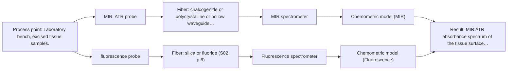
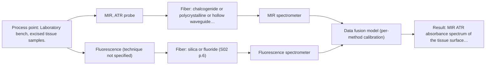

# First technical assessment: Local measurements of heterogeneous model tissues

## Answer

**Customer request (our summary):** Research group evaluating a spectral measurement interface with model biological tissues for a laboratory classification study, wanting to compare MIR ATR and fluorescence information.

### Brief answer

Test MIR ATR and fluorescence on the same marked points of chicken breast, fat and liver, with one model per method first and a fused model only as a later comparison. Published work on these tissues is a precedent for the approach, not proof for your setup. Still open: whether fluorescence gives usable signal on your samples, how ground truth is defined, and whether a combined probe is needed.

### Proposal

- **Best current option:** O2 (recommended)
- **Basis:** supplied AFS sources
- **What would change it:** If the fluorescence channel gives no usable signal on these samples, O1 (MIR ATR alone) becomes the first experiment. If the grid comparison shows that the two probes still see different volumes, O3 becomes the better choice.
- **Next step:** Fix the class labels and reference method, then measure MIR ATR and fluorescence at the same marked points on three samples each of breast, fat and liver.

**Secondary evidence (external, not AFS material):** G1: E01 ¶31. See Expert detail.

**Decision status:** Provisional feasibility assessment

### Solution options

| ID | Tier | Methods | Confidence | Cost class, S01 Table 1 (p.6) | Ease of use | Maintenance | Performance fit | Sources |
|---|---|---|---|---|---|---|---|---|
| O1 | Simple | M1 MIR, ATR probe | Medium: open question: Q3 (starts at Medium) | high cost (row 2) | one probe, one instrument, simple setup | crystal cleaning and contact control | gives the single-method baseline first | [1: S01 p.10] [2: S01 p.9] [3: S01 p.13] [4: REF §5] |
| O2 | Recommended | M1 MIR, ATR probe; M2 fluorescence probe | Low: open question: Q1, Q3 (starts at Medium); fit for soft solid to be tested, sample clarity unknown, fluorescent target unknown | high cost (rows 2, 19) | two probes, careful grid alignment | two instrument chains to calibrate | direct comparison on marked grid points | [5: S04 p.2] [1: S01 p.10] [2: S01 p.9] [3: S01 p.13] [4: REF §5] [6: S04 p.3] [7: S01 p.5] [8: S04 p.4] |
| O3 | Extended (multi-method) | M3 MIR, ATR probe + Fluorescence (combination) | Low: open question: Q2, Q3 (starts at Medium); fit for soft solid to be tested, sample clarity unknown, fluorescent target unknown; multi-method, fusion benefit not yet shown | high cost (rows 2, 19) | one probe head, two spectrometers | two calibrations, probe head care | removes spot-mismatch risk on heterogeneous tissue | [9: S04 p.2] [10: S01 p.8] [11: S01 p.9] [12: S04 p.4] [13: S04 p.4] [14: S04 p.1] [15: REF §5] |

*Confidence rates the basis of the advice (how much is known and cited), not a predicted accuracy or probability of success. It starts at High, or at Medium when a key question on the method or the option is open, and drops one level per weakness listed (floor Low).*

*Cost class is the relative rating in S01 Table 1 (p.6) for the in-line method+technique rows named (the highest one for a multi-method option); it is not a price.*

### Setup sketch

*Recommended option O2; drawn by code from the option, a schematic, not a configuration.*

### Key questions

1. Do the chicken breast, fat and liver samples give a fluorescence signal above background with the excitation wavelength you intend to use, and which excitation and emission settings are planned?
2. Must MIR ATR and fluorescence analyse the same spot on the sample, or is a marked position grid with two separate probes acceptable for this laboratory study?
3. What independent reference assigns the class label to each measurement point, and how many samples per class will be measured?

## Expert detail

**Customer enquiry**

> Our research group is evaluating a spectral measurement interface using model biological tissues such as chicken muscle, fat and liver. We want to compare MIR ATR and fluorescence information, because the material is heterogeneous and sequential measurements may not sample the same location. This is a laboratory classification study. We need a first comparison experiment and a clear statement of what its results would demonstrate.

**Decision status:** Provisional feasibility assessment. A method shortlist can be justified: the customer's proposed comparison of MIR ATR and fluorescence on chicken muscle, fat and liver matches a published laboratory demonstration on the same model tissues, and the co-location concern they raise is a documented issue. What remains open is the classification frame itself: ground truth, number of samples, fluorescence signal strength and the numerical go/no-go criteria.

### Parameters

| ID | Parameter | Kind | Need | Measured by | Why | Sources |
|---|---|---|---|---|---|---|
| P1 | Tissue class label per measurement point (muscle, fat, liver) | qualitative | required | Reference lab method: independent reference label per point by the customer's own method, for example dissection or histology | A classification study needs an independent label for every measurement point; without it no model can be trained or checked. | [16: REF §3] |
| P2 | MIR ATR absorbance spectrum of the tissue surface layer | quantitative | required | Spectroscopy: MIR | The MIR block is the primary method, and its band intensities in the fingerprint region carry the lipid and protein information used to separate the tissue types. | [17: S04 p.3] |
| P3 | Fluorescence emission intensity of the sample at the chosen excitation | quantitative | required | Spectroscopy: Fluorescence | The fluorescence block only adds information if a fluorescent species is present and gives a signal above background on these samples. | [6: S04 p.3] [7: S01 p.5] |

### Solution option details

- **O1 cost drivers:** one MIR ATR probe and spectrometer time
- **O2 cost drivers:** two probes and spectrometers, position marking, sample handling
- **O3 cost drivers:** combined probe head, CIR and silica fibers, two spectrometers
- **O3 combining methods:** Both channels look at the same spot through one probe head, so the two blocks can be fused at low level after block scaling, with one model per method kept as the baseline. Acquisition rates differ between the two methods, so the blocks must be aligned to a common time step and each instrument keeps its own calibration and diagnostics. The fused model must beat the best single method on held-out samples, otherwise the extra channel is dropped.

*Extended (multi-method) option O3; drawn by code from the option, a schematic, not a configuration.*

### Premise check

- **Precedent only:** MIR ATR and fluorescence information can be meaningfully compared on these heterogeneous samples. A published laboratory study built a multispectral ATR IR + fluorescence probe and applied it to these model tissues; that is a reason to test the comparison, not proof for this group's interface or samples. [18: S04 p.1] [19: S04 p.4]
- **Supported:** Heterogeneity and possible non-colocation of sequential measurements are the key reasons for the comparison. The sources state that alternating measurements with separate probes cannot guarantee that both methods analyse the same spot, and that the two methods should see the same small area. [20: S04 p.2] [21: S01 p.8]
- **Precedent only:** Chicken muscle, fat and liver are suitable model tissues for evaluating a spectral measurement interface. A source describes poultry as an attractive model system for evaluating spectroscopic methods and equipment; this supports the choice by precedent, not as a specification. [22: S04 p.3]

### Requirements

**Stated by the customer**

- "Our research group is evaluating a spectral measurement interface using model biological tissues such as chicken muscle, fat and liver"
- "We want to compare MIR ATR and fluorescence information"
- "because the material is heterogeneous and sequential measurements may not sample the same location"
- "This is a laboratory classification study."
- "We need a first comparison experiment and a clear statement of what its results would demonstrate"
- "MIR ATR and fluorescence information"
- "laboratory classification study"

**Key unknowns**

- Which class labels define the task, and which independent reference (for example dissection or histology) assigns a label to each measurement point.
- Whether the tissues give a usable endogenous fluorescence signal above background, and at which excitation wavelength.
- Whether the two measurements must be co-located on the same spot, or whether a marked position grid is acceptable for this laboratory study.
- The MIR ATR measurement conditions (crystal material, contact and pressure, spectral range, resolution, number of co-added scans).
- The fluorescence measurement conditions (excitation wavelength, filters, detector, integration time).
- The numerical go/no-go criteria (for example minimum correct-classification rate on held-out samples, minimum fluorescence signal-to-background).

### Clarification questions (most decision-relevant first)

Q1. Do the chicken breast, fat and liver samples give a fluorescence signal above background with the excitation wavelength you intend to use, and which excitation and emission settings are planned? *Why it matters:* Fluorescence is informative only where a fluorophore is present, so this decides whether the fluorescence block can be tested at all. *(affects: M2)*
Q2. Must MIR ATR and fluorescence analyse the same spot on the sample, or is a marked position grid with two separate probes acceptable for this laboratory study? *Why it matters:* This decides whether a single combined probe head is needed or whether standard probes on one grid are sufficient. *(affects: installation, M3)*
Q3. What independent reference assigns the class label to each measurement point, and how many samples per class will be measured? *Why it matters:* Without an independent label per point the classification result cannot be interpreted or validated. *(affects: method)*
Q4. Which MIR ATR configuration and measurement conditions do you plan (crystal material, contact pressure, spectral range, resolution, number of co-added scans)? *Why it matters:* ATR samples only a few micrometres at the surface, so contact and crystal choice change the measured spectrum. *(affects: technique)*
Q5. What numerical criteria would make you accept or reject the comparison (for example minimum correct-classification rate on held-out samples, minimum fluorescence signal-to-background)? *Why it matters:* The go/no-go basis has to come from you; the sources give no target figures for this study. *(affects: status)*
Q6. How do the tissue samples behave optically at the measurement surface - are they opaque and strongly scattering, or clear and transmissive - and does that match the fluorescence geometry you plan? *Why it matters:* The optical behaviour decides which fluorescence measurement geometry is usable and whether a surface-contact interface is the right choice. *(affects: technique, M2)*

### Recommendation

- **M1 · Primary candidate: MIR, ATR probe.** MIR ATR is the best-supported single method here: ATR suits liquid and soft solid samples that make tight contact, and MIR band spectra are well defined and selective. Its nominal range is 4000-400 cm-1, while the usable range depends on the instrument, fiber and probe selected. *Conditions:* Tight contact and a clean crystal must be maintained, because the ATR layer is only a few micrometres deep. [1: S01 p.10] [2: S01 p.9] [3: S01 p.13] [4: REF §5]
- **M2 · Conditional candidate: fluorescence probe.** Fluorescence adds information on fluorophores that MIR does not show directly, and a liver-specific porphyrin peak was observed on these model tissues. It applies only where a fluorescent species is present, which most chemicals are not. *Conditions:* Applies only if a usable signal above background is confirmed on the customer's samples at the chosen excitation wavelength. [6: S04 p.3] [7: S01 p.5] [8: S04 p.4]
- **M3 · Comparison candidate: MIR, ATR probe + Fluorescence (combination).** The two methods see different things: MIR separates the lipid-rich fat, fluorescence recognises liver tissue, and only the joint model separated all three classes in the published chicken-tissue work. Any gain from joining them is a hypothesis to test against the best single method. *Conditions:* Test only after the single-method measurements, and only where both methods analyse the same measurement point. [12: S04 p.4] [13: S04 p.4] [14: S04 p.1] [15: REF §5] Later hypothesis, after single-method tests.

### Measurement concept

- **Probe and geometry:** MIR ATR with the sample in contact with the crystal; fluorescence through the same measurement interface or, for the first comparison, a second probe on the same marked points.
- **Location:** Laboratory bench, excised tissue samples.
- **Fiber link:** Not specified here: the fiber family and any link length must come from the configuration actually selected, not from a nominal method range. [23: S04 p.2]

### Spectral range

- **MIR:** ATR [2: S01 p.9] [4: REF §5]
- **Fluorescence:** fluorescence_probe [24: REF §5] [25: S01 p.12]

### Risks and uncertainty

- The fluorescence block may be dominated by background or by variable autofluorescence, so it may add little beyond the MIR block on these samples. *(rules: R-FLU-2)* [26: S01 p.5]
- If the two probes do not look at the same volume, an apparent gain of a joint model can be a sampling artefact rather than a real complementarity. *(rules: R-CMB-2)* [20: S04 p.2]
- Contact pressure and surface fat or fluid on the ATR crystal can change the MIR spectrum, because ATR samples only the outermost few micrometres. *(rules: R-MIR-3)* [3: S01 p.13]
- With few samples a joint model can overfit, so conclusions must rest on validation with whole samples or positions held out. *(rules: R-CAL-1)* [27: S03 p.13]

### First feasibility experiment

1. **Prepare three samples each of chicken breast or muscle, fat and liver, each large enough to hold several measurement points, and mark a position grid on every sample.** Sample set [28: S04 p.3] [29: S04 p.3]
2. **Record MIR ATR spectra at every grid point of every sample with fixed contact conditions, and build one classification model for the MIR block alone.** Single method first *(no verified source: engineering judgement)*
3. **Record fluorescence spectra at the same grid points with the chosen excitation and emission settings, and check the signal against a background measurement before modelling.** Second single method *(no verified source: engineering judgement)*
4. **Assign every measurement point an independent class label with the customer's reference method, without knowledge of the spectra.** Independent reference [16: REF §3]
5. **Compare the best single-method model with the joined two-block model, holding out whole samples or whole positions, and judge the result against the customer's own numerical criteria.** Comparison and go/no-go [15: REF §5] [27: S03 p.13]

**Reference measurements:** An independent class label for every measurement point, defined by the customer's own reference method (for example dissection or histology), recorded before or without knowledge of the spectra.

**Decision basis:** The customer's own numerical criteria on held-out samples, for example a minimum correct-classification rate and a minimum fluorescence signal-to-background.

### Assumptions

- The customer supplies excised, fresh tissue samples of comparable size and handling.
- MIR ATR is used with tight sample contact and a clean crystal.
- A usable endogenous fluorophore exists in at least some of the samples.
- The tissue samples are assumed to be optically opaque and strongly scattering at the measurement surface; if some of them are clear or highly transmissive, the fluorescence geometry and the measurement interface would have to be reconsidered.

### Further notes

- **Chemometrics:** Build one model per method first (PCA for exploration, PLS-DA for classification) and validate by excluding whole samples or measurement positions, since repeated measurements at one position behave similarly; the published work then fused the two blocks by simple concatenation after rescaling.
- **Future direction:** If the two-method comparison works, the natural extension is a single probe head for both channels, and the source notes that such a probe can later be modified for diffuse reflectance UV-vis or NIR measurements instead of fluorimetry.

### Secondary evidence (external, not AFS material)

*Found by a literature search for gaps the supplied AFS sources leave open. Not AFS material and not proof for this case; every quote below was verified verbatim against the fetched text.*

**G1 · multi-method:** Combining several spectroscopy methods (data fusion) (Both channels look at the same spot through one probe head, so the two blocks can be fused at low level after block scaling, with one model per method kept as the baseline. Acquisition rates differ between the two methods, so the blocks must be aligned to a common time step and each instrument keeps its own calibration and diagnostics. The fused model must beat the best single method on held-out samples, otherwise the extra channel is dropped.)

- **E01 ¶31** The source describes low-level data fusion as the simplest way to combine inputs by rearranging variables from different sources into one new data matrix. *How it applies:* This supports the proposed low-level fusion of the two blocks after block scaling, but the source does not address differing acquisition rates or time-step alignment. *Limits and transfer risks:* It is a general PAT review, not a study of MIR ATR and fluorescence on the same probe head or of model biological tissues, so transfer to this interface and sample set is uncertain. *(supports O3)*
  > "Low-level data fusion (LLDF) is considered the simplest method to achieve a combination of inputs. In this case, the data is rearranged into a new data matrix, where the variables coming from different sources are placed one after the other."
  > Challenges and Opportunities of Implementing Data Fusion in Process Analytical Technology-A Review. (2022) · Molecules (Basel, Switzerland) · doi:10.3390/molecules27154846 · https://europepmc.org/article/PMC/PMC9369811 · retrieved 2026-10-17, full text, licence: cc by, via curated library

### Evidence (verified quotes)

1. ✓ **S01 p.10** (general): "ATR fiber probes (Fig.1) enable the analysis of liquids and solid elastic samples"
2. ✓ **S01 p.9** (general): "Vibrational spectroscopy in the mid-IR range (4000-400 cm-1) is one of the most informative methods of chemical analysis."
3. ✓ **S01 p.13** (general): "typically at a depth of few microns"
4. ✓ **REF §5** (general): "It is not a product specification: actual spectral coverage, fiber length, component ratings, detection limits and accuracy depend on the configuration and the sample."
5. ✓ **S04 p.2** (application precedent): "to ensure the compatibility of separate measurements on the same points using IR and fluorescence probes"
6. ✓ **S04 p.3** (general): "The most selective peak at 613 nm, which can be assigned to porphyrins, has sufficient specificity to distinguish the liver from other measured samples."
7. ✓ **S01 p.5** (general): "However, most chemicals do not exhibit this property."
8. ✓ **S04 p.4** (general): "it is limited to the samples containing at least one fluorescent component"
9. ✓ **S04 p.2** (general): "high transparency in the working spectral regions of both chalcogenide infrared (CIR) and UV silica fibers"
10. ✓ **S01 p.8** (general): "The use of a combined probe facilitates measurements and allows for the analysis of a smaller sample volume."
11. ✓ **S01 p.9** (general): "One of the challenges of multispectral analysis is the need to simultaneously connect at least two independently operating measuring instruments."
12. ✓ **S04 p.4** (application precedent): "IR spectroscopy works better for the discrimination of fat (Figure 3a), whereas fluorescence is well suited for the recognition of liver tissue"
13. ✓ **S04 p.4** (application precedent): "none of the individual techniques was sufficient to completely separate the three sample classes on the PCA score plots"
14. ✓ (precedent only) **S04 p.1** (method gain): "results in much better accuracy of the tumor margin detection than each of the methods individually"
15. ✓ **REF §5** (general): "compare with the best single method."
16. ✓ **REF §3** (general): "Representative samples or process states, independent reference measurements, what is compared, and the basis for the go / no-go decision."
17. ✓ **S04 p.3** (general): "The discriminative power of mid-IR spectroscopy (Figure 2a and Figure S-4) toward rich in lipids fat samples is related to the stretching vibration band of the ester carbonyl C=O at about 1740 cm-1"
18. ✓ **S04 p.1** (general): "A multispectral fiber optic probe has been developed that enables simultaneous analysis of various liquid and solid samples using attenuated total reflection mid-infrared spectroscopy and fluorimetry."
19. ✓ **S04 p.4** (application precedent): "the PCA model built on the concatenated IR and fluorescence data revealed three distinct groups of samples corresponding to tissue types"
20. ✓ **S04 p.2** (general): "Such alternating multispectral measurements cannot guarantee complete coincidence of the spots analyzed by both methods"
21. ✓ **S01 p.8** (general): "It is crucial that the spectral information obtained by different methods-Mid-IR, NIR, Raman, and fluorescence spectra-is collected from the same small, even pinpoint, area of the sample."
22. ✓ **S04 p.3** (application precedent): "Commercially produced poultry combines the availability of fresh samples and the variability of tissue types, making it an attractive model system for evaluating spectroscopic methods and equipment."
23. ✓ **S04 p.2** (general): "The main challenge of such local multispectral analysis is related to the necessity to perform different spectroscopic measurements at the same point simultaneously."
24. ✓ **REF §5** (general): "Depends on the fluorescent species"
25. ✓ **S01 p.12** (general): "Fluorimetry is based on measuring the broad emission signal observed upon irradiation of certain samples in the UV and visible regions."
26. ✓ **S01 p.5** (general): "the strong overlap of spectral signals in UV spectra complicates the analysis of real samples"
27. ✓ **S03 p.13** (general): "Repeated measurements in the same sample position produced similar spectra or sensor data; therefore, these should always be simultaneously excluded for every CV iteration."
28. ✓ **S04 p.3** (application precedent): "To provide the necessary statistical representativeness of the data, three samples of each tissue type were prepared."
29. ✓ **S04 p.3** (application precedent): "The samples were large enough to reflect the possible heterogeneity of the tissue."

### Verification

- Citations verified: 39 of 39 (exact or whitespace/hyphen-tolerant match on the cited page, scope checked).
- Hard check failures before deterministic corrections: 0; still open: 0; soft warnings: 1; repair rounds: 1.
- External evidence (live): 1 quote(s) verified verbatim (exact or whitespace/hyphen-tolerant, at most 400 characters and 2 sentences, against the cited paragraph); 1 item(s) dropped.
- External search: 3 query(ies), 30 hit(s), 5 source(s) (3 from the curated library).
- External step: 2 model call(s), 69.8 s extra (cost in the run JSON).
  - ⚠ dropped G1 E05 ¶10: quote not verified (too_long: quote longer than 400 characters (418))

*Run D08-20261017T225856Z · models deepseek/deepseek-v4.1-flash*
