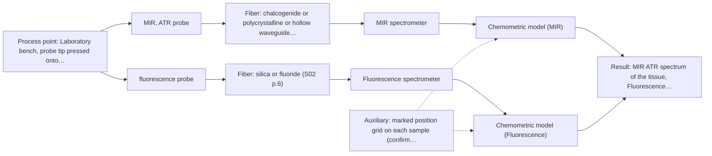
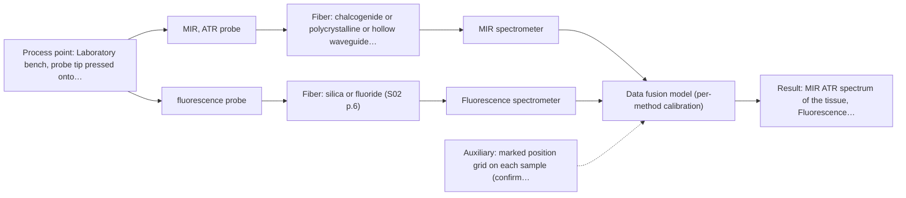

# First technical assessment: Local measurements of heterogeneous model tissues

## Answer

**Customer request (our summary):** The customer wants a first comparison experiment and results interpretation for using MIR ATR versus fluorescence spectroscopy to classify heterogeneous model biological tissues (chicken muscle, fat, and liver).

### Brief answer

Test MIR ATR first as the primary method alongside fluorescence in a sequential single-method comparison (O2) on marked positions, with a combined probe (O3) tested if available to resolve same-spot alignment. The experiment demonstrates which single method best separates the tissue types and whether fused same-spot data yields a measurable classification gain. Still open: your acceptance criteria, excitation wavelength and fluorophores, and combined-probe availability.

### Proposal

- **Best current option:** O2 (recommended)
- **Basis:** supplied AFS sources
- **What would change it:** If the group does not have a fluorescence setup or the tissues lack detectable fluorophores, O1 with MIR ATR alone becomes the primary path. If a combined probe is already in hand, testing can proceed directly to evaluate O3 alongside O2.
- **Next step:** Run the laboratory comparison on representative chicken tissue samples using sequential single-method measurements (O2), with the combined probe (O3) tested if available.

**Secondary evidence (external, not AFS material):** G1: no usable external source found; G2: E03 ¶31; G3: no usable external source found; G4: no usable external source found. See Expert detail.

**Decision status:** Provisional feasibility assessment

### Solution options

| ID | Tier | Methods | Confidence | Cost class, S01 Table 1 (p.6) | Ease of use | Maintenance | Performance fit | Sources |
|---|---|---|---|---|---|---|---|---|
| O1 | Simple | M1 MIR, ATR probe | High | high cost (row 2) | Single standard ATR probe, straightforward setup | Low; one spectrometer and probe | Evaluates if MIR alone classifies tissues | [1: S01 p.9] [2: S01 p.10] [3: S01 p.13] |
| O2 | Recommended | M1 MIR, ATR probe; M2 fluorescence probe | Low: open question: Q2 (starts at Medium); fit for soft solid to be tested, fluorescent target unknown | high cost (rows 2, 19) | Two separate probes on marked spots | Moderate; two separate spectrometers to maintain | Directly compares both single-method classification capabilities | [1: S01 p.9] [2: S01 p.10] [3: S01 p.13] [4: S01 p.5] [5: S04 p.3] |
| O3 | Extended (multi-method) | M1 MIR, ATR probe; M2 fluorescence probe; M3 MIR, ATR probe + Fluorescence (combination) | Low: open question: Q2, Q3 (starts at Medium); fit for soft solid to be tested, fluorescent target unknown; multi-method, fusion benefit not yet shown | high cost (rows 2, 19) | One combined probe head, two spectrometers | Moderate; two instrument blocks each calibrated | Simultaneous same-spot measurement directly resolves heterogeneity | [6: S04 p.4] [7: S01 p.8] [1: S01 p.9] [2: S01 p.10] [3: S01 p.13] [4: S01 p.5] [5: S04 p.3] [8: S04 p.1] [9: S01 p.8] |

*Confidence rates the basis of the advice (how much is known and cited), not a predicted accuracy or probability of success. It starts at High, or at Medium when a key question on the method or the option is open, and drops one level per weakness listed (floor Low).*

*Cost class is the relative rating in S01 Table 1 (p.6) for the in-line method+technique rows named (the highest one for a multi-method option); it is not a price.*

### Setup sketch

*Recommended option O2; drawn by code from the option, a schematic, not a configuration.*

### Key questions

1. What classification accuracy (e.g. sensitivity, specificity or misclassification rate) would the group accept as a go/no-go criterion for each method and for the combination?
2. Which fluorophores do you expect in your tissue models, and which fluorescence excitation wavelength is planned?
3. Is a combined MIR-ATR + fluorescence probe available for the study, or should the first comparison use two separate probes on marked positions?

## Expert detail

**Customer enquiry**

> Our research group is evaluating a spectral measurement interface using model biological tissues such as chicken muscle, fat and liver. We want to compare MIR ATR and fluorescence information, because the material is heterogeneous and sequential measurements may not sample the same location. This is a laboratory classification study. We need a first comparison experiment and a clear statement of what its results would demonstrate.

**Decision status:** Provisional feasibility assessment. A laboratory comparison of MIR ATR and fluorescence on chicken tissues is directly supported by a published precedent with the same tissues and a combined probe, so a method shortlist and a first experiment can be justified; no process or clinical claim follows from it.

### Parameters

| ID | Parameter | Kind | Need | Measured by | Why | Sources |
|---|---|---|---|---|---|---|
| P1 | Tissue type (muscle, fat, liver) | qualitative | required | Reference lab method: visual/histological labelling of each sample and position | It is the classification target against which each method's discriminative power is judged. | *(no verified source: engineering judgement)* |
| P2 | MIR ATR spectrum of the tissue | quantitative | required | Spectroscopy: MIR | It is the primary spectral input whose classification performance is being compared. | [1: S01 p.9] |
| P3 | Fluorescence emission spectrum of the tissue | quantitative | required | Spectroscopy: Fluorescence | It is the second spectral input whose complementary information content is being tested. | [10: S01 p.12] |
| P4 | Measurement position / local heterogeneity within each sample | qualitative | optional | Auxiliary sensor: marked position grid on each sample (cited; confirm availability with AFS) | It should be recorded because heterogeneity between positions drives spectral scatter and the same-spot question the group raised. | [11: S04 p.3] |

### Solution option details

- **O1 cost drivers:** FTIR spectrometer, ATR probe, tissue samples
- **O2 cost drivers:** Two spectrometers, two single probes, reference labelling
- **O3 cost drivers:** Combined multispectral probe, two spectrometers, chemometrics software
- **O3 combining methods:** Low-level data fusion: MIR-ATR and fluorescence spectra from the same probe spot are concatenated into a single matrix, as demonstrated on chicken tissues. Both channels must sample the same small area and data must be normalised to a common time step, with block scaling applied so neither method dominates. Each instrument keeps its own calibration, and the fused model must beat the best single method on held-out validation samples.

*Extended (multi-method) option O3; drawn by code from the option, a schematic, not a configuration.*

### Premise check

- **Supported:** Sequential measurements with separate probes may not sample the same location in heterogeneous tissue. Both the concept document and the probe study state this difficulty explicitly. [12: S01 p.8] [13: S04 p.2]
- **Precedent only:** Chicken muscle, fat and liver contain measurable fluorophores, so fluorescence can contribute to the classification. The published probe study measured intrinsic fluorescence (FAD-dominated band, porphyrin peak at 613 nm) in exactly these chicken tissues; this is a reason to test, not a guarantee for the customer's samples. [5: S04 p.3]
- **Precedent only:** A combined MIR-ATR + fluorescence probe can classify biological tissues better than either method alone. Shown for chicken breast, fat and liver in a laboratory PCA study; it is a hypothesis to reproduce, not proof for a new setup. [14: S04 p.4] [6: S04 p.4]

### Requirements

**Stated by the customer**

- A first comparison experiment for MIR ATR versus fluorescence on chicken muscle, fat and liver.
- A clear statement of what the experiment's results would demonstrate.
- Handling of tissue heterogeneity, since sequential measurements may not sample the same location.

**Key unknowns**

- Required classification accuracy and the go/no-go criteria the group will accept.
- Which fluorophores are expected and which excitation wavelength the fluorescence channel will use.
- Whether a combined MIR-ATR + fluorescence probe is available, or two separate probes must be compared first.
- How many tissue samples and measurement positions per tissue type are available for calibration and validation.

### Clarification questions (most decision-relevant first)

Q1. What classification accuracy (e.g. sensitivity, specificity or misclassification rate) would the group accept as a go/no-go criterion for each method and for the combination? *Why it matters:* The go/no-go numbers must come from the customer; without them the comparison experiment cannot be judged. *(affects: status)*
Q2. Which fluorophores do you expect in your tissue models, and which fluorescence excitation wavelength is planned? *Why it matters:* Fluorescence only measures species that actually fluoresce, and the excitation wavelength determines which fluorophores are seen. *(affects: technique, M2)*
Q3. Is a combined MIR-ATR + fluorescence probe available for the study, or should the first comparison use two separate probes on marked positions? *Why it matters:* The combined probe is what solves the same-spot problem the group raised; two separate probes reintroduce it. *(affects: installation, M3)*
Q4. How many independent tissue samples per type (and measurement positions per sample) can you provide for calibration and held-out validation? *Why it matters:* With few samples, fused models risk overfitting and the validation design must be planned around it. *(affects: M3, status)*

### Recommendation

- **M1 · Primary candidate: MIR, ATR probe.** MIR ATR gives well-defined absorption bands of the tissue chemistry and suits soft solids in contact with the crystal, so it is the strongest single method to test first. Its few-micrometre penetration depth means it reads a surface layer, which must be kept in mind on heterogeneous tissue. *Conditions:* Tissue must contact the ATR crystal tightly; deposits and surface representativeness are checked during the trial. [1: S01 p.9] [2: S01 p.10] [3: S01 p.13]
- **M2 · Comparison candidate: fluorescence probe.** Fluorescence is highly sensitive and, in the published chicken-tissue study, distinguished liver via a porphyrin band that IR did not separate as well. Its selectivity is low, so it must be tested against the actual fluorophores present. *Conditions:* The tissues must contain fluorescent components; excitation wavelength to be fixed with the group (Q2). [4: S01 p.5] [5: S04 p.3]
- **M3 · Conditional candidate: MIR, ATR probe + Fluorescence (combination).** A combined MIR-ATR + fluorescence probe measures both signals from the same spot simultaneously, which directly addresses the group's heterogeneity concern, and the published study showed the fused data separating chicken tissue classes where single methods did not. The gain over the best single method is a hypothesis to confirm after M1 and M2. *Conditions:* Applies if Q3 confirms a combined probe is available and the single-method tests show complementary information. [8: S04 p.1] [6: S04 p.4] [9: S01 p.8] Later hypothesis, after single-method tests.

### Measurement concept

- **Probe and geometry:** MIR ATR fiber probe with a ZrO2 or diamond ATR tip in contact with the tissue; fluorescence via a fiber probe at the same or (preferably) the same combined probe head.
- **Location:** Laboratory bench, probe tip pressed onto defined marked positions on each tissue sample.
- **Fiber link:** MIR channel needs CIR or PIR fiber (silica does not transmit mid-IR); fluorescence channel uses silica fibers; short lab lengths are sufficient. [15: S02 p.6] [16: S04 p.2]

### Spectral range

- **MIR:** Nominal mid-IR range 4000-400 cm-1; the usable range depends on the selected ATR crystal, CIR/PIR fiber and spectrometer. [1: S01 p.9]
- **Fluorescence:** Emission range depends on the specific fluorophores present and the excitation wavelength chosen in the UV and visible regions; the usable range depends on the instrument, fiber, and probe optics. [17: S01 p.12]

### Risks and uncertainty

- ATR reads only a few micrometres of surface, so on heterogeneous tissue the classification may reflect local surface composition rather than tissue type. *(rules: R-MIR-3, R-GEN-5)* [3: S01 p.13]
- If the fluorescence channel excites the wrong fluorophores or the tissues lack fluorescent components, its contribution may be negligible. *(rules: R-FLU-1)* [18: S01 p.5]
- With few samples per tissue type, fused or single-method classification models can overfit and validation statistics become unreliable. [19: S03 p.6]
- The published same-spot synergy was shown with a combined probe; reproducing it with two alternating probes may fail for exactly the reason the group stated. *(rules: R-CMB-2)* [13: S04 p.2]

### First feasibility experiment

1. **Collect fresh chicken muscle, fat and liver samples covering the expected biological variation (multiple animals, multiple positions per tissue), and mark fixed measurement positions.** Representative sampling across the chemical and physical variation of each tissue type. *(no verified source: engineering judgement)*
2. **Record independent reference labels for every sample and position (tissue type confirmed visually/histologically) before any spectral measurement.** Ground truth for the classification comparison. *(no verified source: engineering judgement)*
3. **Measure each marked position with MIR ATR alone and with fluorescence alone, then with the combined probe at the same spot if available.** Single methods first; the combination is tested against them at the identical location. *(no verified source: engineering judgement)*
4. **Build one classification model per method (e.g. PCA/PLS-DA) and one on the fused data; validate on held-out samples or positions, not on the calibration set.** Compare single-method versus fused performance on independent data. [20: S04 p.4]
5. **Apply the customer's go/no-go criteria (Q1): the combination is kept only if it beats the best single method on the held-out validation set.** Decide whether the multispectral interface is worth pursuing. *(no verified source: engineering judgement)*

**Reference measurements:** Tissue type per sample and position, confirmed independently of the spectra (visual/histological labelling).

**Decision basis:** Per-method and fused classification performance on held-out samples, judged against the accuracy criteria the group defines in Q1.

### Assumptions

- Fresh (not frozen/thawed) tissue is used, or the effect of freezing on the spectra is explicitly tested.
- Short fiber links (bench scale) are sufficient, so MIR fiber length is not a limiting question in this laboratory study.

### Not covered by the supplied sources

- Required classification accuracy or acceptance criteria for the group's study.
- Specific instrument models or excitation wavelength the group plans to use.

### Further notes

- **Chemometrics:** Start with unsupervised PCA per method block, then PLS-DA classification; validate with segmented cross-validation or held-out samples and, with few samples, a permutation test to guard against chance correlation, as done in the cited tissue studies.
- **Future direction:** If the laboratory comparison succeeds, the same combined-probe concept could later be evaluated for in-line or in-situ tissue measurements, but that would need its own feasibility work.

### Secondary evidence (external, not AFS material)

*Found by a literature search for gaps the supplied AFS sources leave open. Not AFS material and not proof for this case; every quote below was verified verbatim against the fetched text.*

**G1 · auxiliary sensor:** In-line measurement of Measurement position / local heterogeneity within each sample with marked position grid on each sample

- No usable external source found.

**G2 · multi-method:** Combining several spectroscopy methods (data fusion) (Low-level data fusion: MIR-ATR and fluorescence spectra from the same probe spot are concatenated into a single matrix, as demonstrated on chicken tissues. Both channels must sample the same small area and data must be normalised to a common time step, with block scaling applied so neither method dominates. Each instrument keeps its own calibration, and the fused model must beat the best single method on held-out validation samples.)

- **E03 ¶31** Low-level data fusion rearranges data into a new matrix where variables from different sources are placed one after the other. *How it applies:* This approach can be tested to concatenate MIR-ATR and fluorescence spectra for classifying the model biological tissues. Block scaling and evaluation of individual dataset contributions should be considered during model development. *Limits and transfer risks:* The cited study focuses on general data fusion principles rather than chicken muscle, fat, and liver classification specifically. Differences in matrix composition and instrument response may affect transferability. *(supports O3)*
  > "Low-level data fusion (LLDF) is considered the simplest method to achieve a combination of inputs. In this case, the data is rearranged into a new data matrix, where the variables coming from different sources are placed one after the other."
  > Challenges and Opportunities of Implementing Data Fusion in Process Analytical Technology-A Review. (2022) · Molecules (Basel, Switzerland) · doi:10.3390/molecules27154846 · https://europepmc.org/article/PMC/PMC9369811 · retrieved 2026-10-17, full text, licence: cc by, via curated library

**G3 · not in the supplied sources:** Required classification accuracy or acceptance criteria for the group's study.

- No usable external source found.

**G4 · not in the supplied sources:** Specific instrument models or excitation wavelength the group plans to use.

- No usable external source found.

### Evidence (verified quotes)

1. ✓ **S01 p.9** (general): "Vibrational spectroscopy in the mid-IR range (4000-400 cm-1) is one of the most informative methods of chemical analysis."
2. ✓ **S01 p.10** (general): "ATR fiber probes (Fig.1) enable the analysis of liquids and solid elastic samples"
3. ✓ **S01 p.13** (general): "typically at a depth of few microns"
4. ✓ **S01 p.5** (general): "Another highly sensitive method, UV/Vis fluorimetry, is based on the secondary emission of excited molecules of certain substances"
5. ✓ **S04 p.3** (application precedent): "The most selective peak at 613 nm, which can be assigned to porphyrins, has sufficient specificity to distinguish the liver from other measured samples."
6. ✓ (precedent only) **S04 p.4** (method gain): "the PCA model built on the concatenated IR and fluorescence data revealed three distinct groups of samples corresponding to tissue types"
7. ✓ **S01 p.8** (general): "Ultimately, the measurement data must be normalized to a common time step."
8. ✓ **S04 p.1** (application precedent): "A multispectral fiber optic probe has been developed that enables simultaneous analysis of various liquid and solid samples using attenuated total reflection mid-infrared spectroscopy and fluorimetry."
9. ✓ **S01 p.8** (general): "The use of a combined probe facilitates measurements and allows for the analysis of a smaller sample volume."
10. ✓ **S01 p.12** (general): "Fluorescence spectroscopy can be used for multispectral measurements, for example, in combination with Mid-IR or NIR spectroscopy."
11. ✓ **S04 p.3** (application precedent): "The samples were large enough to reflect the possible heterogeneity of the tissue. Each sample was represented by five distributed points."
12. ✓ **S01 p.8** (general): "collected from the same small, even pinpoint, area of the sample. This is difficult to achieve by using two probes alternately for measurements."
13. ✓ **S04 p.2** (general): "Such alternating multispectral measurements cannot guarantee complete coincidence of the spots analyzed by both methods"
14. ✓ **S04 p.4** (application precedent): "none of the individual techniques was sufficient to completely separate the three sample classes on the PCA score plots"
15. ✓ **S02 p.6** (general): "1100 nm Chalcogenide As-S IR Fibers 6500 nm"
16. ✓ **S04 p.2** (general): "ZrO2 crystal was chosen due to its high (close to the diamond) refractive index, high transparency in the working spectral regions of both chalcogenide infrared (CIR) and UV silica fibers"
17. ✓ **S01 p.12** (general): "Fluorimetry is based on measuring the broad emission signal observed upon irradiation of certain samples in the UV and visible regions."
18. ✓ **S01 p.5** (general): "However, most chemicals do not exhibit this property."
19. ✓ **S03 p.6** (general): "In order to reduce the risk of overfitting caused by the limited experimental data volume, a thorough validation of the discrimination models was required."
20. ✓ **S04 p.4** (general): "The data preprocessing and analysis in this study were deliberately minimized to facilitate understanding of how complementary spectral information contributes into the joint multivariate model."

### Verification

- Citations verified: 27 of 27 (exact or whitespace/hyphen-tolerant match on the cited page, scope checked).
- Hard check failures before deterministic corrections: 0; still open: 0; soft warnings: 2; repair rounds: 1.
- External evidence (live): 1 quote(s) verified verbatim (exact or whitespace/hyphen-tolerant, at most 400 characters and 2 sentences, against the cited paragraph); 0 item(s) dropped.
- External search: 4 query(ies), 35 hit(s), 5 source(s) (3 from the curated library).
- External step: 2 model call(s), 5.5 s extra (cost in the run JSON).

*Run D08-20261018T094733Z-b559 · models google/gemini-3.5-flash-lite, google/gemini-3.8-flash, z-ai/glm-5.3-flash*
