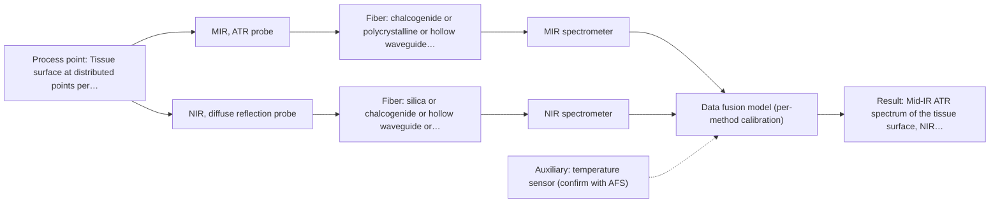
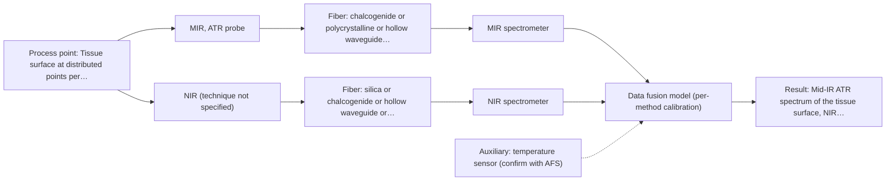

# First technical assessment: Local measurements of heterogeneous model tissues

## Answer

**Customer request (our summary):** Research group wants to compare MIR ATR and fluorescence information for a laboratory classification study using model biological tissues (chicken muscle, fat, liver), and asks for a first comparison experiment and a statement of what its results would demonstrate.

### Brief answer

Test MIR ATR first: it suits soft tissue held against the crystal and gives well-defined bands. NIR diffuse reflection is the second channel that fits turbid tissue; the fluorescence comparison you propose needs a confirmed fluorophore in your chicken muscle, fat and liver before it can be added. Measure the single methods at the same points first, and judge the result against classification accuracy you set in advance.

### Proposal

- **Best current option:** O2 (recommended): M1 MIR, ATR probe; M2 NIR, diffuse reflection probe
- **Basis:** supplied AFS sources
- **What would change it:** If the tissues show a usable fluorophore at the chosen excitation, the fluorescence comparison becomes testable and the second channel could be fluorescence instead of NIR. If MIR ATR alone already separates the three classes on held-out samples, the second channel can be dropped.
- **Next step:** Run the MIR ATR single-method trial on a representative set of chicken muscle, fat and liver, and settle the fluorophore, class and reference-label questions before adding any second channel.

**Decision status:** Provisional feasibility assessment. A shortlist can be justified: MIR ATR suits soft tissue held against the crystal, and NIR diffuse reflection is the second optical channel that fits turbid, scattering tissue. It stays provisional because the fluorescence comparison the group proposes depends on an unidentified fluorophore, and the classes, reference labels and acceptance criteria are not yet fixed.

### Solution options

| ID | Tier | Methods | Confidence | Cost class, S01 Table 1 (p.6) | Ease of use | Maintenance | Performance fit | Sources |
|---|---|---|---|---|---|---|---|---|
| O1 | Simple | M1 MIR, ATR probe | High | high cost (row 2) | one probe and one spectrometer, routine contact measurement | crystal cleaning and contact checks between samples | answers whether MIR ATR alone separates muscle, fat and liver | [1: S01 p.10] [2: S01 p.9] [3: S04 p.1] |
| O2 | Recommended | M1 MIR, ATR probe; M2 NIR, diffuse reflection probe | Low: uncited auxiliary sensor; multi-method, fusion benefit not yet shown | high cost (rows 2, 8) | two probes measured on the same points, more sample handling | two instruments and calibrations, plus cleaning both probes | compares two information types on the same tissues, as the group asks | [4: S03 p.2] [5: S04 p.4] [6: S01 p.10] [7: S01 p.9] [8: S04 p.1] [9: S01 p.10] |
| O3 | Extended (multi-method) | M1 MIR, ATR probe; M3 MIR, ATR probe + NIR (combination) | Low: uncited auxiliary sensor; multi-method, fusion benefit not yet shown | high cost (row 2); not rated in S01 Table 1: NIR (technique not specified) | combined probe, one contact point, more setup work | two calibrations plus probe cleaning and drift checks | tests whether a same-spot MIR ATR and NIR combination beats the best single method | [10: S01 p.8] [11: S01 p.8] [12: S01 p.8] [13: S01 p.10] [14: S01 p.9] [15: S04 p.1] [16: S01 p.8] [17: S01 p.8] [18: S01 p.5] |

*Confidence rates the basis of the advice (how much is known and cited), not a predicted accuracy or probability of success. It starts at High and drops one level per weakness listed.*

*Cost class is the relative rating in S01 Table 1 (p.6) for the in-line method+technique rows named (the highest one for a multi-method option); it is not a price.*

### Setup sketch

*Recommended option O2; drawn by code from the option, a schematic, not a configuration.*

*Extended (multi-method) option O3; drawn by code from the option, a schematic, not a configuration.*

### Key questions

1. Which fluorescent species do you expect in the chicken muscle, fat and liver samples, and would a fluorescent label or indicator be acceptable if none is naturally present?
2. What are the classification classes and which independent reference method (for example histology or a biochemical assay) will provide the labels?
3. Must the two information types be measured at the same spot and time, or are sequential measurements on the same sample acceptable?

## Expert detail

**Customer enquiry**

> Our research group is evaluating a spectral measurement interface using model biological tissues such as chicken muscle, fat and liver. We want to compare MIR ATR and fluorescence information, because the material is heterogeneous and sequential measurements may not sample the same location. This is a laboratory classification study. We need a first comparison experiment and a clear statement of what its results would demonstrate.

### Parameters

| ID | Parameter | Kind | Need | Measured by | Why | Sources |
|---|---|---|---|---|---|---|
| P1 | Mid-IR ATR spectrum of the tissue surface | quantitative | required | Spectroscopy: MIR | It is the information the first single-method test has to deliver, and its well-defined absorption bands carry the chemical contrast between muscle, fat and liver. | [19: S01 p.9] |
| P2 | NIR diffuse reflectance spectrum of the tissue | quantitative | required | Spectroscopy: NIR | It is the second single-method information type in the comparison, taken from a larger volume than the ATR surface layer. | [20: S01 p.10] |
| P3 | Tissue type label (muscle, fat, liver) as the classification reference | qualitative | required | Reference lab method: histology or equivalent independent tissue identification | A classification study needs an independent label for every measured point, otherwise the spectra cannot be scored. | *(no verified source: engineering judgement)* |
| P4 | Sample temperature at the measurement point | quantitative | optional | Auxiliary sensor: temperature sensor (engineering judgement: confirm availability with AFS) | It should be available because ATR band intensities and fluorescence intensity drift with temperature and it is cheap to record with each spectrum. | *(no verified source: engineering judgement)* |

### Solution option details

- **O1 cost drivers:** one MIR ATR probe and spectrometer, sample handling, reference labelling
- **O2 cost drivers:** second spectrometer and probe, reference labelling, two separate calibrations
- **O3 cost drivers:** second spectrometer, combined probe head carrying IR and silica fibers, synchronisation and fusion work
- **O3 combining methods:** Fusion level: one model per method (MIR ATR, NIR diffuse reflection) first as the baseline, then a fused model on the joined, rescaled blocks, compared with the best single method. Both techniques must look at the same small area, which in practice means a combined probe head rather than two probes used alternately, and the acquisition rates have to be brought to a common time step. Each channel needs its own calibration and diagnostics, and the fused model only earns its place if it beats the best single method on held-out samples.

### Premise check

- **Precedent only:** Chicken muscle, fat and liver are adequate model tissues for this comparison. A published study used these poultry tissues as a model system for evaluating spectroscopic methods and equipment; that is a reason to test, not proof that the same separation will hold for this group's samples. [21: S04 p.3]
- **Precedent only:** MIR ATR and fluorescence information are suitable to compare for this classification study. The sources show the two techniques giving complementary chemical information on tissue, and in one laboratory example the three tissue classes separated only after the two data blocks were joined. They do not establish that this works for the group's own samples, preparation or instrument. [22: S04 p.1] [23: S04 p.4]
- **Supported:** Heterogeneity and the risk that sequential measurements miss the same location are the key reasons to compare the methods. A supplied source states directly that same-area sampling is difficult when two probes are used alternately. [24: S01 p.8]

### Requirements

**Stated by the customer**

**Key unknowns**

- Whether chicken muscle, fat and liver contain a usable endogenous fluorophore, and at which excitation wavelength.
- The classification classes and the independent reference method that supplies the labels.
- Planned MIR ATR range, resolution and probe geometry, and the fluorescence excitation and emission wavelengths.
- Whether same-spot measurement is possible (combined probe head) or only sequential measurement.
- Sample presentation, thickness, hydration and temperature control.
- The acceptance criteria (accuracy, sensitivity, specificity) that would make the first experiment a success.

### Clarification questions (most decision-relevant first)

Q1. Which fluorescent species do you expect in the chicken muscle, fat and liver samples, and would a fluorescent label or indicator be acceptable if none is naturally present? *Why it matters:* Fluorescence only reports species that fluoresce, so without one the fluorescence half of the comparison cannot be included. *(affects: method, technique)*
Q2. What are the classification classes and which independent reference method (for example histology or a biochemical assay) will provide the labels? *Why it matters:* The classes and the reference method define what the first experiment has to predict and how it is scored. *(affects: status, installation)*
Q3. Must the two information types be measured at the same spot and time, or are sequential measurements on the same sample acceptable? *Why it matters:* This decides whether a combined probe head is needed or two separate probes will do. *(affects: installation, technique)*
Q4. Which MIR ATR range, resolution and probe geometry, and which fluorescence excitation and emission wavelengths, do you plan to use? *Why it matters:* The usable range and the fluorophores that can be seen depend on the instrument, fiber and probe actually selected. *(affects: technique, installation)*
Q5. How many samples and replicate points per tissue type will you measure, and what classification accuracy would count as success? *Why it matters:* This sets the go/no-go basis and the amount of independent reference work needed. *(affects: status)*

### Recommendation

- **M1 · Primary candidate: MIR, ATR probe.** MIR ATR is the single method to test first: it is the established route for liquids and soft solids held against the crystal, and its band spectra are highly informative. The nominal method range is 4000-400 cm-1; the usable range depends on the fiber, crystal and probe actually selected. *Conditions:* Requires tight sample contact and an ATR-compatible fiber and probe. [25: S01 p.10] [26: S01 p.9] [27: S04 p.1]
- **M2 · Comparison candidate: NIR, diffuse reflection probe.** NIR diffuse reflection is the second single method worth testing: it suits scattering, opaque tissue and reports on overtones of the same functional groups from a larger volume. It is also the second channel the supplied sources raise for this probe family when fluorimetry is not available. *Conditions:* Needs a NIR-capable fiber and probe, its own calibration, and a second spectrometer if it is run beside MIR. [28: S03 p.2] [29: S01 p.10] [30: S04 p.4]
- **M3 · Conditional candidate: MIR, ATR probe.** MIR ATR and NIR look at different depths of the same tissue, so a same-spot combination is a hypothesis worth testing once the single methods have been run. Any gain has to be shown against the best single method on held-out samples. *Conditions:* Applies only if the single-method tests show that neither method alone separates the tissue classes, and only with same-spot sampling. [31: S01 p.8] [32: S01 p.8] [33: S01 p.5] Later hypothesis, after single-method tests: combine with NIR.
- **M4 · Not recommended: fluorescence probe.** Fluorescence is not recommended on its own as it stands, because most chemicals do not fluoresce and no fluorescent species has been identified in these tissues. Its selectivity is low, so it is best used as an addition to a vibrational method rather than alone. *Conditions:* Would become worth testing if a fluorescent species or a justified indicator is confirmed in the tissue. [34: S01 p.5] [35: S04 p.4]

### Measurement concept

- **Probe and geometry:** MIR ATR probe head in contact with the tissue; a NIR diffuse-reflection probe for the second channel; a combined probe head only if same-spot measurement is required.
- **Location:** Tissue surface at distributed points per sample (a surface layer of a few micrometres for MIR ATR, a larger volume for NIR diffuse reflection).
- **Fiber link:** Not specified in the enquiry; the MIR fiber family has to transmit the mid-IR range, while silica fibers cover the NIR range. *(no verified source: engineering judgement)*

### Spectral range

- **MIR:** Nominal mid-IR range 4000-400 cm-1; the usable range depends on the fiber, crystal and probe actually selected. [36: S01 p.9]
- **NIR:** Nominal NIR range 780-2500 nm; the usable range depends on the instrument, fiber and probe actually selected. [37: S01 p.10]
- **Fluorescence:** The range is set by the fluorophore and the chosen excitation wavelength; it is not a fixed method range. No excitation or emission wavelength is stated in the enquiry. *(no verified source: engineering judgement)*

### Risks and uncertainty

- No usable fluorophore may be present in chicken muscle, fat or liver at the available wavelengths, so the fluorescence comparison the group proposes cannot be included and the study falls back to MIR ATR alone (M1). *(rules: R-FLU-1)* *(no verified source: engineering judgement)*
- If the two information types are measured sequentially with separate probes, the two data sets may not describe the same spot on a heterogeneous sample, and a model built on them would mix different material. *(rules: R-CMB-2)* *(no verified source: engineering judgement)*
- An ATR probe sees only a surface layer of a few micrometres, so surface films, fat smearing or drying can dominate the spectrum and vary between replicates. *(rules: R-MIR-3)* *(no verified source: engineering judgement)*
- The published poultry-tissue result is a laboratory example; it does not show that a classifier built there transfers to this group's own samples, preparation or instrument. *(rules: R-EVI-1, R-EVI-2)* *(no verified source: engineering judgement)*

### First feasibility experiment

1. **Build a representative sample set: at least three independent samples of each tissue type (muscle, fat, liver) with five distributed measurement points per sample, covering the variation in fat content, connective tissue and hydration you expect.** Representative samples across the expected chemical and physical variation. [38: S04 p.3] [39: S04 p.3]
2. **Fix an independent reference label for every sample and point (tissue type by histology or an equivalent independent identification) before any modelling, and keep whole samples aside as held-out batches.** Independent reference measurements and held-out validation. [40: REF §3]
3. **Measure MIR ATR alone first on all samples and points, with fixed contact, temperature and replicate spectra, and report the raw spectral variability before any chemometrics.** Single method first; the baseline for the comparison. *(no verified source: engineering judgement)*
4. **Measure NIR diffuse reflection alone on the same points as the second single method, and separately check whether the tissue gives a usable fluorescence signal at your chosen excitation; if it does not, the fluorescence channel stays out of the comparison.** Single method first; decides whether a fluorescence channel is viable at all. *(no verified source: engineering judgement)*
5. **Only then test the combination: same-spot simultaneous measurement with a combined probe, or at least co-registered points; build one model per method and a fused model and compare both with the best single method on the held-out samples. Go/no-go criteria (accuracy, sensitivity, specificity) are set by you before the run.** Combinations after single methods, validated on held-out runs. *(no verified source: engineering judgement)*

**Reference measurements:** Independent tissue-type identification (histology or equivalent) per sample and point; sample temperature recorded alongside each spectrum.

**Decision basis:** Numeric go/no-go thresholds are to be supplied by the customer; the comparison is whether each method, and the combination, classifies the held-out samples better than chance and whether the combination beats the best single method.

### Assumptions

- The tissue samples can be held in tight contact with an ATR crystal without changing their state.
- The tissue types differ chemically enough to be separated spectroscopically.
- MIR ATR and the second channel can be measured at the same points, or on spots homogeneous enough for the comparison.

### Further notes

- **Chemometrics:** The comparison is a classification task: PCA or PLS-DA on each method separately and then on the joined data, with the reference tissue label as the target (S04 p.4). In that example minimal preprocessing was used and the three classes separated only after joining the blocks, so plan per-method preprocessing and held-out validation rather than a single calibration number.
- **Future direction:** If the combined interface proves useful in the laboratory, the same probe concept is the basis for a compact system restricted to the two informative channels (S04 p.4).

### Evidence (verified quotes)

1. ✓ **S01 p.10** (general): "ATR fiber probes (Fig.1) enable the analysis of liquids and solid elastic samples"
2. ✓ **S01 p.9** (general): "Vibrational spectroscopy in the mid-IR range (4000-400 cm-1) is one of the most informative methods of chemical analysis."
3. ✓ **S04 p.1** (application precedent): "its application for the analysis of biological tissues by fiber-based probes is one of the most important exceptions"
4. ✓ **S03 p.2** (application precedent): "Diffuse reflectance near-infrared (NIR) spectroscopy is one of the most promising methods for optical tissue analysis."
5. ✓ **S04 p.4** (general): "Further development of the probe may include its modification to enable diffuse reflectance UV-vis and NIR measurements instead of the fluorimetry, thus opening new application areas."
6. ✓ **S01 p.10** (general): "ATR fiber probes (Fig.1) enable the analysis of liquids and solid elastic samples"
7. ✓ **S01 p.9** (general): "Vibrational spectroscopy in the mid-IR range (4000-400 cm-1) is one of the most informative methods of chemical analysis."
8. ✓ **S04 p.1** (application precedent): "its application for the analysis of biological tissues by fiber-based probes is one of the most important exceptions"
9. ✓ **S01 p.10** (general): "NIR spectra (780-2500 nm) contain predominantly overtones and component bands of fundamental vibrations of molecules and atomic groups"
10. ✓ **S01 p.8** (general): "Ultimately, the measurement data must be normalized to a common time step."
11. ✓ **S01 p.8** (general): "Variables obtained from different spectral methods are not equivalent."
12. ✓ **S01 p.8** (general): "The use of a combined probe facilitates measurements and allows for the analysis of a smaller sample volume."
13. ✓ **S01 p.10** (general): "ATR fiber probes (Fig.1) enable the analysis of liquids and solid elastic samples"
14. ✓ **S01 p.9** (general): "Vibrational spectroscopy in the mid-IR range (4000-400 cm-1) is one of the most informative methods of chemical analysis."
15. ✓ **S04 p.1** (application precedent): "its application for the analysis of biological tissues by fiber-based probes is one of the most important exceptions"
16. ✓ **S01 p.8** (general): "Information can also be obtained from various depths, as in the analysis of biological tissue samples using Mid-IR and NIR spectroscopy with fiber-optic probes."
17. ✓ **S01 p.8** (general): "Another multispectral probe is also under development, combining four spectral methods: Mid-IR, NIR, Raman, and fluorescence."
18. ✓ **S01 p.5** (general): "strong absorption in the mid-IR region limits the corresponding spectral method to the analysis of very thin samples (usually less than 50 μm)"
19. ✓ **S01 p.9** (general): "Vibrational spectroscopy in the mid-IR range (4000-400 cm-1) is one of the most informative methods of chemical analysis."
20. ✓ **S01 p.10** (general): "NIR spectra (780-2500 nm) contain predominantly overtones and component bands of fundamental vibrations of molecules and atomic groups"
21. ✓ **S04 p.3** (application precedent): "Commercially produced poultry combines the availability of fresh samples and the variability of tissue types, making it an attractive model system for evaluating spectroscopic methods and equipment."
22. ✓ **S04 p.1** (application precedent): "This synergy was explained by the capability of methods to deliver complementary chemical information, i.e., indicate the presence of different tumor biomarkers."
23. ✓ **S04 p.4** (application precedent): "none of the individual techniques was sufficient to completely separate the three sample classes"
24. ✓ **S01 p.8** (general): "This is difficult to achieve by using two probes alternately for measurements."
25. ✓ **S01 p.10** (general): "ATR fiber probes (Fig.1) enable the analysis of liquids and solid elastic samples"
26. ✓ **S01 p.9** (general): "Vibrational spectroscopy in the mid-IR range (4000-400 cm-1) is one of the most informative methods of chemical analysis."
27. ✓ **S04 p.1** (application precedent): "its application for the analysis of biological tissues by fiber-based probes is one of the most important exceptions"
28. ✓ **S03 p.2** (application precedent): "Diffuse reflectance near-infrared (NIR) spectroscopy is one of the most promising methods for optical tissue analysis."
29. ✓ **S01 p.10** (general): "NIR spectra (780-2500 nm) contain predominantly overtones and component bands of fundamental vibrations of molecules and atomic groups"
30. ✓ **S04 p.4** (general): "Further development of the probe may include its modification to enable diffuse reflectance UV-vis and NIR measurements instead of the fluorimetry, thus opening new application areas."
31. ✓ **S01 p.8** (general): "Information can also be obtained from various depths, as in the analysis of biological tissue samples using Mid-IR and NIR spectroscopy with fiber-optic probes."
32. ✓ **S01 p.8** (general): "Another multispectral probe is also under development, combining four spectral methods: Mid-IR, NIR, Raman, and fluorescence."
33. ✓ **S01 p.5** (general): "strong absorption in the mid-IR region limits the corresponding spectral method to the analysis of very thin samples (usually less than 50 μm)"
34. ✓ **S01 p.5** (general): "However, most chemicals do not exhibit this property."
35. ✓ **S04 p.4** (general): "it is limited to the samples containing at least one fluorescent component"
36. ✓ **S01 p.9** (general): "Vibrational spectroscopy in the mid-IR range (4000-400 cm-1) is one of the most informative methods of chemical analysis."
37. ✓ **S01 p.10** (general): "NIR spectra (780-2500 nm) contain predominantly overtones and component bands of fundamental vibrations of molecules and atomic groups"
38. ✓ **S04 p.3** (application precedent): "three samples of each tissue type were prepared"
39. ✓ **S04 p.3** (application precedent): "Each sample was represented by five distributed points."
40. ✓ **REF §3** (general): "Representative samples or process states, independent reference measurements, what is compared, and the basis for the go / no-go decision."

### Verification

- Citations verified: 27 of 27 (exact or whitespace/hyphen-tolerant match on the cited page, scope checked).
- Hard check failures before deterministic corrections: 0; still open: 0; soft warnings: 1; repair rounds: 2.

*Run D08-20261017T154503Z · models deepseek/deepseek-v4.1-flash*
