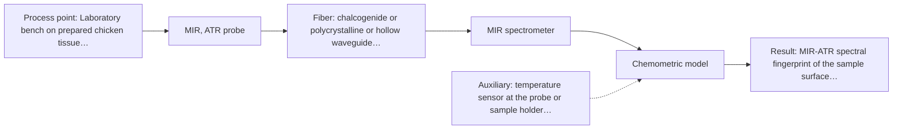
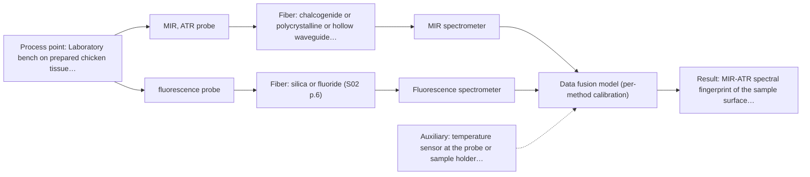

# First technical assessment: Local measurements of heterogeneous model tissues

**Customer enquiry**

> Our research group is evaluating a spectral measurement interface using model biological tissues such as chicken muscle, fat and liver. We want to compare MIR ATR and fluorescence information, because the material is heterogeneous and sequential measurements may not sample the same location. This is a laboratory classification study. We need a first comparison experiment and a clear statement of what its results would demonstrate.

## Brief answer

Start with MIR-ATR alone on representative muscle, fat and liver samples, each with an independent reference label; add fluorescence only if the tissue shows a usable fluorescent component. In the closest published precedent neither technique alone separated all three tissue classes, while the combined data did — a hypothesis to test on your samples. Tell us your class definition, reference label and acceptance criterion.

## Proposal

- **Best current option:** O2 (recommended): R1 MIR, ATR probe
- **Basis:** supplied AFS sources
- **What would change it:** If the samples show no usable fluorescent component, the fluorescence and combined options fall away. If one single method already meets your acceptance criterion, the combination is not justified. If the class labels cannot be defined independently of the spectra, the study cannot be run as a classification study. If the interface must later be in-line rather than on a bench, the probe geometry, contact conditions and fiber link have to be re-examined.
- **Next step:** Answer the deciding questions (class definition and reference label, optical regime and presence and excitation of a fluorescent component, available instruments and probes, acceptance criterion), then run the single-method measurements on representative samples with an independent reference before any combined measurement.

**Decision status:** Provisional feasibility assessment. A shortlist can be justified from the stated sample type (soft solid, heterogeneous, laboratory study) and from the closest published precedent, but the class definition, the reference label, the optical regime (whether the tissues show usable autofluorescence) and the acceptance criterion are still open. The shortlist is therefore conditional and the assumptions are stated.

## Parameters

| ID | Parameter | Kind | Need | Measured by | Why | Sources |
|---|---|---|---|---|---|---|
| P1 | MIR-ATR spectral fingerprint of the sample surface layer | quantitative | required | Spectroscopy: MIR | Carries the chemical information of the surface layer that the classification is built on; in the precedent it separated the lipid-rich tissue class. | [1: S04 p.3] |
| P2 | Fluorescence emission of the sample (endogenous fluorophores) | quantitative | required | Spectroscopy: Fluorescence | The fluorescence side of the comparison; it is only meaningful if the tissue contains a fluorescent component, which must be confirmed first. | [2: S04 p.3] |
| P3 | Tissue class label (independent reference) | qualitative | required | Reference lab method: anatomical identification of the tissue type, confirmed histologically where possible | A classification study needs a class label for every sample that is defined without using the spectra; otherwise the results cannot be interpreted. | *(no verified source: engineering judgement)* |
| P4 | Sample temperature at the probe | quantitative | optional | Auxiliary sensor: temperature sensor at the probe or sample holder (engineering judgement: confirm availability with AFS) | Should be available: contact quality and fluorescence intensity can drift with temperature, and a logged temperature helps to explain between-run variation. No source in the supplied material states a required value. | *(no verified source: engineering judgement)* |

## Solution options

| ID | Tier | Methods | Cost class, S01 Table 1 (p.6) | Ease of use | Maintenance | Performance fit | Sources |
|---|---|---|---|---|---|---|---|
| O1 | Simple | R2 fluorescence probe | low (row 19) | Simple probe, no contact-critical crystal | Probe cleaning and excitation-source stability checks | Low selectivity; may separate only one tissue class | [3: S04 p.4] |
| O2 | Recommended | R1 MIR, ATR probe | high (row 2) | Needs firm, reproducible sample-to-crystal contact | Crystal cleaning and contact checks between samples | High spectral selectivity; the best single-method fit for these tissue classes | [4: S04 p.4] |
| O3 | Extended (multi-method) | R1 MIR, ATR probe; R2 fluorescence probe; R3 MIR, ATR probe + Fluorescence (combination) | high (rows 2, 19) | One probe head, but two spectrometers and one combined measurement protocol | Two instruments to run and calibrate; ATR crystal cleaning plus fluorescence channel checks | Only justified if one method alone cannot meet the acceptance criterion | [5: S01 p.8] [6: S01 p.8] [7: S01 p.8] [8: S01 p.9] [9: S01 p.9] |

*Cost class is the relative rating in S01 Table 1 (p.6) for the in-line method+technique rows named (the highest one for a multi-method option); it is not a price.*

- **O1 cost drivers:** Excitation source, fluorescence spectrometer, silica fiber probe, sample handling and reference labelling
- **O2 cost drivers:** FTIR spectrometer, mid-IR fiber probe and ATR crystal, sample preparation and reference labelling
- **O3 cost drivers:** Two spectrometers (MIR and fluorescence), a combined multispectral probe with CIR/PIR and silica fibers, data synchronisation and fusion software, larger reference data set
- **O3 combining methods:** Fusion level: start with one model per method as the baseline, then concatenate the two blocks with block scaling so that neither method dominates (a method with more variables otherwise has a greater impact). Same sampling spot: one combined probe head so that both methods look at the same small area; the ATR channel analyses only a surface layer while fluorescence samples deeper, so the spot must be homogeneous. Synchronisation: align both channels to a common time step, since acquisition rates can differ greatly. Per-method calibration: each channel needs its own calibration and diagnostics, and two instruments must be run and maintained. Must beat the best single method: validate the fused model on held-out animals and keep the combination only if it outperforms the best single-method model.

## Setup sketch

*Recommended option O2; drawn by code from the option, a schematic, not a configuration.*

*Extended (multi-method) option O3; drawn by code from the option, a schematic, not a configuration.*

## Premise check

- **Precedent only:** MIR ATR and fluorescence information are appropriate and comparable for this classification task. The closest published study used exactly this pair of methods on chicken breast, fat and liver: each method recognised a different tissue class, and the two were combined precisely because neither alone separated all three classes. That is a reason to test the pair, not proof that it will separate your samples. [10: S04 p.4] [11: S04 p.3]
- **Supported:** Because the material is heterogeneous, sequential measurements may not sample the same location, and this justifies comparing the two methods at one spot. The source states that the spectra from different methods must come from the same small area, and that this is difficult with two probes used alternately. So the concern is well founded; it does not by itself prove that a combined measurement is needed for your samples. [12: S01 p.8] [13: S01 p.8]
- **Precedent only:** Chicken muscle, fat and liver are suitable model biological tissues for this evaluation. A published study used exactly these poultry tissues as a model system for evaluating spectroscopic methods and equipment. This supports the choice as a precedent for a laboratory study; it says nothing about your particular animals, cuts or storage. [14: S04 p.3]

## Requirements

**Stated by the customer**

**Key unknowns**

- The exact classes to be distinguished and the independent reference (ground truth) that defines each sample's label.
- The optical regime of the samples (how strongly they scatter and absorb) and whether the tissues contain a usable fluorescent component, and with which excitation wavelength it is best excited.
- Which hardware is available: two separate MIR and fluorescence instruments with their own probes, or one combined multispectral probe.
- Sample preparation and ATR contact conditions (surface, thickness, contact pressure, temperature).
- Spectral ranges and acquisition settings for both methods, and the number of animals / samples per class.
- The classification performance you would accept as success.

## Clarification questions (most decision-relevant first)

Q1. Which classes must be distinguished, and what independent reference (ground truth) defines each sample's label? *Why it matters:* Without a label defined without using the spectra, the comparison cannot be interpreted or compared between methods. *(affects: P3, R1, R2, R3)*
Q2. What is the optical regime of the samples - how strongly do muscle, fat and liver scatter and absorb light - and do they show usable autofluorescence, and at which excitation wavelength? *Why it matters:* This decides whether the fluorescence probe is viable at all and whether a fluorescence channel can be measured at the same spot as the MIR ATR channel. *(affects: R2, R3, O1, O3)*
Q3. Which hardware is available: two separate MIR and fluorescence instruments with their own probes, or one combined multispectral probe head? *Why it matters:* This decides whether the two methods can be measured at the same point and how the data would have to be synchronised and fused. *(affects: O3, R3)*
Q4. What classification performance would you accept as success for this study? *Why it matters:* The go / no-go basis of the experiment comes from you; no performance figure can be taken from the sources. *(affects: feasibility_plan)*
Q5. How are the samples prepared and brought into contact with the ATR crystal (surface, thickness, contact pressure, temperature), and how many animals / samples per class are available? *Why it matters:* ATR needs firm reproducible contact and analyses only a surface layer; the sample count sets how the models can be validated. *(affects: P1, P4, R1)*

## Recommendation

- **R1 · Primary candidate: MIR, ATR probe.** Single method to test first. The sample state (soft solid) fits ATR contact, MIR gives well-defined, selective bands, and in the closest published precedent it was the technique that recognised the lipid-rich tissue class. *Conditions:* Requires firm, reproducible contact between the sample and the ATR crystal; only a surface layer is analysed. [15: S01 p.10] [16: S01 p.9] [17: S01 p.13]
- **R2 · Conditional candidate: fluorescence probe.** Worth testing only if the samples contain a usable fluorescent component; where present, it carried information on a different class than MIR. The optical regime and the presence of a fluorophore are the deciding unknowns for the fluorescence side of the comparison. *Conditions:* Applies only if autofluorescence from the tissue is strong enough at the chosen excitation; the method is limited to samples containing at least one fluorescent component. [18: S04 p.4] [19: S04 p.3]
- **R3 · Conditional candidate: MIR, ATR probe.** Combination hypothesis, to be tested only after the single-method runs: in the closest precedent neither technique alone separated all three tissue classes, while the concatenated data did. It is a hypothesis, not an established gain. *Conditions:* Applies only if the single-method tests show that neither method alone meets your acceptance criterion, and only if both methods can be measured at the same spot. [20: S04 p.4] [21: S01 p.12] Later hypothesis, after single-method tests: combine with Fluorescence.

## Measurement concept

- **Probe and geometry:** MIR in attenuated total reflection with the sample in direct contact with the ATR crystal; fluorescence with the same probe head or a fluorescence probe aimed at the same point. For a later combined option, one probe head carrying both an ATR crystal and fluorescence fibers.
- **Location:** Laboratory bench on prepared chicken tissue samples; several measurement points per sample.
- **Fiber link:** Silica fibers for the fluorescence channel; chalcogenide (CIR) or polycrystalline (PIR) fibers for the MIR channel, since silica does not transmit the mid-IR. Any MIR link length depends on the configuration actually selected and is not stated in the supplied sources. [22: S04 p.2] [23: S02 p.6]

## Spectral range

- **MIR:** Nominal mid-IR range 4000-400 cm-1. The usable range depends on the instrument, the fiber and the ATR crystal actually selected. [24: S01 p.9] [25: REF §3]
- **Fluorescence:** The range depends on the fluorescent species present and on the chosen excitation wavelength; the excitation wavelength must be stated separately from the emission range. [26: S04 p.4]

## Risks and uncertainty

- The tissues may contain no usable fluorescent component, or autofluorescence may be too weak or masked in some classes, so the fluorescence and combined options could not be tested as planned. *(rules: R-FLU-1, R-FLU-2)* [27: S04 p.4]
- Even with one combined probe head, the ATR channel analyses only a surface layer while the fluorescence channel samples a different volume; if the spot is not homogeneous the two blocks do not describe the same material and the fusion is not meaningful. *(rules: R-MIR-3, R-CMB-2)* [28: S04 p.2]
- Without an independent reference label agreed before the measurements, the classification results cannot be interpreted or compared between methods. *(rules: R-GEN-2)* [29: REF §3]
- Results from ex vivo chicken tissue measured on a bench do not establish in-line, process or clinical performance; a laboratory classification study is a feasibility step only. *(rules: R-EVI-1, R-EVI-3)* [30: REF §3]

## First feasibility experiment

1. **Prepare representative samples of muscle, fat and liver across the expected biological variation, with several measurement points per sample.** Representative samples across the expected variation. [31: S04 p.3]
2. **Agree the class definition and label every sample independently of the spectra before any optical measurement, keeping the labels separate from the spectral data.** Independent reference: a class label defined without using the spectra. [32: REF §3]
3. **Measure every sample with MIR-ATR alone, then with fluorescence alone using separate probes, logging contact, sample temperature and acquisition settings, and check on a few samples whether usable autofluorescence is present at all.** Single methods first; no combination in this step, and a check of the deciding unknown (usable fluorescence). *(no verified source: engineering judgement)*
4. **Build one classification model per method on the reference labels and validate with the split made by animal or sample rather than by measurement point, reporting per-class sensitivity and specificity.** Per-method baseline that the combination must later beat. [33: S03 p.6]
5. **Only then concatenate the two spectral blocks with block scaling on held-out animals and compare the fused model against the best single-method model, keeping the combination only if it is better.** Combination tested as a later hypothesis, against the best single method. [34: S01 p.8] [35: REF §5]

**Reference measurements:** Independent class labels for every sample, agreed before the spectral measurements and kept separate from them.

**Decision basis:** Acceptance criterion for the classification to be supplied by the customer; no performance figure is taken from the sources.

## Assumptions

- The samples are soft solids that can be brought into firm contact with an ATR crystal.
- The optical regime of the samples (scattering and absorption) and the presence of a usable fluorophore are not yet known; a short pre-test on a few samples will establish whether a fluorescence probe is viable at all.
- At least one fluorescent component is present in the tissues (to be confirmed).
- The study stays a laboratory, off-line classification study; no in-line installation is required yet.
- The class labels can be defined independently of the spectra.

## Further notes

- **Chemometrics:** A classification study needs a model per method built on the reference labels (for example PCA or PLS-DA), with validation split by animal or sample rather than by measurement point, because repeated measurements at the same point are not independent. For the combined option the two spectral blocks are concatenated with block scaling so that neither method dominates, and the fused model must beat the best single-method model on held-out animals.
- **Future direction:** The combined-probe concept could later be modified to record diffuse reflectance UV-vis and NIR instead of fluorimetry, and developed towards a compact multisensor system for the same sample type.

## Evidence (verified quotes)

1. ✓ **S04 p.3** (application precedent): "The discriminative power of mid-IR spectroscopy (Figure 2a and Figure S-4) toward rich in lipids fat samples is related to the stretching vibration band of the ester carbonyl C=O at about 1740 cm-1, which is characteristic of saturated triglycerides."
2. ✓ **S04 p.3** (application precedent): "The most selective peak at 613 nm, which can be assigned to porphyrins, has sufficient specificity to distinguish the liver from other measured samples."
3. ✓ **S04 p.4** (general): "it is limited to the samples containing at least one fluorescent component"
4. ✓ **S04 p.4** (general): "suitability of analyzed samples for ATR measurements, which is true for liquid or soft solid samples and their components, allowing a tight contact with the probe head."
5. ✓ **S01 p.8** (general): "The use of a combined probe facilitates measurements and allows for the analysis of a smaller sample volume."
6. ✓ **S01 p.8** (general): "Ultimately, the measurement data must be normalized to a common time step."
7. ✓ **S01 p.8** (general): "If the variables have different units of measurement, the data should be normalized in some way, for example, using an autoscaling algorithm."
8. ✓ **S01 p.9** (general): "methods containing a larger number of variables have a greater impact on the model."
9. ✓ **S01 p.9** (general): "One of the challenges of multispectral analysis is the need to simultaneously connect at least two independently operating measuring instruments."
10. ✓ **S04 p.4** (application precedent): "none of the individual techniques was sufficient to completely separate the three sample classes"
11. ✓ **S04 p.3** (application precedent): "The discriminative power of mid-IR spectroscopy (Figure 2a and Figure S-4) toward rich in lipids fat samples is related to the stretching vibration band of the ester carbonyl C=O at about 1740 cm-1, which is characteristic of saturated triglycerides."
12. ✓ **S01 p.8** (general): "It is crucial that the spectral information obtained by different methods-Mid-IR, NIR, Raman, and fluorescence spectra-is collected from the same small, even pinpoint, area of the sample."
13. ✓ **S01 p.8** (general): "This is difficult to achieve by using two probes alternately for measurements."
14. ✓ **S04 p.3** (application precedent): "Commercially produced poultry combines the availability of fresh samples and the variability of tissue types, making it an attractive model system for evaluating spectroscopic methods and equipment."
15. ✓ **S01 p.10** (general): "ATR fiber probes (Fig.1) enable the analysis of liquids and solid elastic samples"
16. ✓ **S01 p.9** (general): "Vibrational spectroscopy in the mid-IR range (4000-400 cm-1) is one of the most informative methods of chemical analysis."
17. ✓ **S01 p.13** (general): "typically at a depth of few microns"
18. ✓ **S04 p.4** (general): "it is limited to the samples containing at least one fluorescent component"
19. ✓ **S04 p.3** (application precedent): "The most selective peak at 613 nm, which can be assigned to porphyrins, has sufficient specificity to distinguish the liver from other measured samples."
20. ✓ (precedent only) **S04 p.4** (method gain): "the PCA model built on the concatenated IR and fluorescence data revealed three distinct groups of samples corresponding to tissue types"
21. ✓ **S01 p.12** (general): "Fluorescence spectroscopy can be used for multispectral measurements, for example, in combination with Mid-IR or NIR spectroscopy."
22. ✓ **S04 p.2** (general): "high transparency in the working spectral regions of both chalcogenide infrared (CIR) and UV silica fibers"
23. ✓ **S02 p.6** (general): "350 nm Standard VIS-NIR Silica Fibers Al/Cu-coated VIS-NIR Silica Fibers 2400 nm"
24. ✓ **S01 p.9** (general): "Vibrational spectroscopy in the mid-IR range (4000-400 cm-1) is one of the most informative methods of chemical analysis."
25. ✓ **REF §3** (general): "A nominal method range is not the range of a specific instrument, fiber or probe."
26. ✓ **S04 p.4** (general): "The fluorimetry can be adjusted to a particular application by choosing an appropriate excitation wavelength."
27. ✓ **S04 p.4** (general): "it is limited to the samples containing at least one fluorescent component"
28. ✓ **S04 p.2** (general): "plays no significant role, if the spot under the measuring element is considered homogeneous."
29. ✓ **REF §3** (general): "Representative samples or process states, independent reference measurements, what is compared, and the basis for the go / no-go decision."
30. ✓ **REF §3** (general): "stretched beyond their scope, for example a laboratory study cited as proof of process or clinical readiness."
31. ✓ **S04 p.3** (application precedent): "Each sample was represented by five distributed points."
32. ✓ **REF §3** (general): "Representative samples or process states, independent reference measurements, what is compared, and the basis for the go / no-go decision."
33. ✓ **S03 p.6** (application precedent): "Three validation methods were applied to calculate the prediction statistics for each model: two types of cross-validation (CV) and a random-subset validation (RSV)."
34. ✓ **S01 p.8** (general): "Variables obtained from different spectral methods are not equivalent."
35. ✓ **REF §5** (general): "compare with the best single method."

## Verification

- Citations verified: 35 of 35 (exact or whitespace/hyphen-tolerant match on the cited page, scope checked).
- Hard check failures before deterministic corrections: 0; still open: 0; soft warnings: 2; repair rounds: 1.
- Corrected deterministically after verification (1):
  - ⚠ recommendations[2].combined_with: combined_with normalised to ['Fluorescence'] (duplicates and the entry's own method removed)

*Run D08-20261017T124749Z · models deepseek/deepseek-v4.1-flash · cost $0.0329*
