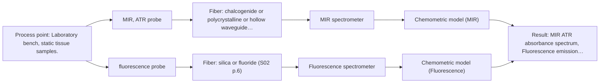
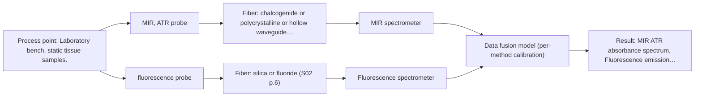

# First technical assessment: Local measurements of heterogeneous model tissues

## Answer

**Customer request (our summary):** The customer is asking for an initial comparison experiment between MIR ATR and fluorescence measurements on model biological tissues (chicken muscle, fat, and liver) for a laboratory classification study. They also want a clear statement of what the experiment's results would demonstrate.

### Brief answer

Test MIR ATR first on marked points of chicken muscle, fat and liver, then fluorescence at the same points, and compare per-method models on held-out samples; add the fused data as a second step. A published study on the same three tissues is a reason to test, not proof: it found neither method alone separated all three classes. What remains open is the fluorophore and excitation wavelength, the sample optical regime, the reference for tissue class, and the success threshold.

### Proposal

- **Best current option:** O2 (recommended)
- **Basis:** supplied AFS sources
- **What would change it:** If same-spot coincidence turns out to be a firm requirement, the choice moves to the combined-probe option (O3); if fluorescence proves not viable at the chosen excitation, it falls back to the MIR-only baseline (O1). A customer-defined success threshold and an independent class reference would also change which option is worth running.
- **Next step:** Confirm the fluorophore, excitation wavelength and sample optical regime, and whether the two methods will share one probe head, then run the single-method baselines on the marked sample set.

**Secondary evidence (external, not AFS material):** G1: E01 ¶31, E01 ¶82. See Expert detail.

**Decision status:** Provisional feasibility assessment

### Solution options

| ID | Tier | Methods | Confidence | Cost class, S01 Table 1 (p.6) | Ease of use | Maintenance | Performance fit | Sources |
|---|---|---|---|---|---|---|---|---|
| O1 | Simple | M1 MIR, ATR probe | Medium: precedent only | high cost (row 2) | one probe, simple contact measurement | crystal cleaning between samples | cheapest first test of MIR separation power | [1: S04 p.4] [2: S04 p.3] |
| O2 | Recommended | M1 MIR, ATR probe; M2 fluorescence probe | Low: fit for soft solid to be tested, sample clarity unknown, fluorescent target unknown; precedent only | high cost (rows 2, 19) | two probes on one marked sample set | two instruments and probe cleaning | answers the two-method comparison in a lab | [3: S04 p.4] [1: S04 p.4] [2: S04 p.3] [4: S04 p.3] [5: S04 p.4] |
| O3 | Extended (multi-method) | M1 MIR, ATR probe; M2 fluorescence probe; M3 MIR, ATR probe + Fluorescence (combination) | Low: open question: Q2 (starts at Medium); fit for soft solid to be tested, sample clarity unknown, fluorescent target unknown; multi-method, fusion benefit not yet shown | high cost (rows 2, 19) | one contact tip, two spectrometers | two instruments, crystal and fiber care | removes spot mismatch on heterogeneous tissue | [6: S01 p.14] [7: S01 p.9] [1: S04 p.4] [2: S04 p.3] [4: S04 p.3] [5: S04 p.4] [8: S04 p.4] [9: S04 p.4] [10: S01 p.8] |

*Confidence rates the basis of the advice (how much is known and cited), not a predicted accuracy or probability of success. It starts at High, or at Medium when a key question on the method or the option is open, and drops one level per weakness listed (floor Low).*

*Cost class is the relative rating in S01 Table 1 (p.6) for the in-line method+technique rows named (the highest one for a multi-method option); it is not a price.*

### Setup sketch

*Recommended option O2; drawn by code from the option, a schematic, not a configuration.*

### Key questions

1. Which fluorescing species is present in the samples (tissue autofluorescence or an added indicator), and at which excitation wavelength will it be measured?
2. Will the two methods be measured through one combined probe at the same spot, or with separate probes at marked points on static samples?
3. What is the independent reference for tissue class (histology or documented sample identity), and how many independent samples or batches per class are available?

## Expert detail

**Customer enquiry**

> Our research group is evaluating a spectral measurement interface using model biological tissues such as chicken muscle, fat and liver. We want to compare MIR ATR and fluorescence information, because the material is heterogeneous and sequential measurements may not sample the same location. This is a laboratory classification study. We need a first comparison experiment and a clear statement of what its results would demonstrate.

**Decision status:** Provisional feasibility assessment. A method shortlist can be justified with stated assumptions, so this is a provisional assessment: MIR ATR fits soft-solid contact measurement and fluorescence needs a confirmed fluorescing species. Whether the same-spot requirement forces a combined probe, and what would count as a successful comparison, remain open.

### Parameters

| ID | Parameter | Kind | Need | Measured by | Why | Sources |
|---|---|---|---|---|---|---|
| P1 | Tissue class (muscle, fat, liver) | qualitative | required | Reference lab method: histology or documented sample identity | The study is a classification, so every measurement needs an independent class label. | [11: S04 p.3] |
| P2 | MIR ATR absorbance spectrum | quantitative | required | Spectroscopy: MIR | It carries the fingerprint bands, such as the ester carbonyl band of triglycerides, that mid-IR uses to separate tissue types. | [2: S04 p.3] |
| P3 | Fluorescence emission spectrum | quantitative | required | Spectroscopy: Fluorescence | It is the second, complementary block; in the precedent a band near 613 nm distinguished liver from the other tissues. | [4: S04 p.3] |

### Solution option details

- **O1 cost drivers:** one spectrometer, one ATR probe, sample handling
- **O2 cost drivers:** two spectrometers, two probes, point marking and sample handling
- **O3 cost drivers:** combined probe, two spectrometers, synchronisation and fusion work
- **O3 combining methods:** Fusion level: keep one model per method as the baseline, then concatenate the two blocks after scaling them to a common intensity range. Both channels must be collected from the same spot and aligned to a common time step, with each instrument keeping its own calibration and diagnostics. The fused model must beat the best single method on held-out samples, otherwise the second channel is not justified.

*Extended (multi-method) option O3; drawn by code from the option, a schematic, not a configuration.*

### Premise check

- **Supported:** Chicken muscle, fat and liver are suitable model biological tissues for evaluating a spectral measurement interface. A published study used exactly these three chicken tissues to evaluate a multispectral probe; the tissues are a model system, not the customer's real target. [12: S04 p.3]
- **Precedent only:** MIR ATR and fluorescence information can be meaningfully compared, and combining them adds information for these samples. The precedent reports that neither technique alone separated the three classes while the concatenated data did; that is a reason to test the comparison on the customer's own samples, not proof for them. [8: S04 p.4] [9: S04 p.4]
- **Supported:** Sequential measurements may not sample the same location, which matters for heterogeneous tissue. The sources state directly that alternating probes cannot be relied on to hit the same spot. [13: S04 p.2] [14: S01 p.8]

### Requirements

**Stated by the customer**

- "Our research group is evaluating a spectral measurement interface"
- "using model biological tissues such as chicken muscle, fat and liver"
- "We want to compare MIR ATR and fluorescence information"
- "the material is heterogeneous"
- "sequential measurements may not sample the same location"
- "This is a laboratory classification study"
- "We need a first comparison experiment and a clear statement of what its results would demonstrate."
- "MIR ATR"
- "fluorescence information"
- "compare MIR ATR and fluorescence information"
- "laboratory classification study"

**Key unknowns**

- Which fluorescing species is present in the samples and which excitation wavelength would be used.
- The optical regime of the samples (clear, turbid or opaque) at the fluorescence wavelengths, which decides whether the fluorescence channel is viable.
- The independent reference for tissue class and how many independent samples or batches per class are available.
- Whether same-spot coincidence is a firm requirement or marked-point sequential measurement is acceptable.
- The numerical result that would count as a successful comparison.
- Planned MIR range, ATR crystal and fiber type, and the fluorescence excitation and emission range.

### Clarification questions (most decision-relevant first)

Q1. Which fluorescing species is present in the samples (tissue autofluorescence or an added indicator), and at which excitation wavelength will it be measured? *Why it matters:* Fluorescence only reports species that fluoresce, so without a confirmed fluorophore the second method cannot be planned. *(affects: technique)*
Q2. Will the two methods be measured through one combined probe at the same spot, or with separate probes at marked points on static samples? *Why it matters:* This decides whether the sampling-coincidence concern is removed by hardware or only by sample handling, and it separates the simple from the combined option. *(affects: installation, M3)*
Q3. What is the independent reference for tissue class (histology or documented sample identity), and how many independent samples or batches per class are available? *Why it matters:* A classification comparison is only meaningful against a reference that does not come from the spectra themselves. *(affects: status)*
Q4. Which MIR range, ATR crystal material and fiber type are planned, and over which fluorescence excitation and emission range? *Why it matters:* The usable range depends on the probe, crystal and fibers actually selected, not on the nominal method range. *(affects: technique, installation)*
Q5. What numerical result would count as a successful comparison, for example the classification error on held-out samples? *Why it matters:* The go/no-go criterion has to come from the customer; no supplied source gives one for these samples. *(affects: status, M3)*
Q6. Are the samples optically clear, turbid or opaque at the intended fluorescence excitation and emission wavelengths, and how thick are they? *Why it matters:* The optical regime of the sample is still unknown and decides whether fluorescence light can be collected and how the fluorescence channel should be arranged. *(affects: technique)*

### Recommendation

- **M1 · Primary candidate: MIR, ATR probe.** MIR ATR is the only named method whose sample fit is confirmed here: it suits liquids and soft solids brought into tight contact with the crystal, and mid-IR bands are well defined. A precedent on the same three chicken tissues used mid-IR ATR as one channel and found it discriminated the fat-rich samples. *Conditions:* Applies while the samples are soft solids or liquids that can be brought into tight contact with the ATR crystal. [1: S04 p.4] [2: S04 p.3]
- **M2 · Conditional candidate: fluorescence probe.** Fluorescence is worth testing only if a fluorescing species is present: the precedent attributes a liver-selective band to porphyrins, while most chemicals do not fluoresce. No fluorophore, excitation wavelength or sample optical regime has been identified for these samples yet, so this entry stays conditional. *Conditions:* Applies only if a fluorescent species such as tissue autofluorescence is confirmed, an excitation wavelength is chosen, and the sample is optically accessible for the fluorescence channel (Q6). [4: S04 p.3] [5: S04 p.4]
- **M3 · Comparison candidate: MIR, ATR probe + Fluorescence (combination).** The precedent reports that neither mid-IR nor fluorescence alone separated all three tissue types, while the concatenated data did, so the combination is a hypothesis to test after the single methods. Same-spot collection is the point of the combination, because alternating probes cannot be relied on to hit the same spot on heterogeneous tissue. *Conditions:* Tested only after the single-method baselines, and only if the fluorescence channel is viable (see M2). [8: S04 p.4] [9: S04 p.4] [10: S01 p.8] Later hypothesis, after single-method tests.

### Measurement concept

- **Probe and geometry:** Contact ATR on the sample surface for mid-IR; a fluorescence channel through the same tip or a second probe on the same marked point.
- **Location:** Laboratory bench, static tissue samples.
- **Fiber link:** Not specified by the customer; fiber family must match each method's range and is an open point (Q4). *(no verified source: engineering judgement)*

### Spectral range

- **MIR:** Nominal mid-IR range 4000-400 cm-1; the usable range depends on the ATR crystal, fiber and probe selected. [15: S01 p.9] [16: REF §3]
- **Fluorescence:** Excitation and emission range depend on the fluorescing species and the chosen excitation wavelength; neither is stated in the enquiry. *(no verified source: engineering judgement)*

### Risks and uncertainty

- Fluorescence may carry little information if the chosen excitation does not excite the tissue fluorophores, or if their content varies little between muscle, fat and liver. *(rules: R-FLU-1, R-FLU-2)* *(no verified source: engineering judgement)*
- ATR sees only the top few micrometres, so surface drying, smearing or fat films on the crystal can dominate the mid-IR spectrum. *(rules: R-MIR-3)* *(no verified source: engineering judgement)*
- If the two methods are measured sequentially at marked points, residual spot mismatch on heterogeneous tissue can make the per-method comparison misleading. *(rules: R-CMB-2)* *(no verified source: engineering judgement)*
- With few independent samples per class, a fused model can appear better than the single methods by chance unless whole samples are held out. *(rules: R-CAL-1)* *(no verified source: engineering judgement)*

### First feasibility experiment

1. **Prepare representative samples across the expected variation: at least three independent samples each of chicken muscle, fat and liver, each large enough to carry several distributed measurement points.** Representativeness [17: S04 p.3] [18: REF §3]
2. **Measure every point first with MIR ATR alone, then with fluorescence alone, on the same marked points (or with a combined probe at the same spot), and record the point identity with each spectrum.** Single methods first [10: S01 p.8]
3. **Confirm the tissue class of every sample independently of the spectra (histology or documented sample identity) and keep those labels out of model building until validation.** Independent reference *(no verified source: engineering judgement)*
4. **Build one classification model per method and then a model on the concatenated blocks, validating by holding out whole samples rather than single measurement points.** Comparison [19: S03 p.13] [20: S04 p.4]
5. **Go/no-go: the combined model must classify held-out samples better than the best single method; the numerical margin comes from the customer and is still open (Q5).** Go/no-go basis [21: REF §5]

**Reference measurements:** Independent tissue-class reference (histology or documented sample identity); no reference figures are available from the sources for these samples.

**Decision basis:** fused model must beat the best single method on held-out samples, threshold set by the customer

### Assumptions

- Samples are soft solids or liquids that can be brought into contact with an ATR crystal.
- At least one tissue fluorophore is present at a usable concentration.
- The samples are optically accessible for the fluorescence channel (not fully opaque at the chosen excitation and emission wavelengths); the optical regime is unconfirmed (Q6).
- Marked points on static samples give acceptable spot coincidence if a combined probe is not used.

### Further notes

- **Chemometrics:** Per-method classification models first, then a model on the concatenated blocks; the precedent deliberately kept preprocessing minimal so that the contribution of each block stayed visible. With few samples per class, repeated measurements at one sample must be excluded together during validation.
- **Future direction:** If the two-method comparison works, a compact multisensor design with one combined probe and a small number of channels is the natural next step; the precedent notes that specialisation allows the two methods to be combined in one compact device.

### Secondary evidence (external, not AFS material)

*Found by a literature search for gaps the supplied AFS sources leave open. Not AFS material and not proof for this case; every quote below was verified verbatim against the fetched text.*

**G1 · multi-method:** Combining several spectroscopy methods (data fusion) (Fusion level: keep one model per method as the baseline, then concatenate the two blocks after scaling them to a common intensity range. Both channels must be collected from the same spot and aligned to a common time step, with each instrument keeping its own calibration and diagnostics. The fused model must beat the best single method on held-out samples, otherwise the second channel is not justified.)

- **E01 ¶31** This review describes low-level data fusion as the simplest way to combine inputs by placing variables from different sources one after another in a new data matrix. *How it applies:* This could inform the baseline concatenation step in O3, where MIR ATR and fluorescence blocks are joined after scaling to a common range. *Limits and transfer risks:* The source is a general PAT review and does not specify biological tissue, MIR ATR or fluorescence, scaling, alignment, or held-out validation. *(supports O3)*
  > "Low-level data fusion (LLDF) is considered the simplest method to achieve a combination of inputs. In this case, the data is rearranged into a new data matrix, where the variables coming from different sources are placed one after the other."
  > Challenges and Opportunities of Implementing Data Fusion in Process Analytical Technology-A Review. (2022) · Molecules (Basel, Switzerland) · doi:10.3390/molecules27154846 · https://europepmc.org/article/PMC/PMC9369811 · retrieved 2026-10-17, full text, licence: cc by, via curated library
- **E01 ¶82** This review states that before fusing multiple data sources, one should evaluate each dataset's contribution and complementarity. *How it applies:* This could inform the G1 requirement to keep single-method baselines and check whether the second channel adds complementary information before accepting the fused model. *Limits and transfer risks:* The source is a general PAT review and does not specify MIR ATR, fluorescence, biological tissues, scaling, alignment, or a held-out performance criterion. *(supports O3)*
  > "Before fusing data from multiple sources, it is essential to evaluate the contribution of each dataset to the model and its complementarity."
  > Challenges and Opportunities of Implementing Data Fusion in Process Analytical Technology-A Review. (2022) · Molecules (Basel, Switzerland) · doi:10.3390/molecules27154846 · https://europepmc.org/article/PMC/PMC9369811 · retrieved 2026-10-17, full text, licence: cc by, via curated library

### Evidence (verified quotes)

1. ✓ **S04 p.4** (general): "suitability of analyzed samples for ATR measurements, which is true for liquid or soft solid samples and their components, allowing a tight contact with the probe head."
2. ✓ **S04 p.3** (application precedent): "The discriminative power of mid-IR spectroscopy (Figure 2a and Figure S-4) toward rich in lipids fat samples is related to the stretching vibration band of the ester carbonyl C=O at about 1740 cm-1, which is characteristic of saturated triglycerides."
3. ✓ **S04 p.4** (application precedent): "PCA models for individual data blocks confirmed the above conclusions based on the spectral interpretation that IR spectroscopy works better for the discrimination of fat (Figure 3a), whereas fluorescence is well suited for the recognition of liver tissue (Figure 3b)."
4. ✓ **S04 p.3** (application precedent): "The most selective peak at 613 nm, which can be assigned to porphyrins, has sufficient specificity to distinguish the liver from other measured samples."
5. ✓ **S04 p.4** (general): "it is limited to the samples containing at least one fluorescent component that often has a biological or natural origin"
6. ✓ **S01 p.14** (application precedent): "A multispectral fiber probe, e.g. one combining MIR-ATR and fluorescence techniques into a single fiber optic probe shaft allows for the simultaneous acquisition of complementary chemical information from the exact same measurement point, a capability critical for analyzing heterogeneous solid samples like biological tissues or rapidly changing liquid environments."
7. ✓ **S01 p.9** (general): "One of the challenges of multispectral analysis is the need to simultaneously connect at least two independently operating measuring instruments."
8. ✓ **S04 p.4** (application precedent): "However, none of the individual techniques was sufficient to completely separate the three sample classes on the PCA score plots (PCs one to five were investigated)."
9. ✓ (precedent only) **S04 p.4** (method gain): "At the same time, the PCA model built on the concatenated IR and fluorescence data revealed three distinct groups of samples corresponding to tissue types (Figure 3c)."
10. ✓ **S01 p.8** (general): "It is crucial that the spectral information obtained by different methods-Mid-IR, NIR, Raman, and fluorescence spectra-is collected from the same small, even pinpoint, area of the sample."
11. ✓ **S04 p.3** (application precedent): "The developed multispectral probe was tested in the practical analysis of biological tissue samples using different organs and parts of the chicken: breast, fat, and liver."
12. ✓ **S04 p.3** (application precedent): "Commercially produced poultry combines the availability of fresh samples and the variability of tissue types, making it an attractive model system for evaluating spectroscopic methods and equipment."
13. ✓ **S04 p.2** (general): "Such alternating multispectral measurements cannot guarantee complete coincidence of the spots analyzed by both methods and, moreover, cannot be used in the clinical surgery practice."
14. ✓ **S01 p.8** (general): "This is difficult to achieve by using two probes alternately for measurements."
15. ✓ **S01 p.9** (general): "Vibrational spectroscopy in the mid-IR range (4000-400 cm-1) is one of the most informative methods of chemical analysis."
16. ✓ **REF §3** (general): "A nominal method range is not the range of a specific instrument, fiber or probe."
17. ✓ **S04 p.3** (application precedent): "To provide the necessary statistical representativeness of the data, three samples of each tissue type were prepared."
18. ✓ **REF §3** (general): "Representative samples or process states, independent reference measurements, what is compared, and the basis for the go / no-go decision."
19. ✓ **S03 p.13** (general): "Repeated measurements in the same sample position produced similar spectra or sensor data; therefore, these should always be simultaneously excluded for every CV iteration."
20. ✓ **S04 p.4** (application precedent): "The data preprocessing and analysis in this study were deliberately minimized to facilitate understanding of how complementary spectral information contributes into the joint multivariate model."
21. ✓ **REF §5** (general): "compare with the best single method."

### Verification

- Citations verified: 26 of 26 (exact or whitespace/hyphen-tolerant match on the cited page, scope checked).
- Hard check failures before deterministic corrections: 0; still open: 0; soft warnings: 2; repair rounds: 1.
- External evidence (live): 2 quote(s) verified verbatim (exact or whitespace/hyphen-tolerant, at most 400 characters and 2 sentences, against the cited paragraph); 0 item(s) dropped.
- External search: 3 query(ies), 30 hit(s), 5 source(s) (3 from the curated library).
- External step: 2 model call(s), 75.6 s extra (cost in the run JSON).

*Run D08-20261017T202806Z · models deepseek/deepseek-v4.1-flash*
