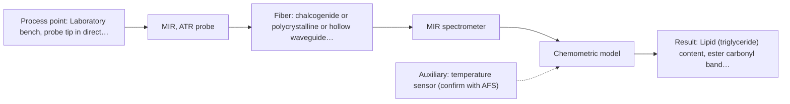
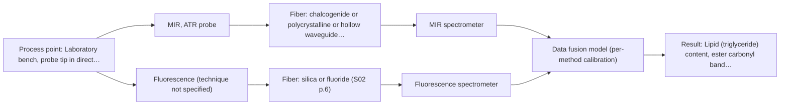

# First technical assessment: Local measurements of heterogeneous model tissues

# Answer

**Customer request:** Laboratory classification study comparing MIR ATR and fluorescence information on heterogeneous model biological tissues.

## Brief answer

Test MIR ATR first as the single method: it suits soft tissue held in contact with the crystal and gives sharp, well-defined bands. Add a fluorescence arm only if the tissues show usable autofluorescence, and measure both methods on the same marked points. What is still open is whether a combined same-spot probe beats the better single method; the class reference and go/no-go criteria need your confirmation.

## Proposal

- **Best current option:** O2 (recommended): M1 MIR, ATR probe
- **Basis:** supplied AFS sources
- **What would change it:** If the tissues show usable autofluorescence and the single-method models leave the classes overlapping, O3 becomes the choice; if no fluorophore is present, O1 falls away and only the MIR ATR route remains. A class reference and numerical criteria that cannot be met would also change the plan.
- **Next step:** Answer Q1-Q3 and run the five-step comparison on chicken muscle, fat and liver, starting with MIR ATR alone and adding fluorescence on the same marked points.

**Decision status:** Provisional feasibility assessment. A defensible shortlist exists: MIR ATR fits these soft-solid samples and fluorescence is worth a parallel, conditional test on the same points. The shortlist and plan rest on assumptions about the fluorophore, the class reference and the acceptance criteria, which the questions below address.

## Solution options

| ID | Tier | Methods | Confidence | Cost class, S01 Table 1 (p.6) | Ease of use | Maintenance | Performance fit | Sources |
|---|---|---|---|---|---|---|---|---|
| O1 | Simple | M2 fluorescence probe | Medium: sample clarity unknown, fluorescent target unknown | low (row 19) | One compact probe, simple measurement; needs a matched excitation wavelength. | Source lifetime and probe cleaning. | Least effort single check of whether fluorescence alone carries class information. | [1: S04 p.3] |
| O2 | Recommended | M1 MIR, ATR probe | High | high (row 2) | Single contact probe with a well-established measurement routine. | Regular ATR crystal cleaning and contact checks. | Best single method for these soft solids: sharp, well-defined MIR bands with high selectivity. | [2: S01 p.10] |
| O3 | Extended (multi-method) | M3 MIR, ATR probe + Fluorescence (combination) | Low: sample clarity unknown, fluorescent target unknown; multi-method, fusion benefit not yet shown | high (row 2); not rated in S01 Table 1: Fluorescence (technique not specified) | One combined probe, but two spectrometers and a fused data workflow. | Two instrument calibrations plus crystal and fiber cleaning. | Adds fluorescence information at the same spot when one method cannot separate the classes. | [3: S04 p.1] [4: S01 p.8] [5: S01 p.9] |

*Confidence rates the basis of the advice (how much is known and cited), not a predicted accuracy or probability of success. It starts at High and drops one level per weakness listed.*

*Cost class is the relative rating in S01 Table 1 (p.6) for the in-line method+technique rows named (the highest one for a multi-method option); it is not a price.*

## Setup sketch

*Recommended option O2; drawn by code from the option, a schematic, not a configuration.*

*Extended (multi-method) option O3; drawn by code from the option, a schematic, not a configuration.*

## Key questions

1. What is the independent ground truth for the class labels (visual tissue-type assignment, histology, or another method), and which spectral markers define the classes?
2. Do the tissues show usable autofluorescence, or is a fluorescent indicator intended, and at which excitation and emission wavelengths?
3. Can both methods be measured at the same point simultaneously with one combined probe, or only sequentially with separate probes?

# Expert detail

**Customer enquiry**

> Our research group is evaluating a spectral measurement interface using model biological tissues such as chicken muscle, fat and liver. We want to compare MIR ATR and fluorescence information, because the material is heterogeneous and sequential measurements may not sample the same location. This is a laboratory classification study. We need a first comparison experiment and a clear statement of what its results would demonstrate.

## Parameters

| ID | Parameter | Kind | Need | Measured by | Why | Sources |
|---|---|---|---|---|---|---|
| P1 | Tissue class (muscle, fat, liver) | qualitative | required | Reference lab method: visual tissue-type assignment, histology if available | The study's target is to separate these three classes, so an independent class label is needed to score any model. | [6: S04 p.3] |
| P2 | Lipid (triglyceride) content, ester carbonyl band near 1740 cm-1 | quantitative | required | Spectroscopy: MIR | The C=O band near 1740 cm-1 is characteristic of saturated triglycerides and was the MIR feature that separated fat from the other tissues. | [7: S04 p.3] |
| P3 | Protein content, amide I and II bands | quantitative | required | Spectroscopy: MIR | Amide I and II are the major protein absorption peaks and help interpret the muscle, fat and liver differences in the MIR spectra. | [8: S04 p.3] |
| P4 | Fluorescence emission band of intracellular fluorophores (FAD) | quantitative | required | Spectroscopy: Fluorescence | This broad emission band is formed by intracellular fluorophores with the dominating contribution of flavin adenine dinucleotide (FAD) and carries the main fluorescence signal of these tissues. | [9: S04 p.3] |
| P5 | Porphyrin fluorescence band near 613 nm | quantitative | required | Spectroscopy: Fluorescence | This peak was the most selective fluorescence feature and distinguished liver from the other measured tissues. | [10: S04 p.3] |
| P6 | Sample temperature | quantitative | optional | Auxiliary sensor: temperature sensor (engineering judgement: confirm availability with AFS) | Temperature affects band positions and the ATR contact condition; it should be available to check measurement stability between runs. | *(no verified source: engineering judgement)* |

## Solution option details

- **O1 cost drivers:** One fluorescence spectrometer, excitation source, probe and reference samples.
- **O2 cost drivers:** FTIR spectrometer, mid-IR ATR probe and reference samples.
- **O3 cost drivers:** Two spectrometers, a combined multispectral probe and data-fusion software.
- **O3 combining methods:** Fusion level: start with one model per method, then join the blocks with scaling so neither method dominates the model. Both methods must see the same small spot; with a combined ATR-fluorescence probe that is the crystal tip, and the two channels must be synchronised to a common time step. Each block keeps its own calibration and diagnostics, and the fused model must beat the better single method on held-out samples, otherwise the second method is dropped.

## Premise check

- **Precedent only:** MIR ATR and fluorescence information are comparable and appropriate for classifying these tissues. A published study used exactly these two techniques on chicken breast, fat and liver, but each technique separated different tissue types and only the combined data separated all three. This is a reason to test, not proof for your study. [11: S04 p.3] [12: S04 p.4]
- **Supported:** The key challenge is heterogeneity and sequential measurements not sampling the same location. The sources state directly that same-spot multi-method measurement is hard to achieve with two probes used alternately. [13: S01 p.8] [14: S04 p.2]
- **Precedent only:** Chicken muscle, fat and liver are suitable model biological tissues for this study. The same model system (chicken breast, fat, liver) is described as attractive for evaluating spectroscopic methods and equipment, but that is a published example, not proof for your group. [15: S04 p.3]

## Requirements

**Stated by the customer**

**Key unknowns**

- Whether the tissues contain a usable fluorophore (autofluorescence) and at which excitation and emission wavelengths.
- The independent class reference (visual tissue-type assignment, histology or another method) and how the classes are defined.
- Number of samples per tissue type and measurement points per sample, i.e. the statistical representativeness.
- Sample preparation, thickness and how tight the contact with the ATR crystal will be.
- Whether both methods can be measured at the same point simultaneously (combined probe) or only one after the other.
- The numerical go/no-go criteria (accuracy, sensitivity, specificity) that will be accepted.

## Clarification questions (most decision-relevant first)

Q1. What is the independent ground truth for the class labels (visual tissue-type assignment, histology, or another method), and which spectral markers define the classes? *Why it matters:* A comparison can only demonstrate classification if the classes have an independent reference to score against. *(affects: M1, M2, M3, O1, O2, O3, P1)*
Q2. Do the tissues show usable autofluorescence, or is a fluorescent indicator intended, and at which excitation and emission wavelengths? *Why it matters:* Fluorescence only measures species that fluoresce, so without a fluorophore the fluorescence arm and the combined probe cannot contribute. *(affects: M2, M3, O1, O3, P4, P5)*
Q3. Can both methods be measured at the same point simultaneously with one combined probe, or only sequentially with separate probes? *Why it matters:* On heterogeneous tissue the same-spot requirement decides whether a method comparison is valid at all. *(affects: M3, O3)*
Q4. How will samples be prepared and presented (thickness, contact pressure on the ATR crystal, temperature)? *Why it matters:* ATR needs tight contact and probes only a thin surface layer, so preparation and contact set the representativeness of the MIR data. *(affects: M1, O2, P2, P3, P6)*
Q5. How many samples and replicates per tissue type, and which numerical criteria (accuracy, sensitivity, specificity) define a go decision? *Why it matters:* The go/no-go basis must come from you, not from the sources. *(affects: O1, O2, O3)*
Q6. Are the tissue surfaces opaque and strongly scattering, or translucent, under the fluorescence excitation and emission wavelengths you intend to use? *Why it matters:* The optical regime of the sample decides how much fluorescence signal can be excited and collected from the surface and how much of the tissue the measurement represents. *(affects: M2, M3, O1, O3)*

## Recommendation

- **M1 · Primary candidate: MIR, ATR probe.** MIR ATR fits these soft-solid samples and gives well-defined absorption bands; a contact ATR probe is made for liquids and soft solids. It is the single method to test first. *Conditions:* Requires tight contact between sample and crystal, and analyses only a surface layer of a few micrometres. [16: S01 p.10] [17: S04 p.4] [18: S01 p.5]
- **M2 · Conditional candidate: fluorescence probe.** Fluorescence is only informative if the tissue contains a fluorescent component; in the chicken-tissue precedent the porphyrin peak separated liver from the other tissues. It applies only if that condition is met. *Conditions:* Applies only if usable autofluorescence is confirmed or a justified fluorescent indicator is added, with the excitation wavelength chosen for that species. [19: S04 p.4] [20: S01 p.5] [21: S04 p.3]
- **M3 · Comparison candidate: MIR, ATR probe.** A combined MIR-ATR and fluorescence probe reads both methods from the same small spot, which alternating probes cannot guarantee on heterogeneous tissue. In the precedent neither technique alone separated all three tissue classes, so a gain from combining is a hypothesis to test. *Conditions:* Test after the single-method runs, and keep it only if the combined model beats the better single method. [22: S01 p.8] [23: S04 p.1] [24: S01 p.7] Later hypothesis, after single-method tests: combine with Fluorescence.

## Measurement concept

- **Probe and geometry:** Contact ATR (mid-IR) and a fluorescence probe; both must address the same small spot, ideally through one combined ATR/fluorescence probe head.
- **Location:** Laboratory bench, probe tip in direct contact with the tissue surface.
- **Fiber link:** Fiber family and any link length depend on the configuration and are not fixed here; the MIR path needs a mid-IR fiber family, and long lengths are stated in the sources only for silica fibers. [25: S01 p.8]

## Spectral range

- **MIR:** Nominal mid-IR range 4000-400 cm-1; the usable range depends on the instrument, fiber and probe actually selected. [26: S01 p.9]
- **Fluorescence:** The range depends on the fluorescent species and on the chosen excitation wavelength, so it can only be fixed once Q2 and Q6 are answered. [27: S01 p.12]
- **Raman:** Not part of this enquiry; if it is ever added, the Raman shift in cm-1 is stated separately from the laser excitation wavelength in nm. [28: S01 p.11]

## Risks and uncertainty

- If the tissues carry no usable fluorophore, the fluorescence arm adds no class information and O1 and the fluorescence part of O3 fall away. *(rules: R-FLU-1)* *(no verified source: engineering judgement)*
- ATR probes only a surface layer a few micrometres deep, so MIR ATR may not represent the bulk heterogeneity that motivates the comparison. *(rules: R-MIR-3)* *(no verified source: engineering judgement)*
- If the two methods are run with separate probes one after the other, the analysed spots may not coincide and the comparison is confounded. *(rules: R-CMB-2)* *(no verified source: engineering judgement)*
- Without an independent class reference and stated numerical criteria, no outcome can be judged to demonstrate classification. *(rules: R-GEN-2)* *(no verified source: engineering judgement)*

## First feasibility experiment

1. **Prepare representative samples across the expected chemical and physical variation: three samples of each tissue type, each large enough to reflect tissue heterogeneity and measured at five distributed points.** Representative samples across the expected chemical and physical variation. [29: S04 p.3] [30: S04 p.3]
2. **Fix the independent class reference for every sample and point (visual tissue-type assignment, histology if available) before any spectroscopy is run.** Independent reference measurement. *(no verified source: engineering judgement)*
3. **Measure the single methods first, MIR ATR then fluorescence, on the same marked points with the same contact geometry, and keep the two data sets separate without fusion.** Single methods first, same points. [31: S01 p.8]
4. **Build one classification model per method (for example PCA or PLS-DA as in the precedent) and validate on held-out samples, keeping repeated points of one sample together in the same fold.** Per-method models with held-out validation. [32: S03 p.13]
5. **Compare the same-spot combined model with the better single method against the accuracy, sensitivity and specificity criteria you set; if the combined model does not win, keep the single method.** Go/no-go basis on held-out samples. [33: REF §3]

**Reference measurements:** Independent class reference per sample and point (visual tissue-type assignment, histology if available).

**Decision basis:** Numerical accuracy, sensitivity and specificity criteria to be supplied by the customer.

## Assumptions

- Tissue samples are soft enough to make tight contact with the ATR crystal.
- At least one fluorescent component (autofluorescence or indicator) is present at a usable level.
- The tissue surfaces are optically accessible enough for fluorescence excitation and collection.
- Class labels can be assigned independently for every measured point.

## Further notes

- **Chemometrics:** The study needs classification models with reference data: one model per method first, then a fused model, validated on held-out samples so that repeated points of one sample stay together. In the precedent, PCA separated the three chicken tissue classes only on the concatenated IR and fluorescence data.
- **Future direction:** If the comparison succeeds, the same interface could later be reduced to a small number of information channels in a compact multisensor, which the precedent illustrates for the chicken tissue classes.

## Evidence (verified quotes)

1. ✓ **S04 p.3** (application precedent): "The most selective peak at 613 nm, which can be assigned to porphyrins, has sufficient specificity to distinguish the liver from other measured samples."
2. ✓ **S01 p.10** (general): "ATR fiber probes (Fig.1) enable the analysis of liquids and solid elastic samples, such as biological tissue"
3. ✓ **S04 p.1** (application precedent): "A multispectral fiber optic probe has been developed that enables simultaneous analysis of various liquid and solid samples using attenuated total reflection mid-infrared spectroscopy and fluorimetry."
4. ✓ **S01 p.8** (general): "Variables obtained from different spectral methods are not equivalent."
5. ✓ **S01 p.9** (general): "One of the challenges of multispectral analysis is the need to simultaneously connect at least two independently operating measuring instruments."
6. ✓ **S04 p.3** (application precedent): "The developed multispectral probe was tested in the practical analysis of biological tissue samples using different organs and parts of the chicken: breast, fat, and liver."
7. ✓ **S04 p.3** (general): "stretching vibration band of the ester carbonyl C=O at about 1740 cm-1, which is characteristic of saturated triglycerides"
8. ✓ **S04 p.3** (general): "the amide I and II bands, two major absorption peaks of the protein peptide group in the infrared region."
9. ✓ **S04 p.3** (general): "The observed broad band with the maximum between 520 and 530 nm is formed by the emission of intracellular fluorophores with the dominating contribution of flavin adenine dinucleotide (FAD)"
10. ✓ **S04 p.3** (application precedent): "The most selective peak at 613 nm, which can be assigned to porphyrins, has sufficient specificity to distinguish the liver from other measured samples."
11. ✓ **S04 p.3** (application precedent): "The developed multispectral probe was tested in the practical analysis of biological tissue samples using different organs and parts of the chicken: breast, fat, and liver."
12. ✓ **S04 p.4** (application precedent): "none of the individual techniques was sufficient to completely separate the three sample classes on the PCA score plots"
13. ✓ **S01 p.8** (general): "This is difficult to achieve by using two probes alternately for measurements."
14. ✓ **S04 p.2** (general): "Such alternating multispectral measurements cannot guarantee complete coincidence of the spots analyzed by both methods"
15. ✓ **S04 p.3** (application precedent): "Commercially produced poultry combines the availability of fresh samples and the variability of tissue types, making it an attractive model system for evaluating spectroscopic methods and equipment."
16. ✓ **S01 p.10** (general): "ATR fiber probes (Fig.1) enable the analysis of liquids and solid elastic samples, such as biological tissue"
17. ✓ **S04 p.4** (general): "suitability of analyzed samples for ATR measurements, which is true for liquid or soft solid samples and their components, allowing a tight contact with the probe head."
18. ✓ **S01 p.5** (general): "Mid-IR band spectra contain well-defined peaks (absorption bands)"
19. ✓ **S04 p.4** (general): "it is limited to the samples containing at least one fluorescent component"
20. ✓ **S01 p.5** (general): "However, most chemicals do not exhibit this property."
21. ✓ **S04 p.3** (application precedent): "The most selective peak at 613 nm, which can be assigned to porphyrins, has sufficient specificity to distinguish the liver from other measured samples."
22. ✓ **S01 p.8** (general): "It is crucial that the spectral information obtained by different methods-Mid-IR, NIR, Raman, and fluorescence spectra-is collected from the same small, even pinpoint, area of the sample."
23. ✓ **S04 p.1** (application precedent): "A multispectral fiber optic probe has been developed that enables simultaneous analysis of various liquid and solid samples using attenuated total reflection mid-infrared spectroscopy and fluorimetry."
24. ✓ (precedent only) **S01 p.7** (method gain): "The analysis of such systems may require a combination of two or even more spectral methods."
25. ✓ **S01 p.8** (general): "The use of a combined probe facilitates measurements and allows for the analysis of a smaller sample volume."
26. ✓ **S01 p.9** (general): "Vibrational spectroscopy in the mid-IR range (4000-400 cm-1) is one of the most informative methods of chemical analysis."
27. ✓ **S01 p.12** (general): "Fluorimetry is based on measuring the broad emission signal observed upon irradiation of certain samples in the UV and visible regions."
28. ✓ **S01 p.11** (general): "The Raman shift is used as the horizontal (spectral) axis in Raman spectroscopy"
29. ✓ **S04 p.3** (application precedent): "three samples of each tissue type were prepared."
30. ✓ **S04 p.3** (application precedent): "Each sample was represented by five distributed points."
31. ✓ **S01 p.8** (general): "the data from each method must be obtained simultaneously."
32. ✓ **S03 p.13** (general): "Repeated measurements in the same sample position produced similar spectra or sensor data; therefore, these should always be simultaneously excluded for every CV iteration."
33. ✓ **REF §3** (general): "Representative samples or process states, independent reference measurements, what is compared, and the basis for the go / no-go decision."

## Verification

- Citations verified: 33 of 33 (exact or whitespace/hyphen-tolerant match on the cited page, scope checked).
- Hard check failures before deterministic corrections: 0; still open: 0; soft warnings: 1; repair rounds: 1.

*Run D08-20261017T140832Z · models deepseek/deepseek-v4.1-flash*
