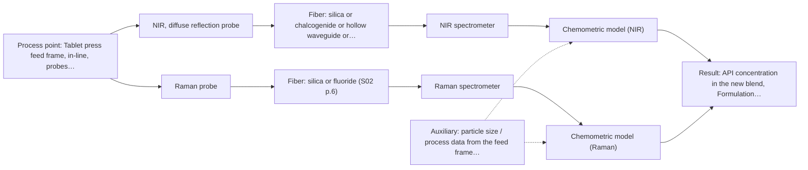
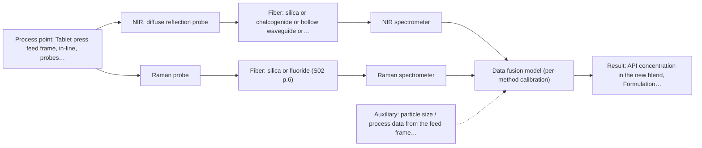

# First technical assessment: A new formulation after an existing NIR pilot

## Answer

**Customer request (our summary):** The customer wants to know what technical assessment and experiment to perform to reuse an existing NIR calibration for a new API and excipient blend or if adding Raman will keep the old calibration valid.

### Brief answer

Do not reuse the old NIR calibration: calibrations are matrix-specific, and a new API and excipient blend is a new matrix. Rebuild and validate the NIR reflection calibration on representative samples of the new blend with an independent reference assay. Test Raman as a separate method with its own calibration; adding Raman does not keep the old calibration valid. A fused NIR+Raman model is only a later hypothesis, tested if a single method misses your accuracy target.

### Proposal

- **Best current option:** O2 (recommended)
- **Basis:** supplied AFS sources
- **What would change it:** If the rebuilt NIR model alone meets the customer's accuracy target on held-out batches, the Raman comparison and fusion can be dropped (O1 suffices). If Raman suffers strong fluorescence background from the new excipients, only O1 remains.
- **Next step:** Run the multi-method lab trial on representative samples of the new blend with an independent reference assay, rebuilding the NIR calibration first.

**Secondary evidence (external, not AFS material):** G1: no usable external source found; G2: E02 ¶31; G3: no usable external source found; G4: no usable external source found. See Expert detail.

**Decision status:** Premise not supported by the sources

### Solution options

| ID | Tier | Methods | Confidence | Cost class, S01 Table 1 (p.6) | Ease of use | Maintenance | Performance fit | Sources |
|---|---|---|---|---|---|---|---|---|
| O1 | Simple | M1 NIR, diffuse reflection probe | Low: open question: Q1, Q3 (starts at Medium); a customer premise is contradicted, status: premise not supported | average cost (row 8) | Reuses installed probe and hardware | One instrument, one calibration to maintain | Fits if rebuilt NIR model meets target on new blend | [1: S01 p.15] [2: REF §5] |
| O2 | Recommended | M1 NIR, diffuse reflection probe; M2 Raman probe | Low: open question: Q1, Q3 (starts at Medium); a customer premise is contradicted, status: premise not supported | high cost (rows 8, 12) | Two probes at same feed-frame spot | Two calibrations and instruments to maintain | Fits because matrix change is unproven and Raman adds independent molecular information | [1: S01 p.15] [2: REF §5] [3: S01 p.15] [4: S01 p.11] |
| O3 | Extended (multi-method) | M3 NIR, diffuse reflection probe + Raman (combination) | Low: open question: Q1, Q3 (starts at Medium); precedent only; a customer premise is contradicted, status: premise not supported; multi-method, fusion benefit not yet shown | high cost (rows 8, 12) | More complex data handling and software | Fused model breaks if either block drifts | Fits only if fusion beats the best single method on held-out batches | [5: S01 p.15] [6: S01 p.15] |

*Confidence rates the basis of the advice (how much is known and cited), not a predicted accuracy or probability of success. It starts at High, or at Medium when a key question on the method or the option is open, and drops one level per weakness listed (floor Low).*

*Cost class is the relative rating in S01 Table 1 (p.6) for the in-line method+technique rows named (the highest one for a multi-method option); it is not a price.*

### Setup sketch

*Recommended option O2; drawn by code from the option, a schematic, not a configuration.*

### Key questions

1. How different are the new API and excipients from the old formulation (chemistry, particle size, colour)?
2. Is an independent laboratory reference assay available for API concentration in the new blend?
3. How many representative samples or production batches of the new blend can be collected across the expected concentration range?

## Expert detail

**Customer enquiry**

> Our existing NIR pilot follows API concentration in one powder formulation at the tablet press feed frame. We are introducing a different API and excipient blend and would like to reuse the calibration. A colleague suggests adding Raman so that the old calibration will remain valid. What should our first technical assessment and experiment be?

**Decision status:** Premise not supported by the sources. The sources state that NIR calibrations are specific to the sample matrix, so an existing NIR calibration cannot be assumed valid for a different API and excipient blend; adding Raman does not preserve the old calibration, since Raman needs its own model and any fusion gain is a hypothesis to test.

### Parameters

| ID | Parameter | Kind | Need | Measured by | Why | Sources |
|---|---|---|---|---|---|---|
| P1 | API concentration in the new blend | quantitative | required | Spectroscopy: NIR | It is the target variable the in-line model must predict and validate against. | *(no verified source: engineering judgement)* |
| P2 | Formulation composition (new API and excipient identity and proportions) | qualitative | required | Spectroscopy: Raman | The matrix change is the reason the old calibration fails, so the compositional difference must be characterised. | *(no verified source: engineering judgement)* |
| P3 | Blend uniformity / physical variation (particle size, scattering state) | qualitative | optional | Auxiliary sensor: particle size / process data from the feed frame (engineering judgement: confirm availability with AFS) | Reflection signals are sensitive to surface and particle characteristics, so physical variation should be available to separate it from composition effects. | *(no verified source: engineering judgement)* |

### Solution option details

- **O1 cost drivers:** Reference assays, representative sample collection, chemometric rebuild and validation effort
- **O2 cost drivers:** Additional Raman spectrometer and probe, second calibration, doubled reference and validation workload
- **O3 cost drivers:** Two spectrometers, synchronisation software, fused-model development and per-block calibration upkeep
- **O3 combining methods:** Low-level fusion: synchronized NIR and Raman spectra merged into one augmented matrix, as in the published feed-frame example. Both probes must sample the same powder at the same spot, and data must be normalised to a common time step. Each method keeps its own calibration block, and the fused model must beat the best single method on independent batches or it is dropped.

*Extended (multi-method) option O3; drawn by code from the option, a schematic, not a configuration.*

### Premise check

- **Contradicted:** The existing NIR calibration can be reused for a different API and excipient blend. NIR calibrations are matrix-specific; a change of API and excipients changes the matrix, so the old model must be re-validated and usually rebuilt or extended on the new blend. [2: REF §5] [7: S01 p.10]
- **Not covered:** Adding Raman will keep the old NIR calibration valid. No supplied source says that adding a second method preserves an existing calibration. Raman requires its own chemometric model, and a combined NIR+Raman model is a new model whose benefit must be proven against the best single method. [8: S01 p.12] [9: REF §5]

### Requirements

**Stated by the customer**

- "Our existing NIR pilot follows API concentration in one powder formulation at the tablet press feed frame."
- "We are introducing a different API and excipient blend"
- *Further statements: see the customer enquiry above.*

**Key unknowns**

- How spectrally different the new API and excipients are from the old formulation
- Whether an independent reference assay is available for the new blend
- How many representative samples or batches can be collected for recalibration
- Whether the new excipients fluoresce under Raman excitation
- Configuration of the existing NIR probe and spectrometer

### Clarification questions (most decision-relevant first)

Q1. How different are the new API and excipients from the old formulation (chemistry, particle size, colour)? *Why it matters:* The spectral overlap between old and new blend decides whether the old model can be extended or must be rebuilt from scratch. *(affects: method)*
Q2. Is an independent laboratory reference assay available for API concentration in the new blend? *Why it matters:* Without reference values no new calibration or validation is possible for either method. *(affects: status)*
Q3. How many representative samples or production batches of the new blend can be collected across the expected concentration range? *Why it matters:* The number of samples determines whether a rebuilt NIR calibration, or a fused NIR+Raman model, is statistically feasible. *(affects: M1, M3)*
Q4. Do the new excipients show fluorescence under the intended Raman laser excitation? *Why it matters:* Fluorescence background can swamp weak Raman signals and decide whether Raman is viable for this blend. *(affects: M2)*
Q5. What are the existing NIR probe type, spectrometer and installation details at the feed frame? *Why it matters:* The usable spectral range and sampling geometry of the installed system bound what the rebuilt calibration can cover. *(affects: installation)*

### Recommendation

- **M1 · Primary candidate: NIR, diffuse reflection probe.** The existing pilot already uses NIR diffuse reflection in the feed frame, and NIR reflection is the established geometry for opaque powders. The calibration must be re-validated and rebuilt or extended on the new blend, not reused. *Conditions:* A reference assay and representative samples of the new blend must be available. [1: S01 p.15] [2: REF §5]
- **M2 · Comparison candidate: Raman probe.** Raman is a published complement to NIR for blend potency in the tablet press feed frame, capturing information NIR misses. It needs its own calibration and its fluorescence background must be checked on the new blend. *Conditions:* Tested as a single method with its own calibration after the NIR revalidation is underway. [3: S01 p.15] [4: S01 p.11]
- **M3 · Conditional candidate: NIR, diffuse reflection probe + Raman (combination).** A fused NIR+Raman model is a published route to higher accuracy for blend potency than single-method models, but the gain is a hypothesis. It should only be tested after the single-method results are in. *Conditions:* Only if the rebuilt NIR model alone does not meet the customer's accuracy target on the new blend. [5: S01 p.15] [6: S01 p.15]

### Measurement concept

- **Probe and geometry:** NIR diffuse reflection fiber probe at the existing feed frame position; optional Raman fiber probe (785 nm excitation class, per the published feed-frame example) at the same sampling spot if M2/M3 proceed.
- **Location:** Tablet press feed frame, in-line, probes inserted into the powder flow.
- **Fiber link:** Vis-NIR silica fibers for NIR; the Raman link uses silica fibers with metal-coated jackets to avoid polymer fluorescence background. [10: S01 p.15] [11: S02 p.7]

### Spectral range

- **NIR:** Nominal NIR range 780-2500 nm; the usable range depends on the installed spectrometer, fiber and probe. [12: S01 p.10]
- **Raman:** Raman is reported as Raman shift in cm-1 with the laser excitation wavelength stated separately; the usable range depends on the instrument, fiber and probe actually selected. [13: S01 p.11]

### Risks and uncertainty

- The new blend may differ so much spectrally that even a rebuilt NIR model needs many more reference samples than planned. *(rules: R-CAL-1)* *(no verified source: engineering judgement)*
- NIR reflection signals are sensitive to surface characteristics and particle size, so physical differences between blends can mimic composition changes. *(rules: R-GEO-6)* *(no verified source: engineering judgement)*
- Fluorescence from the new API or excipients may swamp the Raman signal, removing the comparison and fusion options. *(rules: R-RAM-1)* *(no verified source: engineering judgement)*
- A fused model adds a second instrument with its own calibration and drift behaviour, and may not beat the best single method. *(rules: R-CMB-1)* *(no verified source: engineering judgement)*

### First feasibility experiment

1. **Collect representative samples of the new API/excipient blend spanning the expected API concentration range and physical variation (particle size, mixing states).** Cover the variation the calibration must handle. *(no verified source: engineering judgement)*
2. **Measure each sample with the existing NIR reflection probe and, in parallel, with a Raman probe as a single method.** Single methods first; establish whether each method alone tracks API in the new blend. *(no verified source: engineering judgement)*
3. **Measure API concentration of every sample with an independent laboratory reference assay.** Provide the reference data the new calibration and validation require. *(no verified source: engineering judgement)*
4. **Rebuild or extend the NIR calibration on the new blend and validate it on held-out runs or batches; build the Raman model the same way.** Quantify whether each single method meets the target on the new formulation. *(no verified source: engineering judgement)*
5. **Only if a single method misses the target, test the fused NIR+Raman model on the same held-out data and keep it only if it beats the best single method against the customer's go/no-go criteria.** The fusion gain is a hypothesis until proven on independent batches. *(no verified source: engineering judgement)*

**Reference measurements:** Independent laboratory assay of API concentration for every calibration and validation sample.

**Decision basis:** Go/no-go criteria (acceptable prediction error, sensitivity to blend change) are set by the customer; the published fused NIR+Raman example is a precedent, not proof for this blend.

### Assumptions

- The existing pilot uses an NIR diffuse reflection probe, consistent with an opaque powder at the feed frame.
- The customer's accuracy target and reference assay exist but have not been stated.

### Not covered by the supplied sources

- Calibration transfer or model-update procedures between different API/excipient formulations are not covered by the supplied material.
- Achievable accuracy or sample counts for recalibration on a new blend are not stated in the sources.

### Further notes

- **Chemometrics:** The old NIR model should not be reused; rebuild or extend it on spectra of the new blend with reference assay values, and validate on held-out runs or batches. If the fused option is tested, watch block scaling so one method does not dominate the model.
- **Real-time tracking:** The goal is continuous in-line tracking of API concentration at the feed frame; after recalibration, monitor prediction performance over time and re-validate whenever the formulation changes again.
- **Future direction:** If the fused model proves itself, a combined NIR+Raman probe shaft for the feed frame is a published hardware direction worth considering later.

### Secondary evidence (external, not AFS material)

*Found by a literature search for gaps the supplied AFS sources leave open. Not AFS material and not proof for this case; every quote below was verified verbatim against the fetched text.*

**G1 · auxiliary sensor:** In-line measurement of Blend uniformity / physical variation (particle size, scattering state) with particle size / process data from the feed frame

- No usable external source found.

**G2 · multi-method:** Combining several spectroscopy methods (data fusion) (Low-level fusion: synchronized NIR and Raman spectra merged into one augmented matrix, as in the published feed-frame example. Both probes must sample the same powder at the same spot, and data must be normalised to a common time step. Each method keeps its own calibration block, and the fused model must beat the best single method on independent batches or it is dropped.)

- **E02 ¶31** Low-level data fusion rearranges data into a new matrix where variables from different sources are placed sequentially. *How it applies:* This supports combining NIR and Raman spectra into an augmented matrix for joint modeling, provided preprocessing aligns them properly. *Limits and transfer risks:* Data fusion models can fail if instrumental complementarity is insufficient for the specific mixture. *(supports O3)*
  > "Low-level data fusion (LLDF) is considered the simplest method to achieve a combination of inputs. In this case, the data is rearranged into a new data matrix, where the variables coming from different sources are placed one after the other."
  > Challenges and Opportunities of Implementing Data Fusion in Process Analytical Technology-A Review. (2022) · Molecules (Basel, Switzerland) · doi:10.3390/molecules27154846 · https://europepmc.org/article/PMC/PMC9369811 · retrieved 2026-10-17, full text, licence: cc by, via curated library

**G3 · not in the supplied sources:** Calibration transfer or model-update procedures between different API/excipient formulations are not covered by the supplied material.

- No usable external source found.

**G4 · not in the supplied sources:** Achievable accuracy or sample counts for recalibration on a new blend are not stated in the sources.

- No usable external source found.

### Evidence (verified quotes)

1. ✓ **S01 p.15** (application precedent): "the probes are inserted directly into the process environment, such as the feed frame of a rotary tablet press."
2. ✓ **REF §5** (general): "physical variation; calibration specific to the matrix."
3. ✓ **S01 p.15** (general): "NIR detects hydrogen bonds and asymmetric polar groups, while Raman provides information on the molecular backbone and symmetrical non-polar groups."
4. ✓ **S01 p.11** (general): "superposition of luminescence (fluorescence), which has a significantly higher intensity."
5. ✓ (precedent only) **S01 p.15** (method gain): "By combining Raman and NIR, these models can predict API potency or coating thickness with higher accuracy and robustness than single-method models."
6. ✓ **S01 p.15** (general): "Data processing for pharmaceutical tasks relies on "low-level data fusion," where the synchronized NIR and Raman spectra are merged into a single augmented matrix."
7. ✓ **S01 p.10** (general): "The broad absorption bands observed in this region overlap, suggesting the use of chemometrics for quantitative and qualitative analysis of spectral data."
8. ✓ **S01 p.12** (general): "Raman spectra (as well as IR absorption spectra) can be used to construct chemometric models-calibration or classification ones."
9. ✓ **REF §5** (general): "compare with the best single method."
10. ✓ **S01 p.15** (general): "Raman spectrometer and Raman fiber probe for contact measurements with 785 nm excitation wavelength"
11. ✓ **S02 p.7** (general): "Free of Polymer jacket fluorescence for Raman and Fluo- Spectroscopy"
12. ✓ **S01 p.10** (general): "NIR spectra (780-2500 nm) contain predominantly overtones and component bands of fundamental vibrations"
13. ✓ **S01 p.11** (general): "The Raman shift is used as the horizontal (spectral) axis in Raman spectroscopy"

### Verification

- Citations verified: 14 of 14 (exact or whitespace/hyphen-tolerant match on the cited page, scope checked).
- Hard check failures before deterministic corrections: 0; still open: 0; soft warnings: 1; repair rounds: 1.
- External evidence (live): 1 quote(s) verified verbatim (exact or whitespace/hyphen-tolerant, at most 400 characters and 2 sentences, against the cited paragraph); 0 item(s) dropped.
- External search: 5 query(ies), 30 hit(s), 5 source(s) (3 from the curated library).
- External step: 2 model call(s), 5.7 s extra (cost in the run JSON).

*Run H01-20261018T102937Z-311d · models google/gemini-3.5-flash-lite, google/gemini-3.8-flash, z-ai/glm-5.3-flash*
