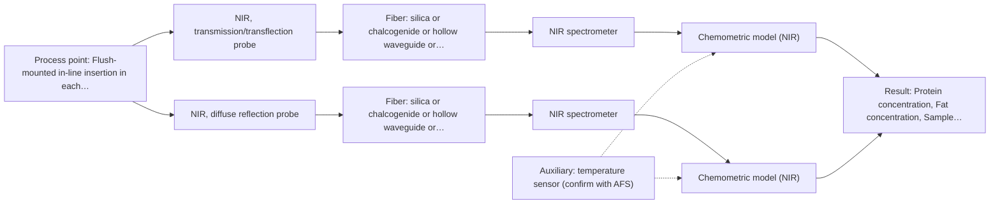

# First technical assessment: Composition monitoring across two dairy streams

## Answer

**Customer request (our summary):** The customer wants to know what measurement concepts and comparison experiments to use for composition monitoring of a clear whey stream and an opaque milk concentrate.

### Brief answer

Test NIR first: transmission or transflection on the clear whey and diffuse reflection on the opaque concentrate, using one NIR spectrometer and comparing both interfaces on the same samples. A single transflection probe covering both streams is a simpler alternative to evaluate during the trials. Open points to clarify include concentration ranges, whey clarity variation, installation conditions and laboratory reference sampling frequency.

### Proposal

- **Best current option:** O2 (recommended)
- **Basis:** supplied AFS sources
- **What would change it:** If the whey proves consistently clear and the concentrate consistently measurable, a single transflection probe (O1) could replace the two-interface setup; if concentration ranges turn out to be near trace levels, NIR sensitivity would need re-examination.
- **Next step:** Run the comparison experiment: measure representative samples of both streams with NIR transmission/transflection and reflection probes, calibrate against laboratory protein and fat results, and decide on the agreed accuracy criteria.

**Secondary evidence (external, not AFS material):** G1: E02 ¶12; G2: no usable external source found; G3: E05 ¶1; G4: E04 ¶1. See Expert detail.

**Decision status:** Provisional feasibility assessment

### Solution options

| ID | Tier | Methods | Confidence | Cost class, S01 Table 1 (p.6) | Ease of use | Maintenance | Performance fit | Sources |
|---|---|---|---|---|---|---|---|---|
| O1 | Simple | M1 NIR, transmission/transflection probe | Medium: open question: Q1, Q3 (starts at Medium) | average cost (row 7) | One probe and one spectrometer for both streams | Single interface to clean and recalibrate | Tests whether one transflection probe covers both streams | [1: S01 p.18] [2: S01 p.5] [3: S01 p.18] [4: S01 p.18] |
| O2 | Recommended | M1 NIR, transmission/transflection probe; M2 NIR, diffuse reflection probe | Medium: open question: Q1, Q3 (starts at Medium) | average cost (rows 7, 8) | Two probes, one shared NIR spectrometer | Two probes to clean; per-stream calibrations | Matches each stream's optical character: transmission for whey, reflection for concentrate | [5: S01 p.18] [1: S01 p.18] [2: S01 p.5] [3: S01 p.18] [4: S01 p.18] [6: S01 p.17] [7: S01 p.17] |

*Confidence rates the basis of the advice (how much is known and cited), not a predicted accuracy or probability of success. It starts at High, or at Medium when a key question on the method or the option is open, and drops one level per weakness listed (floor Low).*

*Cost class is the relative rating in S01 Table 1 (p.6) for the in-line method+technique rows named (the highest one for a multi-method option); it is not a price.*

### Setup sketch

*Recommended option O2; drawn by code from the option, a schematic, not a configuration.*

### Key questions

1. What are the approximate protein and fat concentration ranges in the whey stream and in the milk concentrate?
2. At what temperature, pressure and location (pipe or vessel) would the probes be installed, and is a flush-mounted insertion point available on each stream?
3. How clear is the whey in practice, and how much does its turbidity or fat content vary over time?

## Expert detail

**Customer enquiry**

> Our dairy process handles both a relatively clear whey stream and an opaque milk concentrate. We want a pilot for composition monitoring, using laboratory protein and fat results where those variables are relevant. We can compare different measurement interfaces before choosing the installation. What first measurement concepts and comparison experiment would make sense for these two streams?

**Decision status:** Provisional feasibility assessment. NIR is well documented for in-line dairy composition monitoring, but the choice between transmission, reflection and transflection interfaces for these two specific streams rests on assumptions about clarity, fat content and concentration ranges that must be confirmed in a comparison test.

### Parameters

| ID | Parameter | Kind | Need | Measured by | Why | Sources |
|---|---|---|---|---|---|---|
| P1 | Protein concentration | quantitative | required | Reference lab method: laboratory protein analysis (e.g. Kjeldahl or Dumas per customer lab routine) | Protein is a stated monitoring target and the calibration response variable. | *(no verified source: engineering judgement)* |
| P2 | Fat concentration | quantitative | required | Reference lab method: laboratory fat analysis (e.g. Gerber or Röse-Gottlieb per customer lab routine) | Fat is a stated monitoring target and also drives the optical scattering that separates the two streams. | *(no verified source: engineering judgement)* |
| P3 | Sample temperature at the measurement point | quantitative | optional | Auxiliary sensor: temperature sensor (engineering judgement: confirm availability with AFS) | Temperature affects NIR spectra and should be available to include or compensate in the calibration. | *(no verified source: engineering judgement)* |

### Solution option details

- **O1 cost drivers:** One transflection probe, one NIR spectrometer, calibration samples and lab references
- **O2 cost drivers:** Two probes and insertion points, one spectrometer, per-stream calibration and lab reference sampling

### Premise check

- **Precedent only:** A single interface could serve both the clear whey and the opaque concentrate. The dairy source notes that a transflection probe can in some cases work for both low-fat and high-fat milk products, but this is shown for dairy examples, not proven for this customer's streams. [4: S01 p.18]
- **Precedent only:** NIR is a suitable method for in-line protein and fat monitoring in dairy streams. The sources describe inline NIR reflection and transmission for fat and protein in dairy with PLS calibration, which justifies testing but is not proof for this installation. [8: S01 p.17]

### Requirements

**Stated by the customer**

- Composition monitoring pilot on two streams: relatively clear whey and opaque milk concentrate.
- Protein and fat as monitored variables, validated against laboratory results.
- Different measurement interfaces can be compared before choosing the installation.

**Key unknowns**

- Protein and fat concentration ranges in each stream (sensitivity and pathlength choice).
- Degree of clarity and scattering variation of the whey stream in practice.
- Process temperature, pressure and available installation points.
- Frequency and accuracy of laboratory reference sampling for calibration.

### Clarification questions (most decision-relevant first)

Q1. What are the approximate protein and fat concentration ranges in the whey stream and in the milk concentrate? *Why it matters:* NIR may lack sensitivity for trace levels, and the concentration range drives the choice of pathlength and interface. *(affects: technique, M1, M2)*
Q2. At what temperature, pressure and location (pipe or vessel) would the probes be installed, and is a flush-mounted insertion point available on each stream? *Why it matters:* Installation conditions determine which probe types are mechanically feasible and how representative the sampling spot is. *(affects: installation)*
Q3. How clear is the whey in practice, and how much does its turbidity or fat content vary over time? *Why it matters:* Reflection is less representative for clear liquids, and transmission fails when the sample becomes too thick or fat-rich, so the actual variation decides the interface. *(affects: technique, M1, M2)*
Q4. How often can laboratory protein and fat reference results be taken during the pilot, and with what expected accuracy? *Why it matters:* The number and quality of reference samples determine whether a usable chemometric calibration can be built and validated. *(affects: status)*

### Recommendation

- **M1 · Primary candidate: NIR, transmission/transflection probe.** NIR transmission is the preferred geometry for transparent or semi-transparent liquids such as whey, and a transflection probe can in some cases also serve higher-fat streams. NIR suits remote fiber-probe measurement with glass optics, with pathlength typically 1-10 mm in dairy. [1: S01 p.18] [2: S01 p.5] [3: S01 p.18] [4: S01 p.18]
- **M2 · Comparison candidate: NIR, diffuse reflection probe.** NIR reflection is used for opaque or highly concentrated dairy products such as the milk concentrate, where transmission light cannot penetrate. It is sensitive to surface characteristics and fat globule size, so scatter correction and calibration on the concentrate are needed. [6: S01 p.17] [7: S01 p.17]

### Measurement concept

- **Probe and geometry:** NIR transmission or transflection probe on the whey line; NIR diffuse-reflection probe on the concentrate line; both candidates compared, with a single transflection probe as a possible simplification.
- **Location:** Flush-mounted in-line insertion in each stream, at a point representative of the flow.
- **Fiber link:** Vis-NIR silica fibers connect the probes to the spectrometer; the usable range depends on the selected instrument, fiber and probe. [9: S02 p.6] [10: S01 p.17]

### Spectral range

- **NIR:** Nominal NIR range 780-2500 nm; the usable range depends on the spectrometer, fiber and probe actually selected. [11: S01 p.10]

### Risks and uncertainty

- If the whey is less clear or more variable in fat content than assumed, transmission may saturate and reflection or transflection may be needed instead. *(rules: R-GEO-2, R-GEN-4)* [12: S01 p.18]
- Reflection signals on the concentrate may track fat globule size and surface effects rather than composition, so physical variation can mimic composition change. *(rules: R-GEO-6)* [7: S01 p.17]
- NIR bands are broad and overlapping, so quantitative protein and fat results depend entirely on a matrix-specific chemometric calibration that must be built and validated per stream. *(rules: R-NIR-2, R-CAL-1)* [13: S01 p.10]
- If protein or fat levels in one stream are near trace levels, NIR sensitivity may be insufficient and the method choice would have to be revisited. *(rules: R-NIR-4)* [14: S01 p.16]

### First feasibility experiment

1. **Collect representative samples of both streams across the expected variation in protein, fat and turbidity (different production runs and concentrate levels).** Cover the chemical and physical variation the calibration must handle. *(no verified source: engineering judgement)*
2. **Measure all samples with the candidate interfaces: NIR transmission/transflection and NIR diffuse reflection, using the same NIR spectrometer.** Compare the interfaces on identical samples under identical conditions. *(no verified source: engineering judgement)*
3. **Obtain independent laboratory protein and fat reference results for every sample.** Provide the reference data for calibration and validation. *(no verified source: engineering judgement)*
4. **Build per-stream PLS calibration models for protein and fat, and validate them on held-out samples or runs not used in calibration.** Quantify prediction accuracy per interface and per stream. *(no verified source: engineering judgement)*
5. **Go/no-go: agree numerical accuracy criteria with the customer (e.g. acceptable prediction error for protein and fat per stream) and select the interface, or the single transflection probe if it meets the same criteria on both streams.** Make the interface decision on agreed, measurable criteria. *(no verified source: engineering judgement)*

**Reference measurements:** Laboratory protein and fat analyses on every pilot sample, taken at matched times with the spectral measurements.

**Decision basis:** Per-stream prediction error for protein and fat on held-out runs, against accuracy limits agreed with the customer.

### Assumptions

- Both streams are aqueous dairy liquids at process conditions compatible with in-line fiber probes.
- Laboratory protein and fat methods are available at sufficient frequency during the pilot.

### Not covered by the supplied sources

- Achievable prediction accuracy for protein and fat in these specific streams is not stated in the supplied material.

### Further notes

- **Chemometrics:** Per-stream PLS calibration models for protein and fat are needed because NIR bands overlap and calibrations are matrix-specific; scatter correction (e.g. SNV or MSC) should be tested especially for the reflection data on the concentrate, and models must be validated on held-out runs.
- **Real-time tracking:** The pilot should record spectra continuously in-line on both streams so that dynamic changes (e.g. concentrate level) are captured and time-matched to laboratory references.
- **Future direction:** If one transflection probe passes the comparison test on both streams, the installation can later be simplified to a single interface per line, or extended with additional methods only if a target appears that NIR cannot cover.

### Secondary evidence (external, not AFS material)

*Found by a literature search for gaps the supplied AFS sources leave open. Not AFS material and not proof for this case; every quote below was verified verbatim against the fetched text.*

**G1 · auxiliary sensor:** In-line measurement of Sample temperature at the measurement point with temperature sensor

- **E02 ¶12** The temperature sensitivity of the OH bands is a severe drawback for measuring aqueous solution in NIR and MIR, which makes tempered sample holders necessary. *How it applies:* This highlights why sample temperature should be tracked or controlled when analyzing aqueous streams like whey and milk. *Limits and transfer risks:* The source discusses general spectroscopic setups and aqueous solutions rather than the specific dairy streams or the AFS in-line probe design. *(supports O2)*
  > "Additionally, the temperature sensitivity of the OH bands is a severe drawback for measuring aqueous solution in NIR and MIR, which makes tempered sample holders necessary [29]."
  > A critical review of recent trends, and a future perspective of optical spectroscopy as PAT in biopharmaceutical downstream processing. (2020) · Analytical and bioanalytical chemistry · doi:10.1007/s00216-020-02407-z · https://europepmc.org/article/PMC/PMC7072065 · retrieved 2026-10-17, full text, licence: cc by, via curated library

**G2 · not in the supplied sources:** Achievable prediction accuracy for protein and fat in these specific streams is not stated in the supplied material.

- No usable external source found.

**G3 · parameter without a source:** Measuring Protein concentration: Protein is a stated monitoring target and the calibration response variable.

- **E05 ¶1** NIR spectra obtained on whey samples with known and varying amounts of the proteins of interest are used to develop partial least squares prediction models. *How it applies:* It supports testing NIR methods for protein monitoring in aqueous whey streams as part of the evaluation. *Limits and transfer risks:* The study evaluates complex aqueous whey solutions in a laboratory or simulated setup rather than the exact customer plant conditions. *(supports O2)*
  > "MIR and NIR spectra obtained on whey samples with known and varying amounts of the proteins of interest and are used to develop partial least squares prediction models."
  > Prediction of α-Lactalbumin and β-Lactoglobulin Composition of Aqueous Whey Solutions Using Fourier Transform Mid-Infrared Spectroscopy and Near-Infrared Spectroscopy (2020) · Applied Spectroscopy · doi:10.1177/0003702820979747 · https://doi.org/10.1177/0003702820979747 · retrieved 2026-10-18, abstract only, licence: cc-by-nc, via openalex

**G4 · parameter without a source:** Measuring Fat concentration: Fat is a stated monitoring target and also drives the optical scattering that separates the two streams.

- **E04 ¶1** A system based on near-infrared spectroscopy has been developed for the in-line control of the composition of the milk used as raw material to control protein and fat. *How it applies:* It provides a reference point for monitoring fat and protein in milk streams using near-infrared methods. *Limits and transfer risks:* The reference application involves milk for yoghurt production, which may differ in fat and protein concentration ranges from the customer's specific streams. *(supports O2)*
  > "A system based on near-infrared (NIR) spectroscopy has been developed for the in-line control of the composition of the milk used as raw material for yoghurt production to control the content of protein and fat in the final product, and, therefore, to reduce variability in the production process."
  > Yoghurt standardization using real-time NIR prediction of milk fat and protein content (2024) · Journal of Food Composition and Analysis · doi:10.1016/j.jfca.2024.106015 · https://doi.org/10.1016/j.jfca.2024.106015 · retrieved 2026-10-18, abstract only, licence: cc-by-nc-nd, via openalex

### Evidence (verified quotes)

1. ✓ **S01 p.18** (general): "Transmission is the preferred method for transparent or semi-transparent liquids, such as skim milk, whey, or permeate."
2. ✓ **S01 p.5** (general): "making it ideal for online applications, including remote measurements via fiber optic probes."
3. ✓ **S01 p.18** (general): "the precise control of the optical pathlength (usually 1 - 10 mm); if the pathlength is too wide, the signal is lost to absorption; if too narrow, the sample represents a negligible volume."
4. ✓ **S01 p.18** (application precedent): "In some cases, a Transflection probe can already be a combined solution working well for low-fat and high-fat containing milk products."
5. ✓ **S01 p.18** (general): "By maintaining both, a lab can calibrate models for every stage of production - from raw milk intake to final evaporation - ensuring that no matter how the physical state of the milk changes during processing, the inline monitoring remains accurate and robust."
6. ✓ **S01 p.17** (general): "NIR Reflection is primarily used for opaque or highly concentrated dairy products, such as yogurt, butter, or whole milk concentrates."
7. ✓ **S01 p.17** (general): "the method is sensitive to the surface characteristics and fat globule size."
8. ✓ **S01 p.17** (application precedent): "The use of Near-Infrared (NIR) spectroscopy for the inline monitoring of milk is a cornerstone of modern dairy "Process Analytical Technology" (PAT)."
9. ✓ **S02 p.6** (general): "350 nm Standard VIS-NIR Silica Fibers Al/Cu-coated VIS-NIR Silica Fibers 2400 nm"
10. ✓ **S01 p.17** (general): "Experimentally, the probe is flush-mounted into a pipe or vat to interact directly with the flowing medium."
11. ✓ **S01 p.10** (general): "NIR spectra (780-2500 nm) contain predominantly overtones and component bands of fundamental vibrations"
12. ✓ **S01 p.18** (general): "it fails when the milk becomes too "thick" or fat-rich, as the light cannot penetrate the sample."
13. ✓ **S01 p.10** (general): "The broad absorption bands observed in this region overlap, suggesting the use of chemometrics for quantitative and qualitative analysis of spectral data."
14. ✓ **S01 p.16** (general): "may lack the sensitivity to detect trace compounds below 0.1 percent."

### Verification

- Citations verified: 16 of 16 (exact or whitespace/hyphen-tolerant match on the cited page, scope checked).
- Hard check failures before deterministic corrections: 0; still open: 0; soft warnings: 0; repair rounds: 1.
- External evidence (live): 3 quote(s) verified verbatim (exact or whitespace/hyphen-tolerant, at most 400 characters and 2 sentences, against the cited paragraph); 0 item(s) dropped.
- External search: 3 query(ies), 20 hit(s), 5 source(s) (3 from the curated library).
- External step: 2 model call(s), 6.8 s extra (cost in the run JSON).

*Run H02-20261018T102937Z-5cfc · models google/gemini-3.5-flash-lite, google/gemini-3.8-flash, z-ai/glm-5.3-flash*
