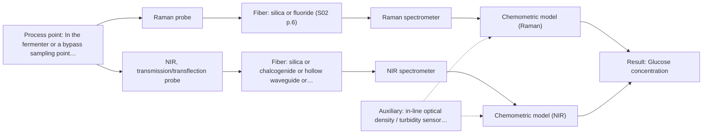
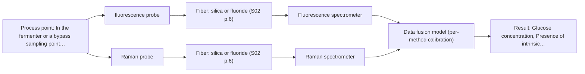

# First technical assessment: A fluorescence instrument requested for glucose and viable biomass

## Answer

**Customer request (our summary):** The customer wants to know how to use their existing fluorescence spectrometer to measure glucose and viable biomass during fermentation, despite not having a fluorescent target or marker.

### Brief answer

Fluorescence alone cannot report glucose: glucose is not fluorescent and you have no marker or reference relationship, so that premise does not hold. Test Raman first on representative broth samples against lab glucose and viable-count references; NIR transmission is the comparison if the broth is transparent enough. Your fluorescence spectrometer may still serve a biomass-related signal via intrinsic fluorophores such as NADH or riboflavin, but that must be confirmed first. Required accuracy and go/no-go criteria remain open.

### Proposal

- **Best current option:** O2 (recommended)
- **Basis:** supplied AFS sources
- **What would change it:** If the broth contains no usable fluorophore and Raman suffers strong fluorescence background, the Raman route weakens and NIR becomes the lead candidate; if the broth is too turbid for transmission, an ATR or reflection probe is required.
- **Next step:** Run the multi-method lab trial on representative broth samples with independent glucose and viable-count references, starting with Raman.

**Secondary evidence (external, not AFS material):** G1: no usable external source found; G2: no usable external source found; G3: no usable external source found; G4: E04 ¶102. See Expert detail.

**Decision status:** Premise not supported by the sources

### Solution options

| ID | Tier | Methods | Confidence | Cost class, S01 Table 1 (p.6) | Ease of use | Maintenance | Performance fit | Sources |
|---|---|---|---|---|---|---|---|---|
| O1 | Simple | M1 Raman probe | Low: open question: Q1, Q3 (starts at Medium); a customer premise is contradicted, status: premise not supported | high cost (row 12) | Lab trial, no process installation | Minimal, bench instruments only | Answers glucose feasibility directly on real broth samples | [1: S01 p.16] [2: S01 p.16] |
| O2 | Recommended | M1 Raman probe; M2 NIR, transmission/transflection probe | Low: open question: Q1, Q2, Q3 (starts at Medium); sample clarity unknown; a customer premise is contradicted, status: premise not supported | high cost (rows 7, 12) | In-line probe with established workflow | Probe cleaning and calibration upkeep | Covers glucose in-line and benchmarks the best fiber-probe method | [1: S01 p.16] [2: S01 p.16] [3: S01 p.16] [4: S01 p.18] |
| O3 | Extended (multi-method) | M3 fluorescence probe + Raman (combination); M1 Raman probe | Low: open question: Q1, Q3 (starts at Medium); fluorescent target unknown; a customer premise is contradicted, status: premise not supported; multi-method, fusion benefit not yet shown | high cost (rows 12, 19) | Two instruments, more complex operation | Two calibrations and two probe channels to maintain | Adds biomass-related fluorophore signal glucose-only Raman lacks | [5: S01 p.8] [6: S01 p.7] [1: S01 p.16] [2: S01 p.16] |

*Confidence rates the basis of the advice (how much is known and cited), not a predicted accuracy or probability of success. It starts at High, or at Medium when a key question on the method or the option is open, and drops one level per weakness listed (floor Low).*

*Cost class is the relative rating in S01 Table 1 (p.6) for the in-line method+technique rows named (the highest one for a multi-method option); it is not a price.*

### Setup sketch

*Recommended option O2; drawn by code from the option, a schematic, not a configuration.*

### Key questions

1. Which organism and medium do you ferment, and does the broth contain known intrinsic fluorophores (NADH, tryptophan, riboflavin) or could an added fluorescent indicator be acceptable?
2. What is the expected optical density / turbidity range of the broth over the run?
3. What accuracy do you need for glucose and biomass, and what numerical go/no-go criteria should the feasibility test meet?

## Expert detail

**Customer enquiry**

> We already have a fluorescence spectrometer and would like to use it to report glucose concentration and viable biomass directly during fermentation. Our only justification is that fluorescence can be very sensitive. We have not identified a fluorescent target, marker or reference relationship. What should the assistant tell us?

**Decision status:** Premise not supported by the sources. The premise that fluorescence sensitivity alone justifies direct in-line glucose measurement is contradicted by the sources: glucose is not among the species fluorescence can measure, and no fluorescent target or marker has been identified. A conditional path for biomass via intrinsic fluorophores remains open.

### Parameters

| ID | Parameter | Kind | Need | Measured by | Why | Sources |
|---|---|---|---|---|---|---|
| P1 | Glucose concentration | quantitative | required | Spectroscopy: Raman | It is the primary target the customer wants reported in-line. | [2: S01 p.16] |
| P2 | Viable biomass (viable cell concentration) | quantitative | required | Reference lab method: viable cell count (e.g. plate count or equivalent) | It is the second target, and spectroscopy can only correlate with it, so an independent reference is needed. | *(no verified source: engineering judgement)* |
| P3 | Presence of intrinsic fluorophores (NADH, tryptophan, riboflavin or similar) | qualitative | required | Spectroscopy: Fluorescence | Fluorescence can only contribute if a fluorescing species exists in the broth; this decides whether the existing spectrometer has any role. | [7: S01 p.16] |
| P4 | Broth optical density / turbidity | quantitative | optional | Auxiliary sensor: in-line optical density / turbidity sensor (engineering judgement: confirm availability with AFS) | It should be available because it decides probe geometry limits and tracks cell density as a physical process trend. | *(no verified source: engineering judgement)* |

### Solution option details

- **O1 cost drivers:** Raman spectrometer and probe rental or purchase, reference lab assays, chemometric modelling time
- **O2 cost drivers:** In-line Raman probe and spectrometer, NIR comparison hardware, calibration samples and reference assays
- **O3 cost drivers:** Second spectrometer channel, combined or co-located probes, fused-model development and validation effort
- **O3 combining methods:** Low-level fusion: Raman and fluorescence spectra synchronised to a common time step and merged into one augmented matrix, with block scaling so neither method dominates. Both probes must sample the same broth volume, ideally via a combined or co-located probe head. Each method keeps its own calibration, and the fused model must beat the best single method on held-out batches or it is dropped.

*Extended (multi-method) option O3; drawn by code from the option, a schematic, not a configuration.*

### Premise check

- **Contradicted:** Fluorescence sensitivity is sufficient justification for measuring glucose directly, without a fluorescent target or marker. Fluorescence only works on species that actually fluoresce; most chemicals, glucose included, do not, so sensitivity alone does not make glucose measurable. [8: S01 p.5] [9: S04 p.4]
- **Precedent only:** Fluorescence can still play a role in fermentation monitoring. Published bioprocess work reports fluorescence used for intrinsic fluorophores such as NADH, tryptophan and riboflavin; this is a reason to test, not proof for this customer's process. [7: S01 p.16]
- **Precedent only:** A spectroscopic method can track glucose and metabolites directly in a fermenter. Literature examples report Raman used in the same reactor for direct detection of metabolites such as glucose; this supports a feasibility trial, not a ready solution. [2: S01 p.16]

### Requirements

**Stated by the customer**

- Report glucose concentration in-line during fermentation.
- Report viable biomass in-line during fermentation.
- Use the existing fluorescence spectrometer.

**Key unknowns**

- Whether the broth contains intrinsic fluorophores (e.g. NADH, riboflavin) usable as a biomass-related indicator
- Optical density / turbidity range of the broth, which decides transmission vs reflection vs ATR geometry
- Required accuracy and go/no-go criteria for glucose and biomass
- Excitation wavelengths and fiber interface of the existing fluorescence spectrometer
- Reference method available for viable biomass (e.g. viable count)

### Clarification questions (most decision-relevant first)

Q1. Which organism and medium do you ferment, and does the broth contain known intrinsic fluorophores (NADH, tryptophan, riboflavin) or could an added fluorescent indicator be acceptable? *Why it matters:* Fluorescence can only report something if a fluorescing species or justified indicator exists; without one it cannot serve either target. *(affects: method, status)*
Q2. What is the expected optical density / turbidity range of the broth over the run? *Why it matters:* Turbidity decides whether transmission, reflection or ATR geometry is viable for any optical probe in the broth. *(affects: technique, M2)*
Q3. What accuracy do you need for glucose and biomass, and what numerical go/no-go criteria should the feasibility test meet? *Why it matters:* The feasibility experiment and the decision to proceed need customer-defined numerical criteria. *(affects: status, M1)*
Q4. What excitation wavelengths, detection range and probe interface does your existing fluorescence spectrometer have? *Why it matters:* It determines whether the instrument can be coupled to an in-line fluorescence probe at all. *(affects: installation, M3)*
Q5. Which reference method will you use for viable biomass (e.g. viable count) and at what sampling frequency? *Why it matters:* Viable biomass is not directly measured by spectroscopy; an independent reference is needed to build and validate any model. *(affects: status, method)*

### Recommendation

- **M1 · Primary candidate: Raman probe.** Raman tolerates water well and published bioprocess work reports direct detection of metabolites such as glucose in the reactor. It is the strongest single-method candidate to test first for glucose. *Conditions:* Fluorescence background from the broth must be checked on real samples; a matrix-specific chemometric calibration is required. [1: S01 p.16] [2: S01 p.16]
- **M2 · Comparison candidate: NIR, transmission/transflection probe.** NIR is the most common online fiber-probe method and literature reports it tracking major components like glucose in the millimolar range, but it needs a matrix-specific calibration and may miss trace levels. *Conditions:* Viable only if the broth stays transparent enough for a controlled 1-10 mm pathlength; otherwise a reflection geometry must be tested. [3: S01 p.16] [4: S01 p.18]
- **M3 · Comparison candidate: fluorescence probe + Raman (combination).** If single-method tests show Raman covers glucose but not the metabolic biomass state, adding fluorescence provides complementary data; bioprocess literature reports multi-method monitoring. *Conditions:* Tested only after single-method trials, against the best single method, with same-spot sampling and synchronised data. [6: S01 p.7]
- **N1 · Not recommended: fluorescence probe.** The customer proposed fluorescence alone to report glucose directly, but glucose does not fluoresce and no marker or reference relationship exists, so the sources contradict this use. [8: S01 p.5]

### Measurement concept

- **Probe and geometry:** Immersion Raman fiber probe for the fermenter broth (primary test); fluorescence only via a fiber probe if a fluorophore is confirmed; NIR transmission/transflection as comparison if the broth is transparent enough.
- **Location:** In the fermenter or a bypass sampling point, same spot for any combined measurement.
- **Fiber link:** Silica fibers suit Raman and NIR; the existing fluorescence spectrometer's fiber compatibility is unknown (Q4). No link length can be stated from the sources. [10: S01 p.11]

### Spectral range

- **Raman:** Raman shift in cm-1 with laser excitation wavelength stated separately; the usable shift range depends on the instrument, laser and probe actually selected. [11: S01 p.11]
- **NIR:** Nominal NIR range 780-2500 nm; the usable range depends on the instrument, fiber and probe actually selected. [12: S01 p.10]
- **Fluorescence:** Emission depends on the fluorescent species and the excitation wavelength; no nominal range can be stated until a fluorophore is identified. [13: S01 p.12]

### Risks and uncertainty

- The broth's fluorescence background could swamp the weak Raman signal, degrading the primary glucose measurement. *(rules: R-RAM-1)* [14: S01 p.11]
- Any glucose or biomass model is matrix-specific and must be re-validated if the medium, organism or process changes. *(rules: R-CAL-1)* [15: REF §5]
- Rising turbidity during fermentation can saturate transmission geometries and force a switch to reflection or ATR. *(rules: R-GEO-2, R-GEO-7)* [16: S01 p.16]
- Spectroscopic signals correlate with biomass only indirectly; viable count is the reference and the correlation may not hold across process phases. *(rules: R-UV-2)* [17: S01 p.16]

### First feasibility experiment

1. **Collect representative broth samples across the expected variation: organism/medium states, glucose levels from high to depleted, and early to late process phases.** Cover the chemical and physical variation the model must handle. *(no verified source: engineering judgement)*
2. **Measure each sample with independent reference methods: glucose by a laboratory enzymatic or HPLC method, viable biomass by viable count.** Provide the reference data the calibration and validation depend on. *(no verified source: engineering judgement)*
3. **Record Raman spectra of all samples first (single method), checking fluorescence background; then NIR transmission/transflection on the same samples if the broth is transparent enough.** Compare the single methods before any combination. *(no verified source: engineering judgement)*
4. **Build a matrix-specific chemometric model per method and validate on held-out runs or batches; only then test a fluorescence block added to the best single method.** Establish whether any combined model beats the best single method. *(no verified source: engineering judgement)*
5. **Apply the customer's numerical go/no-go criteria (Q3) for glucose accuracy and biomass agreement to decide whether an in-line installation is justified.** Give the decision an objective basis. *(no verified source: engineering judgement)*

**Reference measurements:** Laboratory glucose assay and viable cell count on every calibration and validation sample.

**Decision basis:** Customer-defined accuracy targets for glucose and agreement limits for biomass (Q3); no numbers can be assumed from the sources.

### Assumptions

- The fermentation is aqueous and the broth is a liquid, as inferred from the enquiry.
- The existing fluorescence spectrometer could be coupled to a fiber probe, which is unverified (Q4).

### Not covered by the supplied sources

- Whether glucose or viable biomass has ever been measured in-line by fluorescence with or without an added indicator; the supplied material does not cover this.

### Further notes

- **Chemometrics:** A glucose calibration (e.g. PLS on Raman or NIR spectra) and, if fluorescence contributes, a biomass-related model both need reference data across the full process range; validation on held-out runs or batches is essential before any in-line use.
- **Real-time tracking:** The goal is continuous in-line tracking during fermentation; acquisition rate and data synchronisation to a common time step must be planned if more than one method is used.
- **Future direction:** If the feasibility trial succeeds, a specialised compact sensor tuned to the selected spectral features (an optical multisensor approach) could replace full spectrometers for routine process control.

### Secondary evidence (external, not AFS material)

*Found by a literature search for gaps the supplied AFS sources leave open. Not AFS material and not proof for this case; every quote below was verified verbatim against the fetched text.*

**G1 · auxiliary sensor:** In-line measurement of Broth optical density / turbidity with in-line optical density / turbidity sensor

- No usable external source found.

**G2 · multi-method:** Combining several spectroscopy methods (data fusion) (Low-level fusion: Raman and fluorescence spectra synchronised to a common time step and merged into one augmented matrix, with block scaling so neither method dominates. Both probes must sample the same broth volume, ideally via a combined or co-located probe head. Each method keeps its own calibration, and the fused model must beat the best single method on held-out batches or it is dropped.)

- No usable external source found.

**G3 · not in the supplied sources:** Whether glucose or viable biomass has ever been measured in-line by fluorescence with or without an added indicator; the supplied material does not cover this.

- No usable external source found.

**G4 · parameter without a source:** Measuring Viable biomass (viable cell concentration): It is the second target, and spectroscopy can only correlate with it, so an independent reference is needed.

- **E04 ¶102** Turbidity-based measurements do not distinguish viable from non-viable biomass, which may affect performance in long fermentations. *How it applies:* When using optical density or turbidity sensors for viable biomass estimation, watch for potential divergence in extended processes and consider complementary methods if viability distinction is required. *Limits and transfer risks:* This limitation was noted in the context of yeast fermentations and may vary depending on the specific microbial species, cell lysis rates, and fermentation duration. *(supports O2)*
  > "Finally, turbidity-based measurements do not distinguish viable from non-viable biomass, which may affect performance in long fermentations; integration with complementary methods such as capacitance-based sensors may be required (Kiviharju et al. 2008)."
  > Real-Time Biomass Estimation in High-Density Yeast Fermentations Using Soft Sensor Modeling. (2026) · Biotechnology and bioengineering · doi:10.1002/bit.70266 · https://europepmc.org/article/PMC/PMC13521467 · retrieved 2026-10-18, full text, licence: cc by, via europepmc

### Evidence (verified quotes)

1. ✓ **S01 p.16** (general): "Raman is particularly well-suited for aqueous environments, as it exhibits low absorbance for water molecules compared to infrared methods."
2. ✓ **S01 p.16** (application precedent): "Raman spectroscopy can be used in the same reactor to provide a "molecular fingerprint" for direct detection of specific metabolites like glucose, acetate, or lactate."
3. ✓ **S01 p.16** (application precedent): "NIR spectroscopy is effective for tracking major components like glucose or glycerol in the millimolar range but may lack the sensitivity to detect trace compounds below 0.1 percent."
4. ✓ **S01 p.18** (general): "the precise control of the optical pathlength (usually 1 - 10 mm); if the pathlength is too wide, the signal is lost to absorption; if too narrow, the sample represents a negligible volume."
5. ✓ **S01 p.8** (general): "the data from each method must be obtained simultaneously."
6. ✓ (precedent only) **S01 p.7** (method gain): "This often provides a synergistic effect, allowing one to solve a problem that either method alone cannot handle or only partially."
7. ✓ **S01 p.16** (application precedent): "critical cofactors and amino acids like NADH, tryptophan, and riboflavin."
8. ✓ **S01 p.5** (general): "However, most chemicals do not exhibit this property."
9. ✓ **S04 p.4** (general): "it is limited to the samples containing at least one fluorescent component"
10. ✓ **S01 p.11** (general): "The kit includes a Raman spectrometer, laser, and Raman fiber probe."
11. ✓ **S01 p.11** (general): "The Raman shift is used as the horizontal (spectral) axis in Raman spectroscopy"
12. ✓ **S01 p.10** (general): "NIR spectra (780-2500 nm) contain predominantly overtones and component bands of fundamental vibrations"
13. ✓ **S01 p.12** (general): "Fluorimetry is based on measuring the broad emission signal observed upon irradiation of certain samples in the UV and visible regions."
14. ✓ **S01 p.11** (general): "superposition of luminescence (fluorescence), which has a significantly higher intensity."
15. ✓ **REF §5** (general): "Weak signal, fluorescence background; calibration specific to the matrix."
16. ✓ **S01 p.16** (general): "transmission setup becomes saturated because the light cannot penetrate the bulk of the sample."
17. ✓ **S01 p.16** (general): "cell suspension turbidity correlates well with cell density."

### Verification

- Citations verified: 21 of 21 (exact or whitespace/hyphen-tolerant match on the cited page, scope checked).
- Hard check failures before deterministic corrections: 0; still open: 0; soft warnings: 2; repair rounds: 1.
- External evidence (live): 1 quote(s) verified verbatim (exact or whitespace/hyphen-tolerant, at most 400 characters and 2 sentences, against the cited paragraph); 1 item(s) dropped.
- External search: 4 query(ies), 15 hit(s), 5 source(s) (3 from the curated library).
- External step: 2 model call(s), 7.2 s extra (cost in the run JSON).
  - ⚠ dropped G1 E04 ¶1: figure not in its own quote: 3 L

*Run H03-20261018T102937Z-ad0f · models google/gemini-3.5-flash-lite, google/gemini-3.8-flash, z-ai/glm-5.3-flash*
