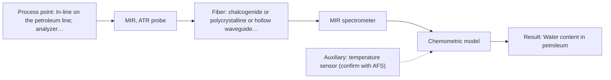
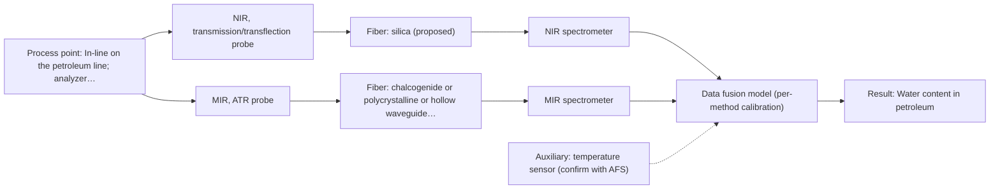

# First technical assessment: Reuse of a silica link for petroleum MIR ATR

## Answer

**Customer request (our summary):** The customer wants to measure water in a petroleum line using MIR ATR with a remote analyzer in another building, reusing an existing silica fiber, and asks for concept approval.

### Brief answer

The concept cannot be approved as stated: silica fibers cannot carry mid-IR light, so MIR ATR needs a CIR or PIR fiber instead of the existing cable. MIR ATR itself is worth testing first, with a published precedent for water in petroleum. Open items: the MIR link length to the other building, the sample state, and the required accuracy.

### Proposal

- **Best current option:** O2 (recommended)
- **Basis:** supplied AFS sources
- **What would change it:** A confirmed MIR fiber link length and sample state would fix the installation; if the MIR link proves infeasible, the NIR fallback over the existing silica cable becomes the primary path.
- **Next step:** Supply the link length, routing and operating conditions, and run the laboratory MIR ATR feasibility test on representative petroleum samples with Karl Fischer reference values.

**Secondary evidence (external, not AFS material):** G1: no usable external source found; G2: no usable external source found; G3: no usable external source found; G4: no usable external source found. See Expert detail.

**Decision status:** Premise not supported by the sources

### Solution options

| ID | Tier | Methods | Confidence | Cost class, S01 Table 1 (p.6) | Ease of use | Maintenance | Performance fit | Sources |
|---|---|---|---|---|---|---|---|---|
| O1 | Simple | M2 NIR, transmission/transflection probe | Low: open question: Q3 (starts at Medium); physical state unknown, sample clarity unknown; a customer premise is contradicted, status: premise not supported | average cost (row 7) | Least effort reusing existing silica fiber | Routine transmission probe cleaning and calibration | Reuses existing cable but broad bands | [1: S01 p.10] [2: S01 p.10] |
| O2 | Recommended | M1 MIR, ATR probe | Low: open question: Q1, Q2, Q3 (starts at Medium); physical state unknown, sample clarity unknown; a customer premise is contradicted, status: premise not supported | high cost (row 2) | Direct in-line ATR crystal immersion | ATR crystal cleaning and fouling checks | Specific fundamental bands for water detection | [3: S02 p.13] [4: S01 p.9] |
| O3 | Extended (multi-method) | M2 NIR, transmission/transflection probe; M3 MIR, ATR probe + NIR (combination) | Low: open question: Q3 (starts at Medium); physical state unknown, sample clarity unknown; a customer premise is contradicted, status: premise not supported; multi-method, fusion benefit not yet shown | high cost (rows 2, 7) | Complex with two separate spectrometers | Two probes and two calibrations upkeep | Combines fundamental and overtone spectral features | [5: S01 p.8] [6: S01 p.8] [1: S01 p.10] [2: S01 p.10] [7: S01 p.7] |

*Confidence rates the basis of the advice (how much is known and cited), not a predicted accuracy or probability of success. It starts at High, or at Medium when a key question on the method or the option is open, and drops one level per weakness listed (floor Low).*

*Cost class is the relative rating in S01 Table 1 (p.6) for the in-line method+technique rows named (the highest one for a multi-method option); it is not a price.*

### Setup sketch

*Recommended option O2; drawn by code from the option, a schematic, not a configuration.*

### Key questions

1. What is the actual link length and routing between the petroleum line and the analyzer building?
2. What is the physical state and condition of the petroleum at the measurement point (liquid, viscous, opaque, temperature, fouling)?
3. What water-content range, accuracy and response time does the investigation require?

## Expert detail

**Customer enquiry**

> We want to investigate water content in a petroleum line using MIR ATR. The analyzer would be in another building. We already have a silica fiber cable from a visible or NIR measurement setup and would like to reuse it. The link length, routing and operating conditions have not yet been supplied. Can the assistant approve this concept?

**Decision status:** Premise not supported by the sources. The central premise that the existing silica fiber can be reused for MIR ATR is contradicted by the sources: silica fibers cannot carry mid-IR light, which requires CIR or PIR fibers or hollow waveguides. Approval of the concept as stated is therefore not possible; the MIR ATR method itself remains worth testing with the correct fiber.

### Parameters

| ID | Parameter | Kind | Need | Measured by | Why | Sources |
|---|---|---|---|---|---|---|
| P1 | Water content in petroleum | quantitative | required | Spectroscopy: MIR | It is the target variable the customer wants to investigate in-line. | [3: S02 p.13] |
| P2 | Reference water content (lab) | quantitative | required | Reference lab method: Karl Fischer titration or equivalent laboratory water-in-oil method | Calibration and validation of the spectral model need independent reference values. | *(no verified source: engineering judgement)* |
| P3 | Sample temperature at the probe | quantitative | optional | Auxiliary sensor: temperature sensor (engineering judgement: confirm availability with AFS) | Temperature shifts spectral bands and affects ATR contact, so it should be available to correct or flag its influence. | *(no verified source: engineering judgement)* |

### Solution option details

- **O1 cost drivers:** NIR spectrometer, transmission probe, chemometric calibration
- **O2 cost drivers:** FTIR spectrometer, CIR or PIR fiber, MIR ATR probe
- **O3 cost drivers:** Two spectrometers, dual probes, fiber cabling, data fusion
- **O3 combining methods:** Low-level data fusion combines synchronized MIR ATR and NIR spectra into a single augmented matrix with autoscaling. Both probes must sample the exact same process volume simultaneously to avoid turbulence-induced discrepancies. The multi-block model must demonstrate superior prediction accuracy over the best single method on independent validation batches before deployment.

*Extended (multi-method) option O3; drawn by code from the option, a schematic, not a configuration.*

### Premise check

- **Contradicted:** The existing silica fiber cable from a visible/NIR setup can be reused for MIR ATR. Silica fibers end near 2.4 um and cannot carry mid-IR light; MIR requires chalcogenide (CIR), polycrystalline (PIR) fibers or hollow waveguides. [8: S02 p.6] [4: S01 p.9]
- **Not covered:** The concept can be approved without knowing link length, routing and operating conditions. No supplied source states an achievable MIR fiber link length; long cables are documented only for low-OH silica fibers, while mid-IR fiber examples shown in the sources are short laboratory lengths, so the remote-analyzer concept cannot be assessed without knowing the actual distance. [9: S02 p.7] [10: S02 p.10]
- **Precedent only:** MIR ATR is a suitable method for water in petroleum. A published application example shows water content in petroleum measured with ATR probes, which is a reason to test, not proof for this line. [3: S02 p.13]

### Requirements

**Stated by the customer**

- Water content in a petroleum line (customer enquiry)
- MIR ATR as intended method (customer enquiry)
- Analyzer in another building (customer enquiry)
- Reuse of an existing silica fiber cable (customer enquiry)

**Key unknowns**

- Link length and routing between the line and the analyzer in the other building
- Physical state and optical regime of the petroleum (liquid, viscous, opaque, temperature)
- Operating conditions (temperature, pressure, fouling tendency at the probe)
- Required accuracy, detection limit and response time for water content
- Whether the existing silica cable transmission range would suit an NIR fallback

### Clarification questions (most decision-relevant first)

Q1. What is the actual link length and routing between the petroleum line and the analyzer building? *Why it matters:* No source states an achievable MIR fiber link length, so the remote-analyzer concept stands or falls on this number. *(affects: installation, M1)*
Q2. What is the physical state and condition of the petroleum at the measurement point (liquid, viscous, opaque, temperature, fouling)? *Why it matters:* ATR requires tight contact with a liquid, paste or soft solid, and the crystal samples only a surface layer a few micrometres deep. *(affects: technique, M1)*
Q3. What water-content range, accuracy and response time does the investigation require? *Why it matters:* This determines whether MIR ATR alone suffices or whether a second method must be considered. *(affects: method, M1)*
Q4. What are the operating temperature and pressure at the probe location? *Why it matters:* They determine probe and fiber compatibility and whether the ATR crystal can be immersed in the line. *(affects: installation, M1)*

### Recommendation

- **M1 · Primary candidate: MIR, ATR probe.** MIR ATR has a published application precedent for water content in petroleum, and MIR spectra give well-defined bands with high selectivity. It must use CIR or PIR fiber, not the existing silica cable. *Conditions:* Achievable link length for CIR or PIR fiber and liquid or soft-solid contact at the probe. [3: S02 p.13] [4: S01 p.9]
- **M2 · Conditional candidate: NIR, transmission/transflection probe.** If the remote MIR fiber link is unachievable, an NIR transmission or transflection probe could reuse the existing silica fiber cable. NIR absorption bands overlap and require a multivariate calibration. *Conditions:* Applies only if the MIR link is not feasible and the fluid optical regime allows transmission. [1: S01 p.10] [2: S01 p.10]
- **M3 · Comparison candidate: MIR, ATR probe + NIR (combination).** Combining MIR ATR with NIR is a secondary hypothesis to evaluate whether data fusion improves prediction accuracy over single-method analysis. Any gain from combining methods must be verified experimentally. *Conditions:* Evaluated only after single-method feasibility is tested and only if single-method accuracy is insufficient. [7: S01 p.7]

### Measurement concept

- **Probe and geometry:** Immersible MIR ATR fiber probe (ZrO2 or diamond ATR tip) in contact with the petroleum stream, coupled via CIR or PIR fiber to an FTIR spectrometer.
- **Location:** In-line on the petroleum line; analyzer location depends on the achievable MIR fiber link length, which is unknown.
- **Fiber link:** CIR or PIR fiber; the existing silica cable cannot be used for MIR. Achievable MIR link length is an open question. [11: S02 p.13] [12: S01 p.10]

### Spectral range

- **MIR:** Nominal MIR range 4000-400 cm-1; usable range depends on the selected CIR or PIR fiber and ATR crystal, not to be confused with an instrument or fiber range. [13: S01 p.9]
- **NIR:** Nominal NIR range 780-2500 nm; usable range depends on the instrument, fiber, and probe selected rather than the nominal method boundaries. [1: S01 p.10]

### Risks and uncertainty

- The MIR fiber link to another building may not be achievable at the required distance, as no source states an achievable industrial MIR link length. *(rules: R-FIB-2)* [14: S02 p.10]
- ATR samples only a surface layer a few micrometres deep, so crystal fouling and surface representativeness in a flowing petroleum line are risks. *(rules: R-MIR-3)* [15: S01 p.13]
- The physical state and optical regime of the petroleum are unknown, so the ATR contact requirement and Table 1 sample fit are unconfirmed. *(rules: R-MIR-2)* [16: S04 p.4]
- An NIR fallback over the existing silica cable would need a matrix-specific calibration and may lack sensitivity for very low water contents. *(rules: R-CAL-1, R-NIR-4)* [17: S01 p.16]

### First feasibility experiment

1. **Collect representative petroleum samples spanning the expected water-content range and physical variation (temperature, opacity, phase).** Ensure the calibration space covers real line conditions. *(no verified source: engineering judgement)*
2. **Measure each sample with a laboratory MIR ATR setup (ZrO2 or diamond ATR tip) using a CIR/PIR fiber probe.** Establish whether MIR ATR spectra distinguish the water levels of interest. [18: S02 p.13]
3. **Obtain independent reference water-content values for every sample by a laboratory method (e.g. Karl Fischer titration).** Provide the ground truth for calibration and validation. *(no verified source: engineering judgement)*
4. **Build and validate a chemometric calibration on held-out samples; if MIR ATR alone falls short of the target, test the MIR+NIR combination against the best single method.** Quantify achievable accuracy and decide whether fusion adds value. [19: S01 p.5]
5. **Confirm the achievable MIR fiber link length with AFS before fixing the analyzer location; define go/no-go criteria (accuracy, detection limit, response time) with the customer.** The remote-analyzer concept depends on a link length no source specifies. *(no verified source: engineering judgement)*

**Reference measurements:** Karl Fischer titration or an equivalent laboratory water-in-oil method, supplied by the customer.

**Decision basis:** Go/no-go criteria (required accuracy, detection limit, response time) to be defined numerically by the customer; the plan proceeds only if the MIR link length is confirmed feasible.

### Assumptions

- The petroleum at the measurement point is a liquid or soft solid that can make tight contact with an ATR crystal (unconfirmed).
- The existing silica cable is a standard VIS-NIR silica type (customer description, not verified against a datasheet).

### Not covered by the supplied sources

- Achievable MIR (CIR/PIR) fiber link length for a building-to-building installation
- Accuracy, detection limit or response time for water in petroleum by MIR ATR in-line

### Further notes

- **Chemometrics:** A quantitative water-in-petroleum model (e.g. PLS on MIR ATR spectra) will need representative calibration samples and independent reference values; validation on held-out samples is essential before any in-line use.
- **Real-time tracking:** The target is continuous in-line tracking of water content; once calibrated, the fiber-probe setup supports near-real-time results, subject to the confirmed link and acquisition conditions.
- **Future direction:** If the process later needs more than water (e.g. composition fingerprinting), a multispectral extension building on the same probe infrastructure could be considered.

### Secondary evidence (external, not AFS material)

*Found by a literature search for gaps the supplied AFS sources leave open. Not AFS material and not proof for this case; every quote below was verified verbatim against the fetched text.*

**G1 · auxiliary sensor:** In-line measurement of Sample temperature at the probe with temperature sensor

- No usable external source found.

**G2 · multi-method:** Combining several spectroscopy methods (data fusion) (Low-level data fusion combines synchronized MIR ATR and NIR spectra into a single augmented matrix with autoscaling. Both probes must sample the exact same process volume simultaneously to avoid turbulence-induced discrepancies. The multi-block model must demonstrate superior prediction accuracy over the best single method on independent validation batches before deployment.)

- No usable external source found.

**G3 · not in the supplied sources:** Achievable MIR (CIR/PIR) fiber link length for a building-to-building installation

- No usable external source found.

**G4 · not in the supplied sources:** Accuracy, detection limit or response time for water in petroleum by MIR ATR in-line

- No usable external source found.

### Evidence (verified quotes)

1. ✓ **S01 p.10** (general): "NIR spectra (780-2500 nm) contain predominantly overtones and component bands of fundamental vibrations"
2. ✓ **S01 p.10** (general): "The broad absorption bands observed in this region overlap, suggesting the use of chemometrics for quantitative and qualitative analysis of spectral data."
3. ✓ **S02 p.13** (application precedent): "Application: measurement of water content in petroleum ATR-Probes with ATR-tips from ZrO2 (& Diamond, etc.)"
4. ✓ **S01 p.9** (general): "Vibrational spectroscopy in the mid-IR range (4000-400 cm-1) is one of the most informative methods of chemical analysis."
5. ✓ **S01 p.8** (general): "Ultimately, the measurement data must be normalized to a common time step."
6. ✓ **S01 p.8** (general): "If the variables have different units of measurement, the data should be normalized in some way, for example, using an autoscaling algorithm."
7. ✓ (precedent only) **S01 p.7** (method gain): "The analysis of such systems may require a combination of two or even more spectral methods."
8. ✓ **S02 p.6** (performance figure): "350 nm Standard VIS-NIR Silica Fibers Al/Cu-coated VIS-NIR Silica Fibers 2400 nm"
9. ✓ **S02 p.7** (performance figure): "Robust 100-300m cables made with Silica fibers of low OH-content (<0.1ppm OH) enable remote industrial process-control"
10. ✓ (precedent only) **S02 p.10** (performance figure): "1.25 Meter Silver Halide - straight run"
11. ✓ **S02 p.13** (application precedent): "ATR-Probes with ATR-tips from ZrO2 (& Diamond, etc.) sealed in PEEK-shaft"
12. ✓ **S01 p.10** (general): "ATR fiber probes (Fig.1) enable the analysis of liquids and solid elastic samples"
13. ✓ **S01 p.9** (general): "Vibrational spectroscopy in the mid-IR range (4000-400 cm-1)"
14. ✓ (precedent only) **S02 p.10** (performance figure): "1 Meter PolyMicro hollow fiber 1mm ID"
15. ✓ **S01 p.13** (general): "typically at a depth of few microns"
16. ✓ **S04 p.4** (general): "suitability of analyzed samples for ATR measurements, which is true for liquid or soft solid samples and their components, allowing a tight contact with the probe head."
17. ✓ **S01 p.16** (general): "may lack the sensitivity to detect trace compounds below 0.1 percent."
18. ✓ **S02 p.13** (application precedent): "Pure Oil | 0.1% Water | 0.5% Water | 1.0% Water | 2.0% Water"
19. ✓ **S01 p.5** (general): "Extracting the information necessary for quantitative and qualitative analysis from optical spectra requires special methods for analyzing multidimensional data, called the above-mentioned term chemometrics."

### Verification

- Citations verified: 25 of 25 (exact or whitespace/hyphen-tolerant match on the cited page, scope checked).
- Hard check failures before deterministic corrections: 0; still open: 0; soft warnings: 3; repair rounds: 1.
- External evidence (live): 0 quote(s) verified verbatim (exact or whitespace/hyphen-tolerant, at most 400 characters and 2 sentences, against the cited paragraph); 0 item(s) dropped.
- External search: 4 query(ies), 20 hit(s), 5 source(s) (3 from the curated library).
- External step: 2 model call(s), 4.9 s extra (cost in the run JSON).

*Run H04-20261018T102937Z-6edd · models google/gemini-3.5-flash-lite, google/gemini-3.8-flash, z-ai/glm-5.3-flash*
