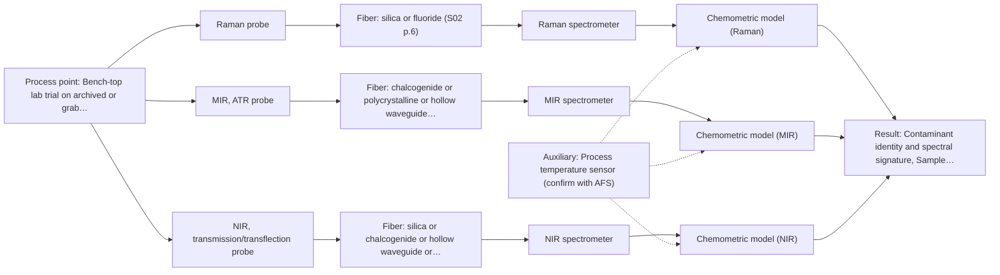
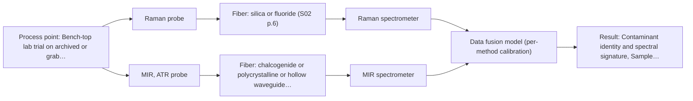

# First technical assessment: An undefined off specification liquid

## Answer

**Customer request (our summary):** The customer wants an immediate recommendation for a spectroscopy method and sensor configuration to monitor an unspecified contaminant in a liquid process.

### Brief answer

No exact sensor configuration can be justified yet: the contaminant, the quality variable and the optical character of your liquid are all unknown. The right first step is a multi-method laboratory trial - Raman and mid-IR ATR probes on representative normal and off-spec samples, adding NIR transmission only if the liquid is clear - with independent lab reference analysis of every sample. The in-line method and configuration follow from those results and your go/no-go criteria.

### Proposal

- **Best current option:** O2 (recommended)
- **Basis:** supplied AFS sources
- **What would change it:** If the customer identifies the contaminant and quality variable, or shows the liquid is strongly absorbing/turbid, the shortlist narrows immediately (e.g. NIR transmission drops out or a specific targeted method takes over). If reference analysis shows no optically active contaminant, spectroscopy itself may not be the right tool.
- **Next step:** Run the multi-method laboratory trial (Raman and MIR-ATR first, NIR transmission if clear) on representative normal and off-spec samples with independent laboratory reference analysis, against customer-defined go/no-go criteria.

**Secondary evidence (external, not AFS material):** G1: no usable external source found; G2: no usable external source found; G3: no usable external source found; G4: no usable external source found. See Expert detail.

**Decision status:** Insufficient information for a method choice

### Solution options

| ID | Tier | Methods | Confidence | Cost class, S01 Table 1 (p.6) | Ease of use | Maintenance | Performance fit | Sources |
|---|---|---|---|---|---|---|---|---|
| O1 | Simple | M1 Raman probe | Low: open question: Q1, Q2, Q3 (starts at Medium); status: insufficient information | high cost (row 12) | Single probe, straightforward lab setup | Minimal; one probe and spectrometer | Fastest first answer on unknown contaminant | [1: S01 p.16] [2: S01 p.11] |
| O2 | Recommended | M1 Raman probe; M2 MIR, ATR probe; M3 NIR, transmission/transflection probe | Low: open question: Q1, Q2, Q3 (starts at Medium); sample clarity unknown; status: insufficient information | high cost (rows 2, 7, 12) | Structured trial, moderate coordination effort | Lab-based only at this stage | Covers unknown matrix and unknown contaminant by method comparison | [3: S01 p.3] [1: S01 p.16] [2: S01 p.11] [4: S01 p.10] [5: S01 p.5] [6: S01 p.18] [7: S01 p.18] |
| O3 | Extended (multi-method) | M4 Raman probe + MIR (combination) | Low: open question: Q1, Q2, Q3 (starts at Medium); status: insufficient information; multi-method, fusion benefit not yet shown | high cost (rows 2, 12) | Two instruments, more complex operation | Each block needs its own calibration and diagnostics | Only if single methods prove complementary but insufficient | [8: S01 p.8] [9: S01 p.9] [10: S01 p.11] [11: S01 p.7] |

*Confidence rates the basis of the advice (how much is known and cited), not a predicted accuracy or probability of success. It starts at High, or at Medium when a key question on the method or the option is open, and drops one level per weakness listed (floor Low).*

*Cost class is the relative rating in S01 Table 1 (p.6) for the in-line method+technique rows named (the highest one for a multi-method option); it is not a price.*

### Setup sketch

*Recommended option O2; drawn by code from the option, a schematic, not a configuration.*

### Key questions

1. What is the liquid matrix (chemical composition, aqueous or solvent-based, typical additives)?
2. Can you provide archived normal and off-specification samples together with an independent laboratory reference analysis of each?
3. Which quality variable or specification is at risk when the process goes off-spec (e.g. colour, purity, concentration of a named component)?

## Expert detail

**Customer enquiry**

> We have a liquid process that occasionally goes off specification. We suspect contamination, but we cannot yet name the contaminant or the affected quality variable. We would like you to recommend the best spectroscopy method and exact sensor configuration immediately. What information and first experiment should come before that decision?

**Decision status:** Insufficient information for a method choice. The contaminant, the quality variable and the optical character of the liquid are all unknown, so no single method or exact sensor configuration can be justified yet; the honest next step is a structured multi-method laboratory trial on representative samples.

### Parameters

| ID | Parameter | Kind | Need | Measured by | Why | Sources |
|---|---|---|---|---|---|---|
| P1 | Contaminant identity and spectral signature | qualitative | required | Reference lab method: Certified laboratory analysis (e.g. GC-MS/HPLC) of off-spec samples | The target analyte determines which spectral method and range can detect it at all. | *(no verified source: engineering judgement)* |
| P2 | Sample optical regime (clear vs turbid/scattering) | qualitative | required | Reference lab method: Laboratory turbidity/optical-density measurement on grab samples | It decides between transmission/transflection and ATR or reflection geometries. | [6: S01 p.18] |
| P3 | Matrix composition and background interferences | qualitative | required | Reference lab method: Laboratory composition analysis of normal process liquid | Calibrations are matrix-specific, so the background composition must be known to interpret spectral differences. | [12: S01 p.10] |
| P4 | Process temperature at the measurement point | quantitative | optional | Auxiliary sensor: Process temperature sensor (engineering judgement: confirm availability with AFS) | Temperature shifts spectra and affects probe material choice; it should be available from existing process instrumentation. | *(no verified source: engineering judgement)* |

### Solution option details

- **O1 cost drivers:** One Raman spectrometer and probe, sample collection, reference lab analyses
- **O2 cost drivers:** Two to three spectrometers and probes for the trial, reference analyses, chemometric modelling time
- **O3 cost drivers:** Two spectrometers, combined or paired probes, fusion software, extended validation
- **O3 combining methods:** Low-level fusion: Raman and MIR-ATR spectra of the same sample spot merged into one augmented matrix after synchronisation to a common time step and block scaling. Both probes must sample the same liquid volume; a combined probe or co-located immersion probes at one point is required. Each method keeps its own calibration, and the fused model must beat the best single method on held-out batches before any in-line commitment.

*Extended (multi-method) option O3; drawn by code from the option, a schematic, not a configuration.*

### Premise check

- **Not covered:** A best method and exact sensor configuration can be named immediately, before the contaminant, quality variable or sample optical behaviour is known. No supplied source supports selecting a method without knowing the target analyte or sample characteristics; the sources instead recommend starting from multi-method trials when composition is incompletely known (S01 p.3; S02 p.20). [3: S01 p.3]
- **Supported:** A structured multi-method laboratory trial is an appropriate first step for a process with incompletely known contamination. Testing various optical spectroscopy approaches is identified as crucial for analyzing samples of incompletely known composition to select the most suitable method. [3: S01 p.3]

### Requirements

**Stated by the customer**

- "liquid process"
- "occasionally goes off specification"
- "We suspect contamination, but we cannot yet name the contaminant or the affected quality variable."

**Key unknowns**

- Identity and spectral signature of the suspected contaminant
- The quality variable that goes off specification
- Liquid matrix composition and background interferences
- Optical regime of the liquid (clear, turbid or scattering)
- Whether the contaminant or matrix contains fluorescent species
- Installation constraints: temperature, pressure, fouling, distance to spectrometer

### Clarification questions (most decision-relevant first)

Q1. What is the liquid matrix (chemical composition, aqueous or solvent-based, typical additives)? *Why it matters:* The matrix determines which spectral regions are usable and which interferences must be calibrated out. *(affects: method)*
Q2. Can you provide archived normal and off-specification samples together with an independent laboratory reference analysis of each? *Why it matters:* Without representative samples and reference values, no method comparison or calibration can be built or judged. *(affects: status, method)*
Q3. Which quality variable or specification is at risk when the process goes off-spec (e.g. colour, purity, concentration of a named component)? *Why it matters:* The target variable decides whether a quantitative calibration, a classification model or a simple trend signal is needed. *(affects: method)*
Q4. Is the liquid optically clear, turbid or strongly scattering, and does it foam or contain particles? *Why it matters:* Clarity decides between transmission/transflection and reflection or ATR geometries. *(affects: technique)*
Q5. What are the installation constraints: process temperature and pressure, fouling tendency, and distance from the measurement point to a safe spectrometer location? *Why it matters:* These determine probe type, fiber family and achievable link length, which differ strongly between silica (NIR/visible) and mid-IR fibers. *(affects: installation)*

### Recommendation

- **M1 · Primary candidate: Raman probe.** Raman gives a molecular fingerprint of unknown organic contaminants in liquids and tolerates water far better than infrared methods, so it is the strongest single first test when the matrix is not yet characterised. Its weak signal and possible fluorescence background must be checked on real samples. [1: S01 p.16] [2: S01 p.11]
- **M2 · Comparison candidate: MIR, ATR probe.** MIR-ATR probes are established for in-line liquid analysis and give well-resolved, highly selective bands that complement Raman. It should be tested against Raman on the same samples before any combined use. *Conditions:* The liquid must wet the ATR crystal and tolerate contact; fouling and surface-layer sampling are known risks. [4: S01 p.10] [5: S01 p.5]
- **M3 · Conditional candidate: NIR, transmission/transflection probe.** NIR transmission is the workhorse for clear liquid streams and is robust for remote fiber-probe use, but it fails if the liquid is too opaque or absorbing, which is not yet known. *Conditions:* Applies only if the liquid is transparent or semi-transparent and a suitable optical pathlength can be controlled. [6: S01 p.18] [7: S01 p.18]
- **M4 · Comparison candidate: Raman probe + MIR (combination).** If neither Raman nor MIR-ATR alone separates normal from off-spec samples, a combined Raman + MIR-ATR measurement is a later hypothesis: the two spectra are complementary and published combined probes exist. Any fusion gain must be demonstrated against the best single method. *Conditions:* Only after the single-method tests, and only if both methods show partial but complementary information. [10: S01 p.11] [11: S01 p.7]
- **M5 · Not recommended: fluorescence probe.** Fluorescence is often expected to catch 'contamination' generically, but it only measures species that actually fluoresce, and most chemicals do not; with no fluorescent species or indicator identified it cannot be the primary screen. *Conditions:* Revisit only if a fluorescent contaminant or a justified indicator is identified. [13: S01 p.5]

### Measurement concept

- **Probe and geometry:** Laboratory trial first: immersion Raman probe and MIR-ATR fiber probe tested on the same representative liquid samples; NIR transmission/transflection added if the liquid proves clear.
- **Location:** Bench-top lab trial on archived or grab samples; in-line installation point decided only after the method is selected.
- **Fiber link:** Silica fibers for Raman (visible/NIR excitation); mid-IR requires CIR or PIR fibers, whose achievable link length is an open question - long (100-300 m) cables are documented only for low-OH silica fibers. [14: S02 p.6] [15: S02 p.7]

### Spectral range

- **Raman:** Raman shift in cm-1 with laser excitation wavelength stated separately; nominal range depends on the selected spectrometer and probe. [16: S01 p.11]
- **MIR:** Nominal mid-IR range 4000-400 cm-1; the usable range depends on the selected fiber and ATR crystal. [17: S01 p.9]
- **NIR:** Nominal NIR range 780-2500 nm; the usable range depends on the instrument, fiber and probe actually selected. [18: S01 p.10]

### Risks and uncertainty

- The contaminant may have weak Raman activity or sit below the detection limit of any optical method, making spectroscopy the wrong tool. *(rules: R-RAM-1)* *(no verified source: engineering judgement)*
- Fluorescence background from the matrix or from polymer-jacketed fibers can swamp the Raman signal on real samples. *(rules: R-RAM-1, R-FIB-4)* *(no verified source: engineering judgement)*
- If the liquid is opaque or strongly absorbing, NIR transmission and UV-Vis transmission will fail and only ATR or reflection geometries remain. *(rules: R-GEO-2, R-GEN-3)* *(no verified source: engineering judgement)*
- Occasional off-spec events may be rare, so the trial dataset may not contain enough off-spec states to build or validate a model. *(rules: R-CAL-1)* *(no verified source: engineering judgement)*

### First feasibility experiment

1. **Collect representative samples: normal production material plus every available off-spec or suspect batch, spanning the expected chemical and physical variation (temperature, turbidity, age).** Ensure the trial data covers the real process variability. *(no verified source: engineering judgement)*
2. **Obtain independent reference analysis of each sample from a certified laboratory (e.g. GC-MS/HPLC for contaminant identification and the off-spec quality variable).** Provide ground truth to label spectra and identify the contaminant. *(no verified source: engineering judgement)*
3. **Measure each sample with the single methods first - Raman probe and MIR-ATR probe - under identical, documented conditions; add NIR transmission only if the samples are optically clear.** Compare single methods before any combination, per the multi-method trial approach. *(no verified source: engineering judgement)*
4. **Build a first classification or regression model per method against the reference labels, and only then test a fused Raman + MIR-ATR model, validating on held-out batches.** Establish whether any combination beats the best single method. [19: S01 p.8]
5. **Apply customer-defined go/no-go criteria (e.g. required detection limit, false-alarm rate, response time) to decide whether an in-line configuration can be specified.** Make the decision basis explicit and owned by the customer. *(no verified source: engineering judgement)*

**Reference measurements:** Certified laboratory analysis (identity and concentration of any contaminant found, plus the off-spec quality variable) for every sample.

**Decision basis:** Go/no-go against customer-defined numerical criteria (detection limit, classification error, response time); these figures are not in the supplied sources and must come from the customer.

### Assumptions

- The process liquid is accessible for grab or archived sampling.
- Off-spec events leave physical samples or can be reproduced in the laboratory.
- The customer can commission independent laboratory reference analysis.

### Not covered by the supplied sources

- Any performance figure (detection limit, response time, accuracy) for detecting an unknown contaminant in an unspecified liquid
- Achievable mid-IR fiber link length for an in-line installation
- The customer's matrix, contaminant or specification limits

### Further notes

- **Chemometrics:** With an unknown contaminant, start with unsupervised analysis (PCA) of normal vs off-spec spectra to find discriminating features, then build supervised classification (e.g. PLS-DA) or regression models only once reference labels exist; validate on held-out batches and guard against overfitting given the expected small number of off-spec events.
- **Real-time tracking:** In-line continuous tracking is the eventual goal, but it is only meaningful after a method and target variable are fixed; fiber optics then allow the spectrometer to sit away from the process point.
- **Future direction:** Once the contaminant and quality variable are known, a compact customized spectral fiber sensor or LED-based multi-wavelength sensor tuned to the informative wavelengths can replace the full spectrometer for routine in-line control.

### Secondary evidence (external, not AFS material)

*Found by a literature search for gaps the supplied AFS sources leave open. Not AFS material and not proof for this case; every quote below was verified verbatim against the fetched text.*

**G1 · decision status:** insufficient information: The contaminant, the quality variable and the optical character of the liquid are all unknown, so no single method or exact sensor configuration can be justified yet; the honest next step is a structured multi-method laboratory trial on representative samples.

- No usable external source found.

**G2 · auxiliary sensor:** In-line measurement of Process temperature at the measurement point with Process temperature sensor

- No usable external source found.

**G3 · multi-method:** Combining several spectroscopy methods (data fusion) (Low-level fusion: Raman and MIR-ATR spectra of the same sample spot merged into one augmented matrix after synchronisation to a common time step and block scaling. Both probes must sample the same liquid volume; a combined probe or co-located immersion probes at one point is required. Each method keeps its own calibration, and the fused model must beat the best single method on held-out batches before any in-line commitment.)

- No usable external source found.

**G4 · not in the supplied sources:** Any performance figure (detection limit, response time, accuracy) for detecting an unknown contaminant in an unspecified liquid

- No usable external source found.

### Evidence (verified quotes)

1. ✓ **S01 p.16** (general): "Raman is particularly well-suited for aqueous environments, as it exhibits low absorbance for water molecules compared to infrared methods."
2. ✓ **S01 p.11** (general): "superposition of luminescence (fluorescence), which has a significantly higher intensity."
3. ✓ **S01 p.3** (general): "samples of incompletely known composition, in order to select the most suitable method or combination of methods."
4. ✓ **S01 p.10** (general): "ATR fiber probes (Fig.1) enable the analysis of liquids and solid elastic samples"
5. ✓ **S01 p.5** (general): "Mid-IR band spectra contain well-defined peaks (absorption bands), while NIR, UV, and fluorescence spectra contain broad, highly overlapping signals"
6. ✓ **S01 p.18** (general): "Transmission is the preferred method for transparent or semi-transparent liquids, such as skim milk, whey, or permeate."
7. ✓ **S01 p.18** (general): "it fails when the milk becomes too "thick" or fat-rich, as the light cannot penetrate the sample."
8. ✓ **S01 p.8** (general): "It is crucial that the spectral information obtained by different methods-Mid-IR, NIR, Raman, and fluorescence spectra-is collected from the same small, even pinpoint, area of the sample."
9. ✓ **S01 p.9** (general): "One of the challenges of multispectral analysis is the need to simultaneously connect at least two independently operating measuring instruments."
10. ✓ **S01 p.11** (general): "This property makes mid-IR and Raman spectra complementary, that is, they complement each other."
11. ✓ (precedent only) **S01 p.7** (method gain): "The analysis of such systems may require a combination of two or even more spectral methods."
12. ✓ **S01 p.10** (general): "The broad absorption bands observed in this region overlap, suggesting the use of chemometrics for quantitative and qualitative analysis of spectral data."
13. ✓ **S01 p.5** (general): "However, most chemicals do not exhibit this property."
14. ✓ **S02 p.6** (general): "1100 nm Chalcogenide As-S IR Fibers 6500 nm"
15. ✓ **S02 p.7** (general): "Robust 100-300m cables made with Silica fibers of low OH-content (<0.1ppm OH) enable remote industrial process-control"
16. ✓ **S01 p.11** (general): "The Raman shift is used as the horizontal (spectral) axis in Raman spectroscopy"
17. ✓ **S01 p.9** (general): "Vibrational spectroscopy in the mid-IR range (4000-400 cm-1) is one of the most informative methods of chemical analysis."
18. ✓ **S01 p.10** (general): "NIR spectra (780-2500 nm) contain predominantly overtones and component bands of fundamental vibrations"
19. ✓ **S01 p.8** (general): "Ultimately, the measurement data must be normalized to a common time step."

### Verification

- Citations verified: 22 of 22 (exact or whitespace/hyphen-tolerant match on the cited page, scope checked).
- Hard check failures before deterministic corrections: 0; still open: 0; soft warnings: 1; repair rounds: 1.
- External evidence (live): 0 quote(s) verified verbatim (exact or whitespace/hyphen-tolerant, at most 400 characters and 2 sentences, against the cited paragraph); 0 item(s) dropped.
- External search: 4 query(ies), 15 hit(s), 5 source(s) (3 from the curated library).
- External step: 2 model call(s), 4.0 s extra (cost in the run JSON).

*Run H05-20261018T102937Z-b2ca · models google/gemini-3.5-flash-lite, google/gemini-3.8-flash, z-ai/glm-5.3-flash*
