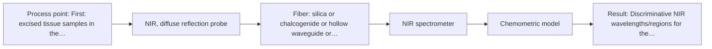
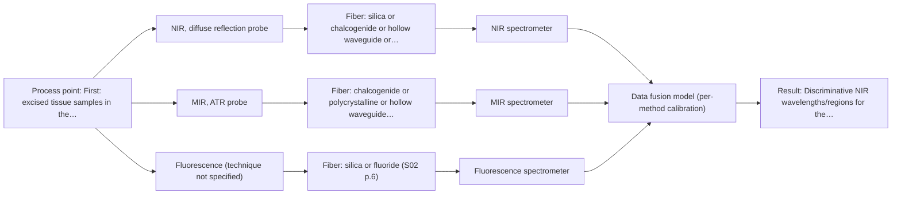

# First technical assessment: A research sensor requested for immediate surgical use

## Answer

**Customer request (our summary):** The customer asks if a published LED NIR kidney study can serve as proof that their proposed sensor is ready for live surgery tumor boundary decisions, given they have no in vivo data or validation.

### Brief answer

No: the supplied study is an ex vivo proof-of-concept on a small group of patients and cannot be quoted as proof that a sensor is ready for live surgical boundary decisions. The appropriate next step is an ex vivo feasibility study using NIR diffuse reflection on your own tumor and healthy tissue samples with histopathology reference. An LED sensor configuration or multi-method combinations should only be considered after single-method NIR proves feasible on your tissue.

### Proposal

- **Best current option:** O2 (recommended)
- **Basis:** supplied AFS sources
- **What would change it:** If the target tissue does not show discriminative NIR spectral bands, or if histopathology-referenced samples cannot be obtained, the method choice would change. If live surgical use is insisted upon immediately without ex vivo validation, the assessment would shift to outside supported scope.
- **Next step:** Obtain histopathologically confirmed ex vivo tissue specimens and perform benchtop NIR diffuse-reflection spectroscopy across the expected biological variability.

**Secondary evidence (external, not AFS material):** G1: E04 ¶53; G2: no usable external source found; G3: no usable external source found; G4: no usable external source found. See Expert detail.

**Decision status:** Premise not supported by the sources

### Solution options

| ID | Tier | Methods | Confidence | Cost class, S01 Table 1 (p.6) | Ease of use | Maintenance | Performance fit | Sources |
|---|---|---|---|---|---|---|---|---|
| O1 | Simple | M2 MIR, ATR probe | Low: open question: Q1 (starts at Medium); a customer premise is contradicted, status: premise not supported | high cost (row 2) | Direct ATR crystal contact on tissue | Low; crystal cleaning between samples | Evaluates surface fingerprint on excised tissue | [1: S01 p.10] |
| O2 | Recommended | M1 NIR, diffuse reflection probe | Low: open question: Q1 (starts at Medium); sample clarity unknown; precedent only; a customer premise is contradicted, status: premise not supported | average cost (row 8) | Non-contact diffuse reflection probe measurement | Low; fiber probe with fixed spacer | Directly tests the customer's NIR concept ex vivo | [2: S03 p.4] [3: S03 p.2] |
| O3 | Extended (multi-method) | M1 NIR, diffuse reflection probe; M3 MIR, ATR probe + Fluorescence (combination) | Low: open question: Q1 (starts at Medium); sample clarity unknown, fit for soft solid to be tested, fluorescent target unknown; a customer premise is contradicted, status: premise not supported; multi-method, fusion benefit not yet shown | at least high cost (rows 2, 8); Fluorescence row not identified | Multi-modal setup requiring synchronized spectrometers | High; multiple spectrometers and probe alignment | Fuses deeper NIR scattering with superficial MIR/fluorescence | [4: S04 p.4] [2: S03 p.4] [3: S03 p.2] [5: S04 p.1] [6: S01 p.8] |

*Confidence rates the basis of the advice (how much is known and cited), not a predicted accuracy or probability of success. It starts at High, or at Medium when a key question on the method or the option is open, and drops one level per weakness listed (floor Low).*

*Cost class is the relative rating in S01 Table 1 (p.6) for the in-line method+technique rows named (the highest one for a multi-method option); it is not a price.*

### Setup sketch

*Recommended option O2; drawn by code from the option, a schematic, not a configuration.*

### Key questions

1. Which organ and tumor type is targeted, and how do the optical properties differ from kidney tissue?
2. Can you obtain excised tissue samples (tumor and healthy) with an independent histopathology classification?
3. Is the intended first phase ex vivo laboratory research, or is the goal a device used for surgical decisions in patients?

## Expert detail

**Customer enquiry**

> We read the supplied LED NIR kidney study and want to use the same concept to guide tumor boundary decisions during live surgery. Can we quote its findings as proof that the proposed sensor is ready for that use? We have no new in vivo data and no validation on our own setup. What assessment and next feasibility steps are appropriate?

**Decision status:** Premise not supported by the sources. The enquiry asks whether a published ex vivo study can be quoted as proof that a sensor is ready for live surgical use; the sources explicitly frame that study as a proof-of-concept with no in vivo validation, so this central premise is contradicted.

### Parameters

| ID | Parameter | Kind | Need | Measured by | Why | Sources |
|---|---|---|---|---|---|---|
| P1 | Tissue class (tumor vs healthy, with grade where available) | qualitative | required | Reference lab method: histopathology (WHO-criteria classification of excised tissue) | It is the classification target and the independent reference against which any spectral model must be validated. | [7: S03 p.3] |
| P2 | Discriminative NIR wavelengths/regions for the target tissue | qualitative | required | Spectroscopy: NIR | LED channel selection for the reduced sensor depends entirely on which regions carry tumor-related information in the customer's tissue. | [8: S03 p.7] |

### Solution option details

- **O1 cost drivers:** Excised tissue handling, reference pathology, ATR probe
- **O2 cost drivers:** Tissue sample set, histopathology reference, benchtop NIR spectrometer
- **O3 cost drivers:** Multispectral probe, multiple spectrometers, data fusion modeling
- **O3 combining methods:** Low-level data fusion combining normalized NIR diffuse reflection with synchronized MIR-ATR and fluorescence data from the same sampling spot. Variables must be autoscaled to balance block weights. Each spectral system requires separate calibration and validation, and the fused model must demonstrate superior classification accuracy over the best single-method baseline.

*Extended (multi-method) option O3; drawn by code from the option, a schematic, not a configuration.*

### Premise check

- **Contradicted:** The published LED NIR kidney study can be quoted as proof that the proposed sensor is ready for tumor boundary decisions in live surgery. The study itself is an ex vivo proof-of-concept on a limited patient set and states that much work remains; a laboratory study cannot be cited as proof of clinical readiness. [9: S03 p.14] [10: S03 p.3]
- **Contradicted:** Using the study's concept is sufficient without new in vivo data or validation on the customer's own setup. The study authors themselves call for further dedicated studies, optimized wavelengths and a representative patient set before any practical diagnostic model; none of this exists for the customer's setup. [11: S03 p.14]
- **Precedent only:** NIR diffuse-reflection sensing can discriminate tumor from healthy tissue. The supplied study shows this ex vivo on kidney biopsies; it is a reason to test the concept on the customer's own samples, not proof for their application. [12: S03 p.14]

### Requirements

**Stated by the customer**

- Target: guidance of tumor boundary decisions during live surgery.
- Constraint: no new in vivo data and no validation on the customer's own setup exist.

**Key unknowns**

- Organ and tumor type the customer targets (the study is kidney-specific).
- Availability of excised tissue samples with histopathology reference.
- Whether the first phase is intended as ex vivo research or in vivo clinical use.
- Customer's required sensitivity/specificity and acceptable false-negative rate.
- Sensor configuration the customer has or plans (full spectrometer vs LED channels).

### Clarification questions (most decision-relevant first)

Q1. Which organ and tumor type is targeted, and how do the optical properties differ from kidney tissue? *Why it matters:* The study's LED wavelengths and discriminative bands are tissue-specific, so the whole channel selection may need to be redone. *(affects: method)*
Q2. Can you obtain excised tissue samples (tumor and healthy) with an independent histopathology classification? *Why it matters:* Without a reference diagnosis on your own samples no calibration or validation is possible. *(affects: status)*
Q3. Is the intended first phase ex vivo laboratory research, or is the goal a device used for surgical decisions in patients? *Why it matters:* A clinical decision role implies regulatory and validation requirements far beyond a feasibility study, which changes the whole plan. *(affects: status)*
Q4. What sensitivity, specificity and maximum acceptable false-negative rate would you require for boundary guidance? *Why it matters:* These numbers are needed as the go/no-go criteria for any feasibility experiment. *(affects: status)*

### Recommendation

- **M1 · Primary candidate: NIR, diffuse reflection probe.** NIR diffuse reflection is the geometry used in the supplied kidney study and NIR penetrates tissue up to several millimetres, capturing both molecular and morphological information. It is the single method to test first on the customer's own excised samples. *Conditions:* Tested ex vivo on the customer's own tissue with histopathology reference; not as evidence of surgical readiness. [2: S03 p.4] [3: S03 p.2]
- **M2 · Comparison candidate: MIR, ATR probe.** MIR-ATR provides direct fundamental vibrational fingerprints of tissue surface biochemistry. It serves as a benchmark single-method comparison to NIR on excised tissue. *Conditions:* Tested ex vivo on excised tissue in direct contact with ATR crystal. [1: S01 p.10]
- **M3 · Conditional candidate: MIR, ATR probe + Fluorescence (combination).** A combined MIR-ATR and fluorescence probe allows simultaneous acquisition of surface vibrational and deeper fluorescence emission from the same spot. It serves as a multi-method hypothesis if single-method spectroscopy lacks diagnostic accuracy. *Conditions:* Applies only if the tissue contains active fluorophores and single-method NIR or MIR discrimination is insufficient. [5: S04 p.1] [6: S01 p.8] Later hypothesis, after single-method tests.
- **M4 · Not recommended: NIR, transmission/transflection probe.** Transmission requires light passing through a defined sample layer, which does not fit contact measurement of solid tissue at a boundary during a procedure. [13: S01 p.18]

### Measurement concept

- **Probe and geometry:** Fiber-optic NIR diffuse-reflection probe in light contact with the tissue surface (as in the supplied study, with a fixed probe-to-sample distance); later optionally a combined MIR-ATR/fluorescence probe.
- **Location:** First: excised tissue samples in the laboratory. In-vivo surgical use is a later, separately regulated step.
- **Fiber link:** Vis-NIR silica fibers cover the NIR range; the usable range depends on the spectrometer, fiber and probe actually selected. [14: S03 p.4] [15: S02 p.6]

### Spectral range

- **NIR:** Nominal NIR range is 780-2500 nm; usable range depends on the instrument, fiber, and probe selected. [16: S01 p.10]
- **MIR:** Nominal mid-IR range 4000-400 cm-1 (2.5-25 µm); ATR probes sample a surface layer of a few micrometres. Usable range depends on the CIR/PIR fiber and crystal selected. [17: S01 p.9] [18: S01 p.13]

### Risks and uncertainty

- Ex vivo frozen/thawed tissue spectra can differ from real in vivo measurements, so ex vivo results may not transfer to surgery. *(rules: R-EVI-3)* [10: S03 p.3]
- The published model rests on very few patients and exploratory validation, so its statistics may not reproduce on new tissue. [19: S03 p.10]
- LED wavelengths optimized for kidney tissue may carry no discriminative information for a different organ or tumor type. *(rules: R-CAL-1)* *(no verified source: engineering judgement)*
- In tumor oncology, false negatives are unacceptable, and the study prototype showed high measurement variance in tumor samples. [20: S03 p.14]

### First feasibility experiment

1. **Collect excised tumor and healthy tissue samples spanning the expected biological variation (patient, grade, tissue region), with histopathology as the independent reference classification.** Representative samples and reference truth. *(no verified source: engineering judgement)*
2. **Measure all samples with a benchtop NIR spectrometer and diffuse-reflection fiber probe under controlled, fixed geometry; record full spectra before any LED reduction.** Establish which spectral regions discriminate on the customer's tissue. *(no verified source: engineering judgement)*
3. **Build and validate classification models (e.g. PCA/PLS-DA) with held-out validation by patient/sample, not by repeated measurement.** Avoid overfitting on limited material. [21: S03 p.14]
4. **Only if discriminative regions are found, simulate and then build an LED channel set for those wavelengths and compare it against the full-spectrum result.** Test the reduced-sensor concept against the best single-method baseline. *(no verified source: engineering judgement)*
5. **Define go/no-go with the customer: minimum sensitivity/specificity on held-out samples (customer-supplied numbers), with false negatives weighted per clinical relevance; any in vivo step is a separate, later decision.** Objective basis for proceeding or stopping. *(no verified source: engineering judgement)*

**Reference measurements:** Histopathological classification of each sample (tumor vs healthy, grade) as independent reference.

**Decision basis:** Customer-defined sensitivity/specificity thresholds on held-out samples; no go/no-go numbers exist in the sources.

### Assumptions

- The customer's target tissue is soft solid biological tissue comparable to the study's samples.
- The first realistic phase is ex vivo laboratory work; no in vivo or clinical use is assumed.

### Not covered by the supplied sources

- Any in vivo or clinical performance data for LED NIR boundary guidance.
- Regulatory or approval requirements for surgical decision-support devices.
- The customer's target organ, tumor type and required accuracy.

### Further notes

- **Chemometrics:** Any classification model must be built and validated on the customer's own samples with patient-level held-out validation and permutation testing, as the supplied study recommends for limited datasets; the published model itself cannot be reused.
- **Real-time tracking:** Real-time boundary guidance during surgery is a much later goal; the sources show only ex vivo feasibility and note that alternating or sequential measurements cannot guarantee the same measurement point, which is why combined probes were developed.
- **Future direction:** If ex vivo feasibility is shown, a dedicated in vivo study design with ethics approval and a representative patient set would be the next stage, as the study authors themselves outline.

### Secondary evidence (external, not AFS material)

*Found by a literature search for gaps the supplied AFS sources leave open. Not AFS material and not proof for this case; every quote below was verified verbatim against the fetched text.*

**G1 · multi-method:** Combining several spectroscopy methods (data fusion) (Low-level data fusion combining normalized NIR diffuse reflection with synchronized MIR-ATR and fluorescence data from the same sampling spot. Variables must be autoscaled to balance block weights. Each spectral system requires separate calibration and validation, and the fused model must demonstrate superior classification accuracy over the best single-method baseline.)

- **E04 ¶53** To overcome limitations of single-modality workflows, future research should prioritize multimodal data fusion integrating interpretable modeling, standardized data protocols, and rigorous external validation. *How it applies:* This supports testing whether combining multiple spectroscopic modalities improves classification robustness, though external validation on relevant tissue samples remains necessary. *Limits and transfer risks:* The reviewed literature focuses on herbal materials and textiles rather than surgical tumor margins, so transfer risks are high due to completely different sample matrices and biological structures. *(supports O3)*
  > "To overcome limitations of single-modality workflows-such as restricted selectivity for trace targets and diminished generalization capabilities during domain transfer-future research should prioritize multimodal data fusion."
  > From Fingerprint Spectra to Intelligent Perception: Research Advances in Spectral Techniques for Ginseng Species Identification. (2026) · Foods (Basel, Switzerland) · doi:10.3390/foods15040684 · https://europepmc.org/article/PMC/PMC12939865 · retrieved 2026-10-18, full text, licence: cc by, via europepmc

**G2 · not in the supplied sources:** Any in vivo or clinical performance data for LED NIR boundary guidance.

- No usable external source found.

**G3 · not in the supplied sources:** Regulatory or approval requirements for surgical decision-support devices.

- No usable external source found.

**G4 · not in the supplied sources:** The customer's target organ, tumor type and required accuracy.

- No usable external source found.

### Evidence (verified quotes)

1. ✓ **S01 p.10** (general): "ATR fiber probes (Fig.1) enable the analysis of liquids and solid elastic samples"
2. ✓ **S03 p.4** (application precedent): "The measurements were performed in the diffuse reflectance mode."
3. ✓ **S03 p.2** (general): "Delivering a mixture of the scatter and absorbance information on the light-to-tissue interaction enables the detection of both molecular (related to the functional group vibrations) and morphological (due to the cell transformation) tissue changes"
4. ✓ **S04 p.4** (application precedent): "the PCA model built on the concatenated IR and fluorescence data revealed three distinct groups of samples corresponding to tissue types"
5. ✓ (precedent only) **S04 p.1** (method gain): "optical diagnostics using a combination of fluorimetry with diffuse reflectance NIR16 or ATR IR15 spectroscopy results in much better accuracy of the tumor margin detection than each of the methods individually."
6. ✓ **S01 p.8** (general): "It is crucial that the spectral information obtained by different methods-Mid-IR, NIR, Raman, and fluorescence spectra-is collected from the same small, even pinpoint, area of the sample."
7. ✓ **S03 p.3** (application precedent): "Histological classification was performed in accordance with the World Health Organization (WHO) criteria."
8. ✓ **S03 p.7** (application precedent): "the whole regions of 1100-1220 nm and 1350-1470 nm look very promising for cancer discrimination purposes."
9. ✓ **S03 p.14** (general): "This study provides a proof-of-concept demonstration of the LED-based sensor for tumor discrimination."
10. ✓ **S03 p.3** (general): "Although the spectra of frozen/thawed biopsies can differ from real-life in vivo measurements"
11. ✓ **S03 p.14** (general): "Further dedicated studies are needed to yield the next sensor prototype."
12. ✓ **S03 p.14** (application precedent): "the LED-based sensing approach developed in the present work is capable of discriminating between tumor and healthy tissues."
13. ✓ **S01 p.18** (general): "the precise control of the optical pathlength (usually 1 - 10 mm); if the pathlength is too wide, the signal is lost to absorption; if too narrow, the sample represents a negligible volume."
14. ✓ **S03 p.4** (application precedent): "The head of the probe was equipped with a cylindrical stainless steel spacer to maintain a constant distance of 2 mm from the entrance of the optical fiber to the studied sample"
15. ✓ **S02 p.6** (general): "350 nm Standard VIS-NIR Silica Fibers Al/Cu-coated VIS-NIR Silica Fibers 2400 nm"
16. ✓ **S01 p.10** (general): "NIR spectra (780-2500 nm) contain predominantly overtones and component bands of fundamental vibrations"
17. ✓ **S01 p.9** (general): "Vibrational spectroscopy in the mid-IR range (4000-400 cm-1) is one of the most informative methods of chemical analysis."
18. ✓ **S01 p.13** (general): "typically at a depth of few microns"
19. ✓ **S03 p.10** (general): "The present discrimination modeling on the basis of poor experimental data including only a few patients was exploratory"
20. ✓ **S03 p.14** (general): "The main disadvantage of the LED-based sensor in its present form is a very high measurement variance in cancer tissue samples"
21. ✓ **S03 p.14** (general): "A thorough validation, including full, segmented and random-subset CVs, as well as randomization tests, are recommended in any cases for which important conclusions depend on calibration or discrimination models built on limited experimental material."

### Verification

- Citations verified: 22 of 22 (exact or whitespace/hyphen-tolerant match on the cited page, scope checked).
- Hard check failures before deterministic corrections: 0; still open: 0; soft warnings: 1; repair rounds: 1.
- External evidence (live): 1 quote(s) verified verbatim (exact or whitespace/hyphen-tolerant, at most 400 characters and 2 sentences, against the cited paragraph); 0 item(s) dropped.
- External search: 5 query(ies), 25 hit(s), 5 source(s) (3 from the curated library).
- External step: 2 model call(s), 5.3 s extra (cost in the run JSON).

*Run H06-20261018T102937Z-a475 · models google/gemini-3.5-flash-lite, google/gemini-3.8-flash, z-ai/glm-5.3-flash*
