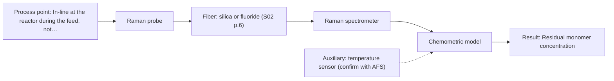
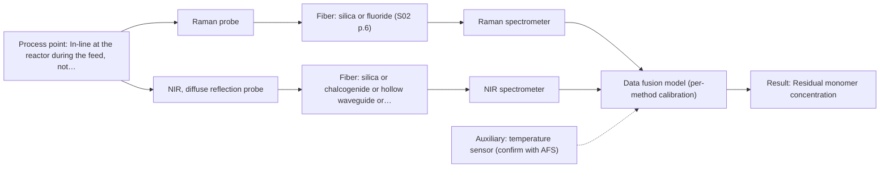

# First technical assessment

## Answer

**Customer request (our summary):** Customer runs a water-based emulsion polymerisation in a 2 m3 stirred batch reactor at about 80 °C and wants an in-line spectroscopic measurement of residual monomer during the feed instead of lab sampling; the product is milky white. They ask which spectroscopic method and probe to test first.

### Brief answer

Test Raman first: water interferes less than in infrared methods and Raman can target the monomer directly. Compare it with NIR diffuse reflection, which suits the strongly scattering milky white product, and keep NIR+Raman fusion as a later hypothesis. The choice stays provisional until the monomer, its concentration range and any fluorescence are known.

### Proposal

- **Best current option:** O2 (recommended)
- **Basis:** engineering judgement, with secondary external support E03 ¶20 (not AFS material)
- **What would change it:** A very low required detection limit or a strong fluorescence background would move the choice to the NIR+Raman fusion (O3) or to MIR ATR; if NIR diffuse reflection proves sensitive enough, it would become the primary.
- **Next step:** Run a multi-method lab trial on representative feed samples against an independent lab reference for the residual monomer.

**Secondary evidence (external, not AFS material):** G1: E03 ¶12, E01 ¶19; G2: no usable external source found; G3: E03 ¶20; G4: no usable external source found. See Expert detail.

**Decision status:** Provisional feasibility assessment

### Solution options

| ID | Tier | Methods | Confidence | Cost class, S01 Table 1 (p.6) | Ease of use | Maintenance | Performance fit | Sources |
|---|---|---|---|---|---|---|---|---|
| O1 | Simple | M2 NIR, diffuse reflection probe | Medium: open question: Q1 (starts at Medium) | average cost (row 8) | simple probe, standard NIR spectrometer | window cleaning and scatter-drift checks | direct fit to the milky scattering product | [1: S01 p.17] [2: S01 p.5] [3: S01 p.10] |
| O2 | Recommended | M1 Raman probe | Low: open question: Q1 (starts at Medium); uncited auxiliary sensor | high cost (row 12) | single probe, laser safety measures | probe cleaning, laser and filter checks | molecular specificity for the monomer in water | [4: S01 p.16] [5: S01 p.16] |
| O3 | Extended (multi-method) | M3 Raman probe + NIR (combination) | Low: open question: Q1 (starts at Medium); precedent only; uncited auxiliary sensor; multi-method, fusion benefit not yet shown | high cost (rows 8, 12) | two instruments, synchronised acquisition | two calibrations and probe cleanings | complementary blocks may cover scatter and monomer | [6: S01 p.8] [7: S01 p.8] [8: S01 p.15] [9: S01 p.7] |

*Confidence rates the basis of the advice (how much is known and cited), not a predicted accuracy or probability of success. It starts at High, or at Medium when a key question on the method or the option is open, and drops one level per weakness listed (floor Low).*

*Cost class is the relative rating in S01 Table 1 (p.6) for the in-line method+technique rows named (the highest one for a multi-method option); it is not a price.*

### Setup sketch

*Recommended option O2; drawn by code from the option, a schematic, not a configuration.*

### Key questions

1. Which residual monomer is to be followed, over what concentration range, and what detection limit and accuracy are required?
2. Are fluorescent species present in the formulation, such as surfactants, initiators, stabilisers or optical brighteners?
3. What probe port is available, what is the distance from the reactor to the spectrometer, and how will the probe be cleaned?

## Expert detail

**Customer enquiry**

> We run a water-based emulsion polymerisation in a 2 m3 stirred batch reactor at about 80 °C and want to follow the residual monomer in-line during the feed, instead of taking samples for the lab. The product is milky white. Which spectroscopic method and probe should we test first?

**Decision status:** Provisional feasibility assessment. The stated aqueous, strongly scattering product and the sources justify a short method shortlist, but the monomer species, its concentration range and any fluorescence are unknown, so the choice stays provisional.

### Parameters

| ID | Parameter | Kind | Need | Measured by | Why | Sources |
|---|---|---|---|---|---|---|
| P1 | Residual monomer concentration | quantitative | required | Spectroscopy: Raman | This is the target variable the customer wants to follow in-line during the feed. | *(no verified source: engineering judgement)* |
| P2 | Temperature | quantitative | required | Auxiliary sensor: temperature sensor (engineering judgement: confirm availability with AFS) | Temperature affects the reaction state and the spectra, so it is needed to interpret and stabilise the model. | *(no verified source: engineering judgement)* |
| P3 | Emulsion scatter (particle size or solids content) | quantitative | optional | Reference lab method: particle-size or gravimetric solids measurement | Physical variation can mimic a composition change in scattering samples, so a reference for scatter helps separate physical from chemical effects. | [10: S01 p.17] |

### Solution option details

- **O1 cost drivers:** one NIR spectrometer and reflection probe
- **O2 cost drivers:** Raman spectrometer, laser and Raman probe
- **O3 cost drivers:** two spectrometers, combined or dual probes, data fusion
- **O3 combining methods:** Low-level fusion of synchronised NIR and Raman spectra from the same small sampling spot, with per-method calibration and block scaling. Validate on held-out runs and require the fused model to beat the best single method.

*Extended (multi-method) option O3; drawn by code from the option, a schematic, not a configuration.*

### Premise check

- **Precedent only:** In-line spectroscopy can replace the lab sampling currently used for the residual monomer. A source shows probes inserted directly into a running process environment, capturing spectra without interrupting the flow; this is a reason to test, not proof for this process. [11: S01 p.15]
- **Precedent only:** An optical measurement is suitable for the milky white, strongly scattering product. A source shows NIR reflection used for opaque, highly concentrated dairy products, a similar scattering liquid; this supports testing, not a guarantee for this emulsion. [1: S01 p.17]

### Requirements

**Stated by the customer**

- "water-based emulsion polymerisation"
- "a 2 m3 stirred batch reactor"
- "at about 80 °C"
- "follow the residual monomer in-line during the feed"
- *Further statements: see the customer enquiry above.*

**Key unknowns**

- Which residual monomer species is to be measured and over what concentration range
- Required detection limit, accuracy and response time
- Whether the formulation contains fluorescent species (surfactants, initiators, stabilisers, brighteners)
- Optical behaviour of the mixture during the feed (particle size, solids) versus the final milky white product
- Available probe port, distance from the reactor to the spectrometer and probe cleaning
- Reference lab method for the residual monomer and its uncertainty

### Clarification questions (most decision-relevant first)

Q1. Which residual monomer is to be followed, over what concentration range, and what detection limit and accuracy are required? *Why it matters:* The monomer's spectral signature and the required sensitivity decide which method can meet the target. *(affects: method)*
Q2. Are fluorescent species present in the formulation, such as surfactants, initiators, stabilisers or optical brighteners? *Why it matters:* A strong fluorescence background can make Raman unusable and would shift the technique choice toward NIR or MIR. *(affects: technique)*
Q3. What probe port is available, what is the distance from the reactor to the spectrometer, and how will the probe be cleaned? *Why it matters:* Port, distance and cleaning decide the probe type, the fiber link and the maintenance concept. *(affects: installation)*
Q4. What reference lab method is used for the residual monomer, and what is its typical uncertainty? *Why it matters:* The in-line model must be validated against that reference, and its uncertainty sets the achievable accuracy. *(affects: method)*
Q5. Can representative samples be taken across the feed, or a bypass provided, for the trial? *Why it matters:* Without representative samples and reference values, no calibration or go/no-go decision is possible. *(affects: status)*

### Recommendation

- **M1 · Primary candidate: Raman probe.** Raman tolerates the water matrix, where water absorbs far less than in infrared methods, and it can give a molecular fingerprint for a specific monomer. It is the single method to test first for the residual monomer. [4: S01 p.16] [5: S01 p.16]
- **M2 · Comparison candidate: NIR, diffuse reflection probe.** NIR diffuse reflection is the geometry for opaque, highly scattering samples like this milky white product, and NIR suits remote fiber-probe measurement in-line. Its broad overlapping bands need a chemometric calibration. *Conditions:* Applies if the residual monomer is present at a level NIR can detect. [1: S01 p.17] [2: S01 p.5] [3: S01 p.10]
- **M3 · Comparison candidate: Raman probe + NIR (combination).** NIR and Raman carry complementary information, NIR detecting hydrogen bonds and polar groups and Raman the molecular backbone and non-polar groups, so fusion may improve monomer quantification. Any gain is a hypothesis to test against the best single method. *Conditions:* Only if the single-method tests leave the residual-monomer target or a stated interference uncovered. [8: S01 p.15] [9: S01 p.7] Later hypothesis, after single-method tests.

### Measurement concept

- **Probe and geometry:** A Raman probe first, with NIR diffuse reflection as a comparison; both contact or view the flowing emulsion through a reactor port.
- **Location:** In-line at the reactor during the feed, not off-line sampling.
- **Fiber link:** Fiber link length is not stated in the sources and depends on the selected configuration and the port distance; treat it as an open question. *(no verified source: engineering judgement)*

### Spectral range

- **Raman:** Raman is reported as a Raman shift in cm-1; the laser excitation wavelength is stated separately and is not fixed by the sources for this case. [12: S01 p.11]
- **NIR:** The nominal NIR range is 780-2500 nm; the usable range depends on the instrument, fiber and probe actually selected. [13: S01 p.10]

### Risks and uncertainty

- Raman signals are weak and a fluorescence background from surfactants, initiators or the monomer could mask the monomer band in the milky emulsion. *(rules: R-RAM-1)* [14: S01 p.11]
- The residual-monomer concentration range and the required detection limit are unknown; if very low, both Raman and NIR may lack sensitivity. *(rules: R-NIR-4)* [15: S01 p.16]
- The optical properties of the mixture change during the feed (particle size, solids), so a calibration built at one state may not transfer. *(rules: R-CAL-1, R-GEO-6)* *(no verified source: engineering judgement)*
- Probe fouling or coating in the polymerising emulsion at reactor temperature could degrade the signal and require frequent cleaning. *(rules: R-MIR-3)* *(no verified source: engineering judgement)*

### First feasibility experiment

1. **Collect representative samples across the feed at different conversion states, each with an independent lab reference value for the residual monomer.** Provide the reference data for calibration and a later go/no-go basis. [16: REF §3]
2. **Measure all samples with a Raman probe first and record signal strength and any fluorescence background.** Test the single primary method before any combination. *(no verified source: engineering judgement)*
3. **Measure the same samples by NIR diffuse reflection and compare the two single methods.** Check whether the scattering-friendly geometry gives an equal or better result. *(no verified source: engineering judgement)*
4. **Build calibration models on one subset and validate on held-out runs or batches, with proper cross-validation and a permutation test.** Reduce the risk of overfitting on a limited dataset. [17: S03 p.14]
5. **Only if the single methods fall short, test NIR and Raman fusion at the same sampling spot and require the fused model to beat the best single method; set the go/no-go detection limit, accuracy and response-time criteria together with the customer.** Decide whether the added second method earns its place. [18: REF §5]

**Reference measurements:** Independent lab values for the residual monomer are needed for every trial sample.

**Decision basis:** Go/no-go thresholds for detection limit, accuracy and response time are to be set by the customer, not by the sources.

### Assumptions

- The residual monomer is an organic species with a measurable vibrational signature.
- Representative samples and an independent lab reference can be obtained across the feed.

### Not covered by the supplied sources

- No supplied source covers in-line residual-monomer monitoring in emulsion polymerisation, its achievable detection limit, or the optical behaviour of this specific milky white product.
- No supplied source states an achievable fiber link length for this in-line installation.

### Further notes

- **Chemometrics:** Both NIR and Raman will need a chemometric calibration built on the independent lab reference values. NIR bands are broad and overlapping and the milky emulsion requires scatter handling, while a Raman model is matrix-specific; both must be re-validated when the matrix or monomer grade changes.
- **Real-time tracking:** The aim is continuous in-line tracking of the residual monomer during the feed, so acquisition speed and time alignment of the data matter; data from more than one method must be normalised to a common time step before fusion.
- **Future direction:** After successful multi-method lab trials, the method could be reduced to a compact sensor with a small set of selected wavelengths for the reactor.

### Secondary evidence (external, not AFS material)

*Found by a literature search for gaps the supplied AFS sources leave open. Not AFS material and not proof for this case; every quote below was verified verbatim against the fetched text.*

**G1 · auxiliary sensor:** In-line measurement of Temperature with temperature sensor

- **E03 ¶12** The source notes that OH bands in aqueous solution are temperature-sensitive in NIR and MIR, so tempered sample holders are necessary. *How it applies:* For an aqueous emulsion, this suggests temperature control or measurement may be needed to reduce spectral drift; test whether in-line temperature stability is sufficient and whether spectra need temperature correction. *Limits and transfer risks:* The source concerns NIR and MIR aqueous solutions, not Raman or emulsion polymerisation, and does not address milky white scattering or residual monomer. *(supports O2)*
  > "Additionally, the temperature sensitivity of the OH bands is a severe drawback for measuring aqueous solution in NIR and MIR, which makes tempered sample holders necessary [29]."
  > A critical review of recent trends, and a future perspective of optical spectroscopy as PAT in biopharmaceutical downstream processing. (2020) · Analytical and bioanalytical chemistry · doi:10.1007/s00216-020-02407-z · https://europepmc.org/article/PMC/PMC7072065 · retrieved 2026-10-17, full text, licence: cc by, via curated library
- **E01 ¶19** The source varied temperature together with concentrations and ionic strength to obtain a robust model. *How it applies:* This could inform calibration and validation for in-line monitoring by including temperature variation and using temperature as an auxiliary variable. *Limits and transfer risks:* The source is about reactive liquid-liquid extraction in lithium recycling, not emulsion polymerisation, and does not specify an in-line temperature sensor or Raman probe. *(supports O2)*
  > "The concentrations of nitric acid and hydrochloric acid as well as the ionic strength and temperature were varied to obtain a robust model."
  > Process Analytical Technology-Integrated FT-IR and Raman Spectroscopies for Efficient Reactive Liquid-Liquid Extraction Processing in Lithium Recycling. (2025) · ACS omega · doi:10.1021/acsomega.5c05705 · https://europepmc.org/article/PMC/PMC12573149 · retrieved 2026-10-17, full text, licence: cc by, via curated library

**G2 · multi-method:** Combining several spectroscopy methods (data fusion) (Low-level fusion of synchronised NIR and Raman spectra from the same small sampling spot, with per-method calibration and block scaling. Validate on held-out runs and require the fused model to beat the best single method.)

- No usable external source found.

**G3 · not in the supplied sources:** No supplied source covers in-line residual-monomer monitoring in emulsion polymerisation, its achievable detection limit, or the optical behaviour of this specific milky white product.

- **E03 ¶20** Raman spectroscopy is often used in upstream processing because of high selectivity and low water interference, despite relatively long measurement times. *How it applies:* For a water-based emulsion, this could justify testing Raman for aqueous interference, while checking whether measurement time matches the feed dynamics. *Limits and transfer risks:* The source concerns biopharmaceutical upstream processing, not emulsion polymerisation, and does not address milky white scattering, residual monomer, or detection limits. *(supports O2)*
  > "Raman spectroscopy is frequently applied in upstream processing in research and industry due to its high selectivity and low water interference [55] despite the relatively long measurement times."
  > A critical review of recent trends, and a future perspective of optical spectroscopy as PAT in biopharmaceutical downstream processing. (2020) · Analytical and bioanalytical chemistry · doi:10.1007/s00216-020-02407-z · https://europepmc.org/article/PMC/PMC7072065 · retrieved 2026-10-17, full text, licence: cc by, via curated library

**G4 · not in the supplied sources:** No supplied source states an achievable fiber link length for this in-line installation.

- No usable external source found.

### Evidence (verified quotes)

1. ✓ **S01 p.17** (application precedent): "NIR Reflection is primarily used for opaque or highly concentrated dairy products, such as yogurt, butter, or whole milk concentrates."
2. ✓ **S01 p.5** (general): "making it ideal for online applications, including remote measurements via fiber optic probes."
3. ✓ **S01 p.10** (general): "The broad absorption bands observed in this region overlap, suggesting the use of chemometrics for quantitative and qualitative analysis of spectral data."
4. ✓ **S01 p.16** (general): "Raman is particularly well-suited for aqueous environments, as it exhibits low absorbance for water molecules compared to infrared methods."
5. ✓ **S01 p.16** (application precedent): "Raman spectroscopy can be used in the same reactor to provide a "molecular fingerprint" for direct detection of specific metabolites like glucose, acetate, or lactate."
6. ✓ (precedent only) **S01 p.8** (method gain): "It is crucial that the spectral information obtained by different methods-Mid-IR, NIR, Raman, and fluorescence spectra-is collected from the same small, even pinpoint, area of the sample."
7. ✓ (precedent only) **S01 p.8** (method gain): "If the variables have different units of measurement, the data should be normalized in some way, for example, using an autoscaling algorithm."
8. ✓ (precedent only) **S01 p.15** (method gain): "The combination of these techniques is particularly effective because it captures complementary chemical information: NIR detects hydrogen bonds and asymmetric polar groups, while Raman provides information on the molecular backbone and symmetrical non-polar groups."
9. ✓ (precedent only) **S01 p.7** (method gain): "The analysis of such systems may require a combination of two or even more spectral methods."
10. ✓ **S01 p.17** (general): "the method is sensitive to the surface characteristics and fat globule size."
11. ✓ **S01 p.15** (application precedent): "During the experimental action, the probes are inserted directly into the process environment, such as the feed frame of a rotary tablet press."
12. ✓ **S01 p.11** (general): "The Raman shift is used as the horizontal (spectral) axis in Raman spectroscopy"
13. ✓ **S01 p.10** (general): "NIR spectra (780-2500 nm) contain predominantly overtones and component bands of fundamental vibrations"
14. ✓ **S01 p.11** (general): "superposition of luminescence (fluorescence), which has a significantly higher intensity."
15. ✓ **S01 p.16** (general): "may lack the sensitivity to detect trace compounds below 0.1 percent."
16. ✓ **REF §3** (general): "Representative samples or process states, independent reference measurements, what is compared, and the basis for the go / no-go decision."
17. ✓ **S03 p.14** (general): "A thorough validation, including full, segmented and random-subset CVs, as well as randomization tests, are recommended in any cases for which important conclusions depend on calibration or discrimination models built on limited experimental material."
18. ✓ **REF §5** (general): "compare with the best single method."

### Verification

- Citations verified: 21 of 21 (exact or whitespace/hyphen-tolerant match on the cited page, scope checked).
- Hard check failures before deterministic corrections: 0; still open: 0; soft warnings: 5; repair rounds: 1.
- External evidence (live): 3 quote(s) verified verbatim (exact or whitespace/hyphen-tolerant, at most 400 characters and 2 sentences, against the cited paragraph); 0 item(s) dropped.
- External search: 6 query(ies), 45 hit(s), 3 source(s) (3 from the curated library).
- External step: 2 model call(s), 62.7 s extra (cost in the run JSON).

*Run adhoc-20261018T053830Z · models deepseek/deepseek-v4.1-flash*
