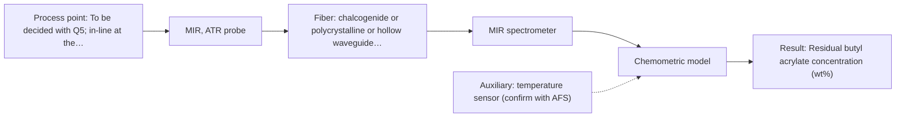
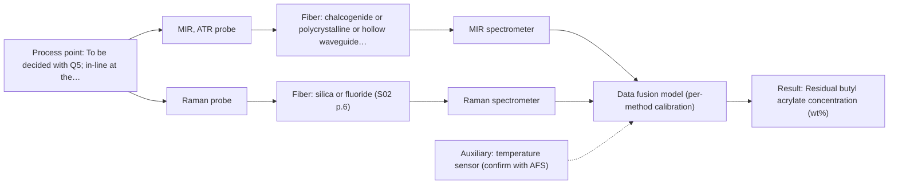

# First technical assessment

## Answer

**Customer request (our summary):** Customer runs a water-based emulsion polymerisation in a 2 m3 stirred batch reactor at about 80 °C and wants to follow residual monomer in-line during the feed instead of taking lab samples. Product is milky white. They ask which spectroscopic method and probe to test first. Additional facts: target is butyl acrylate, roughly 0.5 to 8 wt% during the feed, lab reference is GC. No optical brighteners; an anionic surfactant and a persulfate initiator are used.

### Brief answer

Test mid-IR ATR first: it has strong, well-defined bands and needs only a thin layer in contact with the probe, which suits a milky, water-based emulsion. Test a Raman probe in parallel, as it tolerates water and needs no ATR crystal. Still open: the required detection limit, accuracy and response time, probe contact and cleaning at 80 °C, and whether the formulation fluoresces.

### Proposal

- **Best current option:** O2 (recommended)
- **Basis:** engineering judgement
- **What would change it:** A stated detection limit or accuracy that MIR ATR cannot reach, a confirmed fluorescence background or a fouling problem that rules out a contact probe, or a required spectrometer distance that a mid-IR link cannot cover, would move the choice to M2 or to the combined option.
- **Next step:** Run the single-method comparison on representative reactor samples against GC values and use the customer's accuracy target as the go / no-go basis.

**Secondary evidence (external, not AFS material):** G1: E02 ¶12, E01 ¶19; G2: E03 ¶31, E03 ¶36; G3: no usable external source found; G4: no usable external source found. See Expert detail.

**Decision status:** Provisional feasibility assessment

### Solution options

| ID | Tier | Methods | Confidence | Cost class, S01 Table 1 (p.6) | Ease of use | Maintenance | Performance fit | Sources |
|---|---|---|---|---|---|---|---|---|
| O1 | Simple | M2 Raman probe | Low: open question: Q1 (starts at Medium); uncited auxiliary sensor | high cost (row 12) | one probe, one spectrometer, no crystal | probe cleaning, laser and fiber checks | quick single-method check, water-tolerant, lower sensitivity | [1: S01 p.16] [2: S02 p.7] [3: S01 p.11] [4: S01 p.11] |
| O2 | Recommended | M1 MIR, ATR probe | Low: open question: Q1 (starts at Medium); uncited auxiliary sensor | high cost (row 2) | one contact ATR probe, well-defined bands | crystal and probe cleaning, FTIR checks | best sensitivity and selectivity for the monomer bands | [5: S01 p.9] [6: S01 p.5] [7: S01 p.10] |
| O3 | Extended (multi-method) | M1 MIR, ATR probe; M3 MIR, ATR probe + Raman (combination) | Low: open question: Q1 (starts at Medium); uncited auxiliary sensor; multi-method, fusion benefit not yet shown | high cost (rows 2, 12) | two probes, one fused model, more setup | two instruments and two calibration blocks | only if one method falls short of the target | [8: S01 p.8] [9: S01 p.9] [10: S01 p.9] [11: S04 p.4] [5: S01 p.9] [6: S01 p.5] [7: S01 p.10] [12: S01 p.11] [13: S01 p.7] [14: S01 p.8] |

*Confidence rates the basis of the advice (how much is known and cited), not a predicted accuracy or probability of success. It starts at High, or at Medium when a key question on the method or the option is open, and drops one level per weakness listed (floor Low).*

*Cost class is the relative rating in S01 Table 1 (p.6) for the in-line method+technique rows named (the highest one for a multi-method option); it is not a price.*

### Setup sketch

*Recommended option O2; drawn by code from the option, a schematic, not a configuration.*

### Key questions

1. What detection limit and accuracy, relative to the GC reference, are required at the low end of the 0.5-8 wt% range?
2. What response time or update rate is needed to follow the feed?
3. Can the probe be in direct contact with the emulsion at about 80 °C, and how would the ATR crystal or probe window be kept clean?

## Expert detail

**Customer enquiry**

> We run a water-based emulsion polymerisation in a 2 m3 stirred batch reactor at about 80 °C and want to follow the residual monomer in-line during the feed, instead of taking samples for the lab. The product is milky white. Which spectroscopic method and probe should we test first?

Additional facts from the customer (answers and added details):
- Which residual monomer is to be followed, over what concentration range, and what detection limit and accuracy are required? Answer: Butyl acrylate, roughly 0.5 to 8 wt% during the feed; our lab reference is GC.
- Are fluorescent species present in the formulation, such as surfactants, initiators, stabilisers or optical brighteners? Answer: No optical brighteners; an anionic surfactant and a persulfate initiator are used.

**Decision status:** Provisional feasibility assessment. A shortlist can be justified from the general properties of the methods and a similar in-line precedent, but no supplied source covers butyl acrylate in an emulsion polymerisation and the deciding performance figures are missing. The choice is therefore provisional and rests on the stated assumptions.

### Parameters

| ID | Parameter | Kind | Need | Measured by | Why | Sources |
|---|---|---|---|---|---|---|
| P1 | Residual butyl acrylate concentration (wt%) | quantitative | required | Spectroscopy: MIR | This is the target the customer wants to follow in-line during the feed. | *(no verified source: engineering judgement)* |
| P2 | Temperature at the measurement point | quantitative | required | Auxiliary sensor: temperature sensor (engineering judgement: confirm availability with AFS) | The reactor runs at about 80 °C, which affects the spectra and the probe and crystal materials. | *(no verified source: engineering judgement)* |
| P3 | Scattering level / particle size of the emulsion | quantitative | optional | Reference lab method: off-line particle-size or turbidity measurement | The product is milky white and scattering changes reflected and Raman-collected light, so it should be available across the feed to explain signal variation. | [15: S01 p.17] |

### Solution option details

- **O1 cost drivers:** one spectrometer, laser, fiber probe, chemometric calibration
- **O2 cost drivers:** FTIR spectrometer, mid-IR fiber and ATR probe, calibration effort
- **O3 cost drivers:** second spectrometer, combined probe, synchronisation, fusion modelling
- **O3 combining methods:** Start from one model per method and fuse the joined spectra with block scaling, because variables from different methods are not equivalent and a method with more variables would otherwise dominate. The MIR ATR and Raman measurements must come from the same small spot and be normalised to a common time step, and each instrument keeps its own calibration and maintenance. The fused model must beat the best single method on independent runs, otherwise the second instrument is dropped.

*Extended (multi-method) option O3; drawn by code from the option, a schematic, not a configuration.*

### Premise check

- **Precedent only:** Residual monomer can be followed in-line during the feed instead of by lab sampling. There is a published in-line process example with fiber probes and a general statement that fiber probes are being integrated into reactors, which is a reason to test, not proof for this process. [16: S01 p.15] [17: S01 p.2]
- **Not covered:** The absence of optical brighteners is sufficient to rule out fluorescence interference from the anionic surfactant and the persulfate initiator. No supplied source says whether an anionic surfactant or a persulfate initiator fluoresces, so this has to be measured on the real formulation; it matters because a fluorescence background affects the Raman option. *(no verified source: engineering judgement)*
- **Not covered:** A method and probe can be chosen for a first test before the required detection limit and accuracy are specified. A first test can be proposed, but no supplied source supports stating a detection limit or accuracy before the configuration and the sample are fixed, so these figures stay open. *(no verified source: engineering judgement)*

### Requirements

**Stated by the customer**

- Follow residual butyl acrylate in-line during the feed, roughly 0.5 to 8 wt%, in a water-based emulsion polymerisation at about 80 °C in a 2 m3 stirred batch reactor.
- Product is milky white (highly scattering).
- Laboratory reference is GC.
- No optical brighteners; an anionic surfactant and a persulfate initiator are used.

**Key unknowns**

- Required detection limit and accuracy for butyl acrylate, referenced to GC.
- Required response time or update rate during the feed.
- Whether the probe can contact the emulsion at about 80 °C and how fouling is controlled.
- Fluorescence background from the surfactant, initiator or other formulation components.
- Installation point and distance from the reactor to the spectrometer.
- Whether other monomers or additives must also be followed.

### Clarification questions (most decision-relevant first)

Q1. What detection limit and accuracy, relative to the GC reference, are required at the low end of the 0.5-8 wt% range? *Why it matters:* It decides whether one method can meet the target or whether the combined option is needed. *(affects: method)*
Q2. What response time or update rate is needed to follow the feed? *Why it matters:* It decides the spectrometer type and whether the measurement can follow the feed. *(affects: technique)*
Q3. Can the probe be in direct contact with the emulsion at about 80 °C, and how would the ATR crystal or probe window be kept clean? *Why it matters:* Both MIR ATR and the Raman probe need tight contact, and polymer deposits would change the signal. *(affects: technique)*
Q4. Does the formulation, at process concentrations, show a fluorescence background under the Raman laser? *Why it matters:* A strong background would weaken or rule out the Raman comparison. *(affects: M2)*
Q5. Where should the measurement point be (reactor wall, feed line or recirculation loop), and what distance to the spectrometer is needed? *Why it matters:* It fixes the fiber family and the achievable link length, which differ between the methods. *(affects: installation)*

### Recommendation

- **M1 · Primary candidate: MIR, ATR probe.** Mid-IR gives well-defined absorption bands and high sensitivity, and ATR needs only a very thin layer, which suits a water-based, highly scattering emulsion in contact with the probe. It is the single method to test first against the GC reference. *Conditions:* Applies if the emulsion can be brought into tight contact with the ATR crystal at about 80 °C and the crystal can be kept clean. [5: S01 p.9] [6: S01 p.5] [7: S01 p.10]
- **M2 · Comparison candidate: Raman probe.** Raman tolerates water much better than the infrared methods and can use silica fibers, which suits a long probe-to-spectrometer link, so it is the natural single-method comparison to M1. Its weak signal and any fluorescence background from the formulation must be checked on real samples. *Conditions:* Test in parallel with M1 on the same samples, and state the laser excitation wavelength separately from the Raman shift. [1: S01 p.16] [2: S02 p.7] [3: S01 p.11] [4: S01 p.11]
- **M3 · Conditional candidate: MIR, ATR probe + Raman (combination).** Mid-IR and Raman are complementary vibrational methods, so combining them is a hypothesis to test only if no single method reaches the required accuracy. Any gain must be shown against the best single method, not assumed. *Conditions:* Applies only if the single-method tests (M1, M2) fall short of the accuracy required at the low end of the range. [12: S01 p.11] [13: S01 p.7] [14: S01 p.8] Later hypothesis, after single-method tests.
- **M4 · Not recommended: fluorescence probe.** Fluorescence needs a species that fluoresces or a justified indicator, and none is identified here, so it is not a direct measurement of residual butyl acrylate. The absence of optical brighteners does not by itself rule out a fluorescence background from the surfactant or the initiator. [18: S01 p.5] [19: S04 p.4]

### Measurement concept

- **Probe and geometry:** Contact probe in the reactor or in a recirculation loop; ATR for MIR, a Raman fiber probe for Raman. Non-contact reflection is not proposed for the primary method.
- **Location:** To be decided with Q5; in-line at the reactor or in a bypass loop.
- **Fiber link:** Silica fibers for the Raman probe (visible/short-wave NIR); a mid-IR fiber (CIR or PIR) for the ATR probe. No source states an achievable length for a mid-IR link, so this stays open. [20: S02 p.6] [21: S02 p.6]

### Spectral range

- **MIR:** Nominal mid-IR range 4000-400 cm-1; the usable range depends on the instrument, fiber and ATR crystal actually selected. [22: S01 p.9]
- **Raman:** Raman is reported as a Raman shift in cm-1, with the laser excitation wavelength stated separately; the usable range depends on the spectrometer, laser and probe selected. [23: S01 p.11]

### Risks and uncertainty

- The required detection limit and accuracy are not stated, so it is not yet known whether any method can resolve the low end of the 0.5-8 wt% range against the GC reference. *(rules: R-CAL-1)* [24: REF §5]
- The product is milky white and highly scattering, and both M1 and M2 use a probe in contact with the product, so polymer deposits on the crystal or window could change the signal. *(rules: R-MIR-3, R-GEN-5)* [25: S01 p.13]
- The anionic surfactant or the persulfate initiator may give a fluorescence background that swamps the weak Raman signal; this has to be checked on real samples. *(rules: R-RAM-1)* [4: S01 p.11]
- No source states an achievable fiber-link length for a mid-IR (CIR or PIR) probe, so a long distance between the reactor and the spectrometer could rule out M1. *(rules: R-FIB-2)* *(no verified source: engineering judgement)*

### First feasibility experiment

1. **Take representative reactor samples across the expected variation of the feed, from low to high butyl acrylate, and cover the scattering variation of the milky emulsion.** Representative sampling across the expected chemical and physical variation. [26: REF §3]
2. **Measure the samples with the single methods first, MIR ATR then the Raman probe, in the geometry intended for the line, with repeated measurements per sample.** Single methods before any combination. [27: S04 p.4]
3. **Measure every sample by the independent GC reference and build one calibration per method against those values.** Independent reference values for each method. [28: REF §5]
4. **Validate each calibration on held-out runs or batches and compare the error at the low end of the range with the accuracy the customer requires; that comparison is the go / no-go basis.** Validation on held-out runs and the go / no-go basis. [29: S03 p.14]
5. **Only if no single method reaches the target, test the combination: both probes at the same spot, the data brought to a common time step, and a fused model that must beat the best single method on the held-out runs.** Combination only after the single-method tests. [30: S01 p.8] [31: S01 p.8]

**Reference measurements:** GC (customer's laboratory reference) for butyl acrylate, run on the same samples used for the spectra.

**Decision basis:** Numerical go / no-go criteria to be supplied by the customer: required detection limit and accuracy at the low end of the range, and required response time.

### Assumptions

- The 0.5-8 wt% figure is the butyl acrylate concentration in the reactor during the feed and the GC reference is the accepted value for it.
- A probe can be placed so that it contacts the emulsion at process temperature, directly or in a recirculation loop.
- The feed lasts long enough for spectra to be averaged to the response time that is still to be specified.

### Not covered by the supplied sources

- No supplied source gives a detection limit, accuracy or response time for residual butyl acrylate, in an emulsion polymerisation or in any similar matrix.
- No supplied source addresses the fluorescence behaviour of anionic surfactants or persulfate initiators.
- No supplied source states an achievable fiber-link length for a mid-IR (CIR or PIR) probe.

### Further notes

- **Chemometrics:** Both single methods need a chemometric calibration against the GC reference, and such a calibration is specific to the matrix, so it must be checked again if the formulation changes; the same applies to the fused model in O3.
- **Real-time tracking:** The feed is a moving concentration profile; spectra must be acquired fast enough to follow it and matched in time to the GC values.
- **Future direction:** If one method proves sufficient, a later step could be a compact optical multisensor system focused on this measurement point.

### Secondary evidence (external, not AFS material)

*Found by a literature search for gaps the supplied AFS sources leave open. Not AFS material and not proof for this case; every quote below was verified verbatim against the fetched text.*

**G1 · auxiliary sensor:** In-line measurement of Temperature at the measurement point with temperature sensor

- **E02 ¶12** The source states that temperature sensitivity of OH bands is a severe drawback for measuring aqueous solutions in NIR and MIR, making tempered sample holders necessary. *How it applies:* For a water-based emulsion, temperature at the measurement point may affect MIR spectra, so test whether temperature control or logging is needed at the probe. *Limits and transfer risks:* The source is a review in biopharmaceutical downstream processing, not emulsion polymerisation; tempered sample holders are laboratory/off-line and may not transfer directly to an in-line probe. *(supports O2)*
  > "Additionally, the temperature sensitivity of the OH bands is a severe drawback for measuring aqueous solution in NIR and MIR, which makes tempered sample holders necessary [29]."
  > A critical review of recent trends, and a future perspective of optical spectroscopy as PAT in biopharmaceutical downstream processing. (2020) · Analytical and bioanalytical chemistry · doi:10.1007/s00216-020-02407-z · https://europepmc.org/article/PMC/PMC7072065 · retrieved 2026-10-17, full text, licence: cc by, via curated library
- **E01 ¶19** The source varied concentrations, ionic strength and temperature to obtain a robust model. *How it applies:* This suggests temperature should be varied or recorded during calibration so the model can be robust to process temperature changes. *Limits and transfer risks:* The study is on reactive liquid-liquid extraction in lithium recycling, not emulsion polymerisation, and it does not describe an in-line temperature sensor. *(supports O2)*
  > "The concentrations of nitric acid and hydrochloric acid as well as the ionic strength and temperature were varied to obtain a robust model."
  > Process Analytical Technology-Integrated FT-IR and Raman Spectroscopies for Efficient Reactive Liquid-Liquid Extraction Processing in Lithium Recycling. (2025) · ACS omega · doi:10.1021/acsomega.5c05705 · https://europepmc.org/article/PMC/PMC12573149 · retrieved 2026-10-17, full text, licence: cc by, via curated library

**G2 · multi-method:** Combining several spectroscopy methods (data fusion) (Start from one model per method and fuse the joined spectra with block scaling, because variables from different methods are not equivalent and a method with more variables would otherwise dominate. The MIR ATR and Raman measurements must come from the same small spot and be normalised to a common time step, and each instrument keeps its own calibration and maintenance. The fused model must beat the best single method on independent runs, otherwise the second instrument is dropped.)

- **E03 ¶31** Low-level data fusion is described as the simplest way to combine inputs by placing variables from different sources one after the other in a new data matrix. *How it applies:* This could inform a first fusion test by concatenating MIR and Raman variables, but the need for block scaling must be checked separately. *Limits and transfer risks:* The source is a general PAT data-fusion review, not MIR/Raman on emulsion polymerisation; concatenation alone does not guarantee improved prediction. *(supports O3)*
  > "Low-level data fusion (LLDF) is considered the simplest method to achieve a combination of inputs. In this case, the data is rearranged into a new data matrix, where the variables coming from different sources are placed one after the other."
  > Challenges and Opportunities of Implementing Data Fusion in Process Analytical Technology-A Review. (2022) · Molecules (Basel, Switzerland) · doi:10.3390/molecules27154846 · https://europepmc.org/article/PMC/PMC9369811 · retrieved 2026-10-17, full text, licence: cc by, via curated library
- **E03 ¶36** A Raman and FT-IR food analytical study found that instrument complementarity was not always sufficient to improve predictive performance for several CQAs. *How it applies:* This supports requiring the fused MIR/Raman model to beat the best single method on independent runs before keeping the second instrument. *Limits and transfer risks:* The cited study is in food analysis, not emulsion polymerisation; the result may not transfer to butyl acrylate in a milky white matrix. *(supports O3)*
  > "In some situations, instrument complementarity (not data complementarity) was not sufficient to improve the performance of predictive several CQAs, as shown by a Raman and FT-IR data based food analytical study [73]."
  > Challenges and Opportunities of Implementing Data Fusion in Process Analytical Technology-A Review. (2022) · Molecules (Basel, Switzerland) · doi:10.3390/molecules27154846 · https://europepmc.org/article/PMC/PMC9369811 · retrieved 2026-10-17, full text, licence: cc by, via curated library

**G3 · not in the supplied sources:** No supplied source gives a detection limit, accuracy or response time for residual butyl acrylate, in an emulsion polymerisation or in any similar matrix.

- No usable external source found.

**G4 · not in the supplied sources:** No supplied source addresses the fluorescence behaviour of anionic surfactants or persulfate initiators.

- No usable external source found.

### Evidence (verified quotes)

1. ✓ **S01 p.16** (general): "Raman is particularly well-suited for aqueous environments, as it exhibits low absorbance for water molecules compared to infrared methods."
2. ✓ **S02 p.7** (performance figure): "Robust 100-300m cables made with Silica fibers of low OH-content (<0.1ppm OH) enable remote industrial process-control"
3. ✓ **S01 p.11** (general): "signals, which are several orders of magnitude weaker than IR absorption peaks"
4. ✓ **S01 p.11** (general): "superposition of luminescence (fluorescence), which has a significantly higher intensity."
5. ✓ **S01 p.9** (general): "Due to the high extinction coefficients of various molecules in this region, the method is highly sensitive"
6. ✓ **S01 p.5** (general): "strong absorption in the mid-IR region limits the corresponding spectral method to the analysis of very thin samples (usually less than 50 μm), but it opens up the possibility of using attenuated total reflectance (ATR)"
7. ✓ **S01 p.10** (general): "ATR fiber probes (Fig.1) enable the analysis of liquids and solid elastic samples"
8. ✓ **S01 p.8** (general): "Variables obtained from different spectral methods are not equivalent."
9. ✓ **S01 p.9** (general): "Furthermore, methods containing a larger number of variables have a greater impact on the model."
10. ✓ **S01 p.9** (general): "One of the challenges of multispectral analysis is the need to simultaneously connect at least two independently operating measuring instruments."
11. ✓ (precedent only) **S04 p.4** (method gain): "none of the individual techniques was sufficient to completely separate the three sample classes"
12. ✓ **S01 p.11** (general): "This property makes mid-IR and Raman spectra complementary, that is, they complement each other."
13. ✓ (precedent only) **S01 p.7** (method gain): "The analysis of such systems may require a combination of two or even more spectral methods."
14. ✓ **S01 p.8** (general): "It is crucial that the spectral information obtained by different methods-Mid-IR, NIR, Raman, and fluorescence spectra-is collected from the same small, even pinpoint, area of the sample."
15. ✓ **S01 p.17** (general): "the method is sensitive to the surface characteristics and fat globule size."
16. ✓ **S01 p.15** (application precedent): "During the experimental action, the probes are inserted directly into the process environment, such as the feed frame of a rotary tablet press."
17. ✓ **S01 p.2** (general): "Fiber optic probes and cells are being integrated into reactors and production lines of ongoing technological processes, enabling on-site online analysis and obtaining results in near real time."
18. ✓ **S01 p.5** (general): "However, most chemicals do not exhibit this property."
19. ✓ **S04 p.4** (general): "it is limited to the samples containing at least one fluorescent component"
20. ✓ **S02 p.6** (general): "1100 nm Chalcogenide As-S IR Fibers 6500 nm"
21. ✓ **S02 p.6** (general): "350 nm Standard VIS-NIR Silica Fibers Al/Cu-coated VIS-NIR Silica Fibers 2400 nm"
22. ✓ **S01 p.9** (general): "Vibrational spectroscopy in the mid-IR range (4000-400 cm-1) is one of the most informative methods of chemical analysis."
23. ✓ **S01 p.11** (general): "The Raman shift is used as the horizontal (spectral) axis in Raman spectroscopy"
24. ✓ **REF §5** (general): "It is not a product specification: actual spectral coverage, fiber length, component ratings, detection limits and accuracy depend on the configuration and the sample."
25. ✓ **S01 p.13** (general): "typically at a depth of few microns"
26. ✓ **REF §3** (general): "Representative samples or process states, independent reference measurements, what is compared, and the basis for the go / no-go decision."
27. ✓ **S04 p.4** (general): "Another requirement is the suitability of analyzed samples for ATR measurements, which is true for liquid or soft solid samples and their components, allowing a tight contact with the probe head."
28. ✓ **REF §5** (general): "Weak signal, fluorescence background; calibration specific to the matrix."
29. ✓ **S03 p.14** (general): "A thorough validation, including full, segmented and random-subset CVs, as well as randomization tests, are recommended in any cases for which important conclusions depend on calibration or discrimination models built on limited experimental material."
30. ✓ **S01 p.8** (general): "Ultimately, the measurement data must be normalized to a common time step."
31. ✓ **S01 p.8** (general): "The use of a combined probe facilitates measurements and allows for the analysis of a smaller sample volume."

### Verification

- Citations verified: 34 of 34 (exact or whitespace/hyphen-tolerant match on the cited page, scope checked).
- Hard check failures before deterministic corrections: 0; still open: 0; soft warnings: 3; repair rounds: 1.
- External evidence (live): 4 quote(s) verified verbatim (exact or whitespace/hyphen-tolerant, at most 400 characters and 2 sentences, against the cited paragraph); 0 item(s) dropped.
- External search: 6 query(ies), 45 hit(s), 5 source(s) (3 from the curated library).
- External step: 2 model call(s), 50.6 s extra (cost in the run JSON).

*Run adhoc-20261018T054714Z · models deepseek/deepseek-v4.1-flash*
