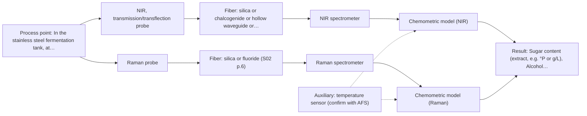
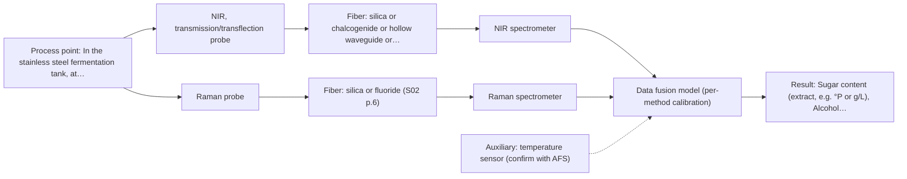

# First technical assessment

## Answer

**Customer request (our summary):** The customer wants to know which spectroscopic method and probe to test first for in-line monitoring of sugar and alcohol in a fermenting beer tank located 30 m from the analyzer.

### Brief answer

Test an NIR transflection (or transmission) immersion fiber probe first: NIR suits remote fiber-probe monitoring, its bands cover sugar and alcohol, and silica fibers support your 30 m link. Run a Raman probe in parallel as the comparison method; consider MIR-ATR only if a 30 m mid-IR fiber link proves feasible. Open points: required accuracy, tank port and CIP conditions, and a calibration validated across the full fermentation range.

### Proposal

- **Best current option:** O2 (recommended)
- **Basis:** supplied AFS sources
- **What would change it:** If the required accuracy is modest and the tank port suits a single immersion probe, O1 alone may suffice; if no 30 m mid-IR link is feasible, M3 drops out, and if single methods miss the accuracy targets on held-out batches, O3 becomes the path.
- **Next step:** Answer the clarification questions and run the multi-method lab trial on representative fermentation samples with laboratory reference analyses.

**Secondary evidence (external, not AFS material):** G1: E01 ¶12; G2: E02 ¶31; G3: no usable external source found; G4: no usable external source found. See Expert detail.

**Decision status:** Provisional feasibility assessment

### Solution options

| ID | Tier | Methods | Confidence | Cost class, S01 Table 1 (p.6) | Ease of use | Maintenance | Performance fit | Sources |
|---|---|---|---|---|---|---|---|---|
| O1 | Simple | M1 NIR, transmission/transflection probe | Low: open question: Q1 (starts at Medium); uncited auxiliary sensor | average cost (row 7) | Standard NIR probe and spectrometer, familiar workflow | Window cleaning at CIP; periodic calibration check | Covers both targets with one probe on a proven 30 m silica link | [1: S01 p.5] [2: S01 p.10] [3: S01 p.18] [4: S02 p.7] |
| O2 | Recommended | M1 NIR, transmission/transflection probe; M2 Raman probe | Low: open question: Q1 (starts at Medium); uncited auxiliary sensor | high cost (rows 7, 12) | Two probes to install and run during trials | Two windows/probe tips to keep clean; two calibrations | Tests the best single method against its strongest aqueous rival before committing | [1: S01 p.5] [2: S01 p.10] [3: S01 p.18] [4: S02 p.7] [5: S01 p.16] [6: S01 p.11] |
| O3 | Extended (multi-method) | M4 NIR, transmission/transflection probe + Raman (combination) | Low: open question: Q1 (starts at Medium); uncited auxiliary sensor; multi-method, fusion benefit not yet shown | high cost (rows 7, 12) | More complex installation and data handling | Two instruments, two calibrations, fused model upkeep | Only if single methods miss the accuracy target on held-out batches | [7: S01 p.15] [8: S01 p.15] [9: S01 p.8] |

*Confidence rates the basis of the advice (how much is known and cited), not a predicted accuracy or probability of success. It starts at High, or at Medium when a key question on the method or the option is open, and drops one level per weakness listed (floor Low).*

*Cost class is the relative rating in S01 Table 1 (p.6) for the in-line method+technique rows named (the highest one for a multi-method option); it is not a price.*

### Setup sketch

*Recommended option O2; drawn by code from the option, a schematic, not a configuration.*

### Key questions

1. What accuracy and update rate do you need for sugar (e.g. extract in °P or g/L) and alcohol (% v/v) during fermentation?
2. Is there an existing optical port, flange or varon/Ingold-style socket on the tank, and at what position relative to the yeast and CO2 gradients?
3. What are the CIP/SIP conditions (temperature, caustic/acids, duration) that the probe must survive?

## Expert detail

**Customer enquiry**

> We run a craft brewery and want to follow sugar and alcohol content in-line during fermentation, in a stainless steel tank at 12–18 °C. The beer is cloudy with yeast and has CO2 bubbles. The analyzer cabinet would be about 30 m from the tank. Which spectroscopic method and probe should we test first?

**Decision status:** Provisional feasibility assessment. A method shortlist can be justified from the stated sample and process facts, but the required accuracy, tank interface and cleaning conditions are unknown, so the choice stays provisional.

### Parameters

| ID | Parameter | Kind | Need | Measured by | Why | Sources |
|---|---|---|---|---|---|---|
| P1 | Sugar content (extract, e.g. °P or g/L) | quantitative | required | Spectroscopy: NIR | It is one of the two target variables the in-line model must predict during fermentation. | *(no verified source: engineering judgement)* |
| P2 | Alcohol content (% v/v) | quantitative | required | Spectroscopy: NIR | It is the second target variable the in-line model must predict as fermentation proceeds. | *(no verified source: engineering judgement)* |
| P3 | Sample temperature at the probe | quantitative | required | Auxiliary sensor: temperature sensor (engineering judgement: confirm availability with AFS) | Temperature shifts spectral bands and must be recorded so the calibration can compensate for the 12-18 °C range. | *(no verified source: engineering judgement)* |
| P4 | Reference sugar and alcohol values per sample | quantitative | required | Reference lab method: laboratory extract and alcohol analysis (e.g. density/distillation or HPLC) | Independent laboratory reference values are needed to build and validate the calibration and to set the go/no-go criteria. | *(no verified source: engineering judgement)* |
| P5 | Yeast turbidity / suspended solids level | quantitative | optional | Spectroscopy: NIR | It should be available because scattering from yeast strongly affects the NIR signal and may need to be a model variable or correction factor. | *(no verified source: engineering judgement)* |

### Solution option details

- **O1 cost drivers:** NIR spectrometer, transflection probe, silica cable, calibration samples and reference analyses
- **O2 cost drivers:** NIR and Raman spectrometers, two probes, cables, extended calibration and reference campaign
- **O3 cost drivers:** Second spectrometer, combined or co-located probes, data-fusion software, larger validation campaign
- **O3 combining methods:** Low-level fusion: synchronised NIR and Raman spectra merged into one augmented matrix for PLS models, as published for blend potency. Both probes must sample the same beer volume at the same tank position, with data normalised to a common time step. Each method keeps its own calibration, and the fused model must beat the best single method on independent batches or it is dropped.

*Extended (multi-method) option O3; drawn by code from the option, a schematic, not a configuration.*

### Premise check

- **Not covered:** A single method and probe can be named now without knowing the required accuracy and the tank's optical interface. No supplied source states accuracy requirements or tank-port options for fermentation; the shortlist below is therefore conditional on the clarification questions. *(no verified source: engineering judgement)*
- **Precedent only:** A 30 m fiber link from tank to analyzer cabinet is feasible. Long remote links are documented for silica (NIR) fibers; no source states an achievable length for mid-IR fibers, so the 30 m link is only supported for the NIR option. [4: S02 p.7]
- **Precedent only:** Spectroscopy can follow sugar and alcohol during fermentation in-line. Published bioprocess examples show fiber-optic monitoring of metabolites such as glucose in fermenters; this is a reason to test, not proof for this brewery. [10: S01 p.16]

### Requirements

**Stated by the customer**

- Follow sugar content in-line during fermentation
- Follow alcohol content in-line during fermentation
- Stainless steel tank at 12-18 °C
- Cloudy beer with yeast and CO2 bubbles
- Analyzer cabinet about 30 m from the tank

**Key unknowns**

- Required accuracy and precision for sugar and alcohol
- Available optical port or flange on the tank and probe insertion geometry
- CIP/SIP conditions and chemical exposure of the probe
- Tank pressure and CO2 headspace behaviour at the measurement point
- Whether the beer contains a usable fluorescent species (for the fluorescence option)

### Clarification questions (most decision-relevant first)

Q1. What accuracy and update rate do you need for sugar (e.g. extract in °P or g/L) and alcohol (% v/v) during fermentation? *Why it matters:* This decides whether a single NIR calibration can meet the target or whether a second method must be considered. *(affects: method, status)*
Q2. Is there an existing optical port, flange or varon/Ingold-style socket on the tank, and at what position relative to the yeast and CO2 gradients? *Why it matters:* The probe type (transmission vs transflection vs reflection) and its insertion depth depend on the available port and local homogeneity. *(affects: installation, technique)*
Q3. What are the CIP/SIP conditions (temperature, caustic/acids, duration) that the probe must survive? *Why it matters:* Cleaning chemistry and temperature limit which probe windows, fibers and seals are usable. *(affects: installation)*
Q4. What is the tank pressure and how strong is CO2 bubbling at the intended measurement point? *Why it matters:* Bubbles and turbulence disturb transmission and reflection signals and influence where the probe should sit. *(affects: installation, technique)*

### Recommendation

- **M1 · Primary candidate: NIR, transmission/transflection probe.** NIR suits remote fiber-probe online measurement and its overtones cover sugar and alcohol in aqueous media; a transflection probe tolerates the turbid, yeast-containing beer where pure transmission would saturate. Silica fibers support the 30 m link. *Conditions:* The optical pathlength must be controlled and the calibration built across the full fermentation range. [1: S01 p.5] [2: S01 p.10] [3: S01 p.18] [4: S02 p.7]
- **M2 · Comparison candidate: Raman probe.** Raman tolerates water well and gives a molecular fingerprint of sugars and ethanol, making it the natural single-method comparison against NIR. Its weak signal and possible fluorescence background must be checked on real beer samples. [5: S01 p.16] [6: S01 p.11]
- **M3 · Conditional candidate: MIR, ATR probe.** MIR-ATR gives well-resolved sugar and ethanol bands and immersion ATR probes are used in-line for liquids, but it is only worth testing if a 30 m mid-IR fiber link proves feasible, which no supplied source confirms. *Conditions:* Test only after AFS confirms an achievable mid-IR fiber length for the 30 m route; ATR also samples only a few micrometres at the crystal surface. [11: S01 p.10] [12: S01 p.13]
- **M4 · Comparison candidate: NIR, transmission/transflection probe + Raman (combination).** If neither NIR nor Raman alone meets the accuracy target, fusing the two could add complementary information, as shown for pharmaceutical blends. The gain is a hypothesis and must beat the best single method on independent batches. *Conditions:* Only after the single-method tests; requires same-spot sampling, synchronised acquisition and per-method calibration. [8: S01 p.15] [9: S01 p.8]
- **M5 · Not recommended: fluorescence probe.** Fluorescence only measures species that actually fluoresce, and no fluorescent marker for sugar or alcohol has been identified in this beer; its selectivity for these targets is low. It could only serve as a supplementary indicator, not the primary method. [13: S01 p.5]

### Measurement concept

- **Probe and geometry:** Immersion NIR transflection (or transmission) fiber probe inserted through a tank port into the fermenting beer; Raman fiber probe at the same region as the comparison; MIR-ATR immersion probe only as a conditional later test.
- **Location:** In the stainless steel fermentation tank, at a position representative of the bulk liquid and away from the strongest CO2 bubble streams.
- **Fiber link:** Silica Vis-NIR fiber cable for the NIR and Raman channels (30 m is within the documented 100-300 m class for low-OH silica cables); the mid-IR link length for a PIR/CIR fiber is an open question for AFS. [4: S02 p.7]

### Spectral range

- **NIR:** Nominal NIR range 780-2500 nm; the usable range depends on the spectrometer, silica fiber and probe actually selected. [14: S01 p.10]
- **Raman:** Raman shift in cm-1 with the laser excitation wavelength (e.g. 785 nm in the published pharma example) stated separately; the usable shift range depends on the selected laser and spectrometer. [15: S01 p.15]

### Risks and uncertainty

- Yeast turbidity and CO2 bubbles scatter and distort the NIR signal, so physical variation can mimic composition change and scatter correction plus a robust sampling position are needed. *(rules: R-GEO-6, R-GEN-5)* [16: S01 p.17]
- The NIR calibration is specific to the beer matrix and must be rebuilt or re-validated whenever the recipe, yeast or process changes materially. *(rules: R-CAL-1)* *(no verified source: engineering judgement)*
- No supplied source confirms a 30 m mid-IR fiber link, so the MIR-ATR option may fail on the fiber route rather than on spectroscopy. *(rules: R-FIB-2)* [17: S02 p.10]
- If the MIR-ATR route is pursued, crystal fouling by yeast and protein could bias the surface-layer signal. *(rules: R-MIR-3)* *(no verified source: engineering judgement)*

### First feasibility experiment

1. **Collect representative beer samples across the expected variation: several fermentation time points from early to terminal gravity, covering the sugar and alcohol ranges, yeast turbidity and CO2 levels.** Cover the chemical and physical span the in-line model must handle. *(no verified source: engineering judgement)*
2. **Measure each sample with the independent reference method the brewery already uses (e.g. laboratory density/extract and alcohol analysis) to provide ground truth for sugar and alcohol.** Provide the reference data the calibration and the go/no-go criteria are judged against. *(no verified source: engineering judgement)*
3. **Record NIR transflection spectra first (single method), then Raman spectra on the same samples, keeping the measurement geometry fixed and logging sample temperature.** Compare the two single methods before any combination is considered. *(no verified source: engineering judgement)*
4. **Build separate PLS calibration models for sugar and alcohol per method and validate them on held-out brews or batches not used in calibration.** Estimate real prediction error and check robustness against overfitting. *(no verified source: engineering judgement)*
5. **Go/no-go: agree with the customer the numerical accuracy targets for sugar and alcohol beforehand; a method passes only if its validated prediction error on held-out batches meets those targets; only then test a fused NIR+Raman model and require it to beat the best single method.** Give an objective basis for choosing the in-line configuration. *(no verified source: engineering judgement)*

**Reference measurements:** Laboratory sugar (extract) and alcohol analysis on every calibration and validation sample, performed by the brewery or an external lab.

**Decision basis:** Validated prediction error on held-out batches against customer-defined accuracy targets for sugar and alcohol.

### Assumptions

- The measurement point can be made representative of the bulk beer despite yeast settling and CO2 gradients.
- A tank port or socket can be fitted or already exists for probe insertion.
- Standard brewery CIP chemistry will be compatible with the chosen probe window and seals (to be confirmed).

### Not covered by the supplied sources

- Accuracy, detection limits or response times achievable for sugar and alcohol in fermenting beer with any of the shortlisted methods
- Achievable length of a mid-IR (PIR/CIR) fiber link for the 30 m route
- Probe materials and seals compatible with brewery CIP/SIP regimes

### Further notes

- **Chemometrics:** A PLS regression model per method (and per analyte) is the baseline; NIR bands are broad and overlapping, so chemometrics are required for quantitative use. Reference data from every calibration and validation sample is essential, and validation on held-out brews protects against overfitting.
- **Real-time tracking:** The goal is continuous in-line tracking of sugar and alcohol through fermentation; diode-array or fast-scanning NIR acquisition supports real-time results, and the model must cover the full dynamics from high sugar/zero alcohol to terminal gravity.
- **Future direction:** Once the calibration is proven, a compact LED-based NIR sensor at selected wavelengths could replace the full spectrometer for routine monitoring, following the published LED-sensor simplification approach.

### Secondary evidence (external, not AFS material)

*Found by a literature search for gaps the supplied AFS sources leave open. Not AFS material and not proof for this case; every quote below was verified verbatim against the fetched text.*

**G1 · auxiliary sensor:** In-line measurement of Sample temperature at the probe with temperature sensor

- **E01 ¶12** Additionally, the temperature sensitivity of the OH bands is a severe drawback for measuring aqueous solution in NIR and MIR, which makes tempered sample holders necessary. *How it applies:* Since temperature variations affect aqueous spectral bands in NIR and MIR, testing should evaluate if probe temperature compensation or a tempered sample interface is needed to avoid sugar and alcohol prediction errors in the fermenting beer. *Limits and transfer risks:* The cited study addresses general aqueous solutions rather than an in-line fermenting beer matrix at industrial scale, so temperature coefficients must be verified directly on the process stream. *(supports O2)*
  > "Additionally, the temperature sensitivity of the OH bands is a severe drawback for measuring aqueous solution in NIR and MIR, which makes tempered sample holders necessary [29]."
  > A critical review of recent trends, and a future perspective of optical spectroscopy as PAT in biopharmaceutical downstream processing. (2020) · Analytical and bioanalytical chemistry · doi:10.1007/s00216-020-02407-z · https://europepmc.org/article/PMC/PMC7072065 · retrieved 2026-10-17, full text, licence: cc by, via curated library

**G2 · multi-method:** Combining several spectroscopy methods (data fusion) (Low-level fusion: synchronised NIR and Raman spectra merged into one augmented matrix for PLS models, as published for blend potency. Both probes must sample the same beer volume at the same tank position, with data normalised to a common time step. Each method keeps its own calibration, and the fused model must beat the best single method on independent batches or it is dropped.)

- **E02 ¶31** Low-level data fusion (LLDF) is considered the simplest method to achieve a combination of inputs. *How it applies:* When testing multi-method monitoring, LLDF can be explored by concatenating synchronized NIR and Raman spectra into a single matrix for PLS calibration, provided both probes sample identical volumes. *Limits and transfer risks:* Data fusion benefits depend heavily on instrument complementarity and dataset contribution, which may not translate from pharmaceutical or food blend models to an active beer fermentation process. *(supports O3)*
  > "Low-level data fusion (LLDF) is considered the simplest method to achieve a combination of inputs. In this case, the data is rearranged into a new data matrix, where the variables coming from different sources are placed one after the other."
  > Challenges and Opportunities of Implementing Data Fusion in Process Analytical Technology-A Review. (2022) · Molecules (Basel, Switzerland) · doi:10.3390/molecules27154846 · https://europepmc.org/article/PMC/PMC9369811 · retrieved 2026-10-17, full text, licence: cc by, via curated library

**G3 · not in the supplied sources:** Accuracy, detection limits or response times achievable for sugar and alcohol in fermenting beer with any of the shortlisted methods

- No usable external source found.

**G4 · not in the supplied sources:** Achievable length of a mid-IR (PIR/CIR) fiber link for the 30 m route

- No usable external source found.

### Evidence (verified quotes)

1. ✓ **S01 p.5** (general): "making it ideal for online applications, including remote measurements via fiber optic probes."
2. ✓ **S01 p.10** (general): "NIR spectra (780-2500 nm) contain predominantly overtones and component bands of fundamental vibrations of molecules and atomic groups"
3. ✓ **S01 p.18** (application precedent): "In some cases, a Transflection probe can already be a combined solution working well for low-fat and high-fat containing milk products."
4. ✓ **S02 p.7** (performance figure): "Robust 100-300m cables made with Silica fibers of low OH-content (<0.1ppm OH) enable remote industrial process-control"
5. ✓ **S01 p.16** (general): "Raman is particularly well-suited for aqueous environments, as it exhibits low absorbance for water molecules compared to infrared methods."
6. ✓ **S01 p.11** (general): "superposition of luminescence (fluorescence), which has a significantly higher intensity."
7. ✓ **S01 p.15** (application precedent): "Data processing for pharmaceutical tasks relies on "low-level data fusion," where the synchronized NIR and Raman spectra are merged into a single augmented matrix."
8. ✓ (precedent only) **S01 p.15** (method gain): "By combining Raman and NIR, these models can predict API potency or coating thickness with higher accuracy and robustness than single-method models."
9. ✓ **S01 p.8** (general): "the data from each method must be obtained simultaneously."
10. ✓ **S01 p.16** (application precedent): "Raman spectroscopy can be used in the same reactor to provide a "molecular fingerprint" for direct detection of specific metabolites like glucose, acetate, or lactate."
11. ✓ **S01 p.10** (general): "Probe-based analysis is gaining widespread use in online analysis, such as in-line, in-process (chemical, biotechnological, natural) environments"
12. ✓ **S01 p.13** (general): "typically at a depth of few microns"
13. ✓ **S01 p.5** (general): "However, most chemicals do not exhibit this property."
14. ✓ **S01 p.10** (general): "NIR spectra (780-2500 nm) contain predominantly overtones and component bands of fundamental vibrations"
15. ✓ **S01 p.15** (general): "Raman spectrometer and Raman fiber probe for contact measurements with 785 nm excitation wavelength"
16. ✓ **S01 p.17** (general): "the method is sensitive to the surface characteristics and fat globule size."
17. ✓ **S02 p.10** (general): "1.25 Meter Silver Halide - straight run"

### Verification

- Citations verified: 20 of 20 (exact or whitespace/hyphen-tolerant match on the cited page, scope checked).
- Hard check failures before deterministic corrections: 0; still open: 0; soft warnings: 1; repair rounds: 1.
- External evidence (live): 2 quote(s) verified verbatim (exact or whitespace/hyphen-tolerant, at most 400 characters and 2 sentences, against the cited paragraph); 0 item(s) dropped.
- External search: 5 query(ies), 25 hit(s), 5 source(s) (3 from the curated library).
- External step: 2 model call(s), 5.2 s extra (cost in the run JSON).

*Run adhoc-20261018T162210Z-8a89 · models google/gemini-3.5-flash-lite, google/gemini-3.8-flash, z-ai/glm-5.3-flash*
