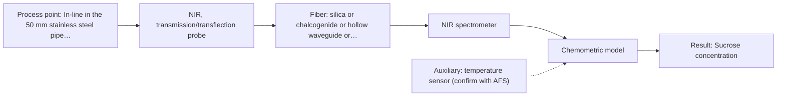
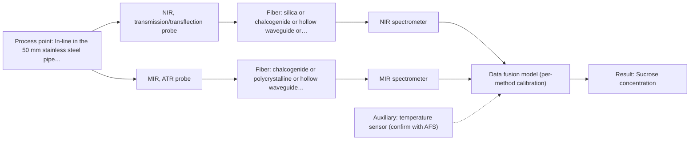

# First technical assessment: Complete enquiry for sugar concentration in a clear solution

## Answer

**Customer request (our summary):** The customer wants an in-line method and probe to monitor sucrose concentration (expected 5–15 % w/w, quality limit ±0.3 % w/w) in a clear, colourless aqueous solution flowing through a 50 mm stainless steel pipe at 20–30 °C and normal pressure, with the analyser standing 10 m away in a dry, safe room.

### Brief answer

Test NIR transmission/transflection first: it is the preferred geometry for a clear liquid and the most common in-line method with fiber probes, and a 10 m silica link is plausible. MIR ATR is a useful comparison. Still open: whether ±0.3 % w/w is reachable, the stream's freedom from bubbles and other species, and probe and clean-in-place compatibility.

### Proposal

- **Best current option:** O2 (recommended)
- **Basis:** supplied AFS sources
- **What would change it:** Interfering species, bubbles or particles in the stream, or a single-method trial that cannot reach ±0.3 % w/w, would move the choice to MIR ATR or the NIR + MIR combination.
- **Next step:** Run the feasibility trial with NIR transmission and the refractometer on representative samples.

**Secondary evidence (external, not AFS material):** G1: E02 ¶12, E05 ¶1; G2: E04 ¶4, E04 ¶34; G3: no usable external source found; G4: E01 ¶33. See Expert detail.

**Decision status:** Provisional feasibility assessment

### Solution options

| ID | Tier | Methods | Confidence | Cost class, S01 Table 1 (p.6) | Ease of use | Maintenance | Performance fit | Sources |
|---|---|---|---|---|---|---|---|---|
| O1 | Simple | M2 MIR, ATR probe | Low: open question: Q1 (starts at Medium); uncited auxiliary sensor | high cost (row 2) | Single contact probe, no pathlength control | Crystal cleaning and cleaning compatibility to check | Strong, selective bands for sucrose | [1: S01 p.5] [2: S01 p.9] |
| O2 | Recommended | M1 NIR, transmission/transflection probe | Low: open question: Q1, Q2, Q3 (starts at Medium); uncited auxiliary sensor | average cost (row 7) | Non-contact, standard silica fibers, remote link | Window cleaning and cleaning compatibility to check | Preferred geometry for a clear liquid | [3: S01 p.18] [4: S01 p.10] [5: S02 p.7] |
| O3 | Extended (multi-method) | M3 NIR, transmission/transflection probe + MIR (combination) | Low: open question: Q1, Q3 (starts at Medium); uncited auxiliary sensor; multi-method, fusion benefit not yet shown | high cost (rows 2, 7) | Two instruments and a combined probe | Two calibrations and two sets of diagnostics | Adds MIR bands if NIR alone falls short | [6: S01 p.7] [7: S01 p.8] [8: S01 p.8] [9: S01 p.8] |

*Confidence rates the basis of the advice (how much is known and cited), not a predicted accuracy or probability of success. It starts at High, or at Medium when a key question on the method or the option is open, and drops one level per weakness listed (floor Low).*

*Cost class is the relative rating in S01 Table 1 (p.6) for the in-line method+technique rows named (the highest one for a multi-method option); it is not a price.*

### Setup sketch

*Recommended option O2; drawn by code from the option, a schematic, not a configuration.*

### Key questions

1. What other dissolved species or impurities are present in the solution, and at what levels?
2. Is the stream free of bubbles, particles or entrained air at the measurement point?
3. How will the ±0.3 % w/w limit be verified against the refractometer, and does it apply in-line?

## Expert detail

**Customer enquiry**

> We produce a clear, colourless aqueous sucrose solution and want to monitor its sucrose concentration in-line. The solution flows through a 50 mm stainless steel pipe at 20 to 30 °C and normal pressure; the expected range is 5 to 15 % w/w and our quality limit is plus or minus 0.3 % w/w. Our laboratory refractometer is the reference method and stays in use. The analyser can stand in a dry, safe room 10 m from the pipe, and the line is cleaned in place with hot caustic once a day. A reading every minute is enough. Please propose a method and probe for a first trial.

**Decision status:** Provisional feasibility assessment. The stated facts (a clear, colourless aqueous liquid, a remote analyser and daily clean-in-place) justify a shortlist with NIR transmission first, but the achievable accuracy, the stream quality and probe compatibility are open, so this is a provisional assessment.

### Parameters

| ID | Parameter | Kind | Need | Measured by | Why | Sources |
|---|---|---|---|---|---|---|
| P1 | Sucrose concentration | quantitative | required | Spectroscopy: NIR | The target variable the customer wants to monitor in-line. | *(no verified source: engineering judgement)* |
| P2 | Temperature | quantitative | required | Auxiliary sensor: temperature sensor (engineering judgement: confirm availability with AFS) | The process varies over 20-30 °C and the spectrum and reference are temperature-dependent, so temperature is needed for compensation. | *(no verified source: engineering judgement)* |
| P3 | Turbidity / entrained gas or particles | qualitative | optional | Not measurable in-line by spectroscopy; alternative: a turbidity sensor or visual inspection | Bubbles or particles would scatter light and disturb a transmission measurement, so the stream quality should be available. | *(no verified source: engineering judgement)* |

### Solution option details

- **O1 cost drivers:** One MIR spectrometer, ATR probe and MIR fiber link
- **O2 cost drivers:** One NIR spectrometer, transmission probe and silica fiber
- **O3 cost drivers:** Two spectrometers, combined probe and fusion software
- **O3 combining methods:** Low-level fusion of synchronised NIR and MIR spectra taken from the same probe spot, with block scaling so neither method dominates. Each block keeps its own calibration and diagnostics. The fused model must beat the best single method on held-out batches, otherwise the extra instrument is dropped.

*Extended (multi-method) option O3; drawn by code from the option, a schematic, not a configuration.*

### Premise check

- **Not covered:** That a quality limit of plus or minus 0.3 % w/w is achievable with an in-line analyser. No supplied source states an achievable in-line accuracy for sucrose, so the ±0.3 % w/w limit must be established in the trial against the refractometer. *(no verified source: engineering judgement)*
- **Supported:** That the analyser can be placed 10 m from the pipe and still measure the stream. Low-OH silica cables are stated for 100-300 m, so a 10 m NIR link is plausible; no MIR link length is stated, so this holds for the NIR option only. [5: S02 p.7]
- **Supported:** That one reading per minute is sufficient and achievable. The sources state that online measurements need high-speed acquisition, which covers a one-per-minute rate. [10: S01 p.5]

### Requirements

**Stated by the customer**

- In-line monitoring of sucrose concentration in a clear, colourless aqueous solution.
- Expected range 5 to 15 % w/w; quality limit ±0.3 % w/w.
- 50 mm stainless steel pipe, 20 to 30 °C, normal pressure.
- Analyser 10 m from the pipe in a dry, safe room.
- Daily hot caustic clean-in-place.
- One reading per minute.
- Laboratory refractometer as the reference method.

**Key unknowns**

- Other dissolved species or impurities that could interfere with the measurement.
- Whether the stream is free of bubbles, particles or entrained air at the measurement point.
- Whether ±0.3 % w/w is reachable in-line and how it will be verified against the refractometer.
- Temperature compensation over the 20 to 30 °C range.
- Probe fouling and compatibility with daily hot caustic clean-in-place.
- Whether the 50 mm pipe can be fitted with a probe or flow cell, and the achievable MIR link length.

### Clarification questions (most decision-relevant first)

Q1. What other dissolved species or impurities are present in the solution, and at what levels? *Why it matters:* Interfering species would change the method choice and the calibration. *(affects: method, M1, M2)*
Q2. Is the stream free of bubbles, particles or entrained air at the measurement point? *Why it matters:* Scattering from bubbles or particles would disturb a transmission measurement. *(affects: technique, M1)*
Q3. How will the ±0.3 % w/w limit be verified against the refractometer, and does it apply in-line? *Why it matters:* The achievable accuracy decides whether one method is enough or a combination is needed. *(affects: status, M1, M3)*
Q4. Can the 50 mm pipe be fitted with a probe or flow cell, and what hygienic and clean-in-place requirements apply? *Why it matters:* Fitting and cleaning compatibility decide the probe and the installation. *(affects: installation)*
Q5. What temperature compensation is needed over the 20 to 30 °C range? *Why it matters:* Temperature affects the spectrum and the reference, so it sets the compensation. *(affects: method, M1)*

### Recommendation

- **M1 · Primary candidate: NIR, transmission/transflection probe.** A clear, colourless liquid is the case where transmission/transflection is preferred, and NIR is the most common in-line method with fiber probes. A 10 m silica-fiber link is plausible. *Conditions:* Applies if the stream stays clear and free of bubbles or particles at the probe. [3: S01 p.18] [4: S01 p.10] [5: S02 p.7]
- **M2 · Comparison candidate: MIR, ATR probe.** MIR gives well-defined, selective bands and ATR handles an aqueous sample with a very thin layer, so it is a useful cross-check on the NIR result. *Conditions:* Applies if a 10 m MIR fiber link and a clean-in-place-compatible ATR probe are confirmed. [1: S01 p.5] [2: S01 p.9]
- **M3 · Conditional candidate: NIR, transmission/transflection probe + MIR (combination).** If NIR alone cannot reach ±0.3 % w/w, fusing NIR transmission with MIR ATR adds complementary vibrational information from the same spot. Any gain is a hypothesis to test against the best single method. *Conditions:* Only if the single-method trials fall short of the customer's ±0.3 % w/w limit. [6: S01 p.7] [9: S01 p.8] Later hypothesis, after single-method tests.

### Measurement concept

- **Probe and geometry:** For NIR, a transmission or transflection fiber probe (or flow cell) with a controlled optical pathlength; for MIR, an ATR fiber probe in contact with the liquid.
- **Location:** In-line in the 50 mm stainless steel pipe, at a point with representative, bubble-free flow.
- **Fiber link:** Silica Vis-NIR fibers for NIR (a 10 m run is within the stated 100-300 m for low-OH silica); MIR needs chalcogenide or polycrystalline fibers, and the achievable MIR link length is an open question. [11: S01 p.18] [5: S02 p.7] [12: S02 p.6]

### Spectral range

- **NIR:** Nominal NIR range 780-2500 nm; this is not the range of a specific instrument, fiber or probe, and the usable range depends on the configuration and the sample. [13: S01 p.10] [14: REF §5]
- **MIR:** Nominal MIR range 4000-400 cm-1 (2.5-25 µm); the usable range depends on the fiber and ATR crystal selected. [2: S01 p.9] [14: REF §5]

### Risks and uncertainty

- The ±0.3 % w/w limit may not be reachable by NIR transmission alone; the achievable accuracy is unknown and must be established against the refractometer. *(rules: R-NIR-2, R-CAL-1)* [15: S01 p.10] [16: REF §5]
- The achievable MIR fiber link length is not stated in the sources, so a 10 m MIR run is an open question. *(rules: R-FIB-2)* [5: S02 p.7]
- Daily hot caustic clean-in-place may foul or damage the probe window or ATR crystal; probe compatibility is unknown. *(rules: R-MIR-3)* [17: REF §5]
- Bubbles, particles or entrained air in the stream would disturb a transmission measurement; the stream quality is unknown. *(rules: R-GEN-5)* [18: S01 p.7]

### First feasibility experiment

1. **Collect representative samples across the expected 5-15 % w/w range and the 20-30 °C range, including any expected process variation.** Cover the chemical and physical variation the calibration must handle. [19: REF §3]
2. **Measure each sample with the single methods first (NIR transmission, then MIR ATR) and with the laboratory refractometer.** Compare each single method against the independent reference. [19: REF §3]
3. **Build and validate a calibration model per method, with held-out runs or batches.** Establish the achievable accuracy and guard against overfitting. [20: S03 p.14]
4. **Only if the single methods fall short, test the NIR + MIR combination on the same samples at the same spot.** Test whether fusion beats the best single method. [9: S01 p.8] [21: REF §5]
5. **Decide go/no-go against the customer's ±0.3 % w/w limit.** Give a clear basis for the decision. [19: REF §3]

**Reference measurements:** The customer's laboratory refractometer, on the same samples.

**Decision basis:** The customer's ±0.3 % w/w quality limit; the numerical criterion comes from the customer, not from the sources.

### Assumptions

- The solution is a simple binary sucrose-water mixture with no significant interfering species.
- The stream is free of bubbles, particles and entrained air at the measurement point.
- The 50 mm pipe can be fitted with a probe or flow cell.
- The analyser room conditions suit the spectrometer.

### Not covered by the supplied sources

- The achievable in-line accuracy for sucrose at ±0.3 % w/w.
- The achievable MIR fiber link length for a 10 m run.
- Probe compatibility with daily hot caustic clean-in-place.
- Hygienic or sanitary design requirements for the probe.

### Further notes

- **Chemometrics:** NIR and MIR bands are broad and overlapping, so a chemometric calibration (for example PLS) against the refractometer is needed; the model is specific to the matrix and must be re-validated if the composition changes.
- **Real-time tracking:** In-line fiber probes enable near-real-time monitoring, and one reading per minute is well within the stated high-speed acquisition.
- **Future direction:** If the single-method trial succeeds, a compact LED-based or optical multisensor system could be developed for this specific application.

### Secondary evidence (external, not AFS material)

*Found by a literature search for gaps the supplied AFS sources leave open. Not AFS material and not proof for this case; every quote below was verified verbatim against the fetched text.*

**G1 · auxiliary sensor:** In-line measurement of Temperature with temperature sensor

- **E02 ¶12** The source states that the temperature sensitivity of the OH bands is a severe drawback when measuring aqueous solutions in NIR and MIR, which makes tempered sample holders necessary. *How it applies:* This supports pairing the NIR probe with temperature control or measurement, and suggests testing whether sample temperature variation over the process range shifts the sucrose signal enough to matter. *Limits and transfer risks:* The statement is general to aqueous NIR/MIR measurement, not specific to sucrose or to an in-line pipe probe, and tempered sample holders are a laboratory measure rather than an in-line sensor. *(supports O2)*
  > "Additionally, the temperature sensitivity of the OH bands is a severe drawback for measuring aqueous solution in NIR and MIR, which makes tempered sample holders necessary [29]."
  > A critical review of recent trends, and a future perspective of optical spectroscopy as PAT in biopharmaceutical downstream processing. (2020) · Analytical and bioanalytical chemistry · doi:10.1007/s00216-020-02407-z · https://europepmc.org/article/PMC/PMC7072065 · retrieved 2026-10-17, full text, licence: cc by, via curated library
- **E05 ¶1** The source describes product temperature measurement as a method to monitor a process and obtain the process parameters needed by mathematical models for in-line or off-line optimization. *How it applies:* This suggests an in-line temperature reading can feed a model-based correction, so a thermocouple or contactless device could be considered as the auxiliary temperature sensor. *Limits and transfer risks:* The work concerns lab-scale freeze-drying of sucrose and PVP solutions, not a flowing pipe, and only the abstract is available, so no uncertainty figures or in-line pipe conditions are given. *(supports O2)*
  > "The measurement of product temperature is one of the methods that can be adopted, especially in the pharmaceutical industry, to monitor the freeze-drying process and to obtain the values of the process parameters required by mathematical models useful for in-line (or off-line) optimization."
  > On the Use of Temperature Measurements as a Process Analytical Technology (PAT) for the Monitoring of a Pharmaceutical Freeze-Drying Process (2023) · Pharmaceutics · doi:10.3390/pharmaceutics15030861 · https://doi.org/10.3390/pharmaceutics15030861 · retrieved 2026-10-18, abstract only, licence: cc-by, via openalex

**G2 · multi-method:** Combining several spectroscopy methods (data fusion) (Low-level fusion of synchronised NIR and MIR spectra taken from the same probe spot, with block scaling so neither method dominates. Each block keeps its own calibration and diagnostics. The fused model must beat the best single method on held-out batches, otherwise the extra instrument is dropped.)

- **E04 ¶4** The source reports that evidence on spectral fusion efficacy is inconsistent: some studies show improvements under controlled laboratory conditions, while others see limited benefit or decreased accuracy attributed to overfitting and increased model complexity. *How it applies:* This supports the plan to keep each block's own calibration and diagnostics and to drop the extra instrument unless the fused model beats the best single method on held-out batches. *Limits and transfer risks:* The evidence comes from soil samples measured with vis-NIR and MIR on a bench, a different matrix, instrument and application than sucrose in an aqueous process stream. *(supports O3)*
  > "While some studies report substantial improvements in SOC prediction accuracy through vis-NIR-MIR fusion under controlled laboratory conditions [14,15], others observe limited benefits or even decreased accuracy in soil classification tasks, attributed to overfitting and increased model complexity [16]."
  > Spectral Predictability of Soil Organic Matter Depends on Its Humin Fraction Rather than Spectral Fusion. (2025) · Sensors (Basel, Switzerland) · doi:10.3390/s25247616 · https://europepmc.org/article/PMC/PMC12736908 · retrieved 2026-10-18, full text, licence: cc by, via europepmc
- **E04 ¶34** The source found that direct concatenation created scale imbalance and that MIR-derived wavelengths dominated the fused model (about 80 percent of selected features), overwhelming the vis-NIR contribution. *How it applies:* This supports block scaling so neither method dominates, and suggests checking the per-block feature or weight distribution of the fused model for one block overwhelming the other. *Limits and transfer risks:* The imbalance arose in soil spectra combining reflectance and absorbance units on a bench instrument; the cause and degree of imbalance may differ for NIR transmission and MIR ATR on an aqueous stream. *(supports O3)*
  > "The dominance of MIR-derived wavelengths in fused models (approximately 80 percent of selected features from MIR; Table 6) indicates that the MIR signal effectively overwhelmed the vis-NIR contribution, preventing complementary information integration."
  > Spectral Predictability of Soil Organic Matter Depends on Its Humin Fraction Rather than Spectral Fusion. (2025) · Sensors (Basel, Switzerland) · doi:10.3390/s25247616 · https://europepmc.org/article/PMC/PMC12736908 · retrieved 2026-10-18, full text, licence: cc by, via europepmc

**G3 · not in the supplied sources:** The achievable in-line accuracy for sucrose at ±0.3 % w/w.

- No usable external source found.

**G4 · not in the supplied sources:** The achievable MIR fiber link length for a 10 m run.

- **E01 ¶33** The source notes that an optical fiber system can be used to reduce the influence of heat development of the globar. *How it applies:* This indicates fiber coupling is a known practice in FTIR setups, so a fiber link is plausible, but the source gives no length, so the required run length still needs its own test. *Limits and transfer risks:* No fiber length, attenuation, connector or spectrometer details are given, and the setup differs from the intended MIR probe and analyser arrangement. *(supports O1)*
  > "In order to reduce the influence of heat development of the globar, an optical fiber system can be used."
  > A Process Analytical Concept for In-Line FTIR Monitoring of Polysiloxane Formation. (2020) · Polymers · doi:10.3390/polym12112473 · https://europepmc.org/article/PMC/PMC7693933 · retrieved 2026-10-17, full text, licence: cc by, via curated library

### Evidence (verified quotes)

1. ✓ **S01 p.5** (general): "strong absorption in the mid-IR region limits the corresponding spectral method to the analysis of very thin samples (usually less than 50 μm), but it opens up the possibility of using attenuated total reflectance (ATR)"
2. ✓ **S01 p.9** (general): "Vibrational spectroscopy in the mid-IR range (4000-400 cm-1) is one of the most informative methods of chemical analysis."
3. ✓ **S01 p.18** (general): "NIR Transmission is the preferred method for transparent or semi-transparent liquids, such as skim milk, whey, or permeate."
4. ✓ **S01 p.10** (general): "Near-IR vibrational spectroscopy (NIR) is the most common online analysis method performed using fiber optic probes."
5. ✓ **S02 p.7** (general): "Robust 100-300m cables made with Silica fibers of low OH-content (<0.1ppm OH) enable remote industrial process-control"
6. ✓ (precedent only) **S01 p.7** (method gain): "The analysis of such systems may require a combination of two or even more spectral methods."
7. ✓ **S01 p.8** (general): "Variables obtained from different spectral methods are not equivalent."
8. ✓ **S01 p.8** (general): "Ultimately, the measurement data must be normalized to a common time step."
9. ✓ **S01 p.8** (general): "It is crucial that the spectral information obtained by different methods-Mid-IR, NIR, Raman, and fluorescence spectra-is collected from the same small, even pinpoint, area of the sample."
10. ✓ **S01 p.5** (general): "Online measurements require high-speed spectral acquisition."
11. ✓ **S01 p.18** (general): "the precise control of the optical pathlength (usually 1 - 10 mm); if the pathlength is too wide, the signal is lost to absorption; if too narrow, the sample represents a negligible volume."
12. ✓ **S02 p.6** (general): "350 nm Standard VIS-NIR Silica Fibers Al/Cu-coated VIS-NIR Silica Fibers 2400 nm"
13. ✓ **S01 p.10** (general): "NIR spectra (780-2500 nm) contain predominantly overtones and component bands of fundamental vibrations of molecules and atomic groups"
14. ✓ **REF §5** (general): "It is not a product specification: actual spectral coverage, fiber length, component ratings, detection limits and accuracy depend on the configuration and the sample."
15. ✓ **S01 p.10** (general): "The broad absorption bands observed in this region overlap, suggesting the use of chemometrics for quantitative and qualitative analysis of spectral data."
16. ✓ **REF §5** (general): "physical variation; calibration specific to the matrix."
17. ✓ **REF §5** (general): "Usable range limited by fiber and crystal; contact, fouling, compatibility."
18. ✓ **S01 p.7** (general): "Morphological factors, such as sample inhomogeneity (e.g., biological tissue) or process turbulence, must also be considered when selecting a measurement technique."
19. ✓ **REF §3** (general): "Representative samples or process states, independent reference measurements, what is compared, and the basis for the go / no-go decision."
20. ✓ **S03 p.14** (general): "A thorough validation, including full, segmented and random-subset CVs, as well as randomization tests, are recommended in any cases for which important conclusions depend on calibration or discrimination models built on limited experimental material."
21. ✓ **REF §5** (general): "compare with the best single method."

### Verification

- Citations verified: 34 of 34 (exact or whitespace/hyphen-tolerant match on the cited page, scope checked).
- Hard check failures before deterministic corrections: 0; still open: 0; soft warnings: 3; repair rounds: 0.
- External evidence (live): 5 quote(s) verified verbatim (exact or whitespace/hyphen-tolerant, at most 400 characters and 2 sentences, against the cited paragraph); 0 item(s) dropped.
- External search: 6 query(ies), 45 hit(s), 5 source(s) (3 from the curated library).
- External step: 2 model call(s), 21.7 s extra (cost in the run JSON).

*Run A07-20261018T060215Z · models deepseek/deepseek-v4.1-flash*
