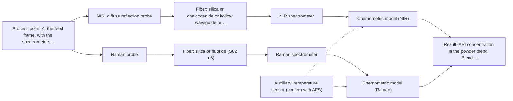
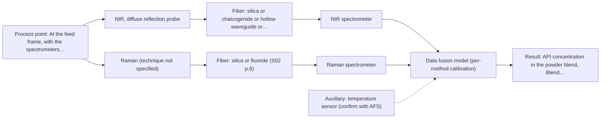

# First technical assessment: Blend potency in a tablet press feed frame

## Answer

**Customer request (our summary):** Customer manufactures tablets from a powder blend containing an active pharmaceutical ingredient and excipients. They want to assess whether a fiber based measurement in the feed frame could follow API concentration changes. Their first pilot should compare reasonable measurement options before committing to production equipment.

### Brief answer

NIR diffuse reflection is the method to test first: it suits an opaque powder, and NIR reflection probes have been used in a tablet-press feed frame. The pilot should measure NIR and Raman on the same representative blend samples against your laboratory reference, then compare a fused model. Still open: the API's spectral response, the required accuracy, and optical access in the feed frame.

### Proposal

- **Best current option:** O2 (recommended)
- **Basis:** supplied AFS sources
- **What would change it:** If the API has no usable NIR band, or if the required accuracy exceeds what a single NIR calibration can reach, the order moves toward Raman first or toward the fused option. A strong fluorescence background in the blend would weaken Raman and favour NIR alone.
- **Next step:** Run the feasibility trial on representative blend samples with reference assays, before any in-line installation is planned.

**Decision status:** Provisional feasibility assessment

### Solution options

| ID | Tier | Methods | Confidence | Cost class, S01 Table 1 (p.6) | Ease of use | Maintenance | Performance fit | Sources |
|---|---|---|---|---|---|---|---|---|
| O1 | Simple | M1 NIR, diffuse reflection probe | High | average cost (row 8) | one probe, one spectrometer | window cleaning and periodic recalibration | answers the main question with least effort | [1: S01 p.15] [2: S01 p.15] [3: S01 p.5] |
| O2 | Recommended | M1 NIR, diffuse reflection probe; M2 Raman probe | High | high cost (rows 8, 12) | two probes on shared sampling points | two calibrations and instrument checks | compares both methods before equipment commitment | [4: S01 p.3] [1: S01 p.15] [2: S01 p.15] [3: S01 p.5] [5: S01 p.15] [6: S01 p.15] |
| O3 | Extended (multi-method) | M3 NIR, diffuse reflection probe + Raman (combination) | Medium: multi-method, fusion benefit not yet shown | high cost (rows 8, 12) | combined probe, two synchronised instruments | per-method calibration and drift checks | adds molecular detail only if single methods fall short | [7: S01 p.15] [8: S01 p.9] [9: S01 p.8] [10: S01 p.15] [11: S01 p.8] [12: S01 p.8] |

*Confidence rates the basis of the advice (how much is known and cited), not a predicted accuracy or probability of success. It starts at High and drops one level per weakness listed (floor Low); an open question on the method holds it at Medium at most.*

*Cost class is the relative rating in S01 Table 1 (p.6) for the in-line method+technique rows named (the highest one for a multi-method option); it is not a price.*

### Setup sketch

*Recommended option O2; drawn by code from the option, a schematic, not a configuration.*

## Expert detail

**Customer enquiry**

> We manufacture tablets from a powder blend containing an active pharmaceutical ingredient and excipients. Laboratory checks tell us whether the blend is on target, but results arrive after the material has moved through the press. We want to assess whether a fiber based measurement in the feed frame could follow API concentration changes. Our first pilot should compare reasonable measurement options before we commit to production equipment.

**Decision status:** Provisional feasibility assessment. A shortlist can be justified: NIR diffuse reflection suits an opaque powder and has a published in-line feed-frame precedent, with Raman as the complementary single method. The choice rests on assumptions about the API's spectral response and the required accuracy, which the pilot has to test.

### Parameters

| ID | Parameter | Kind | Need | Measured by | Why | Sources |
|---|---|---|---|---|---|---|
| P1 | API concentration in the powder blend | quantitative | required | Spectroscopy: NIR | It is the target quantity the in-line measurement has to follow. | [13: S01 p.14] |
| P2 | Blend moisture content | quantitative | optional | Spectroscopy: NIR | Water has strong O-H overtone bands in the NIR region, so moisture shifts the baseline and should be available from the blend record to separate it from an API change. | [14: S01 p.10] |
| P3 | Blend temperature at the probe | quantitative | optional | Auxiliary sensor: temperature sensor (engineering judgement: confirm availability with AFS) | Temperature shifts spectral baselines and changes powder behaviour at the probe, so a reading helps separate drift from a real concentration change. | *(no verified source: engineering judgement)* |
| P4 | Particle size and scatter state of the blend | quantitative | optional | Reference lab method: off-line particle size analysis | Scatter from particle size and surface condition changes the reflection baseline and is a known confounder for the concentration signal. | [15: S01 p.17] |

### Solution option details

- **O1 cost drivers:** probe, NIR spectrometer, calibration samples, reference assays, feed-frame access
- **O2 cost drivers:** two spectrometers, two probes, reference analyses, pilot time
- **O3 cost drivers:** two spectrometers, combined probe, synchronisation, data fusion work
- **O3 combining methods:** Low-level fusion: synchronised NIR and Raman spectra are merged into one matrix with block scaling so that neither method dominates. It requires the same measurement spot, a common time step and a separate calibration and diagnostics for each instrument. The fused model must beat the best single method on held-out batches, otherwise the second instrument is dropped.

*Extended (multi-method) option O3; drawn by code from the option, a schematic, not a configuration.*

### Premise check

- **Precedent only:** A fiber based measurement in the feed frame could follow API concentration changes. A published example inserts NIR reflection and Raman probes into the feed frame of a rotary tablet press to determine blend potency; that is a reason to test the approach, not proof for this blend. [13: S01 p.14]
- **Supported:** Laboratory checks arrive too late, because results come after the material has moved through the press. A source states that fiber probes integrated into production lines give on-site online analysis and results in near real time. [16: S01 p.2]
- **Not covered:** A first pilot comparing reasonable measurement options is sufficient before committing to production equipment. The supplied material describes testing several optical methods in order to select one, but it does not state what a first pilot must establish before production equipment is committed. *(no verified source: engineering judgement)*

### Requirements

**Stated by the customer**

- Manufacture tablets from a powder blend containing an active pharmaceutical ingredient and excipients.
- Laboratory checks tell whether the blend is on target.
- Results arrive after the material has moved through the press.
- They want to assess whether a fiber based measurement in the feed frame could follow API concentration changes.
- Their first pilot should compare reasonable measurement options before committing to production equipment.
- Target: API concentration changes (follow changes)

**Key unknowns**

- API species, nominal concentration and expected variation, and which spectral bands it provides.
- Excipient composition and whether it overlaps or masks the API signal.
- Required accuracy, detection limit and response time, and the current laboratory reference method.
- Feed-frame access: port or window, distance to a safe instrument location, temperature and cleaning regime.
- Blend behaviour at the probe: flow, particle size, moisture, segregation and build-up on a window.
- Raman fluorescence background and any fluorescent components in the formulation.

### Clarification questions (most decision-relevant first)

### Recommendation

- **M1 · Primary candidate: NIR, diffuse reflection probe.** NIR diffuse reflection is the geometry that suits an opaque powder, and a published example measures blend potency in-line with NIR reflection probes in a tablet-press feed frame. It is the single method to test first. *Conditions:* Applies if the API has a usable NIR band and the required accuracy is within what a matrix-specific NIR calibration can reach. [1: S01 p.15] [2: S01 p.15] [3: S01 p.5]
- **M2 · Comparison candidate: Raman probe.** Raman carries complementary information on the molecular backbone and symmetrical non-polar groups, and the same published feed-frame example used a Raman probe. It is the second single method to measure on the same samples. *Conditions:* Applies if the blend's fluorescence background is low enough for the API bands to be visible. [5: S01 p.15] [6: S01 p.15]
- **M3 · Comparison candidate: NIR, diffuse reflection probe + Raman (combination).** Fusing synchronised NIR and Raman spectra has been reported to predict API potency with higher accuracy and robustness than single-method models. This is a later hypothesis to test after the single-method results, not a starting point. *Conditions:* Only if neither single method reaches the required accuracy on the same samples. [10: S01 p.15] [11: S01 p.8] [12: S01 p.8] Later hypothesis, after single-method tests.
- **M4 · Not recommended: MIR, ATR probe.** ATR needs tight contact with a liquid or soft solid, and a dry flowing powder does not give that stable optical contact at the crystal. MIR-ATR is therefore not the right first method for this feed-frame question. [17: S04 p.4]

### Measurement concept

- **Probe and geometry:** Diffuse reflection probe looking at the flowing powder; a contact Raman probe as the second single method; a combined NIR reflection / Raman probe only for the later fusion hypothesis.
- **Location:** At the feed frame, with the spectrometers placed away from the vibration and dust of the production floor.
- **Fiber link:** Fiber type and usable link length depend on the method and the final probe and are not stated for this case. [18: S01 p.15]

### Spectral range

- **NIR:** nominal method range [19: S01 p.10] [20: REF §5]
- **Raman:** nominal method range [21: S01 p.11] [5: S01 p.15]

### Risks and uncertainty

- The API may have no usable NIR or Raman band at the concentration of interest, in which case no method in this shortlist will follow the blend. *(no verified source: engineering judgement)*
- Physical variation such as particle size, moisture or bulk density changes the NIR reflection signal and can be mistaken for a concentration change. [15: S01 p.17]
- Raman may be swamped by fluorescence from the formulation, and movement or window fouling in the feed frame may reduce signal stability. [22: S01 p.11]
- The published feed-frame example is a research demonstration on another formulation and does not establish that this blend can be measured in-line. [23: REF §3]

### First feasibility experiment

1. **Assemble a representative set of blend samples spanning the expected API concentration range and the expected physical variation (particle size, moisture, bulk density).** Assemble a representative sample set [24: REF §3]

**Reference measurements:** The customer's existing laboratory assay for blend potency, applied to every trial sample and to samples taken during the in-line run.

**Decision basis:** Numerical go/no-go criteria (accuracy, detection limit, response time) to be supplied by the customer; the fused model must additionally beat the best single method on held-out batches.

### Assumptions

- The blend in the feed frame presents a reasonably stable surface to a flush-mounted or window-mounted probe.
- The customer can supply reference assay values for the trial samples and for samples taken during the in-line run.
- No fluorescent or strongly coloured excipient dominates the formulation.

### Not covered by the supplied sources

- Any achievable detection limit or accuracy for API concentration in a powder blend measured through a fiber probe.
- A usable fiber-link length or installation envelope for the feed-frame position.
- Whether this particular API and excipient blend gives a usable NIR or Raman signal.

### Further notes

- **Chemometrics:** Both candidate methods need a matrix-specific calibration model built on reference values from the customer's laboratory assay, because NIR bands overlap and physical variation has to be handled by preprocessing. The reference data must span the API range and the expected physical variation.
- **Real-time tracking:** The feed-frame question is a continuous, time-resolved one: the published example captures spectra as the powder passes the probe tip, without interrupting production. Synchronisation to a common time step matters only if the fused option is tested.
- **Future direction:** If a single method works, the next step after method selection could be a compact dedicated analyzer or spectral fiber sensor with a fixed wavelength set, rather than full spectrometers.

### Evidence (verified quotes)

1. ✓ **S01 p.15** (application precedent): "NIR spectrometer and light source coupled with a NIR reflection probe"
2. ✓ **S01 p.15** (application precedent): "the probes are inserted directly into the process environment, such as the feed frame of a rotary tablet press."
3. ✓ **S01 p.5** (general): "NIR spectroscopy, with its relatively large penetration depth (up to several millimetres) even into dense solid samples due to low absorption and strong scattering, allows the use of ordinary glass for optics"
4. ✓ **S01 p.3** (general): "in order to select the most suitable method or combination of methods."
5. ✓ **S01 p.15** (application precedent): "Raman spectrometer and Raman fiber probe for contact measurements with 785 nm excitation wavelength"
6. ✓ **S01 p.15** (general): "NIR detects hydrogen bonds and asymmetric polar groups, while Raman provides information on the molecular backbone and symmetrical non-polar groups."
7. ✓ **S01 p.15** (application precedent): "Data processing for pharmaceutical tasks relies on "low-level data fusion," where the synchronized NIR and Raman spectra are merged into a single augmented matrix."
8. ✓ **S01 p.9** (general): "One of the challenges of multispectral analysis is the need to simultaneously connect at least two independently operating measuring instruments."
9. ✓ **S01 p.8** (general): "If the variables have different units of measurement, the data should be normalized in some way, for example, using an autoscaling algorithm."
10. ✓ (precedent only) **S01 p.15** (method gain): "By combining Raman and NIR, these models can predict API potency or coating thickness with higher accuracy and robustness than single-method models."
11. ✓ **S01 p.8** (general): "It is crucial that the spectral information obtained by different methods-Mid-IR, NIR, Raman, and fluorescence spectra-is collected from the same small, even pinpoint, area of the sample."
12. ✓ **S01 p.8** (general): "Ultimately, the measurement data must be normalized to a common time step."
13. ✓ **S01 p.14** (application precedent): "The primary objective is to determine "blend potency" - the precise concentration and uniformity of the Active Pharmaceutical Ingredient (API) - directly within the production line, specifically in the feed frame of a rotary tablet press."
14. ✓ **S01 p.10** (general): "NIR spectra (780-2500 nm) contain predominantly overtones and component bands of fundamental vibrations of molecules and atomic groups, such as -OH, -NH2=NH, -CH3, =CH2, ≥CH, etc., found in many organic and inorganic compounds."
15. ✓ **S01 p.17** (general): "the method is sensitive to the surface characteristics and fat globule size."
16. ✓ **S01 p.2** (general): "Fiber optic probes and cells are being integrated into reactors and production lines of ongoing technological processes, enabling on-site online analysis and obtaining results in near real time."
17. ✓ **S04 p.4** (general): "suitability of analyzed samples for ATR measurements, which is true for liquid or soft solid samples and their components, allowing a tight contact with the probe head."
18. ✓ **S01 p.15** (general): "located safely away from the vibration and dust of the manufacturing floor."
19. ✓ **S01 p.10** (general): "NIR spectra (780-2500 nm) contain predominantly overtones and component bands of fundamental vibrations"
20. ✓ **REF §5** (general): "It is not a product specification: actual spectral coverage, fiber length, component ratings, detection limits and accuracy depend on the configuration and the sample."
21. ✓ **S01 p.11** (general): "The Raman shift is used as the horizontal (spectral) axis in Raman spectroscopy"
22. ✓ **S01 p.11** (general): "superposition of luminescence (fluorescence), which has a significantly higher intensity."
23. ✓ **REF §3** (general): "a published application is a reason to test a method, not proof that it will work for a new customer."
24. ✓ **REF §3** (general): "Representative samples or process states, independent reference measurements, what is compared, and the basis for the go / no-go decision."

### Verification

- Citations verified: 27 of 27 (exact or whitespace/hyphen-tolerant match on the cited page, scope checked).
- Hard check failures before deterministic corrections: 0; still open: 0; soft warnings: 1; repair rounds: 1.

*Run D01-20261017T161458Z · models deepseek/deepseek-v4.1-flash*
