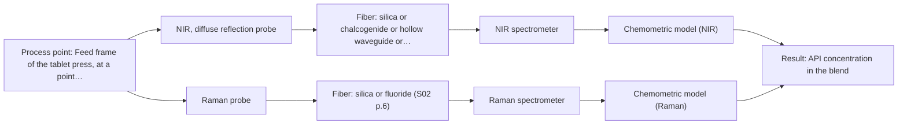
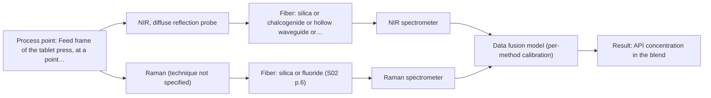

# First technical assessment: Blend potency in a tablet press feed frame

## Answer

**Customer request (our summary):** Customer manufactures tablets from a powder blend and wants to assess whether a fiber-based measurement in the feed frame could follow API concentration changes. They want a first pilot to compare reasonable measurement options before committing to production equipment.

### Brief answer

NIR diffuse reflection is the first method to test in the feed frame, with Raman measured on the same powder as a comparison. A published example puts NIR and Raman probes in a tablet-press feed frame, which is a reason to test, not proof for your blend. Still open are the API identity, the concentration change to be resolved, and the feed-frame optical access.

### Proposal

- **Best current option:** O2 (recommended)
- **Basis:** supplied AFS sources
- **What would change it:** If the API has no usable NIR signature, or the blend fluoresces strongly, the choice would move towards Raman alone or towards the fused option; if the feed frame cannot take a probe, the in-line route itself changes.
- **Next step:** Measure representative blend samples with NIR diffuse reflection and Raman against the laboratory reference before any probe is installed in the press.

**Secondary evidence (external, not AFS material):** G1: E04 ¶1, E02 ¶82; G2: E05 ¶1, E05 ¶1; G3: E04 ¶1; G4: E05 ¶1, E05 ¶1. See Expert detail.

**Decision status:** Provisional feasibility assessment

### Solution options

| ID | Tier | Methods | Confidence | Cost class, S01 Table 1 (p.6) | Ease of use | Maintenance | Performance fit | Sources |
|---|---|---|---|---|---|---|---|---|
| O1 | Simple | M1 NIR, diffuse reflection probe | Medium: open question: Q1, Q2 (starts at Medium) | average cost (row 8) | one probe, simple operation | one instrument, routine probe cleaning | least effort, tests the trend question | [1: S01 p.15] [2: S01 p.18] [3: S01 p.5] [4: S01 p.10] [5: S02 p.7] [6: REF §5] |
| O2 | Recommended | M1 NIR, diffuse reflection probe; M2 Raman probe | Medium: open question: Q1, Q2 (starts at Medium) | high cost (rows 8, 12) | two probes, more setup steps | two instruments, both probes cleaned | compares both candidate methods head-to-head | [7: S01 p.15] [2: S01 p.18] [3: S01 p.5] [4: S01 p.10] [5: S02 p.7] [6: REF §5] [8: S01 p.15] [9: S01 p.11] [10: S01 p.11] |
| O3 | Extended (multi-method) | M1 NIR, diffuse reflection probe; M3 NIR, diffuse reflection probe + Raman (combination) | Low: open question: Q1, Q2 (starts at Medium); multi-method, fusion benefit not yet shown | high cost (rows 8, 12) | combined probe, synchronised acquisition | two instruments, fused model upkeep | fusion only if single methods fall short | [11: S01 p.8] [12: S01 p.8] [13: S01 p.8] [14: S01 p.9] [15: REF §5] [2: S01 p.18] [3: S01 p.5] [4: S01 p.10] [5: S02 p.7] [6: REF §5] [16: S01 p.15] [17: S01 p.15] [18: S01 p.7] |

*Confidence rates the basis of the advice (how much is known and cited), not a predicted accuracy or probability of success. It starts at High, or at Medium when a key question on the method or the option is open, and drops one level per weakness listed (floor Low).*

*Cost class is the relative rating in S01 Table 1 (p.6) for the in-line method+technique rows named (the highest one for a multi-method option); it is not a price.*

### Setup sketch

*Recommended option O2; drawn by code from the option, a schematic, not a configuration.*

### Key questions

1. Which API is in the blend, over what concentration range, and what change in concentration must the measurement resolve?
2. What is the laboratory reference method, and how is its sample taken from the blend or the tablets?
3. Where in the feed frame can a probe be mounted, what window or port is available, and how far away is the spectrometer?

## Expert detail

**Customer enquiry**

> We manufacture tablets from a powder blend containing an active pharmaceutical ingredient and excipients. Laboratory checks tell us whether the blend is on target, but results arrive after the material has moved through the press. We want to assess whether a fiber based measurement in the feed frame could follow API concentration changes. Our first pilot should compare reasonable measurement options before we commit to production equipment.

**Decision status:** Provisional feasibility assessment. A shortlist can be justified: NIR diffuse reflection and Raman both pass the sample-type and geometry check for a powder, and a published example shows NIR and Raman probes working in a tablet-press feed frame. The assessment stays provisional because the API, the concentration change to be resolved and the feed-frame access are all unconfirmed.

### Parameters

| ID | Parameter | Kind | Need | Measured by | Why | Sources |
|---|---|---|---|---|---|---|
| P1 | API concentration in the blend | quantitative | required | Spectroscopy: NIR | It is the target the customer wants to follow in the feed frame. | [19: S01 p.14] |
| P2 | Reference API concentration from the laboratory method | quantitative | required | Reference lab method: the customer's existing laboratory blend assay (method to be named) | Calibration models and the pilot's pass/fail judgement need an independent value for the same material. | *(no verified source: engineering judgement)* |
| P3 | Powder physical state at the probe (particle size, bulk density, surface) | quantitative | optional | Reference lab method: off-line particle-size and bulk-density measurement on grab samples (method to be named) | It should be available because diffuse reflection is sensitive to surface and particle-size effects, which can be confused with a change in API concentration. | *(no verified source: engineering judgement)* |

### Solution option details

- **O1 cost drivers:** one NIR spectrometer, fiber probe, feed-frame port, reference samples
- **O2 cost drivers:** two instruments and probes, more reference analyses, longer pilot
- **O3 cost drivers:** two synchronised instruments, combined probe, data fusion, per-method calibration
- **O3 combining methods:** NIR and Raman would be measured through one combined probe so that both spectra come from the same small area of the powder, since data from different methods must be collected from the same spot. The two streams are then normalised to a common time step, and the concatenated variables are scaled so that neither method dominates the model. Each method keeps its own calibration and diagnostics, and the fused model must beat the best single method on held-out runs, otherwise the extra instrument is dropped.

*Extended (multi-method) option O3; drawn by code from the option, a schematic, not a configuration.*

### Premise check

- **Precedent only:** A fiber based measurement in the feed frame can follow API concentration changes. A published pharmaceutical example places NIR and Raman probes in the feed frame of a rotary tablet press; this is a reason to test the approach, not proof for this blend, this API or this feed frame. [7: S01 p.15]
- **Not covered:** Laboratory checks are a valid reference for whether the blend is on target. The supplied material requires independent reference measurements in a feasibility plan but does not assess any particular laboratory assay, its sampling or its uncertainty. *(no verified source: engineering judgement)*
- **Not covered:** A first pilot comparing reasonable measurement options is sufficient before committing to production equipment. No supplied source states what a pilot must demonstrate before production equipment is committed; those acceptance rules have to come from the customer. *(no verified source: engineering judgement)*

### Requirements

**Stated by the customer**

- "We manufacture tablets from a powder blend containing an active pharmaceutical ingredient and excipients."
- "Laboratory checks tell us whether the blend is on target"
- "results arrive after the material has moved through the press"
- "We want to assess whether a fiber based measurement in the feed frame could follow API concentration changes."
- "Our first pilot should compare reasonable measurement options before we commit to production equipment."
- "follow API concentration changes"

**Key unknowns**

- Identity of the API, its concentration range and the concentration change that must be resolved
- Whether the formulation contains a fluorescent species that would interfere with Raman
- Optical access in the feed frame: probe port, window material, and distance to the spectrometer
- Particle size, bulk density and segregation behaviour of the blend at the measurement point
- The laboratory reference method and how its sample is taken from the blend or the tablets
- Required response time and the numerical accuracy, precision and detection limit the in-line result must meet

### Clarification questions (most decision-relevant first)

Q1. Which API is in the blend, over what concentration range, and what change in concentration must the measurement resolve? *Why it matters:* It decides whether NIR or Raman has enough sensitivity, and whether the API is a minor component that neither method can follow. *(affects: method)*
Q2. What is the laboratory reference method, and how is its sample taken from the blend or the tablets? *Why it matters:* The reference values define the calibration and the agreement the pilot has to demonstrate for each candidate method. *(affects: M1, M2)*
Q3. Where in the feed frame can a probe be mounted, what window or port is available, and how far away is the spectrometer? *Why it matters:* Optical access, window material and link length decide whether a diffuse-reflection probe can be installed at all. *(affects: installation)*
Q4. What are the blend's particle size, flow behaviour and tendency to segregate at the intended measurement point? *Why it matters:* Physical variation at the probe changes the reflected light and has to be separated from the chemical signal. *(affects: technique)*
Q5. What response time and what numerical accuracy, precision and detection limit must the in-line result meet? *Why it matters:* These figures are the go/no-go basis for the pilot and they come from the customer, not from the supplied sources. *(affects: method)*

### Recommendation

- **M1 · Primary candidate: NIR, diffuse reflection probe.** NIR diffuse reflection works well in highly scattering media, needs no contact with the powder, and NIR light penetrates dense solids and can be carried by silica fibers to a remotely placed spectrometer. The nominal NIR range is 780-2500 nm, while the usable range depends on the instrument, fiber and probe actually selected. *Conditions:* Applies if the API has a measurable NIR signature above the excipient background at the concentration change to be resolved. [2: S01 p.18] [3: S01 p.5] [4: S01 p.10] [5: S02 p.7] [6: REF §5]
- **M2 · Comparison candidate: Raman probe.** Raman is the second technique most widely implemented for pharmaceutical blend potency and gives molecular information that NIR does not, but its signal is weak and can be overlaid by fluorescence from the formulation. Raman shift (cm-1) and the laser excitation wavelength must be reported separately. *Conditions:* Applies if the blend shows an acceptable fluorescence background at the excitation wavelength chosen. [8: S01 p.15] [9: S01 p.11] [10: S01 p.11]
- **M3 · Comparison candidate: NIR, diffuse reflection probe + Raman (combination).** Combining NIR and Raman has been reported to predict API potency with higher accuracy and robustness than single-method models, and the two methods carry complementary chemical information. For this blend that gain is a hypothesis and has to be tested against the best single method. *Conditions:* Applies only if the single-method tests show that neither NIR nor Raman alone meets the customer's target. [16: S01 p.15] [17: S01 p.15] [18: S01 p.7] Later hypothesis, after single-method tests.
- **M4 · Not recommended: MIR, ATR probe.** MIR-ATR is a common in-line technique for liquids and melts, but it needs tight contact with a liquid, paste or soft solid, which a flowing powder bed in a feed frame does not provide. MIR would also need chalcogenide or polycrystalline fibers rather than silica. [20: S04 p.4] [21: S02 p.6]

### Measurement concept

- **Probe and geometry:** NIR diffuse-reflection fiber probe looking at the powder surface through a window or port in the feed frame; Raman probe measured on the same material for comparison. No contact with the powder is required for NIR reflection.
- **Location:** Feed frame of the tablet press, at a point where the blend passes the probe tip.
- **Fiber link:** Silica fibers can carry the NIR signal to a remotely placed spectrometer; the length actually achievable in this installation is not stated in the supplied sources and remains an open question. [1: S01 p.15]

### Spectral range

- **NIR:** Nominal NIR range 780-2500 nm; the usable range depends on the instrument, fiber and probe actually selected. [4: S01 p.10] [22: REF §3]
- **Raman:** Raman is reported as Raman shift in cm-1; the laser excitation wavelength is a separate choice and is not fixed by the sources. [10: S01 p.11]

### Risks and uncertainty

- The API may be a minor component that NIR cannot see, because NIR can lack the sensitivity to detect trace compounds below a stated level. *(rules: R-NIR-4)* [23: S01 p.16]
- Diffuse reflection is sensitive to the surface state of the material, so a change in particle size, bulk density or flow can be mistaken for a concentration change. *(rules: R-GEO-6)* [24: S01 p.17]
- Fluorescence from the API or the excipients may swamp the weak Raman signal at the excitation wavelength chosen. *(rules: R-RAM-1)* [25: S01 p.11]
- The feed frame may offer no usable optical access, no stable powder surface at the probe, or no cleaning and material compatibility that a probe needs. *(rules: R-GEN-5)* [26: S01 p.7]

### First feasibility experiment

1. **Prepare representative blend samples across the expected API range (low, on-target, high, near the control limits) plus excipient-only blanks, in the same particle size and physical form as the feed-frame material.** Cover the chemical and physical variation the method must survive. [27: REF §3]
2. **Measure every sample with NIR diffuse reflection first, then with Raman at the proposed excitation wavelength, on the same powder surface and with the probe geometry intended for the feed frame.** Test the single methods before any combination. [1: S01 p.15]
3. **Obtain independent reference values for each sample and run from the customer's laboratory method, with replicate sampling, and record the reference uncertainty.** Give the calibration and the comparison an independent basis. *(no verified source: engineering judgement)*
4. **Build one calibration model per method and compare NIR alone, Raman alone and, later, the fused model on held-out runs or batches, using independent validation rather than the calibration data.** Show whether each model predicts the reference values on material it has not seen. [28: S03 p.14]
5. **Go/no-go: the pilot passes if the in-line result meets the customer's own numerical criteria (accuracy, precision, detection limit, response time) on the held-out runs, and any combined option must beat the best single method or be dropped.** Fix the decision rule before the experiment. [15: REF §5]

**Reference measurements:** Independent laboratory values for the same samples and runs, from the customer's existing blend assay; the method and its sampling must be named before the pilot starts.

**Decision basis:** The customer's own accuracy, precision, detection limit and response-time figures on held-out runs; a combined model must beat the best single method.

### Assumptions

- The blend is presented to the probe as a free-flowing powder at the feed frame, without a liquid or melt phase.
- The API concentration is high enough for NIR or Raman to see it.
- A probe port or window can be provided in the feed frame.

### Not covered by the supplied sources

- No supplied source gives a detection limit, accuracy or response time for API concentration measured in a tablet-press feed frame.
- No supplied source states a probe design, window material, pressure or temperature rating for a feed-frame installation.

### Further notes

- **Chemometrics:** Both NIR and Raman need a calibration model built on independent reference values; for pharmaceutical blend potency the published route is low-level data fusion of synchronised NIR and Raman spectra into one augmented matrix, followed by a regression such as PLS. Model quality should be judged on held-out runs or batches, not on the calibration data.
- **Real-time tracking:** The question is whether concentration changes can be followed in-line; the published feed-frame example records spectra as the powder passes the probe tip without interrupting production, and online work needs high-speed acquisition.
- **Future direction:** If the single-method pilot succeeds, a later step could be a compact multisensor or LED-based sensor for the feed frame instead of a full spectrometer; the sources describe such development as beginning with standard laboratory spectrometers, and it is not part of this pilot.

### Secondary evidence (external, not AFS material)

*Found by a literature search for gaps the supplied AFS sources leave open. Not AFS material and not proof for this case; every quote below was verified verbatim against the fetched text.*

**G1 · multi-method:** Combining several spectroscopy methods (data fusion) (NIR and Raman would be measured through one combined probe so that both spectra come from the same small area of the powder, since data from different methods must be collected from the same spot. The two streams are then normalised to a common time step, and the concatenated variables are scaled so that neither method dominates the model. Each method keeps its own calibration and diagnostics, and the fused model must beat the best single method on held-out runs, otherwise the extra instrument is dropped.)

- **E04 ¶1** The study explored low-level data fusion by concatenating preprocessed NIR and Raman spectra and mid-level data fusion using extracted features. *How it applies:* This is directly relevant to the planned concatenation of NIR and Raman streams; the pilot could compare low- and mid-level fusion against the best single method on held-out runs. *Limits and transfer risks:* Abstract only; the study used a specific platform formulation and API ranges, and it does not detail time alignment, scaling, or the held-out run strategy. *(supports O2)*
  > "For model development and validation, low-level data fusion was explored through concatenation of preprocessed NIR and Raman spectra. Mid-level data fusion was also evaluated, based on extracted features of the preprocessed data."
  > Evaluating the Improvement of Blend Potency Measurements in the Feed Frame of a Rotary Tablet Press Using Combined NIR and Raman Spectroscopy. (2024) · Analytical chemistry · doi:10.1021/acs.analchem.4c01134 · https://europepmc.org/article/MED/38887018 · retrieved 2026-10-17, abstract only, licence: unknown, via europepmc
- **E02 ¶82** The review states that before fusing data from multiple sources, it is essential to evaluate the contribution of each dataset to the model and its complementarity. *How it applies:* This supports keeping each method's own calibration and diagnostics and only retaining the extra instrument if the fused model beats the best single method on held-out runs. *Limits and transfer risks:* A general PAT review, not a feed-frame or tablet study; it gives no specific fusion algorithm, scaling method, or acceptance threshold. *(supports O3)*
  > "Before fusing data from multiple sources, it is essential to evaluate the contribution of each dataset to the model and its complementarity."
  > Challenges and Opportunities of Implementing Data Fusion in Process Analytical Technology-A Review. (2022) · Molecules (Basel, Switzerland) · doi:10.3390/molecules27154846 · https://europepmc.org/article/PMC/PMC9369811 · retrieved 2026-10-17, full text, licence: cc by, via curated library

**G2 · not in the supplied sources:** No supplied source gives a detection limit, accuracy or response time for API concentration measured in a tablet-press feed frame.

- **E05 ¶1** The study found that obtaining the same sample size took considerably longer in the feed chute than in the feed frame, and because of segregation and mixing, the feed frame was preferred for in-line blend potency monitoring. *How it applies:* This suggests the feed-frame position may reduce the time needed to collect a comparable sample, but it does not provide a detection limit, accuracy or response time; the pilot should measure time-to-sample and sample size. *Limits and transfer risks:* Abstract only; specific tablet press, formulations and NIR setup; no numeric response time, detection limit or accuracy is given. *(supports O1)*
  > "Because of the considerably longer measurement time needed to obtain the same sample size inside the feed chute compared to the feed frame, the possibility of powder segregation inside the feed chute and the additional powder mixing inside the feed frame, the latter is preferred over the feed chute for in-line blend potency monitoring."
  > Effect of process parameters and formulation properties on the lead-lag between in-line NIR tablet press feed frame and off-line NIR tablet measurements. (2023) · European journal of pharmaceutics and biopharmaceutics : official journal of Arbeitsgemeinschaft fur Pharmazeutische Verfahrenstechnik e.V · doi:10.1016/j.ejpb.2023.06.012 · https://europepmc.org/article/MED/37356638 · retrieved 2026-10-17, abstract only, licence: unknown, via europepmc
- **E05 ¶1** The study found paddle speed and turret speed were the only compression parameters affecting lead-lag, and lead-lag decreased with increasing paddle speed for the first formulation. *How it applies:* This suggests the pilot should control and record paddle and turret speed because they can affect the timing between in-line NIR and off-line tablet measurements; no numeric response time is given. *Limits and transfer risks:* Abstract only; a specific tablet press and formulation; the effect direction may differ for other blends, so transfer is uncertain. *(supports O1)*
  > "Paddle speed and turret speed were the only compression parameters affecting lead-lag. Lead-lag decreased with increasing paddle speed for the first formulation."
  > Effect of process parameters and formulation properties on the lead-lag between in-line NIR tablet press feed frame and off-line NIR tablet measurements. (2023) · European journal of pharmaceutics and biopharmaceutics : official journal of Arbeitsgemeinschaft fur Pharmazeutische Verfahrenstechnik e.V · doi:10.1016/j.ejpb.2023.06.012 · https://europepmc.org/article/MED/37356638 · retrieved 2026-10-17, abstract only, licence: unknown, via europepmc

**G3 · not in the supplied sources:** No supplied source states a probe design, window material, pressure or temperature rating for a feed-frame installation.

- **E04 ¶1** The study used a single NIRaman Combi Fiber Probe to combine NIR and Raman for in-line blend potency determination in a rotary tablet press feed frame. *How it applies:* This shows a combined NIR/Raman fiber probe has been used in a feed frame, so the pilot could ask vendors about a similar probe; however, the abstract gives no window material, pressure or temperature rating. *Limits and transfer risks:* Abstract only; no probe design details, materials, installation dimensions or environmental ratings are reported; the formulation and press are specific. *(supports O2)*
  > "This study investigated the added value of combining both near-infrared (NIR) and Raman spectroscopy into a single NIRaman Combi Fiber Probe for in-line blend potency determination in the feed frame of a rotary tablet press."
  > Evaluating the Improvement of Blend Potency Measurements in the Feed Frame of a Rotary Tablet Press Using Combined NIR and Raman Spectroscopy. (2024) · Analytical chemistry · doi:10.1021/acs.analchem.4c01134 · https://europepmc.org/article/MED/38887018 · retrieved 2026-10-17, abstract only, licence: unknown, via europepmc

**G4 · premise not covered:** Laboratory checks are a valid reference for whether the blend is on target.

- **E05 ¶1** The study defines lead-lag as the difference in time and API concentration between the in-line NIR response in the feed frame filling chamber and the off-line NIR tablet response. *How it applies:* This warns that an off-line tablet check may not be a same-time reference for the blend in the feed frame; the pilot should account for lead-lag when comparing lab results with in-line measurements. *Limits and transfer risks:* Abstract only; specific formulations, tablet press and NIR setup; lead-lag was affected by paddle and turret speed, so transfer to other processes is uncertain. *(supports O1)*
  > "Lead-lag is defined as the difference in time and API concentration between the measured in-line NIR response inside the filling chamber of the feed frame and the off-line NIR tablet response."
  > Effect of process parameters and formulation properties on the lead-lag between in-line NIR tablet press feed frame and off-line NIR tablet measurements. (2023) · European journal of pharmaceutics and biopharmaceutics : official journal of Arbeitsgemeinschaft fur Pharmazeutische Verfahrenstechnik e.V · doi:10.1016/j.ejpb.2023.06.012 · https://europepmc.org/article/MED/37356638 · retrieved 2026-10-17, abstract only, licence: unknown, via europepmc
- **E05 ¶1** The study found that the in-line NIR response in the dosing chamber closely followed the tablet NIR response. *How it applies:* This supports using off-line tablet measurements as a reference, but only for the dosing chamber and with the study's timing; the pilot should verify this relationship on held-out runs. *Limits and transfer risks:* Abstract only; 'closely following' is not exact agreement, and the result is for specific formulations, a specific press and NIR setup; no lab reference method details are given. *(supports O1)*
  > "The in-line NIR response inside the dosing chamber of the feed frame was found to be closely following the tablet NIR response."
  > Effect of process parameters and formulation properties on the lead-lag between in-line NIR tablet press feed frame and off-line NIR tablet measurements. (2023) · European journal of pharmaceutics and biopharmaceutics : official journal of Arbeitsgemeinschaft fur Pharmazeutische Verfahrenstechnik e.V · doi:10.1016/j.ejpb.2023.06.012 · https://europepmc.org/article/MED/37356638 · retrieved 2026-10-17, abstract only, licence: unknown, via europepmc

### Evidence (verified quotes)

1. ✓ **S01 p.15** (application precedent): "As the powder blend passes the probe tip, the system captures spectra at high speeds without interrupting the production flow."
2. ✓ **S01 p.18** (general): "reflection can work well in highly scattering environments but can be less representative for clear liquids."
3. ✓ **S01 p.5** (general): "NIR spectroscopy, with its relatively large penetration depth (up to several millimetres) even into dense solid samples due to low absorption and strong scattering, allows the use of ordinary glass for optics"
4. ✓ **S01 p.10** (general): "NIR spectra (780-2500 nm) contain predominantly overtones and component bands of fundamental vibrations"
5. ✓ **S02 p.7** (general): "Robust 100-300m cables made with Silica fibers of low OH-content (<0.1ppm OH) enable remote industrial process-control"
6. ✓ **REF §5** (general): "It is not a product specification: actual spectral coverage, fiber length, component ratings, detection limits and accuracy depend on the configuration and the sample."
7. ✓ **S01 p.15** (application precedent): "the probes are inserted directly into the process environment, such as the feed frame of a rotary tablet press."
8. ✓ **S01 p.15** (application precedent): "and widely implemented spectral techniques are Near-Infrared (NIR) and Raman spectroscopy."
9. ✓ **S01 p.11** (general): "superposition of luminescence (fluorescence), which has a significantly higher intensity."
10. ✓ **S01 p.11** (general): "The Raman shift is used as the horizontal (spectral) axis in Raman spectroscopy"
11. ✓ **S01 p.8** (general): "It is crucial that the spectral information obtained by different methods-Mid-IR, NIR, Raman, and fluorescence spectra-is collected from the same small, even pinpoint, area of the sample."
12. ✓ **S01 p.8** (general): "Ultimately, the measurement data must be normalized to a common time step."
13. ✓ **S01 p.8** (general): "Variables obtained from different spectral methods are not equivalent."
14. ✓ **S01 p.9** (general): "methods containing a larger number of variables have a greater impact on the model."
15. ✓ **REF §5** (general): "compare with the best single method."
16. ✓ (precedent only) **S01 p.15** (method gain): "these models can predict API potency or coating thickness with higher accuracy and robustness than single-method models."
17. ✓ (precedent only) **S01 p.15** (method gain): "NIR detects hydrogen bonds and asymmetric polar groups, while Raman provides information on the molecular backbone and symmetrical non-polar groups."
18. ✓ (precedent only) **S01 p.7** (method gain): "The analysis of such systems may require a combination of two or even more spectral methods."
19. ✓ **S01 p.14** (application precedent): "The primary objective is to determine "blend potency" - the precise concentration and uniformity of the Active Pharmaceutical Ingredient (API) - directly within the production line, specifically in the feed frame of a rotary tablet press."
20. ✓ **S04 p.4** (general): "suitability of analyzed samples for ATR measurements, which is true for liquid or soft solid samples and their components, allowing a tight contact with the probe head."
21. ✓ **S02 p.6** (general): "1100 nm Chalcogenide As-S IR Fibers 6500 nm"
22. ✓ **REF §3** (general): "A nominal method range is not the range of a specific instrument, fiber or probe."
23. ✓ (precedent only) **S01 p.16** (performance figure): "may lack the sensitivity to detect trace compounds below 0.1 percent."
24. ✓ **S01 p.17** (general): "the method is sensitive to the surface characteristics and fat globule size."
25. ✓ **S01 p.11** (general): "signals, which are several orders of magnitude weaker than IR absorption peaks"
26. ✓ **S01 p.7** (general): "Morphological factors, such as sample inhomogeneity (e.g., biological tissue) or process turbulence, must also be considered when selecting a measurement technique."
27. ✓ **REF §3** (general): "Representative samples or process states, independent reference measurements, what is compared, and the basis for the go / no-go decision."
28. ✓ **S03 p.14** (general): "A thorough validation, including full, segmented and random-subset CVs, as well as randomization tests, are recommended in any cases for which important conclusions depend on calibration or discrimination models built on limited experimental material."

### Verification

- Citations verified: 34 of 34 (exact or whitespace/hyphen-tolerant match on the cited page, scope checked).
- Hard check failures before deterministic corrections: 0; still open: 0; soft warnings: 4; repair rounds: 1.
- External evidence (live): 7 quote(s) verified verbatim (exact or whitespace/hyphen-tolerant, at most 400 characters and 2 sentences, against the cited paragraph); 0 item(s) dropped.
- External search: 6 query(ies), 45 hit(s), 5 source(s) (3 from the curated library).
- External step: 2 model call(s), 253.2 s extra (cost in the run JSON).

*Run D01-20261017T181901Z · models deepseek/deepseek-v4.1-flash*
