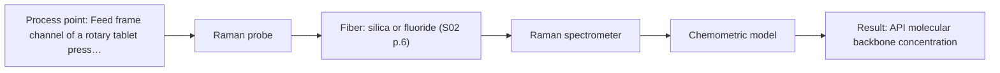
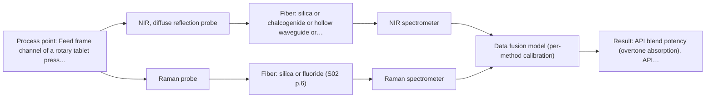

# First technical assessment: Blend potency in a tablet press feed frame

## Answer

**Customer request (our summary):** The customer wants to assess the feasibility of fiber-based spectroscopic monitoring in a tablet press feed frame to track API concentration changes in real time.

### Brief answer

In-line monitoring of API concentration in a tablet press feed frame is supported by literature precedent using fiber-optic Raman or NIR spectroscopy. We recommend testing a contact Raman probe first due to its high chemical specificity for active ingredient molecular backbones, comparing it against NIR diffuse reflection. Bench testing on your powder blend is required first to rule out fluorescence and establish calibration feasibility.

### Proposal

- **Best current option:** O2 (recommended)
- **Basis:** supplied AFS sources
- **What would change it:** If bench testing reveals severe matrix fluorescence that obscures Raman bands, NIR diffuse reflection (O1) would become the primary path. Conversely, if single-method models fail to achieve release precision limits, dual-technique fusion (O3) would be tested.
- **Next step:** Perform initial benchtop Raman and NIR spectral tests on static customer blend samples to evaluate band selectivity, check for fluorescence, and correlate with reference assay values.

**Secondary evidence (external, not AFS material):** G1: E02 ¶31; G2: no usable external source found; G3: no usable external source found; G4: no usable external source found. See Expert detail.

**Decision status:** Provisional feasibility assessment

### Solution options

| ID | Tier | Methods | Confidence | Cost class, S01 Table 1 (p.6) | Ease of use | Maintenance | Performance fit | Sources |
|---|---|---|---|---|---|---|---|---|
| O1 | Simple | M2 NIR, diffuse reflection probe | Medium: open question: Q1 (starts at Medium) | average cost (row 8) | Straightforward lamp and reflection probe setup | Periodic reference standard and window cleaning | Fast acquisition of powder overtone spectra | [1: S01 p.10] [2: S01 p.10] |
| O2 | Recommended | M1 Raman probe | Medium: open question: Q1 (starts at Medium) | high cost (row 12) | Contact probe with laser interlock safety | Window inspection and laser wavelength verification | High chemical selectivity for API backbone | [3: S01 p.15] [4: S01 p.12] [5: S01 p.15] |
| O3 | Extended (multi-method) | M3 NIR, diffuse reflection probe + Raman (combination) | Low: open question: Q1 (starts at Medium); precedent only; multi-method, fusion benefit not yet shown | high cost (rows 8, 12) | Dual spectrometer operation and timing alignment | Dual sensor recalibration and window cleaning | Fused dataset maximizes potency prediction robustness | [6: S01 p.15] [7: S01 p.15] |

*Confidence rates the basis of the advice (how much is known and cited), not a predicted accuracy or probability of success. It starts at High, or at Medium when a key question on the method or the option is open, and drops one level per weakness listed (floor Low).*

*Cost class is the relative rating in S01 Table 1 (p.6) for the in-line method+technique rows named (the highest one for a multi-method option); it is not a price.*

### Setup sketch

*Recommended option O2; drawn by code from the option, a schematic, not a configuration.*

### Key questions

1. What is the chemical identity, nominal target concentration, and expected dynamic range of the active pharmaceutical ingredient (API)?
2. What is the specific make and model of the rotary tablet press feed frame, and are there existing inspection ports or available mounting locations?
3. Does the powder blend demonstrate any tendency toward static adhesion, caking, or window fouling during flow?

## Expert detail

**Customer enquiry**

> We manufacture tablets from a powder blend containing an active pharmaceutical ingredient and excipients. Laboratory checks tell us whether the blend is on target, but results arrive after the material has moved through the press. We want to assess whether a fiber based measurement in the feed frame could follow API concentration changes. Our first pilot should compare reasonable measurement options before we commit to production equipment.

**Decision status:** Provisional feasibility assessment. A provisional assessment is justified because published literature precedent demonstrates in-line NIR and Raman monitoring of API blend potency inside a rotary tablet press feed frame, though API identity, excipients, and mechanical clearances remain to be confirmed.

### Parameters

| ID | Parameter | Kind | Need | Measured by | Why | Sources |
|---|---|---|---|---|---|---|
| P1 | API blend potency (overtone absorption) | quantitative | required | Spectroscopy: NIR | Monitors overtone and combination vibrational bands associated with API concentration in the moving powder blend. | [8: S01 p.14] |
| P2 | API molecular backbone concentration | quantitative | required | Spectroscopy: Raman | Provides chemically specific Raman scattering signals directly proportional to active ingredient concentration. | [5: S01 p.15] |
| P3 | Laboratory reference API concentration | quantitative | required | Reference lab method: Off-line HPLC laboratory assay | Provides independent quantitative reference assays needed to calibrate and validate in-line chemometric regression models. | *(no verified source: engineering judgement)* |

### Solution option details

- **O1 cost drivers:** Standard NIR spectrometer and fiber reflection probe
- **O2 cost drivers:** Raman spectrometer, laser source, and filtered probe
- **O3 cost drivers:** Dual spectrometers, combi-probe, and data fusion software
- **O3 combining methods:** Data fusion requires co-located sampling from the same powder volume using a combined NIR-Raman probe shaft. Spectral acquisitions must be synchronized to a common time step, with block autoscaling applied prior to low-level concatenation into an augmented matrix. The fused multivariate model must demonstrate statistically superior prediction accuracy over the best single-method baseline.

*Extended (multi-method) option O3; drawn by code from the option, a schematic, not a configuration.*

### Premise check

- **Precedent only:** A fiber-based measurement interface can be reliably installed and operated within the moving powder environment of a feed frame. Literature precedent demonstrates insertion of fiber-optic probes directly into a rotary tablet press feed frame to monitor moving powder blends, though mechanical fit and caking behavior must be verified for this specific press. [9: S01 p.15]

### Requirements

**Stated by the customer**

- Manufacture tablets from a powder blend containing an active pharmaceutical ingredient and excipients.
- Laboratory checks confirm whether the blend is on target, but results arrive after material has moved through the press.
- Assess whether a fiber-based measurement in the feed frame could follow API concentration changes.
- First pilot should compare reasonable measurement options before committing to production equipment.

**Key unknowns**

- Chemical identity, molecular structure, and nominal concentration range of the API
- Excipient matrix composition, particle size distribution, and optical scattering properties
- Potential autofluorescence of API or excipients under laser illumination
- Tablet press feed frame model, paddle geometry, and available probe mounting ports
- Risk of powder caking, window coating, or fouling on the optical interface during compression runs
- Required analytical precision, limit of detection, and sampling frequency relative to powder residence time

### Clarification questions (most decision-relevant first)

Q1. What is the chemical identity, nominal target concentration, and expected dynamic range of the active pharmaceutical ingredient (API)? *Why it matters:* Determines whether distinct Raman scattering bands or NIR overtone bands exist without severe spectral overlap from the excipients. *(affects: method, M1, M2)*
Q2. What is the specific make and model of the rotary tablet press feed frame, and are there existing inspection ports or available mounting locations? *Why it matters:* Dictates the required probe outer diameter, insertion depth, and mechanical clearance from rotating feeder paddles. *(affects: installation, technique)*
Q3. Does the powder blend demonstrate any tendency toward static adhesion, caking, or window fouling during flow? *Why it matters:* Fouling on the probe interface attenuates optical signal and could require specialized purge or scraping mechanisms. *(affects: technique, installation)*
Q4. What laboratory reference method is currently used, and what is its measurement turnaround time and analytical error? *Why it matters:* Reference measurement precision establishes the calibration benchmark and determines the statistical feasibility threshold. *(affects: status)*

### Recommendation

- **M1 · Primary candidate: Raman probe.** Raman spectroscopy provides sharp, chemically specific fundamental vibrational bands from molecular backbones, making it highly effective for tracking active pharmaceutical ingredient concentrations in excipient matrices. Its linear concentration response provides robust tracking with less sensitivity to physical matrix variations than overtone methods. [5: S01 p.15] [4: S01 p.12]
- **M2 · Comparison candidate: NIR, diffuse reflection probe.** Diffuse reflectance NIR spectroscopy is widely utilized for solid powder blends, capturing overtone vibrations directly in scattering media using standard silica fiber probes and illumination lamps. It offers rapid spectral acquisition, though overlapping bands require multivariate chemometrics and sensitivity to particle size must be managed. [1: S01 p.10] [2: S01 p.10]
- **M3 · Comparison candidate: NIR, diffuse reflection probe + Raman (combination).** Combining diffuse reflectance NIR with Raman spectroscopy fuses complementary chemical data on polar functional groups and molecular backbones. Literature precedent shows that low-level data fusion can enhance API blend potency prediction robustness in feed frames beyond single-method models. *Conditions:* Applies as a subsequent hypothesis if single-method performance fails to achieve target accuracy and simultaneous co-located sampling is feasible. [6: S01 p.15] [7: S01 p.15] Later hypothesis, after single-method tests.

### Measurement concept

- **Probe and geometry:** Direct-contact immersion reflection or scattering probe mounted flush with the feed frame base or side wall to interrogate moving powder without disrupting flow.
- **Location:** Feed frame channel of a rotary tablet press, situated immediately before the die-filling station.
- **Fiber link:** Flexible low-OH silica optical fiber cables linking the in-line feed frame probe to remote spectrometers positioned away from press vibrations. [9: S01 p.15] [10: S01 p.15]

### Spectral range

- **Raman:** Raman spectra are recorded as Raman shift in units of cm-1, evaluated separately from the laser excitation wavelength of 785 nm; usable range depends on the spectrometer, detector, and probe selected. [11: S01 p.11] [3: S01 p.15]
- **NIR:** Nominal NIR range is 780-2500 nm; usable range depends on the instrument, silica fiber, and probe selected. [12: S01 p.10]

### Risks and uncertainty

- Fluorescence background from the API or excipients may overwhelm the weak Raman scattering signal. *(rules: R-RAM-1)* [13: S01 p.11]
- Physical powder variation such as particle size distribution shifts can alter NIR diffuse reflectance and mimic chemical concentration changes. *(rules: R-GEO-6)* [14: S01 p.17]
- Powder caking or coating onto the probe optical window could blind the measurement interface during continuous tableting runs. *(rules: R-GEN-5)* [15: S01 p.7]
- Spectrometric calibrations are specific to the matrix and require re-validation whenever excipient suppliers or physical blend properties change. *(rules: R-CAL-1)* [16: REF §5]

### First feasibility experiment

1. **Acquire benchtop Raman and NIR diffuse reflectance spectra on pure API, isolated excipients, and calibrated static powder mixtures across a range of API concentrations.** Identify unique spectral bands, confirm absence of intolerable fluorescence in Raman, and evaluate single-method linearity. [17: S01 p.3]
2. **Install temporary single-method Raman and NIR fiber probes into the tablet press feed frame during a controlled pilot run with stepped API concentration variations.** Verify probe optical window clearance, check for powder caking during paddle rotation, and assess dynamic in-line signal quality. [18: S01 p.15]
3. **Withdraw physical blend and tablet samples synchronously with time-stamped in-line spectral acquisitions, submitting them for independent off-line laboratory analysis.** Generate accurate reference values across the target dynamic range to train and cross-validate multivariate calibration models. [19: REF §3]
4. **Develop single-method PLS regression models for Raman and NIR, followed by low-level data fusion modeling if single methods fall short.** Evaluate whether single-method prediction accuracy meets process requirements or if dual-technique fusion is necessary. [7: S01 p.15]
5. **Validate the selected calibration models on an independent, held-out tableting batch under standard commercial production speed.** Demonstrate predictive robustness, confirm root-mean-square error of prediction, and prove absence of model overfitting. *(no verified source: engineering judgement)*

**Reference measurements:** Validated off-line laboratory assay (e.g., HPLC) of physical samples gathered synchronously with in-line spectral collection.

**Decision basis:** Go/no-go decision is based on demonstrating quantitative API prediction error within customer-defined release specification limits and verifying absence of window fouling.

### Assumptions

- The powder blend is optically opaque and suitable for diffuse reflection and backscatter Raman measurements.
- The tablet press feed frame allows flush installation of an optical probe tip without mechanical interference from feeder paddles.
- Off-line laboratory assay results can be precisely matched to time-stamped in-line spectral acquisitions.

### Not covered by the supplied sources

- Quantitative limits of detection, precision, and accuracy for the customer's specific API and excipients
- Specific mechanical port dimensions and paddle clearances for the customer's feed frame model

### Further notes

- **Chemometrics:** Multivariate regression (such as Partial Least Squares) is required to correlate optical spectra with reference assay values. Preprocessing should evaluate scatter corrections (SNV or MSC) for NIR and baseline subtraction for Raman to decouple physical matrix effects from chemical concentration.
- **Real-time tracking:** In-line monitoring captures dynamic potency trends and blend homogenization in real time as powder flows through the feed frame, allowing rapid detection and diversion of out-of-specification material before compression.
- **Future direction:** Following single-method validation, evaluating an integrated multimodal NIR-Raman probe can combine physical blend monitoring and high-specificity chemical quantification in commercial production.

### Secondary evidence (external, not AFS material)

*Found by a literature search for gaps the supplied AFS sources leave open. Not AFS material and not proof for this case; every quote below was verified verbatim against the fetched text.*

*Live search unavailable (library only: cache miss (europepmc); cache miss (openalex)); curated library only.*

**G1 · multi-method:** Combining several spectroscopy methods (data fusion) (Data fusion requires co-located sampling from the same powder volume using a combined NIR-Raman probe shaft. Spectral acquisitions must be synchronized to a common time step, with block autoscaling applied prior to low-level concatenation into an augmented matrix. The fused multivariate model must demonstrate statistically superior prediction accuracy over the best single-method baseline.)

- **E02 ¶31** Low-level data fusion reorganizes variables from different sources sequentially into an augmented data matrix as a straightforward combination strategy. *How it applies:* This suggests testing a low-level concatenation structure for the synchronized NIR and Raman matrices. It should be evaluated against individual single-technique performance to determine whether fused variables add predictive value. *Limits and transfer risks:* The reviewed literature addresses general process analytical applications rather than solid-state powder monitoring in a feed frame, and concatenation does not guarantee improved predictive performance over single-probe measurements. *(supports O3)*
  > "Low-level data fusion (LLDF) is considered the simplest method to achieve a combination of inputs. In this case, the data is rearranged into a new data matrix, where the variables coming from different sources are placed one after the other."
  > Challenges and Opportunities of Implementing Data Fusion in Process Analytical Technology-A Review. (2022) · Molecules (Basel, Switzerland) · doi:10.3390/molecules27154846 · https://europepmc.org/article/PMC/PMC9369811 · retrieved 2026-10-17, full text, licence: cc by, via curated library

**G2 · not in the supplied sources:** Quantitative limits of detection, precision, and accuracy for the customer's specific API and excipients

- No usable external source found.

**G3 · not in the supplied sources:** Specific mechanical port dimensions and paddle clearances for the customer's feed frame model

- No usable external source found.

**G4 · parameter without a source:** Measuring Laboratory reference API concentration: Provides independent quantitative reference assays needed to calibrate and validate in-line chemometric regression models.

- No usable external source found.

### Evidence (verified quotes)

1. ✓ **S01 p.10** (general): "Near-IR vibrational spectroscopy (NIR) is the most common online analysis method performed using fiber optic probes."
2. ✓ **S01 p.10** (general): "The broad absorption bands observed in this region overlap, suggesting the use of chemometrics for quantitative and qualitative analysis of spectral data."
3. ✓ **S01 p.15** (application precedent): "Raman spectrometer and Raman fiber probe for contact measurements with 785 nm excitation wavelength"
4. ✓ **S01 p.12** (general): "dependence on concentration is linear over a wide range of intensities."
5. ✓ **S01 p.15** (general): "NIR detects hydrogen bonds and asymmetric polar groups, while Raman provides information on the molecular backbone and symmetrical non-polar groups."
6. ✓ **S01 p.15** (application precedent): "Data processing for pharmaceutical tasks relies on "low-level data fusion," where the synchronized NIR and Raman spectra are merged into a single augmented matrix."
7. ✓ (precedent only) **S01 p.15** (method gain): "By combining Raman and NIR, these models can predict API potency or coating thickness with higher accuracy and robustness than single-method models."
8. ✓ **S01 p.14** (application precedent): "The primary objective is to determine "blend potency" - the precise concentration and uniformity of the Active Pharmaceutical Ingredient (API) - directly within the production line, specifically in the feed frame of a rotary tablet press."
9. ✓ **S01 p.15** (application precedent): "During the experimental action, the probes are inserted directly into the process environment, such as the feed frame of a rotary tablet press. As the powder blend passes the probe tip, the system captures spectra at high speeds without interrupting the production flow."
10. ✓ **S01 p.15** (general): "The use of fiber optics is critical here, as it allows the sensitive spectrometers to be located safely away from the vibration and dust of the manufacturing floor."
11. ✓ **S01 p.11** (general): "The difference between the observed frequencies and the laser frequency is called the Raman shift, expressed in units of frequency-wavenumbers (cm-1)."
12. ✓ **S01 p.10** (general): "NIR spectra (780-2500 nm) contain predominantly overtones and component bands of fundamental vibrations"
13. ✓ **S01 p.11** (general): "superposition of luminescence (fluorescence), which has a significantly higher intensity."
14. ✓ **S01 p.17** (general): "the method is sensitive to the surface characteristics and fat globule size."
15. ✓ **S01 p.7** (general): "Morphological factors, such as sample inhomogeneity (e.g., biological tissue) or process turbulence, must also be considered when selecting a measurement technique."
16. ✓ **REF §5** (general): "physical variation; calibration specific to the matrix."
17. ✓ **S01 p.3** (general): "samples of incompletely known composition, in order to select the most suitable method or combination of methods."
18. ✓ **S01 p.15** (application precedent): "As the powder blend passes the probe tip, the system captures spectra at high speeds without interrupting the production flow."
19. ✓ **REF §3** (general): "Representative samples or process states, independent reference measurements, what is compared, and the basis for the go / no-go decision."

### Verification

- Citations verified: 27 of 27 (exact or whitespace/hyphen-tolerant match on the cited page, scope checked).
- Hard check failures before deterministic corrections: 0; still open: 0; soft warnings: 4; repair rounds: 1.
- External evidence (cache): 1 quote(s) verified verbatim (exact or whitespace/hyphen-tolerant, at most 400 characters and 2 sentences, against the cited paragraph); 0 item(s) dropped.
- External search: 4 query(ies), 0 hit(s), 3 source(s) (3 from the curated library); ⚠ library only: cache miss (europepmc); cache miss (openalex).
- External step: 2 model call(s), 6.8 s extra (cost in the run JSON).

*Run D01-20261018T075900Z-2293 · models google/gemini-3.8-flash*
