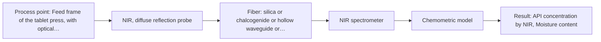
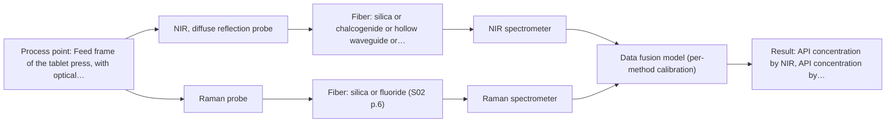

# First technical assessment: Blend potency in a tablet press feed frame

## Answer

**Customer request (our summary):** Customer manufactures tablets from a powder blend containing an active pharmaceutical ingredient and excipients. Laboratory checks tell whether the blend is on target, but results arrive after the material has moved through the press. They want to assess whether a fiber based measurement in the feed frame could follow API concentration changes, with a first pilot comparing reasonable measurement options before committing to production equipment.

### Brief answer

Test NIR diffuse reflection first in a feed-frame pilot, with Raman as a single-method comparison on the same blend samples. Published feed-frame work supports NIR and Raman for API potency, but it is a precedent, not proof for this blend. The open points are the API and excipient spectra, required accuracy, feed-frame access and the reference laboratory method.

### Proposal

- **Best current option:** O2 (recommended)
- **Basis:** supplied AFS sources
- **What would change it:** If the API has no usable NIR signal, if Raman shows clearly stronger API bands, or if the feed frame cannot accept a reflection probe, the choice would move to M2 or M3; the required accuracy and reference method also decide.
- **Next step:** Run a single-method NIR diffuse-reflection trial on representative blend samples with independent laboratory API assays, then compare Raman on the same samples.

**Secondary evidence (external, not AFS material):** G1: E03 ¶31, E03 ¶82; G2: E01 ¶19, E02 ¶20; G3: E01 ¶8, E01 ¶72; G4: E05 ¶64. See Expert detail.

**Decision status:** Provisional feasibility assessment

### Solution options

| ID | Tier | Methods | Confidence | Cost class, S01 Table 1 (p.6) | Ease of use | Maintenance | Performance fit | Sources |
|---|---|---|---|---|---|---|---|---|
| O1 | Simple | M2 Raman probe | Medium: open question: Q1 (starts at Medium) | high cost (row 12) | single probe, laser safety | laser and probe cleaning | tests API Raman bands directly | [1: S01 p.11] |
| O2 | Recommended | M1 NIR, diffuse reflection probe | Medium: open question: Q1 (starts at Medium) | average cost (row 8) | standard fiber probe, simple optics | probe window cleaning and calibration | common online method for powder blends | [2: S01 p.10] [3: S01 p.6] |
| O3 | Extended (multi-method) | M1 NIR, diffuse reflection probe; M2 Raman probe; M3 NIR, diffuse reflection probe + Raman (combination) | Low: open question: Q1 (starts at Medium); multi-method, fusion benefit not yet shown | high cost (rows 8, 12) | two instruments need coordination | two probes and two calibrations | complementary NIR and Raman information | [4: S01 p.15] [5: S01 p.8] [2: S01 p.10] [3: S01 p.6] [1: S01 p.11] [6: S01 p.15] |

*Confidence rates the basis of the advice (how much is known and cited), not a predicted accuracy or probability of success. It starts at High, or at Medium when a key question on the method or the option is open, and drops one level per weakness listed (floor Low).*

*Cost class is the relative rating in S01 Table 1 (p.6) for the in-line method+technique rows named (the highest one for a multi-method option); it is not a price.*

### Setup sketch

*Recommended option O2; drawn by code from the option, a schematic, not a configuration.*

### Key questions

1. What is the API identity and expected concentration range in the blend, and what variation must the measurement follow?
2. What accuracy, detection limit and response time must the feed-frame measurement achieve?
3. What is the feed-frame geometry, available optical access and maximum probe or window size?

## Expert detail

**Customer enquiry**

> We manufacture tablets from a powder blend containing an active pharmaceutical ingredient and excipients. Laboratory checks tell us whether the blend is on target, but results arrive after the material has moved through the press. We want to assess whether a fiber based measurement in the feed frame could follow API concentration changes. Our first pilot should compare reasonable measurement options before we commit to production equipment.

**Decision status:** Provisional feasibility assessment. Published feed-frame work supports testing NIR and Raman for API potency, so a provisional shortlist is justified. The API identity, required accuracy, feed-frame access and reference method are still open, so no production configuration is justified.

### Parameters

| ID | Parameter | Kind | Need | Measured by | Why | Sources |
|---|---|---|---|---|---|---|
| P1 | API concentration by NIR | quantitative | required | Spectroscopy: NIR | It is the primary target for the NIR diffuse-reflection trial in the feed frame. | [7: S01 p.14] |
| P2 | API concentration reference | quantitative | required | Reference lab method: independent laboratory assay for API content in blend samples | An independent reference is needed for calibration and for held-out validation. | [8: REF §3] |
| P3 | API concentration by Raman | quantitative | required | Spectroscopy: Raman | It is needed to test Raman as a single-method comparator for API concentration. | [9: S01 p.15] |
| P4 | Moisture content | quantitative | optional | Spectroscopy: NIR | It should be available because OH bands overlap in NIR and moisture can change powder flow and spectra. | [10: S01 p.10] |
| P5 | Raman signal quality and fluorescence background | qualitative | required | Spectroscopy: Raman | Raman is only useful if API bands are visible above fluorescence and laser scatter. | [11: S01 p.11] |
| P6 | Particle size and scatter | quantitative | optional | Not measurable in-line by spectroscopy; alternative: laser diffraction or sieve analysis of grab samples | It should be available because NIR reflection is sensitive to surface characteristics and scatter, which can mimic concentration changes. | [12: S01 p.17] |

### Solution option details

- **O1 cost drivers:** single Raman spectrometer, laser, fiber probe, method development and reference samples
- **O2 cost drivers:** single NIR spectrometer, light source, reflection probe, fiber link, method development and reference samples
- **O3 cost drivers:** two spectrometers, two probes or combined probe, synchronization, data fusion and extra calibration
- **O3 combining methods:** Start with one NIR model and one Raman model, then test a fused model with joined spectra or scores and block scaling. Both probes must view the same powder at the same time, with data aligned to a common time step and each method calibrated separately. The fused model must beat the best single method on held-out runs before the extra instrument is justified.

*Extended (multi-method) option O3; drawn by code from the option, a schematic, not a configuration.*

### Premise check

- **Precedent only:** A fiber based measurement in the feed frame could follow API concentration changes. A published pharmaceutical example uses NIR and Raman probes in a tablet-press feed frame to determine API blend potency, but it is a precedent for testing, not proof for this blend. [7: S01 p.14]
- **Not covered:** A first pilot comparing reasonable measurement options is sufficient before committing to production equipment. The sources describe multi-method laboratory trials to select a method, but they do not establish that a first pilot is sufficient for a production decision. *(no verified source: engineering judgement)*
- **Precedent only:** NIR and Raman are reasonable measurement options for a powder blend API in a feed frame. The pharmaceutical feed-frame example lists a NIR reflection probe and a Raman fiber probe as the equipment used, but it is a precedent for testing, not proof for this blend. [13: S01 p.15] [14: S01 p.15]

### Requirements

**Stated by the customer**

- "Laboratory checks tell us whether the blend is on target"
- "results arrive after the material has moved through the press"
- "whether a fiber based measurement in the feed frame could follow API concentration changes"
- *Further statements: see the customer enquiry above.*

**Key unknowns**

- API identity, concentration range and expected variation.
- Excipient composition and spectral interferences.
- Required accuracy, detection limit, response time and measurement frequency.
- Feed-frame geometry, optical access and cleaning.
- Process temperature, dust, vibration and humidity.
- Reference laboratory method and sampling timing.

### Clarification questions (most decision-relevant first)

Q1. What is the API identity and expected concentration range in the blend, and what variation must the measurement follow? *Why it matters:* The API spectrum and concentration range decide whether NIR, Raman or both have a usable signal. *(affects: method)*
Q2. What accuracy, detection limit and response time must the feed-frame measurement achieve? *Why it matters:* These numerical criteria set the go/no-go basis for the pilot and whether a single method can be enough. *(affects: status)*
Q3. What is the feed-frame geometry, available optical access and maximum probe or window size? *Why it matters:* The installation point determines whether a reflection or contact probe can view a representative powder flow. *(affects: installation)*
Q4. What are the excipients, and do any of them fluoresce or have strong NIR or Raman bands that overlap the API? *Why it matters:* Matrix bands and fluorescence can make Raman unusable or hide the API response in NIR. *(affects: technique)*
Q5. What are the process temperature, dust, vibration and cleaning conditions at the feed frame? *Why it matters:* These conditions affect probe design, window fouling and whether the optical measurement can stay representative. *(affects: installation)*
Q6. Which reference laboratory method and sampling timing will be used for API content, and what validation is required? *Why it matters:* The reference method defines calibration accuracy and whether held-out validation is possible. *(affects: status)*

### Recommendation

- **M1 · Primary candidate: NIR, diffuse reflection probe.** NIR diffuse reflection is the most common online fiber-probe method and is listed for scattering powders. It is the first single method to test for API concentration changes in the feed frame. *Conditions:* Applies if the feed frame gives optical access to a representative flowing powder surface and a cleanable reflection probe window. [2: S01 p.10] [3: S01 p.6]
- **M2 · Comparison candidate: Raman probe.** Raman is a single-method comparator that can record spectra of powdered materials and gives molecular-backbone information. It is worth testing if the API has usable Raman bands and fluorescence background is acceptable. *Conditions:* Applies if the API has usable Raman bands and fluorescence background is acceptable on the real blend. [1: S01 p.11]
- **M3 · Conditional candidate: NIR, diffuse reflection probe + Raman (combination).** A combined NIR + Raman test is a later hypothesis for complementary chemical information. The published feed-frame example reports higher accuracy and robustness than single-method models, but this is a hypothesis for the customer blend. *Conditions:* Only if the single-method tests do not meet the API-concentration target and both probes can view the same powder at the same time. [4: S01 p.15] [6: S01 p.15]

### Measurement concept

- **Probe and geometry:** Start with a single NIR diffuse-reflection fiber probe viewing the flowing powder in the feed frame; compare with a single Raman fiber probe on the same samples.
- **Location:** Feed frame of the tablet press, with optical access to a representative powder surface.
- **Fiber link:** NIR and Raman require silica fibers; the usable fiber length and probe design depend on the selected configuration and are not specified by the sources. *(no verified source: engineering judgement)*

### Spectral range

- **NIR:** Nominal NIR method range 780-2500 nm. [15: S01 p.10]
- **Raman:** Raman is reported as Raman shift (cm-1), with the laser excitation wavelength stated separately; the supplied sources give no single numeric nominal Raman shift range. [16: S01 p.11]

### Risks and uncertainty

- The API may have no usable NIR or Raman signal, or excipient bands may overlap the API response. *(no verified source: engineering judgement)*
- Feed-frame powder flow, segregation, particle size and moisture may change the spectrum more than API concentration. *(no verified source: engineering judgement)*
- Probe window fouling or limited optical access in the feed frame may prevent a representative measurement. *(no verified source: engineering judgement)*
- Published feed-frame NIR and Raman results are precedent only; the required accuracy and validation for this blend are unknown. *(no verified source: engineering judgement)*

### First feasibility experiment

1. **Collect representative blend samples across the expected API concentration range and normal physical variation (particle size, moisture, density, flow state), with independent laboratory API assays for each sample.** Cover the chemical and physical variation the feed-frame probe will see. [8: REF §3]
2. **Measure every sample with NIR diffuse reflection (M1) and Raman (M2) as separate single-method tests, using the same sampling protocol and recording probe distance, window condition and process conditions.** Compare single methods before any combination. *(no verified source: engineering judgement)*
3. **Build one calibration model per method and validate on held-out runs or batches against the reference assay; compare NIR and Raman on the same samples.** Test whether each single method can follow API concentration. [17: S01 p.12]
4. **Only if both single methods miss the customer's criteria, test a combined NIR + Raman measurement at the same spot and time; compare the fused model with the best single method.** Test the combination as a later hypothesis. [5: S01 p.8] [6: S01 p.15]
5. **Apply the customer's numerical go/no-go criteria for accuracy, detection limit and response time; if they are not met, do not proceed to production equipment.** Make the decision basis explicit and quantitative. [8: REF §3]

**Reference measurements:** Independent laboratory assay for API content in the blend, matched to the sample and run timing.

**Decision basis:** Customer-defined numerical criteria for accuracy, detection limit and response time; no production decision without them.

### Not covered by the supplied sources

- API-specific spectral bands, concentration range and required accuracy for this blend are not in the supplied material.
- Feed-frame geometry, optical access, cleaning and production-equipment commitment criteria are not in the supplied material.

### Further notes

- **Chemometrics:** NIR and Raman need matrix-specific calibration; use independent API assays and held-out validation. Start with one model per method before any fused model.
- **Real-time tracking:** The feed-frame question is a continuous or time-resolved tracking problem; acquisition rate, averaging and dead time must match the blend flow.
- **Future direction:** If the single-method comparison shows complementary value, a later step could evaluate a combined NIR and Raman probe or a compact multisensor system.

### Secondary evidence (external, not AFS material)

*Found by a literature search for gaps the supplied AFS sources leave open. Not AFS material and not proof for this case; every quote below was verified verbatim against the fetched text.*

**G1 · multi-method:** Combining several spectroscopy methods (data fusion) (Start with one NIR model and one Raman model, then test a fused model with joined spectra or scores and block scaling. Both probes must view the same powder at the same time, with data aligned to a common time step and each method calibrated separately. The fused model must beat the best single method on held-out runs before the extra instrument is justified.)

- **E03 ¶31** Low-level data fusion combines inputs by rearranging variables from different sources sequentially into a new data matrix. *How it applies:* This could inform a pilot test of a joined-spectra fused model, but the fused model should still be compared with the best single-method model on held-out runs. *Limits and transfer risks:* The review is general and not specific to pharmaceutical powder or feed-frame conditions; low-level fusion can be sensitive to scaling and alignment. *(supports O3)*
  > "Low-level data fusion (LLDF) is considered the simplest method to achieve a combination of inputs. In this case, the data is rearranged into a new data matrix, where the variables coming from different sources are placed one after the other."
  > Challenges and Opportunities of Implementing Data Fusion in Process Analytical Technology-A Review. (2022) · Molecules (Basel, Switzerland) · doi:10.3390/molecules27154846 · https://europepmc.org/article/PMC/PMC9369811 · retrieved 2026-10-17, full text, licence: cc by, via curated library
- **E03 ¶82** The review advises evaluating each dataset's contribution and complementarity before fusing data from multiple sources. *How it applies:* This supports building separate NIR and Raman models first and checking whether their combination adds value before justifying the extra probe. *Limits and transfer risks:* The review is general and does not establish that NIR and Raman are complementary for this powder; a fused model may not improve on the best single method. *(supports O3)*
  > "Before fusing data from multiple sources, it is essential to evaluate the contribution of each dataset to the model and its complementarity."
  > Challenges and Opportunities of Implementing Data Fusion in Process Analytical Technology-A Review. (2022) · Molecules (Basel, Switzerland) · doi:10.3390/molecules27154846 · https://europepmc.org/article/PMC/PMC9369811 · retrieved 2026-10-17, full text, licence: cc by, via curated library

**G2 · not in the supplied sources:** API-specific spectral bands, concentration range and required accuracy for this blend are not in the supplied material.

- **E01 ¶19** The source reports that concentrations, ionic strength and temperature were varied to obtain a robust model. *How it applies:* For the blend, this suggests calibration should cover the expected API concentration range and relevant process conditions, and that required accuracy should be tested rather than assumed. *Limits and transfer risks:* The work concerns acid concentrations in reactive liquid-liquid extraction, not an API in a tablet powder blend, and it gives no API-specific bands or accuracy target.
  > "The concentrations of nitric acid and hydrochloric acid as well as the ionic strength and temperature were varied to obtain a robust model."
  > Process Analytical Technology-Integrated FT-IR and Raman Spectroscopies for Efficient Reactive Liquid-Liquid Extraction Processing in Lithium Recycling. (2025) · ACS omega · doi:10.1021/acsomega.5c05705 · https://europepmc.org/article/PMC/PMC12573149 · retrieved 2026-10-17, full text, licence: cc by, via curated library
- **E02 ¶20** Raman spectroscopy is described as highly selective with low water interference, though measurement times are relatively long. *How it applies:* This could support considering Raman where API bands need selectivity and water is present, but the measurement time must be checked against feed-frame flow. *Limits and transfer risks:* The statement comes from biopharmaceutical upstream processing, not a powder blend or feed frame, and it does not provide API-specific bands or required accuracy. *(supports O1)*
  > "Raman spectroscopy is frequently applied in upstream processing in research and industry due to its high selectivity and low water interference [55] despite the relatively long measurement times."
  > A critical review of recent trends, and a future perspective of optical spectroscopy as PAT in biopharmaceutical downstream processing. (2020) · Analytical and bioanalytical chemistry · doi:10.1007/s00216-020-02407-z · https://europepmc.org/article/PMC/PMC7072065 · retrieved 2026-10-17, full text, licence: cc by, via curated library

**G3 · not in the supplied sources:** Feed-frame geometry, optical access, cleaning and production-equipment commitment criteria are not in the supplied material.

- **E01 ¶8** A fixed probe location in a continuous process is described as simplifying model design, with narrower calibrations centered on the operational envelope and validation by independent steady-state runs. *How it applies:* This could inform defining the feed-frame probe location and operating window before calibration, and using independent runs for validation. *Limits and transfer risks:* The example is reactive liquid-liquid extraction, not a powder feed frame, and the steady-state assumption may not transfer to tablet-press feed flow.
  > "In contrast, a continuous process at a fixed probe location is intended to operate in a steady-state window, which simplifies the model design: calibrations can be narrower and centered on the operational envelope, validation can rely on independent steady-state runs, and online monitoring focuses on drift and out-of-specification detection rather than resolving the rapidly changing composition."
  > Process Analytical Technology-Integrated FT-IR and Raman Spectroscopies for Efficient Reactive Liquid-Liquid Extraction Processing in Lithium Recycling. (2025) · ACS omega · doi:10.1021/acsomega.5c05705 · https://europepmc.org/article/PMC/PMC12573149 · retrieved 2026-10-17, full text, licence: cc by, via curated library
- **E01 ¶72** In-line methods are said to require maintenance such as calibration, with drift and aging checked by baseline measurements in pure component phases. *How it applies:* This could inform planning for calibration, cleaning and drift checks for a feed-frame probe, and for monitoring baseline behavior. *Limits and transfer risks:* The source refers to a process with pure component phases; a tablet blend may not offer such phases, and feed-frame cleaning/access is not addressed.
  > "Potential typical drawbacks of any in-line method are maintenance efforts like calibration, and actions to sensor drift and aging could be easily overcome by checking the baseline in each cycle of pure component phases of process operation and monitoring any drift in order to be able to react."
  > Process Analytical Technology-Integrated FT-IR and Raman Spectroscopies for Efficient Reactive Liquid-Liquid Extraction Processing in Lithium Recycling. (2025) · ACS omega · doi:10.1021/acsomega.5c05705 · https://europepmc.org/article/PMC/PMC12573149 · retrieved 2026-10-17, full text, licence: cc by, via curated library

**G4 · premise not covered:** A first pilot comparing reasonable measurement options is sufficient before committing to production equipment.

- **E05 ¶64** The source argues for completing verifiable tasks with fewer functions, and says complex structures are unnecessary if a simple sample and fixed optical path suffice. *How it applies:* This could support a pilot that starts with simple measurement options and adds Raman or fusion only after a verifiable benefit is shown. *Limits and transfer risks:* The context is microfluidic food analysis, not a tablet feed frame, and it does not define production-commitment criteria or prove that a pilot is sufficient. *(supports O1)*
  > "Finally, research on microfluidics and spectroscopy should shift from integrating more functions to completing verifiable tasks with fewer functions. If a sample only needs filtration and a fixed optical path, complex multivalve structures are unnecessary."
  > Microfluidics-Integrated Spectroscopic Technologies for Food Safety and Quality Assessment: From Complex-Matrix Processing to On-Site Decision-Making. (2026) · Foods (Basel, Switzerland) · doi:10.3390/foods15183171 · https://europepmc.org/article/PMC/PMC13605163 · retrieved 2026-10-18, full text, licence: cc by, via europepmc

### Evidence (verified quotes)

1. ✓ **S01 p.11** (general): "The Raman spectrometer supplied with this multispectral laboratory is designed to record Raman spectra of various samples, such as liquid mixtures containing organic and inorganic substances, biological tissue, powdered materials of various origins, etc."
2. ✓ **S01 p.10** (general): "Near-IR vibrational spectroscopy (NIR) is the most common online analysis method performed using fiber optic probes."
3. ✓ **S01 p.6** (general): "Scattering media, powder 0.5-1 mm"
4. ✓ (precedent only) **S01 p.15** (method gain): "The combination of these techniques is particularly effective because it captures complementary chemical information: NIR detects hydrogen bonds and asymmetric polar groups, while Raman provides information on the molecular backbone and symmetrical non-polar groups."
5. ✓ **S01 p.8** (general): "It is crucial that the spectral information obtained by different methods-Mid-IR, NIR, Raman, and fluorescence spectra-is collected from the same small, even pinpoint, area of the sample."
6. ✓ (precedent only) **S01 p.15** (method gain): "By combining Raman and NIR, these models can predict API potency or coating thickness with higher accuracy and robustness than single-method models."
7. ✓ **S01 p.14** (application precedent): "The primary objective is to determine "blend potency" - the precise concentration and uniformity of the Active Pharmaceutical Ingredient (API) - directly within the production line, specifically in the feed frame of a rotary tablet press."
8. ✓ **REF §3** (general): "Representative samples or process states, independent reference measurements, what is compared, and the basis for the go / no-go decision."
9. ✓ **S01 p.15** (general): "Raman provides information on the molecular backbone and symmetrical non-polar groups."
10. ✓ **S01 p.10** (general): "such as -OH, -NH2=NH, -CH3, =CH2, ≥CH, etc."
11. ✓ **S01 p.11** (general): "observing Raman bands is often complicated by light scattering from the illuminating laser, and for many organic compounds, by the superposition of luminescence (fluorescence), which has a significantly higher intensity."
12. ✓ **S01 p.17** (general): "the method is sensitive to the surface characteristics and fat globule size."
13. ✓ **S01 p.15** (application precedent): "NIR spectrometer and light source coupled with a NIR reflection probe"
14. ✓ **S01 p.15** (application precedent): "Raman spectrometer and Raman fiber probe for contact measurements with 785 nm excitation wavelength"
15. ✓ **S01 p.10** (general): "NIR spectra (780-2500 nm) contain predominantly overtones and component bands of fundamental vibrations"
16. ✓ **S01 p.11** (general): "The Raman shift is used as the horizontal (spectral) axis in Raman spectroscopy"
17. ✓ **S01 p.12** (general): "Therefore, Raman spectra (as well as IR absorption spectra) can be used to construct chemometric models-calibration or classification ones."

### Verification

- Citations verified: 25 of 25 (exact or whitespace/hyphen-tolerant match on the cited page, scope checked).
- Hard check failures before deterministic corrections: 0; still open: 0; soft warnings: 5; repair rounds: 1.
- External evidence (cache): 7 quote(s) verified verbatim (exact or whitespace/hyphen-tolerant, at most 400 characters and 2 sentences, against the cited paragraph); 0 item(s) dropped.
- External search: 6 query(ies), 10 hit(s), 5 source(s) (3 from the curated library).
- External step: 2 model call(s), 34.3 s extra (cost in the run JSON).

*Run D01-20261018T075900Z-65cc · models deepseek/deepseek-v4.1-flash-1017*
