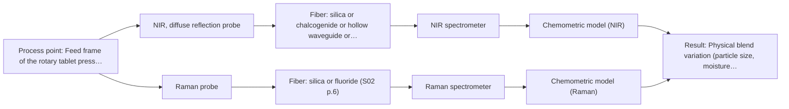
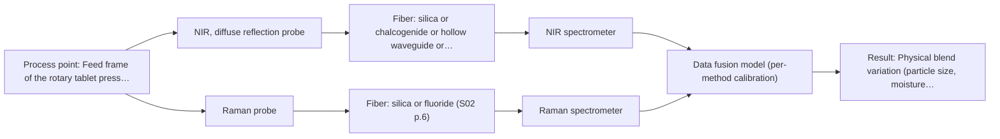

# First technical assessment: Blend potency in a tablet press feed frame

## Answer

**Customer request (our summary):** The customer wants to assess whether a fiber-based optical measurement in the feed frame can monitor API concentration changes in a powder blend.

### Brief answer

Test NIR diffuse reflection first, with a Raman fiber probe as the head-to-head comparison: both are the published standard techniques for in-line blend-potency monitoring in a tablet press feed frame. Skip MIR-ATR, which does not suit a flowing powder. Still open: your required precision and concentration range, feed-frame access and flow conditions, and whether any excipients fluoresce. Validate on held-out batches against your lab API assay before committing to production equipment.

### Proposal

- **Best current option:** O2 (recommended)
- **Basis:** supplied AFS sources
- **What would change it:** If the required API precision is in the trace range or the excipients fluoresce strongly, NIR reflection alone may fail and the option set shifts; if NIR reflection alone meets the target on held-out batches, O1 becomes sufficient.
- **Next step:** Run a multi-method lab trial on representative blend samples with independent API reference assays, comparing NIR diffuse reflection and Raman before any fusion.

**Secondary evidence (external, not AFS material):** G1: no usable external source found; G2: no usable external source found; G3: no usable external source found; G4: no usable external source found. See Expert detail.

**Decision status:** Provisional feasibility assessment

### Solution options

| ID | Tier | Methods | Confidence | Cost class, S01 Table 1 (p.6) | Ease of use | Maintenance | Performance fit | Sources |
|---|---|---|---|---|---|---|---|---|
| O1 | Simple | M1 NIR, diffuse reflection probe | Medium: open question: Q1 (starts at Medium) | average cost (row 8) | Standard probes, straightforward installation | Single instrument, one calibration to maintain | Fits if NIR reflection alone meets the API precision target | [1: S01 p.10] [2: S01 p.17] [3: S01 p.10] |
| O2 | Recommended | M1 NIR, diffuse reflection probe; M2 Raman probe | Medium: open question: Q1, Q3 (starts at Medium) | high cost (rows 8, 12) | Two probes, moderate integration effort | Two instruments and calibrations to run | Fits the pilot goal of comparing options before committing | [4: S01 p.15] [2: S01 p.17] [1: S01 p.10] [3: S01 p.10] [5: S01 p.15] [6: S01 p.11] |
| O3 | Extended (multi-method) | M3 NIR, diffuse reflection probe + Raman (combination) | Low: open question: Q3 (starts at Medium); multi-method, fusion benefit not yet shown | high cost (rows 8, 12) | Most complex, needs fusion expertise | Two instruments; fused model breaks if either block drifts | Fits only if single methods fall short of the precision target | [7: S01 p.15] [8: S01 p.8] [9: S01 p.15] [10: S01 p.15] |

*Confidence rates the basis of the advice (how much is known and cited), not a predicted accuracy or probability of success. It starts at High, or at Medium when a key question on the method or the option is open, and drops one level per weakness listed (floor Low).*

*Cost class is the relative rating in S01 Table 1 (p.6) for the in-line method+technique rows named (the highest one for a multi-method option); it is not a price.*

### Setup sketch

*Recommended option O2; drawn by code from the option, a schematic, not a configuration.*

### Key questions

1. What API concentration range and what measurement precision or detection limit does the feed-frame control need?
2. What access point, window or probe insertion is possible in the feed frame, and what are the powder flow velocity, temperature and dust conditions there?
3. What are the excipients, and do any of them fluoresce or contain strongly Raman-active or water-rich components?

## Expert detail

**Customer enquiry**

> We manufacture tablets from a powder blend containing an active pharmaceutical ingredient and excipients. Laboratory checks tell us whether the blend is on target, but results arrive after the material has moved through the press. We want to assess whether a fiber based measurement in the feed frame could follow API concentration changes. Our first pilot should compare reasonable measurement options before we commit to production equipment.

**Decision status:** Provisional feasibility assessment. A published feed-frame application of NIR and Raman blend-potency monitoring gives a concrete precedent to test, but the customer's own blend, target precision and feed-frame geometry are unknown, so the assessment stays provisional.

### Parameters

| ID | Parameter | Kind | Need | Measured by | Why | Sources |
|---|---|---|---|---|---|---|
| P1 | API concentration in the blend | quantitative | required | Reference lab method: laboratory API assay (e.g. HPLC, to be confirmed with the customer) | It is the target variable the in-line model must predict and the basis of the go/no-go decision. | *(no verified source: engineering judgement)* |
| P2 | Physical blend variation (particle size, moisture, compaction) | qualitative | required | Spectroscopy: NIR | Reflection signals respond to surface and scattering properties, so this variation must be covered and separated from API-related spectral change. | [11: S01 p.17] |
| P3 | Presence of fluorescent excipients | qualitative | optional | Not measurable in-line by spectroscopy; alternative: excipient specification and laboratory fluorescence check on the blend | It should be known because fluorescence background can disable the Raman comparison and fusion option. | [6: S01 p.11] |

### Solution option details

- **O1 cost drivers:** One NIR spectrometer, one reflection probe, reference assays for calibration
- **O2 cost drivers:** NIR and Raman spectrometers, two probes, larger reference-assay campaign
- **O3 cost drivers:** Two spectrometers or a combined probe, fusion software, extended calibration and validation
- **O3 combining methods:** Low-level fusion: synchronised NIR and Raman spectra merged into one augmented matrix before PLS modelling, as in the published feed-frame example. Both probes must sample the same powder volume at the same time step, with block scaling so neither method dominates. The fused model must beat the best single method on held-out batches, otherwise the extra instrument is dropped.

*Extended (multi-method) option O3; drawn by code from the option, a schematic, not a configuration.*

### Premise check

- **Precedent only:** A fiber-based measurement in the tablet-press feed frame can follow API concentration changes in a powder blend. A published example describes NIR and Raman probes inserted directly into a rotary tablet press feed frame to track blend potency in real time; this is a reason to test, not proof for this customer's blend. [4: S01 p.15]
- **Precedent only:** NIR and Raman are the reasonable first options for in-line blend potency monitoring. The source reports that combining NIR and Raman is particularly effective for blend potency because they capture complementary chemical information; whether they suffice for this blend must be shown in the pilot. [12: S01 p.15]

### Requirements

**Stated by the customer**

- Follow API concentration changes in the powder blend at the feed frame, before material reaches the press.
- The first pilot should compare reasonable measurement options before committing to production equipment.

**Key unknowns**

- Required measurement precision, accuracy and detection limit for the API concentration.
- API concentration range and whether trace-level sensitivity is needed.
- Feed frame geometry, available access point and permissible probe installation.
- Excipient composition, including any fluorescent components that could raise the Raman background.
- Availability and turnaround of an independent laboratory reference method for API concentration.

### Clarification questions (most decision-relevant first)

Q1. What API concentration range and what measurement precision or detection limit does the feed-frame control need? *Why it matters:* NIR may lack sensitivity for trace components, so the target range decides whether NIR reflection alone can carry the measurement. *(affects: M1, M2)*
Q2. What access point, window or probe insertion is possible in the feed frame, and what are the powder flow velocity, temperature and dust conditions there? *Why it matters:* The installation geometry determines which probe designs fit and whether the measurement spot is representative of the flowing blend. *(affects: installation)*
Q3. What are the excipients, and do any of them fluoresce or contain strongly Raman-active or water-rich components? *Why it matters:* Fluorescence can swamp weak Raman signals, which would change the technique choice or the excitation wavelength. *(affects: M2, M3)*
Q4. Which laboratory reference method (e.g. HPLC) will provide API concentration values for calibration, and what sample throughput does it allow? *Why it matters:* A chemometric calibration needs independent reference values across the expected concentration range. *(affects: method)*
Q5. How fast do API concentration changes occur in the feed frame, and what update rate must the measurement deliver? *Why it matters:* The required time resolution constrains acquisition speed and any later multi-method synchronisation. *(affects: installation, M3)*

### Recommendation

- **M1 · Primary candidate: NIR, diffuse reflection probe.** NIR diffuse reflection suits opaque, scattering powders and is the most common online fiber-probe method; the feed-frame blend-potency precedent uses exactly this geometry. Broad overlapping bands mean a chemometric calibration against lab reference values is required. [2: S01 p.17] [1: S01 p.10] [3: S01 p.10]
- **M2 · Comparison candidate: Raman probe.** Raman gives molecular specificity with low water interference and is the second standard technique for blend potency in the feed-frame precedent, so it is the natural head-to-head comparison for the pilot. Its weak signals can be swamped by fluorescence, which must be checked on the real blend. *Conditions:* Test on real blend samples; if fluorescence background dominates, consider a different excitation wavelength or drop the technique. [5: S01 p.15] [6: S01 p.11]
- **M3 · Conditional candidate: NIR, diffuse reflection probe + Raman (combination).** If neither single method meets the target on its own, fused NIR and Raman spectra are the published route to higher accuracy and robustness for blend potency, since the two techniques see complementary chemical information. This is a hypothesis to test only after the single-method results are in. *Conditions:* Applies only if the single-method pilot shows neither NIR reflection nor Raman alone meets the required precision. [9: S01 p.15] [10: S01 p.15]
- **M4 · Not recommended: MIR, ATR probe.** ATR requires tight contact and suits liquids, pastes and soft solids, not a flowing opaque powder, so it fails the technique-sample match for this application. It is listed only because MIR-ATR is a familiar pharmaceutical in-line technique a reader might expect. [13: S04 p.4]

### Measurement concept

- **Probe and geometry:** NIR diffuse-reflection fiber probe (and, for comparison, a Raman fiber probe) contacting or closely viewing the moving powder blend in the feed frame; a combined NIR/Raman probe shaft is described for exactly this location.
- **Location:** Feed frame of the rotary tablet press, upstream of the die filling.
- **Fiber link:** Silica fibers for NIR (nominal 780-2500 nm) and for Raman; metal-coated low-OH silica cables avoid polymer-jacket fluorescence and are stated for long industrial links, but the actual usable range and cable length depend on the selected instrument, fiber and probe. [14: S01 p.15] [15: S01 p.10] [16: S02 p.7]

### Spectral range

- **NIR:** Nominal NIR range 780-2500 nm; the usable range depends on the spectrometer, silica fiber and reflection probe actually selected. [15: S01 p.10]
- **Raman:** Raman is reported as Raman shift in cm-1; the feed-frame precedent uses 785 nm laser excitation, stated separately from the shift axis. [17: S01 p.11] [5: S01 p.15]

### Risks and uncertainty

- NIR reflection signals are sensitive to surface characteristics and particle size, so physical blend variation can mimic API concentration change unless scatter correction and representative sampling are built into the calibration. *(rules: R-GEO-6)* [11: S01 p.17]
- The calibration is specific to this blend matrix; any change of formulation, API grade or excipient source requires re-validation of the model. *(rules: R-CAL-1)* [18: REF §5]
- Fluorescence from excipients or the fiber jacket could swamp the Raman signal, removing the comparison method and the fusion option. *(rules: R-RAM-1, R-FIB-4)* [6: S01 p.11]
- The feed-frame measurement spot may not represent the whole blend if the powder is inhomogeneous or the flow is turbulent at the probe position. *(rules: R-GEN-5)* [19: S01 p.7]

### First feasibility experiment

1. **Collect representative blend samples spanning the expected API concentration range and the expected physical variation (particle size, moisture, compaction state).** Cover the calibration space the in-line model will face. *(no verified source: engineering judgement)*
2. **Measure each sample independently by the laboratory reference method (e.g. HPLC) to obtain API concentration values.** Provide the reference data the chemometric calibration needs. *(no verified source: engineering judgement)*
3. **Record NIR diffuse-reflection spectra and, separately, Raman spectra of the same samples, testing single methods first before any fusion.** Establish which single method tracks API concentration best. *(no verified source: engineering judgement)*
4. **Build and validate PLS calibration models on held-out batches or runs, comparing NIR-only, Raman-only and (if justified) fused NIR+Raman performance.** Quantify whether each option, and fusion, beats the best single method. [20: S01 p.15]
5. **Apply the customer's go/no-go criteria (required precision and update rate at the feed frame) to decide which option proceeds to production equipment.** Make the pilot decision objective and traceable. *(no verified source: engineering judgement)*

**Reference measurements:** Independent laboratory API assay on every calibration and validation sample.

**Decision basis:** Go/no-go against the customer's required API precision, detection limit and update rate, measured on held-out batches.

### Assumptions

- The blend is a flowing opaque powder at the feed frame, so contact transmission geometries are excluded.
- A laboratory reference method for API concentration exists or can be established for the pilot.

### Not covered by the supplied sources

- Achievable measurement precision, detection limit or update rate for API potency in a feed frame with the described probes.
- Feed-frame installation details (window material, probe mounting, cleaning) for this customer's press.

### Further notes

- **Chemometrics:** A PLS calibration against the laboratory API assay is needed for either method; validation should use held-out batches, and scatter-correction preprocessing (e.g. SNV or derivatives) should be tested because reflection signals carry physical scatter variation.
- **Real-time tracking:** The feed-frame application is inherently time-resolved: the published example tracks blend homogenisation in real time, so acquisition speed and data synchronisation to a common time step should be specified in the pilot.
- **Future direction:** If the pilot succeeds, a compact industrial combined NIR/Raman probe shaft designed for the feed frame is the described route from lab trial to production equipment.

### Secondary evidence (external, not AFS material)

*Found by a literature search for gaps the supplied AFS sources leave open. Not AFS material and not proof for this case; every quote below was verified verbatim against the fetched text.*

*Live search unavailable (library only: cache miss (europepmc); cache miss (openalex)); curated library only.*

**G1 · multi-method:** Combining several spectroscopy methods (data fusion) (Low-level fusion: synchronised NIR and Raman spectra merged into one augmented matrix before PLS modelling, as in the published feed-frame example. Both probes must sample the same powder volume at the same time step, with block scaling so neither method dominates. The fused model must beat the best single method on held-out batches, otherwise the extra instrument is dropped.)

- No usable external source found.

**G2 · not in the supplied sources:** Achievable measurement precision, detection limit or update rate for API potency in a feed frame with the described probes.

- No usable external source found.

**G3 · not in the supplied sources:** Feed-frame installation details (window material, probe mounting, cleaning) for this customer's press.

- No usable external source found.

**G4 · parameter without a source:** Measuring API concentration in the blend: It is the target variable the in-line model must predict and the basis of the go/no-go decision.

- No usable external source found.

### Evidence (verified quotes)

1. ✓ **S01 p.10** (general): "Near-IR vibrational spectroscopy (NIR) is the most common online analysis method performed using fiber optic probes."
2. ✓ **S01 p.17** (general): "NIR Reflection is primarily used for opaque or highly concentrated dairy products, such as yogurt, butter, or whole milk concentrates."
3. ✓ **S01 p.10** (general): "The broad absorption bands observed in this region overlap, suggesting the use of chemometrics for quantitative and qualitative analysis of spectral data."
4. ✓ **S01 p.15** (application precedent): "the probes are inserted directly into the process environment, such as the feed frame of a rotary tablet press"
5. ✓ **S01 p.15** (application precedent): "Raman spectrometer and Raman fiber probe for contact measurements with 785 nm excitation wavelength"
6. ✓ **S01 p.11** (general): "superposition of luminescence (fluorescence), which has a significantly higher intensity."
7. ✓ **S01 p.15** (application precedent): "Data processing for pharmaceutical tasks relies on "low-level data fusion," where the synchronized NIR and Raman spectra are merged into a single augmented matrix."
8. ✓ **S01 p.8** (general): "the measurement data must be normalized to a common time step."
9. ✓ (precedent only) **S01 p.15** (method gain): "By combining Raman and NIR, these models can predict API potency or coating thickness with higher accuracy and robustness than single-method models."
10. ✓ **S01 p.15** (general): "NIR detects hydrogen bonds and asymmetric polar groups, while Raman provides information on the molecular backbone and symmetrical non-polar groups."
11. ✓ **S01 p.17** (general): "the method is sensitive to the surface characteristics and fat globule size."
12. ✓ **S01 p.15** (application precedent): "The combination of these techniques is particularly effective because it captures complementary chemical information: NIR detects hydrogen bonds and asymmetric polar groups, while Raman provides information on the molecular backbone and symmetrical non-polar groups."
13. ✓ **S04 p.4** (general): "suitability of analyzed samples for ATR measurements, which is true for liquid or soft solid samples and their components, allowing a tight contact with the probe head."
14. ✓ **S01 p.15** (application precedent): "A multispectral NIRaman fiber probe has industrial grade design that combines NIR reflection and Raman optical techniques in a compact shaft that fits in a tablet press feed frame."
15. ✓ **S01 p.10** (general): "NIR spectra (780-2500 nm) contain predominantly overtones and component bands of fundamental vibrations"
16. ✓ **S02 p.7** (general): "Free of Polymer jacket fluorescence for Raman and Fluo- Spectroscopy"
17. ✓ **S01 p.11** (general): "The Raman shift is used as the horizontal (spectral) axis in Raman spectroscopy"
18. ✓ **REF §5** (general): "Weak signal, fluorescence background; calibration specific to the matrix."
19. ✓ **S01 p.7** (general): "Morphological factors, such as sample inhomogeneity (e.g., biological tissue) or process turbulence, must also be considered when selecting a measurement technique."
20. ✓ **S01 p.15** (application precedent): "Then regression models, such as Partial Least Squares (PLS), are applied to these fused datasets."

### Verification

- Citations verified: 27 of 27 (exact or whitespace/hyphen-tolerant match on the cited page, scope checked).
- Hard check failures before deterministic corrections: 0; still open: 0; soft warnings: 2; repair rounds: 1.
- External evidence (cache): 0 quote(s) verified verbatim (exact or whitespace/hyphen-tolerant, at most 400 characters and 2 sentences, against the cited paragraph); 0 item(s) dropped.
- External search: 4 query(ies), 0 hit(s), 3 source(s) (3 from the curated library); ⚠ library only: cache miss (europepmc); cache miss (openalex).
- External step: 2 model call(s), 2.7 s extra (cost in the run JSON).

*Run D01-20261018T075900Z-ae7c · models google/gemini-3.5-flash-lite, google/gemini-3.8-flash, z-ai/glm-5.3-flash*
