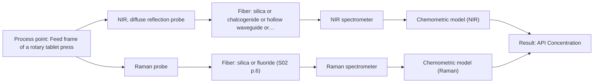
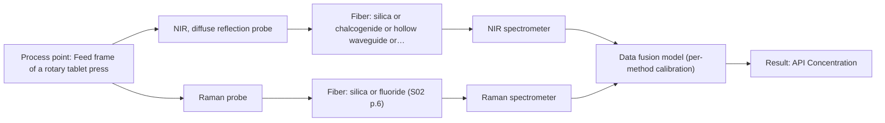

# First technical assessment: Blend potency in a tablet press feed frame

## Answer

**Customer request (our summary):** The customer wants to assess whether a fiber-based measurement in the feed frame can follow API concentration changes in a powder blend during tablet manufacturing.

### Brief answer

To assess API concentration changes in the tablet press feed frame, we recommend starting with a pilot comparison of NIR diffuse reflection and Raman spectroscopy. Both methods have established precedents for in-line blend monitoring. Single-method trials on representative powder samples should be performed first, with data fusion explored as an extended option if required.

### Proposal

- **Best current option:** O2 (recommended)
- **Basis:** supplied AFS sources
- **What would change it:** Definitive customer clarification on specific powder matrix interferences or stringent accuracy limits favoring one specific method.
- **Next step:** Conduct multi-method laboratory trials comparing NIR diffuse reflection and Raman probes on representative powder blend samples.

**Secondary evidence (external, not AFS material):** G1: E01 ¶31; G2: no usable external source found; G3: no usable external source found; G4: no usable external source found. See Expert detail.

**Decision status:** Provisional feasibility assessment

### Solution options

| ID | Tier | Methods | Confidence | Cost class, S01 Table 1 (p.6) | Ease of use | Maintenance | Performance fit | Sources |
|---|---|---|---|---|---|---|---|---|
| O1 | Simple | M1 NIR, diffuse reflection probe | Low: open question: Q1, Q2 (starts at Medium); precedent only | average cost (row 8) | High, straightforward NIR reflection setup | Low, periodic window cleaning | Standard industry approach for powder blend potency monitoring | [1: S01 p.15] |
| O2 | Recommended | M1 NIR, diffuse reflection probe; M2 Raman probe | Low: open question: Q1, Q2 (starts at Medium); precedent only | high cost (rows 8, 12) | Moderate, comparative testing of two single methods | Low to moderate depending on selected probe | Allows direct pilot comparison of NIR and Raman to find the optimal single method | [2: S01 p.15] [1: S01 p.15] [3: S01 p.15] |
| O3 | Extended (multi-method) | M1 NIR, diffuse reflection probe; M2 Raman probe; M3 NIR, diffuse reflection probe + Raman (combination) | Low: open question: Q1, Q2 (starts at Medium); precedent only; multi-method, fusion benefit not yet shown | high cost (rows 8, 12) | Complex, requires multi-instrument integration and data synchronization | High, maintenance required for multiple independent instruments and probes | Maximum chemical specificity by fusing NIR and Raman datasets for complex blends | [4: S01 p.15] [1: S01 p.15] [3: S01 p.15] |

*Confidence rates the basis of the advice (how much is known and cited), not a predicted accuracy or probability of success. It starts at High, or at Medium when a key question on the method or the option is open, and drops one level per weakness listed (floor Low).*

*Cost class is the relative rating in S01 Table 1 (p.6) for the in-line method+technique rows named (the highest one for a multi-method option); it is not a price.*

### Setup sketch

*Recommended option O2; drawn by code from the option, a schematic, not a configuration.*

### Key questions

1. What is the target concentration range of the active pharmaceutical ingredient (API) and the required measurement accuracy?
2. Does the powder blend or any excipient exhibit strong fluorescence under standard laser excitation wavelengths?
3. What are the physical access points, temperature limits, and cleaning requirements in the tablet press feed frame?

## Expert detail

**Customer enquiry**

> We manufacture tablets from a powder blend containing an active pharmaceutical ingredient and excipients. Laboratory checks tell us whether the blend is on target, but results arrive after the material has moved through the press. We want to assess whether a fiber based measurement in the feed frame could follow API concentration changes. Our first pilot should compare reasonable measurement options before we commit to production equipment.

**Decision status:** Provisional feasibility assessment. The customer's goal of tracking API concentration in a tablet press feed frame is well supported by literature precedents for NIR and Raman spectroscopy, but specific performance criteria, exact powder composition, and environmental conditions remain open.

### Parameters

| ID | Parameter | Kind | Need | Measured by | Why | Sources |
|---|---|---|---|---|---|---|
| P1 | API Concentration | quantitative | required | Spectroscopy: NIR | Directly measures blend potency and active ingredient uniformity in the feed frame. | [5: S01 p.14] |
| P2 | Reference API Assay | quantitative | required | Reference lab method: HPLC | Provides independent laboratory reference values required to build and validate chemometric calibration models. | *(no verified source: engineering judgement)* |

### Solution option details

- **O1 cost drivers:** Single NIR spectrometer and diffuse reflection fiber probe
- **O2 cost drivers:** Two spectrometers or modular multi-spectral lab setup for evaluation
- **O3 cost drivers:** Multiple spectrometers, lasers, combined or dual probes, and advanced data fusion software
- **O3 combining methods:** Combines synchronized NIR and Raman spectra into a single augmented data matrix via low-level data fusion. Requires identical sampling positioning in the feed frame, time-step synchronization, block-scaling normalization, and validation on independent batches to prove it outperforms the best single method.

*Extended (multi-method) option O3; drawn by code from the option, a schematic, not a configuration.*

### Premise check

- **Supported:** A fiber-based measurement in the feed frame can successfully follow API concentration changes. The sources explicitly describe in-line monitoring of blend potency and API concentration in the feed frame of a rotary tablet press using fiber-coupled NIR and Raman spectroscopy. [5: S01 p.14]

### Requirements

**Stated by the customer**

- Monitor API concentration changes in a powder blend
- Measurement location in the rotary tablet press feed frame
- Fiber-based optical measurement
- Pilot comparison of measurement options before production commitment

**Key unknowns**

- Required accuracy and detection limits for API concentration
- Specific chemical composition and presence of fluorescent excipients
- Feed frame geometry and mounting constraints
- Process temperature and powder flow dynamics

### Clarification questions (most decision-relevant first)

Q1. What is the target concentration range of the active pharmaceutical ingredient (API) and the required measurement accuracy? *Why it matters:* Determines whether single-method NIR is sufficiently sensitive or if Raman or a combination is required. *(affects: method, technique)*
Q2. Does the powder blend or any excipient exhibit strong fluorescence under standard laser excitation wavelengths? *Why it matters:* Fluorescence background can swamp Raman signals and dictate the choice of excitation wavelength or method. *(affects: method, technique)*
Q3. What are the physical access points, temperature limits, and cleaning requirements in the tablet press feed frame? *Why it matters:* Directly impacts probe mechanical design, window fouling resistance, and fiber routing. *(affects: installation)*
Q4. What is the expected powder flow velocity and turnover rate in the feed frame? *Why it matters:* Informs spectral acquisition time and integration averaging required to follow concentration dynamics. *(affects: technique)*

### Recommendation

- **M1 · Primary candidate: NIR, diffuse reflection probe.** NIR diffuse reflection probes are widely implemented for powder blend potency monitoring in tablet press feed frames, capturing overtone vibrations of organic molecules. [1: S01 p.15]
- **M2 · Comparison candidate: Raman probe.** Raman spectroscopy provides complementary molecular backbone information and is well-suited for solid powder blends, serving as an effective single-method alternative to NIR. *Conditions:* To be tested if NIR spectral overlap or sensitivity to specific excipients is limiting. [3: S01 p.15]
- **M3 · Conditional candidate: NIR, diffuse reflection probe + Raman (combination).** Combining NIR and Raman spectra via low-level data fusion captures both hydrogen bonds and molecular backbone features, improving predictive accuracy if single-method models prove insufficient. *Conditions:* Applies only if single-method NIR or Raman models fail to achieve the required accuracy for blend potency. [4: S01 p.15] Later hypothesis, after single-method tests.

### Measurement concept

- **Probe and geometry:** Diffuse reflection fiber probe flush-mounted or inserted into the powder flow
- **Location:** Feed frame of a rotary tablet press
- **Fiber link:** Silica fiber cable connecting the probe to remote spectrometers safely away from vibration and dust [6: S01 p.15]

### Spectral range

- **NIR:** The nominal NIR range is 780-2500 nm; the usable range depends on the instrument, fiber and probe actually selected. [7: S01 p.10]
- **Raman:** Raman spectroscopy measures the Raman shift in wavenumbers (cm-1) with the excitation wavelength stated separately; the usable range depends on the instrument, fiber and probe actually selected. [8: S01 p.11]

### Risks and uncertainty

- Powder caking or dusting on the probe optical window can distort scatter measurements and invalidate the calibration. *(rules: R-GEO-6)* [9: S01 p.17]
- Changes in powder bulk density or particle size distribution in the feed frame can mimic chemical concentration changes. *(rules: R-CAL-1)* [10: S01 p.17]
- Fluorescence interference from excipients may swamp weak Raman signals if Raman spectroscopy is selected. *(rules: R-RAM-1)* [11: S01 p.11]

### First feasibility experiment

1. **Collect representative powder blend samples across the expected API concentration range and physical variation.** Ensure calibration covers batch-to-batch compositional and physical differences. *(no verified source: engineering judgement)*
2. **Acquire reference laboratory assays for API concentration for each sample batch.** Establish independent ground truth for chemometric model training. *(no verified source: engineering judgement)*
3. **Perform single-method trials using NIR diffuse reflection and Raman probes in a benchtop simulation of the feed frame.** Determine spectral signal-to-noise ratio and preliminary predictive capability. *(no verified source: engineering judgement)*
4. **Validate chemometric calibration models using independent held-out test runs or batches.** Verify model robustness against physical scattering and particle size variations. *(no verified source: engineering judgement)*
5. **Evaluate data fusion of NIR and Raman datasets if single methods fail to meet customer accuracy criteria.** Test hypothesis of synergistic improvement. *(no verified source: engineering judgement)*

**Reference measurements:** Standard laboratory assay methods (e.g., HPLC) for API content determination on extracted reference samples.

**Decision basis:** Go/no-go based on achieving customer-defined prediction error (RMSEP) and correlation coefficient (R2) against reference laboratory checks.

### Assumptions

- The powder blend flows sufficiently past the probe tip to maintain adequate optical contact and signal averaging.
- Laboratory reference checks are sufficiently precise to anchor the chemometric calibration.

### Not covered by the supplied sources

- Specific API and excipient chemical identities and their exact optical absorption coefficients.
- Customer's required numerical accuracy and response time thresholds.

### Further notes

- **Chemometrics:** Quantitative PLS regression models must be constructed using scatter-corrected spectra (such as SNV or MSC) correlated against independent reference laboratory assays.
- **Real-time tracking:** High-speed spectral acquisition enables real-time tracking of powder blend homogeneity and API concentration as material passes the feed frame probe tip.
- **Future direction:** Transition from benchtop multiplexed evaluation to a dedicated compact optical sensor (OMS) for permanent production line integration.

### Secondary evidence (external, not AFS material)

*Found by a literature search for gaps the supplied AFS sources leave open. Not AFS material and not proof for this case; every quote below was verified verbatim against the fetched text.*

*Live search unavailable (library only: cache miss (europepmc); cache miss (openalex)); curated library only.*

**G1 · multi-method:** Combining several spectroscopy methods (data fusion) (Combines synchronized NIR and Raman spectra into a single augmented data matrix via low-level data fusion. Requires identical sampling positioning in the feed frame, time-step synchronization, block-scaling normalization, and validation on independent batches to prove it outperforms the best single method.)

- **E01 ¶31** Low-level data fusion rearranges data into a new matrix by placing variables from different sources one after the other. *How it applies:* This approach could be tested to combine NIR and Raman spectra into a single augmented dataset, provided the sampling geometry and time steps are synchronized. *Limits and transfer risks:* This reviewed concept may not directly apply to the customer's feed frame without proper block-scaling normalization and validation on independent batches, as literature notes that instrument complementarity does not always improve predictive performance. *(supports O3)*
  > "Low-level data fusion (LLDF) is considered the simplest method to achieve a combination of inputs. In this case, the data is rearranged into a new data matrix, where the variables coming from different sources are placed one after the other."
  > Challenges and Opportunities of Implementing Data Fusion in Process Analytical Technology-A Review. (2022) · Molecules (Basel, Switzerland) · doi:10.3390/molecules27154846 · https://europepmc.org/article/PMC/PMC9369811 · retrieved 2026-10-17, full text, licence: cc by, via curated library

**G2 · not in the supplied sources:** Specific API and excipient chemical identities and their exact optical absorption coefficients.

- No usable external source found.

**G3 · not in the supplied sources:** Customer's required numerical accuracy and response time thresholds.

- No usable external source found.

**G4 · parameter without a source:** Measuring Reference API Assay: Provides independent laboratory reference values required to build and validate chemometric calibration models.

- No usable external source found.

### Evidence (verified quotes)

1. ✓ **S01 p.15** (application precedent): "The equipment used for such task involves next spectral systems: - NIR spectrometer and light source coupled with a NIR reflection probe"
2. ✓ **S01 p.15** (application precedent): "The combination of these techniques is particularly effective because it captures complementary chemical information"
3. ✓ **S01 p.15** (application precedent): "- Raman spectrometer and Raman fiber probe for contact measurements with 785 nm excitation wavelength"
4. ✓ (precedent only) **S01 p.15** (method gain): "Data processing for pharmaceutical tasks relies on "low-level data fusion," where the synchronized NIR and Raman spectra are merged into a single augmented matrix."
5. ✓ **S01 p.14** (application precedent): "The primary objective is to determine "blend potency" - the precise concentration and uniformity of the Active Pharmaceutical Ingredient (API) - directly within the production line, specifically in the feed frame of a rotary tablet press."
6. ✓ **S01 p.15** (general): "The use of fiber optics is critical here, as it allows the sensitive spectrometers to be located safely away from the vibration and dust of the manufacturing floor."
7. ✓ **S01 p.10** (general): "NIR spectra (780-2500 nm) contain predominantly overtones and component bands of fundamental vibrations"
8. ✓ **S01 p.11** (general): "The Raman shift is used as the horizontal (spectral) axis in Raman spectroscopy, while the vertical axis shows the absolute intensity of the recorded signals (photon counts)."
9. ✓ **S01 p.17** (general): "the method is sensitive to the surface characteristics and fat globule size."
10. ✓ **S01 p.17** (general): "Data processing may involve converting the reflectance values to absorbance and applying Multiplicative Scatter Correction (MSC) or Standard Normal Variate (SNV) transformations to remove physical interference caused by the scattering nature of the milk particles before using Partial Least Squares (PLS) regression"
11. ✓ **S01 p.11** (general): "for many organic compounds, by the superposition of luminescence (fluorescence), which has a significantly higher intensity."

### Verification

- Citations verified: 14 of 14 (exact or whitespace/hyphen-tolerant match on the cited page, scope checked).
- Hard check failures before deterministic corrections: 0; still open: 0; soft warnings: 2; repair rounds: 1.
- External evidence (cache): 1 quote(s) verified verbatim (exact or whitespace/hyphen-tolerant, at most 400 characters and 2 sentences, against the cited paragraph); 0 item(s) dropped.
- External search: 3 query(ies), 0 hit(s), 3 source(s) (3 from the curated library); ⚠ library only: cache miss (europepmc); cache miss (openalex).
- External step: 2 model call(s), 2.3 s extra (cost in the run JSON).

*Run D01-20261018T075900Z-c407 · models google/gemini-3.5-flash-lite, google/gemini-3.8-flash*
