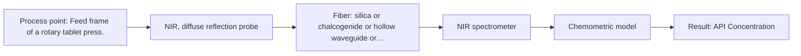
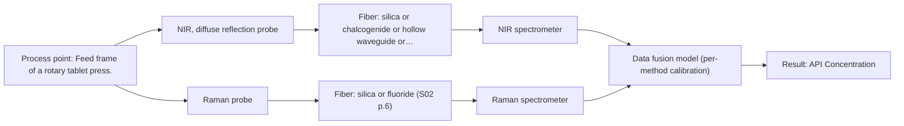

# First technical assessment: Blend potency in a tablet press feed frame

## Answer

**Customer request (our summary):** The customer wants to assess whether a fiber-based optical measurement in a tablet press feed frame can monitor API concentration changes in a powder blend.

### Brief answer

A fiber-based NIR reflection measurement in the tablet press feed frame is recommended as the primary option to monitor API concentration changes. Literature precedent supports NIR for pharmaceutical blend potency tracking. A preliminary pilot should test NIR reflection against independent reference laboratory assays, with a combined NIR-Raman approach held as an extended option if higher molecular specificity is required.

### Proposal

- **Best current option:** O1 (recommended)
- **Basis:** supplied AFS sources
- **What would change it:** If single-method NIR reflection fails to achieve required precision due to matrix interference, the extended NIR-Raman combination should be tested.
- **Next step:** Conduct multi-method laboratory trials with representative powder blend samples and independent reference assays.

**Secondary evidence (external, not AFS material):** G1: E02 ¶31; G2: no usable external source found; G3: no usable external source found; G4: no usable external source found. See Expert detail.

**Decision status:** Provisional feasibility assessment

### Solution options

| ID | Tier | Methods | Confidence | Cost class, S01 Table 1 (p.6) | Ease of use | Maintenance | Performance fit | Sources |
|---|---|---|---|---|---|---|---|---|
| O1 | Recommended | M1 NIR, diffuse reflection probe | Low: open question: Q1, Q3 (starts at Medium); precedent only | average cost (row 8) | Straightforward NIR reflection setup | Periodic optical window cleaning | Optimal fit for primary powder blend monitoring using established NIR reflection. | [1: S01 p.15] |
| O2 | Extended (multi-method) | M1 NIR, diffuse reflection probe; M2 Raman probe + NIR (combination) | Low: open question: Q1, Q3 (starts at Medium); precedent only; multi-method, fusion benefit not yet shown | high cost (rows 8, 12) | Requires dual instrument setup and data synchronization | Higher due to dual instruments and probe upkeep | Combines NIR and Raman for enhanced molecular specificity if single method is insufficient. | [2: S01 p.15] [1: S01 p.15] [3: S01 p.15] |

*Confidence rates the basis of the advice (how much is known and cited), not a predicted accuracy or probability of success. It starts at High, or at Medium when a key question on the method or the option is open, and drops one level per weakness listed (floor Low).*

*Cost class is the relative rating in S01 Table 1 (p.6) for the in-line method+technique rows named (the highest one for a multi-method option); it is not a price.*

### Setup sketch

*Recommended option O1; drawn by code from the option, a schematic, not a configuration.*

### Key questions

1. What is the target concentration range of the active pharmaceutical ingredient (API) and the required analytical precision?
2. What reference laboratory method will be used to determine independent API concentrations for calibration?
3. What are the physical characteristics and flow dynamics of the powder blend in the feed frame?

## Expert detail

**Customer enquiry**

> We manufacture tablets from a powder blend containing an active pharmaceutical ingredient and excipients. Laboratory checks tell us whether the blend is on target, but results arrive after the material has moved through the press. We want to assess whether a fiber based measurement in the feed frame could follow API concentration changes. Our first pilot should compare reasonable measurement options before we commit to production equipment.

**Decision status:** Provisional feasibility assessment. The customer's goal of monitoring API concentration in a tablet press feed frame is supported by literature precedent for NIR spectroscopy, but specific operational parameters and method selection require experimental piloting.

### Parameters

| ID | Parameter | Kind | Need | Measured by | Why | Sources |
|---|---|---|---|---|---|---|
| P1 | API Concentration | quantitative | required | Spectroscopy: NIR | Core target variable to be monitored in real time. | *(no verified source: engineering judgement)* |

### Solution option details

- **O1 cost drivers:** NIR spectrometer, reflection probe, chemometric software
- **O2 cost drivers:** NIR and Raman spectrometers, dual probes, advanced fusion software
- **O2 combining methods:** Low-level data fusion where the synchronized NIR and Raman spectra are merged into a single augmented matrix from the same measurement spot, requiring individual calibration blocks that must outperform single-method accuracy.

*Extended (multi-method) option O2; drawn by code from the option, a schematic, not a configuration.*

### Premise check

- **Not covered:** A fiber-based measurement in the feed frame can successfully follow API concentration changes. Published applications demonstrate NIR spectroscopy in tablet press feed frames for blend potency, but actual performance depends on specific powder flow and matrix properties. *(no verified source: engineering judgement)* ⚠ *(a citation failed verification and was removed)*

### Requirements

**Stated by the customer**

- Monitor API concentration in a powder blend
- Install measurement in the tablet press feed frame
- Compare measurement options in a pilot before production commitment

**Key unknowns**

- Target API concentration range and required analytical precision
- Specific excipient matrix and chemical variability
- Powder flow dynamics and probe-to-powder contact conditions in the feed frame
- Exact calibration requirements and reference laboratory method

### Clarification questions (most decision-relevant first)

Q1. What is the target concentration range of the active pharmaceutical ingredient (API) and the required analytical precision? *Why it matters:* Defines the detection sensitivity and chemometric model requirements. *(affects: method, M1, M2)*
Q2. What reference laboratory method will be used to determine independent API concentrations for calibration? *Why it matters:* Ensures accurate benchmark data for quantitative model training. *(affects: installation)*
Q3. What are the physical characteristics and flow dynamics of the powder blend in the feed frame? *Why it matters:* Determines optical probe mounting and scatter-correction requirements. *(affects: technique, M1, M2)*

### Recommendation

- **M1 · Primary candidate: NIR, diffuse reflection probe.** NIR reflection probes are widely implemented for in-line powder blending and feed frame monitoring to track blend potency. [1: S01 p.15]
- **M2 · Comparison candidate: Raman probe + NIR (combination).** Raman spectroscopy provides complementary molecular backbone information and can be combined with NIR in an extended multispectral approach. *Conditions:* Applies if NIR alone lacks specificity for the API or if matrix fluorescence permits. [3: S01 p.15] Later hypothesis, after single-method tests.

### Measurement concept

- **Probe and geometry:** NIR reflection fiber probe inserted directly into the feed frame of a rotary tablet press to capture back-scattered light from the passing powder blend.
- **Location:** Feed frame of a rotary tablet press.
- **Fiber link:** Silica fiber cable connecting the probe to the spectrometer, allowing sensitive equipment to sit safely away from vibration and dust. [4: S01 p.15] [5: S01 p.15]

### Spectral range

- **NIR:** Nominal NIR range is 780-2500 nm; the usable range depends on the instrument, fiber and probe actually used. [6: S01 p.10]
- **Raman:** Raman uses a 785 nm laser excitation wavelength and measures Raman shift in cm-1; usable range depends on instrument configuration. [3: S01 p.15]

### Risks and uncertainty

- Powder segregation, variable packing density, or particle size changes in the feed frame can introduce physical scattering variations that mimic chemical concentration shifts. *(rules: R-GEO-6, R-CAL-1)* [7: S01 p.17]
- NIR bands are broad and overlapping, requiring robust chemometric calibration specific to the excipient matrix. *(rules: R-NIR-2, R-CAL-1)* [8: S01 p.10]
- Raman signals can be weak and potentially hindered by fluorescence background from excipients. *(rules: R-RAM-1)* [9: S01 p.11]

### First feasibility experiment

1. **Collect representative powder blend samples across the expected API concentration variation range.** Gather representative powder blend samples across the expected API concentration variation range. *(no verified source: engineering judgement)*
2. **Perform independent reference laboratory measurements to determine accurate API concentrations.** Perform independent reference laboratory measurements for each sample to determine accurate API concentration values. *(no verified source: engineering judgement)*
3. **Test NIR reflection spectroscopy on powder samples in a pilot setup mimicking feed frame conditions.** Test NIR reflection spectroscopy on the powder samples in a pilot setup mimicking feed frame conditions. *(no verified source: engineering judgement)*
4. **Build PLS regression models and validate them on held-out runs or batches.** Build PLS regression models and validate them on held-out runs or batches. *(no verified source: engineering judgement)*

**Reference measurements:** Independent laboratory reference assays of powder blend samples.

**Decision basis:** Proceed to production equipment if prediction error meets the customer's defined numerical accuracy threshold.

### Assumptions

- The powder blend flows consistently past the probe tip in the feed frame.
- Reference laboratory methods can provide accurate benchmark values for calibration.

### Not covered by the supplied sources

- Specific API and excipient chemical identities
- Customer's exact feed frame mechanical drawings

### Further notes

- **Chemometrics:** Partial Least Squares (PLS) regression models combined with scatter correction are required to convert NIR spectra into quantitative API concentration values.
- **Real-time tracking:** In-line fiber probes capture spectra at high speeds without interrupting production flow in the tablet press feed frame.
- **Future direction:** Integration of validated chemometric models into automated feed-forward control systems.

### Secondary evidence (external, not AFS material)

*Found by a literature search for gaps the supplied AFS sources leave open. Not AFS material and not proof for this case; every quote below was verified verbatim against the fetched text.*

*Live search unavailable (library only: cache miss (europepmc); cache miss (openalex)); curated library only.*

**G1 · multi-method:** Combining several spectroscopy methods (data fusion) (Low-level data fusion where the synchronized NIR and Raman spectra are merged into a single augmented matrix from the same measurement spot, requiring individual calibration blocks that must outperform single-method accuracy.)

- **E02 ¶31** Low-level data fusion rearranges data from different sources into a new matrix by placing the variables one after the other. *How it applies:* This literature description could inform how to structure the combined matrix for testing option O2, though compatibility of the individual blocks must still be evaluated. *Limits and transfer risks:* The reviewed data fusion concepts come from general literature and reviews rather than powder blend feed frames, so transferability to tablet press monitoring remains unproven. *(supports O2)*
  > "Low-level data fusion (LLDF) is considered the simplest method to achieve a combination of inputs. In this case, the data is rearranged into a new data matrix, where the variables coming from different sources are placed one after the other."
  > Challenges and Opportunities of Implementing Data Fusion in Process Analytical Technology-A Review. (2022) · Molecules (Basel, Switzerland) · doi:10.3390/molecules27154846 · https://europepmc.org/article/PMC/PMC9369811 · retrieved 2026-10-17, full text, licence: cc by, via curated library

**G2 · not in the supplied sources:** Specific API and excipient chemical identities

- No usable external source found.

**G3 · not in the supplied sources:** Customer's exact feed frame mechanical drawings

- No usable external source found.

**G4 · premise not covered:** A fiber-based measurement in the feed frame can successfully follow API concentration changes.

- No usable external source found.

### Evidence (verified quotes)

1. ✓ **S01 p.15** (application precedent): "NIR spectrometer and light source coupled with a NIR reflection probe"
2. ✓ **S01 p.15** (application precedent): "Data processing for pharmaceutical tasks relies on "low-level data fusion," where the synchronized NIR and Raman spectra are merged into a single augmented matrix."
3. ✓ **S01 p.15** (application precedent): "Raman spectrometer and Raman fiber probe for contact measurements with 785 nm excitation wavelength"
4. ✓ **S01 p.15** (application precedent): "During the experimental action, the probes are inserted directly into the process environment, such as the feed frame of a rotary tablet press."
5. ✓ **S01 p.15** (general): "The use of fiber optics is critical here, as it allows the sensitive spectrometers to be located safely away from the vibration and dust of the manufacturing floor."
6. ✓ **S01 p.10** (general): "NIR spectra (780-2500 nm) contain predominantly overtones and component bands of fundamental vibrations"
7. ✓ **S01 p.17** (general): "the method is sensitive to the surface characteristics and fat globule size."
8. ✓ **S01 p.10** (general): "The broad absorption bands observed in this region overlap, suggesting the use of chemometrics for quantitative and qualitative analysis of spectral data."
9. ✓ **S01 p.11** (general): "superposition of luminescence (fluorescence), which has a significantly higher intensity."

### Verification

- Citations verified: 11 of 12 (exact or whitespace/hyphen-tolerant match on the cited page, scope checked).
- Hard check failures before deterministic corrections: 1; still open: 0; soft warnings: 1; repair rounds: 2.
- Removed 1 citation(s) that failed verification:
  - ⚠ premise_checks[0].citations[0]: S01 p.14 "In the pharmaceutical industry, the most popular and widely implemented spectral techniques are Near-Infrared (NIR) and "
- Corrected deterministically after verification (1):
  - ⚠ premise_checks[0]: verdict precedent_only without a verified citation; changed to not_covered
- External evidence (cache): 1 quote(s) verified verbatim (exact or whitespace/hyphen-tolerant, at most 400 characters and 2 sentences, against the cited paragraph); 0 item(s) dropped.
- External search: 4 query(ies), 0 hit(s), 3 source(s) (3 from the curated library); ⚠ library only: cache miss (europepmc); cache miss (openalex).
- External step: 2 model call(s), 2.2 s extra (cost in the run JSON).

*Run D01-20261018T075900Z-e0df · models google/gemini-3.5-flash-lite*
